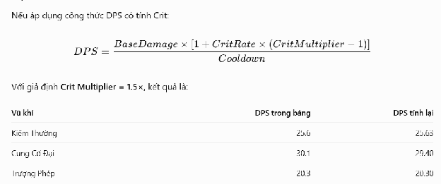
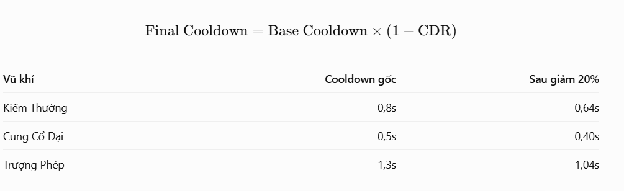

# BẢN THIẾT KẾ CORE GAMEPLAY & QUY TẮC NỀN TẢNG (GDD) \- DỰ ÁN BEAT THE HORDE (ROBLOX)

---

## I. ĐIỀU KHIỂN & TƯƠNG TÁC NHÂN VẬT (CONTROLS & MOVEMENT)

1. Cơ chế di chuyển nhân vật chính (Phím WASD / Thumbstick di động).  
2. Tốc độ di chuyển nền tảng (Base Movement Speed) và chỉ số gia tốc/lực ma sát.  
3. Cơ chế Lướt né đạn (Dash /E) và thời gian hồi chiêu (Dash Cooldown 0.5g).  
4. Khung thời gian bất tử khi Lướt (Invulnerability Frames \- iFrames 0.2g).  
5. Cơ chế Nhảy (Jump / Spacebar) và tương tác với độ cao địa hình/bẫy địa hình.  
6. Thao tác Xoay Camera (Mouse Look / Right Click Drag) góc nhìn thứ ba (TPS).  
7. Khóa hướng Camera theo nhân vật hay cho phép Camera xoay tự do 360 độ.  
8. Thao tác Tương tác Môi trường (Phím F) để mở Rương, tương tác với thương nhân, nói chuyện với Shop.  
9. Giới hạn không gian di chuyển (In-game Boundaries / Invisible Walls).  
10. Cơ chế va chạm giữa Nhân vật và Môi trường (Player-to-Environment Collision).

---

## II. CƠ CHẾ VŨ KHÍ & TẤN CÔNG (WEAPONS & COMBAT SYSTEM)

11. **Phân loại Vũ khí Chính (Primary Weapons):** Được trang bị và lựa chọn tại Sảnh (Lobby) trước khi bắt đầu Run (ví dụ: Kiếm, Cung, Súng, trượng phép, liềm). Vũ khí Chính chỉ sử dụng cơ chế tấn công Chủ động / Thủ công (Onclick / Manual Trigger) để đảm bảo cân bằng game. Cấp độ của Vũ khí Chính được nâng cấp vĩnh viễn tại Sảnh, KHÔNG xuất hiện trong các thẻ bài nâng cấp khi lên cấp trong Run.  
12. **Phân loại Vũ khí Phụ Tự động (Secondary Floating Auto-Weapons):** Được lựa chọn và thu thập TRONG trận chiến (In-Game Run). Các vũ khí này bay xoay quanh hoặc đi theo nhân vật, tự động xả đòn tấn công kẻ thù. Người chơi cũng có thể nâng cấp chỉ số nền tảng của chúng vĩnh viễn tại Sảnh để tối ưu hiệu suất ban đầu.  
13. **Hệ thống Nâng cấp trong Run (In-Game Augments & Items):** Các thẻ bài lựa chọn khi lên cấp trong trận bao gồm các Sách Kỹ năng Bị động (Tomes), Chỉ số nhân bản và Vật phẩm bổ trợ. Các nâng cấp này gia tăng sức mạnh đồng thời cho CẢ Vũ khí Chính (Thủ công) và Vũ khí Phụ (Tự động).  
14. **Ý tưởng Thiết kế Vũ khí Phụ Tự động (Secondary Auto-Weapon Concepts):**  
    1. **Cầu Năng lượng Xoay quanh (Orbiting Energy Orbs):** Bay vòng tròn quanh nhân vật, gây sát thương liên tục và đẩy lùi kẻ thù tiếp cận.  
    2. **Dao Bay Cận chiến (Floating Melee Daggers):** Tự động lao vào phóng sát thương diện hẹp đối với quái vật ở gần nhất.  
    3. **Drone (Automatic Drone):** Đi theo hỗ trợ bắn tia laser hoặc đạn truy tìm mục tiêu có lượng máu cao nhất.  
    4. **Súng Phun Lửa Tự động (Flame Spray):** Sấy lửa theo nón diện rộng định kỳ, gây hiệu ứng Thiêu đốt (ĐốT) lên đám đông.  
    5. **Cột Sét Tâm linh (Lightning Totem):** Tự động phóng sét ngẫu nhiên xuống các vị trí có mật độ quái đông đúc.  
15. Thuật toán Ưu tiên Chọn Mục tiêu của Vũ khí Phụ (Nearest Enemy / Highest HP / Lowest HP / Random) có thể điều chỉnh điều này ở ngoài lobby.  
16. Giới hạn 1 Vũ khí Phụ Tự động tối đa được trang bị trong 1 Run  
17. Chỉ số Sát thương Căn bản (Base Damage) và công thức tính Sát thương thực tế gánh chịu cho cả hai loại vũ khí.  
18. Cơ chế Chí mạng (Crit Rate & Crit Damage Factor) áp dụng đồng bộ.  
19. Cơ chế Đẩy lùi (Knockback Force) và độ khựng của quái vật khi trúng đòn từ Vũ khí Chính và Phụ.  
20. Cơ chế Xuyên thấu (Piercing Count) và Bật nảy (Bounce Count) của đạn/chiêu thức.  
21. Cơ chế Tiến hóa Vũ khí Phụ (Secondary Weapon Evolution / Synergy) khi kết hợp Vũ khí Phụ Max Level. ( sự kết hợp khi mà vũ khí phụ được max level, không cần vũ khí chính phải max, kết hợp sẽ cho hình dạng mới và sức mạnh sẽ khỏe hơn )  
22. Giới hạn cấp độ tối đa của từng Vũ khí Phụ trong Run (Level Cap: Lvl 30).

---

## III. HỆ THỐNG KẺ THÙ & CƠ CHẾ SPAWN (ENEMY SPAWN & AI)

23. Khoảng cách Spawn: Quái vật xuất hiện ngẫu nhiên xung quanh người chơi ở khoảng cách xấp xỉ 6 lần chiều cao của nhân vật Roblox.  
24. Tỷ lệ & Mật độ Spawn theo thời gian: Thời gian còn lại của màn chơi càng ít thì tần suất và mật độ spawn quái vật càng tăng cao.  
25. Giới hạn Spawn mỗi đợt: Giới hạn tối đa quái vật mỗi đợt spawn để đảm bảo cân bằng độ khó và tối ưu hiệu năng (Do chỉ số quái vật tăng dần theo thời gian). map 1 max là 20 quái, tăng 5 cho mỗi map  
26. Phân loại Quái vật & Tiến trình xuất hiện:  
    1. **Giai đoạn Đầu (Early Game):** Xuất hiện các loại quái cơ bản yếu nhất.  
    2. **Quái Thường (Normal Enemies):** Bao gồm Quái Cận chiến (Melee Swarm) dồn số lượng và Quái Tự sát / Nổ (Explosive/Suicide). Có nhiều loại quái cận chiến và sẽ có hình dáng khác nhau   
    3. **Quái Đột biến (Elites):** Phiên bản quái kích thước lớn hơn, trâu hơn, bắt đầu xuất hiện sau 40 giây thi đấu.  
    4. **Mini-Boss:** Sở hữu cả đòn tấn công Cận chiến và tấn công Tầm xa gây nổ diện rộng (AoE Explosive Attacks).  
    5. **Boss Chính (Final Boss):** Được triệu hồi khi thời gian đếm ngược của màn chơi trở về 00:00.  
    6. **Dơi (Quái đặc biệt):** Bay và spawn liên tục trong suốt trận đấu với boss.  
27. Giao diện HUD Boss: Thanh Máu của cả Mini-Boss và Boss Chính đều được hiển thị trên giao diện HUD màn hình.  
28. Cơ chế Duy trì Quái vật (Không Despawn): Quái vật đã xuất hiện sẽ KHÔNG tự biến mất (despawn) khi người chơi di chuyển ra xa hoặc khi Boss xuất hiện; chúng sẽ liên tục đuổi theo người chơi.   
29. Thay thế Quái ở Giai đoạn Boss: Khi Boss Chính xuất hiện, việc spawn quái thường sẽ biến mất hoàn toàn và thay thế bằng Dơi (sức mạnh Dơi cũng tăng dần theo thời gian) cho đến khi hạ gục Boss.  
30. Giết xong final boss và sau khi nhặt rương của final boss hiện 2 cổng 1 là trở về lobby hoặc là sang phase tiếp theo

---

## IV. CƠ CHẾ KINH NGHIỆM, TÀI NGUYÊN & LÊN CẤP (XP, DROPS & LEVEL-UP)

31. **Tỷ lệ rơi Hạt Kinh Nghiệm (XP Orbs):** 100% quái vật khi bị tiêu diệt chắc chắn sẽ rơi ra Hạt XP.  
32. **Phân loại Tỷ lệ Rơi Hạt XP theo Loại Quái vật & Độ hiếm:**  
    1. **Quái Thường (Normal Enemies):** 80% tỷ lệ rơi XP Xanh nhỏ (Small Green XP), 2% tỷ lệ rơi XP Đỏ / Kim cương lớn (Large Red / Diamond XP), phần còn lại (18%) rơi XP Tím vừa (Medium Purple XP).  
    2. **Quái Đột biến (Elite Enemies):** 30% tỷ lệ rơi XP Tím vừa (Medium Purple XP), 10% tỷ lệ rơi XP Đỏ / Kim cương lớn (Large Red / Diamond XP).  
    3. **Mini-Boss & Boss Chính (Final Boss):** 60% tỷ lệ rơi XP Tím vừa (Medium Purple XP), 40% tỷ lệ rơi XP Đỏ / Kim cương lớn (Large Red / Diamond XP).  
33. **Bán kính Hút XP Căn bản (Base Magnet Radius):** Được thiết lập cố định bằng 1.5 lần chiều cao của nhân vật Roblox.  
34. **Vật phẩm Rơi / Buff Tạm thời (Temporary In-Game Drops / Buffs):** Quái vật có tỷ lệ ngẫu nhiên rơi ra các vật phẩm bổ trợ tiêu hao tức thì:  
    1. **Buff Sát thương (Damage Buff):** Tăng \+50% Sát thương trong vòng 15 giây.  
    2. **Đóng băng Thời gian (Time Freeze):** Tạm dừng đếm ngược thời gian và làm ngưng trệ di chuyển của toàn bộ quái vật trong 20 giây.  
    3. **Nam châm Hút XP (Full-map XP Magnet):** Lập tức thu hút toàn bộ Hạt XP đang có trên toàn bản đồ về vị trí người chơi.  
35. **Công thức Tăng trưởng XP (Scaling XP Curve):** Lượng XP cần thiết để thăng cấp gia tăng theo tỷ lệ sau mỗi cấp độ.  
36. **Trạng thái Game & Giao diện Lên Cấp (Level-Up State & Interface):** Khi thăng cấp, trò chơi sẽ Tạm dừng (Pause) để hiển thị menu lựa chọn nâng cấp gồm 3 thẻ bài ngẫu nhiên. Các lựa chọn bao gồm: Nâng cấp chỉ số Vũ khí Chính, Nâng cấp chỉ số Vũ khí Phụ Tự động, Chọn Sách Kỹ năng Bị động (Tome) mới, hoặc Nâng cấp Cấp độ cho Tome hiện có.  
37. **Cơ chế Rương Báu & Loại bỏ Thẻ (Chest Drops & Banish Mechanic):** Rương báu xuất hiện ngẫu nhiên trên bản đồ; Mini-Boss và Boss Chính khi bị tiêu diệt chắc chắn 100% rơi Rương Báu. Mỗi rương chứa 1 phần thưởng/vật phẩm ngẫu nhiên, người chơi có thể chọn Chấp nhận nhận thưởng (Claim) hoặc sử dụng điểm Cấm (Banish) để loại bỏ vật phẩm đó.

---

## V. CƠ CHẾ SINH TỒN, MÁU & CHỈ SỐ BỊ ĐỘNG (HEALTH & PASSIVE STATS)

38. Thanh Máu Tối đa (Max HP) và Máu Hiện tại của Nhân vật.  
39. Cơ chế Giảm Sát thương gánh chịu nhờ Chỉ số Giáp (Armor Stat).  
40. Cơ chế Hồi Máu tự động theo thời gian (HP Regeneration per Second).  
41. Cơ chế Hút Máu khi gây sát thương (Lifesteal Percentage).  
42. Cơ chế Phản Sát Thương (Thorns Damage) khi chịu đòn từ quái.  
43. Cơ chế Né đòn Hoàn toàn (Evasion Rate %).  
44. Cơ chế Hồi sinh khẩn cấp (Revive Count) trong 1 Run (dùng Vé Hồi Sinh hoặc Robux).  
45. Điều kiện Thất bại Run (Game Over): Khi HP trở về 0 và hết lượt Hồi sinh.  
46. Màn hình Tổng kết Kết quả Run (Victory / Defeat Summary Screen): Hiển thị Thời gian sống sót, Số quái đã diệt, XP, Vàng thu thập được.

---

## VI. SÁCH KỸ NĂNG BỊ ĐỘNG (TOMES SYSTEM)

47. **Giới hạn ô chứa Tome (Slot Limitations):** Người chơi mặc định có tối đa 2 ô Tome trong 1 Run. Ô thứ 3 (Slot 3\) và Ô thứ 4 (Slot 4\) bắt buộc phải mở khóa / mua bằng Robux.  
48. **Giới hạn Cấp độ tối đa (Level Cap):** Cấp độ tối đa của mỗi Tome trong 1 Run là Cấp 30 (Level 30).  
49. **Cơ chế Mở khóa & Khóa Tome (Locked / Monetized Tomes):** Các Tome có khả năng gây mất cân bằng hoặc quá bá đạo sẽ bị khóa khỏi kho Tome cơ bản. Người chơi cần dùng Tiền tệ trong game hoặc Robux tại Cửa hàng Sảnh (Lobby) để mở khóa vĩnh viễn trước khi chúng có thể xuất hiện trong Run. Danh sách các Tome bị khóa bao gồm:  
    1. **Sách Lời Nguyền (Cursed Tome):** Tăng mật độ quái elits xuất hiện nhiều hơn  
    2. **Sách May Mắn (Luck Tome):** Tăng tỷ lệ rớt đồ hiếm và các vật phẩm bổ trợ quý giá.  
    3. **Sách Tăng XP (XP Boost Tome):** Tăng % điểm kinh nghiệm nhận được từ các Hạt XP.  
    4. **Sách Giảm Hồi Chiêu (Cooldown Tome):** Giảm thời gian hồi chiêu và tăng tốc độ đánh cho toàn bộ vũ khí.  
50. **Cơ chế Chia sẻ Synergy trong Chế độ Co-op (Co-op Shared Tome Synergy):** Trong chế độ Co-op, nếu Người chơi 1 đã mở khóa một Tome đặc biệt (ví dụ: Sách Lời Nguyền) mà Người chơi 2 chưa sở hữu, Người chơi 2 vẫn có thể tiếp cận và hưởng lợi từ Tome đó trong suốt trận đấu Co-op chung.  
51. **Danh sách các Tome Cơ bản & Tome Mới (Base & New Tomes):**  
    1. **Tome tăng Sát thương (Damage Tome):** Gia tăng % sát thương đầu ra.  
    2. **Tome tăng Diện tích Chiêu thức (AoE / Radius Tome):** Tăng phạm vi ảnh hưởng của kỹ năng và đòn đánh.  
    3. **Tome tăng Tốc độ Di chuyển (Movement / Speed Tome):** Tăng tốc độ di chuyển của nhân vật.  
    4. **Tome tăng Máu & Hồi máu (Vitality Tome):** Tăng Máu tối đa và tốc độ hồi máu tự động.  
    5. **Tome tăng Số lượng Đạn (Quantity / Amount Tome):** Tăng số lượng đạn/projectile tung ra.  
    6. **Tome tăng Chí mạng (Crit Tome):** Tăng tỷ lệ và sát thương chí mạng.  
    7. **Tome tăng Phạm vi Hút XP (Magnet / Pickup Tome):** Tăng bán kính thu hút hạt kinh nghiệm.  
    8. **Sách Giáp / Giảm Sát Thương (Armor Tome):** Tăng chỉ số giáp % và giảm sát thương gánh chịu từ mọi nguồn.  
    9. **Sách Phản Đòn (Thorns Tome):** Phản lại % sát thương trực tiếp lên kẻ thù ngay khi nhân vật bị tấn công.

---

## VII. ĐỀN TẾ & THƯƠNG NHÂN TRONG RUN (IN-GAME SHRINES & VENDORS)

52. Cơ chế xuất hiện Điểm Vòng (Circular Zones \- vùng tròn phát sáng với các đốm sáng lơ lửng) xuất hiện ngẫu nhiên trên bản đồ.  
53. Quy tắc Chiếm giữ Vùng (Zone Control): Người chơi cần đứng bên trong khu vực Điểm Vòng liên tục trong 5 giây để kích hoạt/chiếm giữ. Thời gian chiếm giữ này có thể được rút ngắn nếu người chơi thu thập được các vật phẩm hoặc buff giảm thời gian trong quá trình chơi.  
54. Phân cấp Độ hiếm của Phước lành từ Điểm Vòng (Common \- Uncommon \- Rare \- Legendary).  
55. Hệ thống Thương nhân di động (In-run Merchants) xuất hiện tại các vị trí ngẫu nhiên trên bản đồ, cố định tổng cộng 5 Thương nhân trong mỗi Run. ( nếu phase 1 xuất hiện 2 thương nhân, thì phase 2 sẽ chỉ có 3 thương nhân ), thương nhân sẽ bán những đồ xuất hiện ở trong rương  
56. Phân loại & Tỷ lệ xuất hiện Thương nhân theo Màu Trang Phục:  
    1. **Trang phục Trắng (Common / Uncommon):** Tỷ lệ xuất hiện 75%.  
    2. **Trang phục Tím (Rare / Epic):** Tỷ lệ xuất hiện 20%.  
    3. **Trang phục Vàng (100% Legendary):** Tỷ lệ xuất hiện 5%.  
57. Cơ chế Mua sắm tại Thương nhân: Dùng Vàng kiếm được trong Run để mua Vật phẩm/Buff trực tiếp.

---

## VIII. MÔI TRƯỜNG, BẢN ĐỒ & SỰ KIỆN (MAP & STAGE MECHANICS)

58. Thiết kế Bản đồ Cố định có Tường bao.  
59. Bẫy Môi trường trên Map (Đầm lầy làm chậm, Vùng núi lửa gây sát thương, Bão cát làm giảm tầm nhìn).  
60. Vật thể có thể Phá hủy trên Map (Thùng gỗ, Cây cỏ, Hòm đá) rơi ra Máu, Vàng hoặc Nuke dọn sạch màn hình.  
61. Cổng Dịch chuyển / Cổng Triệu hồi Boss (Teleport / Summon Gate), sau khi đánh boss xong 2 cổng sẽ hiện lên vào cổng để sang màn khác hoặc là chọn cổng trở về lobby  
62. Sự kiện Môi trường Bất ngờ (Random Events): Đột biến quái tràn ngập (Swarm Event), Mưa thiên thạch, Bão sét.

---

## IX. CỬA HÀNG SẢNH MAIN & TIẾN TRÌNH VĨNH CỬU (META PROGRESSION & OUT-OF-GAME SHOP)

63. **Hệ thống Tiền tệ Trong & Ngoài Game (Currency System Breakdown):**  
    1. **Vàng (Gold):** Tiền tệ thu thập và sử dụng duy nhất TRONG trận đấu (In-Run Currency) dùng để mua hàng tại Thương nhân di động và mở các Rương báu trên bản đồ.  
    2. **Xu (Coin):** Tiền tệ nhận được sau khi kết thúc Run, dùng để nâng cấp các chỉ số cơ bản vĩnh viễn tại Sảnh (Giáp, Vũ khí Chính/Phụ, Thú cúng). Có thể dùng số lượng lớn xu để mở rương.  
    3. **Kim Cương (Diamond):** Tiền tệ cao cấp quy đổi từ Robux, dùng để mở Rương Gacha/Crates hoặc mua trực tiếp các vật phẩm độc quyền tại Cửa hàng Sảnh.  
64. **Hệ thống Trang bị & Nâng cấp tại Sảnh (Lobby Equipment & Upgrades):** Người chơi có thể thu thập và nâng cấp vĩnh viễn các trang bị bao gồm Giáp (Armor), Vũ khí Chính & Vũ khí Phụ (Primary & Secondary Weapons), và Thú cúng (Pets).  
65. Hệ thống Điểm danh Hàng ngày (Daily Check-in / Rewards) & Nhiệm vụ Hàng ngày (Daily Quests).( sẽ có 4 nhiệm vụ hàng ngày, hoàn thành cả 4 thì sẽ nhận được 20 kim cương )  
66. Hệ thống Bảng Xếp Hạng (Leaderboards): Xếp hạng Thời gian sống sót lâu nhất hoặc Số quái diệt nhiều nhất.  
67. Chế độ Chơi mở rộng: Singleplayer Run, Co-op Multi-player (2-4 người chơi cùng lúc trên Roblox), Chế độ Vô tận (Endless Survival Mode).

# BẢN THIẾT KẾ CÔNG THỨC SÁT THƯƠNG, CHỈ SỐ VŨ KHÍ & TỶ LỆ CÂN BẰNG (MATH & BALANCE GDD \- V3.1 CÂN BẰNG XP)

**DỰ ÁN BEAT THE HORDE (ROBLOX)**

## ---

I. CẤU TRÚC RUN, MAP, PHASE & BOSS (6 PHÚT/PHASE)

> * **1 Map (Bản đồ):** Mỗi Run diễn ra trên 1 Map duy nhất.  
> * **2 Phase mỗi Map:** Mỗi Phase kéo dài đúng **6 phút** (Tổng thời gian dọn quái & vượt boss cho 2 Phase là 12 phút, chưa tính thời gian đánh Map Boss cuối).  
> * **Cấu trúc Boss mỗi Phase:** Mỗi Phase có 2 Mini-Boss và kết thúc bằng 1 Final Phase Boss tại mốc 00:00 của Phase.  
> * **Map Boss:** Quyết chiến sau Phase 2\.  
> * **Bảo lưu Tiến trình:** Giữ nguyên 100% chỉ số từ Phase 1 sang Phase 2\.

## ---

II. CÔNG THỨC TÍNH SÁT THƯƠNG & CHỈ SỐ CÂN BẰNG VŨ KHÍ CƠ BẢN

**Công thức sát thương thực tế lên quái:**  
Damage\_Actual \= (Base\_Damage \+ Flat\_Bonus) \* (1 \+ Sum\_Damage\_Buff\_Percent) \* Crit\_Multiplier \* \[ 100 / (100 \+ Armor\_Monster) \]  
Máu quái thường cơ bản đầu game: **20 HP** (Giáp quái \= 0).

| Tên Vũ Khí | Loại / Cơ chế | Base Dmg | Tốc đánh / Cooldown | Crit Rate | DPS Ban Đầu   |
| :---- | :---- | :---- | :---- | :---- | :---- |
| **Kiếm Thường** (Chính) | Cận chiến / Thủ công | 20 | 0.8s cooldown | 5% | 25.6 DPS |
| **Cung Cổ Đại** (Chính) | Tầm xa / Thủ công | 14 | 0.5s cooldown | 10% | 30.1 DPS |
| **Trượng Phép** (Chính) | Nổ AoE / Thủ công | 26 | 1.3s cooldown | 3% | 20.3 DPS |
| **Cầu Năng Lượng** (Phụ) | Xoay quanh / Tự động | 8 | 0.2s tick rate | 0% | 40.0 DPS |
| **Dao Bay** (Phụ) | Cận chiến / Tự động | 12 | 0.6s cooldown | 8% | 20.9 DPS |

## ---

III. TỶ LỆ XUẤT HIỆN THẺ NÂNG CẤP KHI LÊN CẤP & TỶ LỆ RƯƠNG

| Mức May Mắn (Luck) | Common (Trắng) | Uncommon (Xanh) | Rare (Lam) | Epic (Tím) | Legendary (Vàng)   |
| :---- | :---- | :---- | :---- | :---- | :---- |
| **Gốc (0 Luck)** | 60.0% | 25.0% | 11.0% | 3.5% | 0.5% |
| **Luck Thấp (+20%)** | 45.0% | 30.0% | 16.0% | 7.5% | 1.5% |
| **Luck Trung Bình (+50%)** | 30.0% | 32.0% | 22.0% | 12.0% | 4.0% |
| **Luck Cao (+100%)** | 15.0% | 30.0% | 30.0% | 18.0% | 7.0% |

## ---

IV. CHỈ SỐ TĂNG TRƯỞNG & KHOẢNG CÁCH GIỮA CÁC ĐỘ HIẾM

> * **Uncommon:** 1.5x \- 1.6x so với Common.  
> * **Rare:** 2.2x \- 2.5x so với Common.  
> * **Epic:** 3.5x \- 4.0x so với Common.  
> * **Legendary:** 5.5x \- 6.0x so với Common \+ hiệu ứng đặc biệt.

## ---

V. QUY TẮC TĂNG TRƯỞNG CHỈ SỐ QUÁI VẬT (6 PHÚT / PHASE)

**Công thức Máu & Sát thương quái:**

> * HP(t) \= HP\_base \* (1 \+ 0.15 \* t)^1.3  
> * Damage(t) \= Damage\_base \* (1 \+ 0.08 \* t)

| Phút (t) | Phase | Quái Thường (HP/Dmg) | Quái Đột Biến (HP/Dmg) | Dơi Đặc Biệt (HP/Dmg) | DPS Yêu Cầu   |
| :---- | :---- | :---- | :---- | :---- | :---- |
| Phút 0 | Phase 1 | 20.0 HP / 5.0 Dmg | 100.0 HP / 12.0 Dmg | 15.0 HP / 4.0 Dmg | 15 DPS |
| Phút 2 | Phase 1 | 28.2 HP / 5.8 Dmg | 140.9 HP / 13.9 Dmg | 21.1 HP / 4.6 Dmg | 35 DPS |
| Phút 4 | Phase 1 | 36.8 HP / 6.6 Dmg | 184.2 HP / 15.8 Dmg | 27.6 HP / 5.3 Dmg | 55 DPS |
| Phút 6 | Phase 1 Boss / P2 Start | 45.8 HP / 7.4 Dmg | 229.2 HP / 17.8 Dmg | 34.4 HP / 5.9 Dmg | 75 DPS |
| Phút 8 | Phase 2 | 55.1 HP / 8.2 Dmg | 275.6 HP / 19.7 Dmg | 41.3 HP / 6.6 Dmg | 110 DPS |
| Phút 10 | Phase 2 | 64.6 HP / 9.0 Dmg | 323.0 HP / 21.6 Dmg | 48.4 HP / 7.2 Dmg | 150 DPS |
| Phút 12 | Phase 2 Boss / Map Boss | 74.3 HP / 9.8 Dmg | 371.4 HP / 23.5 Dmg | 55.7 HP / 7.8 Dmg | 200+ DPS |

## ---

## VI. HỆ THỐNG KINH NGHIỆM & ĐƯỜNG CONG LÊN CẤP CÂN BẰNG (V3.1 \- CHỐNG OVERPOWER)

### 1\. Tỷ lệ Rơi Hạt XP từ Quái (100% rớt)

> * **Quái Thường:** 80% Green (5 XP), 18% Purple (20 XP), 2% Red/Diamond (100 XP).  
> * **Quái Đột Biến (Elite):** 0% Green, 70% Purple (20 XP), 30% Red/Diamond (100 XP).  
> * **Mini-Boss & Final Boss:** 100% Red/Diamond (100 XP+).

### 2\. Công thức Đường Cong XP Lên Cấp (Đã hiệu chỉnh chống Overpower)

> * **Cấp 1 → Cấp 10:** XP(L) \= 60 \* L  
> * **Cấp 11 → Cấp 25:** XP(L) \= 600 \+ 150 \* (L \- 10\)  
> * **Cấp 26 trở đi:** XP(L) \= 3200 \* (1.12)^(L \- 25\)

### 3\. Bảng Thống Kê Chi Tiết Cấp Độ & Tiến Trình (Level 1 → 20\)

| Cấp Độ (L) | XP Cần Lên Cấp | Tổng XP Tích Lũy | Số Hạt Xanh (5 XP) Tương Đương | Mốc Trận Đấu & Đánh Giá   |
| :---- | :---- | :---- | :---- | :---- |
| Level 1 | 60 XP | 60 XP | 12 hạt | Up cấp đầu tiên nhanh chóng. |
| Level 2 | 120 XP | 180 XP | 24 hạt | Mở khóa trang bị phụ. |
| Level 3 | 180 XP | 360 XP | 36 hạt | Định hình build ban đầu. |
| Level 4 | 240 XP | 600 XP | 48 hạt | Dọn đàn quái đông. |
| Level 5 | 300 XP | 900 XP | 60 hạt | Chạm trán Mini-Boss phút thứ 2\. |
| Level 6 | 360 XP | 1,260 XP | 72 hạt | Sát thương ổn định. |
| Level 7 | 420 XP | 1,680 XP | 84 hạt | Áp lực tăng ở phút 3-4. |
| Level 8 | 480 XP | 2,160 XP | 96 hạt | Đối đầu Mini-Boss thứ 2\. |
| Level 9 | 540 XP | 2,700 XP | 108 hạt | Cận kề Final Phase Boss 1 (Phút 6). |
| Level 10 | 600 XP | 3,300 XP | 120 hạt | **Kết thúc Phase 1 (\~Lv 10\)**. |
| Level 11 | 750 XP | 4,050 XP | 150 hạt | **Bắt đầu Phase 2** — XP tăng vọt. |
| Level 12 | 900 XP | 4,950 XP | 180 hạt | Cần săn Elite để bù XP. |
| Level 13 | 1,050 XP | 6,000 XP | 210 hạt | Đòi hỏi tiến hóa Vũ khí phụ. |
| Level 14 | 1,200 XP | 7,200 XP | 240 hạt | Chuỗi Mini-Boss Phase 2\. |
| Level 15 | 1,350 XP | 8,550 XP | 270 hạt | Giai đoạn căng thẳng trước Boss cuối. |
| Level 16 | 1,500 XP | 10,050 XP | 300 hạt | Tối ưu hóa Tome bị động. |
| Level 17 | 1,650 XP | 11,700 XP | 330 hạt | Khó lên cấp, đòi hỏi kỹ năng né đòn. |
| Level 18 | 1,800 XP | 13,500 XP | 360 hạt | Săn Elite và rương báu. |
| Level 19 | 1,950 XP | 15,450 XP | 390 hạt | Chuẩn bị Final Phase Boss 2 (Phút 12). |
| Level 20 | 2,100 XP | 17,550 XP | 420 hạt | **Trần cấp độ lý tưởng trước Map Boss**. |

## VII. CƠ CHẾ LÊN CẤP & MỞ RƯƠNG TRONG TRẬN (LEVEL-UP & CHEST SYSTEM MECHANICS)

### 1\. Quy Tắc Lựa Chọn 3 Thẻ Ngẫu Nhiên

> * Mỗi khi nhân vật **Lên Cấp (Level-Up)** hoặc **Mở Rương Báu (Chest)**, màn hình sẽ hiển thị **3 Thẻ Bài Lựa Chọn (3 Card Choices)**.  
> * **Sự Đa Dạng Loại Thẻ:** 3 thẻ này không nhất thiết phải cùng một loại. Chúng xuất hiện hoàn toàn ngẫu nhiên dựa trên Pool tổng và tỷ lệ Luck Stat của người chơi. Các loại thẻ xuất hiện có thể kết hợp ngẫu nhiên giữa:  
  * Thẻ Nâng cấp Vũ khí / Vũ khí phụ.  
  * Sách Kỹ năng Bị động (Tomes).  
  * Vật phẩm Bổ trợ Chỉ số Trong Rương (In-run Chest Items).  
> * Người chơi được chọn 1 trong 3 thẻ (hoặc dùng lượt Banish/Skip nếu khả dụng).

### 2\. Tỷ Lệ Xuất Hiện Theo Phẩm Cấp (Luck Stat Drop Rates)

| Mức May Mắn (Luck) | Common (Trắng) | Uncommon (Xanh) | Rare (Lam) | Epic (Tím) | Legendary (Vàng)   |
| :---- | :---- | :---- | :---- | :---- | :---- |
| **Gốc (0 Luck)** | 60.0% | 25.0% | 11.0% | 3.5% | 0.5% |
| **Luck Thấp (+20%)** | 45.0% | 30.0% | 16.0% | 7.5% | 1.5% |
| **Luck Trung Bình (+50%)** | 30.0% | 32.0% | 22.0% | 12.0% | 4.0% |
| **Luck Cao (+100%)** | 15.0% | 30.0% | 30.0% | 18.0% | 7.0% |

## ---

## 

## 

## 

## 

## VIII. QUY TẮC NHẶT TRÙNG VẬT PHẨM & CÂN BẰNG CỘNG DỒN (DUPLICATE ITEM STACKING)

Để tránh tình trạng vỡ cân bằng game khi người chơi nhặt trùng lặp một vật phẩm nhiều lần, hệ thống áp dụng cơ chế **Diminishing Returns (Hiệu suất giảm dần)** và **Giới hạn Stack (Stack Cap)**:

| Độ Hiếm & Vật Phẩm | Lần 1 (Bản Gốc) | Lần 2 (Nhặt Trùng 1\) | Lần 3 (Nhặt Trùng 2\) | Giới Hạn Stack Tối Đa   |
| :---- | :---- | :---- | :---- | :---- |
| **Common (Trắng)** *(Đá Mài / Lò Xo / Giáp Da)* | **\+5% ST** / \+4% Tốc đánh | **\+4% ST** (Giảm 20% hiệu quả) | **\+3% ST** (Giảm 40% hiệu quả) | **Tối đa 5 lần** (Max \~15-18%) |
| **Uncommon (Xanh)** *(Linh Dược / Ống Ngắm)* | **\+20 Max HP** / \+5% Crit Rate | **\+15 Max HP** / \+4% Crit Rate | **\+10 Max HP** / \+3% Crit Rate | **Tối đa 4 lần** |
| **Rare (Lam)** *(Khiên / Hút Máu / Ống Kính)* | **\+15 Giáp & Khiên 30** / \+1.5% Lifesteal | **\+10 Giáp & Khiên 20** / \+1.0% Lifesteal | **\+5 Giáp & Khiên 10** / \+0.5% Lifesteal | **Tối đa 3 lần** |
| **Epic (Tím)** *(Động Cơ Turbo / Lõi Lửa)* | **\+15% Tốc đánh & Di chuyển** / \+25% Đốt AoE | **\+10% Tốc đánh & Di chuyển** / \+15% Đốt AoE | **\+5% Tốc đánh & Di chuyển** / \+10% Đốt AoE | **Tối đa 3 lần** |
| **Legendary (Vàng)** *(Đe Thần / Rìu Huyết Ma / Nồi Thép)* | Hiệu ứng đặc biệt độc lập (100% hiệu lực) | Tăng \+50% hiệu lực cơ bản | Không xuất hiện thêm bản sao | **Tối đa 2 lần** |

## ---

## IX. BẢNG THIẾT KẾ CHI TIẾT VẬT PHẨM RƯƠNG TRONG TRẬN (IN-RUN CHEST ITEMS TABLE)

| Cấp Độ Hiếm | Tên Vật Phẩm | Chỉ Số & Hiệu Ứng Cụ Thể (Lần đầu nhặt) | Cơ Chế & Tác Dụng Trong Trận   |
| :---- | :---- | :---- | :---- |
| **Common** | Đá Mài Sơ Cấp (Sharpening Stone) | \+5% Sát thương cơ bản toàn bộ vũ khí | Duy trì DPS cơ bản ở đầu Phase 1\. |
| **Common** | Lò Xo Tốc Độ (Speed Spring) | \+4% Tốc độ đánh / Giảm hồi chiêu nhẹ | Tăng tốc độ xả đòn vũ khí. |
| **Common** | Giáp Da Thường (Leather Armor) | \+4 Giáp cơ bản (\~3.8% giảm ST) | Giảm sát thương từ quái bầy đàn. |
| **Common** | Nam Châm Nhỏ (Small Magnet) | \+15% Bán kính hút hạt XP | Thu gom XP từ xa dễ dàng. |
| **Uncommon** | Linh Dược Nhỏ (Minor Elixir) | \+20 Max HP và \+0.5 HP/s hồi máu | Tăng hũ máu và khả năng trụ đường. |
| **Uncommon** | Ống Ngắm Thô (Basic Scope) | \+5% Tỷ lệ Chí mạng (Crit Rate) | Tăng cơ hội sốc sát thương quái. |
| **Uncommon** | Ủng Đất Sét (Clay Boots) | \+8% Tốc độ di chuyển | Hỗ trợ lướt né vòng vây quái. |
| **Uncommon** | Gai Góc (Thorn Branch) | \+6 Giáp & Phản 15% ST cho quái cận chiến | Trừng phạt quái lao vào áp sát. |
| **Rare** | Khiên Năng Lượng (Energy Shield) | \+15 Giáp & Khiên ảo 30 điểm định kỳ | Bảo vệ nhân vật trước Mini-Boss. |
| **Rare** | Lõi Hút Máu (Vampiric Core) | \+1.5% Lifesteal từ tổng sát thương gây ra | Hồi phục máu xuyên suốt Phase 2\. |
| **Rare** | Ống Kính Ma Thuật (Magic Monocle) | \+10% Crit Rate & \+25% Crit Damage | Bứt phá DPS giai đoạn giữa trận. |
| **Rare** | Hộp Đạn Dự Phòng (Ammo Pack) | \+1 Số lượng đạn/projectile cho vũ khí AoE | Tăng diện tích bao phủ hỏa lực. |
| **Epic** | Động Cơ Quá Tải (Turbo Core) | \+15% Tốc đánh & \+10% Tốc độ di chuyển | Dọn dẹp quái dồn dập nửa sau Phase 2\. |
| **Epic** | Lõi Lửa Lan (Flame Spark) | 25% xác suất đòn đánh gây Thiêu đốt AoE | Khắc tinh các đợt quái tràn ngập. |
| **Epic** | Sách Lời Nguyền Sâu (Deep Curse) | \+25% XP từ quái nhưng ST quái tăng \+15% | Đánh đổi mạo hiểm để thăng cấp nhanh. |
| **Epic** | Hào Quang Sét (Lightning Aura) | Mỗi 2s phóng sét giật 3 kẻ địch gần nhất | Hỗ trợ tiêu diệt quái elite vây quanh. |
| **Legendary** | Đe Thần (Divine Anvil) | \+1 cấp độ vĩnh viễn cho 1 vũ khí đang có | Tạo đỉnh cao sức mạnh (Power Spike). |
| **Legendary** | Rìu Huyết Ma (Bloody Cleaver) | Gây chảy máu (Bleed) & Hút máu 3% ST | Định hình lối chơi cận chiến trực diện. |
| **Legendary** | Nồi Thép (Stainless Steel Pot) | Tăng giới hạn Cấp Max vũ khí & \+20% All Stats | Trang bị tối thượng để diệt Map Boss. |

## ---

## X. HỆ THỐNG KINH NGHIỆM & ĐƯỜNG CONG LÊN CẤP CÂN BẰNG (V3.1 \- CHỐNG OVERPOWER)

**Công thức Đường Cong XP:**

> * **Cấp 1 → Cấp 10:** XP(L) \= 60 \* L  
> * **Cấp 11 → Cấp 25:** XP(L) \= 600 \+ 150 \* (L \- 10\)  
> * **Cấp 26 trở đi:** XP(L) \= 3200 \* (1.12)^(L \- 25\)

| Cấp Độ (L) | XP Cần Lên Cấp | Tổng XP Tích Lũy | Số Hạt Xanh (5 XP) Tương Đương | Đánh Giá Mốc Trận Đấu   |
| :---- | :---- | :---- | :---- | :---- |
| Level 1 | 60 XP | 60 XP | 12 hạt | Up cấp đầu tiên nhanh chóng. |
| Level 5 | 300 XP | 900 XP | 60 hạt | Chạm trán Mini-Boss phút thứ 2\. |
| Level 10 | 600 XP | 3,300 XP | 120 hạt | **Kết thúc Phase 1 (\~Lv 10\)**. |
| Level 15 | 1,350 XP | 8,550 XP | 270 hạt | Giai đoạn căng thẳng trước Boss cuối. |
| Level 20 | 2,100 XP | 17,550 XP | 420 hạt | **Trần cấp độ lý tưởng trước Map Boss**. |

# DOC-01 — CORE GAMEPLAY DESIGN DOCUMENT (GDD)

**Project:**Beat the Horde   
**Version:** 0.2 — Draft  
**Document Type:** Game Design DocumentS  
**Status:** In Development  
**Next Document:** DOC-02 — Game System Design

#  

#         

# 

# **MỤC LỤC** {#mục-lục}

[**MỤC LỤC	2**](#mục-lục)

[**CHI TIẾT CÁC ĐẦU MỤC	14**](#heading=h.oprb62pu4v21)

[PHẦN A — GAME OVERVIEW & CORE STRUCTURE	14](#phần-a-—-game-overview-&-core-structure)

[1\. TỔNG QUAN TRÒ CHƠI (GAME OVERVIEW)	14](#1.-tổng-quan-trò-chơi-\(game-overview\)-game-thuộc-thể-loại-survivor-roguelite,-kết-hợp-chiến-đấu-chủ-động-và-tự-động,-sinh-tồn-trước-làn-sóng-quái-vật,-nâng-cấp-ngẫu-nhiên-trong-trận-và-tiến-trình-vĩnh-viễn-tại-lobby.)

[1.1. Game Concept	14](#1.1.-game-concept)

[1.2. Game Genre	14](#heading=h.vczjxz15blzf)

[1.3. Target Platform — Roblox	14](#1.3.-target-platform-—-roblox)

[1.4. Target Players & Audience	14](#1.4.-target-players-&-audience)

[1.5. Core Player Experience	15](#1.5.-core-player-experience)

[1.6. Game Objectives	15](#1.6.-game-objectives)

[1.7. Game Scope & Feature Boundaries	15](#1.7.-game-scope-&-feature-boundaries)

[2\. MỤC TIÊU THIẾT KẾ (GAME DESIGN GOALS)	15](#2.-mục-tiêu-thiết-kế-\(game-design-goals\))

[2.1. Core Design Pillars	15](#2.1.-core-design-pillars)

[2.2. Combat Experience Goals	15](#2.2.-combat-experience-goals)

[2.3. Progression Experience Goals	15](#2.3.-progression-experience-goals\(người-chơi-phải-cảm-thấy-thế-nào-khi-phát-triển-sức-mạnh?\))

[2.4. Co-op Experience Goals	15](#2.4.-co-op-experience-goals-\(bố-sung-sau\))

[2.5. Difficulty & Replayability Goals	15](#2.5.-difficulty-&-replayability-goals)

[3\. VÒNG LẶP GAMEPLAY (CORE GAMEPLAY LOOP)	15](#3.-vòng-lặp-gameplay-\(core-gameplay-loop\))

[3.1. Core Combat Loop	15](#3.1.-core-combat-loop)

[3.2. Level-Up & Upgrade Loop	15](#3.2.-level-up-&-upgrade-loop)

[3.3. Phase Progression Loop	15](#3.3.-phase-progression-loop)

[3.4. Meta Progression Loop	15](#3.4.-meta-progression-loop)

[3.5. Core Gameplay Loop Diagram	15](#3.5.-core-gameplay-loop-diagram)

[4\. CẤU TRÚC RUN & PHASE (RUN & PHASE STRUCTURE)	15](#4.-cấu-trúc-run-&-phase-\(run-&-phase-structure\))

[4.1. Run Definition	15](#4.1.-run-definition)

[4.2. Run Start Conditions	15](#4.2.-run-start-conditions\(-định-nghĩa-xuất-hiện-map-\))

[4.3. Phase Structure	15](#4.3.-phase-structure)

[4.4. Phase Duration & Timer Rules	15](#4.4.-phase-duration-&-timer-rules)

[4.5. Combat Phase Rules	16](#4.5.-combat-phase-rules)

[4.6. Boss Phase Rules	16](#4.6.-boss-phase-rules)

[4.7. Phase Completion Conditions	16](#4.7.-phase-completion-conditions)

[4.8. Phase Transition Rules	16](#4.8.-phase-transition-rules)

[4.9. Player Progression Persistence Between Phases	16](#4.9.-player-progression-persistence-between-phases)

[4.10. Run Completion & Exit Conditions	16](#4.10.-run-completion-&-exit-conditions)

[5\. CHẾ ĐỘ CHƠI (GAME MODES)	16](#5.-chế-độ-chơi-\(game-modes\))

[5.1. Singleplayer Mode	16](#5.1.-singleplayer-mode)

[5.2. Co-op Mode — 2–4 Players	16](#5.2.-co-op-mode-—-2–4-players)

[5.3. Endless Survival Mode	16](#5.3.-endless-survival-mode)

[5.4. Differences Between Game Modes	16](#5.4.-differences-between-game-modes)

[PHẦN B — CORE GAMEPLAY MECHANICS	16](#phần-b-—-core-gameplay-mechanics)

[6\. ĐIỀU KHIỂN & DI CHUYỂN (PLAYER CONTROLS & MOVEMENT)	16](#6.-điều-khiển-&-di-chuyển-\(player-controls-&-movement\))

[6.1. Movement Controls — WASD / Thumbstick	16](#6.1.-movement-controls-—-wasd-/-thumbstick)

[6.2. Base Movement Speed	16](#6.2.-base-movement-speed)

[6.3. Acceleration & Friction	16](#6.3.-acceleration-&-friction)

[6.4. Jump Mechanics	16](#6.4.-jump-mechanics)

[6.5. Dash Mechanics — Key E	16](#6.5.-dash-mechanics-—-key-e)

[6.6. Dash Cooldown — 0.5s	16](#6.6.-dash-cooldown-—-0.5s)

[6.7. Dash Invulnerability Frames — 0.2s	17](#6.7.-dash-invulnerability-frames-—-0.2s\(bỏ\))

[6.8. Dash Distance & Direction	17](#6.8.-dash-distance-&-direction)

[6.9. Dash Restrictions & Interruptions	17](#6.9.-dash-restrictions-&-interruptions)

[6.10. Camera Controls — TPS	17](#6.10.-camera-controls-—-tps)

[6.11. Camera Rotation & Lock Rules	17](#6.11.-camera-rotation-&-lock-rules)

[6.12. Environment Interaction — Key F	17](#6.12.-environment-interaction-—-key-f)

[6.13. Interaction Range & Priority	17](#6.13.-interaction-range-&-priority)

[6.14. Map Boundaries	17](#6.14.-map-boundaries)

[6.15. Player Collision Rules	17](#6.15.-player-collision-rules)

[6.16. Mobile Control Layout	17](#6.16.-mobile-control-layout-\(back-log-sau\))

[7\. VŨ KHÍ CHÍNH (PRIMARY WEAPON SYSTEM)	17](#7.-vũ-khí-chính-\(primary-weapon-system\))

[7.1. Primary Weapon Overview	17](#7.1.-primary-weapon-overview)

[7.2. Primary Weapon Categories	17](#7.2.-primary-weapon-categories)

[7.3. Manual Attack Rules	17](#7.3.-manual-attack-rules)

[7.4. Attack Input & Conditions	17](#7.4.-attack-input-&-conditions)

[7.5. Primary Weapon Base Stats	17](#7.5.-primary-weapon-base-stats)

[7.6. Attack Range & Hit Detection	17](#7.6.-attack-range-&-hit-detection)

[7.7. Attack Speed & Cooldown	17](#7.7.-attack-speed-&-cooldown)

[7.8. Primary Weapon Selection in Lobby	17](#7.8.-primary-weapon-selection-in-lobby)

[7.9. Permanent Weapon Upgrade	17](#7.9.-permanent-weapon-upgrade)

[7.10. Primary Weapon Restrictions During Run	18](#7.10.-primary-weapon-restrictions-during-run)

[7.11. Interaction with Global Augments & Tomes	18](#7.11.-interaction-with-global-augments-&-tomes)

[7.12. Individual Primary Weapon Behaviors	18](#7.12.-individual-primary-weapon-behaviors)

[8\. VŨ KHÍ PHỤ (SECONDARY AUTO-WEAPON SYSTEM)	18](#8.-vũ-khí-phụ-\(secondary-auto-weapon-system\))

[8.1. Secondary Weapon Overview	18](#8.1.-secondary-weapon-overview)

[8.2. Secondary Weapon Acquisition During Run	18](#8.2.-secondary-weapon-acquisition-during-run)

[8.3. Secondary Weapon Slot Limit — 1	18](#8.3.-secondary-weapon-slot-limit-—-1)

[8.4. Automatic Attack Behavior	18](#8.4.-automatic-attack-behavior)

[8.5. Targeting Priority Settings	18](#8.5.-targeting-priority-settings)

[8.6. Target Acquisition & Target Loss	18](#8.6.-target-acquisition-&-target-loss)

[8.7. Secondary Weapon Base Stats	18](#8.7.-secondary-weapon-base-stats)

[8.8. Secondary Weapon Level Progression	18](#8.8.-secondary-weapon-level-progression)

[8.9. Secondary Weapon Level Cap — 30	18](#8.9.-secondary-weapon-level-cap-—-30)

[8.10. Secondary Weapon Evolution Requirements	18](#8.10.-secondary-weapon-evolution-requirements)

[8.11. Evolution Trigger & Result	18](#8.11.-evolution-trigger-&-result)

[8.12. Evolution Restrictions	18](#8.12.-evolution-restrictions)

[8.13. Permanent Secondary Weapon Upgrades	18](#8.13.-permanent-secondary-weapon-upgrades)

[8.14. Orbiting Energy Orbs	18](#8.14.-orbiting-energy-orbs)

[8.15. Floating Melee Daggers	18](#8.15.-floating-melee-daggers)

[8.16. Automatic Drone	18](#8.16.-automatic-drone)

[8.17. Flame Spray	19](#8.17.-flame-spray)

[8.18. Lightning Totem	19](#8.18.-lightning-totem)

[8.19. Secondary Weapon Behavior in Co-op	19](#8.19.-secondary-weapon-behavior-in-co-op)

[9\. CHIẾN ĐẤU & SÁT THƯƠNG (COMBAT & DAMAGE SYSTEM)	19](#9.-chiến-đấu-&-sát-thương-\(combat-&-damage-system\))

[9.1. Combat System Overview	19](#9.1.-combat-system-overview)

[9.2. Base Damage	19](#9.2.-base-damage)

[9.3. Damage Calculation Rules	19](#9.3.-damage-calculation-rules)

[9.4. Critical Hit Rate	19](#9.4.-critical-hit-rate)

[9.5. Critical Damage Multiplier	19](#9.5.-critical-damage-multiplier)

[9.6. Armor & Damage Reduction	19](#9.6.-armor-&-damage-reduction)

[9.7. Damage Calculation Order	19](#9.7.-damage-calculation-order)

[9.8. Knockback & Hit Stun	19](#9.8.-knockback-&-hit-stun)

[9.9. Projectile Piercing	19](#9.9.-projectile-piercing)

[9.10. Projectile Bounce	19](#9.10.-projectile-bounce)

[9.11. Area of Effect Damage	19](#9.11.-area-of-effect-damage)

[9.12. Damage Over Time & Status Effects	19](#9.12.-damage-over-time-&-status-effects)

[9.13. Buff & Tome Stat Interaction	19](#9.13.-buff-&-tome-stat-interaction)

[9.14. Damage Stacking Rules	19](#9.14.-damage-stacking-rules)

[9.15. Damage Limits & Special Cases	19](#9.15.-damage-limits-&-special-cases)

[10\. KẺ THÙ & AI (ENEMY AI & BEHAVIORS)	19](#10.-kẻ-thù-&-ai-\(enemy-ai-&-behaviors\))

[10.1. Enemy Classification	20](#10.1.-enemy-classification)

[10.2. Normal Melee Enemy	20](#10.2.-normal-melee-enemy)

[10.3. Explosive / Suicide Enemy	20](#10.3.-explosive-/-suicide-enemy)

[10.4. Elite Enemy	20](#10.4.-elite-enemy)

[10.5. Mini-Boss Behaviors	20](#10.5.-mini-boss-behaviors)

[10.6. Final Boss Behaviors	20](#10.6.-final-boss-behaviors)

[10.7. Bat Enemy	20](#10.7.-bat-enemy)

[10.8. Enemy Target Selection	20](#10.8.-enemy-target-selection)

[10.9. Enemy Chase Behavior	20](#10.9.-enemy-chase-behavior)

[10.10. Enemy Attack Range & Cooldown	20](#10.10.-enemy-attack-range-&-cooldown)

[10.11. Enemy Movement & Navigation	20](#10.11.-enemy-movement-&-navigation)

[10.12. Enemy No-Despawn Rules	20](#10.12.-enemy-no-despawn-rules)

[10.13. Enemy Death Conditions	20](#10.13.-enemy-death-conditions)

[10.14. Enemy Behavior in Co-op	20](#10.14.-enemy-behavior-in-co-op)

[11\. HỆ THỐNG SPAWN (ENEMY SPAWN SYSTEM)	20](#11.-hệ-thống-spawn-\(enemy-spawn-system\))

[11.1. Spawn System Overview	20](#11.1.-spawn-system-overview)

[11.2. Spawn Distance — 6 Character Heights	20](#11.2.-spawn-distance-—-6-character-heights)

[11.3. Spawn Position Rules	20](#11.3.-spawn-position-rules)

[11.4. Spawn Frequency & Density	20](#11.4.-spawn-frequency-&-density)

[11.5. Spawn Scaling Over Time	20](#11.5.-spawn-scaling-over-time)

[11.6. Spawn Limit — 20 \+ 5 per Map	21](#11.6.-spawn-limit-—-20-+-5-per-map)

[11.7. Active Enemy Cap vs Spawn Batch Cap	21](#11.7.-active-enemy-cap-vs-spawn-batch-cap)

[11.8. Enemy Type Distribution	21](#11.8.-enemy-type-distribution)

[11.9. Elite Spawn After 40 Seconds	21](#11.9.-elite-spawn-after-40-seconds)

[11.10. Spawn Rules During Boss Encounter	21](#11.10.-spawn-rules-during-boss-encounter)

[11.11. Bat Spawn Rules	21](#11.11.-bat-spawn-rules)

[11.12. Spawn Rules in Co-op	21](#11.12.-spawn-rules-in-co-op)

[11.13. Invalid Spawn Position Handling	21](#11.13.-invalid-spawn-position-handling)

[12\. MINI-BOSS & FINAL BOSS (BOSS ENCOUNTER SYSTEM)	21](#12.-mini-boss-&-final-boss-\(boss-encounter-system\))

[12.1. Boss Encounter Overview	21](#12.1.-boss-encounter-overview)

[12.2. Mini-Boss Spawn Conditions	21](#12.2.-mini-boss-spawn-conditions)

[12.3. Mini-Boss Attack Patterns	21](#12.3.-mini-boss-attack-patterns)

[12.4. Final Boss Spawn at Timer 00:00	21](#12.4.-final-boss-spawn-at-timer-00:00)

[12.5. Final Boss Attack Patterns	21](#12.5.-final-boss-attack-patterns)

[12.6. Boss HP & Combat Stats	21](#12.6.-boss-hp-&-combat-stats)

[12.7. Boss HUD	21](#12.7.-boss-hud)

[12.8. Existing Enemy Behavior During Boss Fight	21](#12.8.-existing-enemy-behavior-during-boss-fight)

[12.9. Normal Spawn Replacement by Bats	21](#12.9.-normal-spawn-replacement-by-bats)

[12.10. Boss Defeat Conditions	21](#12.10.-boss-defeat-conditions)

[12.11. Guaranteed Boss Chest Drop	21](#12.11.-guaranteed-boss-chest-drop)

[12.12. Post-Boss Portal Activation	22](#12.12.-post-boss-portal-activation)

[13\. KINH NGHIỆM & LÊN CẤP (XP & LEVEL PROGRESSION)	22](#13.-kinh-nghiệm-&-lên-cấp-\(xp-&-level-progression\))

[13.1. XP System Overview	22](#13.1.-xp-system-overview)

[13.2. Guaranteed XP Orb Drop — 100%	22](#13.2.-guaranteed-xp-orb-drop-—-100%)

[13.3. XP Orb Types	22](#13.3.-xp-orb-types)

[13.4. Normal Enemy XP Drop Rates	22](#13.4.-normal-enemy-xp-drop-rates)

[13.5. Elite Enemy XP Drop Rates	22](#13.5.-elite-enemy-xp-drop-rates)

[13.6. Mini-Boss & Boss XP Drop Rates	22](#13.6.-mini-boss-&-boss-xp-drop-rates)

[13.7. XP Value per Orb Type	22](#13.7.-xp-value-per-orb-type)

[13.8. Base Magnet Radius — 1.5 Character Heights	22](#13.8.-base-magnet-radius-—-1.5-character-heights)

[13.9. XP Pickup Rules	22](#13.9.-xp-pickup-rules)

[13.10. XP Growth Curve	22](#13.10.-xp-growth-curve)

[13.11. Player Level-Up Conditions	22](#13.11.-player-level-up-conditions)

[13.12. Multiple Level-Up Handling	22](#13.12.-multiple-level-up-handling)

[13.13. XP Sharing in Co-op	22](#13.13.-xp-sharing-in-co-op)

[14\. THẺ NÂNG CẤP TRONG RUN (UPGRADE CARD SYSTEM)	22](#14.-thẻ-nâng-cấp-trong-run-\(upgrade-card-system\))

[14.1. Upgrade Card System Overview	22](#14.1.-upgrade-card-system-overview)

[14.2. Level-Up Trigger	22](#14.2.-level-up-trigger)

[14.3. Three Random Card Choices	22](#14.3.-three-random-card-choices)

[14.4. Secondary Upgrade Cards	22](#14.4.-secondary-upgrade-cards)

[14.5. Tome Acquisition Cards	23](#14.5.-tome-acquisition-cards)

[14.6. Tome Upgrade Cards	23](#14.6.-tome-upgrade-cards)

[14.7. Global Stat Augment Cards	23](#14.7.-global-stat-augment-cards)

[14.8. Primary Weapon Stat Upgrade Restrictions	23](#14.8.-primary-weapon-stat-upgrade-restrictions)

[14.9. Upgrade Card Pool & Rarity	23](#14.9.-upgrade-card-pool-&-rarity)

[14.10. Card Eligibility Conditions	23](#14.10.-card-eligibility-conditions)

[14.11. Max-Level Card Handling	23](#14.11.-max-level-card-handling)

[14.12. Full Tome Slot Handling	23](#14.12.-full-tome-slot-handling)

[14.13. Upgrade Selection & Application Rules	23](#14.13.-upgrade-selection-&-application-rules)

[14.14. Level-Up Pause in Singleplayer	23](#14.14.-level-up-pause-in-singleplayer)

[14.15. Level-Up Pause in Co-op	23](#14.15.-level-up-pause-in-co-op)

[15\. TOME & PASSIVE EFFECTS (TOME SYSTEM)	23](#15.-tome-&-passive-effects-\(tome-system\))

[15.1. Tome System Overview	23](#15.1.-tome-system-overview)

[15.2. Default Tome Slots — 2	23](#15.2.-default-tome-slots-—-2)

[15.3. Premium Tome Slots — 3 & 4	23](#15.3.-premium-tome-slots-—-3-&-4)

[15.4. Tome Level Cap — 30	23](#15.4.-tome-level-cap-—-30)

[15.5. Tome Acquisition & Upgrade Rules	23](#15.5.-tome-acquisition-&-upgrade-rules)

[15.6. Tome Unlock Requirements	23](#15.6.-tome-unlock-requirements)

[15.7. Tome Replacement Rules	23](#15.7.-tome-replacement-rules)

[15.8. Tome Stat Scaling	23](#15.8.-tome-stat-scaling)

[15.9. Tome Effect Stacking	24](#15.9.-tome-effect-stacking)

[15.10. Damage Tome	24](#15.10.-damage-tome)

[15.11. AoE / Radius Tome	24](#15.11.-aoe-/-radius-tome)

[15.12. Movement / Speed Tome	24](#15.12.-movement-/-speed-tome)

[15.13. Vitality Tome	24](#15.13.-vitality-tome)

[15.14. Quantity / Amount Tome	24](#15.14.-quantity-/-amount-tome)

[15.15. Crit Tome	24](#15.15.-crit-tome)

[15.16. Magnet / Pickup Tome	24](#15.16.-magnet-/-pickup-tome)

[15.17. Armor Tome	24](#15.17.-armor-tome)

[15.18. Thorns Tome	24](#15.18.-thorns-tome)

[15.19. Cursed Tome	24](#15.19.-cursed-tome)

[15.20. Luck Tome	24](#15.20.-luck-tome)

[15.21. XP Boost Tome	24](#15.21.-xp-boost-tome)

[15.22. Cooldown Tome	24](#15.22.-cooldown-tome)

[15.23. Shared Tome Synergy in Co-op	24](#15.23.-shared-tome-synergy-in-co-op)

[16\. SINH TỒN & HỒI SINH (SURVIVAL & REVIVE SYSTEM)	24](#16.-sinh-tồn-&-hồi-sinh-\(survival-&-revive-system\))

[16.1. Max HP & Current HP	24](#16.1.-max-hp-&-current-hp)

[16.2. HP Regeneration	24](#16.2.-hp-regeneration)

[16.3. Armor	24](#16.3.-armor)

[16.4. Lifesteal	24](#16.4.-lifesteal)

[16.5. Thorns	24](#16.5.-thorns)

[16.6. Evasion	25](#16.6.-evasion)

[16.7. Player Damage & HP Loss	25](#16.7.-player-damage-&-hp-loss)

[16.8. Player Death Conditions	25](#16.8.-player-death-conditions)

[16.9. Revive Tickets	25](#16.9.-revive-tickets)

[16.10. Robux Revive	25](#16.10.-robux-revive)

[16.11. Revive Limits & Restrictions	25](#16.11.-revive-limits-&-restrictions)

[16.12. Revive Process & Timing	25](#16.12.-revive-process-&-timing)

[16.13. Player Death in Co-op	25](#16.13.-player-death-in-co-op)

[16.14. Team Wipe Conditions	25](#16.14.-team-wipe-conditions)

[PHẦN C — IN-RUN CONTENT & INTERACTIONS	25](#phần-c-—-in-run-content-&-interactions)

[17\. VẬT PHẨM RƠI & BUFF TẠM THỜI	25](#17.-vật-phẩm-rơi-&-buff-tạm-thời)

[17.1. Temporary Drop System	25](#17.1.-temporary-drop-system)

[17.2. Damage Buff — \+50% / 15s	25](#17.2.-damage-buff-—-+50%-/-15s)

[17.3. Time Freeze — 20s	25](#17.3.-time-freeze-—-20s)

[17.4. Full-map XP Magnet	25](#17.4.-full-map-xp-magnet)

[17.5. Buff Drop Rates	25](#17.5.-buff-drop-rates)

[17.6. Buff Pickup & Activation Rules	25](#17.6.-buff-pickup-&-activation-rules)

[17.7. Buff Duration & Expiration	25](#17.7.-buff-duration-&-expiration)

[17.8. Multiple Buff Stacking Rules	26](#17.8.-multiple-buff-stacking-rules)

[17.9. Buff Behavior in Co-op	26](#17.9.-buff-behavior-in-co-op)

[18\. RƯƠNG & BANISH (CHEST & BANISH SYSTEM)	26](#18.-rương-&-banish-\(chest-&-banish-system\))

[18.1. Chest Types	26](#18.1.-chest-types)

[18.2. Random Chest Spawn	26](#18.2.-random-chest-spawn)

[18.3. Mini-Boss & Boss Chest Drop	26](#18.3.-mini-boss-&-boss-chest-drop)

[18.4. Chest Interaction Rules	26](#18.4.-chest-interaction-rules)

[18.5. Chest Unlock Cost	26](#18.5.-chest-unlock-cost)

[18.6. Chest Reward Pool	26](#18.6.-chest-reward-pool)

[18.7. One Reward per Chest	26](#18.7.-one-reward-per-chest)

[18.8. Claim Reward	26](#18.8.-claim-reward)

[18.9. Banish Mechanic	26](#18.9.-banish-mechanic)

[18.10. Banish Resource & Limits	26](#18.10.-banish-resource-&-limits)

[18.11. Chest Ownership in Co-op	26](#18.11.-chest-ownership-in-co-op)

[19\. ĐỀN TẾ (SHRINE SYSTEM)	26](#19.-đền-tế-\(shrine-system\))

[19.1. Shrine Spawn Rules	26](#19.1.-shrine-spawn-rules)

[19.2. Shrine Visual & Capture Zone	26](#19.2.-shrine-visual-&-capture-zone)

[19.3. Capture Duration — 5s	26](#19.3.-capture-duration-—-5s)

[19.4. Capture Progress Rules	26](#19.4.-capture-progress-rules)

[19.5. Capture Speed Modifiers	26](#19.5.-capture-speed-modifiers)

[19.6. Capture Interruption & Reset	27](#19.6.-capture-interruption-&-reset)

[19.7. Blessing Rarity Tiers	27](#19.7.-blessing-rarity-tiers)

[19.8. Blessing Reward Pool	27](#19.8.-blessing-reward-pool)

[19.9. Shrine Reuse Rules	27](#19.9.-shrine-reuse-rules)

[19.10. Shrine Capture in Co-op	27](#19.10.-shrine-capture-in-co-op)

[20\. THƯƠNG NHÂN (MERCHANT SYSTEM)	27](#20.-thương-nhân-\(merchant-system\))

[20.1. Merchant Spawn Rules	27](#20.1.-merchant-spawn-rules)

[20.2. Maximum Merchants per Run — 5	27](#20.2.-maximum-merchants-per-run-—-5)

[20.3. Merchant Distribution Across Phases	27](#20.3.-merchant-distribution-across-phases)

[20.4. White Merchant — 75%	27](#20.4.-white-merchant-—-75%)

[20.5. Purple Merchant — 20%	27](#20.5.-purple-merchant-—-20%)

[20.6. Gold Merchant — 5%	27](#20.6.-gold-merchant-—-5%)

[20.7. Merchant Inventory Pool	27](#20.7.-merchant-inventory-pool)

[20.8. Merchant Item Rarity	27](#20.8.-merchant-item-rarity)

[20.9. Merchant Item Pricing	27](#20.9.-merchant-item-pricing)

[20.10. Gold Purchase Rules	27](#20.10.-gold-purchase-rules)

[20.11. Merchant Interaction Rules	27](#20.11.-merchant-interaction-rules)

[20.12. Merchant Stock in Co-op	27](#20.12.-merchant-stock-in-co-op)

[20.13. Merchant Rules in Endless Mode	27](#20.13.-merchant-rules-in-endless-mode)

[21\. BẢN ĐỒ & MÔI TRƯỜNG (MAP & ENVIRONMENT)	27](#21.-bản-đồ-&-môi-trường-\(map-&-environment\))

[21.1. Fixed Map Structure	27](#21.1.-fixed-map-structure)

[21.2. Map Boundaries & Walls	28](#21.2.-map-boundaries-&-walls)

[21.3. Map List & Phase Mapping	28](#21.3.-map-list-&-phase-mapping)

[21.4. Environmental Hazard Zones	28](#21.4.-environmental-hazard-zones)

[21.5. Swamp Slow Effect	28](#21.5.-swamp-slow-effect)

[21.6. Volcano Damage Zone	28](#21.6.-volcano-damage-zone)

[21.7. Sandstorm Visibility Effect	28](#21.7.-sandstorm-visibility-effect)

[21.8. Destructible Objects	28](#21.8.-destructible-objects)

[21.9. Destructible Object HP & Damage Rules	28](#21.9.-destructible-object-hp-&-damage-rules)

[21.10. Destructible Loot Drops	28](#21.10.-destructible-loot-drops)

[21.11. Nuke Effect & Restrictions	28](#21.11.-nuke-effect-&-restrictions)

[21.12. Spawn & Interaction Placement Rules	28](#21.12.-spawn-&-interaction-placement-rules)

[22\. SỰ KIỆN NGẪU NHIÊN (RANDOM EVENTS)	28](#22.-sự-kiện-ngẫu-nhiên-\(random-events\))

[22.1. Random Event Overview	28](#22.1.-random-event-overview)

[22.2. Swarm Event	28](#22.2.-swarm-event)

[22.3. Meteor Rain Event	28](#22.3.-meteor-rain-event)

[22.4. Lightning Storm Event	28](#22.4.-lightning-storm-event)

[22.5. Event Trigger Conditions	28](#22.5.-event-trigger-conditions)

[22.6. Event Frequency & Duration	28](#22.6.-event-frequency-&-duration)

[22.7. Event Effects & Rewards	28](#22.7.-event-effects-&-rewards)

[22.8. Event Interaction with Boss Phase	29](#22.8.-event-interaction-with-boss-phase)

[23\. CỔNG DỊCH CHUYỂN & CHUYỂN PHASE	29](#23.-cổng-dịch-chuyển-&-chuyển-phase)

[23.1. Portal Spawn Conditions	29](#23.1.-portal-spawn-conditions)

[23.2. Return-to-Lobby Portal	29](#23.2.-return-to-lobby-portal)

[23.3. Next-Phase Portal	29](#23.3.-next-phase-portal)

[23.4. Boss Chest Claim Requirement	29](#23.4.-boss-chest-claim-requirement)

[23.5. Portal Interaction Rules	29](#23.5.-portal-interaction-rules)

[23.6. Phase Transition Data Rules	29](#23.6.-phase-transition-data-rules)

[23.7. Portal Selection in Co-op	29](#23.7.-portal-selection-in-co-op)

[23.8. Portal Timeout & Inactivity Handling	29](#23.8.-portal-timeout-&-inactivity-handling)

[PHẦN D — META PROGRESSION & ECONOMY	29](#phần-d-—-meta-progression-&-economy)

[24\. LOBBY & TRANG BỊ (LOBBY EQUIPMENT)	29](#24.-lobby-&-trang-bị-\(lobby-equipment\))

[24.1. Lobby Overview	29](#24.1.-lobby-overview)

[24.2. Primary Weapon Selection	29](#24.2.-primary-weapon-selection)

[24.3. Secondary Weapon Management	29](#24.3.-secondary-weapon-management)

[24.4. Armor Equipment	29](#24.4.-armor-equipment)

[24.5. Pet Equipment	29](#24.5.-pet-equipment)

[24.6. Tome Unlock Management	29](#24.6.-tome-unlock-management)

[24.7. Player Loadout Rules	29](#24.7.-player-loadout-rules)

[24.8. Starting Run Stats	29](#24.8.-starting-run-stats)

[25\. NÂNG CẤP VĨNH VIỄN (PERMANENT PROGRESSION)	30](#25.-nâng-cấp-vĩnh-viễn-\(permanent-progression\))

[25.1. Permanent Upgrade Overview	30](#25.1.-permanent-upgrade-overview)

[25.2. Primary Weapon Upgrades	30](#25.2.-primary-weapon-upgrades)

[25.3. Secondary Weapon Upgrades	30](#25.3.-secondary-weapon-upgrades)

[25.4. Armor Upgrades	30](#25.4.-armor-upgrades)

[25.5. Pet Upgrades	30](#25.5.-pet-upgrades)

[25.6. Upgrade Cost & Level Caps	30](#25.6.-upgrade-cost-&-level-caps)

[25.7. Permanent Upgrade Stat Effects	30](#25.7.-permanent-upgrade-stat-effects)

[25.8. Permanent Unlock Conditions	30](#25.8.-permanent-unlock-conditions)

[26\. HỆ THỐNG TIỀN TỆ (CURRENCY & ECONOMY)	30](#26.-hệ-thống-tiền-tệ-\(currency-&-economy\))

[26.1. Gold — In-Run Currency	30](#26.1.-gold-—-in-run-currency)

[26.2. Coin — Meta Currency	30](#26.2.-coin-—-meta-currency)

[26.3. Diamond — Premium Currency	30](#26.3.-diamond-—-premium-currency)

[26.4. Currency Acquisition Sources	30](#26.4.-currency-acquisition-sources)

[26.5. Currency Spending Rules	30](#26.5.-currency-spending-rules)

[26.6. Currency Persistence Between Runs	30](#26.6.-currency-persistence-between-runs)

[26.7. Run Reward Calculation	30](#26.7.-run-reward-calculation)

[26.8. Economy Restrictions & Limits	30](#26.8.-economy-restrictions-&-limits)

[27\. CỬA HÀNG & GACHA (SHOP & GACHA)	30](#27.-cửa-hàng-&-gacha-\(shop-&-gacha\))

[27.1. Lobby Shop Overview	30](#27.1.-lobby-shop-overview)

[27.2. Coin Shop Purchases	31](#27.2.-coin-shop-purchases)

[27.3. Diamond Shop Purchases	31](#27.3.-diamond-shop-purchases)

[27.4. Robux Purchases	31](#27.4.-robux-purchases)

[27.5. Gacha / Crate System	31](#27.5.-gacha-/-crate-system)

[27.6. Gacha Reward Pool & Rates	31](#27.6.-gacha-reward-pool-&-rates)

[27.7. Purchase Conditions	31](#27.7.-purchase-conditions)

[27.8. Purchase Failure & Recovery Rules	31](#27.8.-purchase-failure-&-recovery-rules)

[28\. DAILY CHECK-IN & DAILY QUESTS	31](#28.-daily-check-in-&-daily-quests)

[28.1. Daily Check-in	31](#28.1.-daily-check-in)

[28.2. Daily Check-in Rewards	31](#28.2.-daily-check-in-rewards)

[28.3. Four Daily Quests	31](#28.3.-four-daily-quests)

[28.4. Daily Quest Objectives	31](#28.4.-daily-quest-objectives)

[28.5. Daily Quest Progress Tracking	31](#28.5.-daily-quest-progress-tracking)

[28.6. Completion Reward — 20 Diamonds	31](#28.6.-completion-reward-—-20-diamonds)

[28.7. Daily Reset Rules	31](#28.7.-daily-reset-rules)

[29\. LEADERBOARDS	31](#29.-leaderboards)

[29.1. Longest Survival Time	31](#29.1.-longest-survival-time)

[29.2. Most Enemies Defeated	31](#29.2.-most-enemies-defeated)

[29.3. Leaderboard Scope	31](#29.3.-leaderboard-scope)

[29.4. Ranking Calculation & Tie Rules	31](#29.4.-ranking-calculation-&-tie-rules)

[29.5. Leaderboard Update Rules	32](#29.5.-leaderboard-update-rules)

[PHẦN E — GAMEPLAY RULES & MULTIPLAYER	32](#phần-e-—-gameplay-rules-&-multiplayer)

[30\. QUY TẮC TRẠNG THÁI GAME (GAME STATES)	32](#30.-quy-tắc-trạng-thái-game-\(game-states\))

[30.1. Lobby State	32](#30.1.-lobby-state)

[30.2. Run Initialization State	32](#30.2.-run-initialization-state)

[30.3. Combat Phase State	32](#30.3.-combat-phase-state)

[30.4. Level-Up Selection State	32](#30.4.-level-up-selection-state)

[30.5. Boss Encounter State	32](#30.5.-boss-encounter-state)

[30.6. Portal Selection State	32](#30.6.-portal-selection-state)

[30.7. Run Victory / Exit State	32](#30.7.-run-victory-/-exit-state)

[30.8. Run Failure State	32](#30.8.-run-failure-state)

[30.9. Game State Transition Conditions	32](#30.9.-game-state-transition-conditions)

[31\. QUY TẮC TƯƠNG TÁC HỆ THỐNG (SYSTEM INTERACTION RULES)	32](#31.-quy-tắc-tương-tác-hệ-thống-\(system-interaction-rules\))

[31.1. Movement vs Interaction Priority	32](#31.1.-movement-vs-interaction-priority)

[31.2. Combat vs Level-Up Pause	32](#31.2.-combat-vs-level-up-pause)

[31.3. Primary / Secondary / Tome Stat Interaction	32](#31.3.-primary-/-secondary-/-tome-stat-interaction)

[31.4. Damage Buff Stacking	32](#31.4.-damage-buff-stacking)

[31.5. Tome Slot & Card Eligibility	32](#31.5.-tome-slot-&-card-eligibility)

[31.6. Enemy Spawn vs Boss Encounter	32](#31.6.-enemy-spawn-vs-boss-encounter)

[31.7. Chest vs Economy	33](#31.7.-chest-vs-economy)

[31.8. Portal vs Run Progression	33](#31.8.-portal-vs-run-progression)

[31.9. Death vs Active Interactions	33](#31.9.-death-vs-active-interactions)

[32\. MULTIPLAYER & CO-OP GAMEPLAY	33](#32.-multiplayer-&-co-op-gameplay)

[32.1. Co-op Player Count — 2–4	33](#32.1.-co-op-player-count-—-2–4)

[32.2. Shared Run State	33](#32.2.-shared-run-state)

[32.3. Player-Specific vs Shared Progression	33](#32.3.-player-specific-vs-shared-progression)

[32.4. XP Distribution	33](#32.4.-xp-distribution)

[32.5. Level-Up Pause Behavior	33](#32.5.-level-up-pause-behavior)

[32.6. Enemy Targeting & Scaling	33](#32.6.-enemy-targeting-&-scaling)

[32.7. Shared Tome Synergy	33](#32.7.-shared-tome-synergy)

[32.8. Chest Reward Ownership	33](#32.8.-chest-reward-ownership)

[32.9. Merchant Inventory Ownership	33](#32.9.-merchant-inventory-ownership)

[32.10. Shrine Capture Rules	33](#32.10.-shrine-capture-rules)

[32.11. Player Death & Revive	33](#32.11.-player-death-&-revive)

[32.12. Portal Selection & Team Decision	33](#32.12.-portal-selection-&-team-decision)

[32.13. Player Disconnect & Rejoin	33](#32.13.-player-disconnect-&-rejoin)

[33\. ĐIỀU KIỆN THẮNG, THUA & KẾT THÚC RUN	33](#33.-điều-kiện-thắng,-thua-&-kết-thúc-run)

[33.1. Player Death Condition	33](#33.1.-player-death-condition)

[33.2. Revive Availability	33](#33.2.-revive-availability)

[33.3. Run Failure Conditions	34](#33.3.-run-failure-conditions)

[33.4. Boss Defeat & Phase Completion	34](#33.4.-boss-defeat-&-phase-completion)

[33.5. Return-to-Lobby Conditions	34](#33.5.-return-to-lobby-conditions)

[33.6. Endless Mode Exit Conditions	34](#33.6.-endless-mode-exit-conditions)

[33.7. Run Result Summary	34](#33.7.-run-result-summary)

[33.8. Reward Distribution at Run End	34](#33.8.-reward-distribution-at-run-end)

[34\. GAMEPLAY EDGE CASES	34](#34.-gameplay-edge-cases)

[34.1. Multiple Simultaneous Level-Ups	34](#34.1.-multiple-simultaneous-level-ups)

[34.2. Level-Up During Boss Encounter	34](#34.2.-level-up-during-boss-encounter)

[34.3. Player Death During Interaction	34](#34.3.-player-death-during-interaction)

[34.4. Full Tome Slots	34](#34.4.-full-tome-slots)

[34.5. Max-Level Secondary / Tome	34](#34.5.-max-level-secondary-/-tome)

[34.6. Target Loss During Auto-Attack	34](#34.6.-target-loss-during-auto-attack)

[34.7. Enemy Spawn Outside Map Boundaries	34](#34.7.-enemy-spawn-outside-map-boundaries)

[34.8. Multiple Buff Activations	34](#34.8.-multiple-buff-activations)

[34.9. Co-op Player Disconnect	34](#34.9.-co-op-player-disconnect)

[34.10. Portal Interaction Conflict	34](#34.10.-portal-interaction-conflict)

[PHẦN F — DESIGN MANAGEMENT	34](#phần-f-—-design-management)

[35\. GAMEPLAY PARAMETERS & CONSTRAINTS	34](#35.-gameplay-parameters-&-constraints)

[35.1. Player Movement Parameters	35](#35.1.-player-movement-parameters)

[35.2. Weapon & Combat Parameters	35](#35.2.-weapon-&-combat-parameters)

[35.3. Enemy & Spawn Parameters	35](#35.3.-enemy-&-spawn-parameters)

[35.4. XP & Level Parameters	35](#35.4.-xp-&-level-parameters)

[35.5. Tome & Upgrade Parameters	35](#35.5.-tome-&-upgrade-parameters)

[35.6. Boss & Phase Parameters	35](#35.6.-boss-&-phase-parameters)

[35.7. Loot & Economy Parameters	35](#35.7.-loot-&-economy-parameters)

[35.8. Multiplayer Parameters	35](#35.8.-multiplayer-parameters)

[35.9. Confirmed vs Proposed Parameter Values	35](#35.9.-confirmed-vs-proposed-parameter-values)

[36\. OPEN QUESTIONS & DESIGN DECISIONS	35](#36.-open-questions-&-design-decisions)

[36.1. Input & Control Decisions	35](#36.1.-input-&-control-decisions)

[36.2. Primary / Secondary Weapon Decisions	35](#36.2.-primary-/-secondary-weapon-decisions)

[36.3. Combat & Damage Decisions	35](#36.3.-combat-&-damage-decisions)

[36.4. Enemy Spawn & Boss Decisions	35](#36.4.-enemy-spawn-&-boss-decisions)

[36.5. XP & Level-Up Decisions	35](#36.5.-xp-&-level-up-decisions)

[36.6. Tome Decisions	35](#36.6.-tome-decisions)

[36.7. Chest, Shrine & Merchant Decisions	35](#36.7.-chest,-shrine-&-merchant-decisions)

[36.8. Run & Phase Decisions	35](#36.8.-run-&-phase-decisions)

[36.9. Multiplayer Decisions	35](#36.9.-multiplayer-decisions)

[36.10. Economy & Monetization Decisions	35](#36.10.-economy-&-monetization-decisions)

[37\. GAMEPLAY RULES REFERENCE	36](#37.-gameplay-rules-reference)

[37.1. Gameplay Rule ID Convention	36](#37.1.-gameplay-rule-id-convention)

[37.2. Rules by System	36](#37.2.-rules-by-system)

[37.3. Rules by Source GDD Item	36](#37.3.-rules-by-source-gdd-item)

[37.4. Cross-System Rule References	36](#37.4.-cross-system-rule-references)

[37.5. Rule Status Tracking	36](#37.5.-rule-status-tracking)

[38\. VERSION HISTORY & CHANGE LOG	36](#38.-version-history-&-change-log)

[38.1. Document Version History	36](#38.1.-document-version-history)

[38.2. Gameplay Rule Changes	36](#38.2.-gameplay-rule-changes)

[38.3. Approved   Design Decisions	36](#38.3.-approved-design-decisions)

[38.4. Pending Design Changes	36](#38.4.-pending-design-changes)

[TRẠNG THÁI TÀI LIỆU	36](#trạng-thái-tài-liệu)

# 

#       

# CHI TIẾT CÁC ĐẦU MỤC

# PHẦN A — GAME OVERVIEW & CORE STRUCTURE {#phần-a-—-game-overview-&-core-structure}

## **1\. TỔNG QUAN TRÒ CHƠI (GAME OVERVIEW)** Game thuộc thể loại **Survivor Roguelite**, kết hợp chiến đấu chủ động và tự động, sinh tồn trước làn sóng quái vật, nâng cấp ngẫu nhiên trong trận và tiến trình vĩnh viễn tại Lobby. {#1.-tổng-quan-trò-chơi-(game-overview)-game-thuộc-thể-loại-survivor-roguelite,-kết-hợp-chiến-đấu-chủ-động-và-tự-động,-sinh-tồn-trước-làn-sóng-quái-vật,-nâng-cấp-ngẫu-nhiên-trong-trận-và-tiến-trình-vĩnh-viễn-tại-lobby.}

Người chơi chọn Vũ khí Chính tại Lobby, sau đó tham gia một Run gồm nhiều Phase. Trong Run, người chơi tiêu diệt quái, thu thập XP, lựa chọn Tome và nâng cấp, nhận Vũ khí Phụ Tự động, khám phá Shrine, Merchant và Chest.

Khi bộ đếm thời gian của Phase về 00:00, Final Boss xuất hiện. Sau khi tiêu diệt Boss và nhận rương thưởng, người chơi chọn tiếp tục sang Phase mới hoặc trở về Lobby.

### 1.1. Game Concept {#1.1.-game-concept}

**Beat the horde** là trò chơi hành động sinh tồn góc nhìn thứ ba (Third-Person Shooter/Action Survivor), kết hợp cơ chế chiến đấu, phát triển sức mạnh nhân vật trong từng lượt chơi (Run) và hệ thống nâng cấp vĩnh viễn ngoài trận đấu.  
Người chơi điều khiển nhân vật di chuyển trên các bản đồ có giới hạn, chiến đấu với những đợt quái vật xuất hiện liên tục và ngày càng nguy hiểm theo thời gian.

* Hệ thống chiến đấu kết hợp hai loại vũ khí  
  * Primary Weapon: Vũ khí chính được trang bị trước Run tại Lobby và sử dụng cơ chế tấn công thủ công.  
  * Secondary Auto-Weapon: Vũ khí phụ được thu thập trong Run và tự động tấn công kẻ thù theo cơ chế lựa chọn mục tiêu.

Trong quá trình chiến đấu, người chơi thu thập kinh nghiệm (XP), tăng cấp, lựa chọn các thẻ nâng cấp, sử dụng Tome và nhận vật phẩm hỗ trợ để phát triển sức mạnh.

Khi bộ đếm thời gian của Phase kết thúc, Final Boss xuất hiện. Sau khi đánh bại Boss và nhận phần thưởng từ rương, người chơi có thể lựa chọn tiếp tục sang Phase tiếp theo hoặc trở về Lobby.

Ngoài tiến trình trong Run, trò chơi có hệ thống trang bị, nâng cấp vĩnh viễn, tiền tệ, cửa hàng và các hoạt động hằng ngày nhằm tạo động lực cho những lượt chơi tiếp theo.

1.2. Game Genre  
Thể loại chính:

* Action Survivor.  
* Roguelite.  
* Third-Person Action / Shooter (TPS).

Các đặc điểm gameplay:

| Thành phần | Mô tả |
| ----- | ----- |
| Survival Combat | Sinh tồn trước các đợt quái vật có mật độ tăng dần |
| Manual Combat | Người chơi chủ động tấn công bằng Primary Weapon |
| Auto Combat | Secondary Weapon tự động tấn công |
| In-Run Progression | Thu thập XP, tăng cấp và lựa chọn nâng cấp |
| Build Development | Kết hợp vũ khí, Tome và chỉ số để phát triển sức mạnh |
| Boss Encounter | Đối đầu Final Boss khi Phase Timer kết thúc |
| Roguelite Progression | Nâng cấp trang bị vĩnh viễn giữa các Run |
| Multiplayer | Hỗ trợ Singleplayer và Co-op 2–4 người |
| Endless Survival | Chế độ sinh tồn vô tận |

### 1.3. Target Platform — Roblox {#1.3.-target-platform-—-roblox}

Game phát hành trên Roblox; hỗ trợ điều khiển PC bằng WASD, chuột, E, F, Space và Mobile bằng thumbstick. Phạm vi hỗ trợ console là đề xuất cần xác nhận.

### 1.4. Target Players & Audience {#1.4.-target-players-&-audience}

Đề xuất nhóm người chơi Roblox thích hành động sinh tồn, roguelite, tăng sức mạnh qua nhiều Run và phối hợp 2–4 người. Chưa đặt giới hạn độ tuổi hay session mục tiêu.

### 1.5. Core Player Experience {#1.5.-core-player-experience}

Quái rơi XP: quái sẽ rơi 3 hạt xp

- thường 80% xanh/18% tím/2% đỏ   
-  Elite 30% tím/10% đỏ 60% xanh  
- Mini-Boss/ phase Boss 60% tím/40% đỏ.  
- map boss 60%đỏ tím 35%, 5% xanh ( số lượng XP rơi cũng sẽ nhiều hơn phase boss)   
- quái dơi: 30% tím, 10% đỏ, 60% xanh  
  **Công thức Máu & Sát thương quái:**  
> * HP(t) \= HP\_base \* (1 \+ 0.15 \* t)^1.3  
> * Damage(t) \= Damage\_base \* (1 \+ 0.08 \* t)

| Phút (t) | Phase | Quái Thường (HP/Dmg) | Quái Đột Biến (HP/Dmg) | Dơi Đặc Biệt (HP/Dmg) | DPS Yêu Cầu   |
| :---- | :---- | :---- | :---- | :---- | :---- |
| Phút 0 | Phase 1 | 20.0 HP / 5.0 Dmg | 100.0 HP / 12.0 Dmg | 15.0 HP / 4.0 Dmg | 15 DPS |
| Phút 2 | Phase 1 | 28.2 HP / 5.8 Dmg | 140.9 HP / 13.9 Dmg | 21.1 HP / 4.6 Dmg | 35 DPS |
| Phút 4 | Phase 1 | 36.8 HP / 6.6 Dmg | 184.2 HP / 15.8 Dmg | 27.6 HP / 5.3 Dmg | 55 DPS |
| Phút 6 | Phase 1 Boss / P2 Start | 45.8 HP / 7.4 Dmg | 229.2 HP / 17.8 Dmg | 34.4 HP / 5.9 Dmg | 75 DPS |
| Phút 8 | Phase 2 | 55.1 HP / 8.2 Dmg | 275.6 HP / 19.7 Dmg | 41.3 HP / 6.6 Dmg | 110 DPS |
| Phút 10 | Phase 2 | 64.6 HP / 9.0 Dmg | 323.0 HP / 21.6 Dmg | 48.4 HP / 7.2 Dmg | 150 DPS |
| Phút 12 | Phase 2 Boss / Map Boss | 74.3 HP / 9.8 Dmg | 371.4 HP / 23.5 Dmg | 55.7 HP / 7.8 Dmg | 200+ DPS |

## 

### 1.6. Game Objectives {#1.6.-game-objectives}

Đây là phần mô tả mục tiêu của người chơi và mục tiêu trải nghiệm mà game muốn tạo ra.

Nó không phải danh sách tính năng cần lập trình.

Ví dụ, với Beat the Horde, có ba cấp độ mục tiêu:

| Cấp độ | Mục tiêu | Ví dụ trong Beat the Horde |
| ----- | ----- | ----- |
| Moment-to-Moment | Người chơi phải đánh quái, né tránh, nấng cấp trang bị để chạy run liên tục | Di chuyển, né đòn, tiêu diệt quái, thu thập EXP |
| Run Objectives | Người chơi phải đạt điều gì để thắng một Run?người chơi giết hết quái và các con boss kể cả map boss để hoàn thành run, chu | Hoàn thành Phase 1, Phase 2, đánh bại Map Boss ở Phase 3 |
| Long-Term Objectives | Điều gì khiến người chơi tiếp tục chơi nhiều Run? chạy theo cốt truyện, mở các nội dung mới, thăng cấp vô hạn theo meta trải nghiệm “overpower” | Nhận tài nguyên, mở khóa vũ khí, nâng cấp vĩnh viễn, thử Build mới |

Ngoài ra, mục này nên xác định trải nghiệm cốt lõi của game: sinh tồn trước số lượng quái ngày càng lớn, lựa chọn nâng cấp để tạo Build và vượt qua Boss.

Những gì nên viết trong 1.6:

* Mục tiêu chiến đấu và sinh tồn.  
* Mục tiêu hoàn thành Phase và Map.  
* Mục tiêu xây dựng Build trong Run.  
* Mục tiêu phát triển sức mạnh vĩnh viễn qua nhiều Run.  
* Điều kiện thắng/thua ở mức tổng quan.

 **1\. Mục tiêu của Người chơi (Player Goals)**

* **Ngắn hạn (In-run / Phút):** Né đạn/quái, nhặt hạt kinh nghiệm (XP Gems) và Vàng, tiêu diệt các đợt quái bầy đàn (Horde) và Mini-Boss.  
* **Trung hạn (Run / 12 Phút):** Đưa ra các quyết định chọn thẻ bài (3-Card Draft) tối ưu để tạo nên một "Build" mạnh mẽ; sinh tồn qua 2 Phase (mỗi Phase 6 phút) và hạ gục Final Map Boss.  
* **Dài hạn (Meta-Progression / Nhiều lượt chơi):** Sử dụng Vàng tích lũy sau mỗi lượt chơi để nâng cấp chỉ số vĩnh viễn trong Meta-Shop, mở khóa thêm ô Tome Slot 3 và mở khóa các cái mới.

### **2\. Mục tiêu Trải nghiệm trò chơi (Experience & Design Intent)**

* **Cảm giác "Ngợp & Đã tay" (Bullet Heaven Power Fantasy):** Đưa người chơi vào thế bị bao vây bởi hàng trăm kẻ địch cùng lúc (100–150 quái active), nhưng cung cấp hệ thống vũ khí tự động xả đạn liên tục để tạo ra trải nghiệm dọn dẹp bầy đàn cực kỳ đã tay.  
* **Thử thách chiến thuật linh hoạt (Rogue-lite Synergy & Adaptability):** Nhờ cơ chế nhận 3 thẻ ngẫu nhiên khi lên cấp/mở rương cùng quy tắc đổi Sách kỹ năng (Tome Swap) và giới hạn cộng dồn vật phẩm (Diminishing Returns), trò chơi kích thích người chơi linh hoạt điều chỉnh chiến thuật thay vì chỉ áp dụng một công thức cố định.  
* **Nhịp độ dồn dập, không kéo dài lê thê (Tight Pace & High Replayability):** Với thời lượng gói gọn đúng 12 phút/Map, trò chơi giữ được nhịp độ căng thẳng liên tục. Cho dù chiến thắng hay thất bại, người chơi vẫn nhận được Vàng để nâng cấp, tạo ra cảm giác "tiến bộ liên tục" và muốn bấm chơi lại (*"just one more run"*).

### **1.7. Game Scope & Feature Boundaries** {#1.7.-game-scope-&-feature-boundaries}

Mục này dành cho phạm vi sản xuất game.

Ví dụ, GDD của bạn có rất nhiều hệ thống: Primary, Secondary, Tome, Pet, Armor, Gacha, Shop, Co-op, Endless, nhiều Map...

Nhưng không có nghĩa team phải phát triển tất cả trong phiên bản đầu tiên.

Mục 1.7 cần xác định:

| Nội dung | Cần quyết định |
| ----- | ----- |
| Game Modes | Phiên bản đầu tiên có Solo, Co-op hay cả hai? solo cốt truyện trước |
| Map Scope | Làm một Map hoàn chỉnh trước hay nhiều Map? map hoàn chỉnh trước( sẽ có đầy đủ các effect, cutscene, đầy đủ ) |
| Combat Scope | Có bao nhiêu Primary và Secondary ở bản đầu? 5 cái primary, 5 secondary |
| Progression Scope | Tome, Permanent Upgrade, Pet, Armor có triển khai ngay không? triển khai luôn  |
| Lobby Scope | Lobby có những chức năng gì ở bản đầu? sẽ có 6 cái ( sảnh danh vọng, dungoen, cây nâng cấp, shop mua bán, chỗ gacha, xưởng rèn ) |
| Economy Scope | Gold, Coin, Diamond và Shop triển khai đến mức nào?sẽ triển khai theo sàn, những thứ bán trong shop: mua nguyên liệu nâng cấp, những vũ khí ở mức common, quy đổi nguyên liệu nâng cấp 2-1. |
| Out of Scope | Những tính năng nào chủ động để dành cho bản sau? PvP, co-op, run map nhỏ |

Ví dụ, team có thể quyết định bản Prototype chỉ gồm Solo, một Map, ba Phase, một Primary, một Secondary, XP và Boss. Đây chỉ là phương án minh họa, chưa phải phạm vi đã được bạn chốt.

## 2\. MỤC TIÊU THIẾT KẾ (GAME DESIGN GOALS) {#2.-mục-tiêu-thiết-kế-(game-design-goals)}

### 2.1. Core Design Pillars {#2.1.-core-design-pillars}

Trải nghiệm trọng tâm là chiến đấu thủ công bằng Primary kết hợp Secondary tự động, phát triển build và vượt Boss. Ba trụ cột thiết kế: chiến đấu TPS bằng Primary thủ công kết hợp Secondary tự động; tăng sức mạnh qua XP và lựa chọn build trong Run; hoàn thành chuỗi Phase/Boss để nhận tiến trình lâu dài. Mỗi trụ cột phải thể hiện trực tiếp trong thao tác, phần thưởng và độ khó.

### 2.2. Combat Experience Goals {#2.2.-combat-experience-goals}

**Mục đích:** Xác định các mục tiêu trải nghiệm chiến đấu mà Beat the Horde hướng đến, làm cơ sở thiết kế hệ thống Combat, Enemy, Weapon, Boss và Progression.

**1\. Continuous Combat — Chiến đấu liên tục**

Người chơi liên tục đối mặt với quái vật trong Phase 1 và Phase 2\. Hệ thống Enemy Spawn duy trì nhịp độ chiến đấu, tạo cảm giác sinh tồn trước các đợt tấn công ngày càng nguy hiểm.

**2\. Movement-Based Survival — Sinh tồn thông qua di chuyển**

Người chơi cần chủ động di chuyển, giữ khoảng cách, né tránh đòn tấn công và lựa chọn vị trí chiến đấu phù hợp thay vì chỉ đứng yên gây sát thương.

**3\. Progressive Power Growth — Cảm nhận sức mạnh tăng dần**

Trong quá trình chiến đấu, người chơi thu thập EXP, lên cấp và lựa chọn các thẻ nâng cấp để phát triển Build. Các nâng cấp cần tạo ra sự khác biệt có thể nhận thấy trong hiệu quả chiến đấu.

**4\. Weapon Variety — Sự khác biệt giữa các vũ khí**

Primary Weapon và Secondary Weapon đảm nhiệm các vai trò chiến đấu khác nhau. Mỗi loại vũ khí cần có đặc điểm về cách tấn công, phạm vi và hiệu quả sử dụng.

**5\. Increasing Combat Pressure — Áp lực chiến đấu tăng dần**

Trong mỗi Phase sinh tồn kéo dài 6 phút, áp lực chiến đấu tăng theo hệ thống Enemy Spawn và sự xuất hiện của Mini-Boss tại phút 02:00 và 04:30.

**6\. Boss Encounter Challenge — Thử thách Boss**

Phase Boss xuất hiện khi timer đạt 00:00. Người chơi phải tiêu diệt Boss và các quái bắt buộc còn lại để hoàn thành Phase.

Phase 3 tập trung vào trận chiến với Map Boss, đóng vai trò thử thách cuối cùng của Run.

**7\. Rewarding Combat Progression — Phần thưởng gắn với chiến đấu**

Việc tiêu diệt quái cung cấp EXP để người chơi nâng cấp Build. Việc đánh bại map Boss mang lại phần thưởng theo Chest System mà chỉ map boss có, tạo động lực tiếp tục tiến triển trong Run.

**Ghi chú thiết kế:** Tỷ lệ rơi XP Orb, giá trị EXP, công thức sát thương, chỉ số vũ khí và Enemy Scaling được quy định tại các chương hệ thống tương ứng và tài liệu Game Balance, không định nghĩa trực tiếp trong mục này.

### 2.3. Progression Experience Goals(Người chơi phải cảm thấy thế nào khi phát triển sức mạnh?) {#2.3.-progression-experience-goals(người-chơi-phải-cảm-thấy-thế-nào-khi-phát-triển-sức-mạnh?)}

**Mục đích:** Xác định trải nghiệm phát triển sức mạnh mà Beat the Horde hướng đến, bao gồm tiến trình nâng cấp trong từng Run và tiến trình phát triển vĩnh viễn giữa nhiều Run.

**1\. Continuous Growth — Cảm giác mạnh lên liên tục**

Người chơi cần cảm nhận được sự gia tăng sức mạnh trong quá trình chiến đấu thông qua việc thu thập EXP, lên cấp và lựa chọn nâng cấp.

Các nâng cấp phải tạo ra sự thay đổi có thể nhận thấy trong hiệu quả chiến đấu.  
note: cấp độ tối đa có thể đạt được trong màn chơi

cấp độ người chơi đạt được sẽ không có giới hạn, vì 1 run đã có thời gian cố định rồi, lượng quái cũng sẽ được kiểm soát để sẽ ko có tip và trick gì để gian lận cả

**2\. Meaningful Upgrade Choices — Lựa chọn nâng cấp có ý nghĩa**

Mỗi lần lên cấp, người chơi lựa chọn 1 trong 3 thẻ nâng cấp.

Các lựa chọn cần tạo ra những hướng phát triển Build khác nhau, thay vì chỉ tăng chỉ số mà không ảnh hưởng đáng kể đến cách chơi.

**3\. Build Development — Phát triển Build trong Run**

Người chơi kết hợp các nâng cấp, Secondary Weapon và Tome để phát triển Build phù hợp với chiến thuật cá nhân. xây dựng theo nhiều kiểu chơi

Sức mạnh được tích lũy qua Phase 1 và Phase 2, tiếp tục được sử dụng trong Phase 3 khi đối đầu với Map Boss.

**4\. Risk & Reward — Cân bằng giữa thử thách và phần thưởng**

Người chơi phải vượt qua các thử thách ngày càng khó để tiếp tục phát triển sức mạnh.

Việc hoàn thành các Phase và đánh bại Boss mang lại phần thưởng, tạo động lực tiến sâu hơn trong Run.

Những phần thưởng trong rương sau khi đánh bại map boss: nguyên liệu nâng cấp vũ khí, coin, mảnh vũ khí.  
phần thưởn ở độ khó 2 sẽ khác ở độ khó 1 là tăng 20%, sẽ xuất hiện cả các nguyên liệu nâng cấp cao cấp hơn.

**5\. Persistent Progression — Tiến trình vĩnh viễn**

Sau khi Run kết thúc, người chơi có thể sử dụng những tài nguyên được phép giữ lại để phát triển sức mạnh vĩnh viễn tại Lobby.

Các vũ khí, trang bị và nâng cấp vĩnh viễn đã sở hữu không bị mất khi người chơi thất bại trong Run.

**6\. Replayability & Long-Term Motivation — Động lực chơi lại**

Mỗi Run tạo cơ hội thử nghiệm những lựa chọn nâng cấp và hướng phát triển Build khác nhau.

Meta Progression cung cấp mục tiêu dài hạn thông qua việc nâng cấp sức mạnh, mở khóa nội dung và chuẩn bị cho các Run tiếp theo.

**Nguyên tắc thiết kế:**

* Nâng cấp trong Run tạo ra sức mạnh tạm thời.  
* Nâng cấp vĩnh viễn được lưu giữa các Run.  
* Tiến trình sức mạnh cần rõ ràng và dễ cảm nhận.  
* Lựa chọn nâng cấp cần có ý nghĩa đối với Build.  
* Thất bại trong Run không làm mất tài sản và nâng cấp vĩnh viễn đã sở hữu.

**Ghi chú:** Công thức EXP, đường cong Level, chỉ số nâng cấp, tỷ lệ xuất hiện thẻ và chi phí nâng cấp vĩnh viễn được quy định tại các chương hệ thống và tài liệu Game Balance.

### 2.4. Co-op Experience Goals (Bố sung sau) {#2.4.-co-op-experience-goals-(bố-sung-sau)}

Quái rơi XP; thường 80% xanh/18% tím/2% đỏ; Elite 60% xanh/30% tím/10% đỏ \[APPROVED\]; Mini-Boss/Boss 60% tím/40% đỏ. Cơ chế cụ thể khác cần review.

### 2.5. Difficulty & Replayability Goals {#2.5.-difficulty-&-replayability-goals}

**Mục đích:** Xác định mục tiêu thiết kế độ khó và khả năng chơi lại của Beat the Horde, bảo đảm người chơi liên tục đối mặt với thử thách phù hợp, cảm nhận được sự tiến bộ và có động lực tham gia nhiều Run.

**Beat the Horde** tạo nên độ khó hấp dẫn nhờ nhịp đếm ngược 12 phút dồn dập, mật độ quái tràn màn hình cùng các mốc Boss cố định đòi hỏi người chơi phải di chuyển né đòn liên tục. Đồng thời, khả năng chơi lại vô tận được kích hoạt bởi hệ thống chọn 3 thẻ ngẫu nhiên tạo Build linh hoạt trong trận kết hợp với tiến trình tích lũy Vàng nâng cấp vĩnh viễn ngoài Lobby. 

#### **2.5.1. Progressive Difficulty — Độ khó tăng dần**

Độ khó cần tăng theo tiến trình của Run, tạo áp lực chiến đấu ngày càng lớn thông qua hệ thống Enemy Spawn, chỉ số quái và các trận Boss.

Trong Phase 1 và Phase 2, người chơi trải qua vòng lặp sinh tồn kéo dài 6 phút với các mốc thử thách:

* **02:00:** Mini-Boss thứ nhất xuất hiện.  
* **04:30:** Mini-Boss thứ hai xuất hiện.  
* **06:00:** Phase Boss xuất hiện, hệ thống dừng spawn quái thường nhưng giữ lại những quái đã xuất hiện.

Phase 3 tập trung vào trận chiến với Map Boss, đóng vai trò thử thách cuối cùng của Map.

#### **2.5.2. Fair Challenge — Thử thách công bằng**

Người chơi cần có khả năng nhận biết nguy hiểm, phản ứng bằng di chuyển, né tránh và lựa chọn chiến thuật phù hợp.

Thất bại nên chủ yếu xuất phát từ áp lực chiến đấu, quyết định Build hoặc cách xử lý tình huống, thay vì những cơ chế khó nhận biết hay không thể phản ứng.

#### **2.5.3. Difficulty & Power Balance — Cân bằng độ khó và sức mạnh**

Độ khó của quái và Boss cần được cân bằng với khả năng phát triển sức mạnh của người chơi.

Việc thu thập EXP, lên cấp và lựa chọn nâng cấp phải giúp người chơi có cơ hội theo kịp thử thách ngày càng tăng.

Mục tiêu là tạo cảm giác mạnh lên rõ rệt mà không khiến các trận chiến cuối Run mất đi độ khó.

- khi vào game người chơi sẽ được cho những vũ khí căn bản chỉ số của những vũ khí này sẽ không cao  
- Vào run sẽ có những điểm cần người chơi phải chiếm để lấy những chỉ số căn bản  
- còn khi nâng cấp, người chơi sẽ chọn được: vũ khí phụ, tomes. sau khi chọn được cả 2,các nâng cấp tiếp theo sẽ chỉ cho các nâng cấp của vũ khí và sách. 

#### **2.5.4. Build Variety — Đa dạng hướng phát triển**

Người chơi có thể thử nghiệm những cách kết hợp Primary Weapon, Secondary Weapon, Tome và các nâng cấp trong Run.

Các hướng Build khác nhau cần tạo ra trải nghiệm chiến đấu khác biệt và khuyến khích người chơi thử nghiệm trong những Run tiếp theo.

#### **2.5.5. Run-to-Run Variation — Sự khác biệt giữa các Run**

Các lựa chọn nâng cấp và quá trình phát triển Build có thể thay đổi giữa những Run.

Mục tiêu là hạn chế việc mọi Run đều diễn ra với cùng một hướng nâng cấp, đồng thời tạo cơ hội để người chơi thích nghi với những lựa chọn nhận được.

#### **2.5.6. Long-Term Replayability — Động lực chơi lại dài hạn**

Sau khi kết thúc Run, người chơi trở về Lobby để sử dụng tài nguyên và phát triển tiến trình vĩnh viễn.

Các mục tiêu như nâng cấp vũ khí, mở khóa trang bị, thử Build mới và cải thiện khả năng đánh Boss tạo động lực để người chơi tiếp tục chơi.

Thất bại trong Run không làm mất các vũ khí và nâng cấp vĩnh viễn đã sở hữu.

#### **2.5.7. Player Skill Improvement — Phát triển kỹ năng người chơi**

Qua nhiều Run, người chơi có thể cải thiện kỹ năng di chuyển, né tránh, lựa chọn vị trí chiến đấu, quản lý Build và xử lý Boss.

Kết quả chơi không nên chỉ phụ thuộc vào chỉ số vĩnh viễn mà còn cần phản ánh kỹ năng của người chơi.

**Ghi chú thiết kế:** Công thức Enemy Scaling, chỉ số Boss, tốc độ spawn, tốc độ tăng EXP và các mục tiêu cân bằng cụ thể được xác định trong Game Balance. Mục này chỉ quy định định hướng trải nghiệm độ khó và khả năng chơi lại.

## 3\. VÒNG LẶP GAMEPLAY (CORE GAMEPLAY LOOP) {#3.-vòng-lặp-gameplay-(core-gameplay-loop)}

### 3.1. Core Combat Loop {#3.1.-core-combat-loop}

**Mục đích:** Mô tả vòng lặp chiến đấu cốt lõi mà người chơi liên tục thực hiện trong quá trình sinh tồn, bao gồm quan sát, di chuyển, tấn công, né tránh, tiêu diệt quái và thu thập tài nguyên.

#### **3.1.1. Combat Loop Overview**

Vòng lặp chiến đấu cơ bản:

**Quan sát nguy hiểm → Di chuyển / Né tránh → Tấn công → Tiêu diệt quái → Thu thập EXP / Vật phẩm → Tiếp tục chiến đấu.**

Vòng lặp này diễn ra liên tục trong Phase 1 và Phase 2, đồng thời áp dụng cho các trận chiến Boss với những thay đổi về loại kẻ địch và áp lực chiến đấu.

#### **3.1.2. Enemy Detection & Positioning**

* Người chơi quan sát vị trí quái vật thông qua góc nhìn TPS.  
* Người chơi chủ động lựa chọn vị trí chiến đấu, giữ khoảng cách và điều chỉnh hướng tấn công.  
* Quái vật liên tục tiếp cận hoặc tấn công người chơi theo hành vi AI tương ứng.

#### **3.1.3. Player Movement & Evasion**

* Người chơi di chuyển bằng WASD.  
* Người chơi có thể sử dụng Dash bằng phím E để né tránh hoặc thay đổi vị trí.  
* Dash có thời gian hồi chiêu 0,5 giây và thời gian miễn nhiễm sát thương (iFrames) 0,2 giây theo quy tắc hiện tại.  
* Người chơi có thể nhảy và sử dụng địa hình để hỗ trợ di chuyển.

#### **3.1.4. Weapon Attack**

**Primary Weapon:**

* Người chơi chủ động điều khiển thao tác tấn công.  
* Vũ khí gây sát thương theo chỉ số, phạm vi và tốc độ tấn công tương ứng.

**Secondary Weapon:**

* Hoạt động tự động trong chiến đấu.  
* Gây sát thương theo cơ chế riêng của từng loại Secondary Weapon.  
* Hỗ trợ Primary Weapon trong quá trình tiêu diệt quái.

#### **3.1.5. Damage & Enemy Defeat**

* Khi đòn tấn công trúng mục tiêu, hệ thống tính toán sát thương theo Combat System.  
* Quái vật mất HP tương ứng với sát thương nhận được.  
* Khi HP của quái vật về 0, quái bị tiêu diệt.  
* Quái bị tiêu diệt có thể tạo ra EXP Orb hoặc phần thưởng khác theo quy tắc Drop System.

#### **3.1.6. EXP & Item Collection**

* Người chơi di chuyển đến gần EXP Orb để thu thập.  
* EXP được cộng vào tiến trình Level hiện tại.  
* Các vật phẩm hỗ trợ được xử lý theo hiệu ứng tương ứng.  
* Khi đủ EXP để lên cấp, hệ thống kích hoạt Upgrade Loop được mô tả tại mục 3.2.

#### **3.1.7. Combat Continuation**

* Sau khi tiêu diệt quái, người chơi tiếp tục đối mặt với những kẻ địch đang tồn tại hoặc mới xuất hiện.  
* Vòng lặp chiến đấu tiếp tục cho đến khi Phase hoàn thành, Run kết thúc hoặc người chơi tử vong.  
* Các nâng cấp nhận được trong Run có thể làm thay đổi hiệu quả chiến đấu ở những vòng lặp tiếp theo.

#### **3.1.8. Combat Failure**

* Khi HP của người chơi về 0, trạng thái chiến đấu bình thường kết thúc.  
* Hệ thống chuyển sang quy trình tử vong và hồi sinh.  
* Nếu người chơi không hồi sinh, Run kết thúc theo quy tắc Game Over.  
* Các vũ khí và nâng cấp vĩnh viễn đã sở hữu không bị mất khi Run thất bại.

**Liên kết hệ thống:**

* Movement & Dash System  
* Primary Weapon System  
* Secondary Weapon System  
* Damage & Combat System  
* Enemy AI & Spawn System  
* EXP & Level System  
* Upgrade System  
* Death & Revive System

### 3.2. Level-Up & Upgrade Loop {#3.2.-level-up-&-upgrade-loop}

**Mục đích:** Mô tả vòng lặp phát triển sức mạnh của người chơi thông qua việc thu thập EXP, tăng Level và lựa chọn thẻ nâng cấp trong một Run.

#### **3.2.1. Level-Up Loop Overview**

Vòng lặp cơ bản:

**Tiêu diệt quái → Thu thập EXP → Đạt ngưỡng Level-Up → Hiển thị 3 thẻ nâng cấp → Người chơi chọn 1 thẻ → Áp dụng nâng cấp → Tiếp tục chiến đấu.**

Vòng lặp này được lặp lại trong quá trình Run khi người chơi đạt đủ EXP để lên cấp.

#### **3.2.2. EXP Collection & Level-Up Trigger**

* Người chơi nhận EXP thông qua việc thu thập EXP Orb.  
* EXP được cộng vào tiến trình Level hiện tại trong Run.  
* Khi tổng EXP đạt ngưỡng yêu cầu, hệ thống kích hoạt Level-Up.  
* Lượng EXP cần thiết cho từng Level được quy định trong hệ thống EXP & Level và tài liệu Game Balance.  
* Level và các nâng cấp nhận được trong Run thuộc tiến trình tạm thời, không phải cấp độ vĩnh viễn của tài khoản.

#### **3.2.3. Level-Up State**

Khi Level-Up được kích hoạt:

* Hệ thống chuyển người chơi sang trạng thái lựa chọn nâng cấp.  
* Trong chế độ Solo, gameplay được tạm dừng để người chơi lựa chọn.  
* Giao diện Level-Up hiển thị **3 thẻ nâng cấp ngẫu nhiên**.  
* Người chơi cần lựa chọn một thẻ để tiếp tục vòng lặp.

**Co-op:** Quy tắc tạm dừng và xử lý Level-Up giữa nhiều người chơi chưa được chốt.

#### **3.2.4. Upgrade Card Selection**

* Mỗi lần Level-Up, hệ thống cung cấp 3 lựa chọn nâng cấp.  
* Người chơi chọn **1 trong 3 thẻ**. ( các cấp độ thẻ sẽ có ) dựa theo luck của người chơi ( kiếm qua các điểm sáng cần chiếm và các đồ trong rương )  
  **Uncommon:** 1.5x \- 1.6x so với Common.  
  **Rare:** 2.2x \- 2.5x so với Common.  
  **Epic:** 3.5x \- 4.0x so với Common.  
  **Legendary:** 5.5x \- 6.0x so với Common \+ hiệu ứng đặc biệt.  
    
* Thẻ được chọn sẽ cung cấp hiệu ứng nâng cấp tương ứng.  
* Các thẻ không được chọn không được áp dụng cho lần Level-Up đó.

**Cần quy định tại Upgrade System:**

* Danh sách thẻ có thể xuất hiện. ( vũ khí phụ và các tomes )  
* Điều kiện mở khóa và điều kiện xuất hiện của từng thẻ.  
* Quy tắc độ hiếm và xác suất.  
* Cách xử lý thẻ đã đạt cấp tối đa. ( thẻ có cấp độ tối đa là 99 nên việc lên max cấp độ sách là khó sách )  
* ( vũ khí phụ nâng cấp tối đa sẽ kết hợp vũ khí chính \- tăng sức mạnh và mở khóa 1 nội tại cho vũ khí chính )   
* Có cho phép các thẻ trùng nhau trong cùng một lần lựa chọn hay không.  
* Primary Weapon có thuộc nhóm nâng cấp trực tiếp bằng thẻ hay không.

#### **3.2.5. Upgrade Application**

Sau khi người chơi chọn thẻ:

1. Hệ thống xác nhận thẻ được chọn.  
2. Kiểm tra điều kiện áp dụng nâng cấp.  
3. Cập nhật chỉ số, cấp độ hoặc hiệu ứng tương ứng trong Build hiện tại.  
4. Cập nhật giao diện thể hiện nâng cấp đã nhận.  
5. Đóng giao diện lựa chọn nâng cấp.  
6. Đưa người chơi trở lại vòng lặp chiến đấu.

Các nâng cấp nhận được thông qua Level-Up chỉ có hiệu lực trong Run hiện tại, trừ khi một hệ thống khác quy định rõ ngoại lệ.

#### **3.2.6. Progression Persistence**

* Các nâng cấp nhận được trong Phase 1 được giữ lại khi chuyển sang Phase 2\.  
* Các nâng cấp từ Phase 1 và Phase 2 tiếp tục được sử dụng trong Phase 3 để đối đầu Map Boss.  
* Khi Run kết thúc, các nâng cấp tạm thời được xóa.  
* Vũ khí, trang bị và nâng cấp vĩnh viễn đã sở hữu không bị xóa khi Run kết thúc.

#### **3.2.7. Level-Up Edge Cases — Cần chốt**

Các tình huống sau chưa có đủ quy tắc và cần được quyết định trước khi hoàn thiện thiết kế hệ thống:

1. **Multiple Level-Ups:** Người chơi nhận đủ EXP để tăng nhiều Level cùng lúc thì các lượt chọn thẻ được xử lý như thế nào?(các lượt thẻ khi nâng cấp có thể trùng nhau)  
2. ***No Valid Cards:** Nếu không còn đủ 3 thẻ hợp lệ, hệ thống sẽ hiển thị gì?*  
3. **Duplicate Cards:** Có được xuất hiện nhiều thẻ giống nhau trong một lần Level-Up không?  
4. **Maximum Upgrade Level:** Khi vũ khí hoặc Tome đạt giới hạn cấp, thẻ tương ứng còn xuất hiện không?(thì thẻ sẽ k lên nữa mà chỉ lên cấp thôi)  
5. **Co-op Level-Up:** Khi một người lên cấp, toàn bộ trận đấu có dừng không hay chỉ người đó mở giao diện lựa chọn?  
6. **Level-Up During Boss:** Level-Up được xử lý thế nào khi đang đánh Boss?(vẫn sẽ dừng game lại)  
7. **Death & Level-Up Conflict:** Nếu người chơi tử vong cùng lúc với việc đạt ngưỡng lên cấp, trạng thái nào được ưu tiên?(chọn thẻ nâng cấp xong r chết)

**Liên kết hệ thống:**

* EXP & Level System  
* Upgrade Card System  
* Weapon & Tome Progression  
* Game Pause / State Management  
* Co-op System  
* Run Progression System

### 3.3. Phase Progression Loop {#3.3.-phase-progression-loop}

**Mục đích:** Mô tả quá trình tiến triển của người chơi trong một Run, bao gồm chiến đấu, thu thập EXP, nâng cấp sức mạnh, đối đầu với Mini-Boss, Phase Boss và Map Boss, cũng như các điều kiện chuyển tiếp và kết thúc Run.

#### **3.3.1. Cấu trúc Run & Phase**

* Mỗi Run diễn ra trên một Map.  
* Mỗi Map gồm **3 Phase**, trong đó:  
  * **Phase 1:** Chiến đấu sinh tồn, thu thập EXP, nâng cấp Build, đối đầu với 2 Mini-Boss và 1 Phase Boss.  
  * **Phase 2:** Tiếp tục chiến đấu sinh tồn với toàn bộ chỉ số và Build được giữ lại từ Phase 1, đối đầu với 2 Mini-Boss và 1 Phase Boss.  
  * **Phase 3:** Giai đoạn chiến đấu với **Map Boss**, không áp dụng vòng lặp sinh tồn 6 phút như Phase 1 và Phase 2\.  
* Phase 1 và Phase 2 có thời lượng đếm ngược **6 phút mỗi Phase**.  
* Phase Boss xuất hiện khi bộ đếm thời gian của Phase tương ứng đạt **00:00**.  
* Sau khi hoàn thành Phase 2, người chơi tiến vào Phase 3 để đối đầu với Map Boss.  
* Người chơi phải hoàn thành Phase 3 để hoàn thành Map.

#### **3.3.2. Vòng lặp chiến đấu trong Phase 1 & Phase 2**

1. **Bắt đầu Phase:** Người chơi bắt đầu Phase trên Map với trạng thái, chỉ số và trang bị hiện tại.  
2. **Enemy Spawn & Combat:** Quái vật liên tục xuất hiện theo hệ thống Enemy Spawn. Người chơi chiến đấu, tiêu diệt quái và thu thập EXP cùng các vật phẩm hỗ trợ.  
3. **Level-Up & Build Progression:** Khi tích lũy đủ EXP, người chơi lên cấp và lựa chọn 1 trong 3 thẻ nâng cấp để phát triển Build trong Run.  
4. **First Mini-Boss Encounter:** Mini-Boss thứ nhất xuất hiện tại mốc **02:00** tính từ lúc bắt đầu Phase.  
5. **Second Mini-Boss Encounter:** Mini-Boss thứ hai xuất hiện tại mốc **04:30** tính từ lúc bắt đầu Phase.  
6. **Continuous Enemy Spawn:** Trong suốt 6 phút của Phase, quái thường vẫn tiếp tục xuất hiện, kể cả khi Mini-Boss đang tồn tại.  
7. **Phase Boss Encounter:** Khi Phase đạt mốc 06:00 (timer còn 00:00), Phase Boss xuất hiện và hệ thống ngừng tạo thêm quái thường.  
8. **Remaining Enemies:** Những quái vật đã xuất hiện trước đó không tự biến mất và tiếp tục tồn tại cho đến khi bị tiêu diệt.  
9. **Boss Defeat:** Khi Phase Boss bị tiêu diệt, toàn bộ Dơi thuộc giai đoạn Boss tự động biến mất.  
10. **Chest Reward:** Phase Boss bị tiêu diệt sẽ rơi rương phần thưởng theo quy tắc Chest System.  
11. **Phase Completion:** Người chơi phải tiêu diệt Phase Boss và toàn bộ quái còn lại (không tính Dơi đã tự biến mất) để hoàn thành Phase.  
12. **Phase Transition:** Sau khi đáp ứng điều kiện hoàn thành Phase, hệ thống hiển thị cổng chuyển tiếp để người chơi lựa chọn tiếp tục hoặc trở về Lobby.

#### **3.3.3. Phase 3 — Map Boss Encounter**

Phase 3 là giai đoạn chiến đấu cuối cùng của Map, chỉ tập trung vào Map Boss.

* Phase 3 bắt đầu sau khi người chơi hoàn thành Phase 2 và lựa chọn tiếp tục.  
* Không áp dụng bộ đếm thời gian sinh tồn 6 phút.  
* Map Boss là mục tiêu chiến đấu chính của Phase 3\.  
* Người chơi tiếp tục sử dụng Build và các chỉ số đã tích lũy trong Run.  
* Dơi vẫn tăng damage và máu  nhưng boss thì k tăng  
* Người chơi phải tiêu diệt Map Boss và toàn bộ quái còn lại theo điều kiện hoàn thành Phase trừ quái dơi chỉ xuất hiện khi là map final boss=phase boss  
* Sau khi đáp ứng điều kiện hoàn thành, hệ thống chuyển sang trạng thái **Map Completed / Run Victory**.

#### **3.3.4. Quy tắc Enemy Spawn & Boss**

**Mini-Boss:**

* Mỗi Phase sinh tồn có 2 Mini-Boss.  
* Mini-Boss thứ nhất xuất hiện ở phút 02:00.  
* Mini-Boss thứ hai xuất hiện ở phút 04:30.  
* Mini-Boss không làm dừng timer.  
* Quái thường tiếp tục spawn trong thời gian Mini-Boss tồn tại.

**Phase Boss:**

* Xuất hiện tại phút 06:00, khi timer về 00:00.  
* Khi Phase Boss xuất hiện, hệ thống dừng spawn quái thường.  
* Quái thường đã xuất hiện trước đó vẫn tồn tại và tiếp tục tấn công.  
* Dơi xuất hiện trong giai đoạn chiến đấu với Phase Boss.  
* Khi Phase Boss bị tiêu diệt, toàn bộ Dơi thuộc giai đoạn Boss tự động biến mất.

**Điều kiện hoàn thành:**

* Phase Boss đã bị tiêu diệt.  
* Không còn quái thường hoặc quái khác thuộc diện bắt buộc tiêu diệt.  
* Dơi được tự động loại bỏ sau khi Phase Boss chết và không cản trở việc hoàn thành Phase.

#### **3.3.5. Quy tắc chuyển tiếp giữa các Phase**

**Phase 1 → Phase 2:**

* Người chơi hoàn thành Phase 1\.  
* Cổng chuyển tiếp xuất hiện sau khi Phase Boss và toàn bộ quái bắt buộc đã bị tiêu diệt.  
* Người chơi lựa chọn tiếp tục để bước vào Phase 2\.  
* Giữ nguyên **100% chỉ số và Build trong Run**, bao gồm các nâng cấp đã nhận.

**Phase 2 → Phase 3:**

* Người chơi hoàn thành Phase 2\.  
* Cổng chuyển tiếp xuất hiện sau khi đáp ứng điều kiện hoàn thành Phase.  
* Người chơi lựa chọn tiếp tục để bước vào Phase 3\.  
* Toàn bộ chỉ số và Build trong Run tiếp tục được giữ lại.

**Phase 3 → Kết thúc Run:**

* Người chơi tiêu diệt Map Boss và toàn bộ quái bắt buộc còn lại.  
* Hệ thống xác nhận hoàn thành Map.  
* Hiển thị giao diện tổng kết kết quả Run.  
* Người chơi có thể trở về Lobby theo luồng kết thúc Run.

#### **3.3.6. Quy tắc tử vong & hồi sinh**

* Khi HP của người chơi về 0, hệ thống chuyển sang trạng thái tử vong.  
* Người chơi có thể sử dụng **Robux để hồi sinh** theo cơ chế Revive System.  
* Khi hồi sinh thành công, người chơi tiếp tục Run với trang bị và tiến trình phù hợp theo quy tắc hồi sinh.  
* Nếu người chơi không hồi sinh và Run kết thúc:  
  * Các nâng cấp tạm thời nhận được trong Run sẽ bị xóa.  
  * Build được tạo trong Run không được giữ sang Run tiếp theo.  
  * Các vũ khí, trang bị và nâng cấp vĩnh viễn đã sở hữu trước Run không bị mất.  
  * Người chơi trở về Lobby theo luồng Game Over.

#### **3.3.7. Tổng quan Phase Progression Flow**

**Lobby → Start Run → Phase 1 (6 phút) → Phase Boss 1 → Dọn quái còn lại → Chuyển Phase → Phase 2 (6 phút) → Phase Boss 2 → Dọn quái còn lại → Chuyển Phase → Phase 3 (Map Boss) → Hoàn thành Map → Run Victory → Lobby.**

Trong Phase 1 và Phase 2, người chơi liên tục chiến đấu, thu thập EXP và phát triển Build. Mini-Boss xuất hiện tại phút 02:00 và 04:30; Phase Boss xuất hiện ở phút 06:00.

**Trường hợp thất bại:** Khi người chơi tử vong và không hồi sinh, Run kết thúc; tiến trình tạm thời trong Run bị xóa nhưng các nâng cấp vĩnh viễn được bảo toàn.

### 

### 3.4. Meta Progression Loop {#3.4.-meta-progression-loop}

**Mục đích:** Mô tả quá trình phát triển sức mạnh và mở khóa nội dung vĩnh viễn của người chơi thông qua nhiều Run.

Khác với Phase Progression, Meta Progression tập trung vào những tiến trình được lưu lại và tiếp tục sử dụng trong các Run tiếp theo.( sang độ khó tiếp theo của map )

**Vòng lặp tiến triển:**

1. **Lobby Preparation:** Người chơi vào Lobby để xem trang bị, vũ khí và tiến trình đã mở khóa.  
2. **Equipment Selection:** Người chơi lựa chọn Primary Weapon và chuẩn bị các trang bị được phép sử dụng trước khi bắt đầu Run.  
3. **Start Run:** Người chơi tham gia Run để chiến đấu, hoàn thành Phase và thu thập tài nguyên.  
4. **Run Completion / Defeat:** Run kết thúc khi người chơi hoàn thành mục tiêu hoặc thất bại theo điều kiện Game Over.  
5. **Result & Rewards:** Hệ thống tổng kết kết quả Run, bao gồm thời gian sống sót, số quái tiêu diệt, XP và tài nguyên thu thập.  
6. **Return to Lobby:** Người chơi trở về Lobby và nhận các phần thưởng được phép giữ lại sau Run.  
7. **Permanent Progression:** Người chơi sử dụng Coin và các tài nguyên phù hợp để nâng cấp vĩnh viễn ( vũ khí sẽ có nhiều loại khác nhau, khi nâng cấp vũ khí cũng sẽ có những nguyên liệu khác để nâng cấp từng loại vũ khí )hoặc mở khóa nội dung.  
8. **Prepare Next Run:** Người chơi điều chỉnh trang bị, lựa chọn hướng phát triển và bắt đầu Run tiếp theo.

**Các hệ thống Meta Progression hiện có trong GDD:**

* **Primary Weapon Upgrades:** Nâng cấp sức mạnh Vũ khí Chính vĩnh viễn tại Lobby.  
* **Secondary Weapon Upgrades:** Nâng cấp chỉ số nền tảng của Vũ khí Phụ tại Lobby.  
* **Armor & Pet Progression:** Thu thập và nâng cấp trang bị, thú cưng.  
* **Tome Unlocks:** Mở khóa vĩnh viễn các Tome đặc biệt để chúng có thể xuất hiện trong Run.  
* **Currency System:** Gold được sử dụng trong Run; Coin phục vụ nâng cấp vĩnh viễn; Diamond là tiền tệ cao cấp.  
* **Shop / Gacha:** Các hệ thống mua sắm và mở khóa nội dung tại Lobby.

**Nguyên tắc phân tách tiến trình:**

* **In-Run Progression:** XP, Level, Build và các nâng cấp tạm thời phục vụ Run hiện tại.  
* **Meta Progression:** Trang bị, mở khóa và nâng cấp vĩnh viễn được lưu giữa các Run.

### 3.5. Core Gameplay Loop Diagram {#3.5.-core-gameplay-loop-diagram}

Vòng lặp gồm Lobby → vào Run → diệt quái và thu XP, gold → chọn nâng cấp, mở rương trên map, tương tác thương nhân→ đánh mini Boss →  nhận rương → đánh phase boss —\> phase 2 lặp lại như thế —\> map boss —\> 2 lựa chọn ( về lobby & sang độ khó 2 map đấy) —\> quay lại từ đầu với độ khó tiếp theo của map đấy.

## 4\. CẤU TRÚC RUN & PHASE (RUN & PHASE STRUCTURE) {#4.-cấu-trúc-run-&-phase-(run-&-phase-structure)}

### 4.1. Run Definition {#4.1.-run-definition}

Một Run diễn ra trên một Map; mỗi Map gồm Phase 1 và Phase 2, mỗi Phase có 2 Mini-Boss và 1 Phase Boss, tiếp đến Map Boss sau Phase 2\.

### 4.2. Run Start Conditions( định nghĩa xuất hiện map ) {#4.2.-run-start-conditions(-định-nghĩa-xuất-hiện-map-)}

Một Run trên một Map gồm 2 Phase, mỗi Phase 6 phút, 2 Mini-Boss và 1 Phase Boss; sau Phase 2 có Map Boss. Giữ 100% chỉ số qua Phase. 

xuất hiện map khi đánh xong map boss 

### 4.3. Phase Structure {#4.3.-phase-structure}

40s đầu là quái thường với máu cơ bản (cho người chơi kiếm tài nguyên)

sau 40s sẽ có tỉ lệ quái elis xuất hiện và số max quái là 30% sẽ tăng dần đến mini boss 1

Sau mini boss 1 max quái spawn sẽ là 80%

sau mini boss 2 max quái spawn sẽ là 100%

\*những con quái đã spawn sẽ giữ nguyên chỉ số 

Boss phase xuất hiện \- dừng spawn quái

### 4.4. Phase Duration & Timer Rules {#4.4.-phase-duration-&-timer-rules}

Mỗi Phase có 6 phút chiến đấu. Phase Boss xuất hiện khi đồng hồ về 00:00. Time Freeze tạm dừng bộ đếm 20 giây; cách đếm thời gian khi Boss còn sống cần chốt.

### 4.5. Combat Phase Rules {#4.5.-combat-phase-rules}

**Mục đích:** Xác định các quy tắc điều khiển hoạt động chiến đấu trong Phase 1 và Phase 2, bao gồm thời gian, Enemy Spawn, Mini-Boss, Phase Boss, điều kiện hoàn thành Phase và xử lý các trường hợp đặc biệt.

#### **4.5.1. Combat Phase Structure**

* Mỗi Map gồm 3 Phase.  
* Phase 1 và Phase 2 là các Combat Phase có thời lượng **6 phút mỗi Phase**.  
* Phase 3 là giai đoạn chiến đấu với Map Boss, không áp dụng vòng lặp sinh tồn 6 phút.  
* Trong Phase 1 và Phase 2, người chơi phải đối đầu với 2 Mini-Boss và 1 Phase Boss.  
* 1 phase sẽ có Timer đếm ngược từ **06:00 đến 00:00**.

#### **4.5.2. Phase Start Rules**

Khi Phase 1 hoặc Phase 2 bắt đầu:

1. Hệ thống khởi tạo trạng thái Phase.  
2. Timer được thiết lập về 06:00.  
3. Enemy Spawn System bắt đầu tạo quái theo cấu hình của Phase.  
4. Người chơi có thể di chuyển, tấn công, thu thập EXP và nhận nâng cấp.  
5. Phase tiếp tục cho đến khi đạt mốc xuất hiện Phase Boss.

**Quy tắc giữ tiến trình:**

* Khi chuyển từ Phase 1 sang Phase 2, người chơi giữ nguyên 100% chỉ số và Build trong Run.  
* Level, EXP và các nâng cấp tạm thời đã nhận tiếp tục có hiệu lực.

#### **4.5.3. Enemy Spawn Rules**

* Quái thường liên tục xuất hiện trong thời gian Phase đang đếm ngược.  
* Tần suất và số lượng quái được điều khiển bởi Enemy Spawn System.  
* Khi Mini-Boss xuất hiện, Enemy Spawn System vẫn tiếp tục hoạt động.  
* Khi timer về 00:00 và Phase Boss xuất hiện, hệ thống **dừng tạo thêm tất cả các quái trừ dơi**.  
* Những quái đã xuất hiện trước đó **không tự động biến mất** và tiếp tục hoạt động cho đến khi bị tiêu diệt.

**Lưu ý:** Giới hạn số lượng quái đồng thời và công thức tăng tần suất spawn được quy định tại chương 11 — Enemy Spawn System.

#### **4.5.4. Mini-Boss Spawn Rules**

Trong mỗi Combat Phase:

* **Mini-Boss thứ nhất:** Xuất hiện tại thời điểm đã trôi qua 02:00 (timer còn 04:00).  
* **Mini-Boss thứ hai:** Xuất hiện tại thời điểm đã trôi qua 04:30 (timer còn 01:30).  
* Mini-Boss không làm dừng timer.  
* Quái thường vẫn tiếp tục xuất hiện trong khi Mini-Boss tồn tại.  
* Người chơi có thể tiếp tục chiến đấu, thu thập EXP và nâng cấp trong giai đoạn Mini-Boss.

#### **4.5.5. Phase Boss Spawn Rules**

Khi timer đạt 00:00:

1. Phase chuyển sang trạng thái Phase Boss Encounter.  
2. Phase Boss xuất hiện.  
3. Enemy Spawn System dừng tạo quái thường mới.  
4. Những quái đã xuất hiện trước đó vẫn tồn tại.  
5. Người chơi tiếp tục chiến đấu cho đến khi đánh bại Phase Boss.

**Quy tắc Dơi:**

* Dơi có thể xuất hiện trong giai đoạn Phase Boss theo cơ chế riêng.  
* Khi Phase Boss bị tiêu diệt, toàn bộ Dơi thuộc trận Boss đó tự động biến mất.  
* Dơi đã tự biến mất không được tính là quái còn lại cần tiêu diệt để hoàn thành Phase.

#### **4.5.6. Phase Completion Rules**

Một Combat Phase chỉ được xác nhận hoàn thành khi đáp ứng đồng thời:

1. **Phase Boss đã bị tiêu diệt.**  
2. **Toàn bộ quái bắt buộc còn lại đã bị tiêu diệt.**

Nếu Phase Boss đã chết nhưng vẫn còn quái thường:

* Phase chưa được xác nhận hoàn thành.  
* Người chơi phải tiếp tục tiêu diệt quái còn lại.  
* Enemy Spawn System không tiếp tục tạo quái thường mới.  
* Cổng chuyển Phase chưa xuất hiện.

Khi cả hai điều kiện hoàn thành:

* Phase chuyển sang trạng thái Completed.  
* Hệ thống cho phép hiển thị cổng chuyển tiếp.  
* Người chơi có thể tiếp tục Phase tiếp theo hoặc trở về Lobby theo luồng chuyển tiếp đã được thiết kế.

#### **4.5.7. Chest Reward Rules**

* Sau khi Phase Boss bị tiêu diệt, hệ thống tạo rương phần thưởng theo Chest System.  
* Người chơi có thể tương tác với rương để nhận phần thưởng.  
* Quy tắc nội dung rương và cách lựa chọn phần thưởng được định nghĩa tại chương 18 — Chest System.

**Cần chốt:** Việc mở hoặc nhận rương có phải điều kiện bắt buộc trước khi sử dụng cổng chuyển Phase hay không.(không bắt buộc)

#### **4.5.8. Player Death During Combat Phase**

* Khi HP người chơi về 0, hệ thống xử lý trạng thái tử vong.  
* Người chơi có thể sử dụng Robux để hồi sinh theo Revive System.  
* Nếu không hồi sinh và Run kết thúc, toàn bộ nâng cấp tạm thời của Run bị xóa.  
* Vũ khí, trang bị và nâng cấp vĩnh viễn đã sở hữu không bị mất.  
* Cơ chế hồi sinh không làm thay đổi cấu trúc Phase đã được thiết kế.

#### **4.5.9. Phase 3 — Map Boss Rules**

* Phase 3 bắt đầu sau khi hoàn thành Phase 2 và chuyển sang giai đoạn Map Boss.  
* Phase 3 không có timer sinh tồn 6 phút.  
* Người chơi giữ lại toàn bộ Build và chỉ số tích lũy trong Run.  
* Map Boss là mục tiêu chiến đấu chính.  
* Người chơi phải tiêu diệt Map Boss và các quái bắt buộc còn lại để hoàn thành Map.  
* Khi điều kiện hoàn thành được đáp ứng, hệ thống chuyển sang trạng thái Run Victory và hiển thị giao diện tổng kết.

**Cần chốt:** Map Boss có triệu hồi thêm quái hay không(chỉ là quái dơi mạnh lên), và quy tắc dọn quái sau khi Map Boss bị tiêu diệt.

#### **4.5.10. Combat Phase Timeline**

| Thời điểm đã trôi qua | Timer hiển thị | Sự kiện |
| ----- | ----- | ----- |
| 00:00 | 06:00 | Bắt đầu Phase, quái thường xuất hiện |
| 02:00 | 04:00 | Mini-Boss thứ nhất xuất hiện |
| 04:30 | 01:30 | Mini-Boss thứ hai xuất hiện |
| 06:00 | 00:00 | Phase Boss xuất hiện, dừng spawn quái thường |
| Sau 06:00 | 00:00 | Đánh Boss và tiêu diệt quái còn lại |
| Khi hoàn thành | 00:00 | Xác nhận hoàn thành Phase, hiển thị cổng chuyển tiếp |

**Liên kết hệ thống:**

* Chương 3.3 — Phase Progression Loop  
* Chương 11 — Enemy Spawn System  
* Chương 12 — Boss Encounter System  
* Chương 13 — EXP & Level System  
* Chương 18 — Chest System  
* Chương 23 — Phase Transition  
* Chương 33 — Run Completion & Failure

### 4.6. Boss Phase Rules {#4.6.-boss-phase-rules}

* Trong Phase 1 và Phase 2, Phase Boss xuất hiện khi timer đạt 00:00.  
* Khi Phase Boss xuất hiện, hệ thống dừng spawn quái thường. Những quái đã xuất hiện trước đó vẫn tồn tại và tiếp tục chiến đấu.  
* Trong giai đoạn Phase Boss, hệ thống chuyển sang cơ chế xuất hiện Dơi.  
* Khi Phase Boss bị tiêu diệt, toàn bộ Dơi thuộc trận Boss đó tự động biến mất.  
* Người chơi phải tiêu diệt Phase Boss và toàn bộ quái bắt buộc còn lại để hoàn thành Phase.  
* Khi điều kiện hoàn thành Phase được đáp ứng, hệ thống hiển thị hai lựa chọn chuyển tiếp: trở về Lobby hoặc tiếp tục Phase tiếp theo.  
* Sau Phase 2, người chơi tiếp tục sang Phase 3 để đối đầu với Map Boss.  
* Khi chuyển Phase, người chơi giữ nguyên 100% chỉ số, Build, tài nguyên và trạng thái hiện tại.

**Các cơ chế chưa chốt cần review:**

1. Cách xử lý Mini-Boss còn sống khi Phase Boss xuất hiện. mini boss còn sống thì k sang được map bot giống với quái thường   
2. Tần suất, số lượng và điều kiện spawn Dơi trong Boss Fight.  
   tần suất giống quái thường   
3. Việc nhận rương có bắt buộc trước khi chuyển Phase hay khô[ng. kh](http://ng.kh)ông   
4. Quy tắc phần thưởng khi người chơi lựa chọn trở về Lobby trước khi hoàn thành Map.: giữ nguyên phần thưởng vĩnh viễn   
5. Cơ chế triệu hồi quái và xử lý quái còn lại trong Phase 3, không có cơ chế bộ đếm cho phase 3 vì nó là map boss. Người chơi xử lý xong map boss hoặc chết để hoàn thành.  
6. Quy tắc Level-Up, hồi sinh và Co-op trong Boss Fight. (co-op chưa làm )

### 4.7. Phase Completion Conditions {#4.7.-phase-completion-conditions}

**Mục đích:** Xác định các điều kiện bắt buộc để hoàn thành Phase 1, Phase 2 và Phase 3, cũng như quy tắc xử lý quái còn lại, Boss, phần thưởng và trạng thái chuyển Phase.

#### **4.7.1. Phase 1 & Phase 2 — Completion Conditions**

Phase 1 và Phase 2 có cùng bộ điều kiện hoàn thành.

Một Phase chỉ được xác nhận hoàn thành khi **đồng thời thỏa mãn tất cả điều kiện sau:**

1. Timer của Phase đã đạt **00:00**.  
2. Phase Boss đã xuất hiện và bị tiêu diệt.  
3. Toàn bộ quái bắt buộc còn lại trong Phase đã bị tiêu diệt.

**Quy tắc kiểm tra:**

* Timer về 00:00 không đồng nghĩa Phase đã hoàn thành.  
* Phase Boss bị tiêu diệt nhưng vẫn còn quái bắt buộc thì Phase chưa hoàn thành.  
* Quái thường đã bị tiêu diệt hết nhưng Phase Boss vẫn còn sống thì Phase chưa hoàn thành.  
* Mini-Boss còn sống được tính vào nhóm kẻ địch phải tiêu diệt trước khi hoàn thành Phase.  
* Dơi thuộc trận Phase Boss tự động biến mất khi Phase Boss bị tiêu diệt, không yêu cầu người chơi tiêu diệt từng con.

#### **4.7.2. Enemy Cleanup Rules**

Khi timer đạt 00:00:

* Enemy Spawn System ngừng tạo thêm quái.  
* Các quái đã xuất hiện trước đó vẫn tồn tại.  
* Người chơi tiếp tục chiến đấu với Phase Boss và những quái còn lại.  
* Hệ thống tiếp tục kiểm tra số lượng quái bắt buộc đang sống.

Khi Phase Boss bị tiêu diệt:

* Toàn bộ Dơi thuộc trận Boss tự động biến mất.  
* Các quái bắt buộc khác không tự động biến mất.  
* Nếu vẫn còn quái bắt buộc, người chơi phải tiếp tục tiêu diệt chúng.

Phase chỉ hoàn thành khi Phase Boss đã chết và không còn quái bắt buộc.

#### **4.7.3. Phase Completion Trigger**

Khi tất cả điều kiện hoàn thành được đáp ứng:

1. Hệ thống xác nhận trạng thái **Phase Completed**.  
2. Không tiếp tục tạo quái thường thuộc Phase đã hoàn thành.  
3. Hệ thống cho phép xuất hiện cổng chuyển tiếp.  
4. Người chơi có thể lựa chọn chuyển sang Phase tiếp theo hoặc trở về Lobby theo quy tắc Phase Transition.

**Lưu ý:** Rương phần thưởng được tạo khi Phase Boss bị tiêu diệt theo Chest System. Điều kiện nhận rương trước khi sử dụng cổng chưa được chốt.

#### **4.7.4. Phase 3 — Map Completion Conditions**

Phase 3 là giai đoạn chiến đấu với Map Boss, không áp dụng timer sinh tồn 6 phút.

Map được xác nhận hoàn thành khi:

1. Map Boss đã bị tiêu diệt.  
2. Toàn bộ quái bắt buộc còn lại trong Phase 3 đã bị tiêu diệt.

Khi đáp ứng đủ điều kiện:

* Hệ thống xác nhận **Map Completed**.  
* Run chuyển sang trạng thái **Victory**.  
* Hiển thị giao diện tổng kết kết quả Run.  
* Người chơi có thể trở về Lobby theo luồng kết thúc Run.

#### **4.7.5. Completion & Failure Priority**

* Nếu người chơi vẫn đang chiến đấu với Boss hoặc quái bắt buộc, Phase tiếp tục ở trạng thái Combat.  
* Nếu người chơi tử vong trước khi điều kiện hoàn thành được xác nhận, hệ thống xử lý Death & Revive.  
* Nếu người chơi hồi sinh thành công, họ tiếp tục Run theo quy tắc Revive System.  
* Nếu Run kết thúc do người chơi không hồi sinh, Phase không được tính là hoàn thành.  
* Vũ khí và nâng cấp vĩnh viễn không bị mất khi Run thất bại; các nâng cấp tạm thời trong Run bị xóa.

#### **4.7.6. Completion Condition Summary**

| Phase | Điều kiện bắt buộc | Kết quả |
| ----- | ----- | ----- |
| Phase 1 | Timer 00:00 \+ Phase Boss chết \+ hết quái bắt buộc | Phase Completed → Cho phép chuyển Phase 2 |
| Phase 2 | Timer 00:00 \+ Phase Boss chết \+ hết quái bắt buộc | Phase Completed → Cho phép chuyển Phase 3 |
| Phase 3 | Map Boss chết \+ hết quái bắt buộc | Map Completed → Run Victory |

**Liên kết hệ thống:**

* 4.5. Combat Phase Rules  
  33. Enemy Spawn System  
  34. Boss Encounter System  
  35. Chest System  
  36. Phase Transition  
  37. Run Completion & Failure

### 4.8. Phase Transition Rules {#4.8.-phase-transition-rules}

Khi chuyển từ Phase 1 sang Phase 2, giữ nguyên 100% chỉ số nhân vật và build. Việc chuyển Phase diễn ra sau Boss và phần thưởng qua cổng tương ứng.

### 4.9. Player Progression Persistence Between Phases {#4.9.-player-progression-persistence-between-phases}

**Mục đích:** Xác định những dữ liệu, chỉ số và tiến trình phát triển sức mạnh của người chơi được giữ lại khi chuyển giữa các Phase trong cùng một Run, bảo đảm Build không bị đặt lại trong quá trình tiến tới Map Boss.

#### **4.9.1. Core Persistence Rules**

* Mỗi Run gồm 3 Phase:  
  * Phase 1: Combat Phase.  
  * Phase 2: Combat Phase.  
  * Phase 3: Map Boss Phase.  
* Khi chuyển từ Phase 1 sang Phase 2, người chơi giữ nguyên 100% chỉ số và Build đã tích lũy.  
* Khi chuyển từ Phase 2 sang Phase 3, người chơi tiếp tục giữ nguyên 100% chỉ số và Build trong Run.  
* Việc chuyển Phase không được xem là bắt đầu một Run mới.  
* Hệ thống không reset Level, EXP hoặc các nâng cấp trong Run khi chuyển Phase.

#### **4.9.2. Persistent Player Attributes**

Những dữ liệu sau được giữ lại xuyên suốt các Phase trong cùng một Run:

**A. Character Stats**

* Max HP.  
* Damage và các chỉ số sát thương liên quan.  
* Attack Speed.  
* Critical Chance và Critical Damage.  
* Armor và các chỉ số phòng thủ.  
* Movement Speed.  
* Các chỉ số khác được tăng bởi hệ thống nâng cấp trong Run.

**B. Level & EXP**

* Level hiện tại.  
* Lượng EXP đã tích lũy trong Level hiện tại.  
* Các chỉ số hoặc hiệu ứng nhận được từ Level-Up.

**C. Weapons & Build**

* Primary Weapon đang sử dụng.  
* Secondary Weapon đã nhận trong Run.  
* Level hiện tại của Secondary Weapon.  
* Các nâng cấp vũ khí đã nhận.  
* Trạng thái tiến hóa vũ khí nếu đã đạt điều kiện.

**D. Tome & Upgrade**

* Tome đã nhận.  
* Level của từng Tome.  
* Các hiệu ứng nâng cấp đã áp dụng vào Build.  
* Các hiệu ứng có hiệu lực xuyên suốt Run.

**E. Permanent Progression**

* Vũ khí và trang bị vĩnh viễn đã sở hữu.  
* Các nâng cấp vĩnh viễn từ Lobby.  
* Các nội dung đã mở khóa trước khi bắt đầu Run.

#### **4.9.3. Phase Transition Rules**

**Phase 1 → Phase 2**

1. Người chơi tiêu diệt Phase Boss và toàn bộ quái bắt buộc còn lại.  
2. Phase 1 được xác nhận hoàn thành.  
3. Hệ thống xử lý phần thưởng Boss theo Chest System.  
4. Người chơi thực hiện chuyển Phase theo Phase Transition System.  
5. Hệ thống chuyển sang Phase 2\.  
6. Toàn bộ chỉ số, Level, EXP và Build trong Run được giữ lại.  
7. Phase 2 bắt đầu với hệ thống Enemy Spawn và timer mới.

**Phase 2 → Phase 3**

1. Người chơi hoàn thành Phase 2\.  
2. Hệ thống xử lý phần thưởng Boss.  
3. Người chơi chuyển sang Phase 3\.  
4. Toàn bộ chỉ số, Level, EXP và Build trong Run được giữ lại.  
5. Phase 3 bắt đầu với trận chiến Map Boss.

#### **4.9.4. Temporary Effects & Runtime States**

Các trạng thái có thời lượng hoặc phụ thuộc vào thời điểm chuyển Phase cần được quy định riêng, bao gồm:

* HP hiện tại có được giữ nguyên hay hồi đầy.  
* Cooldown của Dash và các kỹ năng.  
* Thời gian còn lại của Buff tạm thời.  
* Các hiệu ứng bất lợi đang tác động lên người chơi.  
* Các vật phẩm hoặc hiệu ứng có thời gian tồn tại giới hạn.

**Trạng thái:** Chưa chốt quy tắc xử lý cụ thể.

Nguyên tắc giữ 100% chỉ số và Build không đồng nghĩa mọi trạng thái thời gian thực đều phải tiếp tục nguyên trạng.

#### **4.9.5. Run Completion & Reset Rules**

Khi Run kết thúc do hoàn thành Map hoặc thất bại:

* Level và EXP thuộc Run hiện tại được đặt lại cho Run tiếp theo.  
* Các nâng cấp tạm thời nhận trong Run bị xóa.  
* Build tạm thời được tạo trong Run không được giữ sang Run mới.  
* Vũ khí, trang bị và nâng cấp vĩnh viễn đã sở hữu không bị mất.  
* Phần thưởng và tài nguyên được giữ lại theo quy tắc Reward & Currency System.

#### **4.9.6. Death & Revive Persistence**

* Khi người chơi tử vong, hệ thống chuyển sang quy trình Death & Revive.  
* Người chơi có thể sử dụng Robux để hồi sinh theo Revive System.  
* Nếu hồi sinh thành công, Run tiếp tục và tiến trình được xử lý theo quy tắc hồi sinh.  
* Nếu không hồi sinh và Run kết thúc, các nâng cấp tạm thời trong Run bị xóa.  
* Vũ khí và nâng cấp vĩnh viễn không bị mất.

**Cần chốt:** Trạng thái HP, Buff và các hiệu ứng tạm thời sau khi hồi sinh.

#### **4.9.7. Persistence Summary**

#### **Quy tắc: Khi chuyển từ Phase 1 → Phase 2 → Phase 3, người chơi giữ nguyên 100% chỉ số, Build, tài nguyên và trạng thái hiện tại. Hệ thống không reset, hồi phục hoặc xóa bất kỳ tiến trình nào của người chơi khi chuyển Phase.**

| Dữ liệu | Phase 1 → 2 | Phase 2 → 3 | Khi bắt đầu Run mới |
| ----- | ----- | ----- | ----- |
| **Level** | **Giữ nguyên** | **Giữ nguyên** | **Reset** |
| **EXP hiện tại** | **Giữ nguyên** | **Giữ nguyên** | **Reset** |
| **Chỉ số nhân vật** | **Giữ nguyên** | **Giữ nguyên** | **Reset phần tăng trong Run** |
| **Primary Weapon** | **Giữ nguyên** | **Giữ nguyên** | **Giữ vũ khí đã sở hữu** |
| **Secondary Weapon** | **Giữ nguyên** | **Giữ nguyên** | **Reset nâng cấp trong Run** |
| **Tome** | **Giữ nguyên** | **Giữ nguyên** | **Reset nâng cấp trong Run** |
| **Upgrade Cards** | **Giữ nguyên** | **Giữ nguyên** | **Reset** |
| **Permanent Upgrades** | **Giữ nguyên** | **Giữ nguyên** | **Giữ nguyên** |
| **HP hiện tại** | **Giữ nguyên** | **Giữ nguyên** | **Khởi tạo theo chỉ số đầu Run** |
| **Max HP** | **Giữ nguyên** | **Giữ nguyên** | **Reset phần tăng trong Run** |
| **Buff / Debuff** | **Giữ nguyên** | **Giữ nguyên** | **Reset hiệu ứng tạm thời** |
| **Cooldown** | **Giữ nguyên** | **Giữ nguyên** | **Khởi tạo lại** |
| **Gold trong Run** | **Giữ nguyên** | **Giữ nguyên** | **Theo Economy System** |
| **Trạng thái tiến hóa vũ khí** | **Giữ nguyên** | **Giữ nguyên** | **Reset tiến hóa trong Run** |

####  **Liên kết hệ thống:**

* 3.3. Phase Progression Loop  
* 4.7. Phase Completion Conditions  
  33. EXP & Level System  
  34. Upgrade System  
  35. Chest System  
  36. Phase Transition System  
  37. Run Completion & Failure

### 4.10. Run Completion & Exit Conditions {#4.10.-run-completion-&-exit-conditions}

**Mục đích:** Xác định các điều kiện hoàn thành, thất bại và thoát Run, bao gồm quy tắc xác nhận kết quả, xử lý phần thưởng và đặt lại tiến trình tạm thời khi Run kết thúc.

#### **4.10.1. Run Structure Overview**

* Mỗi Run diễn ra trên một Map.  
* Mỗi Map gồm **3 Phase**:  
  * **Phase 1:** Sinh tồn 6 phút, đối đầu 2 Mini-Boss và 1 Phase Boss.  
  * **Phase 2:** Sinh tồn 6 phút, đối đầu 2 Mini-Boss và 1 Phase Boss.  
  * **Phase 3:** Đối đầu với Map Boss, không có timer sinh tồn 6 phút.  
* Người chơi giữ nguyên 100% chỉ số, Build, HP hiện tại, EXP, Gold, Buff, Debuff và Cooldown khi chuyển giữa các Phase.  
* Chuyển Phase không được tính là kết thúc Run.

#### **4.10.2. Run Victory Conditions**

Một Run được xác nhận **Victory (Chiến thắng)** khi người chơi đáp ứng toàn bộ điều kiện:

1. Hoàn thành Phase 1\.  
2. Hoàn thành Phase 2\.  
3. Tiến vào Phase 3\.  
4. Tiêu diệt Map Boss.  
5. Tiêu diệt toàn bộ quái bắt buộc còn lại trong Phase 3\.

**Quy tắc xác nhận:**

* Tiêu diệt Map Boss nhưng vẫn còn quái bắt buộc thì Run chưa được tính là hoàn thành.  
* Khi Map Boss và toàn bộ quái bắt buộc đã bị tiêu diệt, hệ thống xác nhận trạng thái `Run Victory`.  
* Hệ thống ngừng hoạt động chiến đấu của Run đã hoàn thành và chuyển sang quy trình tổng kết kết quả.

#### **4.10.3. Run Defeat Conditions**

Run chuyển sang trạng thái **Defeat (Thất bại)** khi:

1. HP của người chơi về 0\.  
2. Người chơi không thực hiện hồi sinh bằng Robux.  
3. Hệ thống xác nhận kết thúc Run theo quy tắc Death & Revive.

**Quy tắc xử lý:**

* Khi HP về 0, người chơi được chuyển sang trạng thái tử vong và có lựa chọn hồi sinh.  
* Nếu hồi sinh thành công, người chơi tiếp tục Run hiện tại.  
* Nếu không hồi sinh, Run kết thúc với kết quả Defeat.  
* Khi Run thất bại, toàn bộ Level, EXP và nâng cấp tạm thời nhận trong Run bị đặt lại.  
* Vũ khí, trang bị và nâng cấp vĩnh viễn đã sở hữu không bị mất.

#### **4.10.4. Voluntary Exit Conditions**

**Voluntary Exit** là trường hợp người chơi chủ động rời Run trước khi hoàn thành Map.

Các tình huống có thể bao gồm:

* Người chơi lựa chọn trở về Lobby sau khi hoàn thành Phase.  
* Người chơi chủ động thoát Run trong quá trình chiến đấu.  
* Người chơi rời khỏi server hoặc mất kết nối.

**Trạng thái:** Cần chốt quy tắc xử lý cho từng trường hợp.

Các nội dung cần xác định:

* Có cho phép thoát Run giữa Combat Phase không?  
* Thoát Run có được nhận phần thưởng đã tích lũy không?  
* Mất kết nối có được tiếp tục Run hay được xử lý như thoát Run?  
* Trong Co-op, một người thoát có ảnh hưởng đến Run của những người còn lại không?

#### **4.10.5. Run Completion Processing**

Khi Run được xác nhận kết thúc:

1. Hệ thống xác định kết quả Run: Victory, Defeat hoặc Voluntary Exit.  
2. Kết thúc hoạt động chiến đấu của Run.  
3. Tổng hợp dữ liệu kết quả, bao gồm:  
   * Map và Phase đã đạt được.  
   * Thời gian tham gia Run.  
   * Số lượng quái đã tiêu diệt.  
   * Boss đã đánh bại.  
   * Level đạt được.  
   * Tài nguyên và phần thưởng đã thu thập.  
4. Xử lý phần thưởng theo Reward & Currency System.  
5. Hiển thị giao diện tổng kết Run.  
6. Cho phép người chơi trở về Lobby.

**Lưu ý:** Danh sách chỉ số hiển thị trên giao diện tổng kết là đề xuất; giao diện và công thức phần thưởng cần được thiết kế chi tiết ở hệ thống tương ứng.

#### **4.10.6. Run Data Reset & Persistence**

**Dữ liệu bị reset khi Run kết thúc:**

* Level và EXP trong Run.  
* Các thẻ nâng cấp đã lựa chọn.  
* Nâng cấp tạm thời của Secondary Weapon và Tome.  
* Các Buff, Debuff và hiệu ứng tạm thời.  
* Build và trạng thái chiến đấu thuộc Run hiện tại.

**Dữ liệu được giữ lại:**

* Vũ khí vĩnh viễn đã sở hữu.  
* Trang bị và Pet vĩnh viễn đã sở hữu.  
* Permanent Upgrades.  
* Các nội dung đã mở khóa.  
* Tiền tệ và phần thưởng được phép lưu theo Economy System.

**Nguyên tắc:** Thất bại hoặc thoát Run không làm mất quyền sở hữu vũ khí, trang bị và nâng cấp vĩnh viễn của người chơi.

#### **4.10.7. Run End State Summary**

| Trường hợp | Kết quả | Xử lý |
| ----- | ----- | ----- |
| Hoàn thành Phase 1 | Run tiếp tục | Chuyển Phase 2, giữ nguyên toàn bộ trạng thái |
| Hoàn thành Phase 2 | Run tiếp tục | Chuyển Phase 3, giữ nguyên toàn bộ trạng thái |
| Đánh bại Map Boss và hết quái bắt buộc | Victory | Tổng kết Run, xử lý phần thưởng |
| HP về 0 và hồi sinh thành công | Run tiếp tục | Tiếp tục chiến đấu theo Revive System |
| HP về 0 và không hồi sinh | Defeat | Kết thúc Run, reset nâng cấp tạm thời |
| Chủ động thoát Run | Chưa chốt | Cần quy định phần thưởng và xử lý thoát |
| Mất kết nối | Chưa chốt | Cần quy định xử lý kết nối và tiến trình |

#### **4.10.8. Run Completion Flow**

**Victory Flow:**

Phase 1 → Phase 2 → Phase 3 → Map Boss Defeated → Enemy Cleanup → Run Victory → Result Screen → Lobby.

**Defeat Flow:**

Combat → Player Death → Revive Option → Không hồi sinh → Run Defeat → Result Screen → Lobby.

**Revive Flow:**

Combat → Player Death → Thanh toán hồi sinh bằng Robux thành công → Tiếp tục Run.

**Liên kết hệ thống:**

* 4.7. Phase Completion Conditions  
* 4.9. Player Progression Persistence Between Phases  
  33. Boss Encounter System  
  34. Chest System  
  35. Phase Transition  
  36. Lobby System  
  37. Run Completion & Failure

.

## 5\. CHẾ ĐỘ CHƠI (GAME MODES) {#5.-chế-độ-chơi-(game-modes)}

### 5.1. Singleplayer Mode {#5.1.-singleplayer-mode}

Có chế độ Singleplayer.

### 5.2. Co-op Mode — 2–4 Players {#5.2.-co-op-mode-—-2–4-players}

Co-op hỗ trợ 2–4 người. Đề xuất chia trạng thái Map/Phase/Timer/Boss dùng chung và HP/XP/Build từng người; cần chốt Pause, loot, revive, portal vote và disconnect.

### 5.3. Endless Survival Mode {#5.3.-endless-survival-mode}

Có chế độ Endless Survival; luật riêng cần review.

### 5.4. Differences Between Game Modes {#5.4.-differences-between-game-modes}

Có Singleplayer, Co-op 2–4 và Endless. Chế độ khác nhau ở quy mô nhóm; quy tắc Endless cần bổ sung. Singleplayer dùng tiến trình cá nhân và tạm dừng khi chọn thẻ Level-Up. Co-op hỗ trợ 2–4 người; các quy tắc chia XP, sở hữu vật phẩm và tạm dừng đồng đội chưa được chốt. Endless là chế độ mở rộng, chưa có điều kiện mở khóa, tăng độ khó và kết thúc được duyệt.

# PHẦN B — CORE GAMEPLAY MECHANICS {#phần-b-—-core-gameplay-mechanics}

## 6\. ĐIỀU KHIỂN & DI CHUYỂN (PLAYER CONTROLS & MOVEMENT) {#6.-điều-khiển-&-di-chuyển-(player-controls-&-movement)}

### 6.1. Movement Controls — WASD / Thumbstick {#6.1.-movement-controls-—-wasd-/-thumbstick}

Định nghĩa & mục đích: "Movement Controls — WASD / Thumbstick" quy định input người chơi. Đây là một quy tắc gameplay có ảnh hưởng trực tiếp đến hành động và phản hồi của người chơi, không chỉ là tên chức năng. Nội dung áp dụng theo trạng thái Run, Phase và chế độ chơi tương ứng.

Cơ chế hoạt động: Khi nhân vật ở trạng thái có thể điều khiển, tiếp nhận input PC/mobile; chuyển thành hành vi chuyển động/camera hoặc tương tác môi trường. Dữ liệu/quy tắc hiện có trong tài liệu: WASD trên máy tính, thumbstick trên mobile. Hệ thống chỉ cho phép áp dụng hiệu ứng khi đúng điều kiện và cập nhật trạng thái liên quan; với quy tắc có giá trị định lượng, ưu tiên bảng đã được chủ thiết kế xác nhận.

Điều kiện, giới hạn và trường hợp biên: Đối chiếu Movement State, thời gian hồi và vật cản; không cho di chuyển ra ngoài ranh giới. Nếu chưa có giá trị, ngưỡng, thời lượng hoặc quy tắc phối hợp cần thiết, ghi \[CẦN CHỐT\] và để Game System Design xử lý sau khi quyết định được thông qua.

Liên kết và kiểm thử: Cần kiểm tra tình huống hợp lệ, điều kiện không hợp lệ, chuyển Phase, Pause, tử vong và sự kiện trùng thời điểm nếu có liên quan. Không được tự coi các đề xuất triển khai là luật gameplay đã được duyệt.

WASD trên máy tính, thumbstick trên mobile.

### 6.2. Base Movement Speed {#6.2.-base-movement-speed}

Định nghĩa & mục đích: "Base Movement Speed" quy định input người chơi. Đây là một quy tắc gameplay có ảnh hưởng trực tiếp đến hành động và phản hồi của người chơi, không chỉ là tên chức năng. Nội dung áp dụng theo trạng thái Run, Phase và chế độ chơi tương ứng.

Cơ chế hoạt động: Khi nhân vật ở trạng thái có thể điều khiển, tiếp nhận input PC/mobile; chuyển thành hành vi chuyển động/camera hoặc tương tác môi trường. Dữ liệu/quy tắc hiện có trong tài liệu: Tốc độ di chuyển cơ bản là chỉ số cấu hình của Player Movement, được cộng ảnh hưởng từ Movement Tome, Clay Boots (+8%) và Turbo Core (+10%). Gia tốc và ma sát nên cấu hình riêng để kiểm thử cảm giác điều khiển; chưa có giá trị chốt. Hệ thống chỉ cho phép áp dụng hiệu ứng khi đúng điều kiện và cập nhật trạng thái liên quan; với quy tắc có giá trị định lượng, ưu tiên bảng đã được chủ thiết kế xác nhận.

Điều kiện, giới hạn và trường hợp biên: Đối chiếu Movement State, thời gian hồi và vật cản; không cho di chuyển ra ngoài ranh giới. Nếu chưa có giá trị, ngưỡng, thời lượng hoặc quy tắc phối hợp cần thiết, ghi \[CẦN CHỐT\] và để Game System Design xử lý sau khi quyết định được thông qua.

Liên kết và kiểm thử: Cần kiểm tra tình huống hợp lệ, điều kiện không hợp lệ, chuyển Phase, Pause, tử vong và sự kiện trùng thời điểm nếu có liên quan. Không được tự coi các đề xuất triển khai là luật gameplay đã được duyệt.

Tốc độ di chuyển cơ bản là chỉ số cấu hình của Player Movement, được cộng ảnh hưởng từ Movement Tome, Clay Boots (+8%) và Turbo Core (+10%). Gia tốc và ma sát nên cấu hình riêng để kiểm thử cảm giác điều khiển; chưa có giá trị chốt.

### 6.3. Acceleration & Friction {#6.3.-acceleration-&-friction}

Định nghĩa & mục đích: "Acceleration & Friction" quy định input người chơi. Đây là một quy tắc gameplay có ảnh hưởng trực tiếp đến hành động và phản hồi của người chơi, không chỉ là tên chức năng. Nội dung áp dụng theo trạng thái Run, Phase và chế độ chơi tương ứng.

Cơ chế hoạt động: Khi nhân vật ở trạng thái có thể điều khiển, tiếp nhận input PC/mobile; chuyển thành hành vi chuyển động/camera hoặc tương tác môi trường. Dữ liệu/quy tắc hiện có trong tài liệu: Tốc độ di chuyển cơ bản là chỉ số cấu hình của Player Movement, được cộng ảnh hưởng từ Movement Tome, Clay Boots (+8%) và Turbo Core (+10%). Gia tốc và ma sát nên cấu hình riêng để kiểm thử cảm giác điều khiển; chưa có giá trị chốt. Hệ thống chỉ cho phép áp dụng hiệu ứng khi đúng điều kiện và cập nhật trạng thái liên quan; với quy tắc có giá trị định lượng, ưu tiên bảng đã được chủ thiết kế xác nhận.

Điều kiện, giới hạn và trường hợp biên: Đối chiếu Movement State, thời gian hồi và vật cản; không cho di chuyển ra ngoài ranh giới. Nếu chưa có giá trị, ngưỡng, thời lượng hoặc quy tắc phối hợp cần thiết, ghi \[CẦN CHỐT\] và để Game System Design xử lý sau khi quyết định được thông qua.

Liên kết và kiểm thử: Cần kiểm tra tình huống hợp lệ, điều kiện không hợp lệ, chuyển Phase, Pause, tử vong và sự kiện trùng thời điểm nếu có liên quan. Không được tự coi các đề xuất triển khai là luật gameplay đã được duyệt.

Tốc độ di chuyển cơ bản là chỉ số cấu hình của Player Movement, được cộng ảnh hưởng từ Movement Tome, Clay Boots (+8%) và Turbo Core (+10%). Gia tốc và ma sát nên cấu hình riêng để kiểm thử cảm giác điều khiển; chưa có giá trị chốt.

### 6.4. Jump Mechanics {#6.4.-jump-mechanics}

Định nghĩa & mục đích: "Jump Mechanics" quy định input người chơi. Đây là một quy tắc gameplay có ảnh hưởng trực tiếp đến hành động và phản hồi của người chơi, không chỉ là tên chức năng. Nội dung áp dụng theo trạng thái Run, Phase và chế độ chơi tương ứng.

Cơ chế hoạt động: Khi nhân vật ở trạng thái có thể điều khiển, tiếp nhận input PC/mobile; chuyển thành hành vi chuyển động/camera hoặc tương tác môi trường. Dữ liệu/quy tắc hiện có trong tài liệu: Nhảy bằng Space. Hệ thống chỉ cho phép áp dụng hiệu ứng khi đúng điều kiện và cập nhật trạng thái liên quan; với quy tắc có giá trị định lượng, ưu tiên bảng đã được chủ thiết kế xác nhận.

Điều kiện, giới hạn và trường hợp biên: Đối chiếu Movement State, thời gian hồi và vật cản; không cho di chuyển ra ngoài ranh giới. Nếu chưa có giá trị, ngưỡng, thời lượng hoặc quy tắc phối hợp cần thiết, ghi \[CẦN CHỐT\] và để Game System Design xử lý sau khi quyết định được thông qua.

Liên kết và kiểm thử: Cần kiểm tra tình huống hợp lệ, điều kiện không hợp lệ, chuyển Phase, Pause, tử vong và sự kiện trùng thời điểm nếu có liên quan. Không được tự coi các đề xuất triển khai là luật gameplay đã được duyệt.

Nhảy bằng Space.

### 6.5. Dash Mechanics — Key E {#6.5.-dash-mechanics-—-key-e}

Định nghĩa & mục đích: "Dash Mechanics — Key E" quy định input người chơi. Đây là một quy tắc gameplay có ảnh hưởng trực tiếp đến hành động và phản hồi của người chơi, không chỉ là tên chức năng. Nội dung áp dụng theo trạng thái Run, Phase và chế độ chơi tương ứng.

Cơ chế hoạt động: Khi nhân vật ở trạng thái có thể điều khiển, tiếp nhận input PC/mobile; chuyển thành hành vi chuyển động/camera hoặc tương tác môi trường. Dữ liệu/quy tắc hiện có trong tài liệu: Dash dùng phím E. Hệ thống chỉ cho phép áp dụng hiệu ứng khi đúng điều kiện và cập nhật trạng thái liên quan; với quy tắc có giá trị định lượng, ưu tiên bảng đã được chủ thiết kế xác nhận.

Điều kiện, giới hạn và trường hợp biên: Đối chiếu Movement State, thời gian hồi và vật cản; không cho di chuyển ra ngoài ranh giới. Đặc biệt: Dash dùng phím E, cooldown 0,5 giây; ghi chú 6.7 trong bản hiện tại có chữ '(Bỏ)' nên cần xác nhận việc giữ hay loại iFrames 0,2 giây. Nếu Dash đụng tường, không được xuyên địa hình; đụng quái vẫn có thể nhận sát thương theo ghi chú phần B.

Liên kết và kiểm thử: Cần kiểm tra tình huống hợp lệ, điều kiện không hợp lệ, chuyển Phase, Pause, tử vong và sự kiện trùng thời điểm nếu có liên quan. Không được tự coi các đề xuất triển khai là luật gameplay đã được duyệt.

Dash dùng phím E.

### 6.6. Dash Cooldown — 0.5s {#6.6.-dash-cooldown-—-0.5s}

Định nghĩa & mục đích: "Dash Cooldown — 0.5s" quy định input người chơi. Đây là một quy tắc gameplay có ảnh hưởng trực tiếp đến hành động và phản hồi của người chơi, không chỉ là tên chức năng. Nội dung áp dụng theo trạng thái Run, Phase và chế độ chơi tương ứng.

Cơ chế hoạt động: Khi nhân vật ở trạng thái có thể điều khiển, tiếp nhận input PC/mobile; chuyển thành hành vi chuyển động/camera hoặc tương tác môi trường. Dữ liệu/quy tắc hiện có trong tài liệu: Thời gian hồi Dash: 0,5 giây. Hệ thống chỉ cho phép áp dụng hiệu ứng khi đúng điều kiện và cập nhật trạng thái liên quan; với quy tắc có giá trị định lượng, ưu tiên bảng đã được chủ thiết kế xác nhận.

Điều kiện, giới hạn và trường hợp biên: Đối chiếu Movement State, thời gian hồi và vật cản; không cho di chuyển ra ngoài ranh giới. Đặc biệt: Dash dùng phím E, cooldown 0,5 giây; ghi chú 6.7 trong bản hiện tại có chữ '(Bỏ)' nên cần xác nhận việc giữ hay loại iFrames 0,2 giây. Nếu Dash đụng tường, không được xuyên địa hình; đụng quái vẫn có thể nhận sát thương theo ghi chú phần B.

Liên kết và kiểm thử: Cần kiểm tra tình huống hợp lệ, điều kiện không hợp lệ, chuyển Phase, Pause, tử vong và sự kiện trùng thời điểm nếu có liên quan. Không được tự coi các đề xuất triển khai là luật gameplay đã được duyệt.

Thời gian hồi Dash: 0,5 giây.

### 6.7. Dash Invulnerability Frames — 0.2s(Bỏ) {#6.7.-dash-invulnerability-frames-—-0.2s(bỏ)}

Định nghĩa & mục đích: "Dash Invulnerability Frames — 0.2s(Bỏ)" quy định input người chơi. Đây là một quy tắc gameplay có ảnh hưởng trực tiếp đến hành động và phản hồi của người chơi, không chỉ là tên chức năng. Nội dung áp dụng theo trạng thái Run, Phase và chế độ chơi tương ứng.

Cơ chế hoạt động: Khi nhân vật ở trạng thái có thể điều khiển, tiếp nhận input PC/mobile; chuyển thành hành vi chuyển động/camera hoặc tương tác môi trường. Dữ liệu/quy tắc hiện có trong tài liệu: Dash có 0,2 giây bất tử. Hệ thống chỉ cho phép áp dụng hiệu ứng khi đúng điều kiện và cập nhật trạng thái liên quan; với quy tắc có giá trị định lượng, ưu tiên bảng đã được chủ thiết kế xác nhận.

Điều kiện, giới hạn và trường hợp biên: Đối chiếu Movement State, thời gian hồi và vật cản; không cho di chuyển ra ngoài ranh giới. Đặc biệt: Dash dùng phím E, cooldown 0,5 giây; ghi chú 6.7 trong bản hiện tại có chữ '(Bỏ)' nên cần xác nhận việc giữ hay loại iFrames 0,2 giây. Nếu Dash đụng tường, không được xuyên địa hình; đụng quái vẫn có thể nhận sát thương theo ghi chú phần B.

Liên kết và kiểm thử: Cần kiểm tra tình huống hợp lệ, điều kiện không hợp lệ, chuyển Phase, Pause, tử vong và sự kiện trùng thời điểm nếu có liên quan. Không được tự coi các đề xuất triển khai là luật gameplay đã được duyệt.

Dash có 0,2 giây bất tử.

### 6.8. Dash Distance & Direction {#6.8.-dash-distance-&-direction}

Định nghĩa & mục đích: "Dash Distance & Direction" quy định input người chơi. Đây là một quy tắc gameplay có ảnh hưởng trực tiếp đến hành động và phản hồi của người chơi, không chỉ là tên chức năng. Nội dung áp dụng theo trạng thái Run, Phase và chế độ chơi tương ứng.

Cơ chế hoạt động: Khi nhân vật ở trạng thái có thể điều khiển, tiếp nhận input PC/mobile; chuyển thành hành vi chuyển động/camera hoặc tương tác môi trường. Dữ liệu/quy tắc hiện có trong tài liệu: Dash kích hoạt bằng E, hồi 0,5 giây và có iFrames 0,2 giây. Đề xuất Dash theo hướng di chuyển hiện tại, không vượt tường và không kích hoạt khi nhân vật đã chết; Hệ thống chỉ cho phép áp dụng hiệu ứng khi đúng điều kiện và cập nhật trạng thái liên quan; với quy tắc có giá trị định lượng, ưu tiên bảng đã được chủ thiết kế xác nhận.

Điều kiện, giới hạn và trường hợp biên: Đối chiếu Movement State, thời gian hồi và vật cản; không cho di chuyển ra ngoài ranh giới. Đặc biệt: Dash dùng phím E, cooldown 0,5 giây; ghi chú 6.7 trong bản hiện tại có chữ '(Bỏ)' nên cần xác nhận việc giữ hay loại iFrames 0,2 giây. Nếu Dash đụng tường, không được xuyên địa hình; đụng quái vẫn có thể nhận sát thương theo ghi chú phần B.

Liên kết và kiểm thử: Cần kiểm tra tình huống hợp lệ, điều kiện không hợp lệ, chuyển Phase, Pause, tử vong và sự kiện trùng thời điểm nếu có liên quan. Không được tự coi các đề xuất triển khai là luật gameplay đã được duyệt.

Dash kích hoạt bằng E, hồi 0,5 giây và có iFrames 0,2 giây. Đề xuất Dash theo hướng di chuyển hiện tại, không vượt tường và không kích hoạt khi nhân vật đã chết;

### 6.9. Dash Restrictions & Interruptions {#6.9.-dash-restrictions-&-interruptions}

Định nghĩa & mục đích: "Dash Restrictions & Interruptions" quy định input người chơi. Đây là một quy tắc gameplay có ảnh hưởng trực tiếp đến hành động và phản hồi của người chơi, không chỉ là tên chức năng. Nội dung áp dụng theo trạng thái Run, Phase và chế độ chơi tương ứng.

Cơ chế hoạt động: Khi nhân vật ở trạng thái có thể điều khiển, tiếp nhận input PC/mobile; chuyển thành hành vi chuyển động/camera hoặc tương tác môi trường. Dữ liệu/quy tắc hiện có trong tài liệu: Dash kích hoạt bằng E, hồi 0,5 giây và có iFrames 0,2 giây. Đề xuất Dash theo hướng di chuyển hiện tại, không vượt tường và không xuyên qua chứng ngại vật và đâm vào quái thì bị ăn sát thương không kích hoạt khi nhân vật đã chết; khoảng cách cần thử nghiệm. Hệ thống chỉ cho phép áp dụng hiệu ứng khi đúng điều kiện và cập nhật trạng thái liên quan; với quy tắc có giá trị định lượng, ưu tiên bảng đã được chủ thiết kế xác nhận.

Điều kiện, giới hạn và trường hợp biên: Đối chiếu Movement State, thời gian hồi và vật cản; không cho di chuyển ra ngoài ranh giới. Đặc biệt: Dash dùng phím E, cooldown 0,5 giây; ghi chú 6.7 trong bản hiện tại có chữ '(Bỏ)' nên cần xác nhận việc giữ hay loại iFrames 0,2 giây. Nếu Dash đụng tường, không được xuyên địa hình; đụng quái vẫn có thể nhận sát thương theo ghi chú phần B.

Liên kết và kiểm thử: Cần kiểm tra tình huống hợp lệ, điều kiện không hợp lệ, chuyển Phase, Pause, tử vong và sự kiện trùng thời điểm nếu có liên quan. Không được tự coi các đề xuất triển khai là luật gameplay đã được duyệt.

Dash kích hoạt bằng E, hồi 0,5 giây và có iFrames 0,2 giây. Đề xuất Dash theo hướng di chuyển hiện tại, không vượt tường và không xuyên qua chứng ngại vật và đâm vào quái thì bị ăn sát thương không kích hoạt khi nhân vật đã chết; khoảng cách cần thử nghiệm.

### 6.10. Camera Controls — TPS {#6.10.-camera-controls-—-tps}

Định nghĩa & mục đích: "Camera Controls — TPS" quy định input người chơi. Đây là một quy tắc gameplay có ảnh hưởng trực tiếp đến hành động và phản hồi của người chơi, không chỉ là tên chức năng. Nội dung áp dụng theo trạng thái Run, Phase và chế độ chơi tương ứng.

Cơ chế hoạt động: Khi nhân vật ở trạng thái có thể điều khiển, tiếp nhận input PC/mobile; chuyển thành hành vi chuyển động/camera hoặc tương tác môi trường. Dữ liệu/quy tắc hiện có trong tài liệu: Camera TPS; cơ chế khóa hay xoay 360 độ cần review. Hệ thống chỉ cho phép áp dụng hiệu ứng khi đúng điều kiện và cập nhật trạng thái liên quan; với quy tắc có giá trị định lượng, ưu tiên bảng đã được chủ thiết kế xác nhận.

Điều kiện, giới hạn và trường hợp biên: Đối chiếu Movement State, thời gian hồi và vật cản; không cho di chuyển ra ngoài ranh giới. Nếu chưa có giá trị, ngưỡng, thời lượng hoặc quy tắc phối hợp cần thiết, ghi \[CẦN CHỐT\] và để Game System Design xử lý sau khi quyết định được thông qua.

Liên kết và kiểm thử: Cần kiểm tra tình huống hợp lệ, điều kiện không hợp lệ, chuyển Phase, Pause, tử vong và sự kiện trùng thời điểm nếu có liên quan. Không được tự coi các đề xuất triển khai là luật gameplay đã được duyệt.

Camera TPS; cơ chế khóa hay xoay 360 độ cần review.

cơ chế xoay 360 độ 

### 6.11. Camera Rotation & Lock Rules {#6.11.-camera-rotation-&-lock-rules}

Định nghĩa & mục đích: "Camera Rotation & Lock Rules" quy định input người chơi. Đây là một quy tắc gameplay có ảnh hưởng trực tiếp đến hành động và phản hồi của người chơi, không chỉ là tên chức năng. Nội dung áp dụng theo trạng thái Run, Phase và chế độ chơi tương ứng.

Cơ chế hoạt động: Khi nhân vật ở trạng thái có thể điều khiển, tiếp nhận input PC/mobile; chuyển thành hành vi chuyển động/camera hoặc tương tác môi trường. Dữ liệu/quy tắc hiện có trong tài liệu: Camera TPS; cơ chế khóa hay xoay 360 độ cần review. Hệ thống chỉ cho phép áp dụng hiệu ứng khi đúng điều kiện và cập nhật trạng thái liên quan; với quy tắc có giá trị định lượng, ưu tiên bảng đã được chủ thiết kế xác nhận.

Điều kiện, giới hạn và trường hợp biên: Đối chiếu Movement State, thời gian hồi và vật cản; không cho di chuyển ra ngoài ranh giới. Nếu chưa có giá trị, ngưỡng, thời lượng hoặc quy tắc phối hợp cần thiết, ghi \[CẦN CHỐT\] và để Game System Design xử lý sau khi quyết định được thông qua.

Liên kết và kiểm thử: Cần kiểm tra tình huống hợp lệ, điều kiện không hợp lệ, chuyển Phase, Pause, tử vong và sự kiện trùng thời điểm nếu có liên quan. Không được tự coi các đề xuất triển khai là luật gameplay đã được duyệt.

Camera TPS; cơ chế khóa hay xoay 360 độ cần review.

tuỳ thuộc người chơi

### 6.12. Environment Interaction — Key F {#6.12.-environment-interaction-—-key-f}

Định nghĩa & mục đích: "Environment Interaction — Key F" quy định input người chơi. Đây là một quy tắc gameplay có ảnh hưởng trực tiếp đến hành động và phản hồi của người chơi, không chỉ là tên chức năng. Nội dung áp dụng theo trạng thái Run, Phase và chế độ chơi tương ứng.

Cơ chế hoạt động: Khi nhân vật ở trạng thái có thể điều khiển, tiếp nhận input PC/mobile; chuyển thành hành vi chuyển động/camera hoặc tương tác môi trường. Dữ liệu/quy tắc hiện có trong tài liệu: Tương tác dùng phím F. Hệ thống chỉ cho phép áp dụng hiệu ứng khi đúng điều kiện và cập nhật trạng thái liên quan; với quy tắc có giá trị định lượng, ưu tiên bảng đã được chủ thiết kế xác nhận.

Điều kiện, giới hạn và trường hợp biên: Đối chiếu Movement State, thời gian hồi và vật cản; không cho di chuyển ra ngoài ranh giới. Nếu chưa có giá trị, ngưỡng, thời lượng hoặc quy tắc phối hợp cần thiết, ghi \[CẦN CHỐT\] và để Game System Design xử lý sau khi quyết định được thông qua.

Liên kết và kiểm thử: Cần kiểm tra tình huống hợp lệ, điều kiện không hợp lệ, chuyển Phase, Pause, tử vong và sự kiện trùng thời điểm nếu có liên quan. Không được tự coi các đề xuất triển khai là luật gameplay đã được duyệt.

Tương tác dùng phím F.

### 6.13. Interaction Range & Priority {#6.13.-interaction-range-&-priority}

Định nghĩa & mục đích: "Interaction Range & Priority" quy định input người chơi. Đây là một quy tắc gameplay có ảnh hưởng trực tiếp đến hành động và phản hồi của người chơi, không chỉ là tên chức năng. Nội dung áp dụng theo trạng thái Run, Phase và chế độ chơi tương ứng.

Cơ chế hoạt động: Khi nhân vật ở trạng thái có thể điều khiển, tiếp nhận input PC/mobile; chuyển thành hành vi chuyển động/camera hoặc tương tác môi trường. Dữ liệu/quy tắc hiện có trong tài liệu: PC dùng WASD, Dash E hồi 0,5 giây, Jump Space, tương tác F; camera TPS. Mobile dùng thumbstick. Người chơi dùng F để tương tác với đối tượng hợp lệ như Chest, Merchant hoặc Shrine khi ở trong phạm vi cho phép. Chỉ một tương tác được thực thi tại một thời điểm; khoảng cách kích hoạt và thứ tự ưu tiên khi nhiều đối tượng chồng phạm vi: CẦN CHỐT. Hệ thống chỉ cho phép áp dụng hiệu ứng khi đúng điều kiện và cập nhật trạng thái liên quan; với quy tắc có giá trị định lượng, ưu tiên bảng đã được chủ thiết kế xác nhận.

Điều kiện, giới hạn và trường hợp biên: Đối chiếu Movement State, thời gian hồi và vật cản; không cho di chuyển ra ngoài ranh giới. Nếu chưa có giá trị, ngưỡng, thời lượng hoặc quy tắc phối hợp cần thiết, ghi \[CẦN CHỐT\] và để Game System Design xử lý sau khi quyết định được thông qua.

Liên kết và kiểm thử: Cần kiểm tra tình huống hợp lệ, điều kiện không hợp lệ, chuyển Phase, Pause, tử vong và sự kiện trùng thời điểm nếu có liên quan. Không được tự coi các đề xuất triển khai là luật gameplay đã được duyệt.

PC dùng WASD, Dash E hồi 0,5 giây, Jump Space, tương tác F; camera TPS. Mobile dùng thumbstick. Người chơi dùng F để tương tác với đối tượng hợp lệ như Chest, Merchant hoặc Shrine khi ở trong phạm vi cho phép. Chỉ một tương tác được thực thi tại một thời điểm; khoảng cách kích hoạt và thứ tự ưu tiên khi nhiều đối tượng chồng phạm vi: CẦN CHỐT.

### 6.14. Map Boundaries {#6.14.-map-boundaries}

**Định nghĩa & mục đích: "Map Boundaries" quy định input người chơi. Đây là một quy tắc gameplay có ảnh hưởng trực tiếp đến hành động và phản hồi của người chơi, không chỉ là tên chức năng. Nội dung áp dụng theo trạng thái Run, Phase và chế độ chơi tương ứng.**

**Cơ chế hoạt động: Khi nhân vật ở trạng thái có thể điều khiển, tiếp nhận input PC/mobile; chuyển thành hành vi chuyển động/camera hoặc tương tác môi trường. Dữ liệu/quy tắc hiện có trong tài liệu: Mục đích: Xác định giới hạn không gian chiến đấu trên Map và quy tắc xử lý khi người chơi hoặc Enemy tiếp cận hoặc vượt khỏi ranh giới bản đồ. Hệ thống chỉ cho phép áp dụng hiệu ứng khi đúng điều kiện và cập nhật trạng thái liên quan; với quy tắc có giá trị định lượng, ưu tiên bảng đã được chủ thiết kế xác nhận.**

**Điều kiện, giới hạn và trường hợp biên: Đối chiếu Movement State, thời gian hồi và vật cản; không cho di chuyển ra ngoài ranh giới. Nếu chưa có giá trị, ngưỡng, thời lượng hoặc quy tắc phối hợp cần thiết, ghi \[CẦN CHỐT\] và để Game System Design xử lý sau khi quyết định được thông qua.**

**Liên kết và kiểm thử: Cần kiểm tra tình huống hợp lệ, điều kiện không hợp lệ, chuyển Phase, Pause, tử vong và sự kiện trùng thời điểm nếu có liên quan. Không được tự coi các đề xuất triển khai là luật gameplay đã được duyệt.**

**Mục đích:** Xác định giới hạn không gian chiến đấu trên Map và quy tắc xử lý khi người chơi hoặc Enemy tiếp cận hoặc vượt khỏi ranh giới bản đồ.

#### **6.14.1. Map Boundary Rules**

* Mỗi Map có một khu vực chiến đấu được xác định bằng ranh giới cụ thể.  
* Người chơi chỉ được phép di chuyển trong phạm vi chiến đấu hợp lệ.  
* Ranh giới có thể được tạo bằng địa hình, vật cản hoặc Invisible Wall tùy thiết kế từng Map.  
* Người chơi không thể đi xuyên qua ranh giới bằng các thao tác di chuyển thông thường.  
* Dash không được phép đưa người chơi vượt khỏi phạm vi Map.  
* Jump không được phép giúp người chơi vượt qua giới hạn Map.  
* map boudaries theo concept map 

#### **6.14.2. Enemy Boundary Rules**

* Enemy và Boss phải hoạt động trong phạm vi chiến đấu hợp lệ.  
* Enemy không được di chuyển ra ngoài Map khi truy đuổi người chơi.  
* Knockback không được đẩy Enemy xuyên qua ranh giới Map.  
* Enemy Spawn phải diễn ra tại các vị trí hợp lệ trong Map.

#### **6.14.3. Out-of-Bounds Handling**

Nếu người chơi hoặc Enemy vượt khỏi ranh giới do lỗi hệ thống:

* Hệ thống phát hiện đối tượng đang nằm ngoài phạm vi Map hợp lệ.  
* Đối tượng được xử lý theo cơ chế khôi phục vị trí an toàn.  
* Không được để người chơi mắc kẹt vĩnh viễn ngoài khu vực chiến đấu.  
* Không được để Enemy nằm ngoài Map khiến người chơi không thể hoàn thành Phase.

#### **6.14.4. Camera Boundary Rules**

* Camera TPS phải hoạt động phù hợp với địa hình và giới hạn Map.  
* Camera không được tạo ra lợi thế quan sát bất thường do xuyên qua vật cản.  
* Hệ thống camera cần xử lý tình huống người chơi đứng sát tường hoặc ranh giới.

#### **6.14.5. Rules Requiring Review**

Các nội dung cần xác nhận trong quá trình thiết kế Map:

1. Kích thước và hình dạng ranh giới của từng Map.  
2. Sử dụng Invisible Wall hay địa hình tự nhiên.  
3. Vị trí khôi phục khi người chơi rơi khỏi Map.  
4. Cách xử lý Enemy hoặc Boss bị kẹt ngoài phạm vi chiến đấu.  
5. Cơ chế Camera Collision khi đứng sát ranh giới.

### 6.15. Player Collision Rules {#6.15.-player-collision-rules}

**Định nghĩa & mục đích: "Player Collision Rules" quy định input người chơi. Đây là một quy tắc gameplay có ảnh hưởng trực tiếp đến hành động và phản hồi của người chơi, không chỉ là tên chức năng. Nội dung áp dụng theo trạng thái Run, Phase và chế độ chơi tương ứng.**

**Cơ chế hoạt động: Khi nhân vật ở trạng thái có thể điều khiển, tiếp nhận input PC/mobile; chuyển thành hành vi chuyển động/camera hoặc tương tác môi trường. Dữ liệu/quy tắc hiện có trong tài liệu: Mục đích: Xác định quy tắc va chạm giữa người chơi với môi trường, Enemy, Boss, đồng đội và các đối tượng tương tác trong Map, bảo đảm hệ thống di chuyển và chiến đấu hoạt động nhất quán. Hệ thống chỉ cho phép áp dụng hiệu ứng khi đúng điều kiện và cập nhật trạng thái liên quan; với quy tắc có giá trị định lượng, ưu tiên bảng đã được chủ thiết kế xác nhận.**

**Điều kiện, giới hạn và trường hợp biên: Đối chiếu Movement State, thời gian hồi và vật cản; không cho di chuyển ra ngoài ranh giới. Nếu chưa có giá trị, ngưỡng, thời lượng hoặc quy tắc phối hợp cần thiết, ghi \[CẦN CHỐT\] và để Game System Design xử lý sau khi quyết định được thông qua.**

**Liên kết và kiểm thử: Cần kiểm tra tình huống hợp lệ, điều kiện không hợp lệ, chuyển Phase, Pause, tử vong và sự kiện trùng thời điểm nếu có liên quan. Không được tự coi các đề xuất triển khai là luật gameplay đã được duyệt.**

**Mục đích:** Xác định quy tắc va chạm giữa người chơi với môi trường, Enemy, Boss, đồng đội và các đối tượng tương tác trong Map, bảo đảm hệ thống di chuyển và chiến đấu hoạt động nhất quán.

#### **6.15.1. Environment Collision**

* Người chơi không thể di chuyển xuyên qua tường, địa hình và các vật cản có Collision.  
* Khi va chạm với vật cản, hệ thống ngăn người chơi tiếp tục di chuyển xuyên qua bề mặt đó.  
* Dash và Jump phải tuân theo quy tắc Collision của môi trường.  
* Người chơi không được bị kẹt trong tường hoặc vật cản sau khi thực hiện Dash.

#### **6.15.2. Enemy & Boss Collision**

**Các quy tắc cần xác nhận:**

* Người chơi có được di chuyển xuyên qua Enemy thông thường hay không. không  
* Người chơi có được di chuyển xuyên qua Mini-Boss và Boss hay không. không  
* Dash có cho phép đi xuyên qua Enemy và Boss hay không. không  
* Va chạm trực tiếp với Enemy có gây sát thương hay không.không

Va chạm vật lý và sát thương tiếp xúc phải được xử lý độc lập theo Combat System.

#### **6.15.3. Player-to-Player Collision**

Trong Co-op Mode, cần xác định:

* Người chơi có thể di chuyển xuyên qua đồng đội hay không.  
* Đồng đội có thể chặn đường di chuyển hoặc Dash của nhau hay không.  
* Các kỹ năng có Knockback có ảnh hưởng đến đồng đội hay không.

#### **6.15.4. Dash Collision Rules**

* Dash sử dụng phím E trên PC.  
* Dash có Cooldown 0,5 giây.  
* Người chơi nhận 0,2 giây bất tử (iFrames) theo quy tắc Dash hiện tại.  
* Dash không được đưa người chơi xuyên qua tường hoặc vượt khỏi Map Boundaries.  
* Quy tắc Dash xuyên qua Enemy và Boss cần được xác nhận riêng.

**Lưu ý:** iFrames ngăn sát thương trong khoảng thời gian quy định, không mặc định cho phép xuyên qua các đối tượng có Collision.

#### **6.15.5. Interaction & Trigger Collision**

* EXP Orb sử dụng vùng phát hiện tương tác để xác định khi nào người chơi thu thập EXP.  
* Chest sử dụng vùng tương tác theo Chest System.  
* Cổng chuyển Phase sử dụng vùng tương tác theo Phase Transition System.  
* Các Trigger không được vô tình chặn đường di chuyển của người chơi.

#### **6.15.6. Collision Edge Cases**

Hệ thống cần xử lý các tình huống:

1. Người chơi Dash vào tường hoặc vật cản. bị chặn   
2. Người chơi bị nhiều Enemy bao quanh. kệ   
3. Người chơi bị Knockback vào tường. kệ  
4. Người chơi và Boss xuất hiện ở vị trí chồng lấn. (xử lý logic là con bot sẽ đẩy người chơi ra nhưng mà k mất máu cho cả 2\)  
5. Hai người chơi đứng cùng một vị trí trong Co-op.(back-log)  
6. Người chơi bị kẹt trong vật thể do lỗi Collision. (xử lý sau)

#### **6.15.7. Collision Rules Summary**

| Loại va chạm | Quy tắc |
| ----- | ----- |
| Player ↔ Wall | Chặn di chuyển |
| Player ↔ Map Boundary | Không cho vượt qua |
| Player ↔ Environment Obstacle | Chặn hết  |
| Player ↔ Normal Enemy | mất máu  |
| Player ↔ Mini-Boss | mất máu  |
| Player ↔ Boss | mất máu |
| Player ↔ Other Player | để sau chưa làm |
| Dash ↔ Wall | Không xuyên qua |
| Dash ↔ Enemy / Boss | mất máu |
| Player ↔ EXP Orb | Kích hoạt thu thập theo EXP System |
| Player ↔ Chest / Phase Gate | Kích hoạt tương tác theo hệ thống tương ứng |

**Trạng thái:** Các quy tắc về Enemy, Boss, Co-op và Dash xuyên Enemy cần được xác nhận trước khi triển khai.

### 6.16. Mobile Control Layout (back-log sau) {#6.16.-mobile-control-layout-(back-log-sau)}

Định nghĩa & mục đích: "Mobile Control Layout (back-log sau)" quy định input người chơi. Đây là một quy tắc gameplay có ảnh hưởng trực tiếp đến hành động và phản hồi của người chơi, không chỉ là tên chức năng. Nội dung áp dụng theo trạng thái Run, Phase và chế độ chơi tương ứng.

Cơ chế hoạt động: Khi nhân vật ở trạng thái có thể điều khiển, tiếp nhận input PC/mobile; chuyển thành hành vi chuyển động/camera hoặc tương tác môi trường. Dữ liệu/quy tắc hiện có trong tài liệu: Camera theo góc nhìn TPS. PC dùng chuột/chuột phải để xoay; Mobile cần bố trí vùng điều khiển di chuyển, nhìn, tấn công, Dash, Jump và tương tác, không che HUD. Hệ thống chỉ cho phép áp dụng hiệu ứng khi đúng điều kiện và cập nhật trạng thái liên quan; với quy tắc có giá trị định lượng, ưu tiên bảng đã được chủ thiết kế xác nhận.

Điều kiện, giới hạn và trường hợp biên: Đối chiếu Movement State, thời gian hồi và vật cản; không cho di chuyển ra ngoài ranh giới. Nếu chưa có giá trị, ngưỡng, thời lượng hoặc quy tắc phối hợp cần thiết, ghi \[CẦN CHỐT\] và để Game System Design xử lý sau khi quyết định được thông qua.

Liên kết và kiểm thử: Cần kiểm tra tình huống hợp lệ, điều kiện không hợp lệ, chuyển Phase, Pause, tử vong và sự kiện trùng thời điểm nếu có liên quan. Không được tự coi các đề xuất triển khai là luật gameplay đã được duyệt.

Camera theo góc nhìn TPS. PC dùng chuột/chuột phải để xoay; Mobile cần bố trí vùng điều khiển di chuyển, nhìn, tấn công, Dash, Jump và tương tác, không che HUD.

## 7\. VŨ KHÍ CHÍNH (PRIMARY WEAPON SYSTEM) {#7.-vũ-khí-chính-(primary-weapon-system)}

### 7.1. Primary Weapon Overview {#7.1.-primary-weapon-overview}

Định nghĩa & mục đích: "Primary Weapon Overview" quy định lệnh đánh chủ động. Đây là một quy tắc gameplay có ảnh hưởng trực tiếp đến hành động và phản hồi của người chơi, không chỉ là tên chức năng. Nội dung áp dụng theo trạng thái Run, Phase và chế độ chơi tương ứng.

Cơ chế hoạt động: Primary chỉ thực hiện đòn đánh khi người chơi nhập lệnh hợp lệ, sau đó kiểm tra cooldown và vùng trúng đích. Dữ liệu/quy tắc hiện có trong tài liệu: Primary chọn tại Lobby, đánh thủ công, nâng cấp vĩnh viễn ngoài Run; không có thẻ tăng cấp Primary trực tiếp trong Run. Hệ thống chỉ cho phép áp dụng hiệu ứng khi đúng điều kiện và cập nhật trạng thái liên quan; với quy tắc có giá trị định lượng, ưu tiên bảng đã được chủ thiết kế xác nhận.

Điều kiện, giới hạn và trường hợp biên: Đòn đánh chịu buff/tome chung nhưng cấp Primary vĩnh viễn được quản lý tại Lobby. Nếu chưa có giá trị, ngưỡng, thời lượng hoặc quy tắc phối hợp cần thiết, ghi \[CẦN CHỐT\] và để Game System Design xử lý sau khi quyết định được thông qua.

Liên kết và kiểm thử: Cần kiểm tra tình huống hợp lệ, điều kiện không hợp lệ, chuyển Phase, Pause, tử vong và sự kiện trùng thời điểm nếu có liên quan. Không được tự coi các đề xuất triển khai là luật gameplay đã được duyệt.

Primary chọn tại Lobby, đánh thủ công, nâng cấp vĩnh viễn ngoài Run; không có thẻ tăng cấp Primary trực tiếp trong Run.

### 7.2. Primary Weapon Categories {#7.2.-primary-weapon-categories}

**Định nghĩa & mục đích: "Primary Weapon Categories" quy định lệnh đánh chủ động. Đây là một quy tắc gameplay có ảnh hưởng trực tiếp đến hành động và phản hồi của người chơi, không chỉ là tên chức năng. Nội dung áp dụng theo trạng thái Run, Phase và chế độ chơi tương ứng.**

**Cơ chế hoạt động: Primary chỉ thực hiện đòn đánh khi người chơi nhập lệnh hợp lệ, sau đó kiểm tra cooldown và vùng trúng đích. Dữ liệu/quy tắc hiện có trong tài liệu: Mục đích: Xác định các nhóm Primary Weapon trong game, đặc điểm chiến đấu và nguyên tắc phân loại nhằm bảo đảm mỗi nhóm vũ khí mang lại trải nghiệm chiến đấu khác nhau. Hệ thống chỉ cho phép áp dụng hiệu ứng khi đúng điều kiện và cập nhật trạng thái liên quan; với quy tắc có giá trị định lượng, ưu tiên bảng đã được chủ thiết kế xác nhận.**

**Điều kiện, giới hạn và trường hợp biên: Đòn đánh chịu buff/tome chung nhưng cấp Primary vĩnh viễn được quản lý tại Lobby. Nếu chưa có giá trị, ngưỡng, thời lượng hoặc quy tắc phối hợp cần thiết, ghi \[CẦN CHỐT\] và để Game System Design xử lý sau khi quyết định được thông qua.**

**Liên kết và kiểm thử: Cần kiểm tra tình huống hợp lệ, điều kiện không hợp lệ, chuyển Phase, Pause, tử vong và sự kiện trùng thời điểm nếu có liên quan. Không được tự coi các đề xuất triển khai là luật gameplay đã được duyệt.**

**Mục đích:** Xác định các nhóm Primary Weapon trong game, đặc điểm chiến đấu và nguyên tắc phân loại nhằm bảo đảm mỗi nhóm vũ khí mang lại trải nghiệm chiến đấu khác nhau.

#### **7.2.1. Primary Weapon General Rules**

* Primary Weapon là vũ khí chính được người chơi lựa chọn tại Lobby trước khi bắt đầu Run.  
* Người chơi điều khiển Primary Weapon tấn công thủ công.  
* Primary Weapon được nâng cấp vĩnh viễn thông qua hệ thống nâng cấp ngoài Run.  
* Trong Run, người chơi không nhận thẻ Level-Up để tăng cấp trực tiếp cho Primary Weapon.  
* Primary Weapon được giữ nguyên khi chuyển giữa các Phase trong cùng một Run.

#### **7.2.2. Weapon Category Classification**

Primary Weapon được phân loại dựa trên các đặc điểm:

* **Attack Type:** Hình thức tấn công của vũ khí.  
* **Attack Range:** Tầm đánh.  
* **Attack Pattern:** Cách vũ khí gây sát thương, ví dụ đơn mục tiêu hoặc diện rộng.  
* **Attack Speed:** Tốc độ tấn công.  
* **Combat Role:** Vai trò của vũ khí trong chiến đấu.

Danh sách Primary Weapon Categories cụ thể sẽ được xác định dựa trên bộ vũ khí được thiết kế cho game.

#### **7.2.3. Category Design Rules**

* Mỗi Primary Weapon phải thuộc một nhóm vũ khí được xác định.  
* Các vũ khí cùng nhóm có thể sử dụng chung một số cơ chế chiến đấu nhưng khác nhau về chỉ số hoặc hiệu ứng.  
* Mỗi nhóm vũ khí cần có đặc điểm chiến đấu riêng để tạo sự khác biệt trong lựa chọn của người chơi.  
* Việc phân loại không làm thay đổi nguyên tắc nâng cấp vĩnh viễn của Primary Weapon.

#### **7.2.4. Weapon Category Summary**

| Category | Đặc điểm chiến đấu | Vũ khí thuộc nhóm |
| ----- | ----- | ----- |
| Chưa xác định | Chưa xác định | Chưa xác định |

**Trạng thái:** Quy tắc sử dụng Primary Weapon đã chốt. Danh sách Category và các vũ khí thuộc từng Category cần được bổ sung khi hoàn thiện Weapon Design.

### 7.3. Manual Attack Rules {#7.3.-manual-attack-rules}

**Định nghĩa & mục đích: "Manual Attack Rules" quy định lệnh đánh chủ động. Đây là một quy tắc gameplay có ảnh hưởng trực tiếp đến hành động và phản hồi của người chơi, không chỉ là tên chức năng. Nội dung áp dụng theo trạng thái Run, Phase và chế độ chơi tương ứng.**

**Cơ chế hoạt động: Primary chỉ thực hiện đòn đánh khi người chơi nhập lệnh hợp lệ, sau đó kiểm tra cooldown và vùng trúng đích. Dữ liệu/quy tắc hiện có trong tài liệu: Mục đích: Xác định quy tắc điều khiển, thực hiện và xử lý đòn tấn công thủ công của Primary Weapon trong quá trình chiến đấu. Hệ thống chỉ cho phép áp dụng hiệu ứng khi đúng điều kiện và cập nhật trạng thái liên quan; với quy tắc có giá trị định lượng, ưu tiên bảng đã được chủ thiết kế xác nhận.**

**Điều kiện, giới hạn và trường hợp biên: Đòn đánh chịu buff/tome chung nhưng cấp Primary vĩnh viễn được quản lý tại Lobby. Nếu chưa có giá trị, ngưỡng, thời lượng hoặc quy tắc phối hợp cần thiết, ghi \[CẦN CHỐT\] và để Game System Design xử lý sau khi quyết định được thông qua.**

**Liên kết và kiểm thử: Cần kiểm tra tình huống hợp lệ, điều kiện không hợp lệ, chuyển Phase, Pause, tử vong và sự kiện trùng thời điểm nếu có liên quan. Không được tự coi các đề xuất triển khai là luật gameplay đã được duyệt.**

**Mục đích:** Xác định quy tắc điều khiển, thực hiện và xử lý đòn tấn công thủ công của Primary Weapon trong quá trình chiến đấu.

#### **7.3.1. General Attack Rules**

* Primary Weapon sử dụng cơ chế **Manual Attack**.  
* Người chơi phải chủ động thực hiện thao tác tấn công để sử dụng Primary Weapon.  
* Primary Weapon không tự động tấn công Enemy khi người chơi không thực hiện thao tác.  
* Mỗi đòn tấn công phải tuân theo Attack Speed, Attack Cooldown và cơ chế riêng của từng vũ khí.  
* Primary Weapon được lựa chọn tại Lobby trước khi bắt đầu Run.  
* Primary Weapon được giữ nguyên khi chuyển giữa các Phase.  
* **Người chơi không thể sử dụng Primary Weapon trong trạng thái Dash.**

#### **7.3.2. Attack Input Rules**

**PC Controls**

* Người chơi sử dụng **chuột phải (Right Mouse Button — RMB)** để tấn công bằng Primary Weapon.  
* Hướng tấn công được xác định theo **hướng Camera TPS**.  
* Primary Weapon hỗ trợ các hình thức nhập lệnh tấn công khác nhau tùy theo cơ chế của từng vũ khí.

**Mobile Controls**

* Người chơi sử dụng nút Attack được thiết kế trên giao diện Mobile UI.  
* Vị trí, kích thước và cách hiển thị nút Attack được xác định trong Mobile UI Design.  
* Hướng tấn công được xác định theo hướng Camera.

**Attack Input Types**

Primary Weapon có thể sử dụng các hình thức tấn công sau:

1. **Single Press Attack**  
   * Người chơi nhấn nút Attack để thực hiện một đòn tấn công.  
   * Đòn đánh được xử lý theo Attack Speed và cơ chế của vũ khí.  
2. **Hold & Release Attack**  
   * Người chơi giữ nút Attack để tích lực.  
   * Khi thả nút, vũ khí thực hiện đòn tấn công.  
   * Ví dụ: Cung có thể tăng tầm bắn dựa trên thời gian giữ nút.  
   * Giới hạn tích lực và tầm bắn tối đa được xác định theo từng vũ khí.  
3. **Continuous Hold Attack**  
   * Một số vũ khí có thể hỗ trợ giữ nút Attack để tiếp tục thực hiện các đòn tấn công theo cơ chế riêng.  
   * Ví dụ: Cung có thể được thiết kế để tiếp tục chu kỳ tích lực đến mức tối đa và bắn khi đáp ứng điều kiện của vũ khí.  
   * Chu kỳ tấn công, thời gian tích lực và điều kiện bắn được xác định trong Weapon Design của từng vũ khí.

**Lưu ý:** Không phải tất cả Primary Weapon đều bắt buộc hỗ trợ cả ba hình thức tấn công. Hình thức Input được xác định theo thiết kế riêng của từng vũ khí.

#### **7.3.3. Attack Execution Rules**

Khi người chơi thực hiện thao tác tấn công:

1. Hệ thống nhận Attack Input từ chuột phải trên PC hoặc nút Attack trên Mobile.  
2. Kiểm tra trạng thái hiện tại của nhân vật.  
3. Nếu người chơi đang Dash, hệ thống không cho phép thực hiện đòn tấn công.  
4. Kiểm tra Attack Speed, Attack Cooldown và điều kiện sử dụng của Primary Weapon.  
5. Xác định hình thức tấn công của vũ khí:  
   * Single Press.  
   * Hold & Release.  
   * Continuous Hold.  
6. Xác định hướng tấn công dựa trên hướng Camera.  
7. Khi đủ điều kiện, hệ thống thực hiện Attack Animation và kích hoạt cơ chế tấn công tương ứng.  
8. Hệ thống thực hiện Hit Detection theo loại Primary Weapon.  
9. Xác định Enemy hoặc Boss bị trúng đòn.  
10. Áp dụng sát thương và hiệu ứng theo Combat System.  
11. Cập nhật Attack Cooldown trước khi cho phép thực hiện đòn tấn công tiếp theo.

#### **7.3.4. Attack & Movement Interaction**

| Player State | Attack Permission | Quy tắc |
| ----- | ----- | ----- |
| Idle | Allowed | Có thể tấn công khi đứng yên |
| Moving | Allowed | Có thể vừa di chuyển vừa tấn công |
| Jumping | Allowed | Có thể tấn công khi đang nhảy |
| Dashing | Not Allowed | Không thể sử dụng Primary Weapon trong lúc Dash |
| Knockback | Not Allowed | Hủy ngay đòn tấn công đang thực hiện |
| Stunned | Not Allowed | Hủy ngay đòn tấn công đang thực hiện |

Dash Interaction Rules

* Trong thời gian Dash, người chơi không thể thực hiện đòn tấn công bằng Primary Weapon.  
* Dash có Cooldown 0,5 giây và iFrames 0,2 giây theo Movement System.  
* Sau khi Dash kết thúc, người chơi có thể tiếp tục tấn công nếu đáp ứng điều kiện của vũ khí.  
* Cách xử lý đòn đánh đang tích lực khi bắt đầu Dash cần được xác nhận riêng.

Knockback & Stun Interaction Rules

* Khi người chơi bị Knockback hoặc Stun, hệ thống lập tức hủy đòn tấn công đang thực hiện.  
* Nếu người chơi đang trong quá trình tích lực (Charge Attack), quá trình tích lực bị hủy.  
* Nếu người chơi đang thực hiện Attack Animation, hoạt ảnh tấn công bị gián đoạn.  
* Đòn đánh bị hủy không tiếp tục thực hiện các bước tấn công chưa xảy ra.  
* Sau khi trạng thái Knockback hoặc Stun kết thúc, người chơi có thể thực hiện đòn tấn công mới nếu đáp ứng điều kiện của vũ khí.  
* Đòn tấn công bị hủy không tự động thực hiện lại.

Attack Interruption Summary

| Trạng thái | Xử lý đòn đánh | Trạng thái |
| ----- | ----- | ----- |
| Moving | Tiếp tục tấn công | Đã chốt |
| Jumping | Tiếp tục tấn công | Đã chốt |
| Dashing | Không cho phép tấn công | Đã chốt |
| Knockback | Hủy đòn đánh ngay lập tức | Đã chốt |
| Stunned | Hủy đòn đánh ngay lập tức | Đã chốt |

Trạng thái: Đã chốt các quy tắc tương tác giữa Manual Attack và Movement, Knockback, Stun. Còn cần xác nhận cách xử lý đòn đánh đang tích lực khi người chơi chủ động Dash.

**Dash Interaction Rules**

* Trong thời gian Dash, người chơi không thể thực hiện đòn tấn công bằng Primary Weapon.  
* Dash vẫn áp dụng Cooldown 0,5 giây và iFrames 0,2 giây theo Movement System.  
* Sau khi Dash kết thúc, người chơi có thể tiếp tục tấn công khi đáp ứng điều kiện của vũ khí.  
* Quy tắc hủy hoặc bảo lưu đòn tấn công đang tích lực khi bắt đầu Dash cần được xác nhận riêng.

#### **7.3.5. Attack Restrictions**

* Primary Weapon không tự động tấn công khi không có Attack Input hợp lệ.  
* Người chơi không thể thực hiện đòn tấn công mới nếu chưa đáp ứng Attack Speed hoặc Attack Cooldown.  
* Người chơi không thể sử dụng Primary Weapon trong thời gian Dash.  
* Mỗi đòn tấn công phải tuân theo Attack Range và Hit Detection của vũ khí.  
* Đòn tấn công chỉ gây sát thương khi trúng mục tiêu hợp lệ.  
* Thời gian tích lực, tầm đánh tối đa và chu kỳ tấn công được xác định riêng cho từng Primary Weapon.

#### **7.3.6. Manual Attack Summary**

| Quy tắc | Thiết kế | Trạng thái |
| ----- | ----- | ----- |
| Primary Weapon Attack | Manual Attack | Đã chốt |
| PC Attack Input | Chuột phải (RMB) | Đã chốt |
| Mobile Attack Input | Nút Attack trên Mobile UI | Đã chốt nguyên tắc |
| Attack Direction | Theo hướng Camera TPS | Đã chốt |
| Single Press Attack | Hỗ trợ tùy vũ khí | Đã chốt |
| Hold & Release Attack | Hỗ trợ tùy vũ khí | Đã chốt |
| Continuous Hold Attack | Hỗ trợ tùy vũ khí | Đã chốt |
| Attack Speed / Cooldown | Theo thông số từng vũ khí | Theo Weapon Design |
| Attack While Moving | Cho phép | Đã chốt |
| Attack While Jumping | Cho phép | Đã chốt |
| Attack While Dashing | Không cho phép | Đã chốt |
| Attack While Knockback | Chưa xác định chi tiết | Cần làm rõ |
| Attack While Stunned | Chưa xác định chi tiết | Cần làm rõ |
| Hit Detection | Theo Weapon & Combat System | Theo thiết kế từng vũ khí |

**Trạng thái:** Các quy tắc điều khiển chính của Manual Attack đã được xác nhận. Thông số riêng của từng vũ khí và cách xử lý Attack khi bị Knockback, Stun hoặc đang tích lực mà bắt đầu Dash cần được hoàn thiện trong Weapon Design và Combat System.

### 7.4. Attack Input & Conditions {#7.4.-attack-input-&-conditions}

**Định nghĩa & mục đích: "Attack Input & Conditions" quy định lệnh đánh chủ động. Đây là một quy tắc gameplay có ảnh hưởng trực tiếp đến hành động và phản hồi của người chơi, không chỉ là tên chức năng. Nội dung áp dụng theo trạng thái Run, Phase và chế độ chơi tương ứng.**

**Cơ chế hoạt động: Primary chỉ thực hiện đòn đánh khi người chơi nhập lệnh hợp lệ, sau đó kiểm tra cooldown và vùng trúng đích. Dữ liệu/quy tắc hiện có trong tài liệu: Mục đích: Xác định quy tắc tiếp nhận Attack Input, kiểm tra trạng thái nhân vật và điều kiện sử dụng Primary Weapon trước khi cho phép thực hiện đòn tấn công. Hệ thống chỉ cho phép áp dụng hiệu ứng khi đúng điều kiện và cập nhật trạng thái liên quan; với quy tắc có giá trị định lượng, ưu tiên bảng đã được chủ thiết kế xác nhận.**

**Điều kiện, giới hạn và trường hợp biên: Đòn đánh chịu buff/tome chung nhưng cấp Primary vĩnh viễn được quản lý tại Lobby. Nếu chưa có giá trị, ngưỡng, thời lượng hoặc quy tắc phối hợp cần thiết, ghi \[CẦN CHỐT\] và để Game System Design xử lý sau khi quyết định được thông qua.**

**Liên kết và kiểm thử: Cần kiểm tra tình huống hợp lệ, điều kiện không hợp lệ, chuyển Phase, Pause, tử vong và sự kiện trùng thời điểm nếu có liên quan. Không được tự coi các đề xuất triển khai là luật gameplay đã được duyệt.**

**Mục đích:** Xác định quy tắc tiếp nhận Attack Input, kiểm tra trạng thái nhân vật và điều kiện sử dụng Primary Weapon trước khi cho phép thực hiện đòn tấn công.

#### **7.4.1. Attack Input Rules**

**PC Controls**

* Người chơi sử dụng chuột phải (Right Mouse Button — RMB) để tấn công bằng Primary Weapon.  
* Hướng tấn công được xác định theo hướng Camera TPS.  
* Hệ thống hỗ trợ các hình thức Attack Input tùy theo thiết kế của từng Primary Weapon:  
  * **Single Press:** Nhấn để thực hiện một đòn tấn công.  
  * **Hold & Release:** Giữ để tích lực, thả để thực hiện đòn tấn công.  
  * **Continuous Hold:** Giữ nút để thực hiện chu kỳ tấn công liên tục theo cơ chế vũ khí.

**Mobile Controls**

* Người chơi sử dụng nút Attack trên Mobile UI.  
* Nút Attack hỗ trợ các thao tác tương ứng với cơ chế của Primary Weapon.  
* Vị trí và thiết kế nút Attack được xác định trong Mobile UI Design.  
* Hướng tấn công được xác định theo hướng Camera.

#### **7.4.2. Attack Conditions**

Đòn tấn công chỉ được thực hiện khi đáp ứng tất cả điều kiện sau:

1. Người chơi đang trong trạng thái có thể chiến đấu.  
2. Người chơi đã trang bị Primary Weapon hợp lệ.  
3. Người chơi không ở trạng thái Dash.  
4. Người chơi không ở trạng thái Knockback.  
5. Người chơi không ở trạng thái Stun.  
6. Primary Weapon đáp ứng điều kiện Attack Speed hoặc Attack Cooldown.  
7. Attack Input phù hợp với cơ chế tấn công của vũ khí.

Nếu một trong các điều kiện không được đáp ứng, hệ thống không cho phép thực hiện đòn tấn công mới.

#### **7.4.3. Attack Input Processing**

Khi người chơi thực hiện Attack Input, hệ thống xử lý theo trình tự:

1. **Receive Input:** Nhận thao tác tấn công từ PC hoặc Mobile.  
2. **Validate Player State:** Kiểm tra trạng thái nhân vật.  
3. **Validate Weapon:** Kiểm tra Primary Weapon đang trang bị.  
4. **Validate Attack Conditions:** Kiểm tra Attack Cooldown và điều kiện tấn công.  
5. **Determine Attack Type:** Xác định Single Press, Hold & Release hoặc Continuous Hold.  
6. **Determine Attack Direction:** Xác định hướng tấn công theo Camera.  
7. **Execute Attack:** Cho phép thực hiện đòn tấn công theo Manual Attack Rules.  
8. **Update Attack State:** Cập nhật trạng thái và thời gian hồi đòn đánh.

Nếu điều kiện không hợp lệ, Attack Input bị từ chối và không kích hoạt đòn tấn công.

#### **7.4.4. Attack State Restrictions**

| Player State | Attack Allowed | System Behavior |
| ----- | ----- | ----- |
| Idle | Yes | Cho phép tấn công |
| Moving | Yes | Cho phép vừa di chuyển vừa tấn công |
| Jumping | Yes | Cho phép tấn công khi nhảy |
| Dashing | No | Không cho phép tấn công |
| Knockback | No | Không cho phép tấn công, hủy đòn đang thực hiện |
| Stunned | No | Không cho phép tấn công, hủy đòn đang thực hiện |
| Dead | No | Không cho phép tấn công |

**Knockback & Stun Rules**

* Khi người chơi bị Knockback hoặc Stun, đòn tấn công đang thực hiện bị hủy ngay lập tức.  
* Nếu đang tích lực, hệ thống hủy quá trình tích lực.  
* Nếu đang thực hiện Attack Animation, hoạt ảnh tấn công bị gián đoạn.  
* Đòn đánh đã bị hủy không tự động thực hiện lại.  
* Sau khi trạng thái Knockback hoặc Stun kết thúc, người chơi có thể thực hiện đòn tấn công mới khi đáp ứng điều kiện hợp lệ.

**Dash Rules**

* Người chơi không thể bắt đầu đòn tấn công mới trong thời gian Dash.  
* Sau khi Dash kết thúc, người chơi có thể tiếp tục tấn công nếu đáp ứng điều kiện của Primary Weapon.  
* Cách xử lý đòn tấn công đang tích lực khi bắt đầu Dash cần được xác nhận riêng.

#### **7.4.5. Weapon Attack Conditions**

Mỗi Primary Weapon có thể sử dụng điều kiện tấn công riêng:

**Single Press Weapon**

* Nhận thao tác nhấn Attack.  
* Kiểm tra Attack Cooldown.  
* Nếu hợp lệ, thực hiện một đòn tấn công.

**Hold & Release Weapon**

* Nhận thao tác giữ Attack.  
* Bắt đầu quá trình Charge Attack.  
* Thời gian giữ nút quyết định mức tích lực theo thông số vũ khí.  
* Khi người chơi thả Attack, hệ thống kiểm tra điều kiện và thực hiện đòn đánh tương ứng.  
* Ví dụ: Cung có thể tăng tầm bắn theo thời gian tích lực.

**Continuous Hold Weapon**

* Nhận thao tác giữ Attack.  
* Thực hiện các chu kỳ tấn công theo cơ chế của vũ khí.  
* Mỗi lần tấn công phải đáp ứng Attack Speed hoặc Attack Cooldown.  
* Khi người chơi ngừng giữ nút, hệ thống xử lý việc kết thúc chu kỳ tấn công theo thiết kế vũ khí.

#### **7.4.6. Attack Input Edge Cases**

Hệ thống cần xử lý các trường hợp:

1. Người chơi nhấn Attack trong khi đang Dash.  
2. Người chơi nhấn Attack khi Attack Cooldown chưa kết thúc.  
3. Người chơi đang tích lực nhưng bị Knockback.  
4. Người chơi đang tích lực nhưng bị Stun.  
5. Người chơi giữ Attack liên tục trong khi di chuyển hoặc Jump.  
6. Người chơi nhấn Attack khi nhân vật đã chết.  
7. Người chơi bắt đầu Dash trong lúc đang tích lực.

Các trường hợp chưa có quy tắc cụ thể phải được xác nhận trong Weapon Design hoặc Combat System trước khi triển khai.

#### **7.4.7. Attack Conditions Summary**

| Condition | Rule | Status |
| ----- | ----- | ----- |
| PC Attack Input | Right Mouse Button | Confirmed |
| Mobile Attack Input | Mobile Attack UI | Confirmed |
| Attack Direction | Camera Direction | Confirmed |
| Primary Weapon Equipped | Required | Confirmed |
| Attack While Idle | Allowed | Confirmed |
| Attack While Moving | Allowed | Confirmed |
| Attack While Jumping | Allowed | Confirmed |
| Attack While Dashing | Not Allowed | Confirmed |
| Attack While Knockback | Not Allowed | Confirmed |
| Attack While Stunned | Not Allowed | Confirmed |
| Knockback / Stun Interruption | Cancel Current Attack | Confirmed |
| Attack While Dead | Not Allowed | Standard Rule |
| Attack Speed / Cooldown | Weapon-Specific | Weapon Design |
| Hold & Release | Weapon-Specific | Confirmed |
| Continuous Hold | Weapon-Specific | Confirmed |
| Charge Attack Interrupted by Dash | Pending | Requires Confirmation |

**Trạng thái:** Các quy tắc Attack Input và điều kiện tấn công chính đã được xác nhận. Quy tắc xử lý Charge Attack khi bắt đầu Dash và thông số tấn công riêng của từng Primary Weapon cần được hoàn thiện trong Weapon Design.

### 7.5. Primary Weapon Base Stats {#7.5.-primary-weapon-base-stats}

### 

### **Định nghĩa & mục đích: "Primary Weapon Base Stats" quy định lệnh đánh chủ động. Đây là một quy tắc gameplay có ảnh hưởng trực tiếp đến hành động và phản hồi của người chơi, không chỉ là tên chức năng. Nội dung áp dụng theo trạng thái Run, Phase và chế độ chơi tương ứng.**

### **Cơ chế hoạt động: Primary chỉ thực hiện đòn đánh khi người chơi nhập lệnh hợp lệ, sau đó kiểm tra cooldown và vùng trúng đích. Dữ liệu/quy tắc hiện có trong tài liệu: 7.5. Primary Weapon Base Stats Hệ thống chỉ cho phép áp dụng hiệu ứng khi đúng điều kiện và cập nhật trạng thái liên quan; với quy tắc có giá trị định lượng, ưu tiên bảng đã được chủ thiết kế xác nhận.**

### **Điều kiện, giới hạn và trường hợp biên: Đòn đánh chịu buff/tome chung nhưng cấp Primary vĩnh viễn được quản lý tại Lobby. Nếu chưa có giá trị, ngưỡng, thời lượng hoặc quy tắc phối hợp cần thiết, ghi \[CẦN CHỐT\] và để Game System Design xử lý sau khi quyết định được thông qua.**

### **Liên kết và kiểm thử: Cần kiểm tra tình huống hợp lệ, điều kiện không hợp lệ, chuyển Phase, Pause, tử vong và sự kiện trùng thời điểm nếu có liên quan. Không được tự coi các đề xuất triển khai là luật gameplay đã được duyệt.**

### 

### **7.5. Primary Weapon Base Stats**

**Định nghĩa & mục đích: "Primary Weapon Base Stats" quy định lệnh đánh chủ động. Đây là một quy tắc gameplay có ảnh hưởng trực tiếp đến hành động và phản hồi của người chơi, không chỉ là tên chức năng. Nội dung áp dụng theo trạng thái Run, Phase và chế độ chơi tương ứng.**

**Cơ chế hoạt động: Primary chỉ thực hiện đòn đánh khi người chơi nhập lệnh hợp lệ, sau đó kiểm tra cooldown và vùng trúng đích. Dữ liệu/quy tắc hiện có trong tài liệu: Mục đích: Xác định bộ chỉ số cơ bản của từng Primary Weapon, làm cơ sở tính toán sát thương và cân bằng sức mạnh vũ khí trong game. Hệ thống chỉ cho phép áp dụng hiệu ứng khi đúng điều kiện và cập nhật trạng thái liên quan; với quy tắc có giá trị định lượng, ưu tiên bảng đã được chủ thiết kế xác nhận.**

**Điều kiện, giới hạn và trường hợp biên: Đòn đánh chịu buff/tome chung nhưng cấp Primary vĩnh viễn được quản lý tại Lobby. Nếu chưa có giá trị, ngưỡng, thời lượng hoặc quy tắc phối hợp cần thiết, ghi \[CẦN CHỐT\] và để Game System Design xử lý sau khi quyết định được thông qua.**

**Liên kết và kiểm thử: Cần kiểm tra tình huống hợp lệ, điều kiện không hợp lệ, chuyển Phase, Pause, tử vong và sự kiện trùng thời điểm nếu có liên quan. Không được tự coi các đề xuất triển khai là luật gameplay đã được duyệt.**

**Mục đích:** Xác định bộ chỉ số cơ bản của từng Primary Weapon, làm cơ sở tính toán sát thương và cân bằng sức mạnh vũ khí trong game.

#### **7.5.1. Primary Weapon Base Stats Table**

| Tên vũ khí | Loại / Cơ chế | Base Damage | Attack Cooldown | Crit Rate | Initial DPS |
| ----- | ----- | ----- | ----- | ----- | ----- |
| **Kiếm Thường** | Cận chiến / Thủ công | 20 | 0.8s | 5% | 25.6 |
| **Cung Cổ Đại** | Tầm xa / Thủ công | 14 | 0.5s | 10% | 30.1 |
| **Trượng Phép** | Nổ AoE / Thủ công | 26 | 1.3s | 3% | 20.3 |

#### **7.5.2. Base Stats Definitions**

* **Base Damage:** Sát thương cơ bản của một đòn tấn công.  
* **Attack Cooldown:** Khoảng thời gian giữa hai lần tấn công hợp lệ.  
* **Crit Rate:** Xác suất đòn đánh gây sát thương chí mạng.  
* **Initial DPS:** Sát thương trung bình mỗi giây của vũ khí tại trạng thái ban đầu, theo giả định tính toán trong Balance Sheet.

#### **7.5.3. Base Stats Rules**

* Mỗi Primary Weapon có bộ Base Stats riêng.  
* Primary Weapon được chọn tại Lobby trước khi bắt đầu Run.  
* Các chỉ số cơ bản được sử dụng làm nền tảng cho Permanent Upgrades và Buff trong Run.  
* Permanent Upgrades được thực hiện tại Lobby và được giữ lại sau khi Run kết thúc.  
* Buff trong Run có thể làm thay đổi chỉ số chiến đấu của Primary Weapon nhưng không thay đổi vĩnh viễn Base Stats.  
* Không có thẻ Level-Up tăng cấp trực tiếp cho Primary Weapon trong Run.  
* Toàn bộ chỉ số và Buff hiện tại được giữ nguyên khi chuyển Phase.  
* Khi Run kết thúc, các Buff tạm thời bị xóa, còn Permanent Upgrades được giữ lại.

#### **7.5.4. Weapon-Specific Mechanics**

* **Kiếm Thường:** Primary Weapon cận chiến, sử dụng Manual Attack.  
* **Cung Cổ Đại:** Primary Weapon tầm xa, sử dụng Manual Attack và cơ chế tích lực theo Attack Input Rules.  
* **Trượng Phép:** Primary Weapon gây sát thương diện rộng (AoE), sử dụng Manual Attack.

Các thông số riêng như Attack Range, Charge Time, AoE Radius và Projectile Speed được định nghĩa trong Weapon Design của từng vũ khí.

**Trạng thái:** Đã xác định danh sách 3 Primary Weapon và các giá trị Base Stats hiện tại. Công thức DPS cần được đối chiếu với Balance Sheet.

### 7.6. Attack Range & Hit Detection {#7.6.-attack-range-&-hit-detection}

**Định nghĩa & mục đích: "Attack Range & Hit Detection" quy định lệnh đánh chủ động. Đây là một quy tắc gameplay có ảnh hưởng trực tiếp đến hành động và phản hồi của người chơi, không chỉ là tên chức năng. Nội dung áp dụng theo trạng thái Run, Phase và chế độ chơi tương ứng.**

**Cơ chế hoạt động: Primary chỉ thực hiện đòn đánh khi người chơi nhập lệnh hợp lệ, sau đó kiểm tra cooldown và vùng trúng đích. Dữ liệu/quy tắc hiện có trong tài liệu: Mục đích: Xác định phạm vi tấn công và quy tắc phát hiện mục tiêu trúng đòn của Primary Weapon, bảo đảm hệ thống xử lý va chạm và áp dụng sát thương chính xác. Hệ thống chỉ cho phép áp dụng hiệu ứng khi đúng điều kiện và cập nhật trạng thái liên quan; với quy tắc có giá trị định lượng, ưu tiên bảng đã được chủ thiết kế xác nhận.**

**Điều kiện, giới hạn và trường hợp biên: Đòn đánh chịu buff/tome chung nhưng cấp Primary vĩnh viễn được quản lý tại Lobby. Nếu chưa có giá trị, ngưỡng, thời lượng hoặc quy tắc phối hợp cần thiết, ghi \[CẦN CHỐT\] và để Game System Design xử lý sau khi quyết định được thông qua.**

**Liên kết và kiểm thử: Cần kiểm tra tình huống hợp lệ, điều kiện không hợp lệ, chuyển Phase, Pause, tử vong và sự kiện trùng thời điểm nếu có liên quan. Không được tự coi các đề xuất triển khai là luật gameplay đã được duyệt.**

**Mục đích:** Xác định phạm vi tấn công và quy tắc phát hiện mục tiêu trúng đòn của Primary Weapon, bảo đảm hệ thống xử lý va chạm và áp dụng sát thương chính xác.

#### **7.6.1. General Attack Range Rules**

* Mỗi Primary Weapon có Attack Range riêng tùy theo loại vũ khí và cơ chế tấn công.  
* Hướng tấn công được xác định theo hướng Camera TPS.  
* Attack Range có thể chịu ảnh hưởng từ các Buff hoặc hiệu ứng nâng cấp hợp lệ trong Run.  
* Mục tiêu nằm ngoài phạm vi tác động của đòn đánh sẽ không bị trúng đòn.  
* Các thông số Attack Range cụ thể được xác định trong Weapon Data và Balance Sheet.

#### **7.6.2. Weapon-Specific Hit Detection**

| Primary Weapon | Attack Type | Hit Detection |
| ----- | ----- | ----- |
| Kiếm Thường | Melee | Kiểm tra Enemy trong vùng chém |
| Cung Cổ Đại | Ranged / Projectile | Kiểm tra va chạm giữa mũi tên và mục tiêu |
| Trượng Phép | Area of Effect | Kiểm tra Enemy nằm trong phạm vi AoE |

**A. Kiếm Thường — Melee Hit Detection**

* Khi người chơi thực hiện đòn chém, hệ thống tạo vùng kiểm tra trúng đòn theo hướng tấn công.  
* Enemy hoặc Boss nằm trong vùng tấn công hợp lệ có thể nhận sát thương.  
* Enemy nằm ngoài vùng tấn công không bị ảnh hưởng.  
* Kích thước, hình dạng và thời gian tồn tại của vùng chém cần được xác định trong Weapon Design.

**B. Cung Cổ Đại — Projectile Hit Detection**

* Khi người chơi thực hiện đòn bắn, hệ thống tạo Projectile theo hướng Camera.  
* Projectile di chuyển theo cơ chế của Cung.  
* Khi Projectile va chạm với Enemy hoặc Boss hợp lệ, hệ thống xác nhận trúng đòn.  
* Cung hỗ trợ cơ chế tích lực; thời gian tích lực có thể ảnh hưởng đến tầm bắn theo thiết kế đã xác nhận.  
* Projectile Speed, Maximum Range và khả năng xuyên mục tiêu cần được xác định trong Weapon Design.

**C. Trượng Phép — AoE Hit Detection**

* Khi người chơi thực hiện đòn tấn công, hệ thống kích hoạt vùng gây sát thương AoE theo cơ chế của Trượng Phép.  
* Enemy hoặc Boss nằm trong vùng AoE hợp lệ có thể nhận sát thương.  
* Enemy nằm ngoài vùng AoE không nhận sát thương từ đòn đánh đó.  
* Vị trí xuất hiện, hình dạng, bán kính và thời gian tồn tại của AoE cần được xác định trong Weapon Design.

#### **7.6.3. Hit Validation Rules**

Khi đòn tấn công được kích hoạt, hệ thống thực hiện:

1. Xác định Primary Weapon đang sử dụng.  
2. Xác định hướng tấn công theo Camera.  
3. Tạo vùng Hit Detection hoặc Projectile tương ứng.  
4. Kiểm tra mục tiêu nằm trong phạm vi tác động hợp lệ.  
5. Xác nhận mục tiêu bị trúng đòn.  
6. Chuyển thông tin trúng đòn sang Combat System để tính Damage, Crit và các hiệu ứng liên quan.

**Nguyên tắc:** Hit Detection chỉ xác định đòn đánh có trúng mục tiêu hay không. Việc tính lượng sát thương được xử lý bởi Damage Calculation System.

#### **7.6.4. Collision & Hit Detection Rules**

* Collision vật lý giữa Player và Enemy được xử lý theo mục 6.15. Player Collision Rules.  
* Player không thể đi xuyên qua Enemy, Mini-Boss hoặc Boss.  
* Va chạm trực tiếp giữa Player và Enemy không tự động gây sát thương.  
* Sát thương chỉ được áp dụng khi có đòn tấn công hoặc vùng gây sát thương hợp lệ.  
* Hit Detection của Primary Weapon phải hoạt động độc lập với Collision di chuyển của nhân vật.

#### **7.6.5. Attack Range & Hit Detection Edge Cases**

Các trường hợp cần được xử lý hoặc xác nhận:

1. Enemy đứng ngay sát Player khi người chơi sử dụng Kiếm.  
2. Nhiều Enemy cùng nằm trong vùng chém.  
3. Projectile của Cung va chạm với tường hoặc vật cản.  
4. Projectile của Cung trúng nhiều Enemy liên tiếp.  
5. Enemy đứng ở mép vùng AoE.  
6. Enemy di chuyển ra khỏi vùng AoE trong lúc đòn đánh đang thực hiện.  
7. Enemy hoặc Boss bị tiêu diệt trong lúc Projectile vẫn đang bay.  
8. Người chơi bị Knockback hoặc Stun trong quá trình tấn công.

#### **7.6.6. Attack Range & Hit Detection Summary**

| Nội dung | Quy tắc | Trạng thái |
| ----- | ----- | ----- |
| Attack Direction | Theo Camera TPS | Đã chốt |
| Kiếm Thường | Melee Hit Detection | Đề xuất chi tiết |
| Cung Cổ Đại | Projectile Hit Detection | Đề xuất chi tiết |
| Trượng Phép | AoE Hit Detection | Đề xuất chi tiết |
| Attack Range | Theo từng Primary Weapon | Chưa có giá trị cụ thể |
| Charge ảnh hưởng tầm Cung | Có | Đã chốt nguyên tắc |
| Collision Player ↔ Enemy | Chặn di chuyển | Đã chốt |
| Contact Damage | Không gây sát thương | Đã chốt |
| Knockback / Stun | Hủy đòn đang thực hiện | Đã chốt |
| Projectile Pierce | Theo từng vũ khí | Chưa chốt |
| Hitbox Size | Theo từng vũ khí | Chưa chốt |
| AoE Radius | Theo từng vũ khí | Chưa chốt |
| Một đòn trúng nhiều mục tiêu | Theo từng vũ khí | Chưa chốt |

**Trạng thái:** Đã xác định hướng tấn công, loại vũ khí và các quy tắc Collision liên quan. Hình dạng Hitbox, phạm vi tấn công và các hành vi đặc thù cần được hoàn thiện trong Weapon Design.  
Để Developer triển khai chính xác, bạn cần quyết định những vấn đề sau:

| Vũ khí | Cơ chế cần chốt |
| ----- | ----- |
| Kiếm Thường | Một lần chém trúng một Enemy hay tất cả Enemy trong vùng chém? |
| Cung Cổ Đại | Mũi tên trúng một Enemy thì biến mất hay xuyên qua nhiều Enemy? |
| Trượng Phép | Vùng AoE xuất hiện tại vị trí con trỏ/camera ngắm, tại Enemy hay trước mặt nhân vật? |
| Tất cả Primary | Đòn đánh có bị tường và vật cản chặn không? |

### 7.7. Attack Speed & Cooldown {#7.7.-attack-speed-&-cooldown}

**Định nghĩa & mục đích: "Attack Speed & Cooldown" quy định lệnh đánh chủ động. Đây là một quy tắc gameplay có ảnh hưởng trực tiếp đến hành động và phản hồi của người chơi, không chỉ là tên chức năng. Nội dung áp dụng theo trạng thái Run, Phase và chế độ chơi tương ứng.**

**Cơ chế hoạt động: Primary chỉ thực hiện đòn đánh khi người chơi nhập lệnh hợp lệ, sau đó kiểm tra cooldown và vùng trúng đích. Dữ liệu/quy tắc hiện có trong tài liệu: Mục đích: Xác định tốc độ tấn công, thời gian hồi giữa các đòn đánh và quy tắc áp dụng các hiệu ứng giảm Cooldown cho hệ thống vũ khí. Hệ thống chỉ cho phép áp dụng hiệu ứng khi đúng điều kiện và cập nhật trạng thái liên quan; với quy tắc có giá trị định lượng, ưu tiên bảng đã được chủ thiết kế xác nhận.**

**Điều kiện, giới hạn và trường hợp biên: Đòn đánh chịu buff/tome chung nhưng cấp Primary vĩnh viễn được quản lý tại Lobby. Nếu chưa có giá trị, ngưỡng, thời lượng hoặc quy tắc phối hợp cần thiết, ghi \[CẦN CHỐT\] và để Game System Design xử lý sau khi quyết định được thông qua.**

**Liên kết và kiểm thử: Cần kiểm tra tình huống hợp lệ, điều kiện không hợp lệ, chuyển Phase, Pause, tử vong và sự kiện trùng thời điểm nếu có liên quan. Không được tự coi các đề xuất triển khai là luật gameplay đã được duyệt.**

**Mục đích:** Xác định tốc độ tấn công, thời gian hồi giữa các đòn đánh và quy tắc áp dụng các hiệu ứng giảm Cooldown cho hệ thống vũ khí.

#### **7.7.1. General Attack Speed Rules**

* Mỗi vũ khí có thông số Attack Cooldown hoặc Attack Interval riêng.  
* Attack Cooldown xác định khoảng thời gian tối thiểu trước khi vũ khí được phép thực hiện đòn tấn công tiếp theo.  
* Primary Weapon sử dụng cơ chế Manual Attack, vì vậy người chơi phải thực hiện Attack Input hợp lệ để tấn công.  
* Secondary Weapon sử dụng cơ chế tấn công tự động theo quy tắc riêng.  
* Attack Speed và Cooldown có thể chịu ảnh hưởng từ Buff hoặc Tome trong Run.  
* Các hiệu ứng tăng tốc độ tấn công không làm thay đổi vĩnh viễn Base Stats của vũ khí.  
* Khi chuyển Phase, trạng thái Cooldown và các Buff hiện tại được giữ nguyên.  
* Khi Run kết thúc, các Buff tạm thời bị xóa.

#### **7.7.2. Base Attack Cooldown**

| Weapon | Weapon Type | Base Cooldown / Interval |
| ----- | ----- | ----- |
| Kiếm Thường | Primary | 0.8s |
| Cung Cổ Đại | Primary | 0.5s |
| Trượng Phép | Primary | 1.3s |
| Cầu Năng Lượng | Secondary | 0.2s Damage Tick |
| Dao Bay | Secondary | 0.6s |

**Lưu ý:**

* Các thông số trên lấy từ Balance V3.1 theo dữ liệu hiện có.  
* Đối với Cầu Năng Lượng, 0.2s là khoảng thời gian gây sát thương theo Tick, không mặc định là Attack Cooldown.  
* Các thông số của Secondary Weapon được mô tả chi tiết hơn trong Secondary Weapon System.

#### **7.7.3. Attack Cooldown Rules**

**Primary Weapon**

1. Người chơi thực hiện Attack Input.  
2. Hệ thống kiểm tra Attack Cooldown hiện tại.  
3. Nếu Cooldown đã kết thúc và nhân vật đáp ứng điều kiện tấn công, đòn đánh được thực hiện.  
4. Hệ thống bắt đầu chu kỳ Cooldown tiếp theo.  
5. Người chơi không thể thực hiện đòn tấn công mới khi Cooldown chưa kết thúc.

**Secondary Weapon**

* Secondary Weapon tự động thực hiện hành vi tấn công theo cơ chế riêng.  
* Mỗi Secondary Weapon có thể sử dụng Attack Cooldown, Attack Interval hoặc Damage Tick Interval.  
* Hệ thống phải phân biệt thời gian kích hoạt vũ khí với thời gian gây sát thương của hiệu ứng.

#### **7.7.4. Cooldown Reduction Rules**

* Cooldown Tome có thể giảm thời gian hồi của những vũ khí hoặc kỹ năng được phép nhận hiệu ứng.  
* Buff giảm Cooldown được áp dụng trong Run.  
* Khi Buff được áp dụng, hệ thống tính toán lại thời gian hồi theo công thức của Balance System.  
* Hiệu ứng Cooldown Reduction được giữ nguyên khi chuyển Phase.  
* Khi Run kết thúc, hiệu ứng Cooldown Reduction tạm thời bị xóa.

**Các thông số cần xác nhận:**

* Công thức tính Cooldown Reduction.  
* Giới hạn giảm Cooldown tối đa.  
* Những vũ khí được phép nhận Cooldown Reduction.  
* Cooldown Reduction có tác động đến Damage Tick Interval hay không.  
* Cách xử lý Cooldown đang chạy khi người chơi nhận thêm Buff.

#### **7.7.5. Attack Speed & Player States**

* Người chơi có thể thực hiện Primary Attack khi đứng yên, di chuyển hoặc Jump nếu Cooldown đã kết thúc.  
* Người chơi không thể thực hiện Primary Attack trong trạng thái Dash.  
* Khi người chơi bị Knockback hoặc Stun, đòn tấn công đang thực hiện bị hủy.  
* Sau khi kết thúc trạng thái không cho phép tấn công, người chơi phải đáp ứng điều kiện Attack Cooldown trước khi thực hiện đòn mới.  
* Cách xử lý Cooldown của đòn bị hủy cần được xác định riêng.

#### **7.7.6. Attack Speed & Cooldown Summary**

| Nội dung | Quy tắc | Trạng thái |
| ----- | ----- | ----- |
| Kiếm Thường Cooldown | 0.8s | Theo Balance V3.1 |
| Cung Cổ Đại Cooldown | 0.5s | Theo Balance V3.1 |
| Trượng Phép Cooldown | 1.3s | Theo Balance V3.1 |
| Cầu Năng Lượng Damage Tick | 0.2s | Theo Balance V3.1 |
| Dao Bay Cooldown | 0.6s | Theo Balance V3.1 |
| Primary Attack | Manual | Đã chốt |
| Secondary Attack | Automatic | Đã chốt |
| Cooldown Tome | Có thể giảm Cooldown | Theo Balance V3.1 |
| Cooldown Reduction Formula | Chưa xác định | Cần xác nhận |
| Maximum Cooldown Reduction | Chưa xác định | Cần xác nhận |
| Damage Tick chịu ảnh hưởng CDR | Chưa xác định | Cần xác nhận |
| Giữ Cooldown khi chuyển Phase | 100% | Đã chốt |
| Knockback / Stun | Hủy đòn đánh | Đã chốt |

**Trạng thái:** Đã xác định thông số Cooldown cơ bản của các vũ khí được liệt kê và nguyên tắc Cooldown Tome. Công thức giảm Cooldown và các trường hợp đặc biệt cần được hoàn thiện trong Balance System.

### 7.8. Primary Weapon Selection in Lobby {#7.8.-primary-weapon-selection-in-lobby}

**Định nghĩa & mục đích: "Primary Weapon Selection in Lobby" quy định lệnh đánh chủ động. Đây là một quy tắc gameplay có ảnh hưởng trực tiếp đến hành động và phản hồi của người chơi, không chỉ là tên chức năng. Nội dung áp dụng theo trạng thái Run, Phase và chế độ chơi tương ứng.**

**Cơ chế hoạt động: Primary chỉ thực hiện đòn đánh khi người chơi nhập lệnh hợp lệ, sau đó kiểm tra cooldown và vùng trúng đích. Dữ liệu/quy tắc hiện có trong tài liệu: Mục đích: Xác định quy tắc lựa chọn, trang bị và sử dụng Primary Weapon tại Lobby trước khi người chơi bắt đầu Run. Hệ thống chỉ cho phép áp dụng hiệu ứng khi đúng điều kiện và cập nhật trạng thái liên quan; với quy tắc có giá trị định lượng, ưu tiên bảng đã được chủ thiết kế xác nhận.**

**Điều kiện, giới hạn và trường hợp biên: Đòn đánh chịu buff/tome chung nhưng cấp Primary vĩnh viễn được quản lý tại Lobby. Nếu chưa có giá trị, ngưỡng, thời lượng hoặc quy tắc phối hợp cần thiết, ghi \[CẦN CHỐT\] và để Game System Design xử lý sau khi quyết định được thông qua.**

**Liên kết và kiểm thử: Cần kiểm tra tình huống hợp lệ, điều kiện không hợp lệ, chuyển Phase, Pause, tử vong và sự kiện trùng thời điểm nếu có liên quan. Không được tự coi các đề xuất triển khai là luật gameplay đã được duyệt.**

**Mục đích:** Xác định quy tắc lựa chọn, trang bị và sử dụng Primary Weapon tại Lobby trước khi người chơi bắt đầu Run.

#### **7.8.1. General Selection Rules**

* Người chơi lựa chọn Primary Weapon tại Lobby trước khi bắt đầu Run.  
* Primary Weapon sử dụng cơ chế Manual Attack.  
* Mỗi Primary Weapon có bộ chỉ số, cơ chế tấn công và Permanent Upgrades riêng.  
* Primary Weapon được nâng cấp vĩnh viễn tại Lobby.  
* Trong Run, người chơi không nhận thẻ Level-Up để tăng cấp trực tiếp cho Primary Weapon.  
* Các Buff trong Run có thể tác động đến chỉ số chiến đấu của Primary Weapon.  
* Primary Weapon đã trang bị được giữ nguyên khi chuyển giữa các Phase trong cùng một Run.

#### **7.8.2. Available Primary Weapons**

| Primary Weapon | Category | Attack Type |
| ----- | ----- | ----- |
| Kiếm Thường | Melee | Manual Attack |
| Cung Cổ Đại | Ranged | Manual Attack / Charge Attack |
| Trượng Phép | AoE | Manual Attack |

**Lưu ý:** Điều kiện mở khóa và quyền sở hữu từng Primary Weapon cần được xác định trong Weapon Unlock System.

#### **7.8.3. Weapon Selection Flow**

1. Người chơi truy cập khu vực hoặc giao diện lựa chọn Primary Weapon tại Lobby.  
2. Hệ thống hiển thị danh sách Primary Weapon.  
3. Người chơi lựa chọn vũ khí muốn sử dụng.  
4. Hệ thống kiểm tra quyền sở hữu hoặc điều kiện sử dụng vũ khí.  
5. Nếu vũ khí hợp lệ, hệ thống ghi nhận Primary Weapon được trang bị.  
6. Khi người chơi bắt đầu Run, hệ thống khởi tạo nhân vật với Primary Weapon đã lựa chọn.  
7. Các chỉ số của vũ khí được áp dụng dựa trên Base Stats và Permanent Upgrades hiện có.

#### **7.8.4. Weapon Equipment Rules**

* Primary Weapon phải được lựa chọn trước khi bắt đầu Run.  
* Người chơi chỉ có thể trang bị Primary Weapon mà hệ thống cho phép sử dụng.  
* Primary Weapon đã chọn được sử dụng làm vũ khí chính khi bắt đầu Run.  
* Khi chuyển Phase, hệ thống không thay đổi Primary Weapon đang trang bị.  
* Khi Run kết thúc, quyền sở hữu và Permanent Upgrades của Primary Weapon được giữ lại.

#### **7.8.5. Primary Weapon Upgrade Interaction**

* Permanent Upgrades được thực hiện tại Lobby.  
* Các nâng cấp vĩnh viễn được lưu vào dữ liệu người chơi.  
* Khi bắt đầu Run, hệ thống áp dụng chỉ số vũ khí sau Permanent Upgrades.  
* Buff trong Run chỉ thay đổi chỉ số chiến đấu tạm thời.  
* Khi Run kết thúc, Buff tạm thời bị xóa và Permanent Upgrades được giữ lại.

#### **7.8.6. Weapon Selection Edge Cases**

Các trường hợp cần xác định:

1. Người chơi chưa lựa chọn Primary Weapon khi bắt đầu Run.  
2. Người chơi lựa chọn vũ khí chưa mở khóa.  
3. Người chơi thay đổi Primary Weapon nhiều lần tại Lobby.  
4. Người chơi rời Lobby ngay sau khi thay đổi vũ khí.  
5. Dữ liệu vũ khí đã trang bị không thể tải thành công.  
6. Người chơi muốn đổi Primary Weapon khi đang trong Run.

#### **7.8.7. Primary Weapon Selection Summary**

| Quy tắc | Thiết kế | Trạng thái |
| ----- | ----- | ----- |
| Primary Weapon Selection | Tại Lobby | Đã chốt |
| Primary Weapon Attack | Manual Attack | Đã chốt |
| Permanent Upgrade | Tại Lobby | Đã chốt |
| Direct Primary Level-Up Cards | Không có | Đã chốt |
| In-Run Buff | Có tác động đến chỉ số chiến đấu | Đã chốt |
| Phase Transition | Giữ nguyên Primary Weapon | Đã chốt |
| Available Primary Weapons | Kiếm, Cung, Trượng | Theo Weapon Data hiện tại |
| Weapon Unlock Conditions | Chưa xác định | Cần chốt |
| Default Primary Weapon | Chưa xác định | Cần chốt |
| Weapon Switching During Run | Chưa xác định | Cần chốt |
| Weapon Selection UI | Chưa xác định chi tiết | Theo Lobby UI Design |

**Trạng thái:** Đã xác nhận nguyên tắc lựa chọn Primary Weapon tại Lobby, nâng cấp vĩnh viễn và giữ vũ khí xuyên suốt các Phase. Các điều kiện mở khóa, vũ khí mặc định và quy tắc đổi vũ khí trong Run cần được hoàn thiện.

### 7.9. Permanent Weapon Upgrade {#7.9.-permanent-weapon-upgrade}

**Định nghĩa & mục đích: "Permanent Weapon Upgrade" quy định lệnh đánh chủ động. Đây là một quy tắc gameplay có ảnh hưởng trực tiếp đến hành động và phản hồi của người chơi, không chỉ là tên chức năng. Nội dung áp dụng theo trạng thái Run, Phase và chế độ chơi tương ứng.**

**Cơ chế hoạt động: Primary chỉ thực hiện đòn đánh khi người chơi nhập lệnh hợp lệ, sau đó kiểm tra cooldown và vùng trúng đích. Dữ liệu/quy tắc hiện có trong tài liệu: Mục đích: Xác định hệ thống nâng cấp vĩnh viễn cho Primary Weapon tại Lobby, cho phép người chơi cải thiện s ức mạnh vũ khí qua nhiều Run và duy trì tiến trình nâng cấp lâu dài. Hệ thống chỉ cho phép áp dụng hiệu ứng khi đúng điều kiện và cập nhật trạng thái liên quan; với quy tắc có giá trị định lượng, ưu tiên bảng đã được chủ thiết kế xác nhận.**

**Điều kiện, giới hạn và trường hợp biên: Đòn đánh chịu buff/tome chung nhưng cấp Primary vĩnh viễn được quản lý tại Lobby. Nếu chưa có giá trị, ngưỡng, thời lượng hoặc quy tắc phối hợp cần thiết, ghi \[CẦN CHỐT\] và để Game System Design xử lý sau khi quyết định được thông qua.**

**Liên kết và kiểm thử: Cần kiểm tra tình huống hợp lệ, điều kiện không hợp lệ, chuyển Phase, Pause, tử vong và sự kiện trùng thời điểm nếu có liên quan. Không được tự coi các đề xuất triển khai là luật gameplay đã được duyệt.**

**Mục đích:** Xác định hệ thống nâng cấp vĩnh viễn cho Primary Weapon tại Lobby, cho phép người chơi cải thiện s ức mạnh vũ khí qua nhiều Run và duy trì tiến trình nâng cấp lâu dài.

#### **7.9.1. General Upgrade Rules**

* Permanent Weapon Upgrade chỉ được thực hiện ngoài Run, tại Lobby.  
* Mỗi Primary Weapon có dữ liệu nâng cấp vĩnh viễn riêng.  
* Người chơi chỉ có thể nâng cấp Primary Weapon mà mình sở hữu và đáp ứng điều kiện nâng cấp.  
* Permanent Upgrades có thể cải thiện các chỉ số chiến đấu của Primary Weapon theo cấu hình từng vũ khí.  
* Khi nâng cấp thành công, hệ thống cập nhật chỉ số và lưu tiến trình nâng cấp.  
* Permanent Upgrades được giữ lại khi người chơi chết, thất bại Run hoặc hoàn thành Run.  
* Khi bắt đầu Run mới, hệ thống áp dụng các nâng cấp vĩnh viễn của Primary Weapon đang trang bị.  
* Trong Run không có thẻ Level-Up tăng cấp trực tiếp cho Primary Weapon.  
* Buff trong Run có thể tác động đến chỉ số chiến đấu nhưng không thay đổi cấp nâng cấp vĩnh viễn của vũ khí.

#### **7.9.2. Upgradeable Primary Weapons**

| Primary Weapon | Upgrade Location | Upgrade Persistence |
| ----- | ----- | ----- |
| Kiếm Thường | Lobby | Permanent |
| Cung Cổ Đại | Lobby | Permanent |
| Trượng Phép | Lobby | Permanent |

Mỗi vũ khí có thể có cấp nâng cấp, chi phí và chỉ số tăng trưởng khác nhau theo Weapon Upgrade Data.

#### **7.9.3. Permanent Upgrade Flow**

1. Người chơi truy cập giao diện nâng cấp vũ khí tại Lobby.  
2. Hệ thống hiển thị các Primary Weapon mà người chơi sở hữu.  
3. Người chơi chọn vũ khí muốn nâng cấp.  
4. Hệ thống hiển thị cấp nâng cấp hiện tại, chỉ số và chi phí nâng cấp tiếp theo.  
5. Người chơi yêu cầu nâng cấp.  
6. Hệ thống kiểm tra điều kiện nâng cấp và tài nguyên cần thiết.  
7. Nếu hợp lệ, hệ thống trừ tài nguyên và tăng cấp nâng cấp của vũ khí.  
8. Hệ thống cập nhật chỉ số tương ứng và lưu dữ liệu nâng cấp.  
9. Giao diện hiển thị cấp nâng cấp và chỉ số mới.

Nếu điều kiện không hợp lệ, hệ thống từ chối nâng cấp và không trừ tài nguyên.

#### **7.9.4. Upgrade Effects**

Permanent Upgrades có thể tác động đến các chỉ số sau, tùy theo thiết kế của từng Primary Weapon:

| Stat | Possible Upgrade Effect |
| ----- | ----- |
| Base Damage | Tăng sát thương |
| Attack Cooldown | Giảm thời gian hồi |
| Critical Chance | Tăng tỷ lệ chí mạng |
| Attack Range | Tăng tầm tấn công |
| Projectile Speed | Tăng tốc độ Projectile |
| AoE Radius | Tăng phạm vi tác động |

**Lưu ý:** Đây là danh sách chỉ số có thể nâng cấp, chưa phải danh sách đã chốt. Cần xác định chỉ số nào được phép nâng cấp vĩnh viễn cho từng Primary Weapon.

#### **7.9.5. Upgrade Persistence Rules**

* Cấp nâng cấp của từng Primary Weapon được lưu trong dữ liệu người chơi.  
* Việc thay đổi Primary Weapon đang trang bị không làm mất cấp nâng cấp của vũ khí trước đó.  
* Khi người chơi đăng nhập lại, hệ thống khôi phục tiến trình nâng cấp của các vũ khí đã sở hữu.  
* Khi chuyển Phase, các chỉ số đã bao gồm Permanent Upgrades được giữ nguyên.  
* Khi Run kết thúc, Permanent Upgrades không bị reset.  
* Buff tạm thời trong Run không được ghi vào dữ liệu Permanent Upgrades.

#### **7.9.6. Upgrade Edge Cases**

| Trường hợp | Quy tắc xử lý |
| ----- | ----- |
| Không đủ tài nguyên | Từ chối nâng cấp, không trừ tài nguyên |
| Vũ khí chưa sở hữu | Không cho phép nâng cấp |
| Đã đạt cấp tối đa | Không cho phép nâng cấp thêm |
| Người chơi nhấn Upgrade nhiều lần liên tiếp | Mỗi yêu cầu phải được kiểm tra để tránh trừ tài nguyên hoặc tăng cấp sai |
| Người chơi thoát game ngay sau khi nâng cấp | Cần bảo đảm dữ liệu nâng cấp và tài nguyên được lưu nhất quán |
| Mất kết nối trong lúc nâng cấp | Không để xảy ra tình trạng mất tài nguyên nhưng không nhận nâng cấp |
| Người chơi đổi Primary Weapon | Giữ nguyên tiến trình nâng cấp riêng của từng vũ khí |
| Người chơi thất bại Run | Không mất Permanent Upgrades |

#### **7.9.7. Permanent Weapon Upgrade Summary**

| Nội dung | Quy tắc | Trạng thái |
| ----- | ----- | ----- |
| Upgrade Location | Lobby | Đã chốt |
| Upgrade Target | Primary Weapon | Đã chốt |
| Upgrade Persistence | Permanent | Đã chốt |
| Upgrade Data | Riêng từng vũ khí | Đề xuất |
| Upgrade Currency | Chưa xác định | Cần chốt |
| Upgrade Cost Formula | Chưa xác định | Cần chốt |
| Maximum Upgrade Level | Chưa xác định | Cần chốt |
| Upgradeable Stats | Chưa xác định chi tiết | Cần chốt |
| Upgrade Stat Growth | Chưa xác định | Cần chốt |
| Reset on Run End | Không | Đã chốt |
| Direct Primary Upgrade Cards in Run | Không có | Đã chốt |

**Trạng thái:** Đã xác định vị trí nâng cấp, tính vĩnh viễn và phạm vi áp dụng cho Primary Weapon. Chi phí, cấp tối đa, chỉ số nâng cấp và công thức tăng trưởng cần được hoàn thiện trong Weapon Upgrade Data và Balance Sheet.

### 7.10. Primary Weapon Restrictions During Run {#7.10.-primary-weapon-restrictions-during-run}

Định nghĩa & mục đích: "Primary Weapon Restrictions During Run" quy định lệnh đánh chủ động. Đây là một quy tắc gameplay có ảnh hưởng trực tiếp đến hành động và phản hồi của người chơi, không chỉ là tên chức năng. Nội dung áp dụng theo trạng thái Run, Phase và chế độ chơi tương ứng.

Cơ chế hoạt động: Primary chỉ thực hiện đòn đánh khi người chơi nhập lệnh hợp lệ, sau đó kiểm tra cooldown và vùng trúng đích. Dữ liệu/quy tắc hiện có trong tài liệu: Primary chọn tại Lobby, đánh thủ công, nâng cấp vĩnh viễn ngoài Run; không có thẻ tăng cấp Primary trực tiếp trong Run. Hệ thống chỉ cho phép áp dụng hiệu ứng khi đúng điều kiện và cập nhật trạng thái liên quan; với quy tắc có giá trị định lượng, ưu tiên bảng đã được chủ thiết kế xác nhận.

Điều kiện, giới hạn và trường hợp biên: Đòn đánh chịu buff/tome chung nhưng cấp Primary vĩnh viễn được quản lý tại Lobby. Nếu chưa có giá trị, ngưỡng, thời lượng hoặc quy tắc phối hợp cần thiết, ghi \[CẦN CHỐT\] và để Game System Design xử lý sau khi quyết định được thông qua.

Liên kết và kiểm thử: Cần kiểm tra tình huống hợp lệ, điều kiện không hợp lệ, chuyển Phase, Pause, tử vong và sự kiện trùng thời điểm nếu có liên quan. Không được tự coi các đề xuất triển khai là luật gameplay đã được duyệt.

Primary chọn tại Lobby, đánh thủ công, nâng cấp vĩnh viễn ngoài Run; không có thẻ tăng cấp Primary trực tiếp trong Run.

### 7.11. Interaction with Global Augments & Tomes {#7.11.-interaction-with-global-augments-&-tomes}

Định nghĩa & mục đích: "Interaction with Global Augments & Tomes" quy định lệnh đánh chủ động. Đây là một quy tắc gameplay có ảnh hưởng trực tiếp đến hành động và phản hồi của người chơi, không chỉ là tên chức năng. Nội dung áp dụng theo trạng thái Run, Phase và chế độ chơi tương ứng.

Cơ chế hoạt động: Primary chỉ thực hiện đòn đánh khi người chơi nhập lệnh hợp lệ, sau đó kiểm tra cooldown và vùng trúng đích. Dữ liệu/quy tắc hiện có trong tài liệu: Primary được trang bị tại Lobby, đánh thủ công; chỉ số vĩnh viễn nâng ở Lobby, còn buff trong Run tác động lên chỉ số chiến đấu. Primary chịu tác động từ buff chỉ số chiến đấu chung và Tome tương ứng trong Run, nhưng không nhận thẻ nâng cấp cấp độ Primary trực tiếp. Tính lại chỉ số hiệu dụng khi hiệu ứng bắt đầu/kết thúc; thứ tự cộng dồn và giới hạn chỉ số: CẦN CHỐT. Hệ thống chỉ cho phép áp dụng hiệu ứng khi đúng điều kiện và cập nhật trạng thái liên quan; với quy tắc có giá trị định lượng, ưu tiên bảng đã được chủ thiết kế xác nhận.

Điều kiện, giới hạn và trường hợp biên: Đòn đánh chịu buff/tome chung nhưng cấp Primary vĩnh viễn được quản lý tại Lobby. Đặc biệt: Tome có hai slot mặc định; slot 3–4 mở premium, và các Tome đặc biệt cần unlock tại Lobby. Khi người chơi đã đủ slot hoặc đạt level cap, pool nâng cấp phải tuân quy tắc eligibility; Tome cap 30 và Secondary cap 99 đã duyệt.

Liên kết và kiểm thử: Cần kiểm tra tình huống hợp lệ, điều kiện không hợp lệ, chuyển Phase, Pause, tử vong và sự kiện trùng thời điểm nếu có liên quan. Không được tự coi các đề xuất triển khai là luật gameplay đã được duyệt.

Primary được trang bị tại Lobby, đánh thủ công; chỉ số vĩnh viễn nâng ở Lobby, còn buff trong Run tác động lên chỉ số chiến đấu. Primary chịu tác động từ buff chỉ số chiến đấu chung và Tome tương ứng trong Run, nhưng không nhận thẻ nâng cấp cấp độ Primary trực tiếp. Tính lại chỉ số hiệu dụng khi hiệu ứng bắt đầu/kết thúc; thứ tự cộng dồn và giới hạn chỉ số: CẦN CHỐT.

### 7.12. Individual Primary Weapon Behaviors {#7.12.-individual-primary-weapon-behaviors}

Định nghĩa & mục đích: "Individual Primary Weapon Behaviors" quy định lệnh đánh chủ động. Đây là một quy tắc gameplay có ảnh hưởng trực tiếp đến hành động và phản hồi của người chơi, không chỉ là tên chức năng. Nội dung áp dụng theo trạng thái Run, Phase và chế độ chơi tương ứng.

Cơ chế hoạt động: Primary chỉ thực hiện đòn đánh khi người chơi nhập lệnh hợp lệ, sau đó kiểm tra cooldown và vùng trúng đích. Dữ liệu/quy tắc hiện có trong tài liệu: Primary chọn tại Lobby, đánh thủ công, nâng cấp vĩnh viễn ngoài Run; không có thẻ tăng cấp Primary trực tiếp trong Run. Hệ thống chỉ cho phép áp dụng hiệu ứng khi đúng điều kiện và cập nhật trạng thái liên quan; với quy tắc có giá trị định lượng, ưu tiên bảng đã được chủ thiết kế xác nhận.

Điều kiện, giới hạn và trường hợp biên: Đòn đánh chịu buff/tome chung nhưng cấp Primary vĩnh viễn được quản lý tại Lobby. Nếu chưa có giá trị, ngưỡng, thời lượng hoặc quy tắc phối hợp cần thiết, ghi \[CẦN CHỐT\] và để Game System Design xử lý sau khi quyết định được thông qua.

Liên kết và kiểm thử: Cần kiểm tra tình huống hợp lệ, điều kiện không hợp lệ, chuyển Phase, Pause, tử vong và sự kiện trùng thời điểm nếu có liên quan. Không được tự coi các đề xuất triển khai là luật gameplay đã được duyệt.

Primary chọn tại Lobby, đánh thủ công, nâng cấp vĩnh viễn ngoài Run; không có thẻ tăng cấp Primary trực tiếp trong Run.

## 8\. VŨ KHÍ PHỤ (SECONDARY AUTO-WEAPON SYSTEM) {#8.-vũ-khí-phụ-(secondary-auto-weapon-system)}

### 8.1. Secondary Weapon Overview {#8.1.-secondary-weapon-overview}

Định nghĩa & mục đích: "Secondary Weapon Overview" quy định hành vi vũ khí tự động. Đây là một quy tắc gameplay có ảnh hưởng trực tiếp đến hành động và phản hồi của người chơi, không chỉ là tên chức năng. Nội dung áp dụng theo trạng thái Run, Phase và chế độ chơi tương ứng.

Cơ chế hoạt động: Secondary tự tìm mục tiêu theo cấu hình ưu tiên tại Lobby, tung đòn theo chu kỳ riêng, và tích lũy nâng cấp trong Run. Dữ liệu/quy tắc hiện có trong tài liệu: Secondary nhận trong Run, tự đánh, tối đa 1, Level 99 \[APPROVED\] và có Evolution khi đạt Max Level. Hệ thống chỉ cho phép áp dụng hiệu ứng khi đúng điều kiện và cập nhật trạng thái liên quan; với quy tắc có giá trị định lượng, ưu tiên bảng đã được chủ thiết kế xác nhận.

Điều kiện, giới hạn và trường hợp biên: Tối đa một Secondary; Evolution và cap phải tuân theo quyết định cuối cùng. Đặc biệt: Tối đa một Secondary trong Run, Level Cap 99 \[APPROVED\]. Evolution khi đạt Level 99; điều kiện cộng hưởng với Primary vẫn TBD.

Liên kết và kiểm thử: Cần kiểm tra tình huống hợp lệ, điều kiện không hợp lệ, chuyển Phase, Pause, tử vong và sự kiện trùng thời điểm nếu có liên quan. Không được tự coi các đề xuất triển khai là luật gameplay đã được duyệt.

Secondary nhận trong Run, tự đánh, tối đa 1, Level 99 \[APPROVED\] và có Evolution khi đạt Max Level.

### 8.2. Secondary Weapon Acquisition During Run {#8.2.-secondary-weapon-acquisition-during-run}

Định nghĩa & mục đích: "Secondary Weapon Acquisition During Run" quy định hành vi vũ khí tự động. Đây là một quy tắc gameplay có ảnh hưởng trực tiếp đến hành động và phản hồi của người chơi, không chỉ là tên chức năng. Nội dung áp dụng theo trạng thái Run, Phase và chế độ chơi tương ứng.

Cơ chế hoạt động: Secondary tự tìm mục tiêu theo cấu hình ưu tiên tại Lobby, tung đòn theo chu kỳ riêng, và tích lũy nâng cấp trong Run. Dữ liệu/quy tắc hiện có trong tài liệu: Secondary nhận trong Run, tự đánh, tối đa 1, Level 99 \[APPROVED\] và có Evolution khi đạt Max Level. Hệ thống chỉ cho phép áp dụng hiệu ứng khi đúng điều kiện và cập nhật trạng thái liên quan; với quy tắc có giá trị định lượng, ưu tiên bảng đã được chủ thiết kế xác nhận.

Điều kiện, giới hạn và trường hợp biên: Tối đa một Secondary; Evolution và cap phải tuân theo quyết định cuối cùng. Đặc biệt: Tối đa một Secondary trong Run, Level Cap 99 \[APPROVED\]. Evolution khi đạt Level 99; điều kiện cộng hưởng với Primary vẫn TBD.

Liên kết và kiểm thử: Cần kiểm tra tình huống hợp lệ, điều kiện không hợp lệ, chuyển Phase, Pause, tử vong và sự kiện trùng thời điểm nếu có liên quan. Không được tự coi các đề xuất triển khai là luật gameplay đã được duyệt.

Secondary nhận trong Run, tự đánh, tối đa 1, Level 99 \[APPROVED\] và có Evolution khi đạt Max Level.

### 8.3. Secondary Weapon Slot Limit — 1 {#8.3.-secondary-weapon-slot-limit-—-1}

Định nghĩa & mục đích: "Secondary Weapon Slot Limit — 1" quy định hành vi vũ khí tự động. Đây là một quy tắc gameplay có ảnh hưởng trực tiếp đến hành động và phản hồi của người chơi, không chỉ là tên chức năng. Nội dung áp dụng theo trạng thái Run, Phase và chế độ chơi tương ứng.

Cơ chế hoạt động: Secondary tự tìm mục tiêu theo cấu hình ưu tiên tại Lobby, tung đòn theo chu kỳ riêng, và tích lũy nâng cấp trong Run. Dữ liệu/quy tắc hiện có trong tài liệu: Tối đa 1 Secondary trong Run. Hệ thống chỉ cho phép áp dụng hiệu ứng khi đúng điều kiện và cập nhật trạng thái liên quan; với quy tắc có giá trị định lượng, ưu tiên bảng đã được chủ thiết kế xác nhận.

Điều kiện, giới hạn và trường hợp biên: Tối đa một Secondary; Evolution và cap phải tuân theo quyết định cuối cùng. Đặc biệt: Tối đa một Secondary trong Run, Level Cap 99 \[APPROVED\]. Evolution khi đạt Level 99; điều kiện cộng hưởng với Primary vẫn TBD.

Liên kết và kiểm thử: Cần kiểm tra tình huống hợp lệ, điều kiện không hợp lệ, chuyển Phase, Pause, tử vong và sự kiện trùng thời điểm nếu có liên quan. Không được tự coi các đề xuất triển khai là luật gameplay đã được duyệt.

Tối đa 1 Secondary trong Run.

### 8.4. Automatic Attack Behavior {#8.4.-automatic-attack-behavior}

Định nghĩa & mục đích: "Automatic Attack Behavior" quy định hành vi vũ khí tự động. Đây là một quy tắc gameplay có ảnh hưởng trực tiếp đến hành động và phản hồi của người chơi, không chỉ là tên chức năng. Nội dung áp dụng theo trạng thái Run, Phase và chế độ chơi tương ứng.

Cơ chế hoạt động: Secondary tự tìm mục tiêu theo cấu hình ưu tiên tại Lobby, tung đòn theo chu kỳ riêng, và tích lũy nâng cấp trong Run. Dữ liệu/quy tắc hiện có trong tài liệu: Secondary tự động, tối đa một vũ khí trong Run, max Level 99 \[APPROVED\], có Evolution khi đạt max; ưu tiên mục tiêu cấu hình tại Lobby. Secondary tự chọn mục tiêu và tấn công khi có mục tiêu hợp lệ theo cooldown hoặc tick riêng. Người chơi không phải bấm nút tấn công Secondary. Nếu mục tiêu mất hiệu lực, hệ thống tìm mục tiêu khác theo cấu hình ưu tiên tại Lobby; thời gian tái chọn mục tiêu: CẦN CHỐT. Hệ thống chỉ cho phép áp dụng hiệu ứng khi đúng điều kiện và cập nhật trạng thái liên quan; với quy tắc có giá trị định lượng, ưu tiên bảng đã được chủ thiết kế xác nhận.

Điều kiện, giới hạn và trường hợp biên: Tối đa một Secondary; Evolution và cap phải tuân theo quyết định cuối cùng. Nếu chưa có giá trị, ngưỡng, thời lượng hoặc quy tắc phối hợp cần thiết, ghi \[CẦN CHỐT\] và để Game System Design xử lý sau khi quyết định được thông qua.

Liên kết và kiểm thử: Cần kiểm tra tình huống hợp lệ, điều kiện không hợp lệ, chuyển Phase, Pause, tử vong và sự kiện trùng thời điểm nếu có liên quan. Không được tự coi các đề xuất triển khai là luật gameplay đã được duyệt.

Secondary tự động, tối đa một vũ khí trong Run, max Level 99 \[APPROVED\], có Evolution khi đạt max; ưu tiên mục tiêu cấu hình tại Lobby. Secondary tự chọn mục tiêu và tấn công khi có mục tiêu hợp lệ theo cooldown hoặc tick riêng. Người chơi không phải bấm nút tấn công Secondary. Nếu mục tiêu mất hiệu lực, hệ thống tìm mục tiêu khác theo cấu hình ưu tiên tại Lobby; thời gian tái chọn mục tiêu: CẦN CHỐT.

### 8.5. Targeting Priority Settings {#8.5.-targeting-priority-settings}

Định nghĩa & mục đích: "Targeting Priority Settings" quy định hành vi vũ khí tự động. Đây là một quy tắc gameplay có ảnh hưởng trực tiếp đến hành động và phản hồi của người chơi, không chỉ là tên chức năng. Nội dung áp dụng theo trạng thái Run, Phase và chế độ chơi tương ứng.

Cơ chế hoạt động: Secondary tự tìm mục tiêu theo cấu hình ưu tiên tại Lobby, tung đòn theo chu kỳ riêng, và tích lũy nâng cấp trong Run. Dữ liệu/quy tắc hiện có trong tài liệu: Chế độ chọn mục tiêu cấu hình tại Lobby gồm gần nhất, HP cao nhất, HP thấp nhất và ngẫu nhiên. Drone theo concept ưu tiên HP cao nhất, Dao bay ưu tiên quái gần nhất. Hệ thống chỉ cho phép áp dụng hiệu ứng khi đúng điều kiện và cập nhật trạng thái liên quan; với quy tắc có giá trị định lượng, ưu tiên bảng đã được chủ thiết kế xác nhận.

Điều kiện, giới hạn và trường hợp biên: Tối đa một Secondary; Evolution và cap phải tuân theo quyết định cuối cùng. Nếu chưa có giá trị, ngưỡng, thời lượng hoặc quy tắc phối hợp cần thiết, ghi \[CẦN CHỐT\] và để Game System Design xử lý sau khi quyết định được thông qua.

Liên kết và kiểm thử: Cần kiểm tra tình huống hợp lệ, điều kiện không hợp lệ, chuyển Phase, Pause, tử vong và sự kiện trùng thời điểm nếu có liên quan. Không được tự coi các đề xuất triển khai là luật gameplay đã được duyệt.

Chế độ chọn mục tiêu cấu hình tại Lobby gồm gần nhất, HP cao nhất, HP thấp nhất và ngẫu nhiên. Drone theo concept ưu tiên HP cao nhất, Dao bay ưu tiên quái gần nhất.

### 8.6. Target Acquisition & Target Loss {#8.6.-target-acquisition-&-target-loss}

Định nghĩa & mục đích: "Target Acquisition & Target Loss" quy định hành vi vũ khí tự động. Đây là một quy tắc gameplay có ảnh hưởng trực tiếp đến hành động và phản hồi của người chơi, không chỉ là tên chức năng. Nội dung áp dụng theo trạng thái Run, Phase và chế độ chơi tương ứng.

Cơ chế hoạt động: Secondary tự tìm mục tiêu theo cấu hình ưu tiên tại Lobby, tung đòn theo chu kỳ riêng, và tích lũy nâng cấp trong Run. Dữ liệu/quy tắc hiện có trong tài liệu: Đề xuất Secondary tìm mục tiêu hợp lệ theo Targeting Mode, tấn công khi còn trong tầm và chọn lại khi mục tiêu chết hoặc ra khỏi tầm; không đánh mục tiêu đã chết. Hệ thống chỉ cho phép áp dụng hiệu ứng khi đúng điều kiện và cập nhật trạng thái liên quan; với quy tắc có giá trị định lượng, ưu tiên bảng đã được chủ thiết kế xác nhận.

Điều kiện, giới hạn và trường hợp biên: Tối đa một Secondary; Evolution và cap phải tuân theo quyết định cuối cùng. Nếu chưa có giá trị, ngưỡng, thời lượng hoặc quy tắc phối hợp cần thiết, ghi \[CẦN CHỐT\] và để Game System Design xử lý sau khi quyết định được thông qua.

Liên kết và kiểm thử: Cần kiểm tra tình huống hợp lệ, điều kiện không hợp lệ, chuyển Phase, Pause, tử vong và sự kiện trùng thời điểm nếu có liên quan. Không được tự coi các đề xuất triển khai là luật gameplay đã được duyệt.

Đề xuất Secondary tìm mục tiêu hợp lệ theo Targeting Mode, tấn công khi còn trong tầm và chọn lại khi mục tiêu chết hoặc ra khỏi tầm; không đánh mục tiêu đã chết.

### 8.7. Secondary Weapon Base Stats {#8.7.-secondary-weapon-base-stats}

Định nghĩa & mục đích: "Secondary Weapon Base Stats" quy định hành vi vũ khí tự động. Đây là một quy tắc gameplay có ảnh hưởng trực tiếp đến hành động và phản hồi của người chơi, không chỉ là tên chức năng. Nội dung áp dụng theo trạng thái Run, Phase và chế độ chơi tương ứng.

Cơ chế hoạt động: Secondary tự tìm mục tiêu theo cấu hình ưu tiên tại Lobby, tung đòn theo chu kỳ riêng, và tích lũy nâng cấp trong Run. Dữ liệu/quy tắc hiện có trong tài liệu: Secondary nhận trong Run, tự đánh, tối đa 1, Level 99 \[APPROVED\] và có Evolution khi đạt Max Level. Hệ thống chỉ cho phép áp dụng hiệu ứng khi đúng điều kiện và cập nhật trạng thái liên quan; với quy tắc có giá trị định lượng, ưu tiên bảng đã được chủ thiết kế xác nhận.

Điều kiện, giới hạn và trường hợp biên: Tối đa một Secondary; Evolution và cap phải tuân theo quyết định cuối cùng. Đặc biệt: Tối đa một Secondary trong Run, Level Cap 99 \[APPROVED\]. Evolution khi đạt Level 99; điều kiện cộng hưởng với Primary vẫn TBD.

Liên kết và kiểm thử: Cần kiểm tra tình huống hợp lệ, điều kiện không hợp lệ, chuyển Phase, Pause, tử vong và sự kiện trùng thời điểm nếu có liên quan. Không được tự coi các đề xuất triển khai là luật gameplay đã được duyệt.

Secondary nhận trong Run, tự đánh, tối đa 1, Level 99 \[APPROVED\] và có Evolution khi đạt Max Level.

### 8.8. Secondary Weapon Level Progression {#8.8.-secondary-weapon-level-progression}

Định nghĩa & mục đích: "Secondary Weapon Level Progression" quy định hành vi vũ khí tự động. Đây là một quy tắc gameplay có ảnh hưởng trực tiếp đến hành động và phản hồi của người chơi, không chỉ là tên chức năng. Nội dung áp dụng theo trạng thái Run, Phase và chế độ chơi tương ứng.

Cơ chế hoạt động: Secondary tự tìm mục tiêu theo cấu hình ưu tiên tại Lobby, tung đòn theo chu kỳ riêng, và tích lũy nâng cấp trong Run. Dữ liệu/quy tắc hiện có trong tài liệu: Secondary nhận trong Run, tự đánh, tối đa 1, Level 99 \[APPROVED\] và có Evolution khi đạt Max Level. Hệ thống chỉ cho phép áp dụng hiệu ứng khi đúng điều kiện và cập nhật trạng thái liên quan; với quy tắc có giá trị định lượng, ưu tiên bảng đã được chủ thiết kế xác nhận.

Điều kiện, giới hạn và trường hợp biên: Tối đa một Secondary; Evolution và cap phải tuân theo quyết định cuối cùng. Đặc biệt: Cấp người chơi trong Run được phần A mô tả không giới hạn; đường cong XP có ba miền 1–10, 11–25 và 26+ theo Math & Balance. Khi đủ nhiều cấp cùng lúc, hệ thống cần xử lý từng lượt thẻ theo thứ tự đã duyệt.

Liên kết và kiểm thử: Cần kiểm tra tình huống hợp lệ, điều kiện không hợp lệ, chuyển Phase, Pause, tử vong và sự kiện trùng thời điểm nếu có liên quan. Không được tự coi các đề xuất triển khai là luật gameplay đã được duyệt.

Secondary nhận trong Run, tự đánh, tối đa 1, Level 99 \[APPROVED\] và có Evolution khi đạt Max Level.

### 8.9. Secondary Weapon Level Cap — 30 {#8.9.-secondary-weapon-level-cap-—-30}

Định nghĩa & mục đích: "Secondary Weapon Level Cap — 30" quy định hành vi vũ khí tự động. Đây là một quy tắc gameplay có ảnh hưởng trực tiếp đến hành động và phản hồi của người chơi, không chỉ là tên chức năng. Nội dung áp dụng theo trạng thái Run, Phase và chế độ chơi tương ứng.

Cơ chế hoạt động: Secondary tự tìm mục tiêu theo cấu hình ưu tiên tại Lobby, tung đòn theo chu kỳ riêng, và tích lũy nâng cấp trong Run. Dữ liệu/quy tắc hiện có trong tài liệu: Secondary tối đa Level 99 \[APPROVED\]. Hệ thống chỉ cho phép áp dụng hiệu ứng khi đúng điều kiện và cập nhật trạng thái liên quan; với quy tắc có giá trị định lượng, ưu tiên bảng đã được chủ thiết kế xác nhận.

Điều kiện, giới hạn và trường hợp biên: Tối đa một Secondary; Evolution và cap phải tuân theo quyết định cuối cùng. Đặc biệt: Cấp người chơi trong Run được phần A mô tả không giới hạn; đường cong XP có ba miền 1–10, 11–25 và 26+ theo Math & Balance. Khi đủ nhiều cấp cùng lúc, hệ thống cần xử lý từng lượt thẻ theo thứ tự đã duyệt.

Liên kết và kiểm thử: Cần kiểm tra tình huống hợp lệ, điều kiện không hợp lệ, chuyển Phase, Pause, tử vong và sự kiện trùng thời điểm nếu có liên quan. Không được tự coi các đề xuất triển khai là luật gameplay đã được duyệt.

Secondary tối đa Level 99 \[APPROVED\].

### 8.10. Secondary Weapon Evolution Requirements {#8.10.-secondary-weapon-evolution-requirements}

Định nghĩa & mục đích: "Secondary Weapon Evolution Requirements" quy định hành vi vũ khí tự động. Đây là một quy tắc gameplay có ảnh hưởng trực tiếp đến hành động và phản hồi của người chơi, không chỉ là tên chức năng. Nội dung áp dụng theo trạng thái Run, Phase và chế độ chơi tương ứng.

Cơ chế hoạt động: Secondary tự tìm mục tiêu theo cấu hình ưu tiên tại Lobby, tung đòn theo chu kỳ riêng, và tích lũy nâng cấp trong Run. Dữ liệu/quy tắc hiện có trong tài liệu: Secondary đạt Max Level có thể tiến hóa mà không cần Primary đạt Max Level. Hệ thống chỉ cho phép áp dụng hiệu ứng khi đúng điều kiện và cập nhật trạng thái liên quan; với quy tắc có giá trị định lượng, ưu tiên bảng đã được chủ thiết kế xác nhận.

Điều kiện, giới hạn và trường hợp biên: Tối đa một Secondary; Evolution và cap phải tuân theo quyết định cuối cùng. Đặc biệt: Tối đa một Secondary trong Run, Level Cap 99 \[APPROVED\]. Evolution khi đạt Level 99; điều kiện cộng hưởng với Primary vẫn TBD.

Liên kết và kiểm thử: Cần kiểm tra tình huống hợp lệ, điều kiện không hợp lệ, chuyển Phase, Pause, tử vong và sự kiện trùng thời điểm nếu có liên quan. Không được tự coi các đề xuất triển khai là luật gameplay đã được duyệt.

Secondary đạt Max Level có thể tiến hóa mà không cần Primary đạt Max Level.

### 8.11. Evolution Trigger & Result {#8.11.-evolution-trigger-&-result}

Định nghĩa & mục đích: "Evolution Trigger & Result" quy định hành vi vũ khí tự động. Đây là một quy tắc gameplay có ảnh hưởng trực tiếp đến hành động và phản hồi của người chơi, không chỉ là tên chức năng. Nội dung áp dụng theo trạng thái Run, Phase và chế độ chơi tương ứng.

Cơ chế hoạt động: Secondary tự tìm mục tiêu theo cấu hình ưu tiên tại Lobby, tung đòn theo chu kỳ riêng, và tích lũy nâng cấp trong Run. Dữ liệu/quy tắc hiện có trong tài liệu: Secondary đạt Level 99 có thể Evolution thành hình dạng mạnh hơn, không yêu cầu Primary đạt Max. Cách kích hoạt, chỉ số mới và ngoại lệ tăng giới hạn Level từ item Legendary cần quyết định. Hệ thống chỉ cho phép áp dụng hiệu ứng khi đúng điều kiện và cập nhật trạng thái liên quan; với quy tắc có giá trị định lượng, ưu tiên bảng đã được chủ thiết kế xác nhận.

Điều kiện, giới hạn và trường hợp biên: Tối đa một Secondary; Evolution và cap phải tuân theo quyết định cuối cùng. Đặc biệt: Tối đa một Secondary trong Run, Level Cap 99 \[APPROVED\]. Evolution khi đạt Level 99; điều kiện cộng hưởng với Primary vẫn TBD.

Liên kết và kiểm thử: Cần kiểm tra tình huống hợp lệ, điều kiện không hợp lệ, chuyển Phase, Pause, tử vong và sự kiện trùng thời điểm nếu có liên quan. Không được tự coi các đề xuất triển khai là luật gameplay đã được duyệt.

Secondary đạt Level 99 có thể Evolution thành hình dạng mạnh hơn, không yêu cầu Primary đạt Max. Cách kích hoạt, chỉ số mới và ngoại lệ tăng giới hạn Level từ item Legendary cần quyết định.

### 8.12. Evolution Restrictions {#8.12.-evolution-restrictions}

Định nghĩa & mục đích: "Evolution Restrictions" quy định hành vi vũ khí tự động. Đây là một quy tắc gameplay có ảnh hưởng trực tiếp đến hành động và phản hồi của người chơi, không chỉ là tên chức năng. Nội dung áp dụng theo trạng thái Run, Phase và chế độ chơi tương ứng.

Cơ chế hoạt động: Secondary tự tìm mục tiêu theo cấu hình ưu tiên tại Lobby, tung đòn theo chu kỳ riêng, và tích lũy nâng cấp trong Run. Dữ liệu/quy tắc hiện có trong tài liệu: Secondary đạt Level 99 có thể Evolution thành hình dạng mạnh hơn, không yêu cầu Primary đạt Max. Cách kích hoạt, chỉ số mới và ngoại lệ tăng giới hạn Level từ item Legendary cần quyết định. Hệ thống chỉ cho phép áp dụng hiệu ứng khi đúng điều kiện và cập nhật trạng thái liên quan; với quy tắc có giá trị định lượng, ưu tiên bảng đã được chủ thiết kế xác nhận.

Điều kiện, giới hạn và trường hợp biên: Tối đa một Secondary; Evolution và cap phải tuân theo quyết định cuối cùng. Đặc biệt: Tối đa một Secondary trong Run, Level Cap 99 \[APPROVED\]. Evolution khi đạt Level 99; điều kiện cộng hưởng với Primary vẫn TBD.

Liên kết và kiểm thử: Cần kiểm tra tình huống hợp lệ, điều kiện không hợp lệ, chuyển Phase, Pause, tử vong và sự kiện trùng thời điểm nếu có liên quan. Không được tự coi các đề xuất triển khai là luật gameplay đã được duyệt.

Secondary đạt Level 99 có thể Evolution thành hình dạng mạnh hơn, không yêu cầu Primary đạt Max. Cách kích hoạt, chỉ số mới và ngoại lệ tăng giới hạn Level từ item Legendary cần quyết định.

### 8.13. Permanent Secondary Weapon Upgrades {#8.13.-permanent-secondary-weapon-upgrades}

Định nghĩa & mục đích: "Permanent Secondary Weapon Upgrades" quy định hành vi vũ khí tự động. Đây là một quy tắc gameplay có ảnh hưởng trực tiếp đến hành động và phản hồi của người chơi, không chỉ là tên chức năng. Nội dung áp dụng theo trạng thái Run, Phase và chế độ chơi tương ứng.

Cơ chế hoạt động: Secondary tự tìm mục tiêu theo cấu hình ưu tiên tại Lobby, tung đòn theo chu kỳ riêng, và tích lũy nâng cấp trong Run. Dữ liệu/quy tắc hiện có trong tài liệu: Secondary nhận trong Run, tự đánh, tối đa 1, Level 99 \[APPROVED\] và có Evolution khi đạt Max Level. Hệ thống chỉ cho phép áp dụng hiệu ứng khi đúng điều kiện và cập nhật trạng thái liên quan; với quy tắc có giá trị định lượng, ưu tiên bảng đã được chủ thiết kế xác nhận.

Điều kiện, giới hạn và trường hợp biên: Tối đa một Secondary; Evolution và cap phải tuân theo quyết định cuối cùng. Đặc biệt: Tối đa một Secondary trong Run, Level Cap 99 \[APPROVED\]. Evolution khi đạt Level 99; điều kiện cộng hưởng với Primary vẫn TBD.

Liên kết và kiểm thử: Cần kiểm tra tình huống hợp lệ, điều kiện không hợp lệ, chuyển Phase, Pause, tử vong và sự kiện trùng thời điểm nếu có liên quan. Không được tự coi các đề xuất triển khai là luật gameplay đã được duyệt.

Secondary nhận trong Run, tự đánh, tối đa 1, Level 99 \[APPROVED\] và có Evolution khi đạt Max Level.

### 8.14. Orbiting Energy Orbs {#8.14.-orbiting-energy-orbs}

Định nghĩa & mục đích: "Orbiting Energy Orbs" quy định hành vi vũ khí tự động. Đây là một quy tắc gameplay có ảnh hưởng trực tiếp đến hành động và phản hồi của người chơi, không chỉ là tên chức năng. Nội dung áp dụng theo trạng thái Run, Phase và chế độ chơi tương ứng.

Cơ chế hoạt động: Secondary tự tìm mục tiêu theo cấu hình ưu tiên tại Lobby, tung đòn theo chu kỳ riêng, và tích lũy nâng cấp trong Run. Dữ liệu/quy tắc hiện có trong tài liệu: Cầu năng lượng bay vòng quanh người chơi, gây sát thương liên tục và knockback. Balance V3.1: 8 damage/tick, tick mỗi 0,2 giây, Crit 0%. Hệ thống chỉ cho phép áp dụng hiệu ứng khi đúng điều kiện và cập nhật trạng thái liên quan; với quy tắc có giá trị định lượng, ưu tiên bảng đã được chủ thiết kế xác nhận.

Điều kiện, giới hạn và trường hợp biên: Tối đa một Secondary; Evolution và cap phải tuân theo quyết định cuối cùng. Nếu chưa có giá trị, ngưỡng, thời lượng hoặc quy tắc phối hợp cần thiết, ghi \[CẦN CHỐT\] và để Game System Design xử lý sau khi quyết định được thông qua.

Liên kết và kiểm thử: Cần kiểm tra tình huống hợp lệ, điều kiện không hợp lệ, chuyển Phase, Pause, tử vong và sự kiện trùng thời điểm nếu có liên quan. Không được tự coi các đề xuất triển khai là luật gameplay đã được duyệt.

Cầu năng lượng bay vòng quanh người chơi, gây sát thương liên tục và knockback. Balance V3.1: 8 damage/tick, tick mỗi 0,2 giây, Crit 0%.

### 8.15. Floating Melee Daggers {#8.15.-floating-melee-daggers}

Định nghĩa & mục đích: "Floating Melee Daggers" quy định hành vi vũ khí tự động. Đây là một quy tắc gameplay có ảnh hưởng trực tiếp đến hành động và phản hồi của người chơi, không chỉ là tên chức năng. Nội dung áp dụng theo trạng thái Run, Phase và chế độ chơi tương ứng.

Cơ chế hoạt động: Secondary tự tìm mục tiêu theo cấu hình ưu tiên tại Lobby, tung đòn theo chu kỳ riêng, và tích lũy nâng cấp trong Run. Dữ liệu/quy tắc hiện có trong tài liệu: Dao bay tự lao vào kẻ địch gần nhất và đánh diện hẹp. Balance V3.1: 12 damage, cooldown 0,6 giây, Crit 8%. Hệ thống chỉ cho phép áp dụng hiệu ứng khi đúng điều kiện và cập nhật trạng thái liên quan; với quy tắc có giá trị định lượng, ưu tiên bảng đã được chủ thiết kế xác nhận.

Điều kiện, giới hạn và trường hợp biên: Tối đa một Secondary; Evolution và cap phải tuân theo quyết định cuối cùng. Nếu chưa có giá trị, ngưỡng, thời lượng hoặc quy tắc phối hợp cần thiết, ghi \[CẦN CHỐT\] và để Game System Design xử lý sau khi quyết định được thông qua.

Liên kết và kiểm thử: Cần kiểm tra tình huống hợp lệ, điều kiện không hợp lệ, chuyển Phase, Pause, tử vong và sự kiện trùng thời điểm nếu có liên quan. Không được tự coi các đề xuất triển khai là luật gameplay đã được duyệt.

Dao bay tự lao vào kẻ địch gần nhất và đánh diện hẹp. Balance V3.1: 12 damage, cooldown 0,6 giây, Crit 8%.

### 8.16. Automatic Drone {#8.16.-automatic-drone}

Định nghĩa & mục đích: "Automatic Drone" quy định hành vi vũ khí tự động. Đây là một quy tắc gameplay có ảnh hưởng trực tiếp đến hành động và phản hồi của người chơi, không chỉ là tên chức năng. Nội dung áp dụng theo trạng thái Run, Phase và chế độ chơi tương ứng.

Cơ chế hoạt động: Secondary tự tìm mục tiêu theo cấu hình ưu tiên tại Lobby, tung đòn theo chu kỳ riêng, và tích lũy nâng cấp trong Run. Dữ liệu/quy tắc hiện có trong tài liệu: Drone bay theo người chơi, bắn laser hoặc projectile truy đuổi, ưu tiên mục tiêu HP cao nhất. Damage và cooldown cần được cân bằng. Hệ thống chỉ cho phép áp dụng hiệu ứng khi đúng điều kiện và cập nhật trạng thái liên quan; với quy tắc có giá trị định lượng, ưu tiên bảng đã được chủ thiết kế xác nhận.

Điều kiện, giới hạn và trường hợp biên: Tối đa một Secondary; Evolution và cap phải tuân theo quyết định cuối cùng. Nếu chưa có giá trị, ngưỡng, thời lượng hoặc quy tắc phối hợp cần thiết, ghi \[CẦN CHỐT\] và để Game System Design xử lý sau khi quyết định được thông qua.

Liên kết và kiểm thử: Cần kiểm tra tình huống hợp lệ, điều kiện không hợp lệ, chuyển Phase, Pause, tử vong và sự kiện trùng thời điểm nếu có liên quan. Không được tự coi các đề xuất triển khai là luật gameplay đã được duyệt.

Drone bay theo người chơi, bắn laser hoặc projectile truy đuổi, ưu tiên mục tiêu HP cao nhất. Damage và cooldown cần được cân bằng.

### 8.17. Flame Spray {#8.17.-flame-spray}

Định nghĩa & mục đích: "Flame Spray" quy định hành vi vũ khí tự động. Đây là một quy tắc gameplay có ảnh hưởng trực tiếp đến hành động và phản hồi của người chơi, không chỉ là tên chức năng. Nội dung áp dụng theo trạng thái Run, Phase và chế độ chơi tương ứng.

Cơ chế hoạt động: Secondary tự tìm mục tiêu theo cấu hình ưu tiên tại Lobby, tung đòn theo chu kỳ riêng, và tích lũy nâng cấp trong Run. Dữ liệu/quy tắc hiện có trong tài liệu: Vũ khí phun lửa tự động gây sát thương vùng hình nón theo chu kỳ và áp dụng Burn lên kẻ địch trong vùng. Tick, damage và thời gian Burn cần cân bằng. Hệ thống chỉ cho phép áp dụng hiệu ứng khi đúng điều kiện và cập nhật trạng thái liên quan; với quy tắc có giá trị định lượng, ưu tiên bảng đã được chủ thiết kế xác nhận.

Điều kiện, giới hạn và trường hợp biên: Tối đa một Secondary; Evolution và cap phải tuân theo quyết định cuối cùng. Nếu chưa có giá trị, ngưỡng, thời lượng hoặc quy tắc phối hợp cần thiết, ghi \[CẦN CHỐT\] và để Game System Design xử lý sau khi quyết định được thông qua.

Liên kết và kiểm thử: Cần kiểm tra tình huống hợp lệ, điều kiện không hợp lệ, chuyển Phase, Pause, tử vong và sự kiện trùng thời điểm nếu có liên quan. Không được tự coi các đề xuất triển khai là luật gameplay đã được duyệt.

Vũ khí phun lửa tự động gây sát thương vùng hình nón theo chu kỳ và áp dụng Burn lên kẻ địch trong vùng. Tick, damage và thời gian Burn cần cân bằng.

### 8.18. Lightning Totem {#8.18.-lightning-totem}

Định nghĩa & mục đích: "Lightning Totem" quy định hành vi vũ khí tự động. Đây là một quy tắc gameplay có ảnh hưởng trực tiếp đến hành động và phản hồi của người chơi, không chỉ là tên chức năng. Nội dung áp dụng theo trạng thái Run, Phase và chế độ chơi tương ứng.

Cơ chế hoạt động: Secondary tự tìm mục tiêu theo cấu hình ưu tiên tại Lobby, tung đòn theo chu kỳ riêng, và tích lũy nâng cấp trong Run. Dữ liệu/quy tắc hiện có trong tài liệu: Totem tự đánh vào khu vực tập trung nhiều quái bằng sét ngẫu nhiên. Cần cấu hình bán kính tìm mục tiêu, số mục tiêu, chu kỳ và sát thương. Hệ thống chỉ cho phép áp dụng hiệu ứng khi đúng điều kiện và cập nhật trạng thái liên quan; với quy tắc có giá trị định lượng, ưu tiên bảng đã được chủ thiết kế xác nhận.

Điều kiện, giới hạn và trường hợp biên: Tối đa một Secondary; Evolution và cap phải tuân theo quyết định cuối cùng. Nếu chưa có giá trị, ngưỡng, thời lượng hoặc quy tắc phối hợp cần thiết, ghi \[CẦN CHỐT\] và để Game System Design xử lý sau khi quyết định được thông qua.

Liên kết và kiểm thử: Cần kiểm tra tình huống hợp lệ, điều kiện không hợp lệ, chuyển Phase, Pause, tử vong và sự kiện trùng thời điểm nếu có liên quan. Không được tự coi các đề xuất triển khai là luật gameplay đã được duyệt.

Totem tự đánh vào khu vực tập trung nhiều quái bằng sét ngẫu nhiên. Cần cấu hình bán kính tìm mục tiêu, số mục tiêu, chu kỳ và sát thương.

### 8.19. Secondary Weapon Behavior in Co-op {#8.19.-secondary-weapon-behavior-in-co-op}

Định nghĩa & mục đích: "Secondary Weapon Behavior in Co-op" quy định hành vi vũ khí tự động. Đây là một quy tắc gameplay có ảnh hưởng trực tiếp đến hành động và phản hồi của người chơi, không chỉ là tên chức năng. Nội dung áp dụng theo trạng thái Run, Phase và chế độ chơi tương ứng.

Cơ chế hoạt động: Secondary tự tìm mục tiêu theo cấu hình ưu tiên tại Lobby, tung đòn theo chu kỳ riêng, và tích lũy nâng cấp trong Run. Dữ liệu/quy tắc hiện có trong tài liệu: Secondary nhận trong Run, tự đánh, tối đa 1, Level 99 \[APPROVED\] và có Evolution khi đạt Max Level. Hệ thống chỉ cho phép áp dụng hiệu ứng khi đúng điều kiện và cập nhật trạng thái liên quan; với quy tắc có giá trị định lượng, ưu tiên bảng đã được chủ thiết kế xác nhận.

Điều kiện, giới hạn và trường hợp biên: Tối đa một Secondary; Evolution và cap phải tuân theo quyết định cuối cùng. Đặc biệt: Tối đa một Secondary trong Run, Level Cap 99 \[APPROVED\]. Evolution khi đạt Level 99; điều kiện cộng hưởng với Primary vẫn TBD.

Liên kết và kiểm thử: Cần kiểm tra tình huống hợp lệ, điều kiện không hợp lệ, chuyển Phase, Pause, tử vong và sự kiện trùng thời điểm nếu có liên quan. Không được tự coi các đề xuất triển khai là luật gameplay đã được duyệt.

Secondary nhận trong Run, tự đánh, tối đa 1, Level 99 \[APPROVED\] và có Evolution khi đạt Max Level.

## 9\. CHIẾN ĐẤU & SÁT THƯƠNG (COMBAT & DAMAGE SYSTEM) {#9.-chiến-đấu-&-sát-thương-(combat-&-damage-system)}

### 9.1. Combat System Overview {#9.1.-combat-system-overview}

Định nghĩa & mục đích: "Combat System Overview" quy định giải quyết sát thương. Đây là một quy tắc gameplay có ảnh hưởng trực tiếp đến hành động và phản hồi của người chơi, không chỉ là tên chức năng. Nội dung áp dụng theo trạng thái Run, Phase và chế độ chơi tương ứng.

Cơ chế hoạt động: Từ hit hợp lệ, lấy base damage, cộng flat, nhân buff %, crit và giảm trừ bởi armor mục tiêu trước khi thay đổi HP. Dữ liệu/quy tắc hiện có trong tài liệu: Sát thương theo công thức (Base\_Damage \+ Flat\_Bonus) × (1 \+ Sum\_Damage\_Buff\_Percent) × Crit\_Multiplier × 100/(100+Armor\_Target). Chiến đấu kết hợp Primary thủ công và tối đa một Secondary tự động. Một đòn chỉ gây sát thương khi đạt điều kiện thực thi và hit detection hợp lệ; va chạm thân thể giữa người chơi và quái không tự gây sát thương. Hệ thống chỉ cho phép áp dụng hiệu ứng khi đúng điều kiện và cập nhật trạng thái liên quan; với quy tắc có giá trị định lượng, ưu tiên bảng đã được chủ thiết kế xác nhận.

Điều kiện, giới hạn và trường hợp biên: Không suy đoán crit multiplier, giá trị cap hay stacking chưa có nguồn. Nếu chưa có giá trị, ngưỡng, thời lượng hoặc quy tắc phối hợp cần thiết, ghi \[CẦN CHỐT\] và để Game System Design xử lý sau khi quyết định được thông qua.

Liên kết và kiểm thử: Cần kiểm tra tình huống hợp lệ, điều kiện không hợp lệ, chuyển Phase, Pause, tử vong và sự kiện trùng thời điểm nếu có liên quan. Không được tự coi các đề xuất triển khai là luật gameplay đã được duyệt.

Sát thương theo công thức (Base\_Damage \+ Flat\_Bonus) × (1 \+ Sum\_Damage\_Buff\_Percent) × Crit\_Multiplier × 100/(100+Armor\_Target). Chiến đấu kết hợp Primary thủ công và tối đa một Secondary tự động. Một đòn chỉ gây sát thương khi đạt điều kiện thực thi và hit detection hợp lệ; va chạm thân thể giữa người chơi và quái không tự gây sát thương.

### 9.2. Base Damage {#9.2.-base-damage}

Định nghĩa & mục đích: "Base Damage" quy định giải quyết sát thương. Đây là một quy tắc gameplay có ảnh hưởng trực tiếp đến hành động và phản hồi của người chơi, không chỉ là tên chức năng. Nội dung áp dụng theo trạng thái Run, Phase và chế độ chơi tương ứng.

Cơ chế hoạt động: Từ hit hợp lệ, lấy base damage, cộng flat, nhân buff %, crit và giảm trừ bởi armor mục tiêu trước khi thay đổi HP. Dữ liệu/quy tắc hiện có trong tài liệu: Áp dụng Damage\_Actual \= (Base\_Damage \+ Flat\_Bonus) × (1 \+ Sum\_Damage\_Buff\_Percent) × Crit\_Multiplier × 100/(100+Armor\_Target). Ví dụ Base Damage: Kiếm 20, Cung 14, Trượng 26, Cầu năng lượng 8, Dao bay 12\. Hệ thống chỉ cho phép áp dụng hiệu ứng khi đúng điều kiện và cập nhật trạng thái liên quan; với quy tắc có giá trị định lượng, ưu tiên bảng đã được chủ thiết kế xác nhận.

Điều kiện, giới hạn và trường hợp biên: Không suy đoán crit multiplier, giá trị cap hay stacking chưa có nguồn. Đặc biệt: Công thức nguồn là (Base+Flat) × (1+SumDamageBuff%) × CritMultiplier × 100/(100+ArmorMonster). Phải tách armor của player và armor của quái; không tự đặt crit multiplier.

Liên kết và kiểm thử: Cần kiểm tra tình huống hợp lệ, điều kiện không hợp lệ, chuyển Phase, Pause, tử vong và sự kiện trùng thời điểm nếu có liên quan. Không được tự coi các đề xuất triển khai là luật gameplay đã được duyệt.

Áp dụng Damage\_Actual \= (Base\_Damage \+ Flat\_Bonus) × (1 \+ Sum\_Damage\_Buff\_Percent) × Crit\_Multiplier × 100/(100+Armor\_Target). Ví dụ Base Damage: Kiếm 20, Cung 14, Trượng 26, Cầu năng lượng 8, Dao bay 12\.

### 9.3. Damage Calculation Rules {#9.3.-damage-calculation-rules}

Định nghĩa & mục đích: "Damage Calculation Rules" quy định giải quyết sát thương. Đây là một quy tắc gameplay có ảnh hưởng trực tiếp đến hành động và phản hồi của người chơi, không chỉ là tên chức năng. Nội dung áp dụng theo trạng thái Run, Phase và chế độ chơi tương ứng.

Cơ chế hoạt động: Từ hit hợp lệ, lấy base damage, cộng flat, nhân buff %, crit và giảm trừ bởi armor mục tiêu trước khi thay đổi HP. Dữ liệu/quy tắc hiện có trong tài liệu: Áp dụng Damage\_Actual \= (Base\_Damage \+ Flat\_Bonus) × (1 \+ Sum\_Damage\_Buff\_Percent) × Crit\_Multiplier × 100/(100+Armor\_Target). Ví dụ Base Damage: Kiếm 20, Cung 14, Trượng 26, Cầu năng lượng 8, Dao bay 12\. Hệ thống chỉ cho phép áp dụng hiệu ứng khi đúng điều kiện và cập nhật trạng thái liên quan; với quy tắc có giá trị định lượng, ưu tiên bảng đã được chủ thiết kế xác nhận.

Điều kiện, giới hạn và trường hợp biên: Không suy đoán crit multiplier, giá trị cap hay stacking chưa có nguồn. Đặc biệt: Công thức nguồn là (Base+Flat) × (1+SumDamageBuff%) × CritMultiplier × 100/(100+ArmorMonster). Phải tách armor của player và armor của quái; không tự đặt crit multiplier.

Liên kết và kiểm thử: Cần kiểm tra tình huống hợp lệ, điều kiện không hợp lệ, chuyển Phase, Pause, tử vong và sự kiện trùng thời điểm nếu có liên quan. Không được tự coi các đề xuất triển khai là luật gameplay đã được duyệt.

Áp dụng Damage\_Actual \= (Base\_Damage \+ Flat\_Bonus) × (1 \+ Sum\_Damage\_Buff\_Percent) × Crit\_Multiplier × 100/(100+Armor\_Target). Ví dụ Base Damage: Kiếm 20, Cung 14, Trượng 26, Cầu năng lượng 8, Dao bay 12\.

### 9.4. Critical Hit Rate {#9.4.-critical-hit-rate}

Định nghĩa & mục đích: "Critical Hit Rate" quy định giải quyết sát thương. Đây là một quy tắc gameplay có ảnh hưởng trực tiếp đến hành động và phản hồi của người chơi, không chỉ là tên chức năng. Nội dung áp dụng theo trạng thái Run, Phase và chế độ chơi tương ứng.

Cơ chế hoạt động: Từ hit hợp lệ, lấy base damage, cộng flat, nhân buff %, crit và giảm trừ bởi armor mục tiêu trước khi thay đổi HP. Dữ liệu/quy tắc hiện có trong tài liệu: Có tỷ lệ và sát thương chí mạng; trị số cụ thể chưa xác định. Hệ thống chỉ cho phép áp dụng hiệu ứng khi đúng điều kiện và cập nhật trạng thái liên quan; với quy tắc có giá trị định lượng, ưu tiên bảng đã được chủ thiết kế xác nhận.

Điều kiện, giới hạn và trường hợp biên: Không suy đoán crit multiplier, giá trị cap hay stacking chưa có nguồn. Đặc biệt: Công thức nguồn là (Base+Flat) × (1+SumDamageBuff%) × CritMultiplier × 100/(100+ArmorMonster). Phải tách armor của player và armor của quái; không tự đặt crit multiplier.

Liên kết và kiểm thử: Cần kiểm tra tình huống hợp lệ, điều kiện không hợp lệ, chuyển Phase, Pause, tử vong và sự kiện trùng thời điểm nếu có liên quan. Không được tự coi các đề xuất triển khai là luật gameplay đã được duyệt.

Có tỷ lệ và sát thương chí mạng; trị số cụ thể chưa xác định.

### 9.5. Critical Damage Multiplier {#9.5.-critical-damage-multiplier}

Định nghĩa & mục đích: "Critical Damage Multiplier" quy định giải quyết sát thương. Đây là một quy tắc gameplay có ảnh hưởng trực tiếp đến hành động và phản hồi của người chơi, không chỉ là tên chức năng. Nội dung áp dụng theo trạng thái Run, Phase và chế độ chơi tương ứng.

Cơ chế hoạt động: Từ hit hợp lệ, lấy base damage, cộng flat, nhân buff %, crit và giảm trừ bởi armor mục tiêu trước khi thay đổi HP. Dữ liệu/quy tắc hiện có trong tài liệu: Có tỷ lệ và sát thương chí mạng; trị số cụ thể chưa xác định. Hệ thống chỉ cho phép áp dụng hiệu ứng khi đúng điều kiện và cập nhật trạng thái liên quan; với quy tắc có giá trị định lượng, ưu tiên bảng đã được chủ thiết kế xác nhận.

Điều kiện, giới hạn và trường hợp biên: Không suy đoán crit multiplier, giá trị cap hay stacking chưa có nguồn. Đặc biệt: Công thức nguồn là (Base+Flat) × (1+SumDamageBuff%) × CritMultiplier × 100/(100+ArmorMonster). Phải tách armor của player và armor của quái; không tự đặt crit multiplier.

Liên kết và kiểm thử: Cần kiểm tra tình huống hợp lệ, điều kiện không hợp lệ, chuyển Phase, Pause, tử vong và sự kiện trùng thời điểm nếu có liên quan. Không được tự coi các đề xuất triển khai là luật gameplay đã được duyệt.

Có tỷ lệ và sát thương chí mạng; trị số cụ thể chưa xác định.

### 9.6. Armor & Damage Reduction {#9.6.-armor-&-damage-reduction}

Định nghĩa & mục đích: "Armor & Damage Reduction" quy định giải quyết sát thương. Đây là một quy tắc gameplay có ảnh hưởng trực tiếp đến hành động và phản hồi của người chơi, không chỉ là tên chức năng. Nội dung áp dụng theo trạng thái Run, Phase và chế độ chơi tương ứng.

Cơ chế hoạt động: Từ hit hợp lệ, lấy base damage, cộng flat, nhân buff %, crit và giảm trừ bởi armor mục tiêu trước khi thay đổi HP. Dữ liệu/quy tắc hiện có trong tài liệu: Có chỉ số Armor giảm sát thương và nâng cấp Armor tại Lobby; công thức chưa xác định. Hệ thống chỉ cho phép áp dụng hiệu ứng khi đúng điều kiện và cập nhật trạng thái liên quan; với quy tắc có giá trị định lượng, ưu tiên bảng đã được chủ thiết kế xác nhận.

Điều kiện, giới hạn và trường hợp biên: Không suy đoán crit multiplier, giá trị cap hay stacking chưa có nguồn. Đặc biệt: Công thức nguồn là (Base+Flat) × (1+SumDamageBuff%) × CritMultiplier × 100/(100+ArmorMonster). Phải tách armor của player và armor của quái; không tự đặt crit multiplier.

Liên kết và kiểm thử: Cần kiểm tra tình huống hợp lệ, điều kiện không hợp lệ, chuyển Phase, Pause, tử vong và sự kiện trùng thời điểm nếu có liên quan. Không được tự coi các đề xuất triển khai là luật gameplay đã được duyệt.

Có chỉ số Armor giảm sát thương và nâng cấp Armor tại Lobby; công thức chưa xác định.

### 9.7. Damage Calculation Order {#9.7.-damage-calculation-order}

Định nghĩa & mục đích: "Damage Calculation Order" quy định giải quyết sát thương. Đây là một quy tắc gameplay có ảnh hưởng trực tiếp đến hành động và phản hồi của người chơi, không chỉ là tên chức năng. Nội dung áp dụng theo trạng thái Run, Phase và chế độ chơi tương ứng.

Cơ chế hoạt động: Từ hit hợp lệ, lấy base damage, cộng flat, nhân buff %, crit và giảm trừ bởi armor mục tiêu trước khi thay đổi HP. Dữ liệu/quy tắc hiện có trong tài liệu: Áp dụng Damage\_Actual \= (Base\_Damage \+ Flat\_Bonus) × (1 \+ Sum\_Damage\_Buff\_Percent) × Crit\_Multiplier × 100/(100+Armor\_Target). Ví dụ Base Damage: Kiếm 20, Cung 14, Trượng 26, Cầu năng lượng 8, Dao bay 12\. Hệ thống chỉ cho phép áp dụng hiệu ứng khi đúng điều kiện và cập nhật trạng thái liên quan; với quy tắc có giá trị định lượng, ưu tiên bảng đã được chủ thiết kế xác nhận.

Điều kiện, giới hạn và trường hợp biên: Không suy đoán crit multiplier, giá trị cap hay stacking chưa có nguồn. Đặc biệt: Công thức nguồn là (Base+Flat) × (1+SumDamageBuff%) × CritMultiplier × 100/(100+ArmorMonster). Phải tách armor của player và armor của quái; không tự đặt crit multiplier.

Liên kết và kiểm thử: Cần kiểm tra tình huống hợp lệ, điều kiện không hợp lệ, chuyển Phase, Pause, tử vong và sự kiện trùng thời điểm nếu có liên quan. Không được tự coi các đề xuất triển khai là luật gameplay đã được duyệt.

Áp dụng Damage\_Actual \= (Base\_Damage \+ Flat\_Bonus) × (1 \+ Sum\_Damage\_Buff\_Percent) × Crit\_Multiplier × 100/(100+Armor\_Target). Ví dụ Base Damage: Kiếm 20, Cung 14, Trượng 26, Cầu năng lượng 8, Dao bay 12\.

### 9.8. Knockback & Hit Stun {#9.8.-knockback-&-hit-stun}

Định nghĩa & mục đích: "Knockback & Hit Stun" quy định giải quyết sát thương. Đây là một quy tắc gameplay có ảnh hưởng trực tiếp đến hành động và phản hồi của người chơi, không chỉ là tên chức năng. Nội dung áp dụng theo trạng thái Run, Phase và chế độ chơi tương ứng.

Cơ chế hoạt động: Từ hit hợp lệ, lấy base damage, cộng flat, nhân buff %, crit và giảm trừ bởi armor mục tiêu trước khi thay đổi HP. Dữ liệu/quy tắc hiện có trong tài liệu: Có đẩy lùi và hit stun. Hệ thống chỉ cho phép áp dụng hiệu ứng khi đúng điều kiện và cập nhật trạng thái liên quan; với quy tắc có giá trị định lượng, ưu tiên bảng đã được chủ thiết kế xác nhận.

Điều kiện, giới hạn và trường hợp biên: Không suy đoán crit multiplier, giá trị cap hay stacking chưa có nguồn. Nếu chưa có giá trị, ngưỡng, thời lượng hoặc quy tắc phối hợp cần thiết, ghi \[CẦN CHỐT\] và để Game System Design xử lý sau khi quyết định được thông qua.

Liên kết và kiểm thử: Cần kiểm tra tình huống hợp lệ, điều kiện không hợp lệ, chuyển Phase, Pause, tử vong và sự kiện trùng thời điểm nếu có liên quan. Không được tự coi các đề xuất triển khai là luật gameplay đã được duyệt.

Có đẩy lùi và hit stun.

### 9.9. Projectile Piercing {#9.9.-projectile-piercing}

Định nghĩa & mục đích: "Projectile Piercing" quy định giải quyết sát thương. Đây là một quy tắc gameplay có ảnh hưởng trực tiếp đến hành động và phản hồi của người chơi, không chỉ là tên chức năng. Nội dung áp dụng theo trạng thái Run, Phase và chế độ chơi tương ứng.

Cơ chế hoạt động: Từ hit hợp lệ, lấy base damage, cộng flat, nhân buff %, crit và giảm trừ bởi armor mục tiêu trước khi thay đổi HP. Dữ liệu/quy tắc hiện có trong tài liệu: Có chỉ số xuyên thấu đạn/chiêu thức. Hệ thống chỉ cho phép áp dụng hiệu ứng khi đúng điều kiện và cập nhật trạng thái liên quan; với quy tắc có giá trị định lượng, ưu tiên bảng đã được chủ thiết kế xác nhận.

Điều kiện, giới hạn và trường hợp biên: Không suy đoán crit multiplier, giá trị cap hay stacking chưa có nguồn. Nếu chưa có giá trị, ngưỡng, thời lượng hoặc quy tắc phối hợp cần thiết, ghi \[CẦN CHỐT\] và để Game System Design xử lý sau khi quyết định được thông qua.

Liên kết và kiểm thử: Cần kiểm tra tình huống hợp lệ, điều kiện không hợp lệ, chuyển Phase, Pause, tử vong và sự kiện trùng thời điểm nếu có liên quan. Không được tự coi các đề xuất triển khai là luật gameplay đã được duyệt.

Có chỉ số xuyên thấu đạn/chiêu thức.

### 9.10. Projectile Bounce {#9.10.-projectile-bounce}

Định nghĩa & mục đích: "Projectile Bounce" quy định giải quyết sát thương. Đây là một quy tắc gameplay có ảnh hưởng trực tiếp đến hành động và phản hồi của người chơi, không chỉ là tên chức năng. Nội dung áp dụng theo trạng thái Run, Phase và chế độ chơi tương ứng.

Cơ chế hoạt động: Từ hit hợp lệ, lấy base damage, cộng flat, nhân buff %, crit và giảm trừ bởi armor mục tiêu trước khi thay đổi HP. Dữ liệu/quy tắc hiện có trong tài liệu: Có chỉ số bật nảy. Hệ thống chỉ cho phép áp dụng hiệu ứng khi đúng điều kiện và cập nhật trạng thái liên quan; với quy tắc có giá trị định lượng, ưu tiên bảng đã được chủ thiết kế xác nhận.

Điều kiện, giới hạn và trường hợp biên: Không suy đoán crit multiplier, giá trị cap hay stacking chưa có nguồn. Nếu chưa có giá trị, ngưỡng, thời lượng hoặc quy tắc phối hợp cần thiết, ghi \[CẦN CHỐT\] và để Game System Design xử lý sau khi quyết định được thông qua.

Liên kết và kiểm thử: Cần kiểm tra tình huống hợp lệ, điều kiện không hợp lệ, chuyển Phase, Pause, tử vong và sự kiện trùng thời điểm nếu có liên quan. Không được tự coi các đề xuất triển khai là luật gameplay đã được duyệt.

Có chỉ số bật nảy.

### 9.11. Area of Effect Damage {#9.11.-area-of-effect-damage}

Định nghĩa & mục đích: "Area of Effect Damage" quy định giải quyết sát thương. Đây là một quy tắc gameplay có ảnh hưởng trực tiếp đến hành động và phản hồi của người chơi, không chỉ là tên chức năng. Nội dung áp dụng theo trạng thái Run, Phase và chế độ chơi tương ứng.

Cơ chế hoạt động: Từ hit hợp lệ, lấy base damage, cộng flat, nhân buff %, crit và giảm trừ bởi armor mục tiêu trước khi thay đổi HP. Dữ liệu/quy tắc hiện có trong tài liệu: Sát thương theo công thức (Base\_Damage \+ Flat\_Bonus) × (1 \+ Sum\_Damage\_Buff\_Percent) × Crit\_Multiplier × 100/(100+Armor\_Target). Đòn AoE kiểm tra các mục tiêu nằm trong vùng tác động tại thời điểm hit hoặc từng damage tick được định nghĩa. Một mục tiêu không bị tính nhiều hit trong cùng một tick nếu không có quy tắc riêng; kích thước vùng và tần suất tick theo từng vũ khí: CẦN CHỐT. Hệ thống chỉ cho phép áp dụng hiệu ứng khi đúng điều kiện và cập nhật trạng thái liên quan; với quy tắc có giá trị định lượng, ưu tiên bảng đã được chủ thiết kế xác nhận.

Điều kiện, giới hạn và trường hợp biên: Không suy đoán crit multiplier, giá trị cap hay stacking chưa có nguồn. Đặc biệt: Công thức nguồn là (Base+Flat) × (1+SumDamageBuff%) × CritMultiplier × 100/(100+ArmorMonster). Phải tách armor của player và armor của quái; không tự đặt crit multiplier.

Liên kết và kiểm thử: Cần kiểm tra tình huống hợp lệ, điều kiện không hợp lệ, chuyển Phase, Pause, tử vong và sự kiện trùng thời điểm nếu có liên quan. Không được tự coi các đề xuất triển khai là luật gameplay đã được duyệt.

Sát thương theo công thức (Base\_Damage \+ Flat\_Bonus) × (1 \+ Sum\_Damage\_Buff\_Percent) × Crit\_Multiplier × 100/(100+Armor\_Target). Đòn AoE kiểm tra các mục tiêu nằm trong vùng tác động tại thời điểm hit hoặc từng damage tick được định nghĩa. Một mục tiêu không bị tính nhiều hit trong cùng một tick nếu không có quy tắc riêng; kích thước vùng và tần suất tick theo từng vũ khí: CẦN CHỐT.

### 9.12. Damage Over Time & Status Effects {#9.12.-damage-over-time-&-status-effects}

Định nghĩa & mục đích: "Damage Over Time & Status Effects" quy định giải quyết sát thương. Đây là một quy tắc gameplay có ảnh hưởng trực tiếp đến hành động và phản hồi của người chơi, không chỉ là tên chức năng. Nội dung áp dụng theo trạng thái Run, Phase và chế độ chơi tương ứng.

Cơ chế hoạt động: Từ hit hợp lệ, lấy base damage, cộng flat, nhân buff %, crit và giảm trừ bởi armor mục tiêu trước khi thay đổi HP. Dữ liệu/quy tắc hiện có trong tài liệu: Sát thương theo công thức (Base\_Damage \+ Flat\_Bonus) × (1 \+ Sum\_Damage\_Buff\_Percent) × Crit\_Multiplier × 100/(100+Armor\_Target). Damage over Time áp dụng sát thương theo các mốc tick trong thời hạn hiệu ứng; trạng thái như Burn hoặc Slow chỉ hoạt động nếu kỹ năng/vật phẩm cấp hiệu ứng đó. Số tick, khả năng làm mới thời hạn và cộng dồn nhiều nguồn: CẦN CHỐT. Hệ thống chỉ cho phép áp dụng hiệu ứng khi đúng điều kiện và cập nhật trạng thái liên quan; với quy tắc có giá trị định lượng, ưu tiên bảng đã được chủ thiết kế xác nhận.

Điều kiện, giới hạn và trường hợp biên: Không suy đoán crit multiplier, giá trị cap hay stacking chưa có nguồn. Đặc biệt: Công thức nguồn là (Base+Flat) × (1+SumDamageBuff%) × CritMultiplier × 100/(100+ArmorMonster). Phải tách armor của player và armor của quái; không tự đặt crit multiplier.

Liên kết và kiểm thử: Cần kiểm tra tình huống hợp lệ, điều kiện không hợp lệ, chuyển Phase, Pause, tử vong và sự kiện trùng thời điểm nếu có liên quan. Không được tự coi các đề xuất triển khai là luật gameplay đã được duyệt.

Sát thương theo công thức (Base\_Damage \+ Flat\_Bonus) × (1 \+ Sum\_Damage\_Buff\_Percent) × Crit\_Multiplier × 100/(100+Armor\_Target). Damage over Time áp dụng sát thương theo các mốc tick trong thời hạn hiệu ứng; trạng thái như Burn hoặc Slow chỉ hoạt động nếu kỹ năng/vật phẩm cấp hiệu ứng đó. Số tick, khả năng làm mới thời hạn và cộng dồn nhiều nguồn: CẦN CHỐT.

### 9.13. Buff & Tome Stat Interaction {#9.13.-buff-&-tome-stat-interaction}

Định nghĩa & mục đích: "Buff & Tome Stat Interaction" quy định giải quyết sát thương. Đây là một quy tắc gameplay có ảnh hưởng trực tiếp đến hành động và phản hồi của người chơi, không chỉ là tên chức năng. Nội dung áp dụng theo trạng thái Run, Phase và chế độ chơi tương ứng.

Cơ chế hoạt động: Từ hit hợp lệ, lấy base damage, cộng flat, nhân buff %, crit và giảm trừ bởi armor mục tiêu trước khi thay đổi HP. Dữ liệu/quy tắc hiện có trong tài liệu: Sát thương theo công thức (Base\_Damage \+ Flat\_Bonus) × (1 \+ Sum\_Damage\_Buff\_Percent) × Crit\_Multiplier × 100/(100+Armor\_Target). Khi buff hoặc Tome thay đổi, cập nhật chỉ số hiệu dụng của những hệ thống chịu ảnh hưởng, gồm Primary và Secondary nếu được áp dụng. Phân biệt bonus phẳng, bonus phần trăm và hiệu ứng đặc biệt; thứ tự tính và cap: CẦN CHỐT. Hệ thống chỉ cho phép áp dụng hiệu ứng khi đúng điều kiện và cập nhật trạng thái liên quan; với quy tắc có giá trị định lượng, ưu tiên bảng đã được chủ thiết kế xác nhận.

Điều kiện, giới hạn và trường hợp biên: Không suy đoán crit multiplier, giá trị cap hay stacking chưa có nguồn. Đặc biệt: Tome có hai slot mặc định; slot 3–4 mở premium, và các Tome đặc biệt cần unlock tại Lobby. Khi người chơi đã đủ slot hoặc đạt level cap, pool nâng cấp phải tuân quy tắc eligibility; Tome cap 30 và Secondary cap 99 đã duyệt.

Liên kết và kiểm thử: Cần kiểm tra tình huống hợp lệ, điều kiện không hợp lệ, chuyển Phase, Pause, tử vong và sự kiện trùng thời điểm nếu có liên quan. Không được tự coi các đề xuất triển khai là luật gameplay đã được duyệt.

Sát thương theo công thức (Base\_Damage \+ Flat\_Bonus) × (1 \+ Sum\_Damage\_Buff\_Percent) × Crit\_Multiplier × 100/(100+Armor\_Target). Khi buff hoặc Tome thay đổi, cập nhật chỉ số hiệu dụng của những hệ thống chịu ảnh hưởng, gồm Primary và Secondary nếu được áp dụng. Phân biệt bonus phẳng, bonus phần trăm và hiệu ứng đặc biệt; thứ tự tính và cap: CẦN CHỐT.

### 9.14. Damage Stacking Rules {#9.14.-damage-stacking-rules}

Định nghĩa & mục đích: "Damage Stacking Rules" quy định giải quyết sát thương. Đây là một quy tắc gameplay có ảnh hưởng trực tiếp đến hành động và phản hồi của người chơi, không chỉ là tên chức năng. Nội dung áp dụng theo trạng thái Run, Phase và chế độ chơi tương ứng.

Cơ chế hoạt động: Từ hit hợp lệ, lấy base damage, cộng flat, nhân buff %, crit và giảm trừ bởi armor mục tiêu trước khi thay đổi HP. Dữ liệu/quy tắc hiện có trong tài liệu: Đề xuất ghi mã quy tắc, mô tả, nguồn Core Rules hoặc Balance V3.1, trạng thái duyệt, người duyệt và ngày thay đổi để GSD và QA truy vết. Hệ thống chỉ cho phép áp dụng hiệu ứng khi đúng điều kiện và cập nhật trạng thái liên quan; với quy tắc có giá trị định lượng, ưu tiên bảng đã được chủ thiết kế xác nhận.

Điều kiện, giới hạn và trường hợp biên: Không suy đoán crit multiplier, giá trị cap hay stacking chưa có nguồn. Đặc biệt: Công thức nguồn là (Base+Flat) × (1+SumDamageBuff%) × CritMultiplier × 100/(100+ArmorMonster). Phải tách armor của player và armor của quái; không tự đặt crit multiplier.

Liên kết và kiểm thử: Cần kiểm tra tình huống hợp lệ, điều kiện không hợp lệ, chuyển Phase, Pause, tử vong và sự kiện trùng thời điểm nếu có liên quan. Không được tự coi các đề xuất triển khai là luật gameplay đã được duyệt.

Đề xuất ghi mã quy tắc, mô tả, nguồn Core Rules hoặc Balance V3.1, trạng thái duyệt, người duyệt và ngày thay đổi để GSD và QA truy vết.

### 9.15. Damage Limits & Special Cases {#9.15.-damage-limits-&-special-cases}

Định nghĩa & mục đích: "Damage Limits & Special Cases" quy định giải quyết sát thương. Đây là một quy tắc gameplay có ảnh hưởng trực tiếp đến hành động và phản hồi của người chơi, không chỉ là tên chức năng. Nội dung áp dụng theo trạng thái Run, Phase và chế độ chơi tương ứng.

Cơ chế hoạt động: Từ hit hợp lệ, lấy base damage, cộng flat, nhân buff %, crit và giảm trừ bởi armor mục tiêu trước khi thay đổi HP. Dữ liệu/quy tắc hiện có trong tài liệu: Sát thương theo công thức (Base\_Damage \+ Flat\_Bonus) × (1 \+ Sum\_Damage\_Buff\_Percent) × Crit\_Multiplier × 100/(100+Armor\_Target). Không gây sát thương cho mục tiêu đã chết, ngoài phạm vi hoặc không hợp lệ. Kiểm tra điều kiện đòn đánh trước khi trừ HP; quy tắc sát thương tối thiểu, làm tròn, miễn nhiễm và trần sát thương: CẦN CHỐT. Hệ thống chỉ cho phép áp dụng hiệu ứng khi đúng điều kiện và cập nhật trạng thái liên quan; với quy tắc có giá trị định lượng, ưu tiên bảng đã được chủ thiết kế xác nhận.

Điều kiện, giới hạn và trường hợp biên: Không suy đoán crit multiplier, giá trị cap hay stacking chưa có nguồn. Đặc biệt: Công thức nguồn là (Base+Flat) × (1+SumDamageBuff%) × CritMultiplier × 100/(100+ArmorMonster). Phải tách armor của player và armor của quái; không tự đặt crit multiplier.

Liên kết và kiểm thử: Cần kiểm tra tình huống hợp lệ, điều kiện không hợp lệ, chuyển Phase, Pause, tử vong và sự kiện trùng thời điểm nếu có liên quan. Không được tự coi các đề xuất triển khai là luật gameplay đã được duyệt.

Sát thương theo công thức (Base\_Damage \+ Flat\_Bonus) × (1 \+ Sum\_Damage\_Buff\_Percent) × Crit\_Multiplier × 100/(100+Armor\_Target). Không gây sát thương cho mục tiêu đã chết, ngoài phạm vi hoặc không hợp lệ. Kiểm tra điều kiện đòn đánh trước khi trừ HP; quy tắc sát thương tối thiểu, làm tròn, miễn nhiễm và trần sát thương: CẦN CHỐT.

## 10\. KẺ THÙ & AI (ENEMY AI & BEHAVIORS) {#10.-kẻ-thù-&-ai-(enemy-ai-&-behaviors)}

### 10.1. Enemy Classification {#10.1.-enemy-classification}

Định nghĩa & mục đích: "Enemy Classification" quy định vòng đời và ai quái. Đây là một quy tắc gameplay có ảnh hưởng trực tiếp đến hành động và phản hồi của người chơi, không chỉ là tên chức năng. Nội dung áp dụng theo trạng thái Run, Phase và chế độ chơi tương ứng.

Cơ chế hoạt động: Quái xuất hiện, chọn mục tiêu, di chuyển/truy đuổi, đánh theo archetype, nhận sát thương và chuyển trạng thái chết khi HP hết. Dữ liệu/quy tắc hiện có trong tài liệu: Enemy gồm Normal, Explosive, Elite sau 40 giây, Mini-Boss, Phase Boss và Dơi trong Boss; quái cũ không tự despawn. Phân nhóm Normal Melee, Explosive/Suicide, Elite, Mini-Boss, Phase Boss, Map Boss và Bat. Mỗi nhóm có bộ chỉ số, cách di chuyển, tấn công, thời điểm xuất hiện và điều kiện bị tiêu diệt riêng. Hệ thống chỉ cho phép áp dụng hiệu ứng khi đúng điều kiện và cập nhật trạng thái liên quan; với quy tắc có giá trị định lượng, ưu tiên bảng đã được chủ thiết kế xác nhận.

Điều kiện, giới hạn và trường hợp biên: Quái không tự despawn do khoảng cách; dơi có ngoại lệ khi Boss chết. Nếu chưa có giá trị, ngưỡng, thời lượng hoặc quy tắc phối hợp cần thiết, ghi \[CẦN CHỐT\] và để Game System Design xử lý sau khi quyết định được thông qua.

Liên kết và kiểm thử: Cần kiểm tra tình huống hợp lệ, điều kiện không hợp lệ, chuyển Phase, Pause, tử vong và sự kiện trùng thời điểm nếu có liên quan. Không được tự coi các đề xuất triển khai là luật gameplay đã được duyệt.

Enemy gồm Normal, Explosive, Elite sau 40 giây, Mini-Boss, Phase Boss và Dơi trong Boss; quái cũ không tự despawn. Phân nhóm Normal Melee, Explosive/Suicide, Elite, Mini-Boss, Phase Boss, Map Boss và Bat. Mỗi nhóm có bộ chỉ số, cách di chuyển, tấn công, thời điểm xuất hiện và điều kiện bị tiêu diệt riêng.

### 10.2. Normal Melee Enemy {#10.2.-normal-melee-enemy}

Định nghĩa & mục đích: "Normal Melee Enemy" quy định vòng đời và ai quái. Đây là một quy tắc gameplay có ảnh hưởng trực tiếp đến hành động và phản hồi của người chơi, không chỉ là tên chức năng. Nội dung áp dụng theo trạng thái Run, Phase và chế độ chơi tương ứng.

Cơ chế hoạt động: Quái xuất hiện, chọn mục tiêu, di chuyển/truy đuổi, đánh theo archetype, nhận sát thương và chuyển trạng thái chết khi HP hết. Dữ liệu/quy tắc hiện có trong tài liệu: Quái thường áp sát theo đàn và gây sát thương cận chiến; quái tự sát/nổ có hành vi tấn công riêng. Normal tại t=0 có 20 HP và 5 damage. Hệ thống chỉ cho phép áp dụng hiệu ứng khi đúng điều kiện và cập nhật trạng thái liên quan; với quy tắc có giá trị định lượng, ưu tiên bảng đã được chủ thiết kế xác nhận.

Điều kiện, giới hạn và trường hợp biên: Quái không tự despawn do khoảng cách; dơi có ngoại lệ khi Boss chết. Nếu chưa có giá trị, ngưỡng, thời lượng hoặc quy tắc phối hợp cần thiết, ghi \[CẦN CHỐT\] và để Game System Design xử lý sau khi quyết định được thông qua.

Liên kết và kiểm thử: Cần kiểm tra tình huống hợp lệ, điều kiện không hợp lệ, chuyển Phase, Pause, tử vong và sự kiện trùng thời điểm nếu có liên quan. Không được tự coi các đề xuất triển khai là luật gameplay đã được duyệt.

Quái thường áp sát theo đàn và gây sát thương cận chiến; quái tự sát/nổ có hành vi tấn công riêng. Normal tại t=0 có 20 HP và 5 damage.

### 10.3. Explosive / Suicide Enemy {#10.3.-explosive-/-suicide-enemy}

Định nghĩa & mục đích: "Explosive / Suicide Enemy" quy định vòng đời và ai quái. Đây là một quy tắc gameplay có ảnh hưởng trực tiếp đến hành động và phản hồi của người chơi, không chỉ là tên chức năng. Nội dung áp dụng theo trạng thái Run, Phase và chế độ chơi tương ứng.

Cơ chế hoạt động: Quái xuất hiện, chọn mục tiêu, di chuyển/truy đuổi, đánh theo archetype, nhận sát thương và chuyển trạng thái chết khi HP hết. Dữ liệu/quy tắc hiện có trong tài liệu: Quái rơi XP; thường 80% xanh/18% tím/2% đỏ; Elite 60% xanh/30% tím/10% đỏ \[APPROVED\]; Mini-Boss/Boss 60% tím/40% đỏ. Cơ chế cụ thể khác cần review. Hệ thống chỉ cho phép áp dụng hiệu ứng khi đúng điều kiện và cập nhật trạng thái liên quan; với quy tắc có giá trị định lượng, ưu tiên bảng đã được chủ thiết kế xác nhận.

Điều kiện, giới hạn và trường hợp biên: Quái không tự despawn do khoảng cách; dơi có ngoại lệ khi Boss chết. Đặc biệt: Cấp người chơi trong Run được phần A mô tả không giới hạn; đường cong XP có ba miền 1–10, 11–25 và 26+ theo Math & Balance. Khi đủ nhiều cấp cùng lúc, hệ thống cần xử lý từng lượt thẻ theo thứ tự đã duyệt.

Liên kết và kiểm thử: Cần kiểm tra tình huống hợp lệ, điều kiện không hợp lệ, chuyển Phase, Pause, tử vong và sự kiện trùng thời điểm nếu có liên quan. Không được tự coi các đề xuất triển khai là luật gameplay đã được duyệt.

Quái rơi XP; thường 80% xanh/18% tím/2% đỏ; Elite 60% xanh/30% tím/10% đỏ \[APPROVED\]; Mini-Boss/Boss 60% tím/40% đỏ. Cơ chế cụ thể khác cần review.

### 10.4. Elite Enemy {#10.4.-elite-enemy}

Định nghĩa & mục đích: "Elite Enemy" quy định vòng đời và ai quái. Đây là một quy tắc gameplay có ảnh hưởng trực tiếp đến hành động và phản hồi của người chơi, không chỉ là tên chức năng. Nội dung áp dụng theo trạng thái Run, Phase và chế độ chơi tương ứng.

Cơ chế hoạt động: Quái xuất hiện, chọn mục tiêu, di chuyển/truy đuổi, đánh theo archetype, nhận sát thương và chuyển trạng thái chết khi HP hết. Dữ liệu/quy tắc hiện có trong tài liệu: Elite lớn và có HP cao hơn Normal, xuất hiện từ giây thứ 40\. Balance V3.1 tại t=0: 100 HP và 12 damage; tăng theo công thức scaling theo phút. Hệ thống chỉ cho phép áp dụng hiệu ứng khi đúng điều kiện và cập nhật trạng thái liên quan; với quy tắc có giá trị định lượng, ưu tiên bảng đã được chủ thiết kế xác nhận.

Điều kiện, giới hạn và trường hợp biên: Quái không tự despawn do khoảng cách; dơi có ngoại lệ khi Boss chết. Nếu chưa có giá trị, ngưỡng, thời lượng hoặc quy tắc phối hợp cần thiết, ghi \[CẦN CHỐT\] và để Game System Design xử lý sau khi quyết định được thông qua.

Liên kết và kiểm thử: Cần kiểm tra tình huống hợp lệ, điều kiện không hợp lệ, chuyển Phase, Pause, tử vong và sự kiện trùng thời điểm nếu có liên quan. Không được tự coi các đề xuất triển khai là luật gameplay đã được duyệt.

Elite lớn và có HP cao hơn Normal, xuất hiện từ giây thứ 40\. Balance V3.1 tại t=0: 100 HP và 12 damage; tăng theo công thức scaling theo phút.

### 10.5. Mini-Boss Behaviors {#10.5.-mini-boss-behaviors}

Định nghĩa & mục đích: "Mini-Boss Behaviors" quy định vòng đời và ai quái. Đây là một quy tắc gameplay có ảnh hưởng trực tiếp đến hành động và phản hồi của người chơi, không chỉ là tên chức năng. Nội dung áp dụng theo trạng thái Run, Phase và chế độ chơi tương ứng.

Cơ chế hoạt động: Quái xuất hiện, chọn mục tiêu, di chuyển/truy đuổi, đánh theo archetype, nhận sát thương và chuyển trạng thái chết khi HP hết. Dữ liệu/quy tắc hiện có trong tài liệu: Final Boss xuất hiện lúc timer 00:00; dừng spawn quái thường và chuyển sang Dơi. Sau Boss và rương có 2 cổng: Lobby/Phase tiếp. Quy tắc cụ thể khác cần review. Hệ thống chỉ cho phép áp dụng hiệu ứng khi đúng điều kiện và cập nhật trạng thái liên quan; với quy tắc có giá trị định lượng, ưu tiên bảng đã được chủ thiết kế xác nhận.

Điều kiện, giới hạn và trường hợp biên: Quái không tự despawn do khoảng cách; dơi có ngoại lệ khi Boss chết. Đặc biệt: Trong Phase 1–2, Mini-Boss lần lượt xuất hiện phút 02:00 và 04:30, Phase Boss ở 06:00; Phase 3 dành cho Map Boss và không dùng timer 6 phút. Quái thường còn lại vẫn tồn tại, dơi biến mất khi Boss chết.

Liên kết và kiểm thử: Cần kiểm tra tình huống hợp lệ, điều kiện không hợp lệ, chuyển Phase, Pause, tử vong và sự kiện trùng thời điểm nếu có liên quan. Không được tự coi các đề xuất triển khai là luật gameplay đã được duyệt.

Final Boss xuất hiện lúc timer 00:00; dừng spawn quái thường và chuyển sang Dơi. Sau Boss và rương có 2 cổng: Lobby/Phase tiếp. Quy tắc cụ thể khác cần review.

### 10.6. Final Boss Behaviors {#10.6.-final-boss-behaviors}

Định nghĩa & mục đích: "Final Boss Behaviors" quy định vòng đời và ai quái. Đây là một quy tắc gameplay có ảnh hưởng trực tiếp đến hành động và phản hồi của người chơi, không chỉ là tên chức năng. Nội dung áp dụng theo trạng thái Run, Phase và chế độ chơi tương ứng.

Cơ chế hoạt động: Quái xuất hiện, chọn mục tiêu, di chuyển/truy đuổi, đánh theo archetype, nhận sát thương và chuyển trạng thái chết khi HP hết. Dữ liệu/quy tắc hiện có trong tài liệu: Final Boss xuất hiện lúc timer 00:00; dừng spawn quái thường và chuyển sang Dơi. Sau Boss và rương có 2 cổng: Lobby/Phase tiếp. Quy tắc cụ thể khác cần review. Hệ thống chỉ cho phép áp dụng hiệu ứng khi đúng điều kiện và cập nhật trạng thái liên quan; với quy tắc có giá trị định lượng, ưu tiên bảng đã được chủ thiết kế xác nhận.

Điều kiện, giới hạn và trường hợp biên: Quái không tự despawn do khoảng cách; dơi có ngoại lệ khi Boss chết. Đặc biệt: Trong Phase 1–2, Mini-Boss lần lượt xuất hiện phút 02:00 và 04:30, Phase Boss ở 06:00; Phase 3 dành cho Map Boss và không dùng timer 6 phút. Quái thường còn lại vẫn tồn tại, dơi biến mất khi Boss chết.

Liên kết và kiểm thử: Cần kiểm tra tình huống hợp lệ, điều kiện không hợp lệ, chuyển Phase, Pause, tử vong và sự kiện trùng thời điểm nếu có liên quan. Không được tự coi các đề xuất triển khai là luật gameplay đã được duyệt.

Final Boss xuất hiện lúc timer 00:00; dừng spawn quái thường và chuyển sang Dơi. Sau Boss và rương có 2 cổng: Lobby/Phase tiếp. Quy tắc cụ thể khác cần review.

### 10.7. Bat Enemy {#10.7.-bat-enemy}

Định nghĩa & mục đích: "Bat Enemy" quy định vòng đời và ai quái. Đây là một quy tắc gameplay có ảnh hưởng trực tiếp đến hành động và phản hồi của người chơi, không chỉ là tên chức năng. Nội dung áp dụng theo trạng thái Run, Phase và chế độ chơi tương ứng.

Cơ chế hoạt động: Quái xuất hiện, chọn mục tiêu, di chuyển/truy đuổi, đánh theo archetype, nhận sát thương và chuyển trạng thái chết khi HP hết. Dữ liệu/quy tắc hiện có trong tài liệu: Dơi xuất hiện liên tục trong trận Boss, thay quái thường mới spawn; HP/damage ban đầu theo V3.1 là 15/4 và tăng theo thời gian. Hệ thống chỉ cho phép áp dụng hiệu ứng khi đúng điều kiện và cập nhật trạng thái liên quan; với quy tắc có giá trị định lượng, ưu tiên bảng đã được chủ thiết kế xác nhận.

Điều kiện, giới hạn và trường hợp biên: Quái không tự despawn do khoảng cách; dơi có ngoại lệ khi Boss chết. Nếu chưa có giá trị, ngưỡng, thời lượng hoặc quy tắc phối hợp cần thiết, ghi \[CẦN CHỐT\] và để Game System Design xử lý sau khi quyết định được thông qua.

Liên kết và kiểm thử: Cần kiểm tra tình huống hợp lệ, điều kiện không hợp lệ, chuyển Phase, Pause, tử vong và sự kiện trùng thời điểm nếu có liên quan. Không được tự coi các đề xuất triển khai là luật gameplay đã được duyệt.

Dơi xuất hiện liên tục trong trận Boss, thay quái thường mới spawn; HP/damage ban đầu theo V3.1 là 15/4 và tăng theo thời gian.

### 10.8. Enemy Target Selection {#10.8.-enemy-target-selection}

Định nghĩa & mục đích: "Enemy Target Selection" quy định vòng đời và ai quái. Đây là một quy tắc gameplay có ảnh hưởng trực tiếp đến hành động và phản hồi của người chơi, không chỉ là tên chức năng. Nội dung áp dụng theo trạng thái Run, Phase và chế độ chơi tương ứng.

Cơ chế hoạt động: Quái xuất hiện, chọn mục tiêu, di chuyển/truy đuổi, đánh theo archetype, nhận sát thương và chuyển trạng thái chết khi HP hết. Dữ liệu/quy tắc hiện có trong tài liệu: Enemy gồm Normal, Explosive, Elite sau 40 giây, Mini-Boss, Phase Boss và Dơi trong Boss; quái cũ không tự despawn. AI xác định mục tiêu hợp lệ trong phạm vi chiến đấu rồi bám đuổi hoặc tấn công theo hành vi của loại quái. Trong Co-op, tiêu chí chọn người chơi (gần nhất, gây sát thương nhiều nhất hay khác): CẦN CHỐT. Hệ thống chỉ cho phép áp dụng hiệu ứng khi đúng điều kiện và cập nhật trạng thái liên quan; với quy tắc có giá trị định lượng, ưu tiên bảng đã được chủ thiết kế xác nhận.

Điều kiện, giới hạn và trường hợp biên: Quái không tự despawn do khoảng cách; dơi có ngoại lệ khi Boss chết. Nếu chưa có giá trị, ngưỡng, thời lượng hoặc quy tắc phối hợp cần thiết, ghi \[CẦN CHỐT\] và để Game System Design xử lý sau khi quyết định được thông qua.

Liên kết và kiểm thử: Cần kiểm tra tình huống hợp lệ, điều kiện không hợp lệ, chuyển Phase, Pause, tử vong và sự kiện trùng thời điểm nếu có liên quan. Không được tự coi các đề xuất triển khai là luật gameplay đã được duyệt.

Enemy gồm Normal, Explosive, Elite sau 40 giây, Mini-Boss, Phase Boss và Dơi trong Boss; quái cũ không tự despawn. AI xác định mục tiêu hợp lệ trong phạm vi chiến đấu rồi bám đuổi hoặc tấn công theo hành vi của loại quái. Trong Co-op, tiêu chí chọn người chơi (gần nhất, gây sát thương nhiều nhất hay khác): CẦN CHỐT.

### 10.9. Enemy Chase Behavior {#10.9.-enemy-chase-behavior}

Định nghĩa & mục đích: "Enemy Chase Behavior" quy định vòng đời và ai quái. Đây là một quy tắc gameplay có ảnh hưởng trực tiếp đến hành động và phản hồi của người chơi, không chỉ là tên chức năng. Nội dung áp dụng theo trạng thái Run, Phase và chế độ chơi tương ứng.

Cơ chế hoạt động: Quái xuất hiện, chọn mục tiêu, di chuyển/truy đuổi, đánh theo archetype, nhận sát thương và chuyển trạng thái chết khi HP hết. Dữ liệu/quy tắc hiện có trong tài liệu: Enemy gồm Normal, Explosive, Elite sau 40 giây, Mini-Boss, Phase Boss và Dơi trong Boss; quái cũ không tự despawn. Khi phát hiện người chơi, quái di chuyển về vị trí có thể tiếp cận và chuyển sang tấn công khi vào tầm. Nếu bị cản đường, AI cần tìm đường thay thế; khoảng cách mất dấu và cơ chế đổi mục tiêu: CẦN CHỐT. Hệ thống chỉ cho phép áp dụng hiệu ứng khi đúng điều kiện và cập nhật trạng thái liên quan; với quy tắc có giá trị định lượng, ưu tiên bảng đã được chủ thiết kế xác nhận.

Điều kiện, giới hạn và trường hợp biên: Quái không tự despawn do khoảng cách; dơi có ngoại lệ khi Boss chết. Nếu chưa có giá trị, ngưỡng, thời lượng hoặc quy tắc phối hợp cần thiết, ghi \[CẦN CHỐT\] và để Game System Design xử lý sau khi quyết định được thông qua.

Liên kết và kiểm thử: Cần kiểm tra tình huống hợp lệ, điều kiện không hợp lệ, chuyển Phase, Pause, tử vong và sự kiện trùng thời điểm nếu có liên quan. Không được tự coi các đề xuất triển khai là luật gameplay đã được duyệt.

Enemy gồm Normal, Explosive, Elite sau 40 giây, Mini-Boss, Phase Boss và Dơi trong Boss; quái cũ không tự despawn. Khi phát hiện người chơi, quái di chuyển về vị trí có thể tiếp cận và chuyển sang tấn công khi vào tầm. Nếu bị cản đường, AI cần tìm đường thay thế; khoảng cách mất dấu và cơ chế đổi mục tiêu: CẦN CHỐT.

### 10.10. Enemy Attack Range & Cooldown {#10.10.-enemy-attack-range-&-cooldown}

Định nghĩa & mục đích: "Enemy Attack Range & Cooldown" quy định vòng đời và ai quái. Đây là một quy tắc gameplay có ảnh hưởng trực tiếp đến hành động và phản hồi của người chơi, không chỉ là tên chức năng. Nội dung áp dụng theo trạng thái Run, Phase và chế độ chơi tương ứng.

Cơ chế hoạt động: Quái xuất hiện, chọn mục tiêu, di chuyển/truy đuổi, đánh theo archetype, nhận sát thương và chuyển trạng thái chết khi HP hết. Dữ liệu/quy tắc hiện có trong tài liệu: Thông số vũ khí từ Balance V3.1: Kiếm 0,8s; Cung 0,5s; Trượng 1,3s; Cầu năng lượng tick 0,2s; Dao bay 0,6s. Cooldown Tome có thể giảm thời gian hồi. Hệ thống chỉ cho phép áp dụng hiệu ứng khi đúng điều kiện và cập nhật trạng thái liên quan; với quy tắc có giá trị định lượng, ưu tiên bảng đã được chủ thiết kế xác nhận.

Điều kiện, giới hạn và trường hợp biên: Quái không tự despawn do khoảng cách; dơi có ngoại lệ khi Boss chết. Nếu chưa có giá trị, ngưỡng, thời lượng hoặc quy tắc phối hợp cần thiết, ghi \[CẦN CHỐT\] và để Game System Design xử lý sau khi quyết định được thông qua.

Liên kết và kiểm thử: Cần kiểm tra tình huống hợp lệ, điều kiện không hợp lệ, chuyển Phase, Pause, tử vong và sự kiện trùng thời điểm nếu có liên quan. Không được tự coi các đề xuất triển khai là luật gameplay đã được duyệt.

Thông số vũ khí từ Balance V3.1: Kiếm 0,8s; Cung 0,5s; Trượng 1,3s; Cầu năng lượng tick 0,2s; Dao bay 0,6s. Cooldown Tome có thể giảm thời gian hồi.

### 10.11. Enemy Movement & Navigation {#10.11.-enemy-movement-&-navigation}

Định nghĩa & mục đích: "Enemy Movement & Navigation" quy định vòng đời và ai quái. Đây là một quy tắc gameplay có ảnh hưởng trực tiếp đến hành động và phản hồi của người chơi, không chỉ là tên chức năng. Nội dung áp dụng theo trạng thái Run, Phase và chế độ chơi tương ứng.

Cơ chế hoạt động: Quái xuất hiện, chọn mục tiêu, di chuyển/truy đuổi, đánh theo archetype, nhận sát thương và chuyển trạng thái chết khi HP hết. Dữ liệu/quy tắc hiện có trong tài liệu: Enemy gồm Normal, Explosive, Elite sau 40 giây, Mini-Boss, Phase Boss và Dơi trong Boss; quái cũ không tự despawn. Quái phải di chuyển trong giới hạn bản đồ, tôn trọng vật cản và va chạm. AI không được dịch chuyển xuyên tường do lỗi tìm đường; hành vi khi kẹt, leo dốc hoặc không có đường đi: CẦN CHỐT. Hệ thống chỉ cho phép áp dụng hiệu ứng khi đúng điều kiện và cập nhật trạng thái liên quan; với quy tắc có giá trị định lượng, ưu tiên bảng đã được chủ thiết kế xác nhận.

Điều kiện, giới hạn và trường hợp biên: Quái không tự despawn do khoảng cách; dơi có ngoại lệ khi Boss chết. Nếu chưa có giá trị, ngưỡng, thời lượng hoặc quy tắc phối hợp cần thiết, ghi \[CẦN CHỐT\] và để Game System Design xử lý sau khi quyết định được thông qua.

Liên kết và kiểm thử: Cần kiểm tra tình huống hợp lệ, điều kiện không hợp lệ, chuyển Phase, Pause, tử vong và sự kiện trùng thời điểm nếu có liên quan. Không được tự coi các đề xuất triển khai là luật gameplay đã được duyệt.

Enemy gồm Normal, Explosive, Elite sau 40 giây, Mini-Boss, Phase Boss và Dơi trong Boss; quái cũ không tự despawn. Quái phải di chuyển trong giới hạn bản đồ, tôn trọng vật cản và va chạm. AI không được dịch chuyển xuyên tường do lỗi tìm đường; hành vi khi kẹt, leo dốc hoặc không có đường đi: CẦN CHỐT.

### 10.12. Enemy No-Despawn Rules {#10.12.-enemy-no-despawn-rules}

Định nghĩa & mục đích: "Enemy No-Despawn Rules" quy định vòng đời và ai quái. Đây là một quy tắc gameplay có ảnh hưởng trực tiếp đến hành động và phản hồi của người chơi, không chỉ là tên chức năng. Nội dung áp dụng theo trạng thái Run, Phase và chế độ chơi tương ứng.

Cơ chế hoạt động: Quái xuất hiện, chọn mục tiêu, di chuyển/truy đuổi, đánh theo archetype, nhận sát thương và chuyển trạng thái chết khi HP hết. Dữ liệu/quy tắc hiện có trong tài liệu: Đề xuất ghi mã quy tắc, mô tả, nguồn Core Rules hoặc Balance V3.1, trạng thái duyệt, người duyệt và ngày thay đổi để GSD và QA truy vết. Hệ thống chỉ cho phép áp dụng hiệu ứng khi đúng điều kiện và cập nhật trạng thái liên quan; với quy tắc có giá trị định lượng, ưu tiên bảng đã được chủ thiết kế xác nhận.

Điều kiện, giới hạn và trường hợp biên: Quái không tự despawn do khoảng cách; dơi có ngoại lệ khi Boss chết. Đặc biệt: Enemy spawn cách người chơi khoảng sáu lần chiều cao avatar; Elite có thể xuất hiện từ giây 40; spawn quái thường dừng khi Boss xuất hiện nhưng những quái đang sống không bị xóa.

Liên kết và kiểm thử: Cần kiểm tra tình huống hợp lệ, điều kiện không hợp lệ, chuyển Phase, Pause, tử vong và sự kiện trùng thời điểm nếu có liên quan. Không được tự coi các đề xuất triển khai là luật gameplay đã được duyệt.

Đề xuất ghi mã quy tắc, mô tả, nguồn Core Rules hoặc Balance V3.1, trạng thái duyệt, người duyệt và ngày thay đổi để GSD và QA truy vết.

### 10.13. Enemy Death Conditions {#10.13.-enemy-death-conditions}

Định nghĩa & mục đích: "Enemy Death Conditions" quy định vòng đời và ai quái. Đây là một quy tắc gameplay có ảnh hưởng trực tiếp đến hành động và phản hồi của người chơi, không chỉ là tên chức năng. Nội dung áp dụng theo trạng thái Run, Phase và chế độ chơi tương ứng.

Cơ chế hoạt động: Quái xuất hiện, chọn mục tiêu, di chuyển/truy đuổi, đánh theo archetype, nhận sát thương và chuyển trạng thái chết khi HP hết. Dữ liệu/quy tắc hiện có trong tài liệu: Enemy gồm Normal, Explosive, Elite sau 40 giây, Mini-Boss, Phase Boss và Dơi trong Boss; quái cũ không tự despawn. Khi HP quái về 0, quái ngừng di chuyển và tấn công, phát sự kiện tiêu diệt, xử lý XP/drop đúng một lần rồi loại khỏi danh sách active. Không xử lý lặp phần thưởng nếu nhiều đòn trúng đồng thời. Hệ thống chỉ cho phép áp dụng hiệu ứng khi đúng điều kiện và cập nhật trạng thái liên quan; với quy tắc có giá trị định lượng, ưu tiên bảng đã được chủ thiết kế xác nhận.

Điều kiện, giới hạn và trường hợp biên: Quái không tự despawn do khoảng cách; dơi có ngoại lệ khi Boss chết. Nếu chưa có giá trị, ngưỡng, thời lượng hoặc quy tắc phối hợp cần thiết, ghi \[CẦN CHỐT\] và để Game System Design xử lý sau khi quyết định được thông qua.

Liên kết và kiểm thử: Cần kiểm tra tình huống hợp lệ, điều kiện không hợp lệ, chuyển Phase, Pause, tử vong và sự kiện trùng thời điểm nếu có liên quan. Không được tự coi các đề xuất triển khai là luật gameplay đã được duyệt.

Enemy gồm Normal, Explosive, Elite sau 40 giây, Mini-Boss, Phase Boss và Dơi trong Boss; quái cũ không tự despawn. Khi HP quái về 0, quái ngừng di chuyển và tấn công, phát sự kiện tiêu diệt, xử lý XP/drop đúng một lần rồi loại khỏi danh sách active. Không xử lý lặp phần thưởng nếu nhiều đòn trúng đồng thời.

### 10.14. Enemy Behavior in Co-op {#10.14.-enemy-behavior-in-co-op}

Định nghĩa & mục đích: "Enemy Behavior in Co-op" quy định vòng đời và ai quái. Đây là một quy tắc gameplay có ảnh hưởng trực tiếp đến hành động và phản hồi của người chơi, không chỉ là tên chức năng. Nội dung áp dụng theo trạng thái Run, Phase và chế độ chơi tương ứng.

Cơ chế hoạt động: Quái xuất hiện, chọn mục tiêu, di chuyển/truy đuổi, đánh theo archetype, nhận sát thương và chuyển trạng thái chết khi HP hết. Dữ liệu/quy tắc hiện có trong tài liệu: Co-op hỗ trợ 2–4 người. Đề xuất chia trạng thái Map/Phase/Timer/Boss dùng chung và HP/XP/Build từng người; cần chốt Pause, loot, revive, portal vote và disconnect. Hệ thống chỉ cho phép áp dụng hiệu ứng khi đúng điều kiện và cập nhật trạng thái liên quan; với quy tắc có giá trị định lượng, ưu tiên bảng đã được chủ thiết kế xác nhận.

Điều kiện, giới hạn và trường hợp biên: Quái không tự despawn do khoảng cách; dơi có ngoại lệ khi Boss chết. Đặc biệt: Co-op dự kiến 2–4 người nhưng chưa nằm trong bản đầu; không tự xác định pause, loot sharing, team vote hoặc revive đồng đội khi nguồn chưa phê duyệt.

Liên kết và kiểm thử: Cần kiểm tra tình huống hợp lệ, điều kiện không hợp lệ, chuyển Phase, Pause, tử vong và sự kiện trùng thời điểm nếu có liên quan. Không được tự coi các đề xuất triển khai là luật gameplay đã được duyệt.

Co-op hỗ trợ 2–4 người. Đề xuất chia trạng thái Map/Phase/Timer/Boss dùng chung và HP/XP/Build từng người; cần chốt Pause, loot, revive, portal vote và disconnect.

## 11\. HỆ THỐNG SPAWN (ENEMY SPAWN SYSTEM) {#11.-hệ-thống-spawn-(enemy-spawn-system)}

### 11.1. Spawn System Overview {#11.1.-spawn-system-overview}

Định nghĩa & mục đích: "Spawn System Overview" quy định tạo đợt quái. Đây là một quy tắc gameplay có ảnh hưởng trực tiếp đến hành động và phản hồi của người chơi, không chỉ là tên chức năng. Nội dung áp dụng theo trạng thái Run, Phase và chế độ chơi tương ứng.

Cơ chế hoạt động: Spawning lựa chọn loại quái và vị trí trong Map, kiểm tra giới hạn mật độ và điều kiện phase trước khi tạo Enemy. Dữ liệu/quy tắc hiện có trong tài liệu: Spawn cách người chơi khoảng 6 lần chiều cao Roblox; mật độ tăng theo thời gian; nguồn ghi giới hạn 20 quái ở Map 1, tăng 5 mỗi Map. Spawner hoạt động theo Phase và trạng thái Boss, xác định loại quái, số lượng, thời điểm và vị trí hợp lệ. Phase 1–2 tăng áp lực theo thời gian; Phase 3 là Map Boss encounter, không dùng vòng spawn sinh tồn 6 phút. Hệ thống chỉ cho phép áp dụng hiệu ứng khi đúng điều kiện và cập nhật trạng thái liên quan; với quy tắc có giá trị định lượng, ưu tiên bảng đã được chủ thiết kế xác nhận.

Điều kiện, giới hạn và trường hợp biên: Không sinh vị trí ngoài Map; tách quy tắc wave cap và active cap chưa chốt. Đặc biệt: Enemy spawn cách người chơi khoảng sáu lần chiều cao avatar; Elite có thể xuất hiện từ giây 40; spawn quái thường dừng khi Boss xuất hiện nhưng những quái đang sống không bị xóa.

Liên kết và kiểm thử: Cần kiểm tra tình huống hợp lệ, điều kiện không hợp lệ, chuyển Phase, Pause, tử vong và sự kiện trùng thời điểm nếu có liên quan. Không được tự coi các đề xuất triển khai là luật gameplay đã được duyệt.

Spawn cách người chơi khoảng 6 lần chiều cao Roblox; mật độ tăng theo thời gian; nguồn ghi giới hạn 20 quái ở Map 1, tăng 5 mỗi Map. Spawner hoạt động theo Phase và trạng thái Boss, xác định loại quái, số lượng, thời điểm và vị trí hợp lệ. Phase 1–2 tăng áp lực theo thời gian; Phase 3 là Map Boss encounter, không dùng vòng spawn sinh tồn 6 phút.

### 11.2. Spawn Distance — 6 Character Heights {#11.2.-spawn-distance-—-6-character-heights}

Định nghĩa & mục đích: "Spawn Distance — 6 Character Heights" quy định tạo đợt quái. Đây là một quy tắc gameplay có ảnh hưởng trực tiếp đến hành động và phản hồi của người chơi, không chỉ là tên chức năng. Nội dung áp dụng theo trạng thái Run, Phase và chế độ chơi tương ứng.

Cơ chế hoạt động: Spawning lựa chọn loại quái và vị trí trong Map, kiểm tra giới hạn mật độ và điều kiện phase trước khi tạo Enemy. Dữ liệu/quy tắc hiện có trong tài liệu: Spawn ở vị trí ngẫu nhiên quanh người chơi với khoảng cách xấp xỉ 6 lần chiều cao nhân vật Roblox. Đề xuất loại vị trí nằm ngoài tường hoặc không thể đi tới. Hệ thống chỉ cho phép áp dụng hiệu ứng khi đúng điều kiện và cập nhật trạng thái liên quan; với quy tắc có giá trị định lượng, ưu tiên bảng đã được chủ thiết kế xác nhận.

Điều kiện, giới hạn và trường hợp biên: Không sinh vị trí ngoài Map; tách quy tắc wave cap và active cap chưa chốt. Đặc biệt: Enemy spawn cách người chơi khoảng sáu lần chiều cao avatar; Elite có thể xuất hiện từ giây 40; spawn quái thường dừng khi Boss xuất hiện nhưng những quái đang sống không bị xóa.

Liên kết và kiểm thử: Cần kiểm tra tình huống hợp lệ, điều kiện không hợp lệ, chuyển Phase, Pause, tử vong và sự kiện trùng thời điểm nếu có liên quan. Không được tự coi các đề xuất triển khai là luật gameplay đã được duyệt.

Spawn ở vị trí ngẫu nhiên quanh người chơi với khoảng cách xấp xỉ 6 lần chiều cao nhân vật Roblox. Đề xuất loại vị trí nằm ngoài tường hoặc không thể đi tới.

### 11.3. Spawn Position Rules {#11.3.-spawn-position-rules}

Định nghĩa & mục đích: "Spawn Position Rules" quy định tạo đợt quái. Đây là một quy tắc gameplay có ảnh hưởng trực tiếp đến hành động và phản hồi của người chơi, không chỉ là tên chức năng. Nội dung áp dụng theo trạng thái Run, Phase và chế độ chơi tương ứng.

Cơ chế hoạt động: Spawning lựa chọn loại quái và vị trí trong Map, kiểm tra giới hạn mật độ và điều kiện phase trước khi tạo Enemy. Dữ liệu/quy tắc hiện có trong tài liệu: Đề xuất ghi mã quy tắc, mô tả, nguồn Core Rules hoặc Balance V3.1, trạng thái duyệt, người duyệt và ngày thay đổi để GSD và QA truy vết. Hệ thống chỉ cho phép áp dụng hiệu ứng khi đúng điều kiện và cập nhật trạng thái liên quan; với quy tắc có giá trị định lượng, ưu tiên bảng đã được chủ thiết kế xác nhận.

Điều kiện, giới hạn và trường hợp biên: Không sinh vị trí ngoài Map; tách quy tắc wave cap và active cap chưa chốt. Đặc biệt: Enemy spawn cách người chơi khoảng sáu lần chiều cao avatar; Elite có thể xuất hiện từ giây 40; spawn quái thường dừng khi Boss xuất hiện nhưng những quái đang sống không bị xóa.

Liên kết và kiểm thử: Cần kiểm tra tình huống hợp lệ, điều kiện không hợp lệ, chuyển Phase, Pause, tử vong và sự kiện trùng thời điểm nếu có liên quan. Không được tự coi các đề xuất triển khai là luật gameplay đã được duyệt.

Đề xuất ghi mã quy tắc, mô tả, nguồn Core Rules hoặc Balance V3.1, trạng thái duyệt, người duyệt và ngày thay đổi để GSD và QA truy vết.

### 11.4. Spawn Frequency & Density {#11.4.-spawn-frequency-&-density}

Định nghĩa & mục đích: "Spawn Frequency & Density" quy định tạo đợt quái. Đây là một quy tắc gameplay có ảnh hưởng trực tiếp đến hành động và phản hồi của người chơi, không chỉ là tên chức năng. Nội dung áp dụng theo trạng thái Run, Phase và chế độ chơi tương ứng.

Cơ chế hoạt động: Spawning lựa chọn loại quái và vị trí trong Map, kiểm tra giới hạn mật độ và điều kiện phase trước khi tạo Enemy. Dữ liệu/quy tắc hiện có trong tài liệu: Tần suất và mật độ spawn tăng khi thời gian Phase còn lại ít hơn. HP(t)=HP\_base×(1+0,15t)^1,3; Damage(t)=Damage\_base×(1+0,08t). Hệ thống chỉ cho phép áp dụng hiệu ứng khi đúng điều kiện và cập nhật trạng thái liên quan; với quy tắc có giá trị định lượng, ưu tiên bảng đã được chủ thiết kế xác nhận.

Điều kiện, giới hạn và trường hợp biên: Không sinh vị trí ngoài Map; tách quy tắc wave cap và active cap chưa chốt. Đặc biệt: Enemy spawn cách người chơi khoảng sáu lần chiều cao avatar; Elite có thể xuất hiện từ giây 40; spawn quái thường dừng khi Boss xuất hiện nhưng những quái đang sống không bị xóa.

Liên kết và kiểm thử: Cần kiểm tra tình huống hợp lệ, điều kiện không hợp lệ, chuyển Phase, Pause, tử vong và sự kiện trùng thời điểm nếu có liên quan. Không được tự coi các đề xuất triển khai là luật gameplay đã được duyệt.

Tần suất và mật độ spawn tăng khi thời gian Phase còn lại ít hơn. HP(t)=HP\_base×(1+0,15t)^1,3; Damage(t)=Damage\_base×(1+0,08t).

### 11.5. Spawn Scaling Over Time {#11.5.-spawn-scaling-over-time}

Định nghĩa & mục đích: "Spawn Scaling Over Time" quy định tạo đợt quái. Đây là một quy tắc gameplay có ảnh hưởng trực tiếp đến hành động và phản hồi của người chơi, không chỉ là tên chức năng. Nội dung áp dụng theo trạng thái Run, Phase và chế độ chơi tương ứng.

Cơ chế hoạt động: Spawning lựa chọn loại quái và vị trí trong Map, kiểm tra giới hạn mật độ và điều kiện phase trước khi tạo Enemy. Dữ liệu/quy tắc hiện có trong tài liệu: Tần suất và mật độ spawn tăng khi thời gian Phase còn lại ít hơn. HP(t)=HP\_base×(1+0,15t)^1,3; Damage(t)=Damage\_base×(1+0,08t). Hệ thống chỉ cho phép áp dụng hiệu ứng khi đúng điều kiện và cập nhật trạng thái liên quan; với quy tắc có giá trị định lượng, ưu tiên bảng đã được chủ thiết kế xác nhận.

Điều kiện, giới hạn và trường hợp biên: Không sinh vị trí ngoài Map; tách quy tắc wave cap và active cap chưa chốt. Đặc biệt: Enemy spawn cách người chơi khoảng sáu lần chiều cao avatar; Elite có thể xuất hiện từ giây 40; spawn quái thường dừng khi Boss xuất hiện nhưng những quái đang sống không bị xóa.

Liên kết và kiểm thử: Cần kiểm tra tình huống hợp lệ, điều kiện không hợp lệ, chuyển Phase, Pause, tử vong và sự kiện trùng thời điểm nếu có liên quan. Không được tự coi các đề xuất triển khai là luật gameplay đã được duyệt.

Tần suất và mật độ spawn tăng khi thời gian Phase còn lại ít hơn. HP(t)=HP\_base×(1+0,15t)^1,3; Damage(t)=Damage\_base×(1+0,08t).

### 11.6. Spawn Limit — 20 \+ 5 per Map {#11.6.-spawn-limit-—-20-+-5-per-map}

Định nghĩa & mục đích: "Spawn Limit — 20 \+ 5 per Map" quy định tạo đợt quái. Đây là một quy tắc gameplay có ảnh hưởng trực tiếp đến hành động và phản hồi của người chơi, không chỉ là tên chức năng. Nội dung áp dụng theo trạng thái Run, Phase và chế độ chơi tương ứng.

Cơ chế hoạt động: Spawning lựa chọn loại quái và vị trí trong Map, kiểm tra giới hạn mật độ và điều kiện phase trước khi tạo Enemy. Dữ liệu/quy tắc hiện có trong tài liệu: Nguồn quy định Map 1 tối đa 20 quái và tăng 5 mỗi Map; đề xuất tách rõ SpawnBatchLimit và ActiveEnemyLimit để tránh nhầm, chỉ chốt giá trị sau khi xác định 'mỗi đợt' hay 'đang tồn tại'. Hệ thống chỉ cho phép áp dụng hiệu ứng khi đúng điều kiện và cập nhật trạng thái liên quan; với quy tắc có giá trị định lượng, ưu tiên bảng đã được chủ thiết kế xác nhận.

Điều kiện, giới hạn và trường hợp biên: Không sinh vị trí ngoài Map; tách quy tắc wave cap và active cap chưa chốt. Đặc biệt: Enemy spawn cách người chơi khoảng sáu lần chiều cao avatar; Elite có thể xuất hiện từ giây 40; spawn quái thường dừng khi Boss xuất hiện nhưng những quái đang sống không bị xóa.

Liên kết và kiểm thử: Cần kiểm tra tình huống hợp lệ, điều kiện không hợp lệ, chuyển Phase, Pause, tử vong và sự kiện trùng thời điểm nếu có liên quan. Không được tự coi các đề xuất triển khai là luật gameplay đã được duyệt.

Nguồn quy định Map 1 tối đa 20 quái và tăng 5 mỗi Map; đề xuất tách rõ SpawnBatchLimit và ActiveEnemyLimit để tránh nhầm, chỉ chốt giá trị sau khi xác định 'mỗi đợt' hay 'đang tồn tại'.

### 11.7. Active Enemy Cap vs Spawn Batch Cap {#11.7.-active-enemy-cap-vs-spawn-batch-cap}

Định nghĩa & mục đích: "Active Enemy Cap vs Spawn Batch Cap" quy định tạo đợt quái. Đây là một quy tắc gameplay có ảnh hưởng trực tiếp đến hành động và phản hồi của người chơi, không chỉ là tên chức năng. Nội dung áp dụng theo trạng thái Run, Phase và chế độ chơi tương ứng.

Cơ chế hoạt động: Spawning lựa chọn loại quái và vị trí trong Map, kiểm tra giới hạn mật độ và điều kiện phase trước khi tạo Enemy. Dữ liệu/quy tắc hiện có trong tài liệu: Nguồn quy định Map 1 tối đa 20 quái và tăng 5 mỗi Map; đề xuất tách rõ SpawnBatchLimit và ActiveEnemyLimit để tránh nhầm, chỉ chốt giá trị sau khi xác định 'mỗi đợt' hay 'đang tồn tại'. Hệ thống chỉ cho phép áp dụng hiệu ứng khi đúng điều kiện và cập nhật trạng thái liên quan; với quy tắc có giá trị định lượng, ưu tiên bảng đã được chủ thiết kế xác nhận.

Điều kiện, giới hạn và trường hợp biên: Không sinh vị trí ngoài Map; tách quy tắc wave cap và active cap chưa chốt. Đặc biệt: Enemy spawn cách người chơi khoảng sáu lần chiều cao avatar; Elite có thể xuất hiện từ giây 40; spawn quái thường dừng khi Boss xuất hiện nhưng những quái đang sống không bị xóa.

Liên kết và kiểm thử: Cần kiểm tra tình huống hợp lệ, điều kiện không hợp lệ, chuyển Phase, Pause, tử vong và sự kiện trùng thời điểm nếu có liên quan. Không được tự coi các đề xuất triển khai là luật gameplay đã được duyệt.

Nguồn quy định Map 1 tối đa 20 quái và tăng 5 mỗi Map; đề xuất tách rõ SpawnBatchLimit và ActiveEnemyLimit để tránh nhầm, chỉ chốt giá trị sau khi xác định 'mỗi đợt' hay 'đang tồn tại'.

### 11.8. Enemy Type Distribution {#11.8.-enemy-type-distribution}

Định nghĩa & mục đích: "Enemy Type Distribution" quy định tạo đợt quái. Đây là một quy tắc gameplay có ảnh hưởng trực tiếp đến hành động và phản hồi của người chơi, không chỉ là tên chức năng. Nội dung áp dụng theo trạng thái Run, Phase và chế độ chơi tương ứng.

Cơ chế hoạt động: Spawning lựa chọn loại quái và vị trí trong Map, kiểm tra giới hạn mật độ và điều kiện phase trước khi tạo Enemy. Dữ liệu/quy tắc hiện có trong tài liệu: Spawn cách người chơi khoảng 6 lần chiều cao Roblox; mật độ tăng theo thời gian; nguồn ghi giới hạn 20 quái ở Map 1, tăng 5 mỗi Map. Phân phối loại quái theo tiến trình Phase: quái cơ bản đầu trận; Elite có thể xuất hiện sau 40 giây; Mini-Boss tại 02:00 và 04:30. Trọng số chi tiết cho từng nhóm và từng Map: CẦN CHỐT. Hệ thống chỉ cho phép áp dụng hiệu ứng khi đúng điều kiện và cập nhật trạng thái liên quan; với quy tắc có giá trị định lượng, ưu tiên bảng đã được chủ thiết kế xác nhận.

Điều kiện, giới hạn và trường hợp biên: Không sinh vị trí ngoài Map; tách quy tắc wave cap và active cap chưa chốt. Nếu chưa có giá trị, ngưỡng, thời lượng hoặc quy tắc phối hợp cần thiết, ghi \[CẦN CHỐT\] và để Game System Design xử lý sau khi quyết định được thông qua.

Liên kết và kiểm thử: Cần kiểm tra tình huống hợp lệ, điều kiện không hợp lệ, chuyển Phase, Pause, tử vong và sự kiện trùng thời điểm nếu có liên quan. Không được tự coi các đề xuất triển khai là luật gameplay đã được duyệt.

Spawn cách người chơi khoảng 6 lần chiều cao Roblox; mật độ tăng theo thời gian; nguồn ghi giới hạn 20 quái ở Map 1, tăng 5 mỗi Map. Phân phối loại quái theo tiến trình Phase: quái cơ bản đầu trận; Elite có thể xuất hiện sau 40 giây; Mini-Boss tại 02:00 và 04:30. Trọng số chi tiết cho từng nhóm và từng Map: CẦN CHỐT.

### 11.9. Elite Spawn After 40 Seconds {#11.9.-elite-spawn-after-40-seconds}

Định nghĩa & mục đích: "Elite Spawn After 40 Seconds" quy định tạo đợt quái. Đây là một quy tắc gameplay có ảnh hưởng trực tiếp đến hành động và phản hồi của người chơi, không chỉ là tên chức năng. Nội dung áp dụng theo trạng thái Run, Phase và chế độ chơi tương ứng.

Cơ chế hoạt động: Spawning lựa chọn loại quái và vị trí trong Map, kiểm tra giới hạn mật độ và điều kiện phase trước khi tạo Enemy. Dữ liệu/quy tắc hiện có trong tài liệu: Elite bắt đầu được đưa vào pool spawn sau 40 giây kể từ đầu trận. Số lượng mỗi đợt và tần suất tăng theo Phase cần được cân bằng. Hệ thống chỉ cho phép áp dụng hiệu ứng khi đúng điều kiện và cập nhật trạng thái liên quan; với quy tắc có giá trị định lượng, ưu tiên bảng đã được chủ thiết kế xác nhận.

Điều kiện, giới hạn và trường hợp biên: Không sinh vị trí ngoài Map; tách quy tắc wave cap và active cap chưa chốt. Đặc biệt: Enemy spawn cách người chơi khoảng sáu lần chiều cao avatar; Elite có thể xuất hiện từ giây 40; spawn quái thường dừng khi Boss xuất hiện nhưng những quái đang sống không bị xóa.

Liên kết và kiểm thử: Cần kiểm tra tình huống hợp lệ, điều kiện không hợp lệ, chuyển Phase, Pause, tử vong và sự kiện trùng thời điểm nếu có liên quan. Không được tự coi các đề xuất triển khai là luật gameplay đã được duyệt.

Elite bắt đầu được đưa vào pool spawn sau 40 giây kể từ đầu trận. Số lượng mỗi đợt và tần suất tăng theo Phase cần được cân bằng.

### 11.10. Spawn Rules During Boss Encounter {#11.10.-spawn-rules-during-boss-encounter}

Định nghĩa & mục đích: "Spawn Rules During Boss Encounter" quy định tạo đợt quái. Đây là một quy tắc gameplay có ảnh hưởng trực tiếp đến hành động và phản hồi của người chơi, không chỉ là tên chức năng. Nội dung áp dụng theo trạng thái Run, Phase và chế độ chơi tương ứng.

Cơ chế hoạt động: Spawning lựa chọn loại quái và vị trí trong Map, kiểm tra giới hạn mật độ và điều kiện phase trước khi tạo Enemy. Dữ liệu/quy tắc hiện có trong tài liệu: Final Boss xuất hiện lúc timer 00:00; dừng spawn quái thường và chuyển sang Dơi. Sau Boss và rương có 2 cổng: Lobby/Phase tiếp. Quy tắc cụ thể khác cần review. Hệ thống chỉ cho phép áp dụng hiệu ứng khi đúng điều kiện và cập nhật trạng thái liên quan; với quy tắc có giá trị định lượng, ưu tiên bảng đã được chủ thiết kế xác nhận.

Điều kiện, giới hạn và trường hợp biên: Không sinh vị trí ngoài Map; tách quy tắc wave cap và active cap chưa chốt. Đặc biệt: Trong Phase 1–2, Mini-Boss lần lượt xuất hiện phút 02:00 và 04:30, Phase Boss ở 06:00; Phase 3 dành cho Map Boss và không dùng timer 6 phút. Quái thường còn lại vẫn tồn tại, dơi biến mất khi Boss chết.

Liên kết và kiểm thử: Cần kiểm tra tình huống hợp lệ, điều kiện không hợp lệ, chuyển Phase, Pause, tử vong và sự kiện trùng thời điểm nếu có liên quan. Không được tự coi các đề xuất triển khai là luật gameplay đã được duyệt.

Final Boss xuất hiện lúc timer 00:00; dừng spawn quái thường và chuyển sang Dơi. Sau Boss và rương có 2 cổng: Lobby/Phase tiếp. Quy tắc cụ thể khác cần review.

### 11.11. Bat Spawn Rules {#11.11.-bat-spawn-rules}

Định nghĩa & mục đích: "Bat Spawn Rules" quy định tạo đợt quái. Đây là một quy tắc gameplay có ảnh hưởng trực tiếp đến hành động và phản hồi của người chơi, không chỉ là tên chức năng. Nội dung áp dụng theo trạng thái Run, Phase và chế độ chơi tương ứng.

Cơ chế hoạt động: Spawning lựa chọn loại quái và vị trí trong Map, kiểm tra giới hạn mật độ và điều kiện phase trước khi tạo Enemy. Dữ liệu/quy tắc hiện có trong tài liệu: Dơi xuất hiện liên tục trong trận Boss, thay quái thường mới spawn; HP/damage ban đầu theo V3.1 là 15/4 và tăng theo thời gian. Hệ thống chỉ cho phép áp dụng hiệu ứng khi đúng điều kiện và cập nhật trạng thái liên quan; với quy tắc có giá trị định lượng, ưu tiên bảng đã được chủ thiết kế xác nhận.

Điều kiện, giới hạn và trường hợp biên: Không sinh vị trí ngoài Map; tách quy tắc wave cap và active cap chưa chốt. Đặc biệt: Enemy spawn cách người chơi khoảng sáu lần chiều cao avatar; Elite có thể xuất hiện từ giây 40; spawn quái thường dừng khi Boss xuất hiện nhưng những quái đang sống không bị xóa.

Liên kết và kiểm thử: Cần kiểm tra tình huống hợp lệ, điều kiện không hợp lệ, chuyển Phase, Pause, tử vong và sự kiện trùng thời điểm nếu có liên quan. Không được tự coi các đề xuất triển khai là luật gameplay đã được duyệt.

Dơi xuất hiện liên tục trong trận Boss, thay quái thường mới spawn; HP/damage ban đầu theo V3.1 là 15/4 và tăng theo thời gian.

### 11.12. Spawn Rules in Co-op {#11.12.-spawn-rules-in-co-op}

Định nghĩa & mục đích: "Spawn Rules in Co-op" quy định tạo đợt quái. Đây là một quy tắc gameplay có ảnh hưởng trực tiếp đến hành động và phản hồi của người chơi, không chỉ là tên chức năng. Nội dung áp dụng theo trạng thái Run, Phase và chế độ chơi tương ứng.

Cơ chế hoạt động: Spawning lựa chọn loại quái và vị trí trong Map, kiểm tra giới hạn mật độ và điều kiện phase trước khi tạo Enemy. Dữ liệu/quy tắc hiện có trong tài liệu: Co-op hỗ trợ 2–4 người. Đề xuất chia trạng thái Map/Phase/Timer/Boss dùng chung và HP/XP/Build từng người; cần chốt Pause, loot, revive, portal vote và disconnect. Hệ thống chỉ cho phép áp dụng hiệu ứng khi đúng điều kiện và cập nhật trạng thái liên quan; với quy tắc có giá trị định lượng, ưu tiên bảng đã được chủ thiết kế xác nhận.

Điều kiện, giới hạn và trường hợp biên: Không sinh vị trí ngoài Map; tách quy tắc wave cap và active cap chưa chốt. Đặc biệt: Co-op dự kiến 2–4 người nhưng chưa nằm trong bản đầu; không tự xác định pause, loot sharing, team vote hoặc revive đồng đội khi nguồn chưa phê duyệt.

Liên kết và kiểm thử: Cần kiểm tra tình huống hợp lệ, điều kiện không hợp lệ, chuyển Phase, Pause, tử vong và sự kiện trùng thời điểm nếu có liên quan. Không được tự coi các đề xuất triển khai là luật gameplay đã được duyệt.

Co-op hỗ trợ 2–4 người. Đề xuất chia trạng thái Map/Phase/Timer/Boss dùng chung và HP/XP/Build từng người; cần chốt Pause, loot, revive, portal vote và disconnect.

### 11.13. Invalid Spawn Position Handling {#11.13.-invalid-spawn-position-handling}

Định nghĩa & mục đích: "Invalid Spawn Position Handling" quy định tạo đợt quái. Đây là một quy tắc gameplay có ảnh hưởng trực tiếp đến hành động và phản hồi của người chơi, không chỉ là tên chức năng. Nội dung áp dụng theo trạng thái Run, Phase và chế độ chơi tương ứng.

Cơ chế hoạt động: Spawning lựa chọn loại quái và vị trí trong Map, kiểm tra giới hạn mật độ và điều kiện phase trước khi tạo Enemy. Dữ liệu/quy tắc hiện có trong tài liệu: Spawn cách người chơi khoảng 6 lần chiều cao Roblox; mật độ tăng theo thời gian; nguồn ghi giới hạn 20 quái ở Map 1, tăng 5 mỗi Map. Vị trí spawn phải nằm trong ranh giới Map, không chồng vật cản và phù hợp khoảng cách sinh quái. Nếu điểm chọn không hợp lệ, chọn lại điểm khác; số lần thử tối đa và fallback: CẦN CHỐT. Hệ thống chỉ cho phép áp dụng hiệu ứng khi đúng điều kiện và cập nhật trạng thái liên quan; với quy tắc có giá trị định lượng, ưu tiên bảng đã được chủ thiết kế xác nhận.

Điều kiện, giới hạn và trường hợp biên: Không sinh vị trí ngoài Map; tách quy tắc wave cap và active cap chưa chốt. Đặc biệt: Enemy spawn cách người chơi khoảng sáu lần chiều cao avatar; Elite có thể xuất hiện từ giây 40; spawn quái thường dừng khi Boss xuất hiện nhưng những quái đang sống không bị xóa.

Liên kết và kiểm thử: Cần kiểm tra tình huống hợp lệ, điều kiện không hợp lệ, chuyển Phase, Pause, tử vong và sự kiện trùng thời điểm nếu có liên quan. Không được tự coi các đề xuất triển khai là luật gameplay đã được duyệt.

Spawn cách người chơi khoảng 6 lần chiều cao Roblox; mật độ tăng theo thời gian; nguồn ghi giới hạn 20 quái ở Map 1, tăng 5 mỗi Map. Vị trí spawn phải nằm trong ranh giới Map, không chồng vật cản và phù hợp khoảng cách sinh quái. Nếu điểm chọn không hợp lệ, chọn lại điểm khác; số lần thử tối đa và fallback: CẦN CHỐT.

## 12\. MINI-BOSS & FINAL BOSS (BOSS ENCOUNTER SYSTEM) {#12.-mini-boss-&-final-boss-(boss-encounter-system)}

### 12.1. Boss Encounter Overview {#12.1.-boss-encounter-overview}

Định nghĩa & mục đích: "Boss Encounter Overview" quy định sự kiện boss. Đây là một quy tắc gameplay có ảnh hưởng trực tiếp đến hành động và phản hồi của người chơi, không chỉ là tên chức năng. Nội dung áp dụng theo trạng thái Run, Phase và chế độ chơi tương ứng.

Cơ chế hoạt động: Khi mốc thời gian hoặc điều kiện Phase đạt, sinh Mini-Boss/Phase Boss/Map Boss, hiển thị HUD và chạy encounter. Dữ liệu/quy tắc hiện có trong tài liệu: Final Boss xuất hiện lúc timer 00:00; dừng spawn quái thường và chuyển sang Dơi. Sau Boss và rương có 2 cổng: Lobby/Phase tiếp. Quy tắc cụ thể khác cần review. Hệ thống chỉ cho phép áp dụng hiệu ứng khi đúng điều kiện và cập nhật trạng thái liên quan; với quy tắc có giá trị định lượng, ưu tiên bảng đã được chủ thiết kế xác nhận.

Điều kiện, giới hạn và trường hợp biên: Boss drop chest, điều kiện clear bao gồm dọn quái bắt buộc. Đặc biệt: Trong Phase 1–2, Mini-Boss lần lượt xuất hiện phút 02:00 và 04:30, Phase Boss ở 06:00; Phase 3 dành cho Map Boss và không dùng timer 6 phút. Quái thường còn lại vẫn tồn tại, dơi biến mất khi Boss chết.

Liên kết và kiểm thử: Cần kiểm tra tình huống hợp lệ, điều kiện không hợp lệ, chuyển Phase, Pause, tử vong và sự kiện trùng thời điểm nếu có liên quan. Không được tự coi các đề xuất triển khai là luật gameplay đã được duyệt.

Final Boss xuất hiện lúc timer 00:00; dừng spawn quái thường và chuyển sang Dơi. Sau Boss và rương có 2 cổng: Lobby/Phase tiếp. Quy tắc cụ thể khác cần review.

### 12.2. Mini-Boss Spawn Conditions {#12.2.-mini-boss-spawn-conditions}

Định nghĩa & mục đích: "Mini-Boss Spawn Conditions" quy định sự kiện boss. Đây là một quy tắc gameplay có ảnh hưởng trực tiếp đến hành động và phản hồi của người chơi, không chỉ là tên chức năng. Nội dung áp dụng theo trạng thái Run, Phase và chế độ chơi tương ứng.

Cơ chế hoạt động: Khi mốc thời gian hoặc điều kiện Phase đạt, sinh Mini-Boss/Phase Boss/Map Boss, hiển thị HUD và chạy encounter. Dữ liệu/quy tắc hiện có trong tài liệu: Final Boss xuất hiện lúc timer 00:00; dừng spawn quái thường và chuyển sang Dơi. Sau Boss và rương có 2 cổng: Lobby/Phase tiếp. Quy tắc cụ thể khác cần review. Hệ thống chỉ cho phép áp dụng hiệu ứng khi đúng điều kiện và cập nhật trạng thái liên quan; với quy tắc có giá trị định lượng, ưu tiên bảng đã được chủ thiết kế xác nhận.

Điều kiện, giới hạn và trường hợp biên: Boss drop chest, điều kiện clear bao gồm dọn quái bắt buộc. Đặc biệt: Trong Phase 1–2, Mini-Boss lần lượt xuất hiện phút 02:00 và 04:30, Phase Boss ở 06:00; Phase 3 dành cho Map Boss và không dùng timer 6 phút. Quái thường còn lại vẫn tồn tại, dơi biến mất khi Boss chết.

Liên kết và kiểm thử: Cần kiểm tra tình huống hợp lệ, điều kiện không hợp lệ, chuyển Phase, Pause, tử vong và sự kiện trùng thời điểm nếu có liên quan. Không được tự coi các đề xuất triển khai là luật gameplay đã được duyệt.

Final Boss xuất hiện lúc timer 00:00; dừng spawn quái thường và chuyển sang Dơi. Sau Boss và rương có 2 cổng: Lobby/Phase tiếp. Quy tắc cụ thể khác cần review.

### 12.3. Mini-Boss Attack Patterns {#12.3.-mini-boss-attack-patterns}

Định nghĩa & mục đích: "Mini-Boss Attack Patterns" quy định sự kiện boss. Đây là một quy tắc gameplay có ảnh hưởng trực tiếp đến hành động và phản hồi của người chơi, không chỉ là tên chức năng. Nội dung áp dụng theo trạng thái Run, Phase và chế độ chơi tương ứng.

Cơ chế hoạt động: Khi mốc thời gian hoặc điều kiện Phase đạt, sinh Mini-Boss/Phase Boss/Map Boss, hiển thị HUD và chạy encounter. Dữ liệu/quy tắc hiện có trong tài liệu: Final Boss xuất hiện lúc timer 00:00; dừng spawn quái thường và chuyển sang Dơi. Sau Boss và rương có 2 cổng: Lobby/Phase tiếp. Quy tắc cụ thể khác cần review. Hệ thống chỉ cho phép áp dụng hiệu ứng khi đúng điều kiện và cập nhật trạng thái liên quan; với quy tắc có giá trị định lượng, ưu tiên bảng đã được chủ thiết kế xác nhận.

Điều kiện, giới hạn và trường hợp biên: Boss drop chest, điều kiện clear bao gồm dọn quái bắt buộc. Đặc biệt: Trong Phase 1–2, Mini-Boss lần lượt xuất hiện phút 02:00 và 04:30, Phase Boss ở 06:00; Phase 3 dành cho Map Boss và không dùng timer 6 phút. Quái thường còn lại vẫn tồn tại, dơi biến mất khi Boss chết.

Liên kết và kiểm thử: Cần kiểm tra tình huống hợp lệ, điều kiện không hợp lệ, chuyển Phase, Pause, tử vong và sự kiện trùng thời điểm nếu có liên quan. Không được tự coi các đề xuất triển khai là luật gameplay đã được duyệt.

Final Boss xuất hiện lúc timer 00:00; dừng spawn quái thường và chuyển sang Dơi. Sau Boss và rương có 2 cổng: Lobby/Phase tiếp. Quy tắc cụ thể khác cần review.

### 12.4. Final Boss Spawn at Timer 00:00 {#12.4.-final-boss-spawn-at-timer-00:00}

Định nghĩa & mục đích: "Final Boss Spawn at Timer 00:00" quy định sự kiện boss. Đây là một quy tắc gameplay có ảnh hưởng trực tiếp đến hành động và phản hồi của người chơi, không chỉ là tên chức năng. Nội dung áp dụng theo trạng thái Run, Phase và chế độ chơi tương ứng.

Cơ chế hoạt động: Khi mốc thời gian hoặc điều kiện Phase đạt, sinh Mini-Boss/Phase Boss/Map Boss, hiển thị HUD và chạy encounter. Dữ liệu/quy tắc hiện có trong tài liệu: Final Boss xuất hiện lúc timer 00:00; dừng spawn quái thường và chuyển sang Dơi. Sau Boss và rương có 2 cổng: Lobby/Phase tiếp. Quy tắc cụ thể khác cần review. Hệ thống chỉ cho phép áp dụng hiệu ứng khi đúng điều kiện và cập nhật trạng thái liên quan; với quy tắc có giá trị định lượng, ưu tiên bảng đã được chủ thiết kế xác nhận.

Điều kiện, giới hạn và trường hợp biên: Boss drop chest, điều kiện clear bao gồm dọn quái bắt buộc. Đặc biệt: Trong Phase 1–2, Mini-Boss lần lượt xuất hiện phút 02:00 và 04:30, Phase Boss ở 06:00; Phase 3 dành cho Map Boss và không dùng timer 6 phút. Quái thường còn lại vẫn tồn tại, dơi biến mất khi Boss chết.

Liên kết và kiểm thử: Cần kiểm tra tình huống hợp lệ, điều kiện không hợp lệ, chuyển Phase, Pause, tử vong và sự kiện trùng thời điểm nếu có liên quan. Không được tự coi các đề xuất triển khai là luật gameplay đã được duyệt.

Final Boss xuất hiện lúc timer 00:00; dừng spawn quái thường và chuyển sang Dơi. Sau Boss và rương có 2 cổng: Lobby/Phase tiếp. Quy tắc cụ thể khác cần review.

### 12.5. Final Boss Attack Patterns {#12.5.-final-boss-attack-patterns}

Định nghĩa & mục đích: "Final Boss Attack Patterns" quy định sự kiện boss. Đây là một quy tắc gameplay có ảnh hưởng trực tiếp đến hành động và phản hồi của người chơi, không chỉ là tên chức năng. Nội dung áp dụng theo trạng thái Run, Phase và chế độ chơi tương ứng.

Cơ chế hoạt động: Khi mốc thời gian hoặc điều kiện Phase đạt, sinh Mini-Boss/Phase Boss/Map Boss, hiển thị HUD và chạy encounter. Dữ liệu/quy tắc hiện có trong tài liệu: Final Boss xuất hiện lúc timer 00:00; dừng spawn quái thường và chuyển sang Dơi. Sau Boss và rương có 2 cổng: Lobby/Phase tiếp. Quy tắc cụ thể khác cần review. Hệ thống chỉ cho phép áp dụng hiệu ứng khi đúng điều kiện và cập nhật trạng thái liên quan; với quy tắc có giá trị định lượng, ưu tiên bảng đã được chủ thiết kế xác nhận.

Điều kiện, giới hạn và trường hợp biên: Boss drop chest, điều kiện clear bao gồm dọn quái bắt buộc. Đặc biệt: Trong Phase 1–2, Mini-Boss lần lượt xuất hiện phút 02:00 và 04:30, Phase Boss ở 06:00; Phase 3 dành cho Map Boss và không dùng timer 6 phút. Quái thường còn lại vẫn tồn tại, dơi biến mất khi Boss chết.

Liên kết và kiểm thử: Cần kiểm tra tình huống hợp lệ, điều kiện không hợp lệ, chuyển Phase, Pause, tử vong và sự kiện trùng thời điểm nếu có liên quan. Không được tự coi các đề xuất triển khai là luật gameplay đã được duyệt.

Final Boss xuất hiện lúc timer 00:00; dừng spawn quái thường và chuyển sang Dơi. Sau Boss và rương có 2 cổng: Lobby/Phase tiếp. Quy tắc cụ thể khác cần review.

### 12.6. Boss HP & Combat Stats {#12.6.-boss-hp-&-combat-stats}

Định nghĩa & mục đích: "Boss HP & Combat Stats" quy định sự kiện boss. Đây là một quy tắc gameplay có ảnh hưởng trực tiếp đến hành động và phản hồi của người chơi, không chỉ là tên chức năng. Nội dung áp dụng theo trạng thái Run, Phase và chế độ chơi tương ứng.

Cơ chế hoạt động: Khi mốc thời gian hoặc điều kiện Phase đạt, sinh Mini-Boss/Phase Boss/Map Boss, hiển thị HUD và chạy encounter. Dữ liệu/quy tắc hiện có trong tài liệu: Final Boss xuất hiện lúc timer 00:00; dừng spawn quái thường và chuyển sang Dơi. Sau Boss và rương có 2 cổng: Lobby/Phase tiếp. Quy tắc cụ thể khác cần review. Hệ thống chỉ cho phép áp dụng hiệu ứng khi đúng điều kiện và cập nhật trạng thái liên quan; với quy tắc có giá trị định lượng, ưu tiên bảng đã được chủ thiết kế xác nhận.

Điều kiện, giới hạn và trường hợp biên: Boss drop chest, điều kiện clear bao gồm dọn quái bắt buộc. Đặc biệt: Trong Phase 1–2, Mini-Boss lần lượt xuất hiện phút 02:00 và 04:30, Phase Boss ở 06:00; Phase 3 dành cho Map Boss và không dùng timer 6 phút. Quái thường còn lại vẫn tồn tại, dơi biến mất khi Boss chết.

Liên kết và kiểm thử: Cần kiểm tra tình huống hợp lệ, điều kiện không hợp lệ, chuyển Phase, Pause, tử vong và sự kiện trùng thời điểm nếu có liên quan. Không được tự coi các đề xuất triển khai là luật gameplay đã được duyệt.

Final Boss xuất hiện lúc timer 00:00; dừng spawn quái thường và chuyển sang Dơi. Sau Boss và rương có 2 cổng: Lobby/Phase tiếp. Quy tắc cụ thể khác cần review.

### 12.7. Boss HUD {#12.7.-boss-hud}

Định nghĩa & mục đích: "Boss HUD" quy định sự kiện boss. Đây là một quy tắc gameplay có ảnh hưởng trực tiếp đến hành động và phản hồi của người chơi, không chỉ là tên chức năng. Nội dung áp dụng theo trạng thái Run, Phase và chế độ chơi tương ứng.

Cơ chế hoạt động: Khi mốc thời gian hoặc điều kiện Phase đạt, sinh Mini-Boss/Phase Boss/Map Boss, hiển thị HUD và chạy encounter. Dữ liệu/quy tắc hiện có trong tài liệu: Final Boss xuất hiện lúc timer 00:00; dừng spawn quái thường và chuyển sang Dơi. Sau Boss và rương có 2 cổng: Lobby/Phase tiếp. Quy tắc cụ thể khác cần review. Hệ thống chỉ cho phép áp dụng hiệu ứng khi đúng điều kiện và cập nhật trạng thái liên quan; với quy tắc có giá trị định lượng, ưu tiên bảng đã được chủ thiết kế xác nhận.

Điều kiện, giới hạn và trường hợp biên: Boss drop chest, điều kiện clear bao gồm dọn quái bắt buộc. Đặc biệt: Trong Phase 1–2, Mini-Boss lần lượt xuất hiện phút 02:00 và 04:30, Phase Boss ở 06:00; Phase 3 dành cho Map Boss và không dùng timer 6 phút. Quái thường còn lại vẫn tồn tại, dơi biến mất khi Boss chết.

Liên kết và kiểm thử: Cần kiểm tra tình huống hợp lệ, điều kiện không hợp lệ, chuyển Phase, Pause, tử vong và sự kiện trùng thời điểm nếu có liên quan. Không được tự coi các đề xuất triển khai là luật gameplay đã được duyệt.

Final Boss xuất hiện lúc timer 00:00; dừng spawn quái thường và chuyển sang Dơi. Sau Boss và rương có 2 cổng: Lobby/Phase tiếp. Quy tắc cụ thể khác cần review.

### 12.8. Existing Enemy Behavior During Boss Fight {#12.8.-existing-enemy-behavior-during-boss-fight}

Định nghĩa & mục đích: "Existing Enemy Behavior During Boss Fight" quy định sự kiện boss. Đây là một quy tắc gameplay có ảnh hưởng trực tiếp đến hành động và phản hồi của người chơi, không chỉ là tên chức năng. Nội dung áp dụng theo trạng thái Run, Phase và chế độ chơi tương ứng.

Cơ chế hoạt động: Khi mốc thời gian hoặc điều kiện Phase đạt, sinh Mini-Boss/Phase Boss/Map Boss, hiển thị HUD và chạy encounter. Dữ liệu/quy tắc hiện có trong tài liệu: Final Boss xuất hiện lúc timer 00:00; dừng spawn quái thường và chuyển sang Dơi. Sau Boss và rương có 2 cổng: Lobby/Phase tiếp. Quy tắc cụ thể khác cần review. Hệ thống chỉ cho phép áp dụng hiệu ứng khi đúng điều kiện và cập nhật trạng thái liên quan; với quy tắc có giá trị định lượng, ưu tiên bảng đã được chủ thiết kế xác nhận.

Điều kiện, giới hạn và trường hợp biên: Boss drop chest, điều kiện clear bao gồm dọn quái bắt buộc. Đặc biệt: Trong Phase 1–2, Mini-Boss lần lượt xuất hiện phút 02:00 và 04:30, Phase Boss ở 06:00; Phase 3 dành cho Map Boss và không dùng timer 6 phút. Quái thường còn lại vẫn tồn tại, dơi biến mất khi Boss chết.

Liên kết và kiểm thử: Cần kiểm tra tình huống hợp lệ, điều kiện không hợp lệ, chuyển Phase, Pause, tử vong và sự kiện trùng thời điểm nếu có liên quan. Không được tự coi các đề xuất triển khai là luật gameplay đã được duyệt.

Final Boss xuất hiện lúc timer 00:00; dừng spawn quái thường và chuyển sang Dơi. Sau Boss và rương có 2 cổng: Lobby/Phase tiếp. Quy tắc cụ thể khác cần review.

### 12.9. Normal Spawn Replacement by Bats {#12.9.-normal-spawn-replacement-by-bats}

Định nghĩa & mục đích: "Normal Spawn Replacement by Bats" quy định sự kiện boss. Đây là một quy tắc gameplay có ảnh hưởng trực tiếp đến hành động và phản hồi của người chơi, không chỉ là tên chức năng. Nội dung áp dụng theo trạng thái Run, Phase và chế độ chơi tương ứng.

Cơ chế hoạt động: Khi mốc thời gian hoặc điều kiện Phase đạt, sinh Mini-Boss/Phase Boss/Map Boss, hiển thị HUD và chạy encounter. Dữ liệu/quy tắc hiện có trong tài liệu: Mỗi Phase có 2 Mini-Boss, Phase Boss khi timer về 00:00; sau Phase 2 có Map Boss; Boss hiển thị thanh HP. Khi Phase Boss xuất hiện ở mốc 06:00 của Phase 1/2, dừng spawn quái thường; quái đã xuất hiện vẫn tồn tại. Bat có thể xuất hiện trong Boss fight và tự biến mất khi Phase Boss chết. Tần suất Bat: CẦN CHỐT. Hệ thống chỉ cho phép áp dụng hiệu ứng khi đúng điều kiện và cập nhật trạng thái liên quan; với quy tắc có giá trị định lượng, ưu tiên bảng đã được chủ thiết kế xác nhận.

Điều kiện, giới hạn và trường hợp biên: Boss drop chest, điều kiện clear bao gồm dọn quái bắt buộc. Đặc biệt: Enemy spawn cách người chơi khoảng sáu lần chiều cao avatar; Elite có thể xuất hiện từ giây 40; spawn quái thường dừng khi Boss xuất hiện nhưng những quái đang sống không bị xóa.

Liên kết và kiểm thử: Cần kiểm tra tình huống hợp lệ, điều kiện không hợp lệ, chuyển Phase, Pause, tử vong và sự kiện trùng thời điểm nếu có liên quan. Không được tự coi các đề xuất triển khai là luật gameplay đã được duyệt.

Mỗi Phase có 2 Mini-Boss, Phase Boss khi timer về 00:00; sau Phase 2 có Map Boss; Boss hiển thị thanh HP. Khi Phase Boss xuất hiện ở mốc 06:00 của Phase 1/2, dừng spawn quái thường; quái đã xuất hiện vẫn tồn tại. Bat có thể xuất hiện trong Boss fight và tự biến mất khi Phase Boss chết. Tần suất Bat: CẦN CHỐT.

### 12.10. Boss Defeat Conditions {#12.10.-boss-defeat-conditions}

Định nghĩa & mục đích: "Boss Defeat Conditions" quy định sự kiện boss. Đây là một quy tắc gameplay có ảnh hưởng trực tiếp đến hành động và phản hồi của người chơi, không chỉ là tên chức năng. Nội dung áp dụng theo trạng thái Run, Phase và chế độ chơi tương ứng.

Cơ chế hoạt động: Khi mốc thời gian hoặc điều kiện Phase đạt, sinh Mini-Boss/Phase Boss/Map Boss, hiển thị HUD và chạy encounter. Dữ liệu/quy tắc hiện có trong tài liệu: Final Boss xuất hiện lúc timer 00:00; dừng spawn quái thường và chuyển sang Dơi. Sau Boss và rương có 2 cổng: Lobby/Phase tiếp. Quy tắc cụ thể khác cần review. Hệ thống chỉ cho phép áp dụng hiệu ứng khi đúng điều kiện và cập nhật trạng thái liên quan; với quy tắc có giá trị định lượng, ưu tiên bảng đã được chủ thiết kế xác nhận.

Điều kiện, giới hạn và trường hợp biên: Boss drop chest, điều kiện clear bao gồm dọn quái bắt buộc. Đặc biệt: Trong Phase 1–2, Mini-Boss lần lượt xuất hiện phút 02:00 và 04:30, Phase Boss ở 06:00; Phase 3 dành cho Map Boss và không dùng timer 6 phút. Quái thường còn lại vẫn tồn tại, dơi biến mất khi Boss chết.

Liên kết và kiểm thử: Cần kiểm tra tình huống hợp lệ, điều kiện không hợp lệ, chuyển Phase, Pause, tử vong và sự kiện trùng thời điểm nếu có liên quan. Không được tự coi các đề xuất triển khai là luật gameplay đã được duyệt.

Final Boss xuất hiện lúc timer 00:00; dừng spawn quái thường và chuyển sang Dơi. Sau Boss và rương có 2 cổng: Lobby/Phase tiếp. Quy tắc cụ thể khác cần review.

### 12.11. Guaranteed Boss Chest Drop {#12.11.-guaranteed-boss-chest-drop}

Định nghĩa & mục đích: "Guaranteed Boss Chest Drop" quy định sự kiện boss. Đây là một quy tắc gameplay có ảnh hưởng trực tiếp đến hành động và phản hồi của người chơi, không chỉ là tên chức năng. Nội dung áp dụng theo trạng thái Run, Phase và chế độ chơi tương ứng.

Cơ chế hoạt động: Khi mốc thời gian hoặc điều kiện Phase đạt, sinh Mini-Boss/Phase Boss/Map Boss, hiển thị HUD và chạy encounter. Dữ liệu/quy tắc hiện có trong tài liệu: Final Boss xuất hiện lúc timer 00:00; dừng spawn quái thường và chuyển sang Dơi. Sau Boss và rương có 2 cổng: Lobby/Phase tiếp. Quy tắc cụ thể khác cần review. Hệ thống chỉ cho phép áp dụng hiệu ứng khi đúng điều kiện và cập nhật trạng thái liên quan; với quy tắc có giá trị định lượng, ưu tiên bảng đã được chủ thiết kế xác nhận.

Điều kiện, giới hạn và trường hợp biên: Boss drop chest, điều kiện clear bao gồm dọn quái bắt buộc. Đặc biệt: Trong Phase 1–2, Mini-Boss lần lượt xuất hiện phút 02:00 và 04:30, Phase Boss ở 06:00; Phase 3 dành cho Map Boss và không dùng timer 6 phút. Quái thường còn lại vẫn tồn tại, dơi biến mất khi Boss chết.

Liên kết và kiểm thử: Cần kiểm tra tình huống hợp lệ, điều kiện không hợp lệ, chuyển Phase, Pause, tử vong và sự kiện trùng thời điểm nếu có liên quan. Không được tự coi các đề xuất triển khai là luật gameplay đã được duyệt.

Final Boss xuất hiện lúc timer 00:00; dừng spawn quái thường và chuyển sang Dơi. Sau Boss và rương có 2 cổng: Lobby/Phase tiếp. Quy tắc cụ thể khác cần review.

### 12.12. Post-Boss Portal Activation {#12.12.-post-boss-portal-activation}

Định nghĩa & mục đích: "Post-Boss Portal Activation" quy định sự kiện boss. Đây là một quy tắc gameplay có ảnh hưởng trực tiếp đến hành động và phản hồi của người chơi, không chỉ là tên chức năng. Nội dung áp dụng theo trạng thái Run, Phase và chế độ chơi tương ứng.

Cơ chế hoạt động: Khi mốc thời gian hoặc điều kiện Phase đạt, sinh Mini-Boss/Phase Boss/Map Boss, hiển thị HUD và chạy encounter. Dữ liệu/quy tắc hiện có trong tài liệu: Final Boss xuất hiện lúc timer 00:00; dừng spawn quái thường và chuyển sang Dơi. Sau Boss và rương có 2 cổng: Lobby/Phase tiếp. Quy tắc cụ thể khác cần review. Hệ thống chỉ cho phép áp dụng hiệu ứng khi đúng điều kiện và cập nhật trạng thái liên quan; với quy tắc có giá trị định lượng, ưu tiên bảng đã được chủ thiết kế xác nhận.

Điều kiện, giới hạn và trường hợp biên: Boss drop chest, điều kiện clear bao gồm dọn quái bắt buộc. Đặc biệt: Trong Phase 1–2, Mini-Boss lần lượt xuất hiện phút 02:00 và 04:30, Phase Boss ở 06:00; Phase 3 dành cho Map Boss và không dùng timer 6 phút. Quái thường còn lại vẫn tồn tại, dơi biến mất khi Boss chết.

Liên kết và kiểm thử: Cần kiểm tra tình huống hợp lệ, điều kiện không hợp lệ, chuyển Phase, Pause, tử vong và sự kiện trùng thời điểm nếu có liên quan. Không được tự coi các đề xuất triển khai là luật gameplay đã được duyệt.

Final Boss xuất hiện lúc timer 00:00; dừng spawn quái thường và chuyển sang Dơi. Sau Boss và rương có 2 cổng: Lobby/Phase tiếp. Quy tắc cụ thể khác cần review.

## 13\. KINH NGHIỆM & LÊN CẤP (XP & LEVEL PROGRESSION) {#13.-kinh-nghiệm-&-lên-cấp-(xp-&-level-progression)}

### 13.1. XP System Overview {#13.1.-xp-system-overview}

Định nghĩa & mục đích: "XP System Overview" quy định thu thập exp. Đây là một quy tắc gameplay có ảnh hưởng trực tiếp đến hành động và phản hồi của người chơi, không chỉ là tên chức năng. Nội dung áp dụng theo trạng thái Run, Phase và chế độ chơi tương ứng.

Cơ chế hoạt động: Quái rơi XP Orb khi chết; người chơi hút/nhặt orb, cộng EXP, xét ngưỡng level và kích hoạt vòng chọn nâng cấp. Dữ liệu/quy tắc hiện có trong tài liệu: Quái rơi XP; thường 80% xanh/18% tím/2% đỏ; Elite 60% xanh/30% tím/10% đỏ \[APPROVED\]; Mini-Boss/Boss 60% tím/40% đỏ. Cơ chế cụ thể khác cần review. Hệ thống chỉ cho phép áp dụng hiệu ứng khi đúng điều kiện và cập nhật trạng thái liên quan; với quy tắc có giá trị định lượng, ưu tiên bảng đã được chủ thiết kế xác nhận.

Điều kiện, giới hạn và trường hợp biên: Tỷ lệ drop khác nhau theo Enemy Type, một số bảng còn mâu thuẫn. Đặc biệt: Cấp người chơi trong Run được phần A mô tả không giới hạn; đường cong XP có ba miền 1–10, 11–25 và 26+ theo Math & Balance. Khi đủ nhiều cấp cùng lúc, hệ thống cần xử lý từng lượt thẻ theo thứ tự đã duyệt.

Liên kết và kiểm thử: Cần kiểm tra tình huống hợp lệ, điều kiện không hợp lệ, chuyển Phase, Pause, tử vong và sự kiện trùng thời điểm nếu có liên quan. Không được tự coi các đề xuất triển khai là luật gameplay đã được duyệt.

Quái rơi XP; thường 80% xanh/18% tím/2% đỏ; Elite 60% xanh/30% tím/10% đỏ \[APPROVED\]; Mini-Boss/Boss 60% tím/40% đỏ. Cơ chế cụ thể khác cần review.

### 13.2. Guaranteed XP Orb Drop — 100% {#13.2.-guaranteed-xp-orb-drop-—-100%}

Định nghĩa & mục đích: "Guaranteed XP Orb Drop — 100%" quy định thu thập exp. Đây là một quy tắc gameplay có ảnh hưởng trực tiếp đến hành động và phản hồi của người chơi, không chỉ là tên chức năng. Nội dung áp dụng theo trạng thái Run, Phase và chế độ chơi tương ứng.

Cơ chế hoạt động: Quái rơi XP Orb khi chết; người chơi hút/nhặt orb, cộng EXP, xét ngưỡng level và kích hoạt vòng chọn nâng cấp. Dữ liệu/quy tắc hiện có trong tài liệu: Quái rơi XP; thường 80% xanh/18% tím/2% đỏ; Elite 60% xanh/30% tím/10% đỏ \[APPROVED\]; Mini-Boss/Boss 60% tím/40% đỏ. Cơ chế cụ thể khác cần review. Hệ thống chỉ cho phép áp dụng hiệu ứng khi đúng điều kiện và cập nhật trạng thái liên quan; với quy tắc có giá trị định lượng, ưu tiên bảng đã được chủ thiết kế xác nhận.

Điều kiện, giới hạn và trường hợp biên: Tỷ lệ drop khác nhau theo Enemy Type, một số bảng còn mâu thuẫn. Đặc biệt: Cấp người chơi trong Run được phần A mô tả không giới hạn; đường cong XP có ba miền 1–10, 11–25 và 26+ theo Math & Balance. Khi đủ nhiều cấp cùng lúc, hệ thống cần xử lý từng lượt thẻ theo thứ tự đã duyệt.

Liên kết và kiểm thử: Cần kiểm tra tình huống hợp lệ, điều kiện không hợp lệ, chuyển Phase, Pause, tử vong và sự kiện trùng thời điểm nếu có liên quan. Không được tự coi các đề xuất triển khai là luật gameplay đã được duyệt.

Quái rơi XP; thường 80% xanh/18% tím/2% đỏ; Elite 60% xanh/30% tím/10% đỏ \[APPROVED\]; Mini-Boss/Boss 60% tím/40% đỏ. Cơ chế cụ thể khác cần review.

### 13.3. XP Orb Types {#13.3.-xp-orb-types}

Định nghĩa & mục đích: "XP Orb Types" quy định thu thập exp. Đây là một quy tắc gameplay có ảnh hưởng trực tiếp đến hành động và phản hồi của người chơi, không chỉ là tên chức năng. Nội dung áp dụng theo trạng thái Run, Phase và chế độ chơi tương ứng.

Cơ chế hoạt động: Quái rơi XP Orb khi chết; người chơi hút/nhặt orb, cộng EXP, xét ngưỡng level và kích hoạt vòng chọn nâng cấp. Dữ liệu/quy tắc hiện có trong tài liệu: Quái rơi XP; thường 80% xanh/18% tím/2% đỏ; Elite 60% xanh/30% tím/10% đỏ \[APPROVED\]; Mini-Boss/Boss 60% tím/40% đỏ. Cơ chế cụ thể khác cần review. Hệ thống chỉ cho phép áp dụng hiệu ứng khi đúng điều kiện và cập nhật trạng thái liên quan; với quy tắc có giá trị định lượng, ưu tiên bảng đã được chủ thiết kế xác nhận.

Điều kiện, giới hạn và trường hợp biên: Tỷ lệ drop khác nhau theo Enemy Type, một số bảng còn mâu thuẫn. Đặc biệt: Cấp người chơi trong Run được phần A mô tả không giới hạn; đường cong XP có ba miền 1–10, 11–25 và 26+ theo Math & Balance. Khi đủ nhiều cấp cùng lúc, hệ thống cần xử lý từng lượt thẻ theo thứ tự đã duyệt.

Liên kết và kiểm thử: Cần kiểm tra tình huống hợp lệ, điều kiện không hợp lệ, chuyển Phase, Pause, tử vong và sự kiện trùng thời điểm nếu có liên quan. Không được tự coi các đề xuất triển khai là luật gameplay đã được duyệt.

Quái rơi XP; thường 80% xanh/18% tím/2% đỏ; Elite 60% xanh/30% tím/10% đỏ \[APPROVED\]; Mini-Boss/Boss 60% tím/40% đỏ. Cơ chế cụ thể khác cần review.

### 13.4. Normal Enemy XP Drop Rates {#13.4.-normal-enemy-xp-drop-rates}

Định nghĩa & mục đích: "Normal Enemy XP Drop Rates" quy định thu thập exp. Đây là một quy tắc gameplay có ảnh hưởng trực tiếp đến hành động và phản hồi của người chơi, không chỉ là tên chức năng. Nội dung áp dụng theo trạng thái Run, Phase và chế độ chơi tương ứng.

Cơ chế hoạt động: Quái rơi XP Orb khi chết; người chơi hút/nhặt orb, cộng EXP, xét ngưỡng level và kích hoạt vòng chọn nâng cấp. Dữ liệu/quy tắc hiện có trong tài liệu: Quái rơi XP; thường 80% xanh/18% tím/2% đỏ; Elite 60% xanh/30% tím/10% đỏ \[APPROVED\]; Mini-Boss/Boss 60% tím/40% đỏ. Cơ chế cụ thể khác cần review. Hệ thống chỉ cho phép áp dụng hiệu ứng khi đúng điều kiện và cập nhật trạng thái liên quan; với quy tắc có giá trị định lượng, ưu tiên bảng đã được chủ thiết kế xác nhận.

Điều kiện, giới hạn và trường hợp biên: Tỷ lệ drop khác nhau theo Enemy Type, một số bảng còn mâu thuẫn. Đặc biệt: Cấp người chơi trong Run được phần A mô tả không giới hạn; đường cong XP có ba miền 1–10, 11–25 và 26+ theo Math & Balance. Khi đủ nhiều cấp cùng lúc, hệ thống cần xử lý từng lượt thẻ theo thứ tự đã duyệt.

Liên kết và kiểm thử: Cần kiểm tra tình huống hợp lệ, điều kiện không hợp lệ, chuyển Phase, Pause, tử vong và sự kiện trùng thời điểm nếu có liên quan. Không được tự coi các đề xuất triển khai là luật gameplay đã được duyệt.

Quái rơi XP; thường 80% xanh/18% tím/2% đỏ; Elite 60% xanh/30% tím/10% đỏ \[APPROVED\]; Mini-Boss/Boss 60% tím/40% đỏ. Cơ chế cụ thể khác cần review.

### 13.5. Elite Enemy XP Drop Rates {#13.5.-elite-enemy-xp-drop-rates}

Định nghĩa & mục đích: "Elite Enemy XP Drop Rates" quy định thu thập exp. Đây là một quy tắc gameplay có ảnh hưởng trực tiếp đến hành động và phản hồi của người chơi, không chỉ là tên chức năng. Nội dung áp dụng theo trạng thái Run, Phase và chế độ chơi tương ứng.

Cơ chế hoạt động: Quái rơi XP Orb khi chết; người chơi hút/nhặt orb, cộng EXP, xét ngưỡng level và kích hoạt vòng chọn nâng cấp. Dữ liệu/quy tắc hiện có trong tài liệu: Quái rơi XP; thường 80% xanh/18% tím/2% đỏ; Elite 60% xanh/30% tím/10% đỏ \[APPROVED\]; Mini-Boss/Boss 60% tím/40% đỏ. Cơ chế cụ thể khác cần review. Hệ thống chỉ cho phép áp dụng hiệu ứng khi đúng điều kiện và cập nhật trạng thái liên quan; với quy tắc có giá trị định lượng, ưu tiên bảng đã được chủ thiết kế xác nhận.

Điều kiện, giới hạn và trường hợp biên: Tỷ lệ drop khác nhau theo Enemy Type, một số bảng còn mâu thuẫn. Đặc biệt: Cấp người chơi trong Run được phần A mô tả không giới hạn; đường cong XP có ba miền 1–10, 11–25 và 26+ theo Math & Balance. Khi đủ nhiều cấp cùng lúc, hệ thống cần xử lý từng lượt thẻ theo thứ tự đã duyệt.

Liên kết và kiểm thử: Cần kiểm tra tình huống hợp lệ, điều kiện không hợp lệ, chuyển Phase, Pause, tử vong và sự kiện trùng thời điểm nếu có liên quan. Không được tự coi các đề xuất triển khai là luật gameplay đã được duyệt.

Quái rơi XP; thường 80% xanh/18% tím/2% đỏ; Elite 60% xanh/30% tím/10% đỏ \[APPROVED\]; Mini-Boss/Boss 60% tím/40% đỏ. Cơ chế cụ thể khác cần review.

### 13.6. Mini-Boss & Boss XP Drop Rates {#13.6.-mini-boss-&-boss-xp-drop-rates}

Định nghĩa & mục đích: "Mini-Boss & Boss XP Drop Rates" quy định thu thập exp. Đây là một quy tắc gameplay có ảnh hưởng trực tiếp đến hành động và phản hồi của người chơi, không chỉ là tên chức năng. Nội dung áp dụng theo trạng thái Run, Phase và chế độ chơi tương ứng.

Cơ chế hoạt động: Quái rơi XP Orb khi chết; người chơi hút/nhặt orb, cộng EXP, xét ngưỡng level và kích hoạt vòng chọn nâng cấp. Dữ liệu/quy tắc hiện có trong tài liệu: Final Boss xuất hiện lúc timer 00:00; dừng spawn quái thường và chuyển sang Dơi. Sau Boss và rương có 2 cổng: Lobby/Phase tiếp. Quy tắc cụ thể khác cần review. Hệ thống chỉ cho phép áp dụng hiệu ứng khi đúng điều kiện và cập nhật trạng thái liên quan; với quy tắc có giá trị định lượng, ưu tiên bảng đã được chủ thiết kế xác nhận.

Điều kiện, giới hạn và trường hợp biên: Tỷ lệ drop khác nhau theo Enemy Type, một số bảng còn mâu thuẫn. Đặc biệt: Cấp người chơi trong Run được phần A mô tả không giới hạn; đường cong XP có ba miền 1–10, 11–25 và 26+ theo Math & Balance. Khi đủ nhiều cấp cùng lúc, hệ thống cần xử lý từng lượt thẻ theo thứ tự đã duyệt.

Liên kết và kiểm thử: Cần kiểm tra tình huống hợp lệ, điều kiện không hợp lệ, chuyển Phase, Pause, tử vong và sự kiện trùng thời điểm nếu có liên quan. Không được tự coi các đề xuất triển khai là luật gameplay đã được duyệt.

Final Boss xuất hiện lúc timer 00:00; dừng spawn quái thường và chuyển sang Dơi. Sau Boss và rương có 2 cổng: Lobby/Phase tiếp. Quy tắc cụ thể khác cần review.

### 13.7. XP Value per Orb Type {#13.7.-xp-value-per-orb-type}

Định nghĩa & mục đích: "XP Value per Orb Type" quy định thu thập exp. Đây là một quy tắc gameplay có ảnh hưởng trực tiếp đến hành động và phản hồi của người chơi, không chỉ là tên chức năng. Nội dung áp dụng theo trạng thái Run, Phase và chế độ chơi tương ứng.

Cơ chế hoạt động: Quái rơi XP Orb khi chết; người chơi hút/nhặt orb, cộng EXP, xét ngưỡng level và kích hoạt vòng chọn nâng cấp. Dữ liệu/quy tắc hiện có trong tài liệu: Quái rơi XP; thường 80% xanh/18% tím/2% đỏ; Elite 60% xanh/30% tím/10% đỏ \[APPROVED\]; Mini-Boss/Boss 60% tím/40% đỏ. Cơ chế cụ thể khác cần review. Hệ thống chỉ cho phép áp dụng hiệu ứng khi đúng điều kiện và cập nhật trạng thái liên quan; với quy tắc có giá trị định lượng, ưu tiên bảng đã được chủ thiết kế xác nhận.

Điều kiện, giới hạn và trường hợp biên: Tỷ lệ drop khác nhau theo Enemy Type, một số bảng còn mâu thuẫn. Đặc biệt: Cấp người chơi trong Run được phần A mô tả không giới hạn; đường cong XP có ba miền 1–10, 11–25 và 26+ theo Math & Balance. Khi đủ nhiều cấp cùng lúc, hệ thống cần xử lý từng lượt thẻ theo thứ tự đã duyệt.

Liên kết và kiểm thử: Cần kiểm tra tình huống hợp lệ, điều kiện không hợp lệ, chuyển Phase, Pause, tử vong và sự kiện trùng thời điểm nếu có liên quan. Không được tự coi các đề xuất triển khai là luật gameplay đã được duyệt.

Quái rơi XP; thường 80% xanh/18% tím/2% đỏ; Elite 60% xanh/30% tím/10% đỏ \[APPROVED\]; Mini-Boss/Boss 60% tím/40% đỏ. Cơ chế cụ thể khác cần review.

### 13.8. Base Magnet Radius — 1.5 Character Heights {#13.8.-base-magnet-radius-—-1.5-character-heights}

Định nghĩa & mục đích: "Base Magnet Radius — 1.5 Character Heights" quy định thu thập exp. Đây là một quy tắc gameplay có ảnh hưởng trực tiếp đến hành động và phản hồi của người chơi, không chỉ là tên chức năng. Nội dung áp dụng theo trạng thái Run, Phase và chế độ chơi tương ứng.

Cơ chế hoạt động: Quái rơi XP Orb khi chết; người chơi hút/nhặt orb, cộng EXP, xét ngưỡng level và kích hoạt vòng chọn nâng cấp. Dữ liệu/quy tắc hiện có trong tài liệu: Bán kính hút XP cơ bản là 1,5 lần chiều cao nhân vật Roblox; Magnet Tome và Small Magnet (+15%) mở rộng phạm vi. Hệ thống chỉ cho phép áp dụng hiệu ứng khi đúng điều kiện và cập nhật trạng thái liên quan; với quy tắc có giá trị định lượng, ưu tiên bảng đã được chủ thiết kế xác nhận.

Điều kiện, giới hạn và trường hợp biên: Tỷ lệ drop khác nhau theo Enemy Type, một số bảng còn mâu thuẫn. Nếu chưa có giá trị, ngưỡng, thời lượng hoặc quy tắc phối hợp cần thiết, ghi \[CẦN CHỐT\] và để Game System Design xử lý sau khi quyết định được thông qua.

Liên kết và kiểm thử: Cần kiểm tra tình huống hợp lệ, điều kiện không hợp lệ, chuyển Phase, Pause, tử vong và sự kiện trùng thời điểm nếu có liên quan. Không được tự coi các đề xuất triển khai là luật gameplay đã được duyệt.

Bán kính hút XP cơ bản là 1,5 lần chiều cao nhân vật Roblox; Magnet Tome và Small Magnet (+15%) mở rộng phạm vi.

### 13.9. XP Pickup Rules {#13.9.-xp-pickup-rules}

Định nghĩa & mục đích: "XP Pickup Rules" quy định thu thập exp. Đây là một quy tắc gameplay có ảnh hưởng trực tiếp đến hành động và phản hồi của người chơi, không chỉ là tên chức năng. Nội dung áp dụng theo trạng thái Run, Phase và chế độ chơi tương ứng.

Cơ chế hoạt động: Quái rơi XP Orb khi chết; người chơi hút/nhặt orb, cộng EXP, xét ngưỡng level và kích hoạt vòng chọn nâng cấp. Dữ liệu/quy tắc hiện có trong tài liệu: Quái rơi XP; thường 80% xanh/18% tím/2% đỏ; Elite 60% xanh/30% tím/10% đỏ \[APPROVED\]; Mini-Boss/Boss 60% tím/40% đỏ. Cơ chế cụ thể khác cần review. Hệ thống chỉ cho phép áp dụng hiệu ứng khi đúng điều kiện và cập nhật trạng thái liên quan; với quy tắc có giá trị định lượng, ưu tiên bảng đã được chủ thiết kế xác nhận.

Điều kiện, giới hạn và trường hợp biên: Tỷ lệ drop khác nhau theo Enemy Type, một số bảng còn mâu thuẫn. Đặc biệt: Cấp người chơi trong Run được phần A mô tả không giới hạn; đường cong XP có ba miền 1–10, 11–25 và 26+ theo Math & Balance. Khi đủ nhiều cấp cùng lúc, hệ thống cần xử lý từng lượt thẻ theo thứ tự đã duyệt.

Liên kết và kiểm thử: Cần kiểm tra tình huống hợp lệ, điều kiện không hợp lệ, chuyển Phase, Pause, tử vong và sự kiện trùng thời điểm nếu có liên quan. Không được tự coi các đề xuất triển khai là luật gameplay đã được duyệt.

Quái rơi XP; thường 80% xanh/18% tím/2% đỏ; Elite 60% xanh/30% tím/10% đỏ \[APPROVED\]; Mini-Boss/Boss 60% tím/40% đỏ. Cơ chế cụ thể khác cần review.

### 13.10. XP Growth Curve {#13.10.-xp-growth-curve}

Định nghĩa & mục đích: "XP Growth Curve" quy định thu thập exp. Đây là một quy tắc gameplay có ảnh hưởng trực tiếp đến hành động và phản hồi của người chơi, không chỉ là tên chức năng. Nội dung áp dụng theo trạng thái Run, Phase và chế độ chơi tương ứng.

Cơ chế hoạt động: Quái rơi XP Orb khi chết; người chơi hút/nhặt orb, cộng EXP, xét ngưỡng level và kích hoạt vòng chọn nâng cấp. Dữ liệu/quy tắc hiện có trong tài liệu: Quái rơi XP; thường 80% xanh/18% tím/2% đỏ; Elite 60% xanh/30% tím/10% đỏ \[APPROVED\]; Mini-Boss/Boss 60% tím/40% đỏ. Cơ chế cụ thể khác cần review. Hệ thống chỉ cho phép áp dụng hiệu ứng khi đúng điều kiện và cập nhật trạng thái liên quan; với quy tắc có giá trị định lượng, ưu tiên bảng đã được chủ thiết kế xác nhận.

Điều kiện, giới hạn và trường hợp biên: Tỷ lệ drop khác nhau theo Enemy Type, một số bảng còn mâu thuẫn. Đặc biệt: Cấp người chơi trong Run được phần A mô tả không giới hạn; đường cong XP có ba miền 1–10, 11–25 và 26+ theo Math & Balance. Khi đủ nhiều cấp cùng lúc, hệ thống cần xử lý từng lượt thẻ theo thứ tự đã duyệt.

Liên kết và kiểm thử: Cần kiểm tra tình huống hợp lệ, điều kiện không hợp lệ, chuyển Phase, Pause, tử vong và sự kiện trùng thời điểm nếu có liên quan. Không được tự coi các đề xuất triển khai là luật gameplay đã được duyệt.

Quái rơi XP; thường 80% xanh/18% tím/2% đỏ; Elite 60% xanh/30% tím/10% đỏ \[APPROVED\]; Mini-Boss/Boss 60% tím/40% đỏ. Cơ chế cụ thể khác cần review.

### 13.11. Player Level-Up Conditions {#13.11.-player-level-up-conditions}

Định nghĩa & mục đích: "Player Level-Up Conditions" quy định thu thập exp. Đây là một quy tắc gameplay có ảnh hưởng trực tiếp đến hành động và phản hồi của người chơi, không chỉ là tên chức năng. Nội dung áp dụng theo trạng thái Run, Phase và chế độ chơi tương ứng.

Cơ chế hoạt động: Quái rơi XP Orb khi chết; người chơi hút/nhặt orb, cộng EXP, xét ngưỡng level và kích hoạt vòng chọn nâng cấp. Dữ liệu/quy tắc hiện có trong tài liệu: Lên cấp tạm dừng và hiển thị 3 thẻ ngẫu nhiên; hành vi trong Co-op chưa xác định. Hệ thống chỉ cho phép áp dụng hiệu ứng khi đúng điều kiện và cập nhật trạng thái liên quan; với quy tắc có giá trị định lượng, ưu tiên bảng đã được chủ thiết kế xác nhận.

Điều kiện, giới hạn và trường hợp biên: Tỷ lệ drop khác nhau theo Enemy Type, một số bảng còn mâu thuẫn. Đặc biệt: Cấp người chơi trong Run được phần A mô tả không giới hạn; đường cong XP có ba miền 1–10, 11–25 và 26+ theo Math & Balance. Khi đủ nhiều cấp cùng lúc, hệ thống cần xử lý từng lượt thẻ theo thứ tự đã duyệt.

Liên kết và kiểm thử: Cần kiểm tra tình huống hợp lệ, điều kiện không hợp lệ, chuyển Phase, Pause, tử vong và sự kiện trùng thời điểm nếu có liên quan. Không được tự coi các đề xuất triển khai là luật gameplay đã được duyệt.

Lên cấp tạm dừng và hiển thị 3 thẻ ngẫu nhiên; hành vi trong Co-op chưa xác định.

### 13.12. Multiple Level-Up Handling {#13.12.-multiple-level-up-handling}

Định nghĩa & mục đích: "Multiple Level-Up Handling" quy định thu thập exp. Đây là một quy tắc gameplay có ảnh hưởng trực tiếp đến hành động và phản hồi của người chơi, không chỉ là tên chức năng. Nội dung áp dụng theo trạng thái Run, Phase và chế độ chơi tương ứng.

Cơ chế hoạt động: Quái rơi XP Orb khi chết; người chơi hút/nhặt orb, cộng EXP, xét ngưỡng level và kích hoạt vòng chọn nâng cấp. Dữ liệu/quy tắc hiện có trong tài liệu: Lên cấp tạm dừng và hiển thị 3 thẻ ngẫu nhiên; hành vi trong Co-op chưa xác định. Hệ thống chỉ cho phép áp dụng hiệu ứng khi đúng điều kiện và cập nhật trạng thái liên quan; với quy tắc có giá trị định lượng, ưu tiên bảng đã được chủ thiết kế xác nhận.

Điều kiện, giới hạn và trường hợp biên: Tỷ lệ drop khác nhau theo Enemy Type, một số bảng còn mâu thuẫn. Đặc biệt: Cấp người chơi trong Run được phần A mô tả không giới hạn; đường cong XP có ba miền 1–10, 11–25 và 26+ theo Math & Balance. Khi đủ nhiều cấp cùng lúc, hệ thống cần xử lý từng lượt thẻ theo thứ tự đã duyệt.

Liên kết và kiểm thử: Cần kiểm tra tình huống hợp lệ, điều kiện không hợp lệ, chuyển Phase, Pause, tử vong và sự kiện trùng thời điểm nếu có liên quan. Không được tự coi các đề xuất triển khai là luật gameplay đã được duyệt.

Lên cấp tạm dừng và hiển thị 3 thẻ ngẫu nhiên; hành vi trong Co-op chưa xác định.

### 13.13. XP Sharing in Co-op {#13.13.-xp-sharing-in-co-op}

Định nghĩa & mục đích: "XP Sharing in Co-op" quy định thu thập exp. Đây là một quy tắc gameplay có ảnh hưởng trực tiếp đến hành động và phản hồi của người chơi, không chỉ là tên chức năng. Nội dung áp dụng theo trạng thái Run, Phase và chế độ chơi tương ứng.

Cơ chế hoạt động: Quái rơi XP Orb khi chết; người chơi hút/nhặt orb, cộng EXP, xét ngưỡng level và kích hoạt vòng chọn nâng cấp. Dữ liệu/quy tắc hiện có trong tài liệu: Quái rơi XP; thường 80% xanh/18% tím/2% đỏ; Elite 60% xanh/30% tím/10% đỏ \[APPROVED\]; Mini-Boss/Boss 60% tím/40% đỏ. Cơ chế cụ thể khác cần review. Hệ thống chỉ cho phép áp dụng hiệu ứng khi đúng điều kiện và cập nhật trạng thái liên quan; với quy tắc có giá trị định lượng, ưu tiên bảng đã được chủ thiết kế xác nhận.

Điều kiện, giới hạn và trường hợp biên: Tỷ lệ drop khác nhau theo Enemy Type, một số bảng còn mâu thuẫn. Đặc biệt: Cấp người chơi trong Run được phần A mô tả không giới hạn; đường cong XP có ba miền 1–10, 11–25 và 26+ theo Math & Balance. Khi đủ nhiều cấp cùng lúc, hệ thống cần xử lý từng lượt thẻ theo thứ tự đã duyệt.

Liên kết và kiểm thử: Cần kiểm tra tình huống hợp lệ, điều kiện không hợp lệ, chuyển Phase, Pause, tử vong và sự kiện trùng thời điểm nếu có liên quan. Không được tự coi các đề xuất triển khai là luật gameplay đã được duyệt.

Quái rơi XP; thường 80% xanh/18% tím/2% đỏ; Elite 60% xanh/30% tím/10% đỏ \[APPROVED\]; Mini-Boss/Boss 60% tím/40% đỏ. Cơ chế cụ thể khác cần review.

## 14\. THẺ NÂNG CẤP TRONG RUN (UPGRADE CARD SYSTEM) {#14.-thẻ-nâng-cấp-trong-run-(upgrade-card-system)}

### 14.1. Upgrade Card System Overview {#14.1.-upgrade-card-system-overview}

Định nghĩa & mục đích: "Upgrade Card System Overview" quy định lựa chọn thẻ. Đây là một quy tắc gameplay có ảnh hưởng trực tiếp đến hành động và phản hồi của người chơi, không chỉ là tên chức năng. Nội dung áp dụng theo trạng thái Run, Phase và chế độ chơi tương ứng.

Cơ chế hoạt động: Ở Solo, đạt level mới sẽ pause; tạo ba lựa chọn theo pool, Luck, slot và cấp; người chơi nhận đúng một thẻ. Dữ liệu/quy tắc hiện có trong tài liệu: Level-up hiển thị 3 thẻ, chọn 1; rarity theo Luck 0: Common 60%, Uncommon 25%, Rare 11%, Epic 3,5%, Legendary 0,5%. Khi XP đạt ngưỡng lên cấp, người chơi nhận lựa chọn một trong ba thẻ nâng cấp hợp lệ. Pool gồm Secondary, Tome và chỉ số bổ trợ trong Run; không có thẻ tăng cấp Primary trực tiếp. Hệ thống chỉ cho phép áp dụng hiệu ứng khi đúng điều kiện và cập nhật trạng thái liên quan; với quy tắc có giá trị định lượng, ưu tiên bảng đã được chủ thiết kế xác nhận.

Điều kiện, giới hạn và trường hợp biên: Không tự cấp thẻ không đủ điều kiện hoặc nâng cấp tồn tại vĩnh viễn. Nếu chưa có giá trị, ngưỡng, thời lượng hoặc quy tắc phối hợp cần thiết, ghi \[CẦN CHỐT\] và để Game System Design xử lý sau khi quyết định được thông qua.

Liên kết và kiểm thử: Cần kiểm tra tình huống hợp lệ, điều kiện không hợp lệ, chuyển Phase, Pause, tử vong và sự kiện trùng thời điểm nếu có liên quan. Không được tự coi các đề xuất triển khai là luật gameplay đã được duyệt.

Level-up hiển thị 3 thẻ, chọn 1; rarity theo Luck 0: Common 60%, Uncommon 25%, Rare 11%, Epic 3,5%, Legendary 0,5%. Khi XP đạt ngưỡng lên cấp, người chơi nhận lựa chọn một trong ba thẻ nâng cấp hợp lệ. Pool gồm Secondary, Tome và chỉ số bổ trợ trong Run; không có thẻ tăng cấp Primary trực tiếp.

### 14.2. Level-Up Trigger {#14.2.-level-up-trigger}

Định nghĩa & mục đích: "Level-Up Trigger" quy định lựa chọn thẻ. Đây là một quy tắc gameplay có ảnh hưởng trực tiếp đến hành động và phản hồi của người chơi, không chỉ là tên chức năng. Nội dung áp dụng theo trạng thái Run, Phase và chế độ chơi tương ứng.

Cơ chế hoạt động: Ở Solo, đạt level mới sẽ pause; tạo ba lựa chọn theo pool, Luck, slot và cấp; người chơi nhận đúng một thẻ. Dữ liệu/quy tắc hiện có trong tài liệu: Lên cấp tạm dừng và hiển thị 3 thẻ ngẫu nhiên; hành vi trong Co-op chưa xác định. Hệ thống chỉ cho phép áp dụng hiệu ứng khi đúng điều kiện và cập nhật trạng thái liên quan; với quy tắc có giá trị định lượng, ưu tiên bảng đã được chủ thiết kế xác nhận.

Điều kiện, giới hạn và trường hợp biên: Không tự cấp thẻ không đủ điều kiện hoặc nâng cấp tồn tại vĩnh viễn. Đặc biệt: Cấp người chơi trong Run được phần A mô tả không giới hạn; đường cong XP có ba miền 1–10, 11–25 và 26+ theo Math & Balance. Khi đủ nhiều cấp cùng lúc, hệ thống cần xử lý từng lượt thẻ theo thứ tự đã duyệt.

Liên kết và kiểm thử: Cần kiểm tra tình huống hợp lệ, điều kiện không hợp lệ, chuyển Phase, Pause, tử vong và sự kiện trùng thời điểm nếu có liên quan. Không được tự coi các đề xuất triển khai là luật gameplay đã được duyệt.

Lên cấp tạm dừng và hiển thị 3 thẻ ngẫu nhiên; hành vi trong Co-op chưa xác định.

### 14.3. Three Random Card Choices {#14.3.-three-random-card-choices}

Định nghĩa & mục đích: "Three Random Card Choices" quy định lựa chọn thẻ. Đây là một quy tắc gameplay có ảnh hưởng trực tiếp đến hành động và phản hồi của người chơi, không chỉ là tên chức năng. Nội dung áp dụng theo trạng thái Run, Phase và chế độ chơi tương ứng.

Cơ chế hoạt động: Ở Solo, đạt level mới sẽ pause; tạo ba lựa chọn theo pool, Luck, slot và cấp; người chơi nhận đúng một thẻ. Dữ liệu/quy tắc hiện có trong tài liệu: Level-up hiển thị 3 thẻ, chọn 1; rarity theo Luck 0: Common 60%, Uncommon 25%, Rare 11%, Epic 3,5%, Legendary 0,5%. Giao diện Level-Up trình bày ba thẻ ngẫu nhiên để chọn đúng một. Tỷ lệ rarity chịu ảnh hưởng của Luck; nếu pool không đủ ba thẻ hợp lệ, quy tắc thay thế hoặc lặp thẻ: CẦN CHỐT. Hệ thống chỉ cho phép áp dụng hiệu ứng khi đúng điều kiện và cập nhật trạng thái liên quan; với quy tắc có giá trị định lượng, ưu tiên bảng đã được chủ thiết kế xác nhận.

Điều kiện, giới hạn và trường hợp biên: Không tự cấp thẻ không đủ điều kiện hoặc nâng cấp tồn tại vĩnh viễn. Nếu chưa có giá trị, ngưỡng, thời lượng hoặc quy tắc phối hợp cần thiết, ghi \[CẦN CHỐT\] và để Game System Design xử lý sau khi quyết định được thông qua.

Liên kết và kiểm thử: Cần kiểm tra tình huống hợp lệ, điều kiện không hợp lệ, chuyển Phase, Pause, tử vong và sự kiện trùng thời điểm nếu có liên quan. Không được tự coi các đề xuất triển khai là luật gameplay đã được duyệt.

Level-up hiển thị 3 thẻ, chọn 1; rarity theo Luck 0: Common 60%, Uncommon 25%, Rare 11%, Epic 3,5%, Legendary 0,5%. Giao diện Level-Up trình bày ba thẻ ngẫu nhiên để chọn đúng một. Tỷ lệ rarity chịu ảnh hưởng của Luck; nếu pool không đủ ba thẻ hợp lệ, quy tắc thay thế hoặc lặp thẻ: CẦN CHỐT.

### 14.4. Secondary Upgrade Cards {#14.4.-secondary-upgrade-cards}

Định nghĩa & mục đích: "Secondary Upgrade Cards" quy định lựa chọn thẻ. Đây là một quy tắc gameplay có ảnh hưởng trực tiếp đến hành động và phản hồi của người chơi, không chỉ là tên chức năng. Nội dung áp dụng theo trạng thái Run, Phase và chế độ chơi tương ứng.

Cơ chế hoạt động: Ở Solo, đạt level mới sẽ pause; tạo ba lựa chọn theo pool, Luck, slot và cấp; người chơi nhận đúng một thẻ. Dữ liệu/quy tắc hiện có trong tài liệu: Level-up hiển thị 3 thẻ, chọn 1; rarity theo Luck 0: Common 60%, Uncommon 25%, Rare 11%, Epic 3,5%, Legendary 0,5%. Thẻ Secondary dùng để nhận Secondary trong Run hoặc nâng cấp Secondary đang có. Giới hạn một Secondary được trang bị và cấp tối đa 30; cách xử lý thẻ nhận mới khi slot đầy: CẦN CHỐT. Hệ thống chỉ cho phép áp dụng hiệu ứng khi đúng điều kiện và cập nhật trạng thái liên quan; với quy tắc có giá trị định lượng, ưu tiên bảng đã được chủ thiết kế xác nhận.

Điều kiện, giới hạn và trường hợp biên: Không tự cấp thẻ không đủ điều kiện hoặc nâng cấp tồn tại vĩnh viễn. Đặc biệt: Tối đa một Secondary trong Run, Level Cap 99 \[APPROVED\]. Evolution khi đạt Level 99; điều kiện cộng hưởng với Primary vẫn TBD.

Liên kết và kiểm thử: Cần kiểm tra tình huống hợp lệ, điều kiện không hợp lệ, chuyển Phase, Pause, tử vong và sự kiện trùng thời điểm nếu có liên quan. Không được tự coi các đề xuất triển khai là luật gameplay đã được duyệt.

Level-up hiển thị 3 thẻ, chọn 1; rarity theo Luck 0: Common 60%, Uncommon 25%, Rare 11%, Epic 3,5%, Legendary 0,5%. Thẻ Secondary dùng để nhận Secondary trong Run hoặc nâng cấp Secondary đang có. Giới hạn một Secondary được trang bị và cấp tối đa 30; cách xử lý thẻ nhận mới khi slot đầy: CẦN CHỐT.

### 14.5. Tome Acquisition Cards {#14.5.-tome-acquisition-cards}

Định nghĩa & mục đích: "Tome Acquisition Cards" quy định lựa chọn thẻ. Đây là một quy tắc gameplay có ảnh hưởng trực tiếp đến hành động và phản hồi của người chơi, không chỉ là tên chức năng. Nội dung áp dụng theo trạng thái Run, Phase và chế độ chơi tương ứng.

Cơ chế hoạt động: Ở Solo, đạt level mới sẽ pause; tạo ba lựa chọn theo pool, Luck, slot và cấp; người chơi nhận đúng một thẻ. Dữ liệu/quy tắc hiện có trong tài liệu: Level-up hiển thị 3 thẻ, chọn 1; rarity theo Luck 0: Common 60%, Uncommon 25%, Rare 11%, Epic 3,5%, Legendary 0,5%. Thẻ nhận Tome chỉ hợp lệ khi người chơi có slot trống và Tome đáp ứng điều kiện mở khóa. Mặc định hai slot, slot 3–4 cần mở; cách xử lý khi không còn Tome hợp lệ: CẦN CHỐT. Hệ thống chỉ cho phép áp dụng hiệu ứng khi đúng điều kiện và cập nhật trạng thái liên quan; với quy tắc có giá trị định lượng, ưu tiên bảng đã được chủ thiết kế xác nhận.

Điều kiện, giới hạn và trường hợp biên: Không tự cấp thẻ không đủ điều kiện hoặc nâng cấp tồn tại vĩnh viễn. Đặc biệt: Tome có hai slot mặc định; slot 3–4 mở premium, và các Tome đặc biệt cần unlock tại Lobby. Khi người chơi đã đủ slot hoặc đạt level cap, pool nâng cấp phải tuân quy tắc eligibility; Tome cap 30 và Secondary cap 99 đã duyệt.

Liên kết và kiểm thử: Cần kiểm tra tình huống hợp lệ, điều kiện không hợp lệ, chuyển Phase, Pause, tử vong và sự kiện trùng thời điểm nếu có liên quan. Không được tự coi các đề xuất triển khai là luật gameplay đã được duyệt.

Level-up hiển thị 3 thẻ, chọn 1; rarity theo Luck 0: Common 60%, Uncommon 25%, Rare 11%, Epic 3,5%, Legendary 0,5%. Thẻ nhận Tome chỉ hợp lệ khi người chơi có slot trống và Tome đáp ứng điều kiện mở khóa. Mặc định hai slot, slot 3–4 cần mở; cách xử lý khi không còn Tome hợp lệ: CẦN CHỐT.

### 14.6. Tome Upgrade Cards {#14.6.-tome-upgrade-cards}

Định nghĩa & mục đích: "Tome Upgrade Cards" quy định lựa chọn thẻ. Đây là một quy tắc gameplay có ảnh hưởng trực tiếp đến hành động và phản hồi của người chơi, không chỉ là tên chức năng. Nội dung áp dụng theo trạng thái Run, Phase và chế độ chơi tương ứng.

Cơ chế hoạt động: Ở Solo, đạt level mới sẽ pause; tạo ba lựa chọn theo pool, Luck, slot và cấp; người chơi nhận đúng một thẻ. Dữ liệu/quy tắc hiện có trong tài liệu: Level-up hiển thị 3 thẻ, chọn 1; rarity theo Luck 0: Common 60%, Uncommon 25%, Rare 11%, Epic 3,5%, Legendary 0,5%. Thẻ nâng cấp Tome tăng cấp Tome đang sở hữu, tối đa Level 30\. Tome đã đạt trần không tiếp tục xuất hiện dưới dạng thẻ tăng cấp, trừ khi có ngoại lệ được phê duyệt. Hệ thống chỉ cho phép áp dụng hiệu ứng khi đúng điều kiện và cập nhật trạng thái liên quan; với quy tắc có giá trị định lượng, ưu tiên bảng đã được chủ thiết kế xác nhận.

Điều kiện, giới hạn và trường hợp biên: Không tự cấp thẻ không đủ điều kiện hoặc nâng cấp tồn tại vĩnh viễn. Đặc biệt: Tome có hai slot mặc định; slot 3–4 mở premium, và các Tome đặc biệt cần unlock tại Lobby. Khi người chơi đã đủ slot hoặc đạt level cap, pool nâng cấp phải tuân quy tắc eligibility; Tome cap 30 và Secondary cap 99 đã duyệt.

Liên kết và kiểm thử: Cần kiểm tra tình huống hợp lệ, điều kiện không hợp lệ, chuyển Phase, Pause, tử vong và sự kiện trùng thời điểm nếu có liên quan. Không được tự coi các đề xuất triển khai là luật gameplay đã được duyệt.

Level-up hiển thị 3 thẻ, chọn 1; rarity theo Luck 0: Common 60%, Uncommon 25%, Rare 11%, Epic 3,5%, Legendary 0,5%. Thẻ nâng cấp Tome tăng cấp Tome đang sở hữu, tối đa Level 30\. Tome đã đạt trần không tiếp tục xuất hiện dưới dạng thẻ tăng cấp, trừ khi có ngoại lệ được phê duyệt.

### 14.7. Global Stat Augment Cards {#14.7.-global-stat-augment-cards}

Định nghĩa & mục đích: "Global Stat Augment Cards" quy định lựa chọn thẻ. Đây là một quy tắc gameplay có ảnh hưởng trực tiếp đến hành động và phản hồi của người chơi, không chỉ là tên chức năng. Nội dung áp dụng theo trạng thái Run, Phase và chế độ chơi tương ứng.

Cơ chế hoạt động: Ở Solo, đạt level mới sẽ pause; tạo ba lựa chọn theo pool, Luck, slot và cấp; người chơi nhận đúng một thẻ. Dữ liệu/quy tắc hiện có trong tài liệu: Level-up hiển thị 3 thẻ, chọn 1; rarity theo Luck 0: Common 60%, Uncommon 25%, Rare 11%, Epic 3,5%, Legendary 0,5%. Thẻ Global Stat Augment cải thiện chỉ số chung trong Run, có thể ảnh hưởng Primary và Secondary theo loại chỉ số. Chúng không thay thế hệ thống nâng cấp vĩnh viễn tại Lobby; danh sách, rarity và cap từng chỉ số: CẦN CHỐT. Hệ thống chỉ cho phép áp dụng hiệu ứng khi đúng điều kiện và cập nhật trạng thái liên quan; với quy tắc có giá trị định lượng, ưu tiên bảng đã được chủ thiết kế xác nhận.

Điều kiện, giới hạn và trường hợp biên: Không tự cấp thẻ không đủ điều kiện hoặc nâng cấp tồn tại vĩnh viễn. Nếu chưa có giá trị, ngưỡng, thời lượng hoặc quy tắc phối hợp cần thiết, ghi \[CẦN CHỐT\] và để Game System Design xử lý sau khi quyết định được thông qua.

Liên kết và kiểm thử: Cần kiểm tra tình huống hợp lệ, điều kiện không hợp lệ, chuyển Phase, Pause, tử vong và sự kiện trùng thời điểm nếu có liên quan. Không được tự coi các đề xuất triển khai là luật gameplay đã được duyệt.

Level-up hiển thị 3 thẻ, chọn 1; rarity theo Luck 0: Common 60%, Uncommon 25%, Rare 11%, Epic 3,5%, Legendary 0,5%. Thẻ Global Stat Augment cải thiện chỉ số chung trong Run, có thể ảnh hưởng Primary và Secondary theo loại chỉ số. Chúng không thay thế hệ thống nâng cấp vĩnh viễn tại Lobby; danh sách, rarity và cap từng chỉ số: CẦN CHỐT.

### 14.8. Primary Weapon Stat Upgrade Restrictions {#14.8.-primary-weapon-stat-upgrade-restrictions}

Định nghĩa & mục đích: "Primary Weapon Stat Upgrade Restrictions" quy định lựa chọn thẻ. Đây là một quy tắc gameplay có ảnh hưởng trực tiếp đến hành động và phản hồi của người chơi, không chỉ là tên chức năng. Nội dung áp dụng theo trạng thái Run, Phase và chế độ chơi tương ứng.

Cơ chế hoạt động: Ở Solo, đạt level mới sẽ pause; tạo ba lựa chọn theo pool, Luck, slot và cấp; người chơi nhận đúng một thẻ. Dữ liệu/quy tắc hiện có trong tài liệu: Primary chọn tại Lobby, đánh thủ công, nâng cấp vĩnh viễn ngoài Run; không có thẻ tăng cấp Primary trực tiếp trong Run. Hệ thống chỉ cho phép áp dụng hiệu ứng khi đúng điều kiện và cập nhật trạng thái liên quan; với quy tắc có giá trị định lượng, ưu tiên bảng đã được chủ thiết kế xác nhận.

Điều kiện, giới hạn và trường hợp biên: Không tự cấp thẻ không đủ điều kiện hoặc nâng cấp tồn tại vĩnh viễn. Nếu chưa có giá trị, ngưỡng, thời lượng hoặc quy tắc phối hợp cần thiết, ghi \[CẦN CHỐT\] và để Game System Design xử lý sau khi quyết định được thông qua.

Liên kết và kiểm thử: Cần kiểm tra tình huống hợp lệ, điều kiện không hợp lệ, chuyển Phase, Pause, tử vong và sự kiện trùng thời điểm nếu có liên quan. Không được tự coi các đề xuất triển khai là luật gameplay đã được duyệt.

Primary chọn tại Lobby, đánh thủ công, nâng cấp vĩnh viễn ngoài Run; không có thẻ tăng cấp Primary trực tiếp trong Run.

### 14.9. Upgrade Card Pool & Rarity {#14.9.-upgrade-card-pool-&-rarity}

Định nghĩa & mục đích: "Upgrade Card Pool & Rarity" quy định lựa chọn thẻ. Đây là một quy tắc gameplay có ảnh hưởng trực tiếp đến hành động và phản hồi của người chơi, không chỉ là tên chức năng. Nội dung áp dụng theo trạng thái Run, Phase và chế độ chơi tương ứng.

Cơ chế hoạt động: Ở Solo, đạt level mới sẽ pause; tạo ba lựa chọn theo pool, Luck, slot và cấp; người chơi nhận đúng một thẻ. Dữ liệu/quy tắc hiện có trong tài liệu: Ba lựa chọn được rút từ pool hợp lệ theo Luck. Tại Luck 0, tỷ lệ Common/Uncommon/Rare/Epic/Legendary là 60/25/11/3,5/0,5%; các mốc Luck \+20/+50/+100% có bảng V3.1. Hệ thống chỉ cho phép áp dụng hiệu ứng khi đúng điều kiện và cập nhật trạng thái liên quan; với quy tắc có giá trị định lượng, ưu tiên bảng đã được chủ thiết kế xác nhận.

Điều kiện, giới hạn và trường hợp biên: Không tự cấp thẻ không đủ điều kiện hoặc nâng cấp tồn tại vĩnh viễn. Nếu chưa có giá trị, ngưỡng, thời lượng hoặc quy tắc phối hợp cần thiết, ghi \[CẦN CHỐT\] và để Game System Design xử lý sau khi quyết định được thông qua.

Liên kết và kiểm thử: Cần kiểm tra tình huống hợp lệ, điều kiện không hợp lệ, chuyển Phase, Pause, tử vong và sự kiện trùng thời điểm nếu có liên quan. Không được tự coi các đề xuất triển khai là luật gameplay đã được duyệt.

Ba lựa chọn được rút từ pool hợp lệ theo Luck. Tại Luck 0, tỷ lệ Common/Uncommon/Rare/Epic/Legendary là 60/25/11/3,5/0,5%; các mốc Luck \+20/+50/+100% có bảng V3.1.

### 14.10. Card Eligibility Conditions {#14.10.-card-eligibility-conditions}

Định nghĩa & mục đích: "Card Eligibility Conditions" quy định lựa chọn thẻ. Đây là một quy tắc gameplay có ảnh hưởng trực tiếp đến hành động và phản hồi của người chơi, không chỉ là tên chức năng. Nội dung áp dụng theo trạng thái Run, Phase và chế độ chơi tương ứng.

Cơ chế hoạt động: Ở Solo, đạt level mới sẽ pause; tạo ba lựa chọn theo pool, Luck, slot và cấp; người chơi nhận đúng một thẻ. Dữ liệu/quy tắc hiện có trong tài liệu: Đề xuất không đưa nâng cấp Tome đã đạt Level 30, Secondary đã đạt giới hạn hoặc Tome mới khi hết slot vào pool; cần xác nhận cơ chế thay thế và ngoại lệ item tăng level cap. Hệ thống chỉ cho phép áp dụng hiệu ứng khi đúng điều kiện và cập nhật trạng thái liên quan; với quy tắc có giá trị định lượng, ưu tiên bảng đã được chủ thiết kế xác nhận.

Điều kiện, giới hạn và trường hợp biên: Không tự cấp thẻ không đủ điều kiện hoặc nâng cấp tồn tại vĩnh viễn. Nếu chưa có giá trị, ngưỡng, thời lượng hoặc quy tắc phối hợp cần thiết, ghi \[CẦN CHỐT\] và để Game System Design xử lý sau khi quyết định được thông qua.

Liên kết và kiểm thử: Cần kiểm tra tình huống hợp lệ, điều kiện không hợp lệ, chuyển Phase, Pause, tử vong và sự kiện trùng thời điểm nếu có liên quan. Không được tự coi các đề xuất triển khai là luật gameplay đã được duyệt.

Đề xuất không đưa nâng cấp Tome đã đạt Level 30, Secondary đã đạt giới hạn hoặc Tome mới khi hết slot vào pool; cần xác nhận cơ chế thay thế và ngoại lệ item tăng level cap.

### 14.11. Max-Level Card Handling {#14.11.-max-level-card-handling}

Định nghĩa & mục đích: "Max-Level Card Handling" quy định lựa chọn thẻ. Đây là một quy tắc gameplay có ảnh hưởng trực tiếp đến hành động và phản hồi của người chơi, không chỉ là tên chức năng. Nội dung áp dụng theo trạng thái Run, Phase và chế độ chơi tương ứng.

Cơ chế hoạt động: Ở Solo, đạt level mới sẽ pause; tạo ba lựa chọn theo pool, Luck, slot và cấp; người chơi nhận đúng một thẻ. Dữ liệu/quy tắc hiện có trong tài liệu: Đề xuất không đưa nâng cấp Tome đã đạt Level 30, Secondary đã đạt giới hạn hoặc Tome mới khi hết slot vào pool; cần xác nhận cơ chế thay thế và ngoại lệ item tăng level cap. Hệ thống chỉ cho phép áp dụng hiệu ứng khi đúng điều kiện và cập nhật trạng thái liên quan; với quy tắc có giá trị định lượng, ưu tiên bảng đã được chủ thiết kế xác nhận.

Điều kiện, giới hạn và trường hợp biên: Không tự cấp thẻ không đủ điều kiện hoặc nâng cấp tồn tại vĩnh viễn. Đặc biệt: Cấp người chơi trong Run được phần A mô tả không giới hạn; đường cong XP có ba miền 1–10, 11–25 và 26+ theo Math & Balance. Khi đủ nhiều cấp cùng lúc, hệ thống cần xử lý từng lượt thẻ theo thứ tự đã duyệt.

Liên kết và kiểm thử: Cần kiểm tra tình huống hợp lệ, điều kiện không hợp lệ, chuyển Phase, Pause, tử vong và sự kiện trùng thời điểm nếu có liên quan. Không được tự coi các đề xuất triển khai là luật gameplay đã được duyệt.

Đề xuất không đưa nâng cấp Tome đã đạt Level 30, Secondary đã đạt giới hạn hoặc Tome mới khi hết slot vào pool; cần xác nhận cơ chế thay thế và ngoại lệ item tăng level cap.

### 14.12. Full Tome Slot Handling {#14.12.-full-tome-slot-handling}

Định nghĩa & mục đích: "Full Tome Slot Handling" quy định lựa chọn thẻ. Đây là một quy tắc gameplay có ảnh hưởng trực tiếp đến hành động và phản hồi của người chơi, không chỉ là tên chức năng. Nội dung áp dụng theo trạng thái Run, Phase và chế độ chơi tương ứng.

Cơ chế hoạt động: Ở Solo, đạt level mới sẽ pause; tạo ba lựa chọn theo pool, Luck, slot và cấp; người chơi nhận đúng một thẻ. Dữ liệu/quy tắc hiện có trong tài liệu: 2 ô mặc định; ô thứ 3 và 4 mở bằng Robux. Hệ thống chỉ cho phép áp dụng hiệu ứng khi đúng điều kiện và cập nhật trạng thái liên quan; với quy tắc có giá trị định lượng, ưu tiên bảng đã được chủ thiết kế xác nhận.

Điều kiện, giới hạn và trường hợp biên: Không tự cấp thẻ không đủ điều kiện hoặc nâng cấp tồn tại vĩnh viễn. Đặc biệt: Tome có hai slot mặc định; slot 3–4 mở premium, và các Tome đặc biệt cần unlock tại Lobby. Khi người chơi đã đủ slot hoặc đạt level cap, pool nâng cấp phải tuân quy tắc eligibility; Tome cap 30 và Secondary cap 99 đã duyệt.

Liên kết và kiểm thử: Cần kiểm tra tình huống hợp lệ, điều kiện không hợp lệ, chuyển Phase, Pause, tử vong và sự kiện trùng thời điểm nếu có liên quan. Không được tự coi các đề xuất triển khai là luật gameplay đã được duyệt.

2 ô mặc định; ô thứ 3 và 4 mở bằng Robux.

### 14.13. Upgrade Selection & Application Rules {#14.13.-upgrade-selection-&-application-rules}

Định nghĩa & mục đích: "Upgrade Selection & Application Rules" quy định lựa chọn thẻ. Đây là một quy tắc gameplay có ảnh hưởng trực tiếp đến hành động và phản hồi của người chơi, không chỉ là tên chức năng. Nội dung áp dụng theo trạng thái Run, Phase và chế độ chơi tương ứng.

Cơ chế hoạt động: Ở Solo, đạt level mới sẽ pause; tạo ba lựa chọn theo pool, Luck, slot và cấp; người chơi nhận đúng một thẻ. Dữ liệu/quy tắc hiện có trong tài liệu: Đề xuất ghi mã quy tắc, mô tả, nguồn Core Rules hoặc Balance V3.1, trạng thái duyệt, người duyệt và ngày thay đổi để GSD và QA truy vết. Hệ thống chỉ cho phép áp dụng hiệu ứng khi đúng điều kiện và cập nhật trạng thái liên quan; với quy tắc có giá trị định lượng, ưu tiên bảng đã được chủ thiết kế xác nhận.

Điều kiện, giới hạn và trường hợp biên: Không tự cấp thẻ không đủ điều kiện hoặc nâng cấp tồn tại vĩnh viễn. Nếu chưa có giá trị, ngưỡng, thời lượng hoặc quy tắc phối hợp cần thiết, ghi \[CẦN CHỐT\] và để Game System Design xử lý sau khi quyết định được thông qua.

Liên kết và kiểm thử: Cần kiểm tra tình huống hợp lệ, điều kiện không hợp lệ, chuyển Phase, Pause, tử vong và sự kiện trùng thời điểm nếu có liên quan. Không được tự coi các đề xuất triển khai là luật gameplay đã được duyệt.

Đề xuất ghi mã quy tắc, mô tả, nguồn Core Rules hoặc Balance V3.1, trạng thái duyệt, người duyệt và ngày thay đổi để GSD và QA truy vết.

### 14.14. Level-Up Pause in Singleplayer {#14.14.-level-up-pause-in-singleplayer}

Định nghĩa & mục đích: "Level-Up Pause in Singleplayer" quy định lựa chọn thẻ. Đây là một quy tắc gameplay có ảnh hưởng trực tiếp đến hành động và phản hồi của người chơi, không chỉ là tên chức năng. Nội dung áp dụng theo trạng thái Run, Phase và chế độ chơi tương ứng.

Cơ chế hoạt động: Ở Solo, đạt level mới sẽ pause; tạo ba lựa chọn theo pool, Luck, slot và cấp; người chơi nhận đúng một thẻ. Dữ liệu/quy tắc hiện có trong tài liệu: Lên cấp tạm dừng và hiển thị 3 thẻ ngẫu nhiên; hành vi trong Co-op chưa xác định. Hệ thống chỉ cho phép áp dụng hiệu ứng khi đúng điều kiện và cập nhật trạng thái liên quan; với quy tắc có giá trị định lượng, ưu tiên bảng đã được chủ thiết kế xác nhận.

Điều kiện, giới hạn và trường hợp biên: Không tự cấp thẻ không đủ điều kiện hoặc nâng cấp tồn tại vĩnh viễn. Đặc biệt: Cấp người chơi trong Run được phần A mô tả không giới hạn; đường cong XP có ba miền 1–10, 11–25 và 26+ theo Math & Balance. Khi đủ nhiều cấp cùng lúc, hệ thống cần xử lý từng lượt thẻ theo thứ tự đã duyệt.

Liên kết và kiểm thử: Cần kiểm tra tình huống hợp lệ, điều kiện không hợp lệ, chuyển Phase, Pause, tử vong và sự kiện trùng thời điểm nếu có liên quan. Không được tự coi các đề xuất triển khai là luật gameplay đã được duyệt.

Lên cấp tạm dừng và hiển thị 3 thẻ ngẫu nhiên; hành vi trong Co-op chưa xác định.

### 14.15. Level-Up Pause in Co-op {#14.15.-level-up-pause-in-co-op}

Định nghĩa & mục đích: "Level-Up Pause in Co-op" quy định lựa chọn thẻ. Đây là một quy tắc gameplay có ảnh hưởng trực tiếp đến hành động và phản hồi của người chơi, không chỉ là tên chức năng. Nội dung áp dụng theo trạng thái Run, Phase và chế độ chơi tương ứng.

Cơ chế hoạt động: Ở Solo, đạt level mới sẽ pause; tạo ba lựa chọn theo pool, Luck, slot và cấp; người chơi nhận đúng một thẻ. Dữ liệu/quy tắc hiện có trong tài liệu: Lên cấp tạm dừng và hiển thị 3 thẻ ngẫu nhiên; hành vi trong Co-op chưa xác định. Hệ thống chỉ cho phép áp dụng hiệu ứng khi đúng điều kiện và cập nhật trạng thái liên quan; với quy tắc có giá trị định lượng, ưu tiên bảng đã được chủ thiết kế xác nhận.

Điều kiện, giới hạn và trường hợp biên: Không tự cấp thẻ không đủ điều kiện hoặc nâng cấp tồn tại vĩnh viễn. Đặc biệt: Cấp người chơi trong Run được phần A mô tả không giới hạn; đường cong XP có ba miền 1–10, 11–25 và 26+ theo Math & Balance. Khi đủ nhiều cấp cùng lúc, hệ thống cần xử lý từng lượt thẻ theo thứ tự đã duyệt.

Liên kết và kiểm thử: Cần kiểm tra tình huống hợp lệ, điều kiện không hợp lệ, chuyển Phase, Pause, tử vong và sự kiện trùng thời điểm nếu có liên quan. Không được tự coi các đề xuất triển khai là luật gameplay đã được duyệt.

Lên cấp tạm dừng và hiển thị 3 thẻ ngẫu nhiên; hành vi trong Co-op chưa xác định.

## 15\. TOME & PASSIVE EFFECTS (TOME SYSTEM) {#15.-tome-&-passive-effects-(tome-system)}

### 15.1. Tome System Overview {#15.1.-tome-system-overview}

Định nghĩa & mục đích: "Tome System Overview" quy định trang bị tome. Đây là một quy tắc gameplay có ảnh hưởng trực tiếp đến hành động và phản hồi của người chơi, không chỉ là tên chức năng. Nội dung áp dụng theo trạng thái Run, Phase và chế độ chơi tương ứng.

Cơ chế hoạt động: Tome được nhận/nâng cấp qua thẻ hợp lệ và đóng góp nội tại vào Build trong Run. Dữ liệu/quy tắc hiện có trong tài liệu: Tome mặc định 2 slot, mở slot 3–4 bằng Robux, tối đa Level 30; buff tác động lên các chỉ số chung của nhân vật và vũ khí. Tome là hệ thống hiệu ứng bị động trong Run, nhận và tăng cấp qua lựa chọn nâng cấp. Mặc định hai slot, tối đa Level 30/Tome; hiệu ứng chỉ hoạt động khi Tome đang được sở hữu và đáp ứng điều kiện. Hệ thống chỉ cho phép áp dụng hiệu ứng khi đúng điều kiện và cập nhật trạng thái liên quan; với quy tắc có giá trị định lượng, ưu tiên bảng đã được chủ thiết kế xác nhận.

Điều kiện, giới hạn và trường hợp biên: Hai slot mặc định, slot 3–4 premium; Tome Level Cap 30 \[APPROVED\]; Secondary Level Cap 99 \[APPROVED\]. Đặc biệt: Tome có hai slot mặc định; slot 3–4 mở premium, và các Tome đặc biệt cần unlock tại Lobby. Khi người chơi đã đủ slot hoặc đạt level cap, pool nâng cấp phải tuân quy tắc eligibility; Tome cap 30 và Secondary cap 99 đã duyệt.

Liên kết và kiểm thử: Cần kiểm tra tình huống hợp lệ, điều kiện không hợp lệ, chuyển Phase, Pause, tử vong và sự kiện trùng thời điểm nếu có liên quan. Không được tự coi các đề xuất triển khai là luật gameplay đã được duyệt.

Tome mặc định 2 slot, mở slot 3–4 bằng Robux, tối đa Level 30; buff tác động lên các chỉ số chung của nhân vật và vũ khí. Tome là hệ thống hiệu ứng bị động trong Run, nhận và tăng cấp qua lựa chọn nâng cấp. Mặc định hai slot, tối đa Level 30/Tome; hiệu ứng chỉ hoạt động khi Tome đang được sở hữu và đáp ứng điều kiện.

### 15.2. Default Tome Slots — 2 {#15.2.-default-tome-slots-—-2}

Định nghĩa & mục đích: "Default Tome Slots — 2" quy định trang bị tome. Đây là một quy tắc gameplay có ảnh hưởng trực tiếp đến hành động và phản hồi của người chơi, không chỉ là tên chức năng. Nội dung áp dụng theo trạng thái Run, Phase và chế độ chơi tương ứng.

Cơ chế hoạt động: Tome được nhận/nâng cấp qua thẻ hợp lệ và đóng góp nội tại vào Build trong Run. Dữ liệu/quy tắc hiện có trong tài liệu: 2 ô mặc định; ô thứ 3 và 4 mở bằng Robux. Hệ thống chỉ cho phép áp dụng hiệu ứng khi đúng điều kiện và cập nhật trạng thái liên quan; với quy tắc có giá trị định lượng, ưu tiên bảng đã được chủ thiết kế xác nhận.

Điều kiện, giới hạn và trường hợp biên: Hai slot mặc định, slot 3–4 premium; Tome Level Cap 30 \[APPROVED\]; Secondary Level Cap 99 \[APPROVED\]. Đặc biệt: Tome có hai slot mặc định; slot 3–4 mở premium, và các Tome đặc biệt cần unlock tại Lobby. Khi người chơi đã đủ slot hoặc đạt level cap, pool nâng cấp phải tuân quy tắc eligibility; Tome cap 30 và Secondary cap 99 đã duyệt.

Liên kết và kiểm thử: Cần kiểm tra tình huống hợp lệ, điều kiện không hợp lệ, chuyển Phase, Pause, tử vong và sự kiện trùng thời điểm nếu có liên quan. Không được tự coi các đề xuất triển khai là luật gameplay đã được duyệt.

2 ô mặc định; ô thứ 3 và 4 mở bằng Robux.

### 15.3. Premium Tome Slots — 3 & 4 {#15.3.-premium-tome-slots-—-3-&-4}

Định nghĩa & mục đích: "Premium Tome Slots — 3 & 4" quy định trang bị tome. Đây là một quy tắc gameplay có ảnh hưởng trực tiếp đến hành động và phản hồi của người chơi, không chỉ là tên chức năng. Nội dung áp dụng theo trạng thái Run, Phase và chế độ chơi tương ứng.

Cơ chế hoạt động: Tome được nhận/nâng cấp qua thẻ hợp lệ và đóng góp nội tại vào Build trong Run. Dữ liệu/quy tắc hiện có trong tài liệu: 2 ô mặc định; ô thứ 3 và 4 mở bằng Robux. Hệ thống chỉ cho phép áp dụng hiệu ứng khi đúng điều kiện và cập nhật trạng thái liên quan; với quy tắc có giá trị định lượng, ưu tiên bảng đã được chủ thiết kế xác nhận.

Điều kiện, giới hạn và trường hợp biên: Hai slot mặc định, slot 3–4 premium; Tome Level Cap 30 \[APPROVED\]; Secondary Level Cap 99 \[APPROVED\]. Đặc biệt: Tome có hai slot mặc định; slot 3–4 mở premium, và các Tome đặc biệt cần unlock tại Lobby. Khi người chơi đã đủ slot hoặc đạt level cap, pool nâng cấp phải tuân quy tắc eligibility; Tome cap 30 và Secondary cap 99 đã duyệt.

Liên kết và kiểm thử: Cần kiểm tra tình huống hợp lệ, điều kiện không hợp lệ, chuyển Phase, Pause, tử vong và sự kiện trùng thời điểm nếu có liên quan. Không được tự coi các đề xuất triển khai là luật gameplay đã được duyệt.

2 ô mặc định; ô thứ 3 và 4 mở bằng Robux.

### 15.4. Tome Level Cap — 30 {#15.4.-tome-level-cap-—-30}

Định nghĩa & mục đích: "Tome Level Cap — 30" quy định trang bị tome. Đây là một quy tắc gameplay có ảnh hưởng trực tiếp đến hành động và phản hồi của người chơi, không chỉ là tên chức năng. Nội dung áp dụng theo trạng thái Run, Phase và chế độ chơi tương ứng.

Cơ chế hoạt động: Tome được nhận/nâng cấp qua thẻ hợp lệ và đóng góp nội tại vào Build trong Run. Dữ liệu/quy tắc hiện có trong tài liệu: Tome tối đa Level 30\. Hệ thống chỉ cho phép áp dụng hiệu ứng khi đúng điều kiện và cập nhật trạng thái liên quan; với quy tắc có giá trị định lượng, ưu tiên bảng đã được chủ thiết kế xác nhận.

Điều kiện, giới hạn và trường hợp biên: Hai slot mặc định, slot 3–4 premium; Tome Level Cap 30 \[APPROVED\]; Secondary Level Cap 99 \[APPROVED\]. Đặc biệt: Cấp người chơi trong Run được phần A mô tả không giới hạn; đường cong XP có ba miền 1–10, 11–25 và 26+ theo Math & Balance. Khi đủ nhiều cấp cùng lúc, hệ thống cần xử lý từng lượt thẻ theo thứ tự đã duyệt.

Liên kết và kiểm thử: Cần kiểm tra tình huống hợp lệ, điều kiện không hợp lệ, chuyển Phase, Pause, tử vong và sự kiện trùng thời điểm nếu có liên quan. Không được tự coi các đề xuất triển khai là luật gameplay đã được duyệt.

Tome tối đa Level 30\.

### 15.5. Tome Acquisition & Upgrade Rules {#15.5.-tome-acquisition-&-upgrade-rules}

Định nghĩa & mục đích: "Tome Acquisition & Upgrade Rules" quy định trang bị tome. Đây là một quy tắc gameplay có ảnh hưởng trực tiếp đến hành động và phản hồi của người chơi, không chỉ là tên chức năng. Nội dung áp dụng theo trạng thái Run, Phase và chế độ chơi tương ứng.

Cơ chế hoạt động: Tome được nhận/nâng cấp qua thẻ hợp lệ và đóng góp nội tại vào Build trong Run. Dữ liệu/quy tắc hiện có trong tài liệu: Đề xuất ghi mã quy tắc, mô tả, nguồn Core Rules hoặc Balance V3.1, trạng thái duyệt, người duyệt và ngày thay đổi để GSD và QA truy vết. Hệ thống chỉ cho phép áp dụng hiệu ứng khi đúng điều kiện và cập nhật trạng thái liên quan; với quy tắc có giá trị định lượng, ưu tiên bảng đã được chủ thiết kế xác nhận.

Điều kiện, giới hạn và trường hợp biên: Hai slot mặc định, slot 3–4 premium; Tome Level Cap 30 \[APPROVED\]; Secondary Level Cap 99 \[APPROVED\]. Đặc biệt: Tome có hai slot mặc định; slot 3–4 mở premium, và các Tome đặc biệt cần unlock tại Lobby. Khi người chơi đã đủ slot hoặc đạt level cap, pool nâng cấp phải tuân quy tắc eligibility; Tome cap 30 và Secondary cap 99 đã duyệt.

Liên kết và kiểm thử: Cần kiểm tra tình huống hợp lệ, điều kiện không hợp lệ, chuyển Phase, Pause, tử vong và sự kiện trùng thời điểm nếu có liên quan. Không được tự coi các đề xuất triển khai là luật gameplay đã được duyệt.

Đề xuất ghi mã quy tắc, mô tả, nguồn Core Rules hoặc Balance V3.1, trạng thái duyệt, người duyệt và ngày thay đổi để GSD và QA truy vết.

### 15.6. Tome Unlock Requirements {#15.6.-tome-unlock-requirements}

Định nghĩa & mục đích: "Tome Unlock Requirements" quy định trang bị tome. Đây là một quy tắc gameplay có ảnh hưởng trực tiếp đến hành động và phản hồi của người chơi, không chỉ là tên chức năng. Nội dung áp dụng theo trạng thái Run, Phase và chế độ chơi tương ứng.

Cơ chế hoạt động: Tome được nhận/nâng cấp qua thẻ hợp lệ và đóng góp nội tại vào Build trong Run. Dữ liệu/quy tắc hiện có trong tài liệu: Tome đặc biệt Cursed, Luck, XP Boost và Cooldown cần được mở khóa tại Lobby bằng tiền trong game hoặc Robux trước khi vào pool; Co-op có quy tắc chia sẻ quyền tiếp cận. Hệ thống chỉ cho phép áp dụng hiệu ứng khi đúng điều kiện và cập nhật trạng thái liên quan; với quy tắc có giá trị định lượng, ưu tiên bảng đã được chủ thiết kế xác nhận.

Điều kiện, giới hạn và trường hợp biên: Hai slot mặc định, slot 3–4 premium; Tome Level Cap 30 \[APPROVED\]; Secondary Level Cap 99 \[APPROVED\]. Đặc biệt: Tome có hai slot mặc định; slot 3–4 mở premium, và các Tome đặc biệt cần unlock tại Lobby. Khi người chơi đã đủ slot hoặc đạt level cap, pool nâng cấp phải tuân quy tắc eligibility; Tome cap 30 và Secondary cap 99 đã duyệt.

Liên kết và kiểm thử: Cần kiểm tra tình huống hợp lệ, điều kiện không hợp lệ, chuyển Phase, Pause, tử vong và sự kiện trùng thời điểm nếu có liên quan. Không được tự coi các đề xuất triển khai là luật gameplay đã được duyệt.

Tome đặc biệt Cursed, Luck, XP Boost và Cooldown cần được mở khóa tại Lobby bằng tiền trong game hoặc Robux trước khi vào pool; Co-op có quy tắc chia sẻ quyền tiếp cận.

### 15.7. Tome Replacement Rules {#15.7.-tome-replacement-rules}

Định nghĩa & mục đích: "Tome Replacement Rules" quy định trang bị tome. Đây là một quy tắc gameplay có ảnh hưởng trực tiếp đến hành động và phản hồi của người chơi, không chỉ là tên chức năng. Nội dung áp dụng theo trạng thái Run, Phase và chế độ chơi tương ứng.

Cơ chế hoạt động: Tome được nhận/nâng cấp qua thẻ hợp lệ và đóng góp nội tại vào Build trong Run. Dữ liệu/quy tắc hiện có trong tài liệu: Đề xuất ghi mã quy tắc, mô tả, nguồn Core Rules hoặc Balance V3.1, trạng thái duyệt, người duyệt và ngày thay đổi để GSD và QA truy vết. Hệ thống chỉ cho phép áp dụng hiệu ứng khi đúng điều kiện và cập nhật trạng thái liên quan; với quy tắc có giá trị định lượng, ưu tiên bảng đã được chủ thiết kế xác nhận.

Điều kiện, giới hạn và trường hợp biên: Hai slot mặc định, slot 3–4 premium; Tome Level Cap 30 \[APPROVED\]; Secondary Level Cap 99 \[APPROVED\]. Đặc biệt: Tome có hai slot mặc định; slot 3–4 mở premium, và các Tome đặc biệt cần unlock tại Lobby. Khi người chơi đã đủ slot hoặc đạt level cap, pool nâng cấp phải tuân quy tắc eligibility; Tome cap 30 và Secondary cap 99 đã duyệt.

Liên kết và kiểm thử: Cần kiểm tra tình huống hợp lệ, điều kiện không hợp lệ, chuyển Phase, Pause, tử vong và sự kiện trùng thời điểm nếu có liên quan. Không được tự coi các đề xuất triển khai là luật gameplay đã được duyệt.

Đề xuất ghi mã quy tắc, mô tả, nguồn Core Rules hoặc Balance V3.1, trạng thái duyệt, người duyệt và ngày thay đổi để GSD và QA truy vết.

### 15.8. Tome Stat Scaling {#15.8.-tome-stat-scaling}

Định nghĩa & mục đích: "Tome Stat Scaling" quy định trang bị tome. Đây là một quy tắc gameplay có ảnh hưởng trực tiếp đến hành động và phản hồi của người chơi, không chỉ là tên chức năng. Nội dung áp dụng theo trạng thái Run, Phase và chế độ chơi tương ứng.

Cơ chế hoạt động: Tome được nhận/nâng cấp qua thẻ hợp lệ và đóng góp nội tại vào Build trong Run. Dữ liệu/quy tắc hiện có trong tài liệu: Mỗi Tome có tối đa Level 30; đề xuất mỗi cấp cộng modifier vào bộ chỉ số chung, không cộng trực tiếp vào BaseStats để tránh nhân đôi buff. Bảng tăng từng cấp cần Balance Sheet. Hệ thống chỉ cho phép áp dụng hiệu ứng khi đúng điều kiện và cập nhật trạng thái liên quan; với quy tắc có giá trị định lượng, ưu tiên bảng đã được chủ thiết kế xác nhận.

Điều kiện, giới hạn và trường hợp biên: Hai slot mặc định, slot 3–4 premium; Tome Level Cap 30 \[APPROVED\]; Secondary Level Cap 99 \[APPROVED\]. Đặc biệt: Tome có hai slot mặc định; slot 3–4 mở premium, và các Tome đặc biệt cần unlock tại Lobby. Khi người chơi đã đủ slot hoặc đạt level cap, pool nâng cấp phải tuân quy tắc eligibility; Tome cap 30 và Secondary cap 99 đã duyệt.

Liên kết và kiểm thử: Cần kiểm tra tình huống hợp lệ, điều kiện không hợp lệ, chuyển Phase, Pause, tử vong và sự kiện trùng thời điểm nếu có liên quan. Không được tự coi các đề xuất triển khai là luật gameplay đã được duyệt.

Mỗi Tome có tối đa Level 30; đề xuất mỗi cấp cộng modifier vào bộ chỉ số chung, không cộng trực tiếp vào BaseStats để tránh nhân đôi buff. Bảng tăng từng cấp cần Balance Sheet.

### 15.9. Tome Effect Stacking {#15.9.-tome-effect-stacking}

Định nghĩa & mục đích: "Tome Effect Stacking" quy định trang bị tome. Đây là một quy tắc gameplay có ảnh hưởng trực tiếp đến hành động và phản hồi của người chơi, không chỉ là tên chức năng. Nội dung áp dụng theo trạng thái Run, Phase và chế độ chơi tương ứng.

Cơ chế hoạt động: Tome được nhận/nâng cấp qua thẻ hợp lệ và đóng góp nội tại vào Build trong Run. Dữ liệu/quy tắc hiện có trong tài liệu: Mỗi Tome có tối đa Level 30; đề xuất mỗi cấp cộng modifier vào bộ chỉ số chung, không cộng trực tiếp vào BaseStats để tránh nhân đôi buff. Bảng tăng từng cấp cần Balance Sheet. Hệ thống chỉ cho phép áp dụng hiệu ứng khi đúng điều kiện và cập nhật trạng thái liên quan; với quy tắc có giá trị định lượng, ưu tiên bảng đã được chủ thiết kế xác nhận.

Điều kiện, giới hạn và trường hợp biên: Hai slot mặc định, slot 3–4 premium; Tome Level Cap 30 \[APPROVED\]; Secondary Level Cap 99 \[APPROVED\]. Đặc biệt: Tome có hai slot mặc định; slot 3–4 mở premium, và các Tome đặc biệt cần unlock tại Lobby. Khi người chơi đã đủ slot hoặc đạt level cap, pool nâng cấp phải tuân quy tắc eligibility; Tome cap 30 và Secondary cap 99 đã duyệt.

Liên kết và kiểm thử: Cần kiểm tra tình huống hợp lệ, điều kiện không hợp lệ, chuyển Phase, Pause, tử vong và sự kiện trùng thời điểm nếu có liên quan. Không được tự coi các đề xuất triển khai là luật gameplay đã được duyệt.

Mỗi Tome có tối đa Level 30; đề xuất mỗi cấp cộng modifier vào bộ chỉ số chung, không cộng trực tiếp vào BaseStats để tránh nhân đôi buff. Bảng tăng từng cấp cần Balance Sheet.

### 15.10. Damage Tome {#15.10.-damage-tome}

Định nghĩa & mục đích: "Damage Tome" quy định trang bị tome. Đây là một quy tắc gameplay có ảnh hưởng trực tiếp đến hành động và phản hồi của người chơi, không chỉ là tên chức năng. Nội dung áp dụng theo trạng thái Run, Phase và chế độ chơi tương ứng.

Cơ chế hoạt động: Tome được nhận/nâng cấp qua thẻ hợp lệ và đóng góp nội tại vào Build trong Run. Dữ liệu/quy tắc hiện có trong tài liệu: Tome tăng phần trăm sát thương đầu ra cho cả Primary và Secondary, cộng vào nhóm Sum\_Damage\_Buff\_Percent trong công thức damage. Hệ thống chỉ cho phép áp dụng hiệu ứng khi đúng điều kiện và cập nhật trạng thái liên quan; với quy tắc có giá trị định lượng, ưu tiên bảng đã được chủ thiết kế xác nhận.

Điều kiện, giới hạn và trường hợp biên: Hai slot mặc định, slot 3–4 premium; Tome Level Cap 30 \[APPROVED\]; Secondary Level Cap 99 \[APPROVED\]. Đặc biệt: Tome có hai slot mặc định; slot 3–4 mở premium, và các Tome đặc biệt cần unlock tại Lobby. Khi người chơi đã đủ slot hoặc đạt level cap, pool nâng cấp phải tuân quy tắc eligibility; Tome cap 30 và Secondary cap 99 đã duyệt.

Liên kết và kiểm thử: Cần kiểm tra tình huống hợp lệ, điều kiện không hợp lệ, chuyển Phase, Pause, tử vong và sự kiện trùng thời điểm nếu có liên quan. Không được tự coi các đề xuất triển khai là luật gameplay đã được duyệt.

Tome tăng phần trăm sát thương đầu ra cho cả Primary và Secondary, cộng vào nhóm Sum\_Damage\_Buff\_Percent trong công thức damage.

### 15.11. AoE / Radius Tome {#15.11.-aoe-/-radius-tome}

Định nghĩa & mục đích: "AoE / Radius Tome" quy định trang bị tome. Đây là một quy tắc gameplay có ảnh hưởng trực tiếp đến hành động và phản hồi của người chơi, không chỉ là tên chức năng. Nội dung áp dụng theo trạng thái Run, Phase và chế độ chơi tương ứng.

Cơ chế hoạt động: Tome được nhận/nâng cấp qua thẻ hợp lệ và đóng góp nội tại vào Build trong Run. Dữ liệu/quy tắc hiện có trong tài liệu: Tome tăng bán kính vùng ảnh hưởng của chiêu thức và đòn đánh AoE; chỉ áp dụng với loại vũ khí có vùng ảnh hưởng. Hệ thống chỉ cho phép áp dụng hiệu ứng khi đúng điều kiện và cập nhật trạng thái liên quan; với quy tắc có giá trị định lượng, ưu tiên bảng đã được chủ thiết kế xác nhận.

Điều kiện, giới hạn và trường hợp biên: Hai slot mặc định, slot 3–4 premium; Tome Level Cap 30 \[APPROVED\]; Secondary Level Cap 99 \[APPROVED\]. Đặc biệt: Tome có hai slot mặc định; slot 3–4 mở premium, và các Tome đặc biệt cần unlock tại Lobby. Khi người chơi đã đủ slot hoặc đạt level cap, pool nâng cấp phải tuân quy tắc eligibility; Tome cap 30 và Secondary cap 99 đã duyệt.

Liên kết và kiểm thử: Cần kiểm tra tình huống hợp lệ, điều kiện không hợp lệ, chuyển Phase, Pause, tử vong và sự kiện trùng thời điểm nếu có liên quan. Không được tự coi các đề xuất triển khai là luật gameplay đã được duyệt.

Tome tăng bán kính vùng ảnh hưởng của chiêu thức và đòn đánh AoE; chỉ áp dụng với loại vũ khí có vùng ảnh hưởng.

### 15.12. Movement / Speed Tome {#15.12.-movement-/-speed-tome}

Định nghĩa & mục đích: "Movement / Speed Tome" quy định trang bị tome. Đây là một quy tắc gameplay có ảnh hưởng trực tiếp đến hành động và phản hồi của người chơi, không chỉ là tên chức năng. Nội dung áp dụng theo trạng thái Run, Phase và chế độ chơi tương ứng.

Cơ chế hoạt động: Tome được nhận/nâng cấp qua thẻ hợp lệ và đóng góp nội tại vào Build trong Run. Dữ liệu/quy tắc hiện có trong tài liệu: Tome tăng tốc độ di chuyển, tác động lên Movement Speed khi Run đang diễn ra. Hệ thống chỉ cho phép áp dụng hiệu ứng khi đúng điều kiện và cập nhật trạng thái liên quan; với quy tắc có giá trị định lượng, ưu tiên bảng đã được chủ thiết kế xác nhận.

Điều kiện, giới hạn và trường hợp biên: Hai slot mặc định, slot 3–4 premium; Tome Level Cap 30 \[APPROVED\]; Secondary Level Cap 99 \[APPROVED\]. Đặc biệt: Tome có hai slot mặc định; slot 3–4 mở premium, và các Tome đặc biệt cần unlock tại Lobby. Khi người chơi đã đủ slot hoặc đạt level cap, pool nâng cấp phải tuân quy tắc eligibility; Tome cap 30 và Secondary cap 99 đã duyệt.

Liên kết và kiểm thử: Cần kiểm tra tình huống hợp lệ, điều kiện không hợp lệ, chuyển Phase, Pause, tử vong và sự kiện trùng thời điểm nếu có liên quan. Không được tự coi các đề xuất triển khai là luật gameplay đã được duyệt.

Tome tăng tốc độ di chuyển, tác động lên Movement Speed khi Run đang diễn ra.

### 15.13. Vitality Tome {#15.13.-vitality-tome}

Định nghĩa & mục đích: "Vitality Tome" quy định trang bị tome. Đây là một quy tắc gameplay có ảnh hưởng trực tiếp đến hành động và phản hồi của người chơi, không chỉ là tên chức năng. Nội dung áp dụng theo trạng thái Run, Phase và chế độ chơi tương ứng.

Cơ chế hoạt động: Tome được nhận/nâng cấp qua thẻ hợp lệ và đóng góp nội tại vào Build trong Run. Dữ liệu/quy tắc hiện có trong tài liệu: Tome tăng Max HP và hồi máu theo giây; cần chốt cách điều chỉnh Current HP khi Max HP tăng. Hệ thống chỉ cho phép áp dụng hiệu ứng khi đúng điều kiện và cập nhật trạng thái liên quan; với quy tắc có giá trị định lượng, ưu tiên bảng đã được chủ thiết kế xác nhận.

Điều kiện, giới hạn và trường hợp biên: Hai slot mặc định, slot 3–4 premium; Tome Level Cap 30 \[APPROVED\]; Secondary Level Cap 99 \[APPROVED\]. Đặc biệt: Tome có hai slot mặc định; slot 3–4 mở premium, và các Tome đặc biệt cần unlock tại Lobby. Khi người chơi đã đủ slot hoặc đạt level cap, pool nâng cấp phải tuân quy tắc eligibility; Tome cap 30 và Secondary cap 99 đã duyệt.

Liên kết và kiểm thử: Cần kiểm tra tình huống hợp lệ, điều kiện không hợp lệ, chuyển Phase, Pause, tử vong và sự kiện trùng thời điểm nếu có liên quan. Không được tự coi các đề xuất triển khai là luật gameplay đã được duyệt.

Tome tăng Max HP và hồi máu theo giây; cần chốt cách điều chỉnh Current HP khi Max HP tăng.

### 15.14. Quantity / Amount Tome {#15.14.-quantity-/-amount-tome}

Định nghĩa & mục đích: "Quantity / Amount Tome" quy định trang bị tome. Đây là một quy tắc gameplay có ảnh hưởng trực tiếp đến hành động và phản hồi của người chơi, không chỉ là tên chức năng. Nội dung áp dụng theo trạng thái Run, Phase và chế độ chơi tương ứng.

Cơ chế hoạt động: Tome được nhận/nâng cấp qua thẻ hợp lệ và đóng góp nội tại vào Build trong Run. Dữ liệu/quy tắc hiện có trong tài liệu: Tome tăng số projectile của những vũ khí hỗ trợ nhiều đạn; cần định nghĩa riêng khả năng áp dụng cho mỗi loại. Hệ thống chỉ cho phép áp dụng hiệu ứng khi đúng điều kiện và cập nhật trạng thái liên quan; với quy tắc có giá trị định lượng, ưu tiên bảng đã được chủ thiết kế xác nhận.

Điều kiện, giới hạn và trường hợp biên: Hai slot mặc định, slot 3–4 premium; Tome Level Cap 30 \[APPROVED\]; Secondary Level Cap 99 \[APPROVED\]. Đặc biệt: Tome có hai slot mặc định; slot 3–4 mở premium, và các Tome đặc biệt cần unlock tại Lobby. Khi người chơi đã đủ slot hoặc đạt level cap, pool nâng cấp phải tuân quy tắc eligibility; Tome cap 30 và Secondary cap 99 đã duyệt.

Liên kết và kiểm thử: Cần kiểm tra tình huống hợp lệ, điều kiện không hợp lệ, chuyển Phase, Pause, tử vong và sự kiện trùng thời điểm nếu có liên quan. Không được tự coi các đề xuất triển khai là luật gameplay đã được duyệt.

Tome tăng số projectile của những vũ khí hỗ trợ nhiều đạn; cần định nghĩa riêng khả năng áp dụng cho mỗi loại.

### 15.15. Crit Tome {#15.15.-crit-tome}

Định nghĩa & mục đích: "Crit Tome" quy định trang bị tome. Đây là một quy tắc gameplay có ảnh hưởng trực tiếp đến hành động và phản hồi của người chơi, không chỉ là tên chức năng. Nội dung áp dụng theo trạng thái Run, Phase và chế độ chơi tương ứng.

Cơ chế hoạt động: Tome được nhận/nâng cấp qua thẻ hợp lệ và đóng góp nội tại vào Build trong Run. Dữ liệu/quy tắc hiện có trong tài liệu: Có tỷ lệ và sát thương chí mạng; trị số cụ thể chưa xác định. Hệ thống chỉ cho phép áp dụng hiệu ứng khi đúng điều kiện và cập nhật trạng thái liên quan; với quy tắc có giá trị định lượng, ưu tiên bảng đã được chủ thiết kế xác nhận.

Điều kiện, giới hạn và trường hợp biên: Hai slot mặc định, slot 3–4 premium; Tome Level Cap 30 \[APPROVED\]; Secondary Level Cap 99 \[APPROVED\]. Đặc biệt: Tome có hai slot mặc định; slot 3–4 mở premium, và các Tome đặc biệt cần unlock tại Lobby. Khi người chơi đã đủ slot hoặc đạt level cap, pool nâng cấp phải tuân quy tắc eligibility; Tome cap 30 và Secondary cap 99 đã duyệt.

Liên kết và kiểm thử: Cần kiểm tra tình huống hợp lệ, điều kiện không hợp lệ, chuyển Phase, Pause, tử vong và sự kiện trùng thời điểm nếu có liên quan. Không được tự coi các đề xuất triển khai là luật gameplay đã được duyệt.

Có tỷ lệ và sát thương chí mạng; trị số cụ thể chưa xác định.

### 15.16. Magnet / Pickup Tome {#15.16.-magnet-/-pickup-tome}

Định nghĩa & mục đích: "Magnet / Pickup Tome" quy định trang bị tome. Đây là một quy tắc gameplay có ảnh hưởng trực tiếp đến hành động và phản hồi của người chơi, không chỉ là tên chức năng. Nội dung áp dụng theo trạng thái Run, Phase và chế độ chơi tương ứng.

Cơ chế hoạt động: Tome được nhận/nâng cấp qua thẻ hợp lệ và đóng góp nội tại vào Build trong Run. Dữ liệu/quy tắc hiện có trong tài liệu: Tome tăng phạm vi hút XP từ bán kính nền 1,5 lần chiều cao nhân vật. Hệ thống chỉ cho phép áp dụng hiệu ứng khi đúng điều kiện và cập nhật trạng thái liên quan; với quy tắc có giá trị định lượng, ưu tiên bảng đã được chủ thiết kế xác nhận.

Điều kiện, giới hạn và trường hợp biên: Hai slot mặc định, slot 3–4 premium; Tome Level Cap 30 \[APPROVED\]; Secondary Level Cap 99 \[APPROVED\]. Đặc biệt: Tome có hai slot mặc định; slot 3–4 mở premium, và các Tome đặc biệt cần unlock tại Lobby. Khi người chơi đã đủ slot hoặc đạt level cap, pool nâng cấp phải tuân quy tắc eligibility; Tome cap 30 và Secondary cap 99 đã duyệt.

Liên kết và kiểm thử: Cần kiểm tra tình huống hợp lệ, điều kiện không hợp lệ, chuyển Phase, Pause, tử vong và sự kiện trùng thời điểm nếu có liên quan. Không được tự coi các đề xuất triển khai là luật gameplay đã được duyệt.

Tome tăng phạm vi hút XP từ bán kính nền 1,5 lần chiều cao nhân vật.

### 15.17. Armor Tome {#15.17.-armor-tome}

Định nghĩa & mục đích: "Armor Tome" quy định trang bị tome. Đây là một quy tắc gameplay có ảnh hưởng trực tiếp đến hành động và phản hồi của người chơi, không chỉ là tên chức năng. Nội dung áp dụng theo trạng thái Run, Phase và chế độ chơi tương ứng.

Cơ chế hoạt động: Tome được nhận/nâng cấp qua thẻ hợp lệ và đóng góp nội tại vào Build trong Run. Dữ liệu/quy tắc hiện có trong tài liệu: Có chỉ số Armor giảm sát thương và nâng cấp Armor tại Lobby; công thức chưa xác định. Hệ thống chỉ cho phép áp dụng hiệu ứng khi đúng điều kiện và cập nhật trạng thái liên quan; với quy tắc có giá trị định lượng, ưu tiên bảng đã được chủ thiết kế xác nhận.

Điều kiện, giới hạn và trường hợp biên: Hai slot mặc định, slot 3–4 premium; Tome Level Cap 30 \[APPROVED\]; Secondary Level Cap 99 \[APPROVED\]. Đặc biệt: Tome có hai slot mặc định; slot 3–4 mở premium, và các Tome đặc biệt cần unlock tại Lobby. Khi người chơi đã đủ slot hoặc đạt level cap, pool nâng cấp phải tuân quy tắc eligibility; Tome cap 30 và Secondary cap 99 đã duyệt.

Liên kết và kiểm thử: Cần kiểm tra tình huống hợp lệ, điều kiện không hợp lệ, chuyển Phase, Pause, tử vong và sự kiện trùng thời điểm nếu có liên quan. Không được tự coi các đề xuất triển khai là luật gameplay đã được duyệt.

Có chỉ số Armor giảm sát thương và nâng cấp Armor tại Lobby; công thức chưa xác định.

### 15.18. Thorns Tome {#15.18.-thorns-tome}

Định nghĩa & mục đích: "Thorns Tome" quy định trang bị tome. Đây là một quy tắc gameplay có ảnh hưởng trực tiếp đến hành động và phản hồi của người chơi, không chỉ là tên chức năng. Nội dung áp dụng theo trạng thái Run, Phase và chế độ chơi tương ứng.

Cơ chế hoạt động: Tome được nhận/nâng cấp qua thẻ hợp lệ và đóng góp nội tại vào Build trong Run. Dữ liệu/quy tắc hiện có trong tài liệu: Tome phản lại một phần sát thương khi nhân vật bị tấn công; cần quy định phản trên damage nhận thực tế hay damage gốc. Hệ thống chỉ cho phép áp dụng hiệu ứng khi đúng điều kiện và cập nhật trạng thái liên quan; với quy tắc có giá trị định lượng, ưu tiên bảng đã được chủ thiết kế xác nhận.

Điều kiện, giới hạn và trường hợp biên: Hai slot mặc định, slot 3–4 premium; Tome Level Cap 30 \[APPROVED\]; Secondary Level Cap 99 \[APPROVED\]. Đặc biệt: Tome có hai slot mặc định; slot 3–4 mở premium, và các Tome đặc biệt cần unlock tại Lobby. Khi người chơi đã đủ slot hoặc đạt level cap, pool nâng cấp phải tuân quy tắc eligibility; Tome cap 30 và Secondary cap 99 đã duyệt.

Liên kết và kiểm thử: Cần kiểm tra tình huống hợp lệ, điều kiện không hợp lệ, chuyển Phase, Pause, tử vong và sự kiện trùng thời điểm nếu có liên quan. Không được tự coi các đề xuất triển khai là luật gameplay đã được duyệt.

Tome phản lại một phần sát thương khi nhân vật bị tấn công; cần quy định phản trên damage nhận thực tế hay damage gốc.

### 15.19. Cursed Tome {#15.19.-cursed-tome}

Định nghĩa & mục đích: "Cursed Tome" quy định trang bị tome. Đây là một quy tắc gameplay có ảnh hưởng trực tiếp đến hành động và phản hồi của người chơi, không chỉ là tên chức năng. Nội dung áp dụng theo trạng thái Run, Phase và chế độ chơi tương ứng.

Cơ chế hoạt động: Tome được nhận/nâng cấp qua thẻ hợp lệ và đóng góp nội tại vào Build trong Run. Dữ liệu/quy tắc hiện có trong tài liệu: Cursed Tome tăng mật độ Elite xuất hiện; đây là Tome đặc biệt cần mở khóa ở Lobby. Mức tăng cụ thể cần cân bằng. Hệ thống chỉ cho phép áp dụng hiệu ứng khi đúng điều kiện và cập nhật trạng thái liên quan; với quy tắc có giá trị định lượng, ưu tiên bảng đã được chủ thiết kế xác nhận.

Điều kiện, giới hạn và trường hợp biên: Hai slot mặc định, slot 3–4 premium; Tome Level Cap 30 \[APPROVED\]; Secondary Level Cap 99 \[APPROVED\]. Đặc biệt: Tome có hai slot mặc định; slot 3–4 mở premium, và các Tome đặc biệt cần unlock tại Lobby. Khi người chơi đã đủ slot hoặc đạt level cap, pool nâng cấp phải tuân quy tắc eligibility; Tome cap 30 và Secondary cap 99 đã duyệt.

Liên kết và kiểm thử: Cần kiểm tra tình huống hợp lệ, điều kiện không hợp lệ, chuyển Phase, Pause, tử vong và sự kiện trùng thời điểm nếu có liên quan. Không được tự coi các đề xuất triển khai là luật gameplay đã được duyệt.

Cursed Tome tăng mật độ Elite xuất hiện; đây là Tome đặc biệt cần mở khóa ở Lobby. Mức tăng cụ thể cần cân bằng.

### 15.20. Luck Tome {#15.20.-luck-tome}

Định nghĩa & mục đích: "Luck Tome" quy định trang bị tome. Đây là một quy tắc gameplay có ảnh hưởng trực tiếp đến hành động và phản hồi của người chơi, không chỉ là tên chức năng. Nội dung áp dụng theo trạng thái Run, Phase và chế độ chơi tương ứng.

Cơ chế hoạt động: Tome được nhận/nâng cấp qua thẻ hợp lệ và đóng góp nội tại vào Build trong Run. Dữ liệu/quy tắc hiện có trong tài liệu: Luck Tome tăng khả năng xuất hiện vật phẩm hiếm và buff quý; áp dụng bảng tỷ lệ rarity theo các mốc Luck trong V3.1. Hệ thống chỉ cho phép áp dụng hiệu ứng khi đúng điều kiện và cập nhật trạng thái liên quan; với quy tắc có giá trị định lượng, ưu tiên bảng đã được chủ thiết kế xác nhận.

Điều kiện, giới hạn và trường hợp biên: Hai slot mặc định, slot 3–4 premium; Tome Level Cap 30 \[APPROVED\]; Secondary Level Cap 99 \[APPROVED\]. Đặc biệt: Tome có hai slot mặc định; slot 3–4 mở premium, và các Tome đặc biệt cần unlock tại Lobby. Khi người chơi đã đủ slot hoặc đạt level cap, pool nâng cấp phải tuân quy tắc eligibility; Tome cap 30 và Secondary cap 99 đã duyệt.

Liên kết và kiểm thử: Cần kiểm tra tình huống hợp lệ, điều kiện không hợp lệ, chuyển Phase, Pause, tử vong và sự kiện trùng thời điểm nếu có liên quan. Không được tự coi các đề xuất triển khai là luật gameplay đã được duyệt.

Luck Tome tăng khả năng xuất hiện vật phẩm hiếm và buff quý; áp dụng bảng tỷ lệ rarity theo các mốc Luck trong V3.1.

### 15.21. XP Boost Tome {#15.21.-xp-boost-tome}

Định nghĩa & mục đích: "XP Boost Tome" quy định trang bị tome. Đây là một quy tắc gameplay có ảnh hưởng trực tiếp đến hành động và phản hồi của người chơi, không chỉ là tên chức năng. Nội dung áp dụng theo trạng thái Run, Phase và chế độ chơi tương ứng.

Cơ chế hoạt động: Tome được nhận/nâng cấp qua thẻ hợp lệ và đóng góp nội tại vào Build trong Run. Dữ liệu/quy tắc hiện có trong tài liệu: Quái rơi XP; thường 80% xanh/18% tím/2% đỏ; Elite 60% xanh/30% tím/10% đỏ \[APPROVED\]; Mini-Boss/Boss 60% tím/40% đỏ. Cơ chế cụ thể khác cần review. Hệ thống chỉ cho phép áp dụng hiệu ứng khi đúng điều kiện và cập nhật trạng thái liên quan; với quy tắc có giá trị định lượng, ưu tiên bảng đã được chủ thiết kế xác nhận.

Điều kiện, giới hạn và trường hợp biên: Hai slot mặc định, slot 3–4 premium; Tome Level Cap 30 \[APPROVED\]; Secondary Level Cap 99 \[APPROVED\]. Đặc biệt: Cấp người chơi trong Run được phần A mô tả không giới hạn; đường cong XP có ba miền 1–10, 11–25 và 26+ theo Math & Balance. Khi đủ nhiều cấp cùng lúc, hệ thống cần xử lý từng lượt thẻ theo thứ tự đã duyệt.

Liên kết và kiểm thử: Cần kiểm tra tình huống hợp lệ, điều kiện không hợp lệ, chuyển Phase, Pause, tử vong và sự kiện trùng thời điểm nếu có liên quan. Không được tự coi các đề xuất triển khai là luật gameplay đã được duyệt.

Quái rơi XP; thường 80% xanh/18% tím/2% đỏ; Elite 60% xanh/30% tím/10% đỏ \[APPROVED\]; Mini-Boss/Boss 60% tím/40% đỏ. Cơ chế cụ thể khác cần review.

### 15.22. Cooldown Tome {#15.22.-cooldown-tome}

Định nghĩa & mục đích: "Cooldown Tome" quy định trang bị tome. Đây là một quy tắc gameplay có ảnh hưởng trực tiếp đến hành động và phản hồi của người chơi, không chỉ là tên chức năng. Nội dung áp dụng theo trạng thái Run, Phase và chế độ chơi tương ứng.

Cơ chế hoạt động: Tome được nhận/nâng cấp qua thẻ hợp lệ và đóng góp nội tại vào Build trong Run. Dữ liệu/quy tắc hiện có trong tài liệu: Thông số vũ khí từ Balance V3.1: Kiếm 0,8s; Cung 0,5s; Trượng 1,3s; Cầu năng lượng tick 0,2s; Dao bay 0,6s. Cooldown Tome có thể giảm thời gian hồi. Hệ thống chỉ cho phép áp dụng hiệu ứng khi đúng điều kiện và cập nhật trạng thái liên quan; với quy tắc có giá trị định lượng, ưu tiên bảng đã được chủ thiết kế xác nhận.

Điều kiện, giới hạn và trường hợp biên: Hai slot mặc định, slot 3–4 premium; Tome Level Cap 30 \[APPROVED\]; Secondary Level Cap 99 \[APPROVED\]. Đặc biệt: Tome có hai slot mặc định; slot 3–4 mở premium, và các Tome đặc biệt cần unlock tại Lobby. Khi người chơi đã đủ slot hoặc đạt level cap, pool nâng cấp phải tuân quy tắc eligibility; Tome cap 30 và Secondary cap 99 đã duyệt.

Liên kết và kiểm thử: Cần kiểm tra tình huống hợp lệ, điều kiện không hợp lệ, chuyển Phase, Pause, tử vong và sự kiện trùng thời điểm nếu có liên quan. Không được tự coi các đề xuất triển khai là luật gameplay đã được duyệt.

Thông số vũ khí từ Balance V3.1: Kiếm 0,8s; Cung 0,5s; Trượng 1,3s; Cầu năng lượng tick 0,2s; Dao bay 0,6s. Cooldown Tome có thể giảm thời gian hồi.

### 15.23. Shared Tome Synergy in Co-op {#15.23.-shared-tome-synergy-in-co-op}

Định nghĩa & mục đích: "Shared Tome Synergy in Co-op" quy định trang bị tome. Đây là một quy tắc gameplay có ảnh hưởng trực tiếp đến hành động và phản hồi của người chơi, không chỉ là tên chức năng. Nội dung áp dụng theo trạng thái Run, Phase và chế độ chơi tương ứng.

Cơ chế hoạt động: Tome được nhận/nâng cấp qua thẻ hợp lệ và đóng góp nội tại vào Build trong Run. Dữ liệu/quy tắc hiện có trong tài liệu: Co-op cho phép tiếp cận Tome đặc biệt đã được đồng đội mở khóa; cách hoạt động cụ thể cần review. Hệ thống chỉ cho phép áp dụng hiệu ứng khi đúng điều kiện và cập nhật trạng thái liên quan; với quy tắc có giá trị định lượng, ưu tiên bảng đã được chủ thiết kế xác nhận.

Điều kiện, giới hạn và trường hợp biên: Hai slot mặc định, slot 3–4 premium; Tome Level Cap 30 \[APPROVED\]; Secondary Level Cap 99 \[APPROVED\]. Đặc biệt: Tome có hai slot mặc định; slot 3–4 mở premium, và các Tome đặc biệt cần unlock tại Lobby. Khi người chơi đã đủ slot hoặc đạt level cap, pool nâng cấp phải tuân quy tắc eligibility; Tome cap 30 và Secondary cap 99 đã duyệt.

Liên kết và kiểm thử: Cần kiểm tra tình huống hợp lệ, điều kiện không hợp lệ, chuyển Phase, Pause, tử vong và sự kiện trùng thời điểm nếu có liên quan. Không được tự coi các đề xuất triển khai là luật gameplay đã được duyệt.

Co-op cho phép tiếp cận Tome đặc biệt đã được đồng đội mở khóa; cách hoạt động cụ thể cần review.

## 16\. SINH TỒN & HỒI SINH (SURVIVAL & REVIVE SYSTEM) {#16.-sinh-tồn-&-hồi-sinh-(survival-&-revive-system)}

### 16.1. Max HP & Current HP {#16.1.-max-hp-&-current-hp}

Định nghĩa & mục đích: "Max HP & Current HP" quy định sinh tồn và hồi sinh. Đây là một quy tắc gameplay có ảnh hưởng trực tiếp đến hành động và phản hồi của người chơi, không chỉ là tên chức năng. Nội dung áp dụng theo trạng thái Run, Phase và chế độ chơi tương ứng.

Cơ chế hoạt động: Nhân vật nhận sát thương hợp lệ, trừ HP và khi HP bằng không đi vào luồng revive hoặc thất bại. Dữ liệu/quy tắc hiện có trong tài liệu: Nhân vật có HP, Armor, Regen, Lifesteal, Thorns, Evasion; hồi sinh bằng vé hoặc Robux; hết HP và không thể hồi sinh thì Game Over. Max HP là giới hạn HP hiện tại; Current HP giảm khi nhận sát thương hợp lệ và tăng khi hồi máu. HP hiện tại không tự đầy khi chuyển Phase; cách xử lý Current HP khi Max HP tăng/giảm: CẦN CHỐT. Hệ thống chỉ cho phép áp dụng hiệu ứng khi đúng điều kiện và cập nhật trạng thái liên quan; với quy tắc có giá trị định lượng, ưu tiên bảng đã được chủ thiết kế xác nhận.

Điều kiện, giới hạn và trường hợp biên: Khi Run thất bại chỉ xóa tiến trình tạm, không xóa trang bị meta. Nếu chưa có giá trị, ngưỡng, thời lượng hoặc quy tắc phối hợp cần thiết, ghi \[CẦN CHỐT\] và để Game System Design xử lý sau khi quyết định được thông qua.

Liên kết và kiểm thử: Cần kiểm tra tình huống hợp lệ, điều kiện không hợp lệ, chuyển Phase, Pause, tử vong và sự kiện trùng thời điểm nếu có liên quan. Không được tự coi các đề xuất triển khai là luật gameplay đã được duyệt.

Nhân vật có HP, Armor, Regen, Lifesteal, Thorns, Evasion; hồi sinh bằng vé hoặc Robux; hết HP và không thể hồi sinh thì Game Over. Max HP là giới hạn HP hiện tại; Current HP giảm khi nhận sát thương hợp lệ và tăng khi hồi máu. HP hiện tại không tự đầy khi chuyển Phase; cách xử lý Current HP khi Max HP tăng/giảm: CẦN CHỐT.

### 16.2. HP Regeneration {#16.2.-hp-regeneration}

Định nghĩa & mục đích: "HP Regeneration" quy định sinh tồn và hồi sinh. Đây là một quy tắc gameplay có ảnh hưởng trực tiếp đến hành động và phản hồi của người chơi, không chỉ là tên chức năng. Nội dung áp dụng theo trạng thái Run, Phase và chế độ chơi tương ứng.

Cơ chế hoạt động: Nhân vật nhận sát thương hợp lệ, trừ HP và khi HP bằng không đi vào luồng revive hoặc thất bại. Dữ liệu/quy tắc hiện có trong tài liệu: HP Regeneration hồi HP theo giây, không vượt Max HP; Minor Elixir cho \+0,5 HP/s theo bảng item V3.1. Hệ thống chỉ cho phép áp dụng hiệu ứng khi đúng điều kiện và cập nhật trạng thái liên quan; với quy tắc có giá trị định lượng, ưu tiên bảng đã được chủ thiết kế xác nhận.

Điều kiện, giới hạn và trường hợp biên: Khi Run thất bại chỉ xóa tiến trình tạm, không xóa trang bị meta. Nếu chưa có giá trị, ngưỡng, thời lượng hoặc quy tắc phối hợp cần thiết, ghi \[CẦN CHỐT\] và để Game System Design xử lý sau khi quyết định được thông qua.

Liên kết và kiểm thử: Cần kiểm tra tình huống hợp lệ, điều kiện không hợp lệ, chuyển Phase, Pause, tử vong và sự kiện trùng thời điểm nếu có liên quan. Không được tự coi các đề xuất triển khai là luật gameplay đã được duyệt.

HP Regeneration hồi HP theo giây, không vượt Max HP; Minor Elixir cho \+0,5 HP/s theo bảng item V3.1.

### 16.3. Armor {#16.3.-armor}

Định nghĩa & mục đích: "Armor" quy định sinh tồn và hồi sinh. Đây là một quy tắc gameplay có ảnh hưởng trực tiếp đến hành động và phản hồi của người chơi, không chỉ là tên chức năng. Nội dung áp dụng theo trạng thái Run, Phase và chế độ chơi tương ứng.

Cơ chế hoạt động: Nhân vật nhận sát thương hợp lệ, trừ HP và khi HP bằng không đi vào luồng revive hoặc thất bại. Dữ liệu/quy tắc hiện có trong tài liệu: Có chỉ số Armor giảm sát thương và nâng cấp Armor tại Lobby; công thức chưa xác định. Hệ thống chỉ cho phép áp dụng hiệu ứng khi đúng điều kiện và cập nhật trạng thái liên quan; với quy tắc có giá trị định lượng, ưu tiên bảng đã được chủ thiết kế xác nhận.

Điều kiện, giới hạn và trường hợp biên: Khi Run thất bại chỉ xóa tiến trình tạm, không xóa trang bị meta. Đặc biệt: Công thức nguồn là (Base+Flat) × (1+SumDamageBuff%) × CritMultiplier × 100/(100+ArmorMonster). Phải tách armor của player và armor của quái; không tự đặt crit multiplier.

Liên kết và kiểm thử: Cần kiểm tra tình huống hợp lệ, điều kiện không hợp lệ, chuyển Phase, Pause, tử vong và sự kiện trùng thời điểm nếu có liên quan. Không được tự coi các đề xuất triển khai là luật gameplay đã được duyệt.

Có chỉ số Armor giảm sát thương và nâng cấp Armor tại Lobby; công thức chưa xác định.

### 16.4. Lifesteal {#16.4.-lifesteal}

Định nghĩa & mục đích: "Lifesteal" quy định sinh tồn và hồi sinh. Đây là một quy tắc gameplay có ảnh hưởng trực tiếp đến hành động và phản hồi của người chơi, không chỉ là tên chức năng. Nội dung áp dụng theo trạng thái Run, Phase và chế độ chơi tương ứng.

Cơ chế hoạt động: Nhân vật nhận sát thương hợp lệ, trừ HP và khi HP bằng không đi vào luồng revive hoặc thất bại. Dữ liệu/quy tắc hiện có trong tài liệu: Lifesteal hồi máu khi gây damage; Vampiric Core \+1,5% Lifesteal và Bloody Cleaver 3% theo bảng item. Cần quy định hiệu lực với DoT/AoE. Hệ thống chỉ cho phép áp dụng hiệu ứng khi đúng điều kiện và cập nhật trạng thái liên quan; với quy tắc có giá trị định lượng, ưu tiên bảng đã được chủ thiết kế xác nhận.

Điều kiện, giới hạn và trường hợp biên: Khi Run thất bại chỉ xóa tiến trình tạm, không xóa trang bị meta. Nếu chưa có giá trị, ngưỡng, thời lượng hoặc quy tắc phối hợp cần thiết, ghi \[CẦN CHỐT\] và để Game System Design xử lý sau khi quyết định được thông qua.

Liên kết và kiểm thử: Cần kiểm tra tình huống hợp lệ, điều kiện không hợp lệ, chuyển Phase, Pause, tử vong và sự kiện trùng thời điểm nếu có liên quan. Không được tự coi các đề xuất triển khai là luật gameplay đã được duyệt.

Lifesteal hồi máu khi gây damage; Vampiric Core \+1,5% Lifesteal và Bloody Cleaver 3% theo bảng item. Cần quy định hiệu lực với DoT/AoE.

### 16.5. Thorns {#16.5.-thorns}

Định nghĩa & mục đích: "Thorns" quy định sinh tồn và hồi sinh. Đây là một quy tắc gameplay có ảnh hưởng trực tiếp đến hành động và phản hồi của người chơi, không chỉ là tên chức năng. Nội dung áp dụng theo trạng thái Run, Phase và chế độ chơi tương ứng.

Cơ chế hoạt động: Nhân vật nhận sát thương hợp lệ, trừ HP và khi HP bằng không đi vào luồng revive hoặc thất bại. Dữ liệu/quy tắc hiện có trong tài liệu: Thorns gây sát thương phản lại khi nhân vật chịu đòn; Thorn Branch phản 15% sát thương cận chiến theo bảng V3.1. Hệ thống chỉ cho phép áp dụng hiệu ứng khi đúng điều kiện và cập nhật trạng thái liên quan; với quy tắc có giá trị định lượng, ưu tiên bảng đã được chủ thiết kế xác nhận.

Điều kiện, giới hạn và trường hợp biên: Khi Run thất bại chỉ xóa tiến trình tạm, không xóa trang bị meta. Nếu chưa có giá trị, ngưỡng, thời lượng hoặc quy tắc phối hợp cần thiết, ghi \[CẦN CHỐT\] và để Game System Design xử lý sau khi quyết định được thông qua.

Liên kết và kiểm thử: Cần kiểm tra tình huống hợp lệ, điều kiện không hợp lệ, chuyển Phase, Pause, tử vong và sự kiện trùng thời điểm nếu có liên quan. Không được tự coi các đề xuất triển khai là luật gameplay đã được duyệt.

Thorns gây sát thương phản lại khi nhân vật chịu đòn; Thorn Branch phản 15% sát thương cận chiến theo bảng V3.1.

### 16.6. Evasion {#16.6.-evasion}

Định nghĩa & mục đích: "Evasion" quy định sinh tồn và hồi sinh. Đây là một quy tắc gameplay có ảnh hưởng trực tiếp đến hành động và phản hồi của người chơi, không chỉ là tên chức năng. Nội dung áp dụng theo trạng thái Run, Phase và chế độ chơi tương ứng.

Cơ chế hoạt động: Nhân vật nhận sát thương hợp lệ, trừ HP và khi HP bằng không đi vào luồng revive hoặc thất bại. Dữ liệu/quy tắc hiện có trong tài liệu: Evasion là xác suất né hoàn toàn đòn đánh. Đề xuất roll trước khi trừ HP, không áp dụng lên sát thương đã né. Hệ thống chỉ cho phép áp dụng hiệu ứng khi đúng điều kiện và cập nhật trạng thái liên quan; với quy tắc có giá trị định lượng, ưu tiên bảng đã được chủ thiết kế xác nhận.

Điều kiện, giới hạn và trường hợp biên: Khi Run thất bại chỉ xóa tiến trình tạm, không xóa trang bị meta. Nếu chưa có giá trị, ngưỡng, thời lượng hoặc quy tắc phối hợp cần thiết, ghi \[CẦN CHỐT\] và để Game System Design xử lý sau khi quyết định được thông qua.

Liên kết và kiểm thử: Cần kiểm tra tình huống hợp lệ, điều kiện không hợp lệ, chuyển Phase, Pause, tử vong và sự kiện trùng thời điểm nếu có liên quan. Không được tự coi các đề xuất triển khai là luật gameplay đã được duyệt.

Evasion là xác suất né hoàn toàn đòn đánh. Đề xuất roll trước khi trừ HP, không áp dụng lên sát thương đã né.

### 16.7. Player Damage & HP Loss {#16.7.-player-damage-&-hp-loss}

Định nghĩa & mục đích: "Player Damage & HP Loss" quy định sinh tồn và hồi sinh. Đây là một quy tắc gameplay có ảnh hưởng trực tiếp đến hành động và phản hồi của người chơi, không chỉ là tên chức năng. Nội dung áp dụng theo trạng thái Run, Phase và chế độ chơi tương ứng.

Cơ chế hoạt động: Nhân vật nhận sát thương hợp lệ, trừ HP và khi HP bằng không đi vào luồng revive hoặc thất bại. Dữ liệu/quy tắc hiện có trong tài liệu: Nhân vật có HP, Armor, Regen, Lifesteal, Thorns, Evasion; hồi sinh bằng vé hoặc Robux; hết HP và không thể hồi sinh thì Game Over. Chỉ đòn tấn công hoặc vùng nguy hiểm có hit hợp lệ mới làm mất HP; va chạm thân thể với quái/Boss không tự gây damage. Kiểm tra né tránh, giảm sát thương và các hiệu ứng phòng thủ theo thứ tự chưa được duyệt. Hệ thống chỉ cho phép áp dụng hiệu ứng khi đúng điều kiện và cập nhật trạng thái liên quan; với quy tắc có giá trị định lượng, ưu tiên bảng đã được chủ thiết kế xác nhận.

Điều kiện, giới hạn và trường hợp biên: Khi Run thất bại chỉ xóa tiến trình tạm, không xóa trang bị meta. Đặc biệt: Công thức nguồn là (Base+Flat) × (1+SumDamageBuff%) × CritMultiplier × 100/(100+ArmorMonster). Phải tách armor của player và armor của quái; không tự đặt crit multiplier.

Liên kết và kiểm thử: Cần kiểm tra tình huống hợp lệ, điều kiện không hợp lệ, chuyển Phase, Pause, tử vong và sự kiện trùng thời điểm nếu có liên quan. Không được tự coi các đề xuất triển khai là luật gameplay đã được duyệt.

Nhân vật có HP, Armor, Regen, Lifesteal, Thorns, Evasion; hồi sinh bằng vé hoặc Robux; hết HP và không thể hồi sinh thì Game Over. Chỉ đòn tấn công hoặc vùng nguy hiểm có hit hợp lệ mới làm mất HP; va chạm thân thể với quái/Boss không tự gây damage. Kiểm tra né tránh, giảm sát thương và các hiệu ứng phòng thủ theo thứ tự chưa được duyệt.

### 16.8. Player Death Conditions {#16.8.-player-death-conditions}

Định nghĩa & mục đích: "Player Death Conditions" quy định sinh tồn và hồi sinh. Đây là một quy tắc gameplay có ảnh hưởng trực tiếp đến hành động và phản hồi của người chơi, không chỉ là tên chức năng. Nội dung áp dụng theo trạng thái Run, Phase và chế độ chơi tương ứng.

Cơ chế hoạt động: Nhân vật nhận sát thương hợp lệ, trừ HP và khi HP bằng không đi vào luồng revive hoặc thất bại. Dữ liệu/quy tắc hiện có trong tài liệu: Nhân vật có HP, Armor, Regen, Lifesteal, Thorns, Evasion; hồi sinh bằng vé hoặc Robux; hết HP và không thể hồi sinh thì Game Over. Người chơi chết khi Current HP về 0 và chuyển sang xử lý hồi sinh hoặc thất bại Run. Knockback/Stun hủy đòn đánh đang thực hiện; thời điểm khóa điều khiển và xử lý các đòn đang bay sau khi chết: CẦN CHỐT. Hệ thống chỉ cho phép áp dụng hiệu ứng khi đúng điều kiện và cập nhật trạng thái liên quan; với quy tắc có giá trị định lượng, ưu tiên bảng đã được chủ thiết kế xác nhận.

Điều kiện, giới hạn và trường hợp biên: Khi Run thất bại chỉ xóa tiến trình tạm, không xóa trang bị meta. Nếu chưa có giá trị, ngưỡng, thời lượng hoặc quy tắc phối hợp cần thiết, ghi \[CẦN CHỐT\] và để Game System Design xử lý sau khi quyết định được thông qua.

Liên kết và kiểm thử: Cần kiểm tra tình huống hợp lệ, điều kiện không hợp lệ, chuyển Phase, Pause, tử vong và sự kiện trùng thời điểm nếu có liên quan. Không được tự coi các đề xuất triển khai là luật gameplay đã được duyệt.

Nhân vật có HP, Armor, Regen, Lifesteal, Thorns, Evasion; hồi sinh bằng vé hoặc Robux; hết HP và không thể hồi sinh thì Game Over. Người chơi chết khi Current HP về 0 và chuyển sang xử lý hồi sinh hoặc thất bại Run. Knockback/Stun hủy đòn đánh đang thực hiện; thời điểm khóa điều khiển và xử lý các đòn đang bay sau khi chết: CẦN CHỐT.

### 16.9. Revive Tickets {#16.9.-revive-tickets}

Định nghĩa & mục đích: "Revive Tickets" quy định sinh tồn và hồi sinh. Đây là một quy tắc gameplay có ảnh hưởng trực tiếp đến hành động và phản hồi của người chơi, không chỉ là tên chức năng. Nội dung áp dụng theo trạng thái Run, Phase và chế độ chơi tương ứng.

Cơ chế hoạt động: Nhân vật nhận sát thương hợp lệ, trừ HP và khi HP bằng không đi vào luồng revive hoặc thất bại. Dữ liệu/quy tắc hiện có trong tài liệu: Hồi sinh bằng vé hoặc Robux; hết HP và không còn lượt hồi sinh thì Game Over. Hệ thống chỉ cho phép áp dụng hiệu ứng khi đúng điều kiện và cập nhật trạng thái liên quan; với quy tắc có giá trị định lượng, ưu tiên bảng đã được chủ thiết kế xác nhận.

Điều kiện, giới hạn và trường hợp biên: Khi Run thất bại chỉ xóa tiến trình tạm, không xóa trang bị meta. Nếu chưa có giá trị, ngưỡng, thời lượng hoặc quy tắc phối hợp cần thiết, ghi \[CẦN CHỐT\] và để Game System Design xử lý sau khi quyết định được thông qua.

Liên kết và kiểm thử: Cần kiểm tra tình huống hợp lệ, điều kiện không hợp lệ, chuyển Phase, Pause, tử vong và sự kiện trùng thời điểm nếu có liên quan. Không được tự coi các đề xuất triển khai là luật gameplay đã được duyệt.

Hồi sinh bằng vé hoặc Robux; hết HP và không còn lượt hồi sinh thì Game Over.

### 16.10. Robux Revive {#16.10.-robux-revive}

Định nghĩa & mục đích: "Robux Revive" quy định sinh tồn và hồi sinh. Đây là một quy tắc gameplay có ảnh hưởng trực tiếp đến hành động và phản hồi của người chơi, không chỉ là tên chức năng. Nội dung áp dụng theo trạng thái Run, Phase và chế độ chơi tương ứng.

Cơ chế hoạt động: Nhân vật nhận sát thương hợp lệ, trừ HP và khi HP bằng không đi vào luồng revive hoặc thất bại. Dữ liệu/quy tắc hiện có trong tài liệu: Hồi sinh bằng vé hoặc Robux; hết HP và không còn lượt hồi sinh thì Game Over. Hệ thống chỉ cho phép áp dụng hiệu ứng khi đúng điều kiện và cập nhật trạng thái liên quan; với quy tắc có giá trị định lượng, ưu tiên bảng đã được chủ thiết kế xác nhận.

Điều kiện, giới hạn và trường hợp biên: Khi Run thất bại chỉ xóa tiến trình tạm, không xóa trang bị meta. Nếu chưa có giá trị, ngưỡng, thời lượng hoặc quy tắc phối hợp cần thiết, ghi \[CẦN CHỐT\] và để Game System Design xử lý sau khi quyết định được thông qua.

Liên kết và kiểm thử: Cần kiểm tra tình huống hợp lệ, điều kiện không hợp lệ, chuyển Phase, Pause, tử vong và sự kiện trùng thời điểm nếu có liên quan. Không được tự coi các đề xuất triển khai là luật gameplay đã được duyệt.

Hồi sinh bằng vé hoặc Robux; hết HP và không còn lượt hồi sinh thì Game Over.

### 16.11. Revive Limits & Restrictions {#16.11.-revive-limits-&-restrictions}

Định nghĩa & mục đích: "Revive Limits & Restrictions" quy định sinh tồn và hồi sinh. Đây là một quy tắc gameplay có ảnh hưởng trực tiếp đến hành động và phản hồi của người chơi, không chỉ là tên chức năng. Nội dung áp dụng theo trạng thái Run, Phase và chế độ chơi tương ứng.

Cơ chế hoạt động: Nhân vật nhận sát thương hợp lệ, trừ HP và khi HP bằng không đi vào luồng revive hoặc thất bại. Dữ liệu/quy tắc hiện có trong tài liệu: Hồi sinh bằng vé hoặc Robux; hết HP và không còn lượt hồi sinh thì Game Over. Hệ thống chỉ cho phép áp dụng hiệu ứng khi đúng điều kiện và cập nhật trạng thái liên quan; với quy tắc có giá trị định lượng, ưu tiên bảng đã được chủ thiết kế xác nhận.

Điều kiện, giới hạn và trường hợp biên: Khi Run thất bại chỉ xóa tiến trình tạm, không xóa trang bị meta. Nếu chưa có giá trị, ngưỡng, thời lượng hoặc quy tắc phối hợp cần thiết, ghi \[CẦN CHỐT\] và để Game System Design xử lý sau khi quyết định được thông qua.

Liên kết và kiểm thử: Cần kiểm tra tình huống hợp lệ, điều kiện không hợp lệ, chuyển Phase, Pause, tử vong và sự kiện trùng thời điểm nếu có liên quan. Không được tự coi các đề xuất triển khai là luật gameplay đã được duyệt.

Hồi sinh bằng vé hoặc Robux; hết HP và không còn lượt hồi sinh thì Game Over.

### 16.12. Revive Process & Timing {#16.12.-revive-process-&-timing}

Định nghĩa & mục đích: "Revive Process & Timing" quy định sinh tồn và hồi sinh. Đây là một quy tắc gameplay có ảnh hưởng trực tiếp đến hành động và phản hồi của người chơi, không chỉ là tên chức năng. Nội dung áp dụng theo trạng thái Run, Phase và chế độ chơi tương ứng.

Cơ chế hoạt động: Nhân vật nhận sát thương hợp lệ, trừ HP và khi HP bằng không đi vào luồng revive hoặc thất bại. Dữ liệu/quy tắc hiện có trong tài liệu: Hồi sinh bằng vé hoặc Robux; hết HP và không còn lượt hồi sinh thì Game Over. Hệ thống chỉ cho phép áp dụng hiệu ứng khi đúng điều kiện và cập nhật trạng thái liên quan; với quy tắc có giá trị định lượng, ưu tiên bảng đã được chủ thiết kế xác nhận.

Điều kiện, giới hạn và trường hợp biên: Khi Run thất bại chỉ xóa tiến trình tạm, không xóa trang bị meta. Nếu chưa có giá trị, ngưỡng, thời lượng hoặc quy tắc phối hợp cần thiết, ghi \[CẦN CHỐT\] và để Game System Design xử lý sau khi quyết định được thông qua.

Liên kết và kiểm thử: Cần kiểm tra tình huống hợp lệ, điều kiện không hợp lệ, chuyển Phase, Pause, tử vong và sự kiện trùng thời điểm nếu có liên quan. Không được tự coi các đề xuất triển khai là luật gameplay đã được duyệt.

Hồi sinh bằng vé hoặc Robux; hết HP và không còn lượt hồi sinh thì Game Over.

### 16.13. Player Death in Co-op {#16.13.-player-death-in-co-op}

Định nghĩa & mục đích: "Player Death in Co-op" quy định sinh tồn và hồi sinh. Đây là một quy tắc gameplay có ảnh hưởng trực tiếp đến hành động và phản hồi của người chơi, không chỉ là tên chức năng. Nội dung áp dụng theo trạng thái Run, Phase và chế độ chơi tương ứng.

Cơ chế hoạt động: Nhân vật nhận sát thương hợp lệ, trừ HP và khi HP bằng không đi vào luồng revive hoặc thất bại. Dữ liệu/quy tắc hiện có trong tài liệu: Co-op hỗ trợ 2–4 người. Đề xuất chia trạng thái Map/Phase/Timer/Boss dùng chung và HP/XP/Build từng người; cần chốt Pause, loot, revive, portal vote và disconnect. Hệ thống chỉ cho phép áp dụng hiệu ứng khi đúng điều kiện và cập nhật trạng thái liên quan; với quy tắc có giá trị định lượng, ưu tiên bảng đã được chủ thiết kế xác nhận.

Điều kiện, giới hạn và trường hợp biên: Khi Run thất bại chỉ xóa tiến trình tạm, không xóa trang bị meta. Đặc biệt: Co-op dự kiến 2–4 người nhưng chưa nằm trong bản đầu; không tự xác định pause, loot sharing, team vote hoặc revive đồng đội khi nguồn chưa phê duyệt.

Liên kết và kiểm thử: Cần kiểm tra tình huống hợp lệ, điều kiện không hợp lệ, chuyển Phase, Pause, tử vong và sự kiện trùng thời điểm nếu có liên quan. Không được tự coi các đề xuất triển khai là luật gameplay đã được duyệt.

Co-op hỗ trợ 2–4 người. Đề xuất chia trạng thái Map/Phase/Timer/Boss dùng chung và HP/XP/Build từng người; cần chốt Pause, loot, revive, portal vote và disconnect.

### 16.14. Team Wipe Conditions {#16.14.-team-wipe-conditions}

Co-op hỗ trợ 2–4 người. Đề xuất chia trạng thái Map/Phase/Timer/Boss dùng chung và HP/XP/Build từng người; cần chốt Pause, loot, revive, portal vote và disconnect.

# 

# BỔ SUNG CHI TIẾT PHẦN B — QUY TẮC GAMEPLAY CÓ THỂ KIỂM THỬ

# Phạm vi: diễn giải bổ sung cho mục 6–16; giữ nguyên thông số nguồn, không mặc định các đề xuất là quyết định đã duyệt.

# 6\. Player Controls & Movement — Luồng thao tác: Người chơi di chuyển bằng WASD (PC) hoặc thumbstick (mobile); nhảy bằng Space; Dash bằng E; tương tác vật thể bằng F. Camera ở góc nhìn TPS, có xoay bằng chuột/right-click drag. Khi bấm Dash, hệ thống kiểm tra cooldown 0,5 giây, xác định hướng di chuyển và áp dụng iFrames 0,2 giây. Cơ chế tăng tốc, giảm tốc, khoảng cách Dash, ưu tiên khi vừa nhảy vừa Dash, khóa camera, phạm vi F và bố trí nút mobile chưa có con số được phê duyệt — \[TBD\]. Quy tắc kiểm thử: Dash không được thực hiện liên tiếp trước thời gian hồi; sát thương trong iFrames cần được bỏ qua, ngoài iFrames xử lý bình thường. Địa hình và tường bao phải ngăn ra ngoài Map; hành vi va chạm khi Dash đụng tường \[TBD\].

# 7\. Primary Weapons — Người chơi chọn Primary tại Lobby trước Run; trong Run Primary chỉ tấn công thủ công khi người chơi ra lệnh. Danh mục khởi đầu dự kiến 5 loại (kiếm, cung, súng, trượng, liềm); bảng cân bằng đã có số liệu cho Kiếm Thường (20 damage, cooldown 0,8 giây, crit 5%), Cung Cổ Đại (14, 0,5 giây, crit 10%), Trượng Phép (26, 1,3 giây, crit 3%). Vũ khí Primary được nâng cấp nền vĩnh viễn ở Lobby; không dùng thẻ tăng cấp trực tiếp cho Primary trong Run theo Core Rules, nhưng buff, Tome và augment toàn cục có thể tác động tới Primary. \[MÂU THUẪN\] Một số đoạn Level-Up nêu 'nâng chỉ số Primary'; phải phân biệt 'thẻ Primary-specific' với 'augment toàn cục' trước khi chốt pool.

# 8\. Secondary Auto-Weapons — Chỉ được sở hữu tối đa 1 Secondary trong mỗi Run. Sau khi chọn/nhận, Secondary tự động tìm mục tiêu và tấn công; ưu tiên mục tiêu (gần nhất, HP cao nhất, HP thấp nhất, ngẫu nhiên) được cấu hình ngoài Lobby. Các archetype được ghi: Orbiting Energy Orbs (xoay quanh), Floating Daggers (lao vào quái gần), Drone (laser/truy đuổi HP cao), Flame Spray (đốt hình nón), Lightning Totem (sét tập trung cụm quái). Số liệu nền xác định cho Orbs: 8 damage/tick, 0,2 giây/tick; Daggers: 12 damage, 0,6 giây, crit 8%. Core Rules quy định Secondary cap 99 và Evolution khi Secondary tối đa, không bắt buộc Primary tối đa. \[MÂU THUẪN\] Đoạn 3.2 trong tab 2 nhắc cap 99 và Evolution kết hợp Primary để mở nội tại; cần chốt cấp trần và kết quả Evolution. Khi mất mục tiêu giữa animation, thuật toán retarget/hủy đòn vẫn \[TBD\].

# 9\. Damage & Combat — Công thức nguồn: Actual Damage \= (Base Damage \+ Flat Bonus) × (1 \+ tổng Damage Buff %) × Crit Multiplier × 100/(100 \+ Armor\_Monster). Trật tự xử lý theo công thức: cộng flat → nhân buff % → xét crit → nhân hệ số giáp mục tiêu. Cần định nghĩa các buff cộng dồn thuộc cùng nhóm hay nhiều nhóm; crit multiplier mặc định, giới hạn crit, tốc đánh, knockback, hitstun, pierce, bounce, AoE, DoT và rounding đều \[TBD\] nếu không có bảng thông số riêng. Hai loại vũ khí cùng chịu hệ số augment/tome áp dụng toàn cục. Armor player cần công thức và ngoại lệ riêng, không tự suy từ Armor\_Monster.

# 10\. Enemy AI — Các loại quái: melee swarm, suicide/explosive, Elite (bắt đầu sau 40 giây), Mini-Boss (đánh gần và nổ AoE tầm xa), Phase Boss/Map Boss và Bat. Quái đã tạo không tự despawn chỉ vì đi xa; quái cũ tiếp tục đuổi người chơi kể cả khi Boss xuất hiện. Khi Boss Phase bị diệt, Dơi trong giai đoạn Boss biến mất; quái bắt buộc còn lại phải được xử lý trước khi mở cổng. Enemy target selection, line-of-sight, điều hướng chướng ngại vật, tần suất đánh, khoảng nổ và AI co-op \[TBD\].

# 11\. Enemy Spawn — Spawn xung quanh người chơi ở khoảng 6 lần chiều cao avatar Roblox; vị trí cần hợp lệ trong tường Map và tránh vùng không thể đi tới. Tần suất/mật độ tăng khi timer Phase giảm; HP và damage dùng công thức: HP(t)=HP\_base×(1+0,15×t)^1,3; Damage(t)=Damage\_base×(1+0,08×t), t tính theo phút tiến triển. Core Rules ghi Map 1 tối đa 20 quái và mỗi Map kế tiếp \+5; \[TBD\] đó là số quái đang active hay số quái mỗi wave. Khi Phase Boss xuất hiện, ngừng spawn quái thường, chuyển qua spawn Dơi; không xóa quái thường đã tồn tại. Spawn budget, phân bố subtype, thời gian giữa wave và thuật toán nếu vị trí spawn vô hiệu \[TBD\].

# 12\. Boss Encounter — Phase 1 và Phase 2 mỗi Phase 6 phút, Mini-Boss ở mốc 02:00 và 04:30, Phase Boss ở 06:00 (timer 00:00). Không dừng timer chỉ vì Mini-Boss sống. Boss/mini-boss có HP bar trên HUD; mỗi mini-boss và Boss rơi chest theo quy tắc nguồn. Phase 3 không có timer sinh tồn 6 phút và tập trung Map Boss. Map Boss có chỉ số không tự tăng theo thời gian trong trận, trong khi Dơi vẫn scale theo nguồn ở phần A. Mẫu pattern chi tiết, HP Boss và tốc độ bắn \[TBD\]. Phase kết thúc khi Boss và quái bắt buộc đã chết; Dơi được bỏ khỏi điều kiện sau khi Boss bị hạ.

# 13\. XP & Level — 100% quái bị diệt rơi XP; phần A của tab 2 ghi mỗi quái rơi 3 hạt XP. XP Orb xanh \= 5, tím \= 20, đỏ/kim cương \= 100 theo Balance V3.1. Quái thường 80% xanh/18% tím/2% đỏ; riêng Elite, Boss có các tỷ lệ không đồng nhất giữa các nguồn. Công thức yêu cầu XP cho cấp L: L=1..10: 60×L; L=11..25: 600+150×(L−10); L\>=26: 3200×1,12^(L−25). Bán kính hút mặc định \= 1,5 lần chiều cao avatar. Cấp người chơi trong Run được ghi không giới hạn tại 2.3. Xử lý XP dư, nhiều level cùng lúc và phân phối XP trong co-op \[TBD\].

# 14\. Upgrade Cards — Khi Level-Up trong Solo, tạm dừng gameplay, mở 3 thẻ ngẫu nhiên và chọn 1; các thẻ còn lại không áp dụng. Pool nêu Secondary, Tome mới, nâng cấp Tome, augment chỉ số toàn cục; rarity chịu Luck. Các mức nguồn Luck 0: 60/25/11/3,5/0,5%; \+20%: 45/30/16/7,5/1,5%; \+50%: 30/32/22/12/4%; \+100%: 15/30/30/18/7%. Cần lọc các thẻ không hợp lệ khi hết slot hoặc đạt cap, song quy tắc duplicate trong cùng lượt, không đủ 3 thẻ và bộ lọc pool sau khi có Secondary/Tome vẫn \[TBD\]. Nâng cấp trong Run không tự chuyển thành nâng cấp vĩnh viễn.

# 15\. Tome — Mặc định 2 slot; slot 3 và 4 cần mở bằng Robux theo Core Rules. Tome gồm Damage, AoE, Speed, Vitality, Quantity, Crit, Magnet, Armor, Thorns; Tome đặc biệt cần unlock gồm Curse, Luck, XP Boost, Cooldown. Co-op có chia sẻ quyền hưởng lợi Tome đặc biệt; chính xác phạm vi và stacking chưa chốt. \[MÂU THUẪN\] Core Rules ghi cap Tome 30 trong khi đoạn khác nói 99; phải giữ trạng thái chưa duyệt. Thay thế Tome và khi đầy slot \[TBD\].

# 16\. Survival & Revive — Theo dõi Max HP, Current HP, Armor, Regen, Lifesteal, Thorns, Evasion. HP=0 kích hoạt nhánh chết/hồi sinh; vé hồi sinh hoặc Robux được đề cập, nhưng phase flow chi tiết ở phần A chủ yếu nhắc Robux. Khi không còn quyền hồi sinh hoặc người chơi từ chối, Run thất bại; nâng cấp tạm xóa, tài sản meta giữ nguyên. Màn hình kết quả hiển thị thời gian sống, số quái đã hạ, XP, Gold và phần thưởng hợp lệ. Giới hạn số lượt hồi sinh, HP sau hồi sinh, thời gian miễn nhiễm, xử lý co-op/team wipe \[TBD\].

# 

# PHẦN C — IN-RUN CONTENT & INTERACTIONS {#phần-c-—-in-run-content-&-interactions}

## 17\. VẬT PHẨM RƠI & BUFF TẠM THỜI {#17.-vật-phẩm-rơi-&-buff-tạm-thời}

### 17.1. Temporary Drop System {#17.1.-temporary-drop-system}

Định nghĩa & mục đích: "Temporary Drop System" quy định nhặt drop buff. Đây là một quy tắc gameplay có ảnh hưởng trực tiếp đến hành động và phản hồi của người chơi, không chỉ là tên chức năng. Nội dung áp dụng theo trạng thái Run, Phase và chế độ chơi tương ứng.

Cơ chế hoạt động: Vật phẩm tạm kích hoạt khi nhặt, áp dụng hiệu ứng và kết thúc khi hết thời gian hoặc hoàn thành hiệu ứng. Dữ liệu/quy tắc hiện có trong tài liệu: Buff rơi gồm \+50% damage/15 giây, Time Freeze/20 giây và Full-map XP Magnet; quái có thể rơi buff ngẫu nhiên. Temporary Drops là vật phẩm nhặt trong Run để kích hoạt hiệu ứng tức thời hoặc có thời hạn. Các loại đã nêu: Damage Buff \+50%/15 giây, Time Freeze 20 giây và Full-map XP Magnet. Hệ thống chỉ cho phép áp dụng hiệu ứng khi đúng điều kiện và cập nhật trạng thái liên quan; với quy tắc có giá trị định lượng, ưu tiên bảng đã được chủ thiết kế xác nhận.

Điều kiện, giới hạn và trường hợp biên: Tỷ lệ spawn và stacking cần có cấu hình được duyệt. Nếu chưa có giá trị, ngưỡng, thời lượng hoặc quy tắc phối hợp cần thiết, ghi \[CẦN CHỐT\] và để Game System Design xử lý sau khi quyết định được thông qua.

Liên kết và kiểm thử: Cần kiểm tra tình huống hợp lệ, điều kiện không hợp lệ, chuyển Phase, Pause, tử vong và sự kiện trùng thời điểm nếu có liên quan. Không được tự coi các đề xuất triển khai là luật gameplay đã được duyệt.

Buff rơi gồm \+50% damage/15 giây, Time Freeze/20 giây và Full-map XP Magnet; quái có thể rơi buff ngẫu nhiên. Temporary Drops là vật phẩm nhặt trong Run để kích hoạt hiệu ứng tức thời hoặc có thời hạn. Các loại đã nêu: Damage Buff \+50%/15 giây, Time Freeze 20 giây và Full-map XP Magnet.

### 17.2. Damage Buff — \+50% / 15s {#17.2.-damage-buff-—-+50%-/-15s}

Định nghĩa & mục đích: "Damage Buff — \+50% / 15s" quy định nhặt drop buff. Đây là một quy tắc gameplay có ảnh hưởng trực tiếp đến hành động và phản hồi của người chơi, không chỉ là tên chức năng. Nội dung áp dụng theo trạng thái Run, Phase và chế độ chơi tương ứng.

Cơ chế hoạt động: Vật phẩm tạm kích hoạt khi nhặt, áp dụng hiệu ứng và kết thúc khi hết thời gian hoặc hoàn thành hiệu ứng. Dữ liệu/quy tắc hiện có trong tài liệu: Damage Buff tăng \+50% sát thương trong 15 giây, áp dụng cho vũ khí đang sử dụng; cần chốt cách xử lý khi nhặt trùng. Hệ thống chỉ cho phép áp dụng hiệu ứng khi đúng điều kiện và cập nhật trạng thái liên quan; với quy tắc có giá trị định lượng, ưu tiên bảng đã được chủ thiết kế xác nhận.

Điều kiện, giới hạn và trường hợp biên: Tỷ lệ spawn và stacking cần có cấu hình được duyệt. Đặc biệt: Công thức nguồn là (Base+Flat) × (1+SumDamageBuff%) × CritMultiplier × 100/(100+ArmorMonster). Phải tách armor của player và armor của quái; không tự đặt crit multiplier.

Liên kết và kiểm thử: Cần kiểm tra tình huống hợp lệ, điều kiện không hợp lệ, chuyển Phase, Pause, tử vong và sự kiện trùng thời điểm nếu có liên quan. Không được tự coi các đề xuất triển khai là luật gameplay đã được duyệt.

Damage Buff tăng \+50% sát thương trong 15 giây, áp dụng cho vũ khí đang sử dụng; cần chốt cách xử lý khi nhặt trùng.

### 17.3. Time Freeze — 20s {#17.3.-time-freeze-—-20s}

Định nghĩa & mục đích: "Time Freeze — 20s" quy định nhặt drop buff. Đây là một quy tắc gameplay có ảnh hưởng trực tiếp đến hành động và phản hồi của người chơi, không chỉ là tên chức năng. Nội dung áp dụng theo trạng thái Run, Phase và chế độ chơi tương ứng.

Cơ chế hoạt động: Vật phẩm tạm kích hoạt khi nhặt, áp dụng hiệu ứng và kết thúc khi hết thời gian hoặc hoàn thành hiệu ứng. Dữ liệu/quy tắc hiện có trong tài liệu: Buff Time Freeze kéo dài 20 giây. Hệ thống chỉ cho phép áp dụng hiệu ứng khi đúng điều kiện và cập nhật trạng thái liên quan; với quy tắc có giá trị định lượng, ưu tiên bảng đã được chủ thiết kế xác nhận.

Điều kiện, giới hạn và trường hợp biên: Tỷ lệ spawn và stacking cần có cấu hình được duyệt. Nếu chưa có giá trị, ngưỡng, thời lượng hoặc quy tắc phối hợp cần thiết, ghi \[CẦN CHỐT\] và để Game System Design xử lý sau khi quyết định được thông qua.

Liên kết và kiểm thử: Cần kiểm tra tình huống hợp lệ, điều kiện không hợp lệ, chuyển Phase, Pause, tử vong và sự kiện trùng thời điểm nếu có liên quan. Không được tự coi các đề xuất triển khai là luật gameplay đã được duyệt.

Buff Time Freeze kéo dài 20 giây.

### 17.4. Full-map XP Magnet {#17.4.-full-map-xp-magnet}

Định nghĩa & mục đích: "Full-map XP Magnet" quy định nhặt drop buff. Đây là một quy tắc gameplay có ảnh hưởng trực tiếp đến hành động và phản hồi của người chơi, không chỉ là tên chức năng. Nội dung áp dụng theo trạng thái Run, Phase và chế độ chơi tương ứng.

Cơ chế hoạt động: Vật phẩm tạm kích hoạt khi nhặt, áp dụng hiệu ứng và kết thúc khi hết thời gian hoặc hoàn thành hiệu ứng. Dữ liệu/quy tắc hiện có trong tài liệu: Quái rơi XP; thường 80% xanh/18% tím/2% đỏ; Elite 60% xanh/30% tím/10% đỏ \[APPROVED\]; Mini-Boss/Boss 60% tím/40% đỏ. Cơ chế cụ thể khác cần review. Hệ thống chỉ cho phép áp dụng hiệu ứng khi đúng điều kiện và cập nhật trạng thái liên quan; với quy tắc có giá trị định lượng, ưu tiên bảng đã được chủ thiết kế xác nhận.

Điều kiện, giới hạn và trường hợp biên: Tỷ lệ spawn và stacking cần có cấu hình được duyệt. Đặc biệt: Cấp người chơi trong Run được phần A mô tả không giới hạn; đường cong XP có ba miền 1–10, 11–25 và 26+ theo Math & Balance. Khi đủ nhiều cấp cùng lúc, hệ thống cần xử lý từng lượt thẻ theo thứ tự đã duyệt.

Liên kết và kiểm thử: Cần kiểm tra tình huống hợp lệ, điều kiện không hợp lệ, chuyển Phase, Pause, tử vong và sự kiện trùng thời điểm nếu có liên quan. Không được tự coi các đề xuất triển khai là luật gameplay đã được duyệt.

Quái rơi XP; thường 80% xanh/18% tím/2% đỏ; Elite 60% xanh/30% tím/10% đỏ \[APPROVED\]; Mini-Boss/Boss 60% tím/40% đỏ. Cơ chế cụ thể khác cần review.

### 17.5. Buff Drop Rates {#17.5.-buff-drop-rates}

Định nghĩa & mục đích: "Buff Drop Rates" quy định nhặt drop buff. Đây là một quy tắc gameplay có ảnh hưởng trực tiếp đến hành động và phản hồi của người chơi, không chỉ là tên chức năng. Nội dung áp dụng theo trạng thái Run, Phase và chế độ chơi tương ứng.

Cơ chế hoạt động: Vật phẩm tạm kích hoạt khi nhặt, áp dụng hiệu ứng và kết thúc khi hết thời gian hoặc hoàn thành hiệu ứng. Dữ liệu/quy tắc hiện có trong tài liệu: Buff rơi gồm \+50% damage/15 giây, Time Freeze/20 giây và Full-map XP Magnet; quái có thể rơi buff ngẫu nhiên. Quái có thể rơi buff theo xác suất riêng với XP. Tỷ lệ rơi cho từng loại quái, trọng số giữa các buff và giới hạn số vật phẩm tồn tại trên Map: CẦN CHỐT; không tự suy ra từ bảng tỷ lệ XP. Hệ thống chỉ cho phép áp dụng hiệu ứng khi đúng điều kiện và cập nhật trạng thái liên quan; với quy tắc có giá trị định lượng, ưu tiên bảng đã được chủ thiết kế xác nhận.

Điều kiện, giới hạn và trường hợp biên: Tỷ lệ spawn và stacking cần có cấu hình được duyệt. Nếu chưa có giá trị, ngưỡng, thời lượng hoặc quy tắc phối hợp cần thiết, ghi \[CẦN CHỐT\] và để Game System Design xử lý sau khi quyết định được thông qua.

Liên kết và kiểm thử: Cần kiểm tra tình huống hợp lệ, điều kiện không hợp lệ, chuyển Phase, Pause, tử vong và sự kiện trùng thời điểm nếu có liên quan. Không được tự coi các đề xuất triển khai là luật gameplay đã được duyệt.

Buff rơi gồm \+50% damage/15 giây, Time Freeze/20 giây và Full-map XP Magnet; quái có thể rơi buff ngẫu nhiên. Quái có thể rơi buff theo xác suất riêng với XP. Tỷ lệ rơi cho từng loại quái, trọng số giữa các buff và giới hạn số vật phẩm tồn tại trên Map: CẦN CHỐT; không tự suy ra từ bảng tỷ lệ XP.

### 17.6. Buff Pickup & Activation Rules {#17.6.-buff-pickup-&-activation-rules}

Định nghĩa & mục đích: "Buff Pickup & Activation Rules" quy định nhặt drop buff. Đây là một quy tắc gameplay có ảnh hưởng trực tiếp đến hành động và phản hồi của người chơi, không chỉ là tên chức năng. Nội dung áp dụng theo trạng thái Run, Phase và chế độ chơi tương ứng.

Cơ chế hoạt động: Vật phẩm tạm kích hoạt khi nhặt, áp dụng hiệu ứng và kết thúc khi hết thời gian hoặc hoàn thành hiệu ứng. Dữ liệu/quy tắc hiện có trong tài liệu: Đề xuất ghi mã quy tắc, mô tả, nguồn Core Rules hoặc Balance V3.1, trạng thái duyệt, người duyệt và ngày thay đổi để GSD và QA truy vết. Hệ thống chỉ cho phép áp dụng hiệu ứng khi đúng điều kiện và cập nhật trạng thái liên quan; với quy tắc có giá trị định lượng, ưu tiên bảng đã được chủ thiết kế xác nhận.

Điều kiện, giới hạn và trường hợp biên: Tỷ lệ spawn và stacking cần có cấu hình được duyệt. Nếu chưa có giá trị, ngưỡng, thời lượng hoặc quy tắc phối hợp cần thiết, ghi \[CẦN CHỐT\] và để Game System Design xử lý sau khi quyết định được thông qua.

Liên kết và kiểm thử: Cần kiểm tra tình huống hợp lệ, điều kiện không hợp lệ, chuyển Phase, Pause, tử vong và sự kiện trùng thời điểm nếu có liên quan. Không được tự coi các đề xuất triển khai là luật gameplay đã được duyệt.

Đề xuất ghi mã quy tắc, mô tả, nguồn Core Rules hoặc Balance V3.1, trạng thái duyệt, người duyệt và ngày thay đổi để GSD và QA truy vết.

### 17.7. Buff Duration & Expiration {#17.7.-buff-duration-&-expiration}

Định nghĩa & mục đích: "Buff Duration & Expiration" quy định nhặt drop buff. Đây là một quy tắc gameplay có ảnh hưởng trực tiếp đến hành động và phản hồi của người chơi, không chỉ là tên chức năng. Nội dung áp dụng theo trạng thái Run, Phase và chế độ chơi tương ứng.

Cơ chế hoạt động: Vật phẩm tạm kích hoạt khi nhặt, áp dụng hiệu ứng và kết thúc khi hết thời gian hoặc hoàn thành hiệu ứng. Dữ liệu/quy tắc hiện có trong tài liệu: Quái rơi XP; thường 80% xanh/18% tím/2% đỏ; Elite 60% xanh/30% tím/10% đỏ \[APPROVED\]; Mini-Boss/Boss 60% tím/40% đỏ. Cơ chế cụ thể khác cần review. Hệ thống chỉ cho phép áp dụng hiệu ứng khi đúng điều kiện và cập nhật trạng thái liên quan; với quy tắc có giá trị định lượng, ưu tiên bảng đã được chủ thiết kế xác nhận.

Điều kiện, giới hạn và trường hợp biên: Tỷ lệ spawn và stacking cần có cấu hình được duyệt. Đặc biệt: Cấp người chơi trong Run được phần A mô tả không giới hạn; đường cong XP có ba miền 1–10, 11–25 và 26+ theo Math & Balance. Khi đủ nhiều cấp cùng lúc, hệ thống cần xử lý từng lượt thẻ theo thứ tự đã duyệt.

Liên kết và kiểm thử: Cần kiểm tra tình huống hợp lệ, điều kiện không hợp lệ, chuyển Phase, Pause, tử vong và sự kiện trùng thời điểm nếu có liên quan. Không được tự coi các đề xuất triển khai là luật gameplay đã được duyệt.

Quái rơi XP; thường 80% xanh/18% tím/2% đỏ; Elite 60% xanh/30% tím/10% đỏ \[APPROVED\]; Mini-Boss/Boss 60% tím/40% đỏ. Cơ chế cụ thể khác cần review.

### 17.8. Multiple Buff Stacking Rules {#17.8.-multiple-buff-stacking-rules}

Định nghĩa & mục đích: "Multiple Buff Stacking Rules" quy định nhặt drop buff. Đây là một quy tắc gameplay có ảnh hưởng trực tiếp đến hành động và phản hồi của người chơi, không chỉ là tên chức năng. Nội dung áp dụng theo trạng thái Run, Phase và chế độ chơi tương ứng.

Cơ chế hoạt động: Vật phẩm tạm kích hoạt khi nhặt, áp dụng hiệu ứng và kết thúc khi hết thời gian hoặc hoàn thành hiệu ứng. Dữ liệu/quy tắc hiện có trong tài liệu: Đề xuất ghi mã quy tắc, mô tả, nguồn Core Rules hoặc Balance V3.1, trạng thái duyệt, người duyệt và ngày thay đổi để GSD và QA truy vết. Hệ thống chỉ cho phép áp dụng hiệu ứng khi đúng điều kiện và cập nhật trạng thái liên quan; với quy tắc có giá trị định lượng, ưu tiên bảng đã được chủ thiết kế xác nhận.

Điều kiện, giới hạn và trường hợp biên: Tỷ lệ spawn và stacking cần có cấu hình được duyệt. Nếu chưa có giá trị, ngưỡng, thời lượng hoặc quy tắc phối hợp cần thiết, ghi \[CẦN CHỐT\] và để Game System Design xử lý sau khi quyết định được thông qua.

Liên kết và kiểm thử: Cần kiểm tra tình huống hợp lệ, điều kiện không hợp lệ, chuyển Phase, Pause, tử vong và sự kiện trùng thời điểm nếu có liên quan. Không được tự coi các đề xuất triển khai là luật gameplay đã được duyệt.

Đề xuất ghi mã quy tắc, mô tả, nguồn Core Rules hoặc Balance V3.1, trạng thái duyệt, người duyệt và ngày thay đổi để GSD và QA truy vết.

### 17.9. Buff Behavior in Co-op {#17.9.-buff-behavior-in-co-op}

Định nghĩa & mục đích: "Buff Behavior in Co-op" quy định nhặt drop buff. Đây là một quy tắc gameplay có ảnh hưởng trực tiếp đến hành động và phản hồi của người chơi, không chỉ là tên chức năng. Nội dung áp dụng theo trạng thái Run, Phase và chế độ chơi tương ứng.

Cơ chế hoạt động: Vật phẩm tạm kích hoạt khi nhặt, áp dụng hiệu ứng và kết thúc khi hết thời gian hoặc hoàn thành hiệu ứng. Dữ liệu/quy tắc hiện có trong tài liệu: Co-op hỗ trợ 2–4 người. Đề xuất chia trạng thái Map/Phase/Timer/Boss dùng chung và HP/XP/Build từng người; cần chốt Pause, loot, revive, portal vote và disconnect. Hệ thống chỉ cho phép áp dụng hiệu ứng khi đúng điều kiện và cập nhật trạng thái liên quan; với quy tắc có giá trị định lượng, ưu tiên bảng đã được chủ thiết kế xác nhận.

Điều kiện, giới hạn và trường hợp biên: Tỷ lệ spawn và stacking cần có cấu hình được duyệt. Đặc biệt: Co-op dự kiến 2–4 người nhưng chưa nằm trong bản đầu; không tự xác định pause, loot sharing, team vote hoặc revive đồng đội khi nguồn chưa phê duyệt.

Liên kết và kiểm thử: Cần kiểm tra tình huống hợp lệ, điều kiện không hợp lệ, chuyển Phase, Pause, tử vong và sự kiện trùng thời điểm nếu có liên quan. Không được tự coi các đề xuất triển khai là luật gameplay đã được duyệt.

Co-op hỗ trợ 2–4 người. Đề xuất chia trạng thái Map/Phase/Timer/Boss dùng chung và HP/XP/Build từng người; cần chốt Pause, loot, revive, portal vote và disconnect.

## 18\. RƯƠNG & BANISH (CHEST & BANISH SYSTEM) {#18.-rương-&-banish-(chest-&-banish-system)}

### 18.1. Chest Types {#18.1.-chest-types}

Định nghĩa & mục đích: "Chest Types" quy định mở rương và chọn thưởng. Đây là một quy tắc gameplay có ảnh hưởng trực tiếp đến hành động và phản hồi của người chơi, không chỉ là tên chức năng. Nội dung áp dụng theo trạng thái Run, Phase và chế độ chơi tương ứng.

Cơ chế hoạt động: Chest được tạo từ Map/Boss, kiểm tra điều kiện mở, lựa chọn thưởng, và áp dụng Claim/Banish theo quy tắc chốt. Dữ liệu/quy tắc hiện có trong tài liệu: Chest ngẫu nhiên; Mini-Boss và Boss rơi Chest 100%; vật phẩm có 5 rarity và stack cap theo rarity trong Balance V3.1. Phân biệt rương xuất hiện ngẫu nhiên trên Map và rương rơi bảo đảm từ Mini-Boss/Boss. Mỗi loại có điều kiện mở, chi phí và pool phần thưởng riêng nếu thiết kế quy định; phân loại rarity rương: CẦN CHỐT. Hệ thống chỉ cho phép áp dụng hiệu ứng khi đúng điều kiện và cập nhật trạng thái liên quan; với quy tắc có giá trị định lượng, ưu tiên bảng đã được chủ thiết kế xác nhận.

Điều kiện, giới hạn và trường hợp biên: Chest hiển thị 3 vật phẩm và người chơi chọn 1 \[APPROVED\]. Đặc biệt: Mini-Boss và Boss bảo đảm rơi Chest; Chest hiển thị 3 phần thưởng hợp lệ và người chơi chọn 1 \[APPROVED\]. Cách Banish/Skip vẫn TBD.

Liên kết và kiểm thử: Cần kiểm tra tình huống hợp lệ, điều kiện không hợp lệ, chuyển Phase, Pause, tử vong và sự kiện trùng thời điểm nếu có liên quan. Không được tự coi các đề xuất triển khai là luật gameplay đã được duyệt.

Chest ngẫu nhiên; Mini-Boss và Boss rơi Chest 100%; vật phẩm có 5 rarity và stack cap theo rarity trong Balance V3.1. Phân biệt rương xuất hiện ngẫu nhiên trên Map và rương rơi bảo đảm từ Mini-Boss/Boss. Mỗi loại có điều kiện mở, chi phí và pool phần thưởng riêng nếu thiết kế quy định; phân loại rarity rương: CẦN CHỐT.

### 18.2. Random Chest Spawn {#18.2.-random-chest-spawn}

Định nghĩa & mục đích: "Random Chest Spawn" quy định mở rương và chọn thưởng. Đây là một quy tắc gameplay có ảnh hưởng trực tiếp đến hành động và phản hồi của người chơi, không chỉ là tên chức năng. Nội dung áp dụng theo trạng thái Run, Phase và chế độ chơi tương ứng.

Cơ chế hoạt động: Chest được tạo từ Map/Boss, kiểm tra điều kiện mở, lựa chọn thưởng, và áp dụng Claim/Banish theo quy tắc chốt. Dữ liệu/quy tắc hiện có trong tài liệu: Chest ngẫu nhiên; Mini-Boss và Boss rơi Chest 100%; vật phẩm có 5 rarity và stack cap theo rarity trong Balance V3.1. Rương ngẫu nhiên được đặt tại vị trí hợp lệ trong Map và cho phép tương tác bằng F khi đủ điều kiện. Tần suất, số lượng tối đa, điều kiện biến mất và phân phối theo Phase: CẦN CHỐT. Hệ thống chỉ cho phép áp dụng hiệu ứng khi đúng điều kiện và cập nhật trạng thái liên quan; với quy tắc có giá trị định lượng, ưu tiên bảng đã được chủ thiết kế xác nhận.

Điều kiện, giới hạn và trường hợp biên: Chest hiển thị 3 vật phẩm và người chơi chọn 1 \[APPROVED\]. Đặc biệt: Mini-Boss và Boss bảo đảm rơi Chest; Chest hiển thị 3 phần thưởng hợp lệ và người chơi chọn 1 \[APPROVED\]. Cách Banish/Skip vẫn TBD.

Liên kết và kiểm thử: Cần kiểm tra tình huống hợp lệ, điều kiện không hợp lệ, chuyển Phase, Pause, tử vong và sự kiện trùng thời điểm nếu có liên quan. Không được tự coi các đề xuất triển khai là luật gameplay đã được duyệt.

Chest ngẫu nhiên; Mini-Boss và Boss rơi Chest 100%; vật phẩm có 5 rarity và stack cap theo rarity trong Balance V3.1. Rương ngẫu nhiên được đặt tại vị trí hợp lệ trong Map và cho phép tương tác bằng F khi đủ điều kiện. Tần suất, số lượng tối đa, điều kiện biến mất và phân phối theo Phase: CẦN CHỐT.

### 18.3. Mini-Boss & Boss Chest Drop {#18.3.-mini-boss-&-boss-chest-drop}

Định nghĩa & mục đích: "Mini-Boss & Boss Chest Drop" quy định mở rương và chọn thưởng. Đây là một quy tắc gameplay có ảnh hưởng trực tiếp đến hành động và phản hồi của người chơi, không chỉ là tên chức năng. Nội dung áp dụng theo trạng thái Run, Phase và chế độ chơi tương ứng.

Cơ chế hoạt động: Chest được tạo từ Map/Boss, kiểm tra điều kiện mở, lựa chọn thưởng, và áp dụng Claim/Banish theo quy tắc chốt. Dữ liệu/quy tắc hiện có trong tài liệu: Final Boss xuất hiện lúc timer 00:00; dừng spawn quái thường và chuyển sang Dơi. Sau Boss và rương có 2 cổng: Lobby/Phase tiếp. Quy tắc cụ thể khác cần review. Hệ thống chỉ cho phép áp dụng hiệu ứng khi đúng điều kiện và cập nhật trạng thái liên quan; với quy tắc có giá trị định lượng, ưu tiên bảng đã được chủ thiết kế xác nhận.

Điều kiện, giới hạn và trường hợp biên: Chest hiển thị 3 vật phẩm và người chơi chọn 1 \[APPROVED\]. Đặc biệt: Trong Phase 1–2, Mini-Boss lần lượt xuất hiện phút 02:00 và 04:30, Phase Boss ở 06:00; Phase 3 dành cho Map Boss và không dùng timer 6 phút. Quái thường còn lại vẫn tồn tại, dơi biến mất khi Boss chết.

Liên kết và kiểm thử: Cần kiểm tra tình huống hợp lệ, điều kiện không hợp lệ, chuyển Phase, Pause, tử vong và sự kiện trùng thời điểm nếu có liên quan. Không được tự coi các đề xuất triển khai là luật gameplay đã được duyệt.

Final Boss xuất hiện lúc timer 00:00; dừng spawn quái thường và chuyển sang Dơi. Sau Boss và rương có 2 cổng: Lobby/Phase tiếp. Quy tắc cụ thể khác cần review.

### 18.4. Chest Interaction Rules {#18.4.-chest-interaction-rules}

Định nghĩa & mục đích: "Chest Interaction Rules" quy định mở rương và chọn thưởng. Đây là một quy tắc gameplay có ảnh hưởng trực tiếp đến hành động và phản hồi của người chơi, không chỉ là tên chức năng. Nội dung áp dụng theo trạng thái Run, Phase và chế độ chơi tương ứng.

Cơ chế hoạt động: Chest được tạo từ Map/Boss, kiểm tra điều kiện mở, lựa chọn thưởng, và áp dụng Claim/Banish theo quy tắc chốt. Dữ liệu/quy tắc hiện có trong tài liệu: Đề xuất ghi mã quy tắc, mô tả, nguồn Core Rules hoặc Balance V3.1, trạng thái duyệt, người duyệt và ngày thay đổi để GSD và QA truy vết. Hệ thống chỉ cho phép áp dụng hiệu ứng khi đúng điều kiện và cập nhật trạng thái liên quan; với quy tắc có giá trị định lượng, ưu tiên bảng đã được chủ thiết kế xác nhận.

Điều kiện, giới hạn và trường hợp biên: Chest hiển thị 3 vật phẩm và người chơi chọn 1 \[APPROVED\]. Đặc biệt: Mini-Boss và Boss bảo đảm rơi Chest; Chest hiển thị 3 phần thưởng hợp lệ và người chơi chọn 1 \[APPROVED\]. Cách Banish/Skip vẫn TBD.

Liên kết và kiểm thử: Cần kiểm tra tình huống hợp lệ, điều kiện không hợp lệ, chuyển Phase, Pause, tử vong và sự kiện trùng thời điểm nếu có liên quan. Không được tự coi các đề xuất triển khai là luật gameplay đã được duyệt.

Đề xuất ghi mã quy tắc, mô tả, nguồn Core Rules hoặc Balance V3.1, trạng thái duyệt, người duyệt và ngày thay đổi để GSD và QA truy vết.

### 18.5. Chest Unlock Cost {#18.5.-chest-unlock-cost}

Định nghĩa & mục đích: "Chest Unlock Cost" quy định mở rương và chọn thưởng. Đây là một quy tắc gameplay có ảnh hưởng trực tiếp đến hành động và phản hồi của người chơi, không chỉ là tên chức năng. Nội dung áp dụng theo trạng thái Run, Phase và chế độ chơi tương ứng.

Cơ chế hoạt động: Chest được tạo từ Map/Boss, kiểm tra điều kiện mở, lựa chọn thưởng, và áp dụng Claim/Banish theo quy tắc chốt. Dữ liệu/quy tắc hiện có trong tài liệu: Gold được dùng để mở Chest trên Map. Đề xuất chi phí là cấu hình theo loại Chest/Phase và chỉ trừ Gold khi mở thành công; chưa có giá chốt. Hệ thống chỉ cho phép áp dụng hiệu ứng khi đúng điều kiện và cập nhật trạng thái liên quan; với quy tắc có giá trị định lượng, ưu tiên bảng đã được chủ thiết kế xác nhận.

Điều kiện, giới hạn và trường hợp biên: Chest hiển thị 3 vật phẩm và người chơi chọn 1 \[APPROVED\]. Đặc biệt: Mini-Boss và Boss bảo đảm rơi Chest; Chest hiển thị 3 phần thưởng hợp lệ và người chơi chọn 1 \[APPROVED\]. Cách Banish/Skip vẫn TBD.

Liên kết và kiểm thử: Cần kiểm tra tình huống hợp lệ, điều kiện không hợp lệ, chuyển Phase, Pause, tử vong và sự kiện trùng thời điểm nếu có liên quan. Không được tự coi các đề xuất triển khai là luật gameplay đã được duyệt.

Gold được dùng để mở Chest trên Map. Đề xuất chi phí là cấu hình theo loại Chest/Phase và chỉ trừ Gold khi mở thành công; chưa có giá chốt.

### 18.6. Chest Reward Pool {#18.6.-chest-reward-pool}

Định nghĩa & mục đích: "Chest Reward Pool" quy định mở rương và chọn thưởng. Đây là một quy tắc gameplay có ảnh hưởng trực tiếp đến hành động và phản hồi của người chơi, không chỉ là tên chức năng. Nội dung áp dụng theo trạng thái Run, Phase và chế độ chơi tương ứng.

Cơ chế hoạt động: Chest được tạo từ Map/Boss, kiểm tra điều kiện mở, lựa chọn thưởng, và áp dụng Claim/Banish theo quy tắc chốt. Dữ liệu/quy tắc hiện có trong tài liệu: \[APPROVED 25/10/2026\] Mở Chest hiển thị 3 vật phẩm/thẻ phần thưởng hợp lệ; chọn 1\. Cách Banish/Skip xử lý riêng vẫn TBD. Hệ thống chỉ cho phép áp dụng hiệu ứng khi đúng điều kiện và cập nhật trạng thái liên quan; với quy tắc có giá trị định lượng, ưu tiên bảng đã được chủ thiết kế xác nhận.

Điều kiện, giới hạn và trường hợp biên: Chest hiển thị 3 vật phẩm và người chơi chọn 1 \[APPROVED\]. Đặc biệt: Mini-Boss và Boss bảo đảm rơi Chest; Chest hiển thị 3 phần thưởng hợp lệ và người chơi chọn 1 \[APPROVED\]. Cách Banish/Skip vẫn TBD.

Liên kết và kiểm thử: Cần kiểm tra tình huống hợp lệ, điều kiện không hợp lệ, chuyển Phase, Pause, tử vong và sự kiện trùng thời điểm nếu có liên quan. Không được tự coi các đề xuất triển khai là luật gameplay đã được duyệt.

\[APPROVED 25/10/2026\] Mở Chest hiển thị 3 vật phẩm/thẻ phần thưởng hợp lệ; chọn 1\. Cách Banish/Skip xử lý riêng vẫn TBD.

### 18.7. One Reward per Chest {#18.7.-one-reward-per-chest}

Định nghĩa & mục đích: "One Reward per Chest" quy định mở rương và chọn thưởng. Đây là một quy tắc gameplay có ảnh hưởng trực tiếp đến hành động và phản hồi của người chơi, không chỉ là tên chức năng. Nội dung áp dụng theo trạng thái Run, Phase và chế độ chơi tương ứng.

Cơ chế hoạt động: Chest được tạo từ Map/Boss, kiểm tra điều kiện mở, lựa chọn thưởng, và áp dụng Claim/Banish theo quy tắc chốt. Dữ liệu/quy tắc hiện có trong tài liệu: \[APPROVED 25/10/2026\] Mở Chest hiển thị 3 vật phẩm/thẻ phần thưởng hợp lệ; chọn 1\. Cách Banish/Skip xử lý riêng vẫn TBD. Hệ thống chỉ cho phép áp dụng hiệu ứng khi đúng điều kiện và cập nhật trạng thái liên quan; với quy tắc có giá trị định lượng, ưu tiên bảng đã được chủ thiết kế xác nhận.

Điều kiện, giới hạn và trường hợp biên: Chest hiển thị 3 vật phẩm và người chơi chọn 1 \[APPROVED\]. Đặc biệt: Mini-Boss và Boss bảo đảm rơi Chest; Chest hiển thị 3 phần thưởng hợp lệ và người chơi chọn 1 \[APPROVED\]. Cách Banish/Skip vẫn TBD.

Liên kết và kiểm thử: Cần kiểm tra tình huống hợp lệ, điều kiện không hợp lệ, chuyển Phase, Pause, tử vong và sự kiện trùng thời điểm nếu có liên quan. Không được tự coi các đề xuất triển khai là luật gameplay đã được duyệt.

\[APPROVED 25/10/2026\] Mở Chest hiển thị 3 vật phẩm/thẻ phần thưởng hợp lệ; chọn 1\. Cách Banish/Skip xử lý riêng vẫn TBD.

### 18.8. Claim Reward {#18.8.-claim-reward}

Định nghĩa & mục đích: "Claim Reward" quy định mở rương và chọn thưởng. Đây là một quy tắc gameplay có ảnh hưởng trực tiếp đến hành động và phản hồi của người chơi, không chỉ là tên chức năng. Nội dung áp dụng theo trạng thái Run, Phase và chế độ chơi tương ứng.

Cơ chế hoạt động: Chest được tạo từ Map/Boss, kiểm tra điều kiện mở, lựa chọn thưởng, và áp dụng Claim/Banish theo quy tắc chốt. Dữ liệu/quy tắc hiện có trong tài liệu: \[APPROVED 25/10/2026\] Mở Chest hiển thị 3 vật phẩm/thẻ phần thưởng hợp lệ; chọn 1\. Cách Banish/Skip xử lý riêng vẫn TBD. Hệ thống chỉ cho phép áp dụng hiệu ứng khi đúng điều kiện và cập nhật trạng thái liên quan; với quy tắc có giá trị định lượng, ưu tiên bảng đã được chủ thiết kế xác nhận.

Điều kiện, giới hạn và trường hợp biên: Chest hiển thị 3 vật phẩm và người chơi chọn 1 \[APPROVED\]. Nếu chưa có giá trị, ngưỡng, thời lượng hoặc quy tắc phối hợp cần thiết, ghi \[CẦN CHỐT\] và để Game System Design xử lý sau khi quyết định được thông qua.

Liên kết và kiểm thử: Cần kiểm tra tình huống hợp lệ, điều kiện không hợp lệ, chuyển Phase, Pause, tử vong và sự kiện trùng thời điểm nếu có liên quan. Không được tự coi các đề xuất triển khai là luật gameplay đã được duyệt.

\[APPROVED 25/10/2026\] Mở Chest hiển thị 3 vật phẩm/thẻ phần thưởng hợp lệ; chọn 1\. Cách Banish/Skip xử lý riêng vẫn TBD.

### 18.9. Banish Mechanic {#18.9.-banish-mechanic}

Định nghĩa & mục đích: "Banish Mechanic" quy định mở rương và chọn thưởng. Đây là một quy tắc gameplay có ảnh hưởng trực tiếp đến hành động và phản hồi của người chơi, không chỉ là tên chức năng. Nội dung áp dụng theo trạng thái Run, Phase và chế độ chơi tương ứng.

Cơ chế hoạt động: Chest được tạo từ Map/Boss, kiểm tra điều kiện mở, lựa chọn thưởng, và áp dụng Claim/Banish theo quy tắc chốt. Dữ liệu/quy tắc hiện có trong tài liệu: \[APPROVED 25/10/2026\] Mở Chest hiển thị 3 vật phẩm/thẻ phần thưởng hợp lệ; chọn 1\. Cách Banish/Skip xử lý riêng vẫn TBD. Hệ thống chỉ cho phép áp dụng hiệu ứng khi đúng điều kiện và cập nhật trạng thái liên quan; với quy tắc có giá trị định lượng, ưu tiên bảng đã được chủ thiết kế xác nhận.

Điều kiện, giới hạn và trường hợp biên: Chest hiển thị 3 vật phẩm và người chơi chọn 1 \[APPROVED\]. Đặc biệt: Mini-Boss và Boss bảo đảm rơi Chest; Chest hiển thị 3 phần thưởng hợp lệ và người chơi chọn 1 \[APPROVED\]. Cách Banish/Skip vẫn TBD.

Liên kết và kiểm thử: Cần kiểm tra tình huống hợp lệ, điều kiện không hợp lệ, chuyển Phase, Pause, tử vong và sự kiện trùng thời điểm nếu có liên quan. Không được tự coi các đề xuất triển khai là luật gameplay đã được duyệt.

\[APPROVED 25/10/2026\] Mở Chest hiển thị 3 vật phẩm/thẻ phần thưởng hợp lệ; chọn 1\. Cách Banish/Skip xử lý riêng vẫn TBD.

### 18.10. Banish Resource & Limits {#18.10.-banish-resource-&-limits}

Định nghĩa & mục đích: "Banish Resource & Limits" quy định mở rương và chọn thưởng. Đây là một quy tắc gameplay có ảnh hưởng trực tiếp đến hành động và phản hồi của người chơi, không chỉ là tên chức năng. Nội dung áp dụng theo trạng thái Run, Phase và chế độ chơi tương ứng.

Cơ chế hoạt động: Chest được tạo từ Map/Boss, kiểm tra điều kiện mở, lựa chọn thưởng, và áp dụng Claim/Banish theo quy tắc chốt. Dữ liệu/quy tắc hiện có trong tài liệu: \[APPROVED 25/10/2026\] Mở Chest hiển thị 3 vật phẩm/thẻ phần thưởng hợp lệ; chọn 1\. Cách Banish/Skip xử lý riêng vẫn TBD. Hệ thống chỉ cho phép áp dụng hiệu ứng khi đúng điều kiện và cập nhật trạng thái liên quan; với quy tắc có giá trị định lượng, ưu tiên bảng đã được chủ thiết kế xác nhận.

Điều kiện, giới hạn và trường hợp biên: Chest hiển thị 3 vật phẩm và người chơi chọn 1 \[APPROVED\]. Đặc biệt: Mini-Boss và Boss bảo đảm rơi Chest; Chest hiển thị 3 phần thưởng hợp lệ và người chơi chọn 1 \[APPROVED\]. Cách Banish/Skip vẫn TBD.

Liên kết và kiểm thử: Cần kiểm tra tình huống hợp lệ, điều kiện không hợp lệ, chuyển Phase, Pause, tử vong và sự kiện trùng thời điểm nếu có liên quan. Không được tự coi các đề xuất triển khai là luật gameplay đã được duyệt.

\[APPROVED 25/10/2026\] Mở Chest hiển thị 3 vật phẩm/thẻ phần thưởng hợp lệ; chọn 1\. Cách Banish/Skip xử lý riêng vẫn TBD.

### 18.11. Chest Ownership in Co-op {#18.11.-chest-ownership-in-co-op}

Định nghĩa & mục đích: "Chest Ownership in Co-op" quy định mở rương và chọn thưởng. Đây là một quy tắc gameplay có ảnh hưởng trực tiếp đến hành động và phản hồi của người chơi, không chỉ là tên chức năng. Nội dung áp dụng theo trạng thái Run, Phase và chế độ chơi tương ứng.

Cơ chế hoạt động: Chest được tạo từ Map/Boss, kiểm tra điều kiện mở, lựa chọn thưởng, và áp dụng Claim/Banish theo quy tắc chốt. Dữ liệu/quy tắc hiện có trong tài liệu: Co-op hỗ trợ 2–4 người. Đề xuất chia trạng thái Map/Phase/Timer/Boss dùng chung và HP/XP/Build từng người; cần chốt Pause, loot, revive, portal vote và disconnect. Hệ thống chỉ cho phép áp dụng hiệu ứng khi đúng điều kiện và cập nhật trạng thái liên quan; với quy tắc có giá trị định lượng, ưu tiên bảng đã được chủ thiết kế xác nhận.

Điều kiện, giới hạn và trường hợp biên: Chest hiển thị 3 vật phẩm và người chơi chọn 1 \[APPROVED\]. Đặc biệt: Mini-Boss và Boss bảo đảm rơi Chest; Chest hiển thị 3 phần thưởng hợp lệ và người chơi chọn 1 \[APPROVED\]. Cách Banish/Skip vẫn TBD.

Liên kết và kiểm thử: Cần kiểm tra tình huống hợp lệ, điều kiện không hợp lệ, chuyển Phase, Pause, tử vong và sự kiện trùng thời điểm nếu có liên quan. Không được tự coi các đề xuất triển khai là luật gameplay đã được duyệt.

Co-op hỗ trợ 2–4 người. Đề xuất chia trạng thái Map/Phase/Timer/Boss dùng chung và HP/XP/Build từng người; cần chốt Pause, loot, revive, portal vote và disconnect.

## 19\. ĐỀN TẾ (SHRINE SYSTEM) {#19.-đền-tế-(shrine-system)}

### 19.1. Shrine Spawn Rules {#19.1.-shrine-spawn-rules}

Định nghĩa & mục đích: "Shrine Spawn Rules" quy định chiếm giữ shrine. Đây là một quy tắc gameplay có ảnh hưởng trực tiếp đến hành động và phản hồi của người chơi, không chỉ là tên chức năng. Nội dung áp dụng theo trạng thái Run, Phase và chế độ chơi tương ứng.

Cơ chế hoạt động: Người chơi vào vùng sáng và giữ vị trí liên tục theo timer capture để nhận blessing. Dữ liệu/quy tắc hiện có trong tài liệu: Shrine xuất hiện ngẫu nhiên, cần đứng trong vòng 5 giây; Blessing có Common/Uncommon/Rare/Legendary. Hệ thống chỉ cho phép áp dụng hiệu ứng khi đúng điều kiện và cập nhật trạng thái liên quan; với quy tắc có giá trị định lượng, ưu tiên bảng đã được chủ thiết kế xác nhận.

Điều kiện, giới hạn và trường hợp biên: Thời gian nền 5 giây; reset khi rời vùng còn chờ quyết định. Đặc biệt: Enemy spawn cách người chơi khoảng sáu lần chiều cao avatar; Elite có thể xuất hiện từ giây 40; spawn quái thường dừng khi Boss xuất hiện nhưng những quái đang sống không bị xóa.

Liên kết và kiểm thử: Cần kiểm tra tình huống hợp lệ, điều kiện không hợp lệ, chuyển Phase, Pause, tử vong và sự kiện trùng thời điểm nếu có liên quan. Không được tự coi các đề xuất triển khai là luật gameplay đã được duyệt.

Shrine xuất hiện ngẫu nhiên, cần đứng trong vòng 5 giây; Blessing có Common/Uncommon/Rare/Legendary.

### 19.2. Shrine Visual & Capture Zone {#19.2.-shrine-visual-&-capture-zone}

Định nghĩa & mục đích: "Shrine Visual & Capture Zone" quy định chiếm giữ shrine. Đây là một quy tắc gameplay có ảnh hưởng trực tiếp đến hành động và phản hồi của người chơi, không chỉ là tên chức năng. Nội dung áp dụng theo trạng thái Run, Phase và chế độ chơi tương ứng.

Cơ chế hoạt động: Người chơi vào vùng sáng và giữ vị trí liên tục theo timer capture để nhận blessing. Dữ liệu/quy tắc hiện có trong tài liệu: Shrine xuất hiện ngẫu nhiên, cần đứng trong vòng 5 giây; Blessing có Common/Uncommon/Rare/Legendary. Hệ thống chỉ cho phép áp dụng hiệu ứng khi đúng điều kiện và cập nhật trạng thái liên quan; với quy tắc có giá trị định lượng, ưu tiên bảng đã được chủ thiết kế xác nhận.

Điều kiện, giới hạn và trường hợp biên: Thời gian nền 5 giây; reset khi rời vùng còn chờ quyết định. Nếu chưa có giá trị, ngưỡng, thời lượng hoặc quy tắc phối hợp cần thiết, ghi \[CẦN CHỐT\] và để Game System Design xử lý sau khi quyết định được thông qua.

Liên kết và kiểm thử: Cần kiểm tra tình huống hợp lệ, điều kiện không hợp lệ, chuyển Phase, Pause, tử vong và sự kiện trùng thời điểm nếu có liên quan. Không được tự coi các đề xuất triển khai là luật gameplay đã được duyệt.

Shrine xuất hiện ngẫu nhiên, cần đứng trong vòng 5 giây; Blessing có Common/Uncommon/Rare/Legendary.

### 19.3. Capture Duration — 5s {#19.3.-capture-duration-—-5s}

Định nghĩa & mục đích: "Capture Duration — 5s" quy định chiếm giữ shrine. Đây là một quy tắc gameplay có ảnh hưởng trực tiếp đến hành động và phản hồi của người chơi, không chỉ là tên chức năng. Nội dung áp dụng theo trạng thái Run, Phase và chế độ chơi tương ứng.

Cơ chế hoạt động: Người chơi vào vùng sáng và giữ vị trí liên tục theo timer capture để nhận blessing. Dữ liệu/quy tắc hiện có trong tài liệu: Shrine yêu cầu đứng liên tục trong vòng 5 giây; buff giảm thời gian chiếm có thể rút ngắn mốc này. Đề xuất thanh tiến độ hiển thị trực tiếp. Hệ thống chỉ cho phép áp dụng hiệu ứng khi đúng điều kiện và cập nhật trạng thái liên quan; với quy tắc có giá trị định lượng, ưu tiên bảng đã được chủ thiết kế xác nhận.

Điều kiện, giới hạn và trường hợp biên: Thời gian nền 5 giây; reset khi rời vùng còn chờ quyết định. Nếu chưa có giá trị, ngưỡng, thời lượng hoặc quy tắc phối hợp cần thiết, ghi \[CẦN CHỐT\] và để Game System Design xử lý sau khi quyết định được thông qua.

Liên kết và kiểm thử: Cần kiểm tra tình huống hợp lệ, điều kiện không hợp lệ, chuyển Phase, Pause, tử vong và sự kiện trùng thời điểm nếu có liên quan. Không được tự coi các đề xuất triển khai là luật gameplay đã được duyệt.

Shrine yêu cầu đứng liên tục trong vòng 5 giây; buff giảm thời gian chiếm có thể rút ngắn mốc này. Đề xuất thanh tiến độ hiển thị trực tiếp.

### 19.4. Capture Progress Rules {#19.4.-capture-progress-rules}

Định nghĩa & mục đích: "Capture Progress Rules" quy định chiếm giữ shrine. Đây là một quy tắc gameplay có ảnh hưởng trực tiếp đến hành động và phản hồi của người chơi, không chỉ là tên chức năng. Nội dung áp dụng theo trạng thái Run, Phase và chế độ chơi tương ứng.

Cơ chế hoạt động: Người chơi vào vùng sáng và giữ vị trí liên tục theo timer capture để nhận blessing. Dữ liệu/quy tắc hiện có trong tài liệu: Shrine yêu cầu đứng liên tục trong vòng 5 giây; buff giảm thời gian chiếm có thể rút ngắn mốc này. Đề xuất thanh tiến độ hiển thị trực tiếp. Hệ thống chỉ cho phép áp dụng hiệu ứng khi đúng điều kiện và cập nhật trạng thái liên quan; với quy tắc có giá trị định lượng, ưu tiên bảng đã được chủ thiết kế xác nhận.

Điều kiện, giới hạn và trường hợp biên: Thời gian nền 5 giây; reset khi rời vùng còn chờ quyết định. Nếu chưa có giá trị, ngưỡng, thời lượng hoặc quy tắc phối hợp cần thiết, ghi \[CẦN CHỐT\] và để Game System Design xử lý sau khi quyết định được thông qua.

Liên kết và kiểm thử: Cần kiểm tra tình huống hợp lệ, điều kiện không hợp lệ, chuyển Phase, Pause, tử vong và sự kiện trùng thời điểm nếu có liên quan. Không được tự coi các đề xuất triển khai là luật gameplay đã được duyệt.

Shrine yêu cầu đứng liên tục trong vòng 5 giây; buff giảm thời gian chiếm có thể rút ngắn mốc này. Đề xuất thanh tiến độ hiển thị trực tiếp.

### 19.5. Capture Speed Modifiers {#19.5.-capture-speed-modifiers}

Định nghĩa & mục đích: "Capture Speed Modifiers" quy định chiếm giữ shrine. Đây là một quy tắc gameplay có ảnh hưởng trực tiếp đến hành động và phản hồi của người chơi, không chỉ là tên chức năng. Nội dung áp dụng theo trạng thái Run, Phase và chế độ chơi tương ứng.

Cơ chế hoạt động: Người chơi vào vùng sáng và giữ vị trí liên tục theo timer capture để nhận blessing. Dữ liệu/quy tắc hiện có trong tài liệu: Shrine xuất hiện ngẫu nhiên, đứng trong vùng liên tục 5 giây để kích hoạt; Blessing có Common, Uncommon, Rare, Legendary. Tốc độ chiếm Shrine có thể bị thay đổi bởi hiệu ứng nếu tồn tại modifier tương ứng. Thời gian cơ bản là 5 giây đứng liên tục trong vùng; công thức tăng tốc và cap: CẦN CHỐT. Hệ thống chỉ cho phép áp dụng hiệu ứng khi đúng điều kiện và cập nhật trạng thái liên quan; với quy tắc có giá trị định lượng, ưu tiên bảng đã được chủ thiết kế xác nhận.

Điều kiện, giới hạn và trường hợp biên: Thời gian nền 5 giây; reset khi rời vùng còn chờ quyết định. Nếu chưa có giá trị, ngưỡng, thời lượng hoặc quy tắc phối hợp cần thiết, ghi \[CẦN CHỐT\] và để Game System Design xử lý sau khi quyết định được thông qua.

Liên kết và kiểm thử: Cần kiểm tra tình huống hợp lệ, điều kiện không hợp lệ, chuyển Phase, Pause, tử vong và sự kiện trùng thời điểm nếu có liên quan. Không được tự coi các đề xuất triển khai là luật gameplay đã được duyệt.

Shrine xuất hiện ngẫu nhiên, đứng trong vùng liên tục 5 giây để kích hoạt; Blessing có Common, Uncommon, Rare, Legendary. Tốc độ chiếm Shrine có thể bị thay đổi bởi hiệu ứng nếu tồn tại modifier tương ứng. Thời gian cơ bản là 5 giây đứng liên tục trong vùng; công thức tăng tốc và cap: CẦN CHỐT.

### 19.6. Capture Interruption & Reset {#19.6.-capture-interruption-&-reset}

Định nghĩa & mục đích: "Capture Interruption & Reset" quy định chiếm giữ shrine. Đây là một quy tắc gameplay có ảnh hưởng trực tiếp đến hành động và phản hồi của người chơi, không chỉ là tên chức năng. Nội dung áp dụng theo trạng thái Run, Phase và chế độ chơi tương ứng.

Cơ chế hoạt động: Người chơi vào vùng sáng và giữ vị trí liên tục theo timer capture để nhận blessing. Dữ liệu/quy tắc hiện có trong tài liệu: Shrine xuất hiện ngẫu nhiên, đứng trong vùng liên tục 5 giây để kích hoạt; Blessing có Common, Uncommon, Rare, Legendary. Tiến độ chiếm Shrine chỉ tăng khi đáp ứng điều kiện đứng trong vùng. Nếu rời vùng hoặc bị gián đoạn, cần xác định tiến độ giữ nguyên, giảm dần hay reset; chưa có quy tắc được chốt. Hệ thống chỉ cho phép áp dụng hiệu ứng khi đúng điều kiện và cập nhật trạng thái liên quan; với quy tắc có giá trị định lượng, ưu tiên bảng đã được chủ thiết kế xác nhận.

Điều kiện, giới hạn và trường hợp biên: Thời gian nền 5 giây; reset khi rời vùng còn chờ quyết định. Nếu chưa có giá trị, ngưỡng, thời lượng hoặc quy tắc phối hợp cần thiết, ghi \[CẦN CHỐT\] và để Game System Design xử lý sau khi quyết định được thông qua.

Liên kết và kiểm thử: Cần kiểm tra tình huống hợp lệ, điều kiện không hợp lệ, chuyển Phase, Pause, tử vong và sự kiện trùng thời điểm nếu có liên quan. Không được tự coi các đề xuất triển khai là luật gameplay đã được duyệt.

Shrine xuất hiện ngẫu nhiên, đứng trong vùng liên tục 5 giây để kích hoạt; Blessing có Common, Uncommon, Rare, Legendary. Tiến độ chiếm Shrine chỉ tăng khi đáp ứng điều kiện đứng trong vùng. Nếu rời vùng hoặc bị gián đoạn, cần xác định tiến độ giữ nguyên, giảm dần hay reset; chưa có quy tắc được chốt.

### 19.7. Blessing Rarity Tiers {#19.7.-blessing-rarity-tiers}

Định nghĩa & mục đích: "Blessing Rarity Tiers" quy định chiếm giữ shrine. Đây là một quy tắc gameplay có ảnh hưởng trực tiếp đến hành động và phản hồi của người chơi, không chỉ là tên chức năng. Nội dung áp dụng theo trạng thái Run, Phase và chế độ chơi tương ứng.

Cơ chế hoạt động: Người chơi vào vùng sáng và giữ vị trí liên tục theo timer capture để nhận blessing. Dữ liệu/quy tắc hiện có trong tài liệu: Shrine xuất hiện ngẫu nhiên, đứng trong vùng liên tục 5 giây để kích hoạt; Blessing có Common, Uncommon, Rare, Legendary. Phước lành Shrine có bốn phẩm cấp: Common, Uncommon, Rare, Legendary. Phẩm cấp quyết định mức sức mạnh/phần thưởng; xác suất và hệ số hiệu ứng theo từng bậc: CẦN CHỐT. Hệ thống chỉ cho phép áp dụng hiệu ứng khi đúng điều kiện và cập nhật trạng thái liên quan; với quy tắc có giá trị định lượng, ưu tiên bảng đã được chủ thiết kế xác nhận.

Điều kiện, giới hạn và trường hợp biên: Thời gian nền 5 giây; reset khi rời vùng còn chờ quyết định. Nếu chưa có giá trị, ngưỡng, thời lượng hoặc quy tắc phối hợp cần thiết, ghi \[CẦN CHỐT\] và để Game System Design xử lý sau khi quyết định được thông qua.

Liên kết và kiểm thử: Cần kiểm tra tình huống hợp lệ, điều kiện không hợp lệ, chuyển Phase, Pause, tử vong và sự kiện trùng thời điểm nếu có liên quan. Không được tự coi các đề xuất triển khai là luật gameplay đã được duyệt.

Shrine xuất hiện ngẫu nhiên, đứng trong vùng liên tục 5 giây để kích hoạt; Blessing có Common, Uncommon, Rare, Legendary. Phước lành Shrine có bốn phẩm cấp: Common, Uncommon, Rare, Legendary. Phẩm cấp quyết định mức sức mạnh/phần thưởng; xác suất và hệ số hiệu ứng theo từng bậc: CẦN CHỐT.

### 19.8. Blessing Reward Pool {#19.8.-blessing-reward-pool}

Định nghĩa & mục đích: "Blessing Reward Pool" quy định chiếm giữ shrine. Đây là một quy tắc gameplay có ảnh hưởng trực tiếp đến hành động và phản hồi của người chơi, không chỉ là tên chức năng. Nội dung áp dụng theo trạng thái Run, Phase và chế độ chơi tương ứng.

Cơ chế hoạt động: Người chơi vào vùng sáng và giữ vị trí liên tục theo timer capture để nhận blessing. Dữ liệu/quy tắc hiện có trong tài liệu: Shrine xuất hiện ngẫu nhiên, đứng trong vùng liên tục 5 giây để kích hoạt; Blessing có Common, Uncommon, Rare, Legendary. Shrine trao phước lành hoặc buff cho người chơi hoàn tất chiếm giữ. Pool cần ghi tên hiệu ứng, rarity, thời hạn, phạm vi tác dụng và điều kiện nhận; danh sách chi tiết: CẦN CHỐT. Hệ thống chỉ cho phép áp dụng hiệu ứng khi đúng điều kiện và cập nhật trạng thái liên quan; với quy tắc có giá trị định lượng, ưu tiên bảng đã được chủ thiết kế xác nhận.

Điều kiện, giới hạn và trường hợp biên: Thời gian nền 5 giây; reset khi rời vùng còn chờ quyết định. Nếu chưa có giá trị, ngưỡng, thời lượng hoặc quy tắc phối hợp cần thiết, ghi \[CẦN CHỐT\] và để Game System Design xử lý sau khi quyết định được thông qua.

Liên kết và kiểm thử: Cần kiểm tra tình huống hợp lệ, điều kiện không hợp lệ, chuyển Phase, Pause, tử vong và sự kiện trùng thời điểm nếu có liên quan. Không được tự coi các đề xuất triển khai là luật gameplay đã được duyệt.

Shrine xuất hiện ngẫu nhiên, đứng trong vùng liên tục 5 giây để kích hoạt; Blessing có Common, Uncommon, Rare, Legendary. Shrine trao phước lành hoặc buff cho người chơi hoàn tất chiếm giữ. Pool cần ghi tên hiệu ứng, rarity, thời hạn, phạm vi tác dụng và điều kiện nhận; danh sách chi tiết: CẦN CHỐT.

### 19.9. Shrine Reuse Rules {#19.9.-shrine-reuse-rules}

Định nghĩa & mục đích: "Shrine Reuse Rules" quy định chiếm giữ shrine. Đây là một quy tắc gameplay có ảnh hưởng trực tiếp đến hành động và phản hồi của người chơi, không chỉ là tên chức năng. Nội dung áp dụng theo trạng thái Run, Phase và chế độ chơi tương ứng.

Cơ chế hoạt động: Người chơi vào vùng sáng và giữ vị trí liên tục theo timer capture để nhận blessing. Dữ liệu/quy tắc hiện có trong tài liệu: Shrine xuất hiện ngẫu nhiên, cần đứng trong vòng 5 giây; Blessing có Common/Uncommon/Rare/Legendary. Hệ thống chỉ cho phép áp dụng hiệu ứng khi đúng điều kiện và cập nhật trạng thái liên quan; với quy tắc có giá trị định lượng, ưu tiên bảng đã được chủ thiết kế xác nhận.

Điều kiện, giới hạn và trường hợp biên: Thời gian nền 5 giây; reset khi rời vùng còn chờ quyết định. Nếu chưa có giá trị, ngưỡng, thời lượng hoặc quy tắc phối hợp cần thiết, ghi \[CẦN CHỐT\] và để Game System Design xử lý sau khi quyết định được thông qua.

Liên kết và kiểm thử: Cần kiểm tra tình huống hợp lệ, điều kiện không hợp lệ, chuyển Phase, Pause, tử vong và sự kiện trùng thời điểm nếu có liên quan. Không được tự coi các đề xuất triển khai là luật gameplay đã được duyệt.

Shrine xuất hiện ngẫu nhiên, cần đứng trong vòng 5 giây; Blessing có Common/Uncommon/Rare/Legendary.

### 19.10. Shrine Capture in Co-op {#19.10.-shrine-capture-in-co-op}

Định nghĩa & mục đích: "Shrine Capture in Co-op" quy định chiếm giữ shrine. Đây là một quy tắc gameplay có ảnh hưởng trực tiếp đến hành động và phản hồi của người chơi, không chỉ là tên chức năng. Nội dung áp dụng theo trạng thái Run, Phase và chế độ chơi tương ứng.

Cơ chế hoạt động: Người chơi vào vùng sáng và giữ vị trí liên tục theo timer capture để nhận blessing. Dữ liệu/quy tắc hiện có trong tài liệu: Shrine xuất hiện ngẫu nhiên, cần đứng trong vòng 5 giây; Blessing có Common/Uncommon/Rare/Legendary. Hệ thống chỉ cho phép áp dụng hiệu ứng khi đúng điều kiện và cập nhật trạng thái liên quan; với quy tắc có giá trị định lượng, ưu tiên bảng đã được chủ thiết kế xác nhận.

Điều kiện, giới hạn và trường hợp biên: Thời gian nền 5 giây; reset khi rời vùng còn chờ quyết định. Đặc biệt: Co-op dự kiến 2–4 người nhưng chưa nằm trong bản đầu; không tự xác định pause, loot sharing, team vote hoặc revive đồng đội khi nguồn chưa phê duyệt.

Liên kết và kiểm thử: Cần kiểm tra tình huống hợp lệ, điều kiện không hợp lệ, chuyển Phase, Pause, tử vong và sự kiện trùng thời điểm nếu có liên quan. Không được tự coi các đề xuất triển khai là luật gameplay đã được duyệt.

Shrine xuất hiện ngẫu nhiên, cần đứng trong vòng 5 giây; Blessing có Common/Uncommon/Rare/Legendary.

## 20\. THƯƠNG NHÂN (MERCHANT SYSTEM) {#20.-thương-nhân-(merchant-system)}

### 20.1. Merchant Spawn Rules {#20.1.-merchant-spawn-rules}

Định nghĩa & mục đích: "Merchant Spawn Rules" quy định mua bán merchant. Đây là một quy tắc gameplay có ảnh hưởng trực tiếp đến hành động và phản hồi của người chơi, không chỉ là tên chức năng. Nội dung áp dụng theo trạng thái Run, Phase và chế độ chơi tương ứng.

Cơ chế hoạt động: Merchant đặt tại vị trí hợp lệ, cung cấp item trong chest pool và xử lý mua hàng bằng Gold in-run. Dữ liệu/quy tắc hiện có trong tài liệu: 5 Merchant/Run, phân bố giữa các Phase; trắng 75%, tím 20%, vàng 5%; mua bằng Gold. Các quy tắc chi tiết ngoài phạm vi này cần review. Hệ thống chỉ cho phép áp dụng hiệu ứng khi đúng điều kiện và cập nhật trạng thái liên quan; với quy tắc có giá trị định lượng, ưu tiên bảng đã được chủ thiết kế xác nhận.

Điều kiện, giới hạn và trường hợp biên: Chỉ 5 Merchant tổng/Run; tỷ lệ tầng White/Purple/Gold là 75/20/5. Đặc biệt: Tổng 5 Merchant mỗi Run, chia qua các Phase; White 75%, Purple 20%, Gold 5%. Giao dịch dùng Gold, item lấy từ chest pool; giá và stock chưa có đủ thông số.

Liên kết và kiểm thử: Cần kiểm tra tình huống hợp lệ, điều kiện không hợp lệ, chuyển Phase, Pause, tử vong và sự kiện trùng thời điểm nếu có liên quan. Không được tự coi các đề xuất triển khai là luật gameplay đã được duyệt.

5 Merchant/Run, phân bố giữa các Phase; trắng 75%, tím 20%, vàng 5%; mua bằng Gold. Các quy tắc chi tiết ngoài phạm vi này cần review.

### 20.2. Maximum Merchants per Run — 5 {#20.2.-maximum-merchants-per-run-—-5}

Định nghĩa & mục đích: "Maximum Merchants per Run — 5" quy định mua bán merchant. Đây là một quy tắc gameplay có ảnh hưởng trực tiếp đến hành động và phản hồi của người chơi, không chỉ là tên chức năng. Nội dung áp dụng theo trạng thái Run, Phase và chế độ chơi tương ứng.

Cơ chế hoạt động: Merchant đặt tại vị trí hợp lệ, cung cấp item trong chest pool và xử lý mua hàng bằng Gold in-run. Dữ liệu/quy tắc hiện có trong tài liệu: 5 Merchant/Run, phân bố giữa các Phase; trắng 75%, tím 20%, vàng 5%; mua bằng Gold. Các quy tắc chi tiết ngoài phạm vi này cần review. Hệ thống chỉ cho phép áp dụng hiệu ứng khi đúng điều kiện và cập nhật trạng thái liên quan; với quy tắc có giá trị định lượng, ưu tiên bảng đã được chủ thiết kế xác nhận.

Điều kiện, giới hạn và trường hợp biên: Chỉ 5 Merchant tổng/Run; tỷ lệ tầng White/Purple/Gold là 75/20/5. Đặc biệt: Tổng 5 Merchant mỗi Run, chia qua các Phase; White 75%, Purple 20%, Gold 5%. Giao dịch dùng Gold, item lấy từ chest pool; giá và stock chưa có đủ thông số.

Liên kết và kiểm thử: Cần kiểm tra tình huống hợp lệ, điều kiện không hợp lệ, chuyển Phase, Pause, tử vong và sự kiện trùng thời điểm nếu có liên quan. Không được tự coi các đề xuất triển khai là luật gameplay đã được duyệt.

5 Merchant/Run, phân bố giữa các Phase; trắng 75%, tím 20%, vàng 5%; mua bằng Gold. Các quy tắc chi tiết ngoài phạm vi này cần review.

### 20.3. Merchant Distribution Across Phases {#20.3.-merchant-distribution-across-phases}

Định nghĩa & mục đích: "Merchant Distribution Across Phases" quy định mua bán merchant. Đây là một quy tắc gameplay có ảnh hưởng trực tiếp đến hành động và phản hồi của người chơi, không chỉ là tên chức năng. Nội dung áp dụng theo trạng thái Run, Phase và chế độ chơi tương ứng.

Cơ chế hoạt động: Merchant đặt tại vị trí hợp lệ, cung cấp item trong chest pool và xử lý mua hàng bằng Gold in-run. Dữ liệu/quy tắc hiện có trong tài liệu: 5 Merchant/Run, phân bố giữa các Phase; trắng 75%, tím 20%, vàng 5%; mua bằng Gold. Các quy tắc chi tiết ngoài phạm vi này cần review. Hệ thống chỉ cho phép áp dụng hiệu ứng khi đúng điều kiện và cập nhật trạng thái liên quan; với quy tắc có giá trị định lượng, ưu tiên bảng đã được chủ thiết kế xác nhận.

Điều kiện, giới hạn và trường hợp biên: Chỉ 5 Merchant tổng/Run; tỷ lệ tầng White/Purple/Gold là 75/20/5. Đặc biệt: Tổng 5 Merchant mỗi Run, chia qua các Phase; White 75%, Purple 20%, Gold 5%. Giao dịch dùng Gold, item lấy từ chest pool; giá và stock chưa có đủ thông số.

Liên kết và kiểm thử: Cần kiểm tra tình huống hợp lệ, điều kiện không hợp lệ, chuyển Phase, Pause, tử vong và sự kiện trùng thời điểm nếu có liên quan. Không được tự coi các đề xuất triển khai là luật gameplay đã được duyệt.

5 Merchant/Run, phân bố giữa các Phase; trắng 75%, tím 20%, vàng 5%; mua bằng Gold. Các quy tắc chi tiết ngoài phạm vi này cần review.

### 20.4. White Merchant — 75% {#20.4.-white-merchant-—-75%}

Định nghĩa & mục đích: "White Merchant — 75%" quy định mua bán merchant. Đây là một quy tắc gameplay có ảnh hưởng trực tiếp đến hành động và phản hồi của người chơi, không chỉ là tên chức năng. Nội dung áp dụng theo trạng thái Run, Phase và chế độ chơi tương ứng.

Cơ chế hoạt động: Merchant đặt tại vị trí hợp lệ, cung cấp item trong chest pool và xử lý mua hàng bằng Gold in-run. Dữ liệu/quy tắc hiện có trong tài liệu: 5 Merchant/Run, phân bố giữa các Phase; trắng 75%, tím 20%, vàng 5%; mua bằng Gold. Các quy tắc chi tiết ngoài phạm vi này cần review. Hệ thống chỉ cho phép áp dụng hiệu ứng khi đúng điều kiện và cập nhật trạng thái liên quan; với quy tắc có giá trị định lượng, ưu tiên bảng đã được chủ thiết kế xác nhận.

Điều kiện, giới hạn và trường hợp biên: Chỉ 5 Merchant tổng/Run; tỷ lệ tầng White/Purple/Gold là 75/20/5. Đặc biệt: Tổng 5 Merchant mỗi Run, chia qua các Phase; White 75%, Purple 20%, Gold 5%. Giao dịch dùng Gold, item lấy từ chest pool; giá và stock chưa có đủ thông số.

Liên kết và kiểm thử: Cần kiểm tra tình huống hợp lệ, điều kiện không hợp lệ, chuyển Phase, Pause, tử vong và sự kiện trùng thời điểm nếu có liên quan. Không được tự coi các đề xuất triển khai là luật gameplay đã được duyệt.

5 Merchant/Run, phân bố giữa các Phase; trắng 75%, tím 20%, vàng 5%; mua bằng Gold. Các quy tắc chi tiết ngoài phạm vi này cần review.

### 20.5. Purple Merchant — 20% {#20.5.-purple-merchant-—-20%}

Định nghĩa & mục đích: "Purple Merchant — 20%" quy định mua bán merchant. Đây là một quy tắc gameplay có ảnh hưởng trực tiếp đến hành động và phản hồi của người chơi, không chỉ là tên chức năng. Nội dung áp dụng theo trạng thái Run, Phase và chế độ chơi tương ứng.

Cơ chế hoạt động: Merchant đặt tại vị trí hợp lệ, cung cấp item trong chest pool và xử lý mua hàng bằng Gold in-run. Dữ liệu/quy tắc hiện có trong tài liệu: 5 Merchant/Run, phân bố giữa các Phase; trắng 75%, tím 20%, vàng 5%; mua bằng Gold. Các quy tắc chi tiết ngoài phạm vi này cần review. Hệ thống chỉ cho phép áp dụng hiệu ứng khi đúng điều kiện và cập nhật trạng thái liên quan; với quy tắc có giá trị định lượng, ưu tiên bảng đã được chủ thiết kế xác nhận.

Điều kiện, giới hạn và trường hợp biên: Chỉ 5 Merchant tổng/Run; tỷ lệ tầng White/Purple/Gold là 75/20/5. Đặc biệt: Tổng 5 Merchant mỗi Run, chia qua các Phase; White 75%, Purple 20%, Gold 5%. Giao dịch dùng Gold, item lấy từ chest pool; giá và stock chưa có đủ thông số.

Liên kết và kiểm thử: Cần kiểm tra tình huống hợp lệ, điều kiện không hợp lệ, chuyển Phase, Pause, tử vong và sự kiện trùng thời điểm nếu có liên quan. Không được tự coi các đề xuất triển khai là luật gameplay đã được duyệt.

5 Merchant/Run, phân bố giữa các Phase; trắng 75%, tím 20%, vàng 5%; mua bằng Gold. Các quy tắc chi tiết ngoài phạm vi này cần review.

### 20.6. Gold Merchant — 5% {#20.6.-gold-merchant-—-5%}

Định nghĩa & mục đích: "Gold Merchant — 5%" quy định mua bán merchant. Đây là một quy tắc gameplay có ảnh hưởng trực tiếp đến hành động và phản hồi của người chơi, không chỉ là tên chức năng. Nội dung áp dụng theo trạng thái Run, Phase và chế độ chơi tương ứng.

Cơ chế hoạt động: Merchant đặt tại vị trí hợp lệ, cung cấp item trong chest pool và xử lý mua hàng bằng Gold in-run. Dữ liệu/quy tắc hiện có trong tài liệu: 5 Merchant/Run, phân bố giữa các Phase; trắng 75%, tím 20%, vàng 5%; mua bằng Gold. Các quy tắc chi tiết ngoài phạm vi này cần review. Hệ thống chỉ cho phép áp dụng hiệu ứng khi đúng điều kiện và cập nhật trạng thái liên quan; với quy tắc có giá trị định lượng, ưu tiên bảng đã được chủ thiết kế xác nhận.

Điều kiện, giới hạn và trường hợp biên: Chỉ 5 Merchant tổng/Run; tỷ lệ tầng White/Purple/Gold là 75/20/5. Đặc biệt: Tổng 5 Merchant mỗi Run, chia qua các Phase; White 75%, Purple 20%, Gold 5%. Giao dịch dùng Gold, item lấy từ chest pool; giá và stock chưa có đủ thông số.

Liên kết và kiểm thử: Cần kiểm tra tình huống hợp lệ, điều kiện không hợp lệ, chuyển Phase, Pause, tử vong và sự kiện trùng thời điểm nếu có liên quan. Không được tự coi các đề xuất triển khai là luật gameplay đã được duyệt.

5 Merchant/Run, phân bố giữa các Phase; trắng 75%, tím 20%, vàng 5%; mua bằng Gold. Các quy tắc chi tiết ngoài phạm vi này cần review.

### 20.7. Merchant Inventory Pool {#20.7.-merchant-inventory-pool}

Định nghĩa & mục đích: "Merchant Inventory Pool" quy định mua bán merchant. Đây là một quy tắc gameplay có ảnh hưởng trực tiếp đến hành động và phản hồi của người chơi, không chỉ là tên chức năng. Nội dung áp dụng theo trạng thái Run, Phase và chế độ chơi tương ứng.

Cơ chế hoạt động: Merchant đặt tại vị trí hợp lệ, cung cấp item trong chest pool và xử lý mua hàng bằng Gold in-run. Dữ liệu/quy tắc hiện có trong tài liệu: 5 Merchant/Run, phân bố giữa các Phase; trắng 75%, tím 20%, vàng 5%; mua bằng Gold. Các quy tắc chi tiết ngoài phạm vi này cần review. Hệ thống chỉ cho phép áp dụng hiệu ứng khi đúng điều kiện và cập nhật trạng thái liên quan; với quy tắc có giá trị định lượng, ưu tiên bảng đã được chủ thiết kế xác nhận.

Điều kiện, giới hạn và trường hợp biên: Chỉ 5 Merchant tổng/Run; tỷ lệ tầng White/Purple/Gold là 75/20/5. Đặc biệt: Tổng 5 Merchant mỗi Run, chia qua các Phase; White 75%, Purple 20%, Gold 5%. Giao dịch dùng Gold, item lấy từ chest pool; giá và stock chưa có đủ thông số.

Liên kết và kiểm thử: Cần kiểm tra tình huống hợp lệ, điều kiện không hợp lệ, chuyển Phase, Pause, tử vong và sự kiện trùng thời điểm nếu có liên quan. Không được tự coi các đề xuất triển khai là luật gameplay đã được duyệt.

5 Merchant/Run, phân bố giữa các Phase; trắng 75%, tím 20%, vàng 5%; mua bằng Gold. Các quy tắc chi tiết ngoài phạm vi này cần review.

### 20.8. Merchant Item Rarity {#20.8.-merchant-item-rarity}

Định nghĩa & mục đích: "Merchant Item Rarity" quy định mua bán merchant. Đây là một quy tắc gameplay có ảnh hưởng trực tiếp đến hành động và phản hồi của người chơi, không chỉ là tên chức năng. Nội dung áp dụng theo trạng thái Run, Phase và chế độ chơi tương ứng.

Cơ chế hoạt động: Merchant đặt tại vị trí hợp lệ, cung cấp item trong chest pool và xử lý mua hàng bằng Gold in-run. Dữ liệu/quy tắc hiện có trong tài liệu: 5 Merchant/Run, phân bố giữa các Phase; trắng 75%, tím 20%, vàng 5%; mua bằng Gold. Các quy tắc chi tiết ngoài phạm vi này cần review. Hệ thống chỉ cho phép áp dụng hiệu ứng khi đúng điều kiện và cập nhật trạng thái liên quan; với quy tắc có giá trị định lượng, ưu tiên bảng đã được chủ thiết kế xác nhận.

Điều kiện, giới hạn và trường hợp biên: Chỉ 5 Merchant tổng/Run; tỷ lệ tầng White/Purple/Gold là 75/20/5. Đặc biệt: Tổng 5 Merchant mỗi Run, chia qua các Phase; White 75%, Purple 20%, Gold 5%. Giao dịch dùng Gold, item lấy từ chest pool; giá và stock chưa có đủ thông số.

Liên kết và kiểm thử: Cần kiểm tra tình huống hợp lệ, điều kiện không hợp lệ, chuyển Phase, Pause, tử vong và sự kiện trùng thời điểm nếu có liên quan. Không được tự coi các đề xuất triển khai là luật gameplay đã được duyệt.

5 Merchant/Run, phân bố giữa các Phase; trắng 75%, tím 20%, vàng 5%; mua bằng Gold. Các quy tắc chi tiết ngoài phạm vi này cần review.

### 20.9. Merchant Item Pricing {#20.9.-merchant-item-pricing}

Định nghĩa & mục đích: "Merchant Item Pricing" quy định mua bán merchant. Đây là một quy tắc gameplay có ảnh hưởng trực tiếp đến hành động và phản hồi của người chơi, không chỉ là tên chức năng. Nội dung áp dụng theo trạng thái Run, Phase và chế độ chơi tương ứng.

Cơ chế hoạt động: Merchant đặt tại vị trí hợp lệ, cung cấp item trong chest pool và xử lý mua hàng bằng Gold in-run. Dữ liệu/quy tắc hiện có trong tài liệu: 5 Merchant/Run, phân bố giữa các Phase; trắng 75%, tím 20%, vàng 5%; mua bằng Gold. Các quy tắc chi tiết ngoài phạm vi này cần review. Hệ thống chỉ cho phép áp dụng hiệu ứng khi đúng điều kiện và cập nhật trạng thái liên quan; với quy tắc có giá trị định lượng, ưu tiên bảng đã được chủ thiết kế xác nhận.

Điều kiện, giới hạn và trường hợp biên: Chỉ 5 Merchant tổng/Run; tỷ lệ tầng White/Purple/Gold là 75/20/5. Đặc biệt: Tổng 5 Merchant mỗi Run, chia qua các Phase; White 75%, Purple 20%, Gold 5%. Giao dịch dùng Gold, item lấy từ chest pool; giá và stock chưa có đủ thông số.

Liên kết và kiểm thử: Cần kiểm tra tình huống hợp lệ, điều kiện không hợp lệ, chuyển Phase, Pause, tử vong và sự kiện trùng thời điểm nếu có liên quan. Không được tự coi các đề xuất triển khai là luật gameplay đã được duyệt.

5 Merchant/Run, phân bố giữa các Phase; trắng 75%, tím 20%, vàng 5%; mua bằng Gold. Các quy tắc chi tiết ngoài phạm vi này cần review.

### 20.10. Gold Purchase Rules {#20.10.-gold-purchase-rules}

Định nghĩa & mục đích: "Gold Purchase Rules" quy định mua bán merchant. Đây là một quy tắc gameplay có ảnh hưởng trực tiếp đến hành động và phản hồi của người chơi, không chỉ là tên chức năng. Nội dung áp dụng theo trạng thái Run, Phase và chế độ chơi tương ứng.

Cơ chế hoạt động: Merchant đặt tại vị trí hợp lệ, cung cấp item trong chest pool và xử lý mua hàng bằng Gold in-run. Dữ liệu/quy tắc hiện có trong tài liệu: Gold là tiền trong Run, dùng ở Merchant và mở rương. Hệ thống chỉ cho phép áp dụng hiệu ứng khi đúng điều kiện và cập nhật trạng thái liên quan; với quy tắc có giá trị định lượng, ưu tiên bảng đã được chủ thiết kế xác nhận.

Điều kiện, giới hạn và trường hợp biên: Chỉ 5 Merchant tổng/Run; tỷ lệ tầng White/Purple/Gold là 75/20/5. Nếu chưa có giá trị, ngưỡng, thời lượng hoặc quy tắc phối hợp cần thiết, ghi \[CẦN CHỐT\] và để Game System Design xử lý sau khi quyết định được thông qua.

Liên kết và kiểm thử: Cần kiểm tra tình huống hợp lệ, điều kiện không hợp lệ, chuyển Phase, Pause, tử vong và sự kiện trùng thời điểm nếu có liên quan. Không được tự coi các đề xuất triển khai là luật gameplay đã được duyệt.

Gold là tiền trong Run, dùng ở Merchant và mở rương.

### 20.11. Merchant Interaction Rules {#20.11.-merchant-interaction-rules}

Định nghĩa & mục đích: "Merchant Interaction Rules" quy định mua bán merchant. Đây là một quy tắc gameplay có ảnh hưởng trực tiếp đến hành động và phản hồi của người chơi, không chỉ là tên chức năng. Nội dung áp dụng theo trạng thái Run, Phase và chế độ chơi tương ứng.

Cơ chế hoạt động: Merchant đặt tại vị trí hợp lệ, cung cấp item trong chest pool và xử lý mua hàng bằng Gold in-run. Dữ liệu/quy tắc hiện có trong tài liệu: 5 Merchant/Run, phân bố giữa các Phase; trắng 75%, tím 20%, vàng 5%; mua bằng Gold. Các quy tắc chi tiết ngoài phạm vi này cần review. Hệ thống chỉ cho phép áp dụng hiệu ứng khi đúng điều kiện và cập nhật trạng thái liên quan; với quy tắc có giá trị định lượng, ưu tiên bảng đã được chủ thiết kế xác nhận.

Điều kiện, giới hạn và trường hợp biên: Chỉ 5 Merchant tổng/Run; tỷ lệ tầng White/Purple/Gold là 75/20/5. Đặc biệt: Tổng 5 Merchant mỗi Run, chia qua các Phase; White 75%, Purple 20%, Gold 5%. Giao dịch dùng Gold, item lấy từ chest pool; giá và stock chưa có đủ thông số.

Liên kết và kiểm thử: Cần kiểm tra tình huống hợp lệ, điều kiện không hợp lệ, chuyển Phase, Pause, tử vong và sự kiện trùng thời điểm nếu có liên quan. Không được tự coi các đề xuất triển khai là luật gameplay đã được duyệt.

5 Merchant/Run, phân bố giữa các Phase; trắng 75%, tím 20%, vàng 5%; mua bằng Gold. Các quy tắc chi tiết ngoài phạm vi này cần review.

### 20.12. Merchant Stock in Co-op {#20.12.-merchant-stock-in-co-op}

Định nghĩa & mục đích: "Merchant Stock in Co-op" quy định mua bán merchant. Đây là một quy tắc gameplay có ảnh hưởng trực tiếp đến hành động và phản hồi của người chơi, không chỉ là tên chức năng. Nội dung áp dụng theo trạng thái Run, Phase và chế độ chơi tương ứng.

Cơ chế hoạt động: Merchant đặt tại vị trí hợp lệ, cung cấp item trong chest pool và xử lý mua hàng bằng Gold in-run. Dữ liệu/quy tắc hiện có trong tài liệu: 5 Merchant/Run, phân bố giữa các Phase; trắng 75%, tím 20%, vàng 5%; mua bằng Gold. Các quy tắc chi tiết ngoài phạm vi này cần review. Hệ thống chỉ cho phép áp dụng hiệu ứng khi đúng điều kiện và cập nhật trạng thái liên quan; với quy tắc có giá trị định lượng, ưu tiên bảng đã được chủ thiết kế xác nhận.

Điều kiện, giới hạn và trường hợp biên: Chỉ 5 Merchant tổng/Run; tỷ lệ tầng White/Purple/Gold là 75/20/5. Đặc biệt: Tổng 5 Merchant mỗi Run, chia qua các Phase; White 75%, Purple 20%, Gold 5%. Giao dịch dùng Gold, item lấy từ chest pool; giá và stock chưa có đủ thông số.

Liên kết và kiểm thử: Cần kiểm tra tình huống hợp lệ, điều kiện không hợp lệ, chuyển Phase, Pause, tử vong và sự kiện trùng thời điểm nếu có liên quan. Không được tự coi các đề xuất triển khai là luật gameplay đã được duyệt.

5 Merchant/Run, phân bố giữa các Phase; trắng 75%, tím 20%, vàng 5%; mua bằng Gold. Các quy tắc chi tiết ngoài phạm vi này cần review.

### 20.13. Merchant Rules in Endless Mode {#20.13.-merchant-rules-in-endless-mode}

Định nghĩa & mục đích: "Merchant Rules in Endless Mode" quy định mua bán merchant. Đây là một quy tắc gameplay có ảnh hưởng trực tiếp đến hành động và phản hồi của người chơi, không chỉ là tên chức năng. Nội dung áp dụng theo trạng thái Run, Phase và chế độ chơi tương ứng.

Cơ chế hoạt động: Merchant đặt tại vị trí hợp lệ, cung cấp item trong chest pool và xử lý mua hàng bằng Gold in-run. Dữ liệu/quy tắc hiện có trong tài liệu: 5 Merchant/Run, phân bố giữa các Phase; trắng 75%, tím 20%, vàng 5%; mua bằng Gold. Các quy tắc chi tiết ngoài phạm vi này cần review. Hệ thống chỉ cho phép áp dụng hiệu ứng khi đúng điều kiện và cập nhật trạng thái liên quan; với quy tắc có giá trị định lượng, ưu tiên bảng đã được chủ thiết kế xác nhận.

Điều kiện, giới hạn và trường hợp biên: Chỉ 5 Merchant tổng/Run; tỷ lệ tầng White/Purple/Gold là 75/20/5. Đặc biệt: Tổng 5 Merchant mỗi Run, chia qua các Phase; White 75%, Purple 20%, Gold 5%. Giao dịch dùng Gold, item lấy từ chest pool; giá và stock chưa có đủ thông số.

Liên kết và kiểm thử: Cần kiểm tra tình huống hợp lệ, điều kiện không hợp lệ, chuyển Phase, Pause, tử vong và sự kiện trùng thời điểm nếu có liên quan. Không được tự coi các đề xuất triển khai là luật gameplay đã được duyệt.

5 Merchant/Run, phân bố giữa các Phase; trắng 75%, tím 20%, vàng 5%; mua bằng Gold. Các quy tắc chi tiết ngoài phạm vi này cần review.

## 21\. BẢN ĐỒ & MÔI TRƯỜNG (MAP & ENVIRONMENT) {#21.-bản-đồ-&-môi-trường-(map-&-environment)}

### 21.1. Fixed Map Structure {#21.1.-fixed-map-structure}

Định nghĩa & mục đích: "Fixed Map Structure" quy định tác động môi trường. Đây là một quy tắc gameplay có ảnh hưởng trực tiếp đến hành động và phản hồi của người chơi, không chỉ là tên chức năng. Nội dung áp dụng theo trạng thái Run, Phase và chế độ chơi tương ứng.

Cơ chế hoạt động: Người chơi và quái tương tác với tường biên, vùng nguy hiểm, vật phá được và phần thưởng từ môi trường. Dữ liệu/quy tắc hiện có trong tài liệu: Map cố định có tường bao, đầm lầy làm chậm, núi lửa gây damage, bão cát giảm tầm nhìn; vật thể phá được rơi HP, Gold hoặc Nuke. Một Run diễn ra trên một Map có ranh giới cố định và ba Phase. Phase 1–2 sinh tồn sáu phút/Phase; Phase 3 là trận Map Boss, không có timer sinh tồn sáu phút. Hệ thống chỉ cho phép áp dụng hiệu ứng khi đúng điều kiện và cập nhật trạng thái liên quan; với quy tắc có giá trị định lượng, ưu tiên bảng đã được chủ thiết kế xác nhận.

Điều kiện, giới hạn và trường hợp biên: Hazard cần quy tắc tác động cụ thể; không tự đặt damage hoặc loot odds. Nếu chưa có giá trị, ngưỡng, thời lượng hoặc quy tắc phối hợp cần thiết, ghi \[CẦN CHỐT\] và để Game System Design xử lý sau khi quyết định được thông qua.

Liên kết và kiểm thử: Cần kiểm tra tình huống hợp lệ, điều kiện không hợp lệ, chuyển Phase, Pause, tử vong và sự kiện trùng thời điểm nếu có liên quan. Không được tự coi các đề xuất triển khai là luật gameplay đã được duyệt.

Map cố định có tường bao, đầm lầy làm chậm, núi lửa gây damage, bão cát giảm tầm nhìn; vật thể phá được rơi HP, Gold hoặc Nuke. Một Run diễn ra trên một Map có ranh giới cố định và ba Phase. Phase 1–2 sinh tồn sáu phút/Phase; Phase 3 là trận Map Boss, không có timer sinh tồn sáu phút.

### 21.2. Map Boundaries & Walls {#21.2.-map-boundaries-&-walls}

Định nghĩa & mục đích: "Map Boundaries & Walls" quy định tác động môi trường. Đây là một quy tắc gameplay có ảnh hưởng trực tiếp đến hành động và phản hồi của người chơi, không chỉ là tên chức năng. Nội dung áp dụng theo trạng thái Run, Phase và chế độ chơi tương ứng.

Cơ chế hoạt động: Người chơi và quái tương tác với tường biên, vùng nguy hiểm, vật phá được và phần thưởng từ môi trường. Dữ liệu/quy tắc hiện có trong tài liệu: Map cố định có tường bao, đầm lầy làm chậm, núi lửa gây damage, bão cát giảm tầm nhìn; vật thể phá được rơi HP, Gold hoặc Nuke. Người chơi và quái không thể đi xuyên tường hoặc vượt ranh giới Map bằng di chuyển hay Dash. Vật cản phải có collision nhất quán với hit detection; xử lý trường hợp rơi khỏi Map: CẦN CHỐT. Hệ thống chỉ cho phép áp dụng hiệu ứng khi đúng điều kiện và cập nhật trạng thái liên quan; với quy tắc có giá trị định lượng, ưu tiên bảng đã được chủ thiết kế xác nhận.

Điều kiện, giới hạn và trường hợp biên: Hazard cần quy tắc tác động cụ thể; không tự đặt damage hoặc loot odds. Nếu chưa có giá trị, ngưỡng, thời lượng hoặc quy tắc phối hợp cần thiết, ghi \[CẦN CHỐT\] và để Game System Design xử lý sau khi quyết định được thông qua.

Liên kết và kiểm thử: Cần kiểm tra tình huống hợp lệ, điều kiện không hợp lệ, chuyển Phase, Pause, tử vong và sự kiện trùng thời điểm nếu có liên quan. Không được tự coi các đề xuất triển khai là luật gameplay đã được duyệt.

Map cố định có tường bao, đầm lầy làm chậm, núi lửa gây damage, bão cát giảm tầm nhìn; vật thể phá được rơi HP, Gold hoặc Nuke. Người chơi và quái không thể đi xuyên tường hoặc vượt ranh giới Map bằng di chuyển hay Dash. Vật cản phải có collision nhất quán với hit detection; xử lý trường hợp rơi khỏi Map: CẦN CHỐT.

### 21.3. Map List & Phase Mapping {#21.3.-map-list-&-phase-mapping}

Định nghĩa & mục đích: "Map List & Phase Mapping" quy định tác động môi trường. Đây là một quy tắc gameplay có ảnh hưởng trực tiếp đến hành động và phản hồi của người chơi, không chỉ là tên chức năng. Nội dung áp dụng theo trạng thái Run, Phase và chế độ chơi tương ứng.

Cơ chế hoạt động: Người chơi và quái tương tác với tường biên, vùng nguy hiểm, vật phá được và phần thưởng từ môi trường. Dữ liệu/quy tắc hiện có trong tài liệu: Map cố định có tường bao, đầm lầy làm chậm, núi lửa gây damage, bão cát giảm tầm nhìn; vật thể phá được rơi HP, Gold hoặc Nuke. Ba Phase của một Run diễn ra trên cùng một Map; chuyển Phase không đồng nghĩa đổi Map. Danh sách Map và Boss gắn với từng Map: CẦN CHỐT. Hệ thống chỉ cho phép áp dụng hiệu ứng khi đúng điều kiện và cập nhật trạng thái liên quan; với quy tắc có giá trị định lượng, ưu tiên bảng đã được chủ thiết kế xác nhận.

Điều kiện, giới hạn và trường hợp biên: Hazard cần quy tắc tác động cụ thể; không tự đặt damage hoặc loot odds. Đặc biệt: Phase 1 và Phase 2 mỗi giai đoạn 6 phút, Phase 3 đánh Map Boss; chuyển Phase bảo lưu toàn bộ Build. Boss và quái bắt buộc phải bị hạ trước Portal; lựa chọn về Lobby có kết thúc Run.

Liên kết và kiểm thử: Cần kiểm tra tình huống hợp lệ, điều kiện không hợp lệ, chuyển Phase, Pause, tử vong và sự kiện trùng thời điểm nếu có liên quan. Không được tự coi các đề xuất triển khai là luật gameplay đã được duyệt.

Map cố định có tường bao, đầm lầy làm chậm, núi lửa gây damage, bão cát giảm tầm nhìn; vật thể phá được rơi HP, Gold hoặc Nuke. Ba Phase của một Run diễn ra trên cùng một Map; chuyển Phase không đồng nghĩa đổi Map. Danh sách Map và Boss gắn với từng Map: CẦN CHỐT.

### 21.4. Environmental Hazard Zones {#21.4.-environmental-hazard-zones}

Định nghĩa & mục đích: "Environmental Hazard Zones" quy định tác động môi trường. Đây là một quy tắc gameplay có ảnh hưởng trực tiếp đến hành động và phản hồi của người chơi, không chỉ là tên chức năng. Nội dung áp dụng theo trạng thái Run, Phase và chế độ chơi tương ứng.

Cơ chế hoạt động: Người chơi và quái tương tác với tường biên, vùng nguy hiểm, vật phá được và phần thưởng từ môi trường. Dữ liệu/quy tắc hiện có trong tài liệu: Map cố định có tường bao, đầm lầy làm chậm, núi lửa gây damage, bão cát giảm tầm nhìn; vật thể phá được rơi HP, Gold hoặc Nuke. Vùng nguy hiểm môi trường có thể gây Slow, Damage hoặc giảm tầm nhìn tùy loại Map. Mỗi vùng cần cấu hình ranh giới, thời gian tác động, miễn nhiễm và cách báo hiệu; trị số cụ thể: CẦN CHỐT. Hệ thống chỉ cho phép áp dụng hiệu ứng khi đúng điều kiện và cập nhật trạng thái liên quan; với quy tắc có giá trị định lượng, ưu tiên bảng đã được chủ thiết kế xác nhận.

Điều kiện, giới hạn và trường hợp biên: Hazard cần quy tắc tác động cụ thể; không tự đặt damage hoặc loot odds. Nếu chưa có giá trị, ngưỡng, thời lượng hoặc quy tắc phối hợp cần thiết, ghi \[CẦN CHỐT\] và để Game System Design xử lý sau khi quyết định được thông qua.

Liên kết và kiểm thử: Cần kiểm tra tình huống hợp lệ, điều kiện không hợp lệ, chuyển Phase, Pause, tử vong và sự kiện trùng thời điểm nếu có liên quan. Không được tự coi các đề xuất triển khai là luật gameplay đã được duyệt.

Map cố định có tường bao, đầm lầy làm chậm, núi lửa gây damage, bão cát giảm tầm nhìn; vật thể phá được rơi HP, Gold hoặc Nuke. Vùng nguy hiểm môi trường có thể gây Slow, Damage hoặc giảm tầm nhìn tùy loại Map. Mỗi vùng cần cấu hình ranh giới, thời gian tác động, miễn nhiễm và cách báo hiệu; trị số cụ thể: CẦN CHỐT.

### 21.5. Swamp Slow Effect {#21.5.-swamp-slow-effect}

Định nghĩa & mục đích: "Swamp Slow Effect" quy định tác động môi trường. Đây là một quy tắc gameplay có ảnh hưởng trực tiếp đến hành động và phản hồi của người chơi, không chỉ là tên chức năng. Nội dung áp dụng theo trạng thái Run, Phase và chế độ chơi tương ứng.

Cơ chế hoạt động: Người chơi và quái tương tác với tường biên, vùng nguy hiểm, vật phá được và phần thưởng từ môi trường. Dữ liệu/quy tắc hiện có trong tài liệu: Đầm lầy làm giảm tốc độ di chuyển khi người chơi đứng trong vùng; tỷ lệ giảm và phạm vi hiệu lực cần cấu hình. Hệ thống chỉ cho phép áp dụng hiệu ứng khi đúng điều kiện và cập nhật trạng thái liên quan; với quy tắc có giá trị định lượng, ưu tiên bảng đã được chủ thiết kế xác nhận.

Điều kiện, giới hạn và trường hợp biên: Hazard cần quy tắc tác động cụ thể; không tự đặt damage hoặc loot odds. Nếu chưa có giá trị, ngưỡng, thời lượng hoặc quy tắc phối hợp cần thiết, ghi \[CẦN CHỐT\] và để Game System Design xử lý sau khi quyết định được thông qua.

Liên kết và kiểm thử: Cần kiểm tra tình huống hợp lệ, điều kiện không hợp lệ, chuyển Phase, Pause, tử vong và sự kiện trùng thời điểm nếu có liên quan. Không được tự coi các đề xuất triển khai là luật gameplay đã được duyệt.

Đầm lầy làm giảm tốc độ di chuyển khi người chơi đứng trong vùng; tỷ lệ giảm và phạm vi hiệu lực cần cấu hình.

### 21.6. Volcano Damage Zone {#21.6.-volcano-damage-zone}

Định nghĩa & mục đích: "Volcano Damage Zone" quy định tác động môi trường. Đây là một quy tắc gameplay có ảnh hưởng trực tiếp đến hành động và phản hồi của người chơi, không chỉ là tên chức năng. Nội dung áp dụng theo trạng thái Run, Phase và chế độ chơi tương ứng.

Cơ chế hoạt động: Người chơi và quái tương tác với tường biên, vùng nguy hiểm, vật phá được và phần thưởng từ môi trường. Dữ liệu/quy tắc hiện có trong tài liệu: Vùng núi lửa gây sát thương lên nhân vật khi đi vào; tick rate và damage cần cấu hình. Hệ thống chỉ cho phép áp dụng hiệu ứng khi đúng điều kiện và cập nhật trạng thái liên quan; với quy tắc có giá trị định lượng, ưu tiên bảng đã được chủ thiết kế xác nhận.

Điều kiện, giới hạn và trường hợp biên: Hazard cần quy tắc tác động cụ thể; không tự đặt damage hoặc loot odds. Đặc biệt: Công thức nguồn là (Base+Flat) × (1+SumDamageBuff%) × CritMultiplier × 100/(100+ArmorMonster). Phải tách armor của player và armor của quái; không tự đặt crit multiplier.

Liên kết và kiểm thử: Cần kiểm tra tình huống hợp lệ, điều kiện không hợp lệ, chuyển Phase, Pause, tử vong và sự kiện trùng thời điểm nếu có liên quan. Không được tự coi các đề xuất triển khai là luật gameplay đã được duyệt.

Vùng núi lửa gây sát thương lên nhân vật khi đi vào; tick rate và damage cần cấu hình.

### 21.7. Sandstorm Visibility Effect {#21.7.-sandstorm-visibility-effect}

Định nghĩa & mục đích: "Sandstorm Visibility Effect" quy định tác động môi trường. Đây là một quy tắc gameplay có ảnh hưởng trực tiếp đến hành động và phản hồi của người chơi, không chỉ là tên chức năng. Nội dung áp dụng theo trạng thái Run, Phase và chế độ chơi tương ứng.

Cơ chế hoạt động: Người chơi và quái tương tác với tường biên, vùng nguy hiểm, vật phá được và phần thưởng từ môi trường. Dữ liệu/quy tắc hiện có trong tài liệu: Bão cát làm giảm tầm nhìn trong khu vực; cần quy định có ảnh hưởng tầm bắn/targeting hay chỉ hiệu ứng hình ảnh. Hệ thống chỉ cho phép áp dụng hiệu ứng khi đúng điều kiện và cập nhật trạng thái liên quan; với quy tắc có giá trị định lượng, ưu tiên bảng đã được chủ thiết kế xác nhận.

Điều kiện, giới hạn và trường hợp biên: Hazard cần quy tắc tác động cụ thể; không tự đặt damage hoặc loot odds. Nếu chưa có giá trị, ngưỡng, thời lượng hoặc quy tắc phối hợp cần thiết, ghi \[CẦN CHỐT\] và để Game System Design xử lý sau khi quyết định được thông qua.

Liên kết và kiểm thử: Cần kiểm tra tình huống hợp lệ, điều kiện không hợp lệ, chuyển Phase, Pause, tử vong và sự kiện trùng thời điểm nếu có liên quan. Không được tự coi các đề xuất triển khai là luật gameplay đã được duyệt.

Bão cát làm giảm tầm nhìn trong khu vực; cần quy định có ảnh hưởng tầm bắn/targeting hay chỉ hiệu ứng hình ảnh.

### 21.8. Destructible Objects {#21.8.-destructible-objects}

Định nghĩa & mục đích: "Destructible Objects" quy định tác động môi trường. Đây là một quy tắc gameplay có ảnh hưởng trực tiếp đến hành động và phản hồi của người chơi, không chỉ là tên chức năng. Nội dung áp dụng theo trạng thái Run, Phase và chế độ chơi tương ứng.

Cơ chế hoạt động: Người chơi và quái tương tác với tường biên, vùng nguy hiểm, vật phá được và phần thưởng từ môi trường. Dữ liệu/quy tắc hiện có trong tài liệu: Thùng gỗ, cây cỏ và hòm đá có thể phá hủy để nhận máu, Gold hoặc Nuke; cần cấu hình HP vật thể và bảng drop. Hệ thống chỉ cho phép áp dụng hiệu ứng khi đúng điều kiện và cập nhật trạng thái liên quan; với quy tắc có giá trị định lượng, ưu tiên bảng đã được chủ thiết kế xác nhận.

Điều kiện, giới hạn và trường hợp biên: Hazard cần quy tắc tác động cụ thể; không tự đặt damage hoặc loot odds. Nếu chưa có giá trị, ngưỡng, thời lượng hoặc quy tắc phối hợp cần thiết, ghi \[CẦN CHỐT\] và để Game System Design xử lý sau khi quyết định được thông qua.

Liên kết và kiểm thử: Cần kiểm tra tình huống hợp lệ, điều kiện không hợp lệ, chuyển Phase, Pause, tử vong và sự kiện trùng thời điểm nếu có liên quan. Không được tự coi các đề xuất triển khai là luật gameplay đã được duyệt.

Thùng gỗ, cây cỏ và hòm đá có thể phá hủy để nhận máu, Gold hoặc Nuke; cần cấu hình HP vật thể và bảng drop.

### 21.9. Destructible Object HP & Damage Rules {#21.9.-destructible-object-hp-&-damage-rules}

Định nghĩa & mục đích: "Destructible Object HP & Damage Rules" quy định tác động môi trường. Đây là một quy tắc gameplay có ảnh hưởng trực tiếp đến hành động và phản hồi của người chơi, không chỉ là tên chức năng. Nội dung áp dụng theo trạng thái Run, Phase và chế độ chơi tương ứng.

Cơ chế hoạt động: Người chơi và quái tương tác với tường biên, vùng nguy hiểm, vật phá được và phần thưởng từ môi trường. Dữ liệu/quy tắc hiện có trong tài liệu: Thùng gỗ, cây cỏ và hòm đá có thể phá hủy để nhận máu, Gold hoặc Nuke; cần cấu hình HP vật thể và bảng drop. Hệ thống chỉ cho phép áp dụng hiệu ứng khi đúng điều kiện và cập nhật trạng thái liên quan; với quy tắc có giá trị định lượng, ưu tiên bảng đã được chủ thiết kế xác nhận.

Điều kiện, giới hạn và trường hợp biên: Hazard cần quy tắc tác động cụ thể; không tự đặt damage hoặc loot odds. Đặc biệt: Công thức nguồn là (Base+Flat) × (1+SumDamageBuff%) × CritMultiplier × 100/(100+ArmorMonster). Phải tách armor của player và armor của quái; không tự đặt crit multiplier.

Liên kết và kiểm thử: Cần kiểm tra tình huống hợp lệ, điều kiện không hợp lệ, chuyển Phase, Pause, tử vong và sự kiện trùng thời điểm nếu có liên quan. Không được tự coi các đề xuất triển khai là luật gameplay đã được duyệt.

Thùng gỗ, cây cỏ và hòm đá có thể phá hủy để nhận máu, Gold hoặc Nuke; cần cấu hình HP vật thể và bảng drop.

### 21.10. Destructible Loot Drops {#21.10.-destructible-loot-drops}

Định nghĩa & mục đích: "Destructible Loot Drops" quy định tác động môi trường. Đây là một quy tắc gameplay có ảnh hưởng trực tiếp đến hành động và phản hồi của người chơi, không chỉ là tên chức năng. Nội dung áp dụng theo trạng thái Run, Phase và chế độ chơi tương ứng.

Cơ chế hoạt động: Người chơi và quái tương tác với tường biên, vùng nguy hiểm, vật phá được và phần thưởng từ môi trường. Dữ liệu/quy tắc hiện có trong tài liệu: Thùng gỗ, cây cỏ và hòm đá có thể phá hủy để nhận máu, Gold hoặc Nuke; cần cấu hình HP vật thể và bảng drop. Hệ thống chỉ cho phép áp dụng hiệu ứng khi đúng điều kiện và cập nhật trạng thái liên quan; với quy tắc có giá trị định lượng, ưu tiên bảng đã được chủ thiết kế xác nhận.

Điều kiện, giới hạn và trường hợp biên: Hazard cần quy tắc tác động cụ thể; không tự đặt damage hoặc loot odds. Nếu chưa có giá trị, ngưỡng, thời lượng hoặc quy tắc phối hợp cần thiết, ghi \[CẦN CHỐT\] và để Game System Design xử lý sau khi quyết định được thông qua.

Liên kết và kiểm thử: Cần kiểm tra tình huống hợp lệ, điều kiện không hợp lệ, chuyển Phase, Pause, tử vong và sự kiện trùng thời điểm nếu có liên quan. Không được tự coi các đề xuất triển khai là luật gameplay đã được duyệt.

Thùng gỗ, cây cỏ và hòm đá có thể phá hủy để nhận máu, Gold hoặc Nuke; cần cấu hình HP vật thể và bảng drop.

### 21.11. Nuke Effect & Restrictions {#21.11.-nuke-effect-&-restrictions}

Định nghĩa & mục đích: "Nuke Effect & Restrictions" quy định tác động môi trường. Đây là một quy tắc gameplay có ảnh hưởng trực tiếp đến hành động và phản hồi của người chơi, không chỉ là tên chức năng. Nội dung áp dụng theo trạng thái Run, Phase và chế độ chơi tương ứng.

Cơ chế hoạt động: Người chơi và quái tương tác với tường biên, vùng nguy hiểm, vật phá được và phần thưởng từ môi trường. Dữ liệu/quy tắc hiện có trong tài liệu: Nuke là phần thưởng từ vật thể phá được, có tác dụng dọn quái trên màn hình. Cần quy định có ảnh hưởng Boss/Elite và XP drop hay không. Hệ thống chỉ cho phép áp dụng hiệu ứng khi đúng điều kiện và cập nhật trạng thái liên quan; với quy tắc có giá trị định lượng, ưu tiên bảng đã được chủ thiết kế xác nhận.

Điều kiện, giới hạn và trường hợp biên: Hazard cần quy tắc tác động cụ thể; không tự đặt damage hoặc loot odds. Nếu chưa có giá trị, ngưỡng, thời lượng hoặc quy tắc phối hợp cần thiết, ghi \[CẦN CHỐT\] và để Game System Design xử lý sau khi quyết định được thông qua.

Liên kết và kiểm thử: Cần kiểm tra tình huống hợp lệ, điều kiện không hợp lệ, chuyển Phase, Pause, tử vong và sự kiện trùng thời điểm nếu có liên quan. Không được tự coi các đề xuất triển khai là luật gameplay đã được duyệt.

Nuke là phần thưởng từ vật thể phá được, có tác dụng dọn quái trên màn hình. Cần quy định có ảnh hưởng Boss/Elite và XP drop hay không.

### 21.12. Spawn & Interaction Placement Rules {#21.12.-spawn-&-interaction-placement-rules}

Định nghĩa & mục đích: "Spawn & Interaction Placement Rules" quy định tác động môi trường. Đây là một quy tắc gameplay có ảnh hưởng trực tiếp đến hành động và phản hồi của người chơi, không chỉ là tên chức năng. Nội dung áp dụng theo trạng thái Run, Phase và chế độ chơi tương ứng.

Cơ chế hoạt động: Người chơi và quái tương tác với tường biên, vùng nguy hiểm, vật phá được và phần thưởng từ môi trường. Dữ liệu/quy tắc hiện có trong tài liệu: Đề xuất ghi mã quy tắc, mô tả, nguồn Core Rules hoặc Balance V3.1, trạng thái duyệt, người duyệt và ngày thay đổi để GSD và QA truy vết. Hệ thống chỉ cho phép áp dụng hiệu ứng khi đúng điều kiện và cập nhật trạng thái liên quan; với quy tắc có giá trị định lượng, ưu tiên bảng đã được chủ thiết kế xác nhận.

Điều kiện, giới hạn và trường hợp biên: Hazard cần quy tắc tác động cụ thể; không tự đặt damage hoặc loot odds. Đặc biệt: Enemy spawn cách người chơi khoảng sáu lần chiều cao avatar; Elite có thể xuất hiện từ giây 40; spawn quái thường dừng khi Boss xuất hiện nhưng những quái đang sống không bị xóa.

Liên kết và kiểm thử: Cần kiểm tra tình huống hợp lệ, điều kiện không hợp lệ, chuyển Phase, Pause, tử vong và sự kiện trùng thời điểm nếu có liên quan. Không được tự coi các đề xuất triển khai là luật gameplay đã được duyệt.

Đề xuất ghi mã quy tắc, mô tả, nguồn Core Rules hoặc Balance V3.1, trạng thái duyệt, người duyệt và ngày thay đổi để GSD và QA truy vết.

## 22\. SỰ KIỆN NGẪU NHIÊN (RANDOM EVENTS) {#22.-sự-kiện-ngẫu-nhiên-(random-events)}

### 22.1. Random Event Overview {#22.1.-random-event-overview}

Định nghĩa & mục đích: "Random Event Overview" quy định kích hoạt event. Đây là một quy tắc gameplay có ảnh hưởng trực tiếp đến hành động và phản hồi của người chơi, không chỉ là tên chức năng. Nội dung áp dụng theo trạng thái Run, Phase và chế độ chơi tương ứng.

Cơ chế hoạt động: Điều kiện sự kiện kiểm tra trạng thái Phase và cho chạy swarm, meteor hoặc lightning theo thiết kế. Dữ liệu/quy tắc hiện có trong tài liệu: Random Events gồm Swarm, Meteor Rain và Lightning Storm; cần thiết kế bộ kích hoạt và mức độ ảnh hưởng cụ thể. Random Event là sự kiện tạm thời làm thay đổi áp lực chiến đấu hoặc điều kiện Map; ví dụ Swarm, Meteor Rain và Lightning Storm. Không mặc định mọi sự kiện đều xuất hiện trong mỗi Run. Hệ thống chỉ cho phép áp dụng hiệu ứng khi đúng điều kiện và cập nhật trạng thái liên quan; với quy tắc có giá trị định lượng, ưu tiên bảng đã được chủ thiết kế xác nhận.

Điều kiện, giới hạn và trường hợp biên: Tần suất, thời lượng và điều kiện chồng event còn TBD. Nếu chưa có giá trị, ngưỡng, thời lượng hoặc quy tắc phối hợp cần thiết, ghi \[CẦN CHỐT\] và để Game System Design xử lý sau khi quyết định được thông qua.

Liên kết và kiểm thử: Cần kiểm tra tình huống hợp lệ, điều kiện không hợp lệ, chuyển Phase, Pause, tử vong và sự kiện trùng thời điểm nếu có liên quan. Không được tự coi các đề xuất triển khai là luật gameplay đã được duyệt.

Random Events gồm Swarm, Meteor Rain và Lightning Storm; cần thiết kế bộ kích hoạt và mức độ ảnh hưởng cụ thể. Random Event là sự kiện tạm thời làm thay đổi áp lực chiến đấu hoặc điều kiện Map; ví dụ Swarm, Meteor Rain và Lightning Storm. Không mặc định mọi sự kiện đều xuất hiện trong mỗi Run.

### 22.2. Swarm Event {#22.2.-swarm-event}

Định nghĩa & mục đích: "Swarm Event" quy định kích hoạt event. Đây là một quy tắc gameplay có ảnh hưởng trực tiếp đến hành động và phản hồi của người chơi, không chỉ là tên chức năng. Nội dung áp dụng theo trạng thái Run, Phase và chế độ chơi tương ứng.

Cơ chế hoạt động: Điều kiện sự kiện kiểm tra trạng thái Phase và cho chạy swarm, meteor hoặc lightning theo thiết kế. Dữ liệu/quy tắc hiện có trong tài liệu: Swarm Event làm xuất hiện một đợt quái tràn ngập. Đề xuất tăng số quái tạm thời nhưng vẫn tuân thủ giới hạn hiệu năng và Spawn Cap. Hệ thống chỉ cho phép áp dụng hiệu ứng khi đúng điều kiện và cập nhật trạng thái liên quan; với quy tắc có giá trị định lượng, ưu tiên bảng đã được chủ thiết kế xác nhận.

Điều kiện, giới hạn và trường hợp biên: Tần suất, thời lượng và điều kiện chồng event còn TBD. Nếu chưa có giá trị, ngưỡng, thời lượng hoặc quy tắc phối hợp cần thiết, ghi \[CẦN CHỐT\] và để Game System Design xử lý sau khi quyết định được thông qua.

Liên kết và kiểm thử: Cần kiểm tra tình huống hợp lệ, điều kiện không hợp lệ, chuyển Phase, Pause, tử vong và sự kiện trùng thời điểm nếu có liên quan. Không được tự coi các đề xuất triển khai là luật gameplay đã được duyệt.

Swarm Event làm xuất hiện một đợt quái tràn ngập. Đề xuất tăng số quái tạm thời nhưng vẫn tuân thủ giới hạn hiệu năng và Spawn Cap.

### 22.3. Meteor Rain Event {#22.3.-meteor-rain-event}

Định nghĩa & mục đích: "Meteor Rain Event" quy định kích hoạt event. Đây là một quy tắc gameplay có ảnh hưởng trực tiếp đến hành động và phản hồi của người chơi, không chỉ là tên chức năng. Nội dung áp dụng theo trạng thái Run, Phase và chế độ chơi tương ứng.

Cơ chế hoạt động: Điều kiện sự kiện kiểm tra trạng thái Phase và cho chạy swarm, meteor hoặc lightning theo thiết kế. Dữ liệu/quy tắc hiện có trong tài liệu: Meteor Rain tạo đòn tấn công môi trường từ trên cao; cần quy định vùng báo trước, damage, thời lượng và đối tượng chịu ảnh hưởng. Hệ thống chỉ cho phép áp dụng hiệu ứng khi đúng điều kiện và cập nhật trạng thái liên quan; với quy tắc có giá trị định lượng, ưu tiên bảng đã được chủ thiết kế xác nhận.

Điều kiện, giới hạn và trường hợp biên: Tần suất, thời lượng và điều kiện chồng event còn TBD. Nếu chưa có giá trị, ngưỡng, thời lượng hoặc quy tắc phối hợp cần thiết, ghi \[CẦN CHỐT\] và để Game System Design xử lý sau khi quyết định được thông qua.

Liên kết và kiểm thử: Cần kiểm tra tình huống hợp lệ, điều kiện không hợp lệ, chuyển Phase, Pause, tử vong và sự kiện trùng thời điểm nếu có liên quan. Không được tự coi các đề xuất triển khai là luật gameplay đã được duyệt.

Meteor Rain tạo đòn tấn công môi trường từ trên cao; cần quy định vùng báo trước, damage, thời lượng và đối tượng chịu ảnh hưởng.

### 22.4. Lightning Storm Event {#22.4.-lightning-storm-event}

Định nghĩa & mục đích: "Lightning Storm Event" quy định kích hoạt event. Đây là một quy tắc gameplay có ảnh hưởng trực tiếp đến hành động và phản hồi của người chơi, không chỉ là tên chức năng. Nội dung áp dụng theo trạng thái Run, Phase và chế độ chơi tương ứng.

Cơ chế hoạt động: Điều kiện sự kiện kiểm tra trạng thái Phase và cho chạy swarm, meteor hoặc lightning theo thiết kế. Dữ liệu/quy tắc hiện có trong tài liệu: Lightning Storm tạo sét đánh theo vùng trên Map; cần có cảnh báo trực quan và quy tắc damage rõ ràng. Hệ thống chỉ cho phép áp dụng hiệu ứng khi đúng điều kiện và cập nhật trạng thái liên quan; với quy tắc có giá trị định lượng, ưu tiên bảng đã được chủ thiết kế xác nhận.

Điều kiện, giới hạn và trường hợp biên: Tần suất, thời lượng và điều kiện chồng event còn TBD. Nếu chưa có giá trị, ngưỡng, thời lượng hoặc quy tắc phối hợp cần thiết, ghi \[CẦN CHỐT\] và để Game System Design xử lý sau khi quyết định được thông qua.

Liên kết và kiểm thử: Cần kiểm tra tình huống hợp lệ, điều kiện không hợp lệ, chuyển Phase, Pause, tử vong và sự kiện trùng thời điểm nếu có liên quan. Không được tự coi các đề xuất triển khai là luật gameplay đã được duyệt.

Lightning Storm tạo sét đánh theo vùng trên Map; cần có cảnh báo trực quan và quy tắc damage rõ ràng.

### 22.5. Event Trigger Conditions {#22.5.-event-trigger-conditions}

Định nghĩa & mục đích: "Event Trigger Conditions" quy định kích hoạt event. Đây là một quy tắc gameplay có ảnh hưởng trực tiếp đến hành động và phản hồi của người chơi, không chỉ là tên chức năng. Nội dung áp dụng theo trạng thái Run, Phase và chế độ chơi tương ứng.

Cơ chế hoạt động: Điều kiện sự kiện kiểm tra trạng thái Phase và cho chạy swarm, meteor hoặc lightning theo thiết kế. Dữ liệu/quy tắc hiện có trong tài liệu: Random Events gồm Swarm, Meteor Rain và Lightning Storm; cần thiết kế bộ kích hoạt và mức độ ảnh hưởng cụ thể. Event chỉ kích hoạt khi Phase và trạng thái game cho phép. Điều kiện dựa trên thời gian, xác suất hoặc ngưỡng tiến trình chưa được chốt; tránh kích hoạt trong các trạng thái chuyển Phase nếu chưa có luật. Hệ thống chỉ cho phép áp dụng hiệu ứng khi đúng điều kiện và cập nhật trạng thái liên quan; với quy tắc có giá trị định lượng, ưu tiên bảng đã được chủ thiết kế xác nhận.

Điều kiện, giới hạn và trường hợp biên: Tần suất, thời lượng và điều kiện chồng event còn TBD. Nếu chưa có giá trị, ngưỡng, thời lượng hoặc quy tắc phối hợp cần thiết, ghi \[CẦN CHỐT\] và để Game System Design xử lý sau khi quyết định được thông qua.

Liên kết và kiểm thử: Cần kiểm tra tình huống hợp lệ, điều kiện không hợp lệ, chuyển Phase, Pause, tử vong và sự kiện trùng thời điểm nếu có liên quan. Không được tự coi các đề xuất triển khai là luật gameplay đã được duyệt.

Random Events gồm Swarm, Meteor Rain và Lightning Storm; cần thiết kế bộ kích hoạt và mức độ ảnh hưởng cụ thể. Event chỉ kích hoạt khi Phase và trạng thái game cho phép. Điều kiện dựa trên thời gian, xác suất hoặc ngưỡng tiến trình chưa được chốt; tránh kích hoạt trong các trạng thái chuyển Phase nếu chưa có luật.

### 22.6. Event Frequency & Duration {#22.6.-event-frequency-&-duration}

Định nghĩa & mục đích: "Event Frequency & Duration" quy định kích hoạt event. Đây là một quy tắc gameplay có ảnh hưởng trực tiếp đến hành động và phản hồi của người chơi, không chỉ là tên chức năng. Nội dung áp dụng theo trạng thái Run, Phase và chế độ chơi tương ứng.

Cơ chế hoạt động: Điều kiện sự kiện kiểm tra trạng thái Phase và cho chạy swarm, meteor hoặc lightning theo thiết kế. Dữ liệu/quy tắc hiện có trong tài liệu: Random Events gồm Swarm, Meteor Rain và Lightning Storm; cần thiết kế bộ kích hoạt và mức độ ảnh hưởng cụ thể. Mỗi Event có thời gian bắt đầu, thời lượng, cooldown và giới hạn số lần kích hoạt. Các trị số và việc nhiều Event cùng tồn tại: CẦN CHỐT. Hệ thống chỉ cho phép áp dụng hiệu ứng khi đúng điều kiện và cập nhật trạng thái liên quan; với quy tắc có giá trị định lượng, ưu tiên bảng đã được chủ thiết kế xác nhận.

Điều kiện, giới hạn và trường hợp biên: Tần suất, thời lượng và điều kiện chồng event còn TBD. Nếu chưa có giá trị, ngưỡng, thời lượng hoặc quy tắc phối hợp cần thiết, ghi \[CẦN CHỐT\] và để Game System Design xử lý sau khi quyết định được thông qua.

Liên kết và kiểm thử: Cần kiểm tra tình huống hợp lệ, điều kiện không hợp lệ, chuyển Phase, Pause, tử vong và sự kiện trùng thời điểm nếu có liên quan. Không được tự coi các đề xuất triển khai là luật gameplay đã được duyệt.

Random Events gồm Swarm, Meteor Rain và Lightning Storm; cần thiết kế bộ kích hoạt và mức độ ảnh hưởng cụ thể. Mỗi Event có thời gian bắt đầu, thời lượng, cooldown và giới hạn số lần kích hoạt. Các trị số và việc nhiều Event cùng tồn tại: CẦN CHỐT.

### 22.7. Event Effects & Rewards {#22.7.-event-effects-&-rewards}

Định nghĩa & mục đích: "Event Effects & Rewards" quy định kích hoạt event. Đây là một quy tắc gameplay có ảnh hưởng trực tiếp đến hành động và phản hồi của người chơi, không chỉ là tên chức năng. Nội dung áp dụng theo trạng thái Run, Phase và chế độ chơi tương ứng.

Cơ chế hoạt động: Điều kiện sự kiện kiểm tra trạng thái Phase và cho chạy swarm, meteor hoặc lightning theo thiết kế. Dữ liệu/quy tắc hiện có trong tài liệu: Random Events gồm Swarm, Meteor Rain và Lightning Storm; cần thiết kế bộ kích hoạt và mức độ ảnh hưởng cụ thể. Hiệu ứng Event áp dụng trong phạm vi và thời hạn của Event; có thể ảnh hưởng spawn, sát thương hoặc môi trường. Phần thưởng bổ sung không được mặc định có nếu chưa được định nghĩa. Hệ thống chỉ cho phép áp dụng hiệu ứng khi đúng điều kiện và cập nhật trạng thái liên quan; với quy tắc có giá trị định lượng, ưu tiên bảng đã được chủ thiết kế xác nhận.

Điều kiện, giới hạn và trường hợp biên: Tần suất, thời lượng và điều kiện chồng event còn TBD. Nếu chưa có giá trị, ngưỡng, thời lượng hoặc quy tắc phối hợp cần thiết, ghi \[CẦN CHỐT\] và để Game System Design xử lý sau khi quyết định được thông qua.

Liên kết và kiểm thử: Cần kiểm tra tình huống hợp lệ, điều kiện không hợp lệ, chuyển Phase, Pause, tử vong và sự kiện trùng thời điểm nếu có liên quan. Không được tự coi các đề xuất triển khai là luật gameplay đã được duyệt.

Random Events gồm Swarm, Meteor Rain và Lightning Storm; cần thiết kế bộ kích hoạt và mức độ ảnh hưởng cụ thể. Hiệu ứng Event áp dụng trong phạm vi và thời hạn của Event; có thể ảnh hưởng spawn, sát thương hoặc môi trường. Phần thưởng bổ sung không được mặc định có nếu chưa được định nghĩa.

### 22.8. Event Interaction with Boss Phase {#22.8.-event-interaction-with-boss-phase}

Định nghĩa & mục đích: "Event Interaction with Boss Phase" quy định kích hoạt event. Đây là một quy tắc gameplay có ảnh hưởng trực tiếp đến hành động và phản hồi của người chơi, không chỉ là tên chức năng. Nội dung áp dụng theo trạng thái Run, Phase và chế độ chơi tương ứng.

Cơ chế hoạt động: Điều kiện sự kiện kiểm tra trạng thái Phase và cho chạy swarm, meteor hoặc lightning theo thiết kế. Dữ liệu/quy tắc hiện có trong tài liệu: Final Boss xuất hiện lúc timer 00:00; dừng spawn quái thường và chuyển sang Dơi. Sau Boss và rương có 2 cổng: Lobby/Phase tiếp. Quy tắc cụ thể khác cần review. Hệ thống chỉ cho phép áp dụng hiệu ứng khi đúng điều kiện và cập nhật trạng thái liên quan; với quy tắc có giá trị định lượng, ưu tiên bảng đã được chủ thiết kế xác nhận.

Điều kiện, giới hạn và trường hợp biên: Tần suất, thời lượng và điều kiện chồng event còn TBD. Đặc biệt: Trong Phase 1–2, Mini-Boss lần lượt xuất hiện phút 02:00 và 04:30, Phase Boss ở 06:00; Phase 3 dành cho Map Boss và không dùng timer 6 phút. Quái thường còn lại vẫn tồn tại, dơi biến mất khi Boss chết.

Liên kết và kiểm thử: Cần kiểm tra tình huống hợp lệ, điều kiện không hợp lệ, chuyển Phase, Pause, tử vong và sự kiện trùng thời điểm nếu có liên quan. Không được tự coi các đề xuất triển khai là luật gameplay đã được duyệt.

Final Boss xuất hiện lúc timer 00:00; dừng spawn quái thường và chuyển sang Dơi. Sau Boss và rương có 2 cổng: Lobby/Phase tiếp. Quy tắc cụ thể khác cần review.

## 23\. CỔNG DỊCH CHUYỂN & CHUYỂN PHASE {#23.-cổng-dịch-chuyển-&-chuyển-phase}

### 23.1. Portal Spawn Conditions {#23.1.-portal-spawn-conditions}

Định nghĩa & mục đích: "Portal Spawn Conditions" quy định chuyển phase/thoát run. Đây là một quy tắc gameplay có ảnh hưởng trực tiếp đến hành động và phản hồi của người chơi, không chỉ là tên chức năng. Nội dung áp dụng theo trạng thái Run, Phase và chế độ chơi tương ứng.

Cơ chế hoạt động: Sau khi Boss cùng quái bắt buộc bị hạ, mở cổng và nhận quyết định đi tiếp hoặc trở Lobby. Dữ liệu/quy tắc hiện có trong tài liệu: Sau khi Boss chết và nhận Chest, mở hai Portal: về Lobby hoặc tiếp tục. Giữ 100% chỉ số khi qua Phase; quy tắc Portal sau Map Boss cần chốt. Hệ thống chỉ cho phép áp dụng hiệu ứng khi đúng điều kiện và cập nhật trạng thái liên quan; với quy tắc có giá trị định lượng, ưu tiên bảng đã được chủ thiết kế xác nhận.

Điều kiện, giới hạn và trường hợp biên: Giữ toàn bộ Build giữa Phase 1–3; khi Run kết thúc xóa trạng thái tạm. Đặc biệt: Phase 1 và Phase 2 mỗi giai đoạn 6 phút, Phase 3 đánh Map Boss; chuyển Phase bảo lưu toàn bộ Build. Boss và quái bắt buộc phải bị hạ trước Portal; lựa chọn về Lobby có kết thúc Run.

Liên kết và kiểm thử: Cần kiểm tra tình huống hợp lệ, điều kiện không hợp lệ, chuyển Phase, Pause, tử vong và sự kiện trùng thời điểm nếu có liên quan. Không được tự coi các đề xuất triển khai là luật gameplay đã được duyệt.

Sau khi Boss chết và nhận Chest, mở hai Portal: về Lobby hoặc tiếp tục. Giữ 100% chỉ số khi qua Phase; quy tắc Portal sau Map Boss cần chốt.

### 23.2. Return-to-Lobby Portal {#23.2.-return-to-lobby-portal}

Định nghĩa & mục đích: "Return-to-Lobby Portal" quy định chuyển phase/thoát run. Đây là một quy tắc gameplay có ảnh hưởng trực tiếp đến hành động và phản hồi của người chơi, không chỉ là tên chức năng. Nội dung áp dụng theo trạng thái Run, Phase và chế độ chơi tương ứng.

Cơ chế hoạt động: Sau khi Boss cùng quái bắt buộc bị hạ, mở cổng và nhận quyết định đi tiếp hoặc trở Lobby. Dữ liệu/quy tắc hiện có trong tài liệu: Sau khi Boss chết và nhận Chest, mở hai Portal: về Lobby hoặc tiếp tục. Giữ 100% chỉ số khi qua Phase; quy tắc Portal sau Map Boss cần chốt. Hệ thống chỉ cho phép áp dụng hiệu ứng khi đúng điều kiện và cập nhật trạng thái liên quan; với quy tắc có giá trị định lượng, ưu tiên bảng đã được chủ thiết kế xác nhận.

Điều kiện, giới hạn và trường hợp biên: Giữ toàn bộ Build giữa Phase 1–3; khi Run kết thúc xóa trạng thái tạm. Đặc biệt: Phase 1 và Phase 2 mỗi giai đoạn 6 phút, Phase 3 đánh Map Boss; chuyển Phase bảo lưu toàn bộ Build. Boss và quái bắt buộc phải bị hạ trước Portal; lựa chọn về Lobby có kết thúc Run.

Liên kết và kiểm thử: Cần kiểm tra tình huống hợp lệ, điều kiện không hợp lệ, chuyển Phase, Pause, tử vong và sự kiện trùng thời điểm nếu có liên quan. Không được tự coi các đề xuất triển khai là luật gameplay đã được duyệt.

Sau khi Boss chết và nhận Chest, mở hai Portal: về Lobby hoặc tiếp tục. Giữ 100% chỉ số khi qua Phase; quy tắc Portal sau Map Boss cần chốt.

### 23.3. Next-Phase Portal {#23.3.-next-phase-portal}

Định nghĩa & mục đích: "Next-Phase Portal" quy định chuyển phase/thoát run. Đây là một quy tắc gameplay có ảnh hưởng trực tiếp đến hành động và phản hồi của người chơi, không chỉ là tên chức năng. Nội dung áp dụng theo trạng thái Run, Phase và chế độ chơi tương ứng.

Cơ chế hoạt động: Sau khi Boss cùng quái bắt buộc bị hạ, mở cổng và nhận quyết định đi tiếp hoặc trở Lobby. Dữ liệu/quy tắc hiện có trong tài liệu: Sau khi Boss chết và nhận Chest, mở hai Portal: về Lobby hoặc tiếp tục. Giữ 100% chỉ số khi qua Phase; quy tắc Portal sau Map Boss cần chốt. Hệ thống chỉ cho phép áp dụng hiệu ứng khi đúng điều kiện và cập nhật trạng thái liên quan; với quy tắc có giá trị định lượng, ưu tiên bảng đã được chủ thiết kế xác nhận.

Điều kiện, giới hạn và trường hợp biên: Giữ toàn bộ Build giữa Phase 1–3; khi Run kết thúc xóa trạng thái tạm. Đặc biệt: Phase 1 và Phase 2 mỗi giai đoạn 6 phút, Phase 3 đánh Map Boss; chuyển Phase bảo lưu toàn bộ Build. Boss và quái bắt buộc phải bị hạ trước Portal; lựa chọn về Lobby có kết thúc Run.

Liên kết và kiểm thử: Cần kiểm tra tình huống hợp lệ, điều kiện không hợp lệ, chuyển Phase, Pause, tử vong và sự kiện trùng thời điểm nếu có liên quan. Không được tự coi các đề xuất triển khai là luật gameplay đã được duyệt.

Sau khi Boss chết và nhận Chest, mở hai Portal: về Lobby hoặc tiếp tục. Giữ 100% chỉ số khi qua Phase; quy tắc Portal sau Map Boss cần chốt.

### 23.4. Boss Chest Claim Requirement {#23.4.-boss-chest-claim-requirement}

Định nghĩa & mục đích: "Boss Chest Claim Requirement" quy định chuyển phase/thoát run. Đây là một quy tắc gameplay có ảnh hưởng trực tiếp đến hành động và phản hồi của người chơi, không chỉ là tên chức năng. Nội dung áp dụng theo trạng thái Run, Phase và chế độ chơi tương ứng.

Cơ chế hoạt động: Sau khi Boss cùng quái bắt buộc bị hạ, mở cổng và nhận quyết định đi tiếp hoặc trở Lobby. Dữ liệu/quy tắc hiện có trong tài liệu: Final Boss xuất hiện lúc timer 00:00; dừng spawn quái thường và chuyển sang Dơi. Sau Boss và rương có 2 cổng: Lobby/Phase tiếp. Quy tắc cụ thể khác cần review. Hệ thống chỉ cho phép áp dụng hiệu ứng khi đúng điều kiện và cập nhật trạng thái liên quan; với quy tắc có giá trị định lượng, ưu tiên bảng đã được chủ thiết kế xác nhận.

Điều kiện, giới hạn và trường hợp biên: Giữ toàn bộ Build giữa Phase 1–3; khi Run kết thúc xóa trạng thái tạm. Đặc biệt: Trong Phase 1–2, Mini-Boss lần lượt xuất hiện phút 02:00 và 04:30, Phase Boss ở 06:00; Phase 3 dành cho Map Boss và không dùng timer 6 phút. Quái thường còn lại vẫn tồn tại, dơi biến mất khi Boss chết.

Liên kết và kiểm thử: Cần kiểm tra tình huống hợp lệ, điều kiện không hợp lệ, chuyển Phase, Pause, tử vong và sự kiện trùng thời điểm nếu có liên quan. Không được tự coi các đề xuất triển khai là luật gameplay đã được duyệt.

Final Boss xuất hiện lúc timer 00:00; dừng spawn quái thường và chuyển sang Dơi. Sau Boss và rương có 2 cổng: Lobby/Phase tiếp. Quy tắc cụ thể khác cần review.

### 23.5. Portal Interaction Rules {#23.5.-portal-interaction-rules}

Định nghĩa & mục đích: "Portal Interaction Rules" quy định chuyển phase/thoát run. Đây là một quy tắc gameplay có ảnh hưởng trực tiếp đến hành động và phản hồi của người chơi, không chỉ là tên chức năng. Nội dung áp dụng theo trạng thái Run, Phase và chế độ chơi tương ứng.

Cơ chế hoạt động: Sau khi Boss cùng quái bắt buộc bị hạ, mở cổng và nhận quyết định đi tiếp hoặc trở Lobby. Dữ liệu/quy tắc hiện có trong tài liệu: Sau khi Boss chết và nhận Chest, mở hai Portal: về Lobby hoặc tiếp tục. Giữ 100% chỉ số khi qua Phase; quy tắc Portal sau Map Boss cần chốt. Hệ thống chỉ cho phép áp dụng hiệu ứng khi đúng điều kiện và cập nhật trạng thái liên quan; với quy tắc có giá trị định lượng, ưu tiên bảng đã được chủ thiết kế xác nhận.

Điều kiện, giới hạn và trường hợp biên: Giữ toàn bộ Build giữa Phase 1–3; khi Run kết thúc xóa trạng thái tạm. Đặc biệt: Phase 1 và Phase 2 mỗi giai đoạn 6 phút, Phase 3 đánh Map Boss; chuyển Phase bảo lưu toàn bộ Build. Boss và quái bắt buộc phải bị hạ trước Portal; lựa chọn về Lobby có kết thúc Run.

Liên kết và kiểm thử: Cần kiểm tra tình huống hợp lệ, điều kiện không hợp lệ, chuyển Phase, Pause, tử vong và sự kiện trùng thời điểm nếu có liên quan. Không được tự coi các đề xuất triển khai là luật gameplay đã được duyệt.

Sau khi Boss chết và nhận Chest, mở hai Portal: về Lobby hoặc tiếp tục. Giữ 100% chỉ số khi qua Phase; quy tắc Portal sau Map Boss cần chốt.

### 23.6. Phase Transition Data Rules {#23.6.-phase-transition-data-rules}

Định nghĩa & mục đích: "Phase Transition Data Rules" quy định chuyển phase/thoát run. Đây là một quy tắc gameplay có ảnh hưởng trực tiếp đến hành động và phản hồi của người chơi, không chỉ là tên chức năng. Nội dung áp dụng theo trạng thái Run, Phase và chế độ chơi tương ứng.

Cơ chế hoạt động: Sau khi Boss cùng quái bắt buộc bị hạ, mở cổng và nhận quyết định đi tiếp hoặc trở Lobby. Dữ liệu/quy tắc hiện có trong tài liệu: Khi chuyển từ Phase 1 sang Phase 2, giữ nguyên 100% chỉ số nhân vật và build. Việc chuyển Phase diễn ra sau Boss và phần thưởng qua cổng tương ứng. Hệ thống chỉ cho phép áp dụng hiệu ứng khi đúng điều kiện và cập nhật trạng thái liên quan; với quy tắc có giá trị định lượng, ưu tiên bảng đã được chủ thiết kế xác nhận.

Điều kiện, giới hạn và trường hợp biên: Giữ toàn bộ Build giữa Phase 1–3; khi Run kết thúc xóa trạng thái tạm. Đặc biệt: Phase 1 và Phase 2 mỗi giai đoạn 6 phút, Phase 3 đánh Map Boss; chuyển Phase bảo lưu toàn bộ Build. Boss và quái bắt buộc phải bị hạ trước Portal; lựa chọn về Lobby có kết thúc Run.

Liên kết và kiểm thử: Cần kiểm tra tình huống hợp lệ, điều kiện không hợp lệ, chuyển Phase, Pause, tử vong và sự kiện trùng thời điểm nếu có liên quan. Không được tự coi các đề xuất triển khai là luật gameplay đã được duyệt.

Khi chuyển từ Phase 1 sang Phase 2, giữ nguyên 100% chỉ số nhân vật và build. Việc chuyển Phase diễn ra sau Boss và phần thưởng qua cổng tương ứng.

### 23.7. Portal Selection in Co-op {#23.7.-portal-selection-in-co-op}

Định nghĩa & mục đích: "Portal Selection in Co-op" quy định chuyển phase/thoát run. Đây là một quy tắc gameplay có ảnh hưởng trực tiếp đến hành động và phản hồi của người chơi, không chỉ là tên chức năng. Nội dung áp dụng theo trạng thái Run, Phase và chế độ chơi tương ứng.

Cơ chế hoạt động: Sau khi Boss cùng quái bắt buộc bị hạ, mở cổng và nhận quyết định đi tiếp hoặc trở Lobby. Dữ liệu/quy tắc hiện có trong tài liệu: Sau khi Boss chết và nhận Chest, mở hai Portal: về Lobby hoặc tiếp tục. Giữ 100% chỉ số khi qua Phase; quy tắc Portal sau Map Boss cần chốt. Hệ thống chỉ cho phép áp dụng hiệu ứng khi đúng điều kiện và cập nhật trạng thái liên quan; với quy tắc có giá trị định lượng, ưu tiên bảng đã được chủ thiết kế xác nhận.

Điều kiện, giới hạn và trường hợp biên: Giữ toàn bộ Build giữa Phase 1–3; khi Run kết thúc xóa trạng thái tạm. Đặc biệt: Phase 1 và Phase 2 mỗi giai đoạn 6 phút, Phase 3 đánh Map Boss; chuyển Phase bảo lưu toàn bộ Build. Boss và quái bắt buộc phải bị hạ trước Portal; lựa chọn về Lobby có kết thúc Run.

Liên kết và kiểm thử: Cần kiểm tra tình huống hợp lệ, điều kiện không hợp lệ, chuyển Phase, Pause, tử vong và sự kiện trùng thời điểm nếu có liên quan. Không được tự coi các đề xuất triển khai là luật gameplay đã được duyệt.

Sau khi Boss chết và nhận Chest, mở hai Portal: về Lobby hoặc tiếp tục. Giữ 100% chỉ số khi qua Phase; quy tắc Portal sau Map Boss cần chốt.

### 23.8. Portal Timeout & Inactivity Handling {#23.8.-portal-timeout-&-inactivity-handling}

Sau khi Boss chết và nhận Chest, mở hai Portal: về Lobby hoặc tiếp tục. Giữ 100% chỉ số khi qua Phase; quy tắc Portal sau Map Boss cần chốt.

# 

# BỔ SUNG CHI TIẾT PHẦN C — NỘI DUNG VÀ TƯƠNG TÁC TRONG RUN

# 17\. Temporary Drops — Ngoài XP, một số quái có thể rơi buff tiêu hao tức thời. Damage Buff tăng \+50% damage trong 15 giây; Time Freeze dừng timer và đóng băng di chuyển của quái 20 giây; Full-map Magnet kéo toàn bộ XP Orb hiện có về người chơi. Các buff chỉ có hiệu lực khi nhận trong Run. \[TBD\] tỷ lệ drop theo loại quái, thứ tự ưu tiên khi Freeze đúng mốc Boss, stacking khi nhận cùng loại hai lần, vùng tác động co-op, hành vi khi chủ sở hữu chết.

# 18\. Chest & Banish — Chest có thể spawn ngẫu nhiên trên Map; Mini-Boss và Boss bảo đảm 100% rơi Chest. Gold được sử dụng mở chest trên Map. Core Rules quy định 3 choices/chest \[APPROVED\] và người chơi Claim hoặc Banish; Math & Balance V3.1 lại mô tả mỗi chest hiển thị 3 lựa chọn giống khi Level-Up. \[MÂU THUẪN — CẦN DUYỆT\] Chưa chọn cách mở và reward UI. Reward pool cụ thể theo rarity gồm Common (Sharpening Stone, Speed Spring, Leather Armor, Small Magnet), Uncommon (Minor Elixir, Basic Scope, Clay Boots, Thorn Branch), Rare (Energy Shield, Vampiric Core, Magic Monocle, Ammo Pack), Epic (Turbo Core, Flame Spark, Deep Curse, Lightning Aura), Legendary (Divine Anvil, Bloody Cleaver, Stainless Steel Pot). Đối với item trùng áp dụng diminishing returns và cap theo rarity: Common 5, Uncommon 4, Rare 3, Epic 3, Legendary 2; không suy ra con số tăng cho item chưa có bảng chi tiết. Banish points, cost, reset, ownership co-op \[TBD\].

# 19\. Shrines — Shrine là vùng tròn phát sáng xuất hiện ngẫu nhiên. Người chơi đứng trong vùng liên tục 5 giây để kích hoạt; item/buff có thể giảm thời gian chiếm. Phước lành chia Common, Uncommon, Rare, Legendary theo Core Rules. \[TBD\] phạm vi vùng, reset tiến độ nếu bước ra/nhận damage, thời điểm shrine biến mất, số lượng shrine tối đa, bảng blessing và rarity odds, có cộng dồn buff không, co-op cần 1 người hay cả đội chiếm.

# 20\. Merchant — Mỗi Run tối đa 5 Merchant tính gộp qua các Phase; ví dụ Phase 1 có 2 thì Phase 2 chỉ còn 3\. Merchant bán vật phẩm xuất hiện trong chest bằng Gold đang có trong Run. Phân bố loại Merchant: White 75% (Common/Uncommon), Purple 20% (Rare/Epic), Gold 5% (Legendary). Cần tách 'tỷ lệ loại Merchant' khỏi 'tỷ lệ từng item trong inventory'; tỷ lệ item, số slot hàng, giá, tồn kho co-op, refresh và việc merchant xuất hiện ở Phase 3 \[TBD\]. Giao dịch phải đảm bảo không chi Gold hai lần hay cấp item lặp khi tương tác nhanh — \[ĐỀ XUẤT KỸ THUẬT\].

# 21\. Map & Environment — Bản đồ cố định có tường biên. Hazard có đầm lầy làm chậm, núi lửa gây damage, bão cát giảm tầm nhìn. Vật thể phá được: thùng gỗ, cây cỏ, hòm đá; reward có Máu, Gold, Nuke dọn quái. Vị trí spawn của quái, shrine, merchant, chest, portal phải bảo đảm nằm trong vùng hợp lệ và không gây kẹt tương tác. \[TBD\] damage/tick của hazard, số stack slow, Nuke có gây damage cho Boss không, HP của destructible, tỷ lệ loot, quy tắc dơi/boss khi Nuke, va chạm mobile.

# 22\. Random Events — Các event có Swarm, Meteor Rain, Lightning Storm. Mục tiêu là làm thay đổi áp lực chiến đấu và hành vi di chuyển trong Phase. \[TBD\] thời điểm kích hoạt, xác suất, telegraph, thời lượng, phân bố trên Map, cách event tác động lên quái/nhân vật/Boss, có chạy đồng thời với Shrine Capture và khi Pause hay không. Không tự bổ sung damage và tỷ lệ ngoài nguồn.

# 23\. Portals — Sau khi Phase Boss chết, người chơi dọn toàn bộ quái bắt buộc, nhận chest Boss; sau đó có hai cổng: về Lobby hoặc tiếp tục. Phase 1 tiếp tục sang Phase 2, Phase 2 tiếp tục sang Phase 3 (Map Boss), và sau Map Boss là kết thúc Run. Khi chuyển Phase giữ 100% chỉ số và Build tạm trong Run. \[TBD\] có cho đi qua cổng khi chest chưa claim, thời gian cổng tồn tại, phạm vi tương tác, xử lý hai người chọn hai cổng trong co-op. Cổng về Lobby phải gọi quy tắc trả reward và xóa buff in-run tương ứng; tuyệt đối không xóa tài sản vĩnh viễn.

# 

# PHẦN D — META PROGRESSION & ECONOMY {#phần-d-—-meta-progression-&-economy}

## 24\. LOBBY & TRANG BỊ (LOBBY EQUIPMENT) {#24.-lobby-&-trang-bị-(lobby-equipment)}

### 24.1. Lobby Overview {#24.1.-lobby-overview}

Định nghĩa & mục đích: "Lobby Overview" quy định chuẩn bị tại lobby. Đây là một quy tắc gameplay có ảnh hưởng trực tiếp đến hành động và phản hồi của người chơi, không chỉ là tên chức năng. Nội dung áp dụng theo trạng thái Run, Phase và chế độ chơi tương ứng.

Cơ chế hoạt động: Chọn Primary, giáp, Pet, mở khóa Tome và chọn hoạt động trước khi vào Dungeon. Dữ liệu/quy tắc hiện có trong tài liệu: Lobby trang bị và nâng cấp Armor, Primary, Secondary, Pet; mở khóa Tome đặc biệt và cấu hình ưu tiên mục tiêu. Lobby là nơi chuẩn bị Loadout, chọn Primary, quản lý trang bị và nâng cấp vĩnh viễn trước khi bắt đầu Run. Các nâng cấp chỉ trong Run không được mang sang Run mới. Hệ thống chỉ cho phép áp dụng hiệu ứng khi đúng điều kiện và cập nhật trạng thái liên quan; với quy tắc có giá trị định lượng, ưu tiên bảng đã được chủ thiết kế xác nhận.

Điều kiện, giới hạn và trường hợp biên: Khởi đầu ưu tiên Solo cốt truyện, Co-op và PvP để giai đoạn sau. Nếu chưa có giá trị, ngưỡng, thời lượng hoặc quy tắc phối hợp cần thiết, ghi \[CẦN CHỐT\] và để Game System Design xử lý sau khi quyết định được thông qua.

Liên kết và kiểm thử: Cần kiểm tra tình huống hợp lệ, điều kiện không hợp lệ, chuyển Phase, Pause, tử vong và sự kiện trùng thời điểm nếu có liên quan. Không được tự coi các đề xuất triển khai là luật gameplay đã được duyệt.

Lobby trang bị và nâng cấp Armor, Primary, Secondary, Pet; mở khóa Tome đặc biệt và cấu hình ưu tiên mục tiêu. Lobby là nơi chuẩn bị Loadout, chọn Primary, quản lý trang bị và nâng cấp vĩnh viễn trước khi bắt đầu Run. Các nâng cấp chỉ trong Run không được mang sang Run mới.

### 24.2. Primary Weapon Selection {#24.2.-primary-weapon-selection}

Định nghĩa & mục đích: "Primary Weapon Selection" quy định chuẩn bị tại lobby. Đây là một quy tắc gameplay có ảnh hưởng trực tiếp đến hành động và phản hồi của người chơi, không chỉ là tên chức năng. Nội dung áp dụng theo trạng thái Run, Phase và chế độ chơi tương ứng.

Cơ chế hoạt động: Chọn Primary, giáp, Pet, mở khóa Tome và chọn hoạt động trước khi vào Dungeon. Dữ liệu/quy tắc hiện có trong tài liệu: Primary chọn tại Lobby, đánh thủ công, nâng cấp vĩnh viễn ngoài Run; không có thẻ tăng cấp Primary trực tiếp trong Run. Hệ thống chỉ cho phép áp dụng hiệu ứng khi đúng điều kiện và cập nhật trạng thái liên quan; với quy tắc có giá trị định lượng, ưu tiên bảng đã được chủ thiết kế xác nhận.

Điều kiện, giới hạn và trường hợp biên: Khởi đầu ưu tiên Solo cốt truyện, Co-op và PvP để giai đoạn sau. Nếu chưa có giá trị, ngưỡng, thời lượng hoặc quy tắc phối hợp cần thiết, ghi \[CẦN CHỐT\] và để Game System Design xử lý sau khi quyết định được thông qua.

Liên kết và kiểm thử: Cần kiểm tra tình huống hợp lệ, điều kiện không hợp lệ, chuyển Phase, Pause, tử vong và sự kiện trùng thời điểm nếu có liên quan. Không được tự coi các đề xuất triển khai là luật gameplay đã được duyệt.

Primary chọn tại Lobby, đánh thủ công, nâng cấp vĩnh viễn ngoài Run; không có thẻ tăng cấp Primary trực tiếp trong Run.

### 24.3. Secondary Weapon Management {#24.3.-secondary-weapon-management}

Định nghĩa & mục đích: "Secondary Weapon Management" quy định chuẩn bị tại lobby. Đây là một quy tắc gameplay có ảnh hưởng trực tiếp đến hành động và phản hồi của người chơi, không chỉ là tên chức năng. Nội dung áp dụng theo trạng thái Run, Phase và chế độ chơi tương ứng.

Cơ chế hoạt động: Chọn Primary, giáp, Pet, mở khóa Tome và chọn hoạt động trước khi vào Dungeon. Dữ liệu/quy tắc hiện có trong tài liệu: Secondary nhận trong Run, tự đánh, tối đa 1, Level 99 \[APPROVED\] và có Evolution khi đạt Max Level. Hệ thống chỉ cho phép áp dụng hiệu ứng khi đúng điều kiện và cập nhật trạng thái liên quan; với quy tắc có giá trị định lượng, ưu tiên bảng đã được chủ thiết kế xác nhận.

Điều kiện, giới hạn và trường hợp biên: Khởi đầu ưu tiên Solo cốt truyện, Co-op và PvP để giai đoạn sau. Đặc biệt: Tối đa một Secondary trong Run, Level Cap 99 \[APPROVED\]. Evolution khi đạt Level 99; điều kiện cộng hưởng với Primary vẫn TBD.

Liên kết và kiểm thử: Cần kiểm tra tình huống hợp lệ, điều kiện không hợp lệ, chuyển Phase, Pause, tử vong và sự kiện trùng thời điểm nếu có liên quan. Không được tự coi các đề xuất triển khai là luật gameplay đã được duyệt.

Secondary nhận trong Run, tự đánh, tối đa 1, Level 99 \[APPROVED\] và có Evolution khi đạt Max Level.

### 24.4. Armor Equipment {#24.4.-armor-equipment}

Định nghĩa & mục đích: "Armor Equipment" quy định chuẩn bị tại lobby. Đây là một quy tắc gameplay có ảnh hưởng trực tiếp đến hành động và phản hồi của người chơi, không chỉ là tên chức năng. Nội dung áp dụng theo trạng thái Run, Phase và chế độ chơi tương ứng.

Cơ chế hoạt động: Chọn Primary, giáp, Pet, mở khóa Tome và chọn hoạt động trước khi vào Dungeon. Dữ liệu/quy tắc hiện có trong tài liệu: Có chỉ số Armor giảm sát thương và nâng cấp Armor tại Lobby; công thức chưa xác định. Hệ thống chỉ cho phép áp dụng hiệu ứng khi đúng điều kiện và cập nhật trạng thái liên quan; với quy tắc có giá trị định lượng, ưu tiên bảng đã được chủ thiết kế xác nhận.

Điều kiện, giới hạn và trường hợp biên: Khởi đầu ưu tiên Solo cốt truyện, Co-op và PvP để giai đoạn sau. Đặc biệt: Công thức nguồn là (Base+Flat) × (1+SumDamageBuff%) × CritMultiplier × 100/(100+ArmorMonster). Phải tách armor của player và armor của quái; không tự đặt crit multiplier.

Liên kết và kiểm thử: Cần kiểm tra tình huống hợp lệ, điều kiện không hợp lệ, chuyển Phase, Pause, tử vong và sự kiện trùng thời điểm nếu có liên quan. Không được tự coi các đề xuất triển khai là luật gameplay đã được duyệt.

Có chỉ số Armor giảm sát thương và nâng cấp Armor tại Lobby; công thức chưa xác định.

### 24.5. Pet Equipment {#24.5.-pet-equipment}

Định nghĩa & mục đích: "Pet Equipment" quy định chuẩn bị tại lobby. Đây là một quy tắc gameplay có ảnh hưởng trực tiếp đến hành động và phản hồi của người chơi, không chỉ là tên chức năng. Nội dung áp dụng theo trạng thái Run, Phase và chế độ chơi tương ứng.

Cơ chế hoạt động: Chọn Primary, giáp, Pet, mở khóa Tome và chọn hoạt động trước khi vào Dungeon. Dữ liệu/quy tắc hiện có trong tài liệu: Lobby trang bị và nâng cấp Armor, Primary, Secondary, Pet; mở khóa Tome đặc biệt và cấu hình ưu tiên mục tiêu. Pet là hạng mục trang bị tại Lobby thuộc tiến trình vĩnh viễn. Số slot, hành vi hỗ trợ, chỉ số, giới hạn nâng cấp và tác động trong Run: CẦN CHỐT. Hệ thống chỉ cho phép áp dụng hiệu ứng khi đúng điều kiện và cập nhật trạng thái liên quan; với quy tắc có giá trị định lượng, ưu tiên bảng đã được chủ thiết kế xác nhận.

Điều kiện, giới hạn và trường hợp biên: Khởi đầu ưu tiên Solo cốt truyện, Co-op và PvP để giai đoạn sau. Nếu chưa có giá trị, ngưỡng, thời lượng hoặc quy tắc phối hợp cần thiết, ghi \[CẦN CHỐT\] và để Game System Design xử lý sau khi quyết định được thông qua.

Liên kết và kiểm thử: Cần kiểm tra tình huống hợp lệ, điều kiện không hợp lệ, chuyển Phase, Pause, tử vong và sự kiện trùng thời điểm nếu có liên quan. Không được tự coi các đề xuất triển khai là luật gameplay đã được duyệt.

Lobby trang bị và nâng cấp Armor, Primary, Secondary, Pet; mở khóa Tome đặc biệt và cấu hình ưu tiên mục tiêu. Pet là hạng mục trang bị tại Lobby thuộc tiến trình vĩnh viễn. Số slot, hành vi hỗ trợ, chỉ số, giới hạn nâng cấp và tác động trong Run: CẦN CHỐT.

### 24.6. Tome Unlock Management {#24.6.-tome-unlock-management}

Định nghĩa & mục đích: "Tome Unlock Management" quy định chuẩn bị tại lobby. Đây là một quy tắc gameplay có ảnh hưởng trực tiếp đến hành động và phản hồi của người chơi, không chỉ là tên chức năng. Nội dung áp dụng theo trạng thái Run, Phase và chế độ chơi tương ứng.

Cơ chế hoạt động: Chọn Primary, giáp, Pet, mở khóa Tome và chọn hoạt động trước khi vào Dungeon. Dữ liệu/quy tắc hiện có trong tài liệu: Tome đặc biệt Cursed, Luck, XP Boost và Cooldown cần được mở khóa tại Lobby bằng tiền trong game hoặc Robux trước khi vào pool; Co-op có quy tắc chia sẻ quyền tiếp cận. Hệ thống chỉ cho phép áp dụng hiệu ứng khi đúng điều kiện và cập nhật trạng thái liên quan; với quy tắc có giá trị định lượng, ưu tiên bảng đã được chủ thiết kế xác nhận.

Điều kiện, giới hạn và trường hợp biên: Khởi đầu ưu tiên Solo cốt truyện, Co-op và PvP để giai đoạn sau. Đặc biệt: Tome có hai slot mặc định; slot 3–4 mở premium, và các Tome đặc biệt cần unlock tại Lobby. Khi người chơi đã đủ slot hoặc đạt level cap, pool nâng cấp phải tuân quy tắc eligibility; Tome cap 30 và Secondary cap 99 đã duyệt.

Liên kết và kiểm thử: Cần kiểm tra tình huống hợp lệ, điều kiện không hợp lệ, chuyển Phase, Pause, tử vong và sự kiện trùng thời điểm nếu có liên quan. Không được tự coi các đề xuất triển khai là luật gameplay đã được duyệt.

Tome đặc biệt Cursed, Luck, XP Boost và Cooldown cần được mở khóa tại Lobby bằng tiền trong game hoặc Robux trước khi vào pool; Co-op có quy tắc chia sẻ quyền tiếp cận.

### 24.7. Player Loadout Rules {#24.7.-player-loadout-rules}

Định nghĩa & mục đích: "Player Loadout Rules" quy định chuẩn bị tại lobby. Đây là một quy tắc gameplay có ảnh hưởng trực tiếp đến hành động và phản hồi của người chơi, không chỉ là tên chức năng. Nội dung áp dụng theo trạng thái Run, Phase và chế độ chơi tương ứng.

Cơ chế hoạt động: Chọn Primary, giáp, Pet, mở khóa Tome và chọn hoạt động trước khi vào Dungeon. Dữ liệu/quy tắc hiện có trong tài liệu: Đề xuất ghi mã quy tắc, mô tả, nguồn Core Rules hoặc Balance V3.1, trạng thái duyệt, người duyệt và ngày thay đổi để GSD và QA truy vết. Hệ thống chỉ cho phép áp dụng hiệu ứng khi đúng điều kiện và cập nhật trạng thái liên quan; với quy tắc có giá trị định lượng, ưu tiên bảng đã được chủ thiết kế xác nhận.

Điều kiện, giới hạn và trường hợp biên: Khởi đầu ưu tiên Solo cốt truyện, Co-op và PvP để giai đoạn sau. Nếu chưa có giá trị, ngưỡng, thời lượng hoặc quy tắc phối hợp cần thiết, ghi \[CẦN CHỐT\] và để Game System Design xử lý sau khi quyết định được thông qua.

Liên kết và kiểm thử: Cần kiểm tra tình huống hợp lệ, điều kiện không hợp lệ, chuyển Phase, Pause, tử vong và sự kiện trùng thời điểm nếu có liên quan. Không được tự coi các đề xuất triển khai là luật gameplay đã được duyệt.

Đề xuất ghi mã quy tắc, mô tả, nguồn Core Rules hoặc Balance V3.1, trạng thái duyệt, người duyệt và ngày thay đổi để GSD và QA truy vết.

### 24.8. Starting Run Stats {#24.8.-starting-run-stats}

Định nghĩa & mục đích: "Starting Run Stats" quy định chuẩn bị tại lobby. Đây là một quy tắc gameplay có ảnh hưởng trực tiếp đến hành động và phản hồi của người chơi, không chỉ là tên chức năng. Nội dung áp dụng theo trạng thái Run, Phase và chế độ chơi tương ứng.

Cơ chế hoạt động: Chọn Primary, giáp, Pet, mở khóa Tome và chọn hoạt động trước khi vào Dungeon. Dữ liệu/quy tắc hiện có trong tài liệu: Lobby trang bị và nâng cấp Armor, Primary, Secondary, Pet; mở khóa Tome đặc biệt và cấu hình ưu tiên mục tiêu. Khi bắt đầu Run, khởi tạo chỉ số từ nhân vật, trang bị và nâng cấp vĩnh viễn đã sở hữu; Level/XP và nâng cấp tạm thời bắt đầu theo quy tắc Run mới. HP khởi tạo theo Max HP đầu Run; giá trị Gold khởi đầu: CẦN CHỐT. Hệ thống chỉ cho phép áp dụng hiệu ứng khi đúng điều kiện và cập nhật trạng thái liên quan; với quy tắc có giá trị định lượng, ưu tiên bảng đã được chủ thiết kế xác nhận.

Điều kiện, giới hạn và trường hợp biên: Khởi đầu ưu tiên Solo cốt truyện, Co-op và PvP để giai đoạn sau. Nếu chưa có giá trị, ngưỡng, thời lượng hoặc quy tắc phối hợp cần thiết, ghi \[CẦN CHỐT\] và để Game System Design xử lý sau khi quyết định được thông qua.

Liên kết và kiểm thử: Cần kiểm tra tình huống hợp lệ, điều kiện không hợp lệ, chuyển Phase, Pause, tử vong và sự kiện trùng thời điểm nếu có liên quan. Không được tự coi các đề xuất triển khai là luật gameplay đã được duyệt.

Lobby trang bị và nâng cấp Armor, Primary, Secondary, Pet; mở khóa Tome đặc biệt và cấu hình ưu tiên mục tiêu. Khi bắt đầu Run, khởi tạo chỉ số từ nhân vật, trang bị và nâng cấp vĩnh viễn đã sở hữu; Level/XP và nâng cấp tạm thời bắt đầu theo quy tắc Run mới. HP khởi tạo theo Max HP đầu Run; giá trị Gold khởi đầu: CẦN CHỐT.

## 25\. NÂNG CẤP VĨNH VIỄN (PERMANENT PROGRESSION) {#25.-nâng-cấp-vĩnh-viễn-(permanent-progression)}

### 25.1. Permanent Upgrade Overview {#25.1.-permanent-upgrade-overview}

Định nghĩa & mục đích: "Permanent Upgrade Overview" quy định lưu nâng cấp vĩnh viễn. Đây là một quy tắc gameplay có ảnh hưởng trực tiếp đến hành động và phản hồi của người chơi, không chỉ là tên chức năng. Nội dung áp dụng theo trạng thái Run, Phase và chế độ chơi tương ứng.

Cơ chế hoạt động: Sau Run, dùng tài nguyên meta để nâng cấp Primary/Secondary/Armor/Pet và ghi lại chỉ số lâu dài. Dữ liệu/quy tắc hiện có trong tài liệu: Coin sau Run dùng nâng cấp vĩnh viễn Armor, Primary, Secondary, Pet; thông số chi phí phải nằm trong Balance Sheet. Permanent Progression sử dụng tài nguyên ngoài Run để cải thiện trang bị/chỉ số được lưu lâu dài. Nâng cấp chỉ thực hiện ở Lobby và không bị xóa khi hoàn thành hoặc thất bại một Run. Hệ thống chỉ cho phép áp dụng hiệu ứng khi đúng điều kiện và cập nhật trạng thái liên quan; với quy tắc có giá trị định lượng, ưu tiên bảng đã được chủ thiết kế xác nhận.

Điều kiện, giới hạn và trường hợp biên: Không làm mất đầu tư meta khi người chơi thất bại. Nếu chưa có giá trị, ngưỡng, thời lượng hoặc quy tắc phối hợp cần thiết, ghi \[CẦN CHỐT\] và để Game System Design xử lý sau khi quyết định được thông qua.

Liên kết và kiểm thử: Cần kiểm tra tình huống hợp lệ, điều kiện không hợp lệ, chuyển Phase, Pause, tử vong và sự kiện trùng thời điểm nếu có liên quan. Không được tự coi các đề xuất triển khai là luật gameplay đã được duyệt.

Coin sau Run dùng nâng cấp vĩnh viễn Armor, Primary, Secondary, Pet; thông số chi phí phải nằm trong Balance Sheet. Permanent Progression sử dụng tài nguyên ngoài Run để cải thiện trang bị/chỉ số được lưu lâu dài. Nâng cấp chỉ thực hiện ở Lobby và không bị xóa khi hoàn thành hoặc thất bại một Run.

### 25.2. Primary Weapon Upgrades {#25.2.-primary-weapon-upgrades}

Định nghĩa & mục đích: "Primary Weapon Upgrades" quy định lưu nâng cấp vĩnh viễn. Đây là một quy tắc gameplay có ảnh hưởng trực tiếp đến hành động và phản hồi của người chơi, không chỉ là tên chức năng. Nội dung áp dụng theo trạng thái Run, Phase và chế độ chơi tương ứng.

Cơ chế hoạt động: Sau Run, dùng tài nguyên meta để nâng cấp Primary/Secondary/Armor/Pet và ghi lại chỉ số lâu dài. Dữ liệu/quy tắc hiện có trong tài liệu: Primary chọn tại Lobby, đánh thủ công, nâng cấp vĩnh viễn ngoài Run; không có thẻ tăng cấp Primary trực tiếp trong Run. Hệ thống chỉ cho phép áp dụng hiệu ứng khi đúng điều kiện và cập nhật trạng thái liên quan; với quy tắc có giá trị định lượng, ưu tiên bảng đã được chủ thiết kế xác nhận.

Điều kiện, giới hạn và trường hợp biên: Không làm mất đầu tư meta khi người chơi thất bại. Nếu chưa có giá trị, ngưỡng, thời lượng hoặc quy tắc phối hợp cần thiết, ghi \[CẦN CHỐT\] và để Game System Design xử lý sau khi quyết định được thông qua.

Liên kết và kiểm thử: Cần kiểm tra tình huống hợp lệ, điều kiện không hợp lệ, chuyển Phase, Pause, tử vong và sự kiện trùng thời điểm nếu có liên quan. Không được tự coi các đề xuất triển khai là luật gameplay đã được duyệt.

Primary chọn tại Lobby, đánh thủ công, nâng cấp vĩnh viễn ngoài Run; không có thẻ tăng cấp Primary trực tiếp trong Run.

### 25.3. Secondary Weapon Upgrades {#25.3.-secondary-weapon-upgrades}

Định nghĩa & mục đích: "Secondary Weapon Upgrades" quy định lưu nâng cấp vĩnh viễn. Đây là một quy tắc gameplay có ảnh hưởng trực tiếp đến hành động và phản hồi của người chơi, không chỉ là tên chức năng. Nội dung áp dụng theo trạng thái Run, Phase và chế độ chơi tương ứng.

Cơ chế hoạt động: Sau Run, dùng tài nguyên meta để nâng cấp Primary/Secondary/Armor/Pet và ghi lại chỉ số lâu dài. Dữ liệu/quy tắc hiện có trong tài liệu: Secondary nhận trong Run, tự đánh, tối đa 1, Level 99 \[APPROVED\] và có Evolution khi đạt Max Level. Hệ thống chỉ cho phép áp dụng hiệu ứng khi đúng điều kiện và cập nhật trạng thái liên quan; với quy tắc có giá trị định lượng, ưu tiên bảng đã được chủ thiết kế xác nhận.

Điều kiện, giới hạn và trường hợp biên: Không làm mất đầu tư meta khi người chơi thất bại. Đặc biệt: Tối đa một Secondary trong Run, Level Cap 99 \[APPROVED\]. Evolution khi đạt Level 99; điều kiện cộng hưởng với Primary vẫn TBD.

Liên kết và kiểm thử: Cần kiểm tra tình huống hợp lệ, điều kiện không hợp lệ, chuyển Phase, Pause, tử vong và sự kiện trùng thời điểm nếu có liên quan. Không được tự coi các đề xuất triển khai là luật gameplay đã được duyệt.

Secondary nhận trong Run, tự đánh, tối đa 1, Level 99 \[APPROVED\] và có Evolution khi đạt Max Level.

### 25.4. Armor Upgrades {#25.4.-armor-upgrades}

Định nghĩa & mục đích: "Armor Upgrades" quy định lưu nâng cấp vĩnh viễn. Đây là một quy tắc gameplay có ảnh hưởng trực tiếp đến hành động và phản hồi của người chơi, không chỉ là tên chức năng. Nội dung áp dụng theo trạng thái Run, Phase và chế độ chơi tương ứng.

Cơ chế hoạt động: Sau Run, dùng tài nguyên meta để nâng cấp Primary/Secondary/Armor/Pet và ghi lại chỉ số lâu dài. Dữ liệu/quy tắc hiện có trong tài liệu: Có chỉ số Armor giảm sát thương và nâng cấp Armor tại Lobby; công thức chưa xác định. Hệ thống chỉ cho phép áp dụng hiệu ứng khi đúng điều kiện và cập nhật trạng thái liên quan; với quy tắc có giá trị định lượng, ưu tiên bảng đã được chủ thiết kế xác nhận.

Điều kiện, giới hạn và trường hợp biên: Không làm mất đầu tư meta khi người chơi thất bại. Đặc biệt: Công thức nguồn là (Base+Flat) × (1+SumDamageBuff%) × CritMultiplier × 100/(100+ArmorMonster). Phải tách armor của player và armor của quái; không tự đặt crit multiplier.

Liên kết và kiểm thử: Cần kiểm tra tình huống hợp lệ, điều kiện không hợp lệ, chuyển Phase, Pause, tử vong và sự kiện trùng thời điểm nếu có liên quan. Không được tự coi các đề xuất triển khai là luật gameplay đã được duyệt.

Có chỉ số Armor giảm sát thương và nâng cấp Armor tại Lobby; công thức chưa xác định.

### 25.5. Pet Upgrades {#25.5.-pet-upgrades}

Định nghĩa & mục đích: "Pet Upgrades" quy định lưu nâng cấp vĩnh viễn. Đây là một quy tắc gameplay có ảnh hưởng trực tiếp đến hành động và phản hồi của người chơi, không chỉ là tên chức năng. Nội dung áp dụng theo trạng thái Run, Phase và chế độ chơi tương ứng.

Cơ chế hoạt động: Sau Run, dùng tài nguyên meta để nâng cấp Primary/Secondary/Armor/Pet và ghi lại chỉ số lâu dài. Dữ liệu/quy tắc hiện có trong tài liệu: Coin sau Run dùng nâng cấp vĩnh viễn Armor, Primary, Secondary, Pet; thông số chi phí phải nằm trong Balance Sheet. Pet có thể nhận nâng cấp vĩnh viễn tại Lobby theo hệ thống Meta Progression. Loại chỉ số, công thức tăng trưởng, chi phí và trần cấp Pet: CẦN CHỐT. Hệ thống chỉ cho phép áp dụng hiệu ứng khi đúng điều kiện và cập nhật trạng thái liên quan; với quy tắc có giá trị định lượng, ưu tiên bảng đã được chủ thiết kế xác nhận.

Điều kiện, giới hạn và trường hợp biên: Không làm mất đầu tư meta khi người chơi thất bại. Nếu chưa có giá trị, ngưỡng, thời lượng hoặc quy tắc phối hợp cần thiết, ghi \[CẦN CHỐT\] và để Game System Design xử lý sau khi quyết định được thông qua.

Liên kết và kiểm thử: Cần kiểm tra tình huống hợp lệ, điều kiện không hợp lệ, chuyển Phase, Pause, tử vong và sự kiện trùng thời điểm nếu có liên quan. Không được tự coi các đề xuất triển khai là luật gameplay đã được duyệt.

Coin sau Run dùng nâng cấp vĩnh viễn Armor, Primary, Secondary, Pet; thông số chi phí phải nằm trong Balance Sheet. Pet có thể nhận nâng cấp vĩnh viễn tại Lobby theo hệ thống Meta Progression. Loại chỉ số, công thức tăng trưởng, chi phí và trần cấp Pet: CẦN CHỐT.

### 25.6. Upgrade Cost & Level Caps {#25.6.-upgrade-cost-&-level-caps}

Định nghĩa & mục đích: "Upgrade Cost & Level Caps" quy định lưu nâng cấp vĩnh viễn. Đây là một quy tắc gameplay có ảnh hưởng trực tiếp đến hành động và phản hồi của người chơi, không chỉ là tên chức năng. Nội dung áp dụng theo trạng thái Run, Phase và chế độ chơi tương ứng.

Cơ chế hoạt động: Sau Run, dùng tài nguyên meta để nâng cấp Primary/Secondary/Armor/Pet và ghi lại chỉ số lâu dài. Dữ liệu/quy tắc hiện có trong tài liệu: Coin sau Run dùng nâng cấp vĩnh viễn Armor, Primary, Secondary, Pet; thông số chi phí phải nằm trong Balance Sheet. Mỗi hạng mục nâng cấp cần có đơn vị tiền tệ, giá theo cấp và cấp tối đa. Không trừ tiền nếu nâng cấp không hợp lệ; bảng giá và level cap cụ thể: CẦN CHỐT. Hệ thống chỉ cho phép áp dụng hiệu ứng khi đúng điều kiện và cập nhật trạng thái liên quan; với quy tắc có giá trị định lượng, ưu tiên bảng đã được chủ thiết kế xác nhận.

Điều kiện, giới hạn và trường hợp biên: Không làm mất đầu tư meta khi người chơi thất bại. Đặc biệt: Cấp người chơi trong Run được phần A mô tả không giới hạn; đường cong XP có ba miền 1–10, 11–25 và 26+ theo Math & Balance. Khi đủ nhiều cấp cùng lúc, hệ thống cần xử lý từng lượt thẻ theo thứ tự đã duyệt.

Liên kết và kiểm thử: Cần kiểm tra tình huống hợp lệ, điều kiện không hợp lệ, chuyển Phase, Pause, tử vong và sự kiện trùng thời điểm nếu có liên quan. Không được tự coi các đề xuất triển khai là luật gameplay đã được duyệt.

Coin sau Run dùng nâng cấp vĩnh viễn Armor, Primary, Secondary, Pet; thông số chi phí phải nằm trong Balance Sheet. Mỗi hạng mục nâng cấp cần có đơn vị tiền tệ, giá theo cấp và cấp tối đa. Không trừ tiền nếu nâng cấp không hợp lệ; bảng giá và level cap cụ thể: CẦN CHỐT.

### 25.7. Permanent Upgrade Stat Effects {#25.7.-permanent-upgrade-stat-effects}

Định nghĩa & mục đích: "Permanent Upgrade Stat Effects" quy định lưu nâng cấp vĩnh viễn. Đây là một quy tắc gameplay có ảnh hưởng trực tiếp đến hành động và phản hồi của người chơi, không chỉ là tên chức năng. Nội dung áp dụng theo trạng thái Run, Phase và chế độ chơi tương ứng.

Cơ chế hoạt động: Sau Run, dùng tài nguyên meta để nâng cấp Primary/Secondary/Armor/Pet và ghi lại chỉ số lâu dài. Dữ liệu/quy tắc hiện có trong tài liệu: Coin sau Run dùng nâng cấp vĩnh viễn Armor, Primary, Secondary, Pet; thông số chi phí phải nằm trong Balance Sheet. Chỉ số nâng cấp vĩnh viễn được áp dụng khi khởi tạo Run và tồn tại qua các Phase. Phân biệt tăng trực tiếp Base Stat với buff tạm thời trong Run; công thức cộng dồn: CẦN CHỐT. Hệ thống chỉ cho phép áp dụng hiệu ứng khi đúng điều kiện và cập nhật trạng thái liên quan; với quy tắc có giá trị định lượng, ưu tiên bảng đã được chủ thiết kế xác nhận.

Điều kiện, giới hạn và trường hợp biên: Không làm mất đầu tư meta khi người chơi thất bại. Nếu chưa có giá trị, ngưỡng, thời lượng hoặc quy tắc phối hợp cần thiết, ghi \[CẦN CHỐT\] và để Game System Design xử lý sau khi quyết định được thông qua.

Liên kết và kiểm thử: Cần kiểm tra tình huống hợp lệ, điều kiện không hợp lệ, chuyển Phase, Pause, tử vong và sự kiện trùng thời điểm nếu có liên quan. Không được tự coi các đề xuất triển khai là luật gameplay đã được duyệt.

Coin sau Run dùng nâng cấp vĩnh viễn Armor, Primary, Secondary, Pet; thông số chi phí phải nằm trong Balance Sheet. Chỉ số nâng cấp vĩnh viễn được áp dụng khi khởi tạo Run và tồn tại qua các Phase. Phân biệt tăng trực tiếp Base Stat với buff tạm thời trong Run; công thức cộng dồn: CẦN CHỐT.

### 25.8. Permanent Unlock Conditions {#25.8.-permanent-unlock-conditions}

Định nghĩa & mục đích: "Permanent Unlock Conditions" quy định lưu nâng cấp vĩnh viễn. Đây là một quy tắc gameplay có ảnh hưởng trực tiếp đến hành động và phản hồi của người chơi, không chỉ là tên chức năng. Nội dung áp dụng theo trạng thái Run, Phase và chế độ chơi tương ứng.

Cơ chế hoạt động: Sau Run, dùng tài nguyên meta để nâng cấp Primary/Secondary/Armor/Pet và ghi lại chỉ số lâu dài. Dữ liệu/quy tắc hiện có trong tài liệu: Coin sau Run dùng nâng cấp vĩnh viễn Armor, Primary, Secondary, Pet; thông số chi phí phải nằm trong Balance Sheet. Vật phẩm hoặc Tome khóa chỉ được dùng khi người chơi đáp ứng điều kiện sở hữu/mở khóa. Điều kiện dựa vào Coin, Diamond, tiến trình hoặc nhiệm vụ phải được xác định riêng; chưa có bảng đầy đủ. Hệ thống chỉ cho phép áp dụng hiệu ứng khi đúng điều kiện và cập nhật trạng thái liên quan; với quy tắc có giá trị định lượng, ưu tiên bảng đã được chủ thiết kế xác nhận.

Điều kiện, giới hạn và trường hợp biên: Không làm mất đầu tư meta khi người chơi thất bại. Nếu chưa có giá trị, ngưỡng, thời lượng hoặc quy tắc phối hợp cần thiết, ghi \[CẦN CHỐT\] và để Game System Design xử lý sau khi quyết định được thông qua.

Liên kết và kiểm thử: Cần kiểm tra tình huống hợp lệ, điều kiện không hợp lệ, chuyển Phase, Pause, tử vong và sự kiện trùng thời điểm nếu có liên quan. Không được tự coi các đề xuất triển khai là luật gameplay đã được duyệt.

Coin sau Run dùng nâng cấp vĩnh viễn Armor, Primary, Secondary, Pet; thông số chi phí phải nằm trong Balance Sheet. Vật phẩm hoặc Tome khóa chỉ được dùng khi người chơi đáp ứng điều kiện sở hữu/mở khóa. Điều kiện dựa vào Coin, Diamond, tiến trình hoặc nhiệm vụ phải được xác định riêng; chưa có bảng đầy đủ.

## 26\. HỆ THỐNG TIỀN TỆ (CURRENCY & ECONOMY) {#26.-hệ-thống-tiền-tệ-(currency-&-economy)}

### 26.1. Gold — In-Run Currency {#26.1.-gold-—-in-run-currency}

Định nghĩa & mục đích: "Gold — In-Run Currency" quy định ghi nhận tiền tệ. Đây là một quy tắc gameplay có ảnh hưởng trực tiếp đến hành động và phản hồi của người chơi, không chỉ là tên chức năng. Nội dung áp dụng theo trạng thái Run, Phase và chế độ chơi tương ứng.

Cơ chế hoạt động: Gold dùng trong trận, Coin sau trận, Diamond cho premium và gacha; trừ đúng số dư theo nguồn. Dữ liệu/quy tắc hiện có trong tài liệu: Gold là tiền trong Run, dùng ở Merchant và mở rương. Hệ thống chỉ cho phép áp dụng hiệu ứng khi đúng điều kiện và cập nhật trạng thái liên quan; với quy tắc có giá trị định lượng, ưu tiên bảng đã được chủ thiết kế xác nhận.

Điều kiện, giới hạn và trường hợp biên: Không trộn Gold và Coin; xác định rõ phần thưởng nào được giữ qua Run. Nếu chưa có giá trị, ngưỡng, thời lượng hoặc quy tắc phối hợp cần thiết, ghi \[CẦN CHỐT\] và để Game System Design xử lý sau khi quyết định được thông qua.

Liên kết và kiểm thử: Cần kiểm tra tình huống hợp lệ, điều kiện không hợp lệ, chuyển Phase, Pause, tử vong và sự kiện trùng thời điểm nếu có liên quan. Không được tự coi các đề xuất triển khai là luật gameplay đã được duyệt.

Gold là tiền trong Run, dùng ở Merchant và mở rương.

### 26.2. Coin — Meta Currency {#26.2.-coin-—-meta-currency}

Định nghĩa & mục đích: "Coin — Meta Currency" quy định ghi nhận tiền tệ. Đây là một quy tắc gameplay có ảnh hưởng trực tiếp đến hành động và phản hồi của người chơi, không chỉ là tên chức năng. Nội dung áp dụng theo trạng thái Run, Phase và chế độ chơi tương ứng.

Cơ chế hoạt động: Gold dùng trong trận, Coin sau trận, Diamond cho premium và gacha; trừ đúng số dư theo nguồn. Dữ liệu/quy tắc hiện có trong tài liệu: Coin nhận sau Run, dùng nâng cấp vĩnh viễn tại Lobby và có thể dùng mở rương. Hệ thống chỉ cho phép áp dụng hiệu ứng khi đúng điều kiện và cập nhật trạng thái liên quan; với quy tắc có giá trị định lượng, ưu tiên bảng đã được chủ thiết kế xác nhận.

Điều kiện, giới hạn và trường hợp biên: Không trộn Gold và Coin; xác định rõ phần thưởng nào được giữ qua Run. Nếu chưa có giá trị, ngưỡng, thời lượng hoặc quy tắc phối hợp cần thiết, ghi \[CẦN CHỐT\] và để Game System Design xử lý sau khi quyết định được thông qua.

Liên kết và kiểm thử: Cần kiểm tra tình huống hợp lệ, điều kiện không hợp lệ, chuyển Phase, Pause, tử vong và sự kiện trùng thời điểm nếu có liên quan. Không được tự coi các đề xuất triển khai là luật gameplay đã được duyệt.

Coin nhận sau Run, dùng nâng cấp vĩnh viễn tại Lobby và có thể dùng mở rương.

### 26.3. Diamond — Premium Currency {#26.3.-diamond-—-premium-currency}

Định nghĩa & mục đích: "Diamond — Premium Currency" quy định ghi nhận tiền tệ. Đây là một quy tắc gameplay có ảnh hưởng trực tiếp đến hành động và phản hồi của người chơi, không chỉ là tên chức năng. Nội dung áp dụng theo trạng thái Run, Phase và chế độ chơi tương ứng.

Cơ chế hoạt động: Gold dùng trong trận, Coin sau trận, Diamond cho premium và gacha; trừ đúng số dư theo nguồn. Dữ liệu/quy tắc hiện có trong tài liệu: Diamond là tiền cao cấp liên quan Robux, dùng cho gacha và vật phẩm độc quyền. Hệ thống chỉ cho phép áp dụng hiệu ứng khi đúng điều kiện và cập nhật trạng thái liên quan; với quy tắc có giá trị định lượng, ưu tiên bảng đã được chủ thiết kế xác nhận.

Điều kiện, giới hạn và trường hợp biên: Không trộn Gold và Coin; xác định rõ phần thưởng nào được giữ qua Run. Nếu chưa có giá trị, ngưỡng, thời lượng hoặc quy tắc phối hợp cần thiết, ghi \[CẦN CHỐT\] và để Game System Design xử lý sau khi quyết định được thông qua.

Liên kết và kiểm thử: Cần kiểm tra tình huống hợp lệ, điều kiện không hợp lệ, chuyển Phase, Pause, tử vong và sự kiện trùng thời điểm nếu có liên quan. Không được tự coi các đề xuất triển khai là luật gameplay đã được duyệt.

Diamond là tiền cao cấp liên quan Robux, dùng cho gacha và vật phẩm độc quyền.

### 26.4. Currency Acquisition Sources {#26.4.-currency-acquisition-sources}

Định nghĩa & mục đích: "Currency Acquisition Sources" quy định ghi nhận tiền tệ. Đây là một quy tắc gameplay có ảnh hưởng trực tiếp đến hành động và phản hồi của người chơi, không chỉ là tên chức năng. Nội dung áp dụng theo trạng thái Run, Phase và chế độ chơi tương ứng.

Cơ chế hoạt động: Gold dùng trong trận, Coin sau trận, Diamond cho premium và gacha; trừ đúng số dư theo nguồn. Dữ liệu/quy tắc hiện có trong tài liệu: Gold chỉ trong Run; Coin nhận sau Run; Diamond là tiền cao cấp quy đổi từ Robux để dùng Gacha hoặc mua đồ độc quyền. Gold nhận trong Run; Coin nhận sau Run; Diamond là tiền tệ cao cấp gắn với Robux và một số phần thưởng đã nêu. Nguồn phát sinh cụ thể của từng loại phải được ghi riêng, tránh tự quy đổi giữa chúng. Hệ thống chỉ cho phép áp dụng hiệu ứng khi đúng điều kiện và cập nhật trạng thái liên quan; với quy tắc có giá trị định lượng, ưu tiên bảng đã được chủ thiết kế xác nhận.

Điều kiện, giới hạn và trường hợp biên: Không trộn Gold và Coin; xác định rõ phần thưởng nào được giữ qua Run. Nếu chưa có giá trị, ngưỡng, thời lượng hoặc quy tắc phối hợp cần thiết, ghi \[CẦN CHỐT\] và để Game System Design xử lý sau khi quyết định được thông qua.

Liên kết và kiểm thử: Cần kiểm tra tình huống hợp lệ, điều kiện không hợp lệ, chuyển Phase, Pause, tử vong và sự kiện trùng thời điểm nếu có liên quan. Không được tự coi các đề xuất triển khai là luật gameplay đã được duyệt.

Gold chỉ trong Run; Coin nhận sau Run; Diamond là tiền cao cấp quy đổi từ Robux để dùng Gacha hoặc mua đồ độc quyền. Gold nhận trong Run; Coin nhận sau Run; Diamond là tiền tệ cao cấp gắn với Robux và một số phần thưởng đã nêu. Nguồn phát sinh cụ thể của từng loại phải được ghi riêng, tránh tự quy đổi giữa chúng.

### 26.5. Currency Spending Rules {#26.5.-currency-spending-rules}

Định nghĩa & mục đích: "Currency Spending Rules" quy định ghi nhận tiền tệ. Đây là một quy tắc gameplay có ảnh hưởng trực tiếp đến hành động và phản hồi của người chơi, không chỉ là tên chức năng. Nội dung áp dụng theo trạng thái Run, Phase và chế độ chơi tương ứng.

Cơ chế hoạt động: Gold dùng trong trận, Coin sau trận, Diamond cho premium và gacha; trừ đúng số dư theo nguồn. Dữ liệu/quy tắc hiện có trong tài liệu: Đề xuất ghi mã quy tắc, mô tả, nguồn Core Rules hoặc Balance V3.1, trạng thái duyệt, người duyệt và ngày thay đổi để GSD và QA truy vết. Hệ thống chỉ cho phép áp dụng hiệu ứng khi đúng điều kiện và cập nhật trạng thái liên quan; với quy tắc có giá trị định lượng, ưu tiên bảng đã được chủ thiết kế xác nhận.

Điều kiện, giới hạn và trường hợp biên: Không trộn Gold và Coin; xác định rõ phần thưởng nào được giữ qua Run. Nếu chưa có giá trị, ngưỡng, thời lượng hoặc quy tắc phối hợp cần thiết, ghi \[CẦN CHỐT\] và để Game System Design xử lý sau khi quyết định được thông qua.

Liên kết và kiểm thử: Cần kiểm tra tình huống hợp lệ, điều kiện không hợp lệ, chuyển Phase, Pause, tử vong và sự kiện trùng thời điểm nếu có liên quan. Không được tự coi các đề xuất triển khai là luật gameplay đã được duyệt.

Đề xuất ghi mã quy tắc, mô tả, nguồn Core Rules hoặc Balance V3.1, trạng thái duyệt, người duyệt và ngày thay đổi để GSD và QA truy vết.

### 26.6. Currency Persistence Between Runs {#26.6.-currency-persistence-between-runs}

Định nghĩa & mục đích: "Currency Persistence Between Runs" quy định ghi nhận tiền tệ. Đây là một quy tắc gameplay có ảnh hưởng trực tiếp đến hành động và phản hồi của người chơi, không chỉ là tên chức năng. Nội dung áp dụng theo trạng thái Run, Phase và chế độ chơi tương ứng.

Cơ chế hoạt động: Gold dùng trong trận, Coin sau trận, Diamond cho premium và gacha; trừ đúng số dư theo nguồn. Dữ liệu/quy tắc hiện có trong tài liệu: Coin là tiền meta nhận sau Run, dùng nâng cấp vĩnh viễn Armor/Primary/Secondary/Pet và mở rương bằng lượng lớn Coin. Đề xuất lưu Coin ngoài Run. Hệ thống chỉ cho phép áp dụng hiệu ứng khi đúng điều kiện và cập nhật trạng thái liên quan; với quy tắc có giá trị định lượng, ưu tiên bảng đã được chủ thiết kế xác nhận.

Điều kiện, giới hạn và trường hợp biên: Không trộn Gold và Coin; xác định rõ phần thưởng nào được giữ qua Run. Nếu chưa có giá trị, ngưỡng, thời lượng hoặc quy tắc phối hợp cần thiết, ghi \[CẦN CHỐT\] và để Game System Design xử lý sau khi quyết định được thông qua.

Liên kết và kiểm thử: Cần kiểm tra tình huống hợp lệ, điều kiện không hợp lệ, chuyển Phase, Pause, tử vong và sự kiện trùng thời điểm nếu có liên quan. Không được tự coi các đề xuất triển khai là luật gameplay đã được duyệt.

Coin là tiền meta nhận sau Run, dùng nâng cấp vĩnh viễn Armor/Primary/Secondary/Pet và mở rương bằng lượng lớn Coin. Đề xuất lưu Coin ngoài Run.

### 26.7. Run Reward Calculation {#26.7.-run-reward-calculation}

Định nghĩa & mục đích: "Run Reward Calculation" quy định ghi nhận tiền tệ. Đây là một quy tắc gameplay có ảnh hưởng trực tiếp đến hành động và phản hồi của người chơi, không chỉ là tên chức năng. Nội dung áp dụng theo trạng thái Run, Phase và chế độ chơi tương ứng.

Cơ chế hoạt động: Gold dùng trong trận, Coin sau trận, Diamond cho premium và gacha; trừ đúng số dư theo nguồn. Dữ liệu/quy tắc hiện có trong tài liệu: Gold chỉ trong Run; Coin nhận sau Run; Diamond là tiền cao cấp quy đổi từ Robux để dùng Gacha hoặc mua đồ độc quyền. Cuối Run hiển thị và tính thưởng dựa trên kết quả Victory/Defeat/Exit cùng dữ liệu như thời gian, số quái tiêu diệt và tài nguyên. Công thức Coin/Diamond thưởng, hệ số theo Phase và phạt rời sớm: CẦN CHỐT. Hệ thống chỉ cho phép áp dụng hiệu ứng khi đúng điều kiện và cập nhật trạng thái liên quan; với quy tắc có giá trị định lượng, ưu tiên bảng đã được chủ thiết kế xác nhận.

Điều kiện, giới hạn và trường hợp biên: Không trộn Gold và Coin; xác định rõ phần thưởng nào được giữ qua Run. Nếu chưa có giá trị, ngưỡng, thời lượng hoặc quy tắc phối hợp cần thiết, ghi \[CẦN CHỐT\] và để Game System Design xử lý sau khi quyết định được thông qua.

Liên kết và kiểm thử: Cần kiểm tra tình huống hợp lệ, điều kiện không hợp lệ, chuyển Phase, Pause, tử vong và sự kiện trùng thời điểm nếu có liên quan. Không được tự coi các đề xuất triển khai là luật gameplay đã được duyệt.

Gold chỉ trong Run; Coin nhận sau Run; Diamond là tiền cao cấp quy đổi từ Robux để dùng Gacha hoặc mua đồ độc quyền. Cuối Run hiển thị và tính thưởng dựa trên kết quả Victory/Defeat/Exit cùng dữ liệu như thời gian, số quái tiêu diệt và tài nguyên. Công thức Coin/Diamond thưởng, hệ số theo Phase và phạt rời sớm: CẦN CHỐT.

### 26.8. Economy Restrictions & Limits {#26.8.-economy-restrictions-&-limits}

Định nghĩa & mục đích: "Economy Restrictions & Limits" quy định ghi nhận tiền tệ. Đây là một quy tắc gameplay có ảnh hưởng trực tiếp đến hành động và phản hồi của người chơi, không chỉ là tên chức năng. Nội dung áp dụng theo trạng thái Run, Phase và chế độ chơi tương ứng.

Cơ chế hoạt động: Gold dùng trong trận, Coin sau trận, Diamond cho premium và gacha; trừ đúng số dư theo nguồn. Dữ liệu/quy tắc hiện có trong tài liệu: Gold chỉ trong Run; Coin nhận sau Run; Diamond là tiền cao cấp quy đổi từ Robux để dùng Gacha hoặc mua đồ độc quyền. Gold chỉ dùng trong Run theo phạm vi đã mô tả; Coin và Diamond là tài nguyên ngoài Run. Mọi giao dịch phải kiểm tra số dư và quyền sở hữu; giới hạn số dư, hoàn tiền và xử lý giao dịch lỗi: CẦN CHỐT. Hệ thống chỉ cho phép áp dụng hiệu ứng khi đúng điều kiện và cập nhật trạng thái liên quan; với quy tắc có giá trị định lượng, ưu tiên bảng đã được chủ thiết kế xác nhận.

Điều kiện, giới hạn và trường hợp biên: Không trộn Gold và Coin; xác định rõ phần thưởng nào được giữ qua Run. Nếu chưa có giá trị, ngưỡng, thời lượng hoặc quy tắc phối hợp cần thiết, ghi \[CẦN CHỐT\] và để Game System Design xử lý sau khi quyết định được thông qua.

Liên kết và kiểm thử: Cần kiểm tra tình huống hợp lệ, điều kiện không hợp lệ, chuyển Phase, Pause, tử vong và sự kiện trùng thời điểm nếu có liên quan. Không được tự coi các đề xuất triển khai là luật gameplay đã được duyệt.

Gold chỉ trong Run; Coin nhận sau Run; Diamond là tiền cao cấp quy đổi từ Robux để dùng Gacha hoặc mua đồ độc quyền. Gold chỉ dùng trong Run theo phạm vi đã mô tả; Coin và Diamond là tài nguyên ngoài Run. Mọi giao dịch phải kiểm tra số dư và quyền sở hữu; giới hạn số dư, hoàn tiền và xử lý giao dịch lỗi: CẦN CHỐT.

## 27\. CỬA HÀNG & GACHA (SHOP & GACHA) {#27.-cửa-hàng-&-gacha-(shop-&-gacha)}

### 27.1. Lobby Shop Overview {#27.1.-lobby-shop-overview}

Định nghĩa & mục đích: "Lobby Shop Overview" quy định mua/gacha tại lobby. Đây là một quy tắc gameplay có ảnh hưởng trực tiếp đến hành động và phản hồi của người chơi, không chỉ là tên chức năng. Nội dung áp dụng theo trạng thái Run, Phase và chế độ chơi tương ứng.

Cơ chế hoạt động: Người chơi chọn offer hoặc crate, hệ thống kiểm tra chi phí và điều kiện mở rồi cấp reward. Dữ liệu/quy tắc hiện có trong tài liệu: Lobby Shop có Gacha/Crates và vật phẩm độc quyền mua bằng Diamond/Robux; Tome đặc biệt có thể mở bằng tiền game hoặc Robux. Lobby Shop cho phép dùng loại tiền tệ phù hợp để mua/mở khóa hạng mục Meta Progression. Shop không thay thế Merchant sử dụng Gold trong Run; danh mục hàng và giá: CẦN CHỐT. Hệ thống chỉ cho phép áp dụng hiệu ứng khi đúng điều kiện và cập nhật trạng thái liên quan; với quy tắc có giá trị định lượng, ưu tiên bảng đã được chủ thiết kế xác nhận.

Điều kiện, giới hạn và trường hợp biên: Tỷ lệ Gacha và duplicate compensation chưa chốt. Nếu chưa có giá trị, ngưỡng, thời lượng hoặc quy tắc phối hợp cần thiết, ghi \[CẦN CHỐT\] và để Game System Design xử lý sau khi quyết định được thông qua.

Liên kết và kiểm thử: Cần kiểm tra tình huống hợp lệ, điều kiện không hợp lệ, chuyển Phase, Pause, tử vong và sự kiện trùng thời điểm nếu có liên quan. Không được tự coi các đề xuất triển khai là luật gameplay đã được duyệt.

Lobby Shop có Gacha/Crates và vật phẩm độc quyền mua bằng Diamond/Robux; Tome đặc biệt có thể mở bằng tiền game hoặc Robux. Lobby Shop cho phép dùng loại tiền tệ phù hợp để mua/mở khóa hạng mục Meta Progression. Shop không thay thế Merchant sử dụng Gold trong Run; danh mục hàng và giá: CẦN CHỐT.

### 27.2. Coin Shop Purchases {#27.2.-coin-shop-purchases}

Định nghĩa & mục đích: "Coin Shop Purchases" quy định mua/gacha tại lobby. Đây là một quy tắc gameplay có ảnh hưởng trực tiếp đến hành động và phản hồi của người chơi, không chỉ là tên chức năng. Nội dung áp dụng theo trạng thái Run, Phase và chế độ chơi tương ứng.

Cơ chế hoạt động: Người chơi chọn offer hoặc crate, hệ thống kiểm tra chi phí và điều kiện mở rồi cấp reward. Dữ liệu/quy tắc hiện có trong tài liệu: Coin nhận sau Run, dùng nâng cấp vĩnh viễn tại Lobby và có thể dùng mở rương. Hệ thống chỉ cho phép áp dụng hiệu ứng khi đúng điều kiện và cập nhật trạng thái liên quan; với quy tắc có giá trị định lượng, ưu tiên bảng đã được chủ thiết kế xác nhận.

Điều kiện, giới hạn và trường hợp biên: Tỷ lệ Gacha và duplicate compensation chưa chốt. Nếu chưa có giá trị, ngưỡng, thời lượng hoặc quy tắc phối hợp cần thiết, ghi \[CẦN CHỐT\] và để Game System Design xử lý sau khi quyết định được thông qua.

Liên kết và kiểm thử: Cần kiểm tra tình huống hợp lệ, điều kiện không hợp lệ, chuyển Phase, Pause, tử vong và sự kiện trùng thời điểm nếu có liên quan. Không được tự coi các đề xuất triển khai là luật gameplay đã được duyệt.

Coin nhận sau Run, dùng nâng cấp vĩnh viễn tại Lobby và có thể dùng mở rương.

### 27.3. Diamond Shop Purchases {#27.3.-diamond-shop-purchases}

Định nghĩa & mục đích: "Diamond Shop Purchases" quy định mua/gacha tại lobby. Đây là một quy tắc gameplay có ảnh hưởng trực tiếp đến hành động và phản hồi của người chơi, không chỉ là tên chức năng. Nội dung áp dụng theo trạng thái Run, Phase và chế độ chơi tương ứng.

Cơ chế hoạt động: Người chơi chọn offer hoặc crate, hệ thống kiểm tra chi phí và điều kiện mở rồi cấp reward. Dữ liệu/quy tắc hiện có trong tài liệu: Diamond là tiền cao cấp liên quan Robux, dùng cho gacha và vật phẩm độc quyền. Hệ thống chỉ cho phép áp dụng hiệu ứng khi đúng điều kiện và cập nhật trạng thái liên quan; với quy tắc có giá trị định lượng, ưu tiên bảng đã được chủ thiết kế xác nhận.

Điều kiện, giới hạn và trường hợp biên: Tỷ lệ Gacha và duplicate compensation chưa chốt. Nếu chưa có giá trị, ngưỡng, thời lượng hoặc quy tắc phối hợp cần thiết, ghi \[CẦN CHỐT\] và để Game System Design xử lý sau khi quyết định được thông qua.

Liên kết và kiểm thử: Cần kiểm tra tình huống hợp lệ, điều kiện không hợp lệ, chuyển Phase, Pause, tử vong và sự kiện trùng thời điểm nếu có liên quan. Không được tự coi các đề xuất triển khai là luật gameplay đã được duyệt.

Diamond là tiền cao cấp liên quan Robux, dùng cho gacha và vật phẩm độc quyền.

### 27.4. Robux Purchases {#27.4.-robux-purchases}

Định nghĩa & mục đích: "Robux Purchases" quy định mua/gacha tại lobby. Đây là một quy tắc gameplay có ảnh hưởng trực tiếp đến hành động và phản hồi của người chơi, không chỉ là tên chức năng. Nội dung áp dụng theo trạng thái Run, Phase và chế độ chơi tương ứng.

Cơ chế hoạt động: Người chơi chọn offer hoặc crate, hệ thống kiểm tra chi phí và điều kiện mở rồi cấp reward. Dữ liệu/quy tắc hiện có trong tài liệu: Lobby Shop có Gacha/Crates và vật phẩm độc quyền mua bằng Diamond/Robux; Tome đặc biệt có thể mở bằng tiền game hoặc Robux. Mua bằng Robux là giao dịch ngoài Run hoặc hồi sinh theo tính năng tương ứng. Chỉ cấp quyền lợi sau khi giao dịch được xác nhận; giá, hạn mức và chính sách mua lại: CẦN CHỐT. Hệ thống chỉ cho phép áp dụng hiệu ứng khi đúng điều kiện và cập nhật trạng thái liên quan; với quy tắc có giá trị định lượng, ưu tiên bảng đã được chủ thiết kế xác nhận.

Điều kiện, giới hạn và trường hợp biên: Tỷ lệ Gacha và duplicate compensation chưa chốt. Nếu chưa có giá trị, ngưỡng, thời lượng hoặc quy tắc phối hợp cần thiết, ghi \[CẦN CHỐT\] và để Game System Design xử lý sau khi quyết định được thông qua.

Liên kết và kiểm thử: Cần kiểm tra tình huống hợp lệ, điều kiện không hợp lệ, chuyển Phase, Pause, tử vong và sự kiện trùng thời điểm nếu có liên quan. Không được tự coi các đề xuất triển khai là luật gameplay đã được duyệt.

Lobby Shop có Gacha/Crates và vật phẩm độc quyền mua bằng Diamond/Robux; Tome đặc biệt có thể mở bằng tiền game hoặc Robux. Mua bằng Robux là giao dịch ngoài Run hoặc hồi sinh theo tính năng tương ứng. Chỉ cấp quyền lợi sau khi giao dịch được xác nhận; giá, hạn mức và chính sách mua lại: CẦN CHỐT.

### 27.5. Gacha / Crate System {#27.5.-gacha-/-crate-system}

Định nghĩa & mục đích: "Gacha / Crate System" quy định mua/gacha tại lobby. Đây là một quy tắc gameplay có ảnh hưởng trực tiếp đến hành động và phản hồi của người chơi, không chỉ là tên chức năng. Nội dung áp dụng theo trạng thái Run, Phase và chế độ chơi tương ứng.

Cơ chế hoạt động: Người chơi chọn offer hoặc crate, hệ thống kiểm tra chi phí và điều kiện mở rồi cấp reward. Dữ liệu/quy tắc hiện có trong tài liệu: Lobby Shop có Gacha/Crates và vật phẩm độc quyền mua bằng Diamond/Robux; Tome đặc biệt có thể mở bằng tiền game hoặc Robux. Gacha/Crate trao phần thưởng theo pool và rarity được định nghĩa trước, sử dụng Diamond hoặc hình thức mua được cho phép. Điều kiện mở, trùng vật phẩm và cơ chế bảo đảm: CẦN CHỐT. Hệ thống chỉ cho phép áp dụng hiệu ứng khi đúng điều kiện và cập nhật trạng thái liên quan; với quy tắc có giá trị định lượng, ưu tiên bảng đã được chủ thiết kế xác nhận.

Điều kiện, giới hạn và trường hợp biên: Tỷ lệ Gacha và duplicate compensation chưa chốt. Nếu chưa có giá trị, ngưỡng, thời lượng hoặc quy tắc phối hợp cần thiết, ghi \[CẦN CHỐT\] và để Game System Design xử lý sau khi quyết định được thông qua.

Liên kết và kiểm thử: Cần kiểm tra tình huống hợp lệ, điều kiện không hợp lệ, chuyển Phase, Pause, tử vong và sự kiện trùng thời điểm nếu có liên quan. Không được tự coi các đề xuất triển khai là luật gameplay đã được duyệt.

Lobby Shop có Gacha/Crates và vật phẩm độc quyền mua bằng Diamond/Robux; Tome đặc biệt có thể mở bằng tiền game hoặc Robux. Gacha/Crate trao phần thưởng theo pool và rarity được định nghĩa trước, sử dụng Diamond hoặc hình thức mua được cho phép. Điều kiện mở, trùng vật phẩm và cơ chế bảo đảm: CẦN CHỐT.

### 27.6. Gacha Reward Pool & Rates {#27.6.-gacha-reward-pool-&-rates}

Định nghĩa & mục đích: "Gacha Reward Pool & Rates" quy định mua/gacha tại lobby. Đây là một quy tắc gameplay có ảnh hưởng trực tiếp đến hành động và phản hồi của người chơi, không chỉ là tên chức năng. Nội dung áp dụng theo trạng thái Run, Phase và chế độ chơi tương ứng.

Cơ chế hoạt động: Người chơi chọn offer hoặc crate, hệ thống kiểm tra chi phí và điều kiện mở rồi cấp reward. Dữ liệu/quy tắc hiện có trong tài liệu: Lobby Shop có Gacha/Crates và vật phẩm độc quyền mua bằng Diamond/Robux; Tome đặc biệt có thể mở bằng tiền game hoặc Robux. Mỗi loại Crate cần bảng vật phẩm, tỷ lệ nhận và cách xử lý trùng. Chưa có bảng tỷ lệ Gacha được duyệt; không sử dụng bảng Luck của thẻ Level-Up làm tỷ lệ Gacha. Hệ thống chỉ cho phép áp dụng hiệu ứng khi đúng điều kiện và cập nhật trạng thái liên quan; với quy tắc có giá trị định lượng, ưu tiên bảng đã được chủ thiết kế xác nhận.

Điều kiện, giới hạn và trường hợp biên: Tỷ lệ Gacha và duplicate compensation chưa chốt. Nếu chưa có giá trị, ngưỡng, thời lượng hoặc quy tắc phối hợp cần thiết, ghi \[CẦN CHỐT\] và để Game System Design xử lý sau khi quyết định được thông qua.

Liên kết và kiểm thử: Cần kiểm tra tình huống hợp lệ, điều kiện không hợp lệ, chuyển Phase, Pause, tử vong và sự kiện trùng thời điểm nếu có liên quan. Không được tự coi các đề xuất triển khai là luật gameplay đã được duyệt.

Lobby Shop có Gacha/Crates và vật phẩm độc quyền mua bằng Diamond/Robux; Tome đặc biệt có thể mở bằng tiền game hoặc Robux. Mỗi loại Crate cần bảng vật phẩm, tỷ lệ nhận và cách xử lý trùng. Chưa có bảng tỷ lệ Gacha được duyệt; không sử dụng bảng Luck của thẻ Level-Up làm tỷ lệ Gacha.

### 27.7. Purchase Conditions {#27.7.-purchase-conditions}

Định nghĩa & mục đích: "Purchase Conditions" quy định mua/gacha tại lobby. Đây là một quy tắc gameplay có ảnh hưởng trực tiếp đến hành động và phản hồi của người chơi, không chỉ là tên chức năng. Nội dung áp dụng theo trạng thái Run, Phase và chế độ chơi tương ứng.

Cơ chế hoạt động: Người chơi chọn offer hoặc crate, hệ thống kiểm tra chi phí và điều kiện mở rồi cấp reward. Dữ liệu/quy tắc hiện có trong tài liệu: Lobby Shop có Gacha/Crates và vật phẩm độc quyền mua bằng Diamond/Robux; Tome đặc biệt có thể mở bằng tiền game hoặc Robux. Trước khi mua, kiểm tra số dư, điều kiện mở khóa, giới hạn sở hữu và trạng thái giao dịch. Chỉ trừ tiền/cấp vật phẩm một lần khi giao dịch thành công; thông báo lỗi nếu không hợp lệ. Hệ thống chỉ cho phép áp dụng hiệu ứng khi đúng điều kiện và cập nhật trạng thái liên quan; với quy tắc có giá trị định lượng, ưu tiên bảng đã được chủ thiết kế xác nhận.

Điều kiện, giới hạn và trường hợp biên: Tỷ lệ Gacha và duplicate compensation chưa chốt. Nếu chưa có giá trị, ngưỡng, thời lượng hoặc quy tắc phối hợp cần thiết, ghi \[CẦN CHỐT\] và để Game System Design xử lý sau khi quyết định được thông qua.

Liên kết và kiểm thử: Cần kiểm tra tình huống hợp lệ, điều kiện không hợp lệ, chuyển Phase, Pause, tử vong và sự kiện trùng thời điểm nếu có liên quan. Không được tự coi các đề xuất triển khai là luật gameplay đã được duyệt.

Lobby Shop có Gacha/Crates và vật phẩm độc quyền mua bằng Diamond/Robux; Tome đặc biệt có thể mở bằng tiền game hoặc Robux. Trước khi mua, kiểm tra số dư, điều kiện mở khóa, giới hạn sở hữu và trạng thái giao dịch. Chỉ trừ tiền/cấp vật phẩm một lần khi giao dịch thành công; thông báo lỗi nếu không hợp lệ.

### 27.8. Purchase Failure & Recovery Rules {#27.8.-purchase-failure-&-recovery-rules}

Định nghĩa & mục đích: "Purchase Failure & Recovery Rules" quy định mua/gacha tại lobby. Đây là một quy tắc gameplay có ảnh hưởng trực tiếp đến hành động và phản hồi của người chơi, không chỉ là tên chức năng. Nội dung áp dụng theo trạng thái Run, Phase và chế độ chơi tương ứng.

Cơ chế hoạt động: Người chơi chọn offer hoặc crate, hệ thống kiểm tra chi phí và điều kiện mở rồi cấp reward. Dữ liệu/quy tắc hiện có trong tài liệu: Đề xuất ghi mã quy tắc, mô tả, nguồn Core Rules hoặc Balance V3.1, trạng thái duyệt, người duyệt và ngày thay đổi để GSD và QA truy vết. Hệ thống chỉ cho phép áp dụng hiệu ứng khi đúng điều kiện và cập nhật trạng thái liên quan; với quy tắc có giá trị định lượng, ưu tiên bảng đã được chủ thiết kế xác nhận.

Điều kiện, giới hạn và trường hợp biên: Tỷ lệ Gacha và duplicate compensation chưa chốt. Nếu chưa có giá trị, ngưỡng, thời lượng hoặc quy tắc phối hợp cần thiết, ghi \[CẦN CHỐT\] và để Game System Design xử lý sau khi quyết định được thông qua.

Liên kết và kiểm thử: Cần kiểm tra tình huống hợp lệ, điều kiện không hợp lệ, chuyển Phase, Pause, tử vong và sự kiện trùng thời điểm nếu có liên quan. Không được tự coi các đề xuất triển khai là luật gameplay đã được duyệt.

Đề xuất ghi mã quy tắc, mô tả, nguồn Core Rules hoặc Balance V3.1, trạng thái duyệt, người duyệt và ngày thay đổi để GSD và QA truy vết.

## 28\. DAILY CHECK-IN & DAILY QUESTS {#28.-daily-check-in-&-daily-quests}

### 28.1. Daily Check-in {#28.1.-daily-check-in}

Định nghĩa & mục đích: "Daily Check-in" quy định theo dõi nhiệm vụ ngày. Đây là một quy tắc gameplay có ảnh hưởng trực tiếp đến hành động và phản hồi của người chơi, không chỉ là tên chức năng. Nội dung áp dụng theo trạng thái Run, Phase và chế độ chơi tương ứng.

Cơ chế hoạt động: Cập nhật tiến độ bốn nhiệm vụ và điểm danh; chỉ cấp 20 Diamond khi đủ bốn nhiệm vụ. Dữ liệu/quy tắc hiện có trong tài liệu: Có điểm danh hằng ngày; lịch và phần thưởng chi tiết chưa xác định. Hệ thống chỉ cho phép áp dụng hiệu ứng khi đúng điều kiện và cập nhật trạng thái liên quan; với quy tắc có giá trị định lượng, ưu tiên bảng đã được chủ thiết kế xác nhận.

Điều kiện, giới hạn và trường hợp biên: Ngăn claim lại cùng chu kỳ; giờ reset chờ duyệt. Đặc biệt: Có bốn nhiệm vụ ngày; khi hoàn thành cả bốn, thưởng 20 Diamond. Reset time, cách claim và giá trị thưởng nhiệm vụ lẻ chưa có thông số.

Liên kết và kiểm thử: Cần kiểm tra tình huống hợp lệ, điều kiện không hợp lệ, chuyển Phase, Pause, tử vong và sự kiện trùng thời điểm nếu có liên quan. Không được tự coi các đề xuất triển khai là luật gameplay đã được duyệt.

Có điểm danh hằng ngày; lịch và phần thưởng chi tiết chưa xác định.

### 28.2. Daily Check-in Rewards {#28.2.-daily-check-in-rewards}

Định nghĩa & mục đích: "Daily Check-in Rewards" quy định theo dõi nhiệm vụ ngày. Đây là một quy tắc gameplay có ảnh hưởng trực tiếp đến hành động và phản hồi của người chơi, không chỉ là tên chức năng. Nội dung áp dụng theo trạng thái Run, Phase và chế độ chơi tương ứng.

Cơ chế hoạt động: Cập nhật tiến độ bốn nhiệm vụ và điểm danh; chỉ cấp 20 Diamond khi đủ bốn nhiệm vụ. Dữ liệu/quy tắc hiện có trong tài liệu: Có điểm danh hằng ngày; lịch và phần thưởng chi tiết chưa xác định. Hệ thống chỉ cho phép áp dụng hiệu ứng khi đúng điều kiện và cập nhật trạng thái liên quan; với quy tắc có giá trị định lượng, ưu tiên bảng đã được chủ thiết kế xác nhận.

Điều kiện, giới hạn và trường hợp biên: Ngăn claim lại cùng chu kỳ; giờ reset chờ duyệt. Đặc biệt: Có bốn nhiệm vụ ngày; khi hoàn thành cả bốn, thưởng 20 Diamond. Reset time, cách claim và giá trị thưởng nhiệm vụ lẻ chưa có thông số.

Liên kết và kiểm thử: Cần kiểm tra tình huống hợp lệ, điều kiện không hợp lệ, chuyển Phase, Pause, tử vong và sự kiện trùng thời điểm nếu có liên quan. Không được tự coi các đề xuất triển khai là luật gameplay đã được duyệt.

Có điểm danh hằng ngày; lịch và phần thưởng chi tiết chưa xác định.

### 28.3. Four Daily Quests {#28.3.-four-daily-quests}

Định nghĩa & mục đích: "Four Daily Quests" quy định theo dõi nhiệm vụ ngày. Đây là một quy tắc gameplay có ảnh hưởng trực tiếp đến hành động và phản hồi của người chơi, không chỉ là tên chức năng. Nội dung áp dụng theo trạng thái Run, Phase và chế độ chơi tương ứng.

Cơ chế hoạt động: Cập nhật tiến độ bốn nhiệm vụ và điểm danh; chỉ cấp 20 Diamond khi đủ bốn nhiệm vụ. Dữ liệu/quy tắc hiện có trong tài liệu: Có 4 nhiệm vụ hằng ngày. Hệ thống chỉ cho phép áp dụng hiệu ứng khi đúng điều kiện và cập nhật trạng thái liên quan; với quy tắc có giá trị định lượng, ưu tiên bảng đã được chủ thiết kế xác nhận.

Điều kiện, giới hạn và trường hợp biên: Ngăn claim lại cùng chu kỳ; giờ reset chờ duyệt. Đặc biệt: Có bốn nhiệm vụ ngày; khi hoàn thành cả bốn, thưởng 20 Diamond. Reset time, cách claim và giá trị thưởng nhiệm vụ lẻ chưa có thông số.

Liên kết và kiểm thử: Cần kiểm tra tình huống hợp lệ, điều kiện không hợp lệ, chuyển Phase, Pause, tử vong và sự kiện trùng thời điểm nếu có liên quan. Không được tự coi các đề xuất triển khai là luật gameplay đã được duyệt.

Có 4 nhiệm vụ hằng ngày.

### 28.4. Daily Quest Objectives {#28.4.-daily-quest-objectives}

Định nghĩa & mục đích: "Daily Quest Objectives" quy định theo dõi nhiệm vụ ngày. Đây là một quy tắc gameplay có ảnh hưởng trực tiếp đến hành động và phản hồi của người chơi, không chỉ là tên chức năng. Nội dung áp dụng theo trạng thái Run, Phase và chế độ chơi tương ứng.

Cơ chế hoạt động: Cập nhật tiến độ bốn nhiệm vụ và điểm danh; chỉ cấp 20 Diamond khi đủ bốn nhiệm vụ. Dữ liệu/quy tắc hiện có trong tài liệu: Có Daily Check-in và 4 Daily Quests; hoàn thành cả 4 nhận 20 Diamond. Đề xuất reset theo mốc giờ thống nhất và chống nhận thưởng lặp; mốc giờ cần chốt. Hệ thống chỉ cho phép áp dụng hiệu ứng khi đúng điều kiện và cập nhật trạng thái liên quan; với quy tắc có giá trị định lượng, ưu tiên bảng đã được chủ thiết kế xác nhận.

Điều kiện, giới hạn và trường hợp biên: Ngăn claim lại cùng chu kỳ; giờ reset chờ duyệt. Đặc biệt: Có bốn nhiệm vụ ngày; khi hoàn thành cả bốn, thưởng 20 Diamond. Reset time, cách claim và giá trị thưởng nhiệm vụ lẻ chưa có thông số.

Liên kết và kiểm thử: Cần kiểm tra tình huống hợp lệ, điều kiện không hợp lệ, chuyển Phase, Pause, tử vong và sự kiện trùng thời điểm nếu có liên quan. Không được tự coi các đề xuất triển khai là luật gameplay đã được duyệt.

Có Daily Check-in và 4 Daily Quests; hoàn thành cả 4 nhận 20 Diamond. Đề xuất reset theo mốc giờ thống nhất và chống nhận thưởng lặp; mốc giờ cần chốt.

### 28.5. Daily Quest Progress Tracking {#28.5.-daily-quest-progress-tracking}

Định nghĩa & mục đích: "Daily Quest Progress Tracking" quy định theo dõi nhiệm vụ ngày. Đây là một quy tắc gameplay có ảnh hưởng trực tiếp đến hành động và phản hồi của người chơi, không chỉ là tên chức năng. Nội dung áp dụng theo trạng thái Run, Phase và chế độ chơi tương ứng.

Cơ chế hoạt động: Cập nhật tiến độ bốn nhiệm vụ và điểm danh; chỉ cấp 20 Diamond khi đủ bốn nhiệm vụ. Dữ liệu/quy tắc hiện có trong tài liệu: Có Daily Check-in và 4 Daily Quests; hoàn thành cả 4 nhận 20 Diamond. Đề xuất reset theo mốc giờ thống nhất và chống nhận thưởng lặp; mốc giờ cần chốt. Hệ thống chỉ cho phép áp dụng hiệu ứng khi đúng điều kiện và cập nhật trạng thái liên quan; với quy tắc có giá trị định lượng, ưu tiên bảng đã được chủ thiết kế xác nhận.

Điều kiện, giới hạn và trường hợp biên: Ngăn claim lại cùng chu kỳ; giờ reset chờ duyệt. Đặc biệt: Có bốn nhiệm vụ ngày; khi hoàn thành cả bốn, thưởng 20 Diamond. Reset time, cách claim và giá trị thưởng nhiệm vụ lẻ chưa có thông số.

Liên kết và kiểm thử: Cần kiểm tra tình huống hợp lệ, điều kiện không hợp lệ, chuyển Phase, Pause, tử vong và sự kiện trùng thời điểm nếu có liên quan. Không được tự coi các đề xuất triển khai là luật gameplay đã được duyệt.

Có Daily Check-in và 4 Daily Quests; hoàn thành cả 4 nhận 20 Diamond. Đề xuất reset theo mốc giờ thống nhất và chống nhận thưởng lặp; mốc giờ cần chốt.

### 28.6. Completion Reward — 20 Diamonds {#28.6.-completion-reward-—-20-diamonds}

Định nghĩa & mục đích: "Completion Reward — 20 Diamonds" quy định theo dõi nhiệm vụ ngày. Đây là một quy tắc gameplay có ảnh hưởng trực tiếp đến hành động và phản hồi của người chơi, không chỉ là tên chức năng. Nội dung áp dụng theo trạng thái Run, Phase và chế độ chơi tương ứng.

Cơ chế hoạt động: Cập nhật tiến độ bốn nhiệm vụ và điểm danh; chỉ cấp 20 Diamond khi đủ bốn nhiệm vụ. Dữ liệu/quy tắc hiện có trong tài liệu: Hoàn thành cả 4 nhiệm vụ ngày nhận 20 Diamond. Hệ thống chỉ cho phép áp dụng hiệu ứng khi đúng điều kiện và cập nhật trạng thái liên quan; với quy tắc có giá trị định lượng, ưu tiên bảng đã được chủ thiết kế xác nhận.

Điều kiện, giới hạn và trường hợp biên: Ngăn claim lại cùng chu kỳ; giờ reset chờ duyệt. Nếu chưa có giá trị, ngưỡng, thời lượng hoặc quy tắc phối hợp cần thiết, ghi \[CẦN CHỐT\] và để Game System Design xử lý sau khi quyết định được thông qua.

Liên kết và kiểm thử: Cần kiểm tra tình huống hợp lệ, điều kiện không hợp lệ, chuyển Phase, Pause, tử vong và sự kiện trùng thời điểm nếu có liên quan. Không được tự coi các đề xuất triển khai là luật gameplay đã được duyệt.

Hoàn thành cả 4 nhiệm vụ ngày nhận 20 Diamond.

### 28.7. Daily Reset Rules {#28.7.-daily-reset-rules}

Định nghĩa & mục đích: "Daily Reset Rules" quy định theo dõi nhiệm vụ ngày. Đây là một quy tắc gameplay có ảnh hưởng trực tiếp đến hành động và phản hồi của người chơi, không chỉ là tên chức năng. Nội dung áp dụng theo trạng thái Run, Phase và chế độ chơi tương ứng.

Cơ chế hoạt động: Cập nhật tiến độ bốn nhiệm vụ và điểm danh; chỉ cấp 20 Diamond khi đủ bốn nhiệm vụ. Dữ liệu/quy tắc hiện có trong tài liệu: Có Daily Check-in và 4 Daily Quests; hoàn thành cả 4 nhận 20 Diamond. Đề xuất reset theo mốc giờ thống nhất và chống nhận thưởng lặp; mốc giờ cần chốt. Hệ thống chỉ cho phép áp dụng hiệu ứng khi đúng điều kiện và cập nhật trạng thái liên quan; với quy tắc có giá trị định lượng, ưu tiên bảng đã được chủ thiết kế xác nhận.

Điều kiện, giới hạn và trường hợp biên: Ngăn claim lại cùng chu kỳ; giờ reset chờ duyệt. Đặc biệt: Có bốn nhiệm vụ ngày; khi hoàn thành cả bốn, thưởng 20 Diamond. Reset time, cách claim và giá trị thưởng nhiệm vụ lẻ chưa có thông số.

Liên kết và kiểm thử: Cần kiểm tra tình huống hợp lệ, điều kiện không hợp lệ, chuyển Phase, Pause, tử vong và sự kiện trùng thời điểm nếu có liên quan. Không được tự coi các đề xuất triển khai là luật gameplay đã được duyệt.

Có Daily Check-in và 4 Daily Quests; hoàn thành cả 4 nhận 20 Diamond. Đề xuất reset theo mốc giờ thống nhất và chống nhận thưởng lặp; mốc giờ cần chốt.

## 29\. LEADERBOARDS {#29.-leaderboards}

### 29.1. Longest Survival Time {#29.1.-longest-survival-time}

Định nghĩa & mục đích: "Longest Survival Time" quy định ghi kết quả xếp hạng. Đây là một quy tắc gameplay có ảnh hưởng trực tiếp đến hành động và phản hồi của người chơi, không chỉ là tên chức năng. Nội dung áp dụng theo trạng thái Run, Phase và chế độ chơi tương ứng.

Cơ chế hoạt động: Từ kết quả Run đã xác nhận, đối chiếu thành tích về thời gian sống và số quái tiêu diệt. Dữ liệu/quy tắc hiện có trong tài liệu: Xếp hạng theo thời gian sống sót lâu nhất. Hệ thống chỉ cho phép áp dụng hiệu ứng khi đúng điều kiện và cập nhật trạng thái liên quan; với quy tắc có giá trị định lượng, ưu tiên bảng đã được chủ thiết kế xác nhận.

Điều kiện, giới hạn và trường hợp biên: Tie rules và scope leaderboard còn TBD. Nếu chưa có giá trị, ngưỡng, thời lượng hoặc quy tắc phối hợp cần thiết, ghi \[CẦN CHỐT\] và để Game System Design xử lý sau khi quyết định được thông qua.

Liên kết và kiểm thử: Cần kiểm tra tình huống hợp lệ, điều kiện không hợp lệ, chuyển Phase, Pause, tử vong và sự kiện trùng thời điểm nếu có liên quan. Không được tự coi các đề xuất triển khai là luật gameplay đã được duyệt.

Xếp hạng theo thời gian sống sót lâu nhất.

### 29.2. Most Enemies Defeated {#29.2.-most-enemies-defeated}

Định nghĩa & mục đích: "Most Enemies Defeated" quy định ghi kết quả xếp hạng. Đây là một quy tắc gameplay có ảnh hưởng trực tiếp đến hành động và phản hồi của người chơi, không chỉ là tên chức năng. Nội dung áp dụng theo trạng thái Run, Phase và chế độ chơi tương ứng.

Cơ chế hoạt động: Từ kết quả Run đã xác nhận, đối chiếu thành tích về thời gian sống và số quái tiêu diệt. Dữ liệu/quy tắc hiện có trong tài liệu: Xếp hạng theo số quái tiêu diệt. Hệ thống chỉ cho phép áp dụng hiệu ứng khi đúng điều kiện và cập nhật trạng thái liên quan; với quy tắc có giá trị định lượng, ưu tiên bảng đã được chủ thiết kế xác nhận.

Điều kiện, giới hạn và trường hợp biên: Tie rules và scope leaderboard còn TBD. Nếu chưa có giá trị, ngưỡng, thời lượng hoặc quy tắc phối hợp cần thiết, ghi \[CẦN CHỐT\] và để Game System Design xử lý sau khi quyết định được thông qua.

Liên kết và kiểm thử: Cần kiểm tra tình huống hợp lệ, điều kiện không hợp lệ, chuyển Phase, Pause, tử vong và sự kiện trùng thời điểm nếu có liên quan. Không được tự coi các đề xuất triển khai là luật gameplay đã được duyệt.

Xếp hạng theo số quái tiêu diệt.

### 29.3. Leaderboard Scope {#29.3.-leaderboard-scope}

Định nghĩa & mục đích: "Leaderboard Scope" quy định ghi kết quả xếp hạng. Đây là một quy tắc gameplay có ảnh hưởng trực tiếp đến hành động và phản hồi của người chơi, không chỉ là tên chức năng. Nội dung áp dụng theo trạng thái Run, Phase và chế độ chơi tương ứng.

Cơ chế hoạt động: Từ kết quả Run đã xác nhận, đối chiếu thành tích về thời gian sống và số quái tiêu diệt. Dữ liệu/quy tắc hiện có trong tài liệu: Bảng xếp hạng theo thời gian sinh tồn hoặc số quái đã tiêu diệt. Hệ thống chỉ cho phép áp dụng hiệu ứng khi đúng điều kiện và cập nhật trạng thái liên quan; với quy tắc có giá trị định lượng, ưu tiên bảng đã được chủ thiết kế xác nhận.

Điều kiện, giới hạn và trường hợp biên: Tie rules và scope leaderboard còn TBD. Nếu chưa có giá trị, ngưỡng, thời lượng hoặc quy tắc phối hợp cần thiết, ghi \[CẦN CHỐT\] và để Game System Design xử lý sau khi quyết định được thông qua.

Liên kết và kiểm thử: Cần kiểm tra tình huống hợp lệ, điều kiện không hợp lệ, chuyển Phase, Pause, tử vong và sự kiện trùng thời điểm nếu có liên quan. Không được tự coi các đề xuất triển khai là luật gameplay đã được duyệt.

Bảng xếp hạng theo thời gian sinh tồn hoặc số quái đã tiêu diệt.

### 29.4. Ranking Calculation & Tie Rules {#29.4.-ranking-calculation-&-tie-rules}

Định nghĩa & mục đích: "Ranking Calculation & Tie Rules" quy định ghi kết quả xếp hạng. Đây là một quy tắc gameplay có ảnh hưởng trực tiếp đến hành động và phản hồi của người chơi, không chỉ là tên chức năng. Nội dung áp dụng theo trạng thái Run, Phase và chế độ chơi tương ứng.

Cơ chế hoạt động: Từ kết quả Run đã xác nhận, đối chiếu thành tích về thời gian sống và số quái tiêu diệt. Dữ liệu/quy tắc hiện có trong tài liệu: Leaderboard xếp hạng theo thời gian sống sót dài nhất hoặc tổng quái tiêu diệt; cần định nghĩa điều kiện hợp lệ và xử lý đồng hạng. Hệ thống chỉ cho phép áp dụng hiệu ứng khi đúng điều kiện và cập nhật trạng thái liên quan; với quy tắc có giá trị định lượng, ưu tiên bảng đã được chủ thiết kế xác nhận.

Điều kiện, giới hạn và trường hợp biên: Tie rules và scope leaderboard còn TBD. Nếu chưa có giá trị, ngưỡng, thời lượng hoặc quy tắc phối hợp cần thiết, ghi \[CẦN CHỐT\] và để Game System Design xử lý sau khi quyết định được thông qua.

Liên kết và kiểm thử: Cần kiểm tra tình huống hợp lệ, điều kiện không hợp lệ, chuyển Phase, Pause, tử vong và sự kiện trùng thời điểm nếu có liên quan. Không được tự coi các đề xuất triển khai là luật gameplay đã được duyệt.

Leaderboard xếp hạng theo thời gian sống sót dài nhất hoặc tổng quái tiêu diệt; cần định nghĩa điều kiện hợp lệ và xử lý đồng hạng.

### 29.5. Leaderboard Update Rules {#29.5.-leaderboard-update-rules}

Bảng xếp hạng theo thời gian sinh tồn hoặc số quái đã tiêu diệt.

# 

# BỔ SUNG CHI TIẾT PHẦN D — META PROGRESSION & ECONOMY

# 24\. Lobby & Loadout — Lobby là hub giữa các Run; theo quyết định trong phần A có sáu khu: Sảnh Danh Vọng, Dungeon, Cây Nâng Cấp, Shop Mua/Bán, Gacha, Xưởng Rèn. Người chơi chọn 1 Primary trước Run; quản lý Secondary đã mở khóa nhưng chỉ nhận/trang bị Secondary chiến đấu theo quy tắc trong Run; quản lý Armor, Pet và Tome đã unlock. Phiên bản đầu ưu tiên Solo cốt truyện, một Map hoàn chỉnh, 5 Primary và 5 Secondary, Tome/Pet/Armor và các hệ thống Lobby cơ bản; PvP, Co-op và run Map nhỏ là out-of-scope bản đầu theo phần A. \[TBD\] trình tự mở khóa sáu khu và loadout trước khi launch.

# 25\. Permanent Progression — Coin được dùng tăng cấp vĩnh viễn Primary, Secondary, Armor và Pet tại Lobby. Quy tắc quan trọng: 'cấp vĩnh viễn ở Lobby' khác với 'level, buff, augment trong Run'; sau khi chết chỉ mất trạng thái tạm. Nguồn nêu chế tạo/nâng cấp nguyên liệu và quy đổi vật liệu tỉ lệ 2:1 tại Shop, nhưng chưa có công thức cost, bậc vật liệu, tỉ lệ nâng cấp thất bại, stat per level, cấp max mỗi loại — \[TBD\]. Phần A cho biết sau Map Boss có thưởng vật liệu nâng cấp, Coin và mảnh vũ khí; độ khó 2 tăng 20% reward và thêm nguyên liệu cấp cao hơn. Cần chỉ rõ 20% áp dụng vào loại reward nào trước khi coding.

# 26\. Currency — Gold là tiền trong Run dùng Merchant và mở Chest; không tự trở thành Coin. Coin là tiền meta sau Run, dùng nâng cấp và một số rương giá cao. Diamond là premium currency có thể quy đổi từ Robux, dùng Gacha/Crates hoặc mua vật phẩm Lobby độc quyền. Daily Quests hoàn thành 4/4 nhận 20 Diamond. \[MÂU THUẪN\] Một đoạn phần A mô tả dùng 'Vàng tích lũy sau Run' để nâng vĩnh viễn, trái với hệ thống Coin/Gold; phải dùng phân biệt tiền tệ đã nêu trong Core Rules cho đến khi được chốt sửa. \[TBD\] reward formula, Gold còn lại khi exit, Diamond từ gameplay, tỷ giá, cap, rounding và trường hợp refund.

# 27\. Shop & Gacha — Shop bán nguyên liệu nâng cấp, vũ khí Common và phục vụ trao đổi vật liệu 2:1 theo phạm vi phần A. Gacha/Crates mở bằng Diamond, và có nguồn ghi Coin lượng lớn có thể dùng cho một số chest. \[TBD\] danh sách vật phẩm, odds theo rarity, pity, duplicate compensation, giá và giới hạn mua. Quy tắc giao dịch đề xuất: trước cấp item cần xác nhận số dư, điều kiện mua, mã giao dịch duy nhất và lưu kết quả; đây là yêu cầu kỹ thuật cần GSD chốt, không phải tỷ lệ thiết kế mới.

# 28\. Daily Check-in & Quests — Hệ thống có điểm danh hàng ngày và đúng 4 Daily Quests. Khi cả bốn nhiệm vụ được xác nhận hoàn thành, cấp 20 Diamond một lần cho chu kỳ ngày. \[TBD\] danh sách nhiệm vụ cụ thể, reward từng nhiệm vụ, giờ reset và múi giờ, có reroll không, ngày bỏ lỡ, lưu tiến độ khi disconnect. Kiểm thử cơ bản: không thể claim thưởng 4/4 hai lần cho cùng kỳ.

# 29\. Leaderboards — Có ít nhất hai thước đo được xác định: thời gian sống sót lâu nhất và số lượng quái bị hạ. \[TBD\] phạm vi leaderboard (toàn server/toàn cầu/theo mùa), cách xếp hạng tie, thời gian cập nhật, xử lý Run chưa hoàn thành và reset mùa. Chỉ đưa dữ liệu đã được hệ thống xác nhận, không lấy số đếm không được kiểm chứng từ client — \[ĐỀ XUẤT KỸ THUẬT\].

# 

# PHẦN E — GAMEPLAY RULES & MULTIPLAYER {#phần-e-—-gameplay-rules-&-multiplayer}

## 30\. QUY TẮC TRẠNG THÁI GAME (GAME STATES) {#30.-quy-tắc-trạng-thái-game-(game-states)}

### 30.1. Lobby State {#30.1.-lobby-state}

Định nghĩa & mục đích: "Lobby State" quy định điều phối game state. Đây là một quy tắc gameplay có ảnh hưởng trực tiếp đến hành động và phản hồi của người chơi, không chỉ là tên chức năng. Nội dung áp dụng theo trạng thái Run, Phase và chế độ chơi tương ứng.

Cơ chế hoạt động: Từ Lobby sang Run, Combat, Boss, Portal, Victory/Failure; Level-Up tạm ngắt ở Solo. Dữ liệu/quy tắc hiện có trong tài liệu: Đề xuất luồng Lobby → Run Initialization → Phase Combat → Phase Boss → Boss Reward → Portal Selection → Next Phase/Map Boss hoặc Result. Điều kiện chuyển phải dựa vào sự kiện hợp lệ. Hệ thống chỉ cho phép áp dụng hiệu ứng khi đúng điều kiện và cập nhật trạng thái liên quan; với quy tắc có giá trị định lượng, ưu tiên bảng đã được chủ thiết kế xác nhận.

Điều kiện, giới hạn và trường hợp biên: Tránh đồng thời hai trạng thái UI trái nhau. Nếu chưa có giá trị, ngưỡng, thời lượng hoặc quy tắc phối hợp cần thiết, ghi \[CẦN CHỐT\] và để Game System Design xử lý sau khi quyết định được thông qua.

Liên kết và kiểm thử: Cần kiểm tra tình huống hợp lệ, điều kiện không hợp lệ, chuyển Phase, Pause, tử vong và sự kiện trùng thời điểm nếu có liên quan. Không được tự coi các đề xuất triển khai là luật gameplay đã được duyệt.

Đề xuất luồng Lobby → Run Initialization → Phase Combat → Phase Boss → Boss Reward → Portal Selection → Next Phase/Map Boss hoặc Result. Điều kiện chuyển phải dựa vào sự kiện hợp lệ.

### 30.2. Run Initialization State {#30.2.-run-initialization-state}

Định nghĩa & mục đích: "Run Initialization State" quy định điều phối game state. Đây là một quy tắc gameplay có ảnh hưởng trực tiếp đến hành động và phản hồi của người chơi, không chỉ là tên chức năng. Nội dung áp dụng theo trạng thái Run, Phase và chế độ chơi tương ứng.

Cơ chế hoạt động: Từ Lobby sang Run, Combat, Boss, Portal, Victory/Failure; Level-Up tạm ngắt ở Solo. Dữ liệu/quy tắc hiện có trong tài liệu: Đề xuất luồng Lobby → Run Initialization → Phase Combat → Phase Boss → Boss Reward → Portal Selection → Next Phase/Map Boss hoặc Result. Điều kiện chuyển phải dựa vào sự kiện hợp lệ. Hệ thống chỉ cho phép áp dụng hiệu ứng khi đúng điều kiện và cập nhật trạng thái liên quan; với quy tắc có giá trị định lượng, ưu tiên bảng đã được chủ thiết kế xác nhận.

Điều kiện, giới hạn và trường hợp biên: Tránh đồng thời hai trạng thái UI trái nhau. Nếu chưa có giá trị, ngưỡng, thời lượng hoặc quy tắc phối hợp cần thiết, ghi \[CẦN CHỐT\] và để Game System Design xử lý sau khi quyết định được thông qua.

Liên kết và kiểm thử: Cần kiểm tra tình huống hợp lệ, điều kiện không hợp lệ, chuyển Phase, Pause, tử vong và sự kiện trùng thời điểm nếu có liên quan. Không được tự coi các đề xuất triển khai là luật gameplay đã được duyệt.

Đề xuất luồng Lobby → Run Initialization → Phase Combat → Phase Boss → Boss Reward → Portal Selection → Next Phase/Map Boss hoặc Result. Điều kiện chuyển phải dựa vào sự kiện hợp lệ.

### 30.3. Combat Phase State {#30.3.-combat-phase-state}

Định nghĩa & mục đích: "Combat Phase State" quy định điều phối game state. Đây là một quy tắc gameplay có ảnh hưởng trực tiếp đến hành động và phản hồi của người chơi, không chỉ là tên chức năng. Nội dung áp dụng theo trạng thái Run, Phase và chế độ chơi tương ứng.

Cơ chế hoạt động: Từ Lobby sang Run, Combat, Boss, Portal, Victory/Failure; Level-Up tạm ngắt ở Solo. Dữ liệu/quy tắc hiện có trong tài liệu: Đề xuất luồng Lobby → Run Initialization → Phase Combat → Phase Boss → Boss Reward → Portal Selection → Next Phase/Map Boss hoặc Result. Điều kiện chuyển phải dựa vào sự kiện hợp lệ. Hệ thống chỉ cho phép áp dụng hiệu ứng khi đúng điều kiện và cập nhật trạng thái liên quan; với quy tắc có giá trị định lượng, ưu tiên bảng đã được chủ thiết kế xác nhận.

Điều kiện, giới hạn và trường hợp biên: Tránh đồng thời hai trạng thái UI trái nhau. Đặc biệt: Phase 1 và Phase 2 mỗi giai đoạn 6 phút, Phase 3 đánh Map Boss; chuyển Phase bảo lưu toàn bộ Build. Boss và quái bắt buộc phải bị hạ trước Portal; lựa chọn về Lobby có kết thúc Run.

Liên kết và kiểm thử: Cần kiểm tra tình huống hợp lệ, điều kiện không hợp lệ, chuyển Phase, Pause, tử vong và sự kiện trùng thời điểm nếu có liên quan. Không được tự coi các đề xuất triển khai là luật gameplay đã được duyệt.

Đề xuất luồng Lobby → Run Initialization → Phase Combat → Phase Boss → Boss Reward → Portal Selection → Next Phase/Map Boss hoặc Result. Điều kiện chuyển phải dựa vào sự kiện hợp lệ.

### 30.4. Level-Up Selection State {#30.4.-level-up-selection-state}

Định nghĩa & mục đích: "Level-Up Selection State" quy định điều phối game state. Đây là một quy tắc gameplay có ảnh hưởng trực tiếp đến hành động và phản hồi của người chơi, không chỉ là tên chức năng. Nội dung áp dụng theo trạng thái Run, Phase và chế độ chơi tương ứng.

Cơ chế hoạt động: Từ Lobby sang Run, Combat, Boss, Portal, Victory/Failure; Level-Up tạm ngắt ở Solo. Dữ liệu/quy tắc hiện có trong tài liệu: Lên cấp tạm dừng và hiển thị 3 thẻ ngẫu nhiên; hành vi trong Co-op chưa xác định. Hệ thống chỉ cho phép áp dụng hiệu ứng khi đúng điều kiện và cập nhật trạng thái liên quan; với quy tắc có giá trị định lượng, ưu tiên bảng đã được chủ thiết kế xác nhận.

Điều kiện, giới hạn và trường hợp biên: Tránh đồng thời hai trạng thái UI trái nhau. Đặc biệt: Cấp người chơi trong Run được phần A mô tả không giới hạn; đường cong XP có ba miền 1–10, 11–25 và 26+ theo Math & Balance. Khi đủ nhiều cấp cùng lúc, hệ thống cần xử lý từng lượt thẻ theo thứ tự đã duyệt.

Liên kết và kiểm thử: Cần kiểm tra tình huống hợp lệ, điều kiện không hợp lệ, chuyển Phase, Pause, tử vong và sự kiện trùng thời điểm nếu có liên quan. Không được tự coi các đề xuất triển khai là luật gameplay đã được duyệt.

Lên cấp tạm dừng và hiển thị 3 thẻ ngẫu nhiên; hành vi trong Co-op chưa xác định.

### 30.5. Boss Encounter State {#30.5.-boss-encounter-state}

Định nghĩa & mục đích: "Boss Encounter State" quy định điều phối game state. Đây là một quy tắc gameplay có ảnh hưởng trực tiếp đến hành động và phản hồi của người chơi, không chỉ là tên chức năng. Nội dung áp dụng theo trạng thái Run, Phase và chế độ chơi tương ứng.

Cơ chế hoạt động: Từ Lobby sang Run, Combat, Boss, Portal, Victory/Failure; Level-Up tạm ngắt ở Solo. Dữ liệu/quy tắc hiện có trong tài liệu: Final Boss xuất hiện lúc timer 00:00; dừng spawn quái thường và chuyển sang Dơi. Sau Boss và rương có 2 cổng: Lobby/Phase tiếp. Quy tắc cụ thể khác cần review. Hệ thống chỉ cho phép áp dụng hiệu ứng khi đúng điều kiện và cập nhật trạng thái liên quan; với quy tắc có giá trị định lượng, ưu tiên bảng đã được chủ thiết kế xác nhận.

Điều kiện, giới hạn và trường hợp biên: Tránh đồng thời hai trạng thái UI trái nhau. Đặc biệt: Trong Phase 1–2, Mini-Boss lần lượt xuất hiện phút 02:00 và 04:30, Phase Boss ở 06:00; Phase 3 dành cho Map Boss và không dùng timer 6 phút. Quái thường còn lại vẫn tồn tại, dơi biến mất khi Boss chết.

Liên kết và kiểm thử: Cần kiểm tra tình huống hợp lệ, điều kiện không hợp lệ, chuyển Phase, Pause, tử vong và sự kiện trùng thời điểm nếu có liên quan. Không được tự coi các đề xuất triển khai là luật gameplay đã được duyệt.

Final Boss xuất hiện lúc timer 00:00; dừng spawn quái thường và chuyển sang Dơi. Sau Boss và rương có 2 cổng: Lobby/Phase tiếp. Quy tắc cụ thể khác cần review.

### 30.6. Portal Selection State {#30.6.-portal-selection-state}

Định nghĩa & mục đích: "Portal Selection State" quy định điều phối game state. Đây là một quy tắc gameplay có ảnh hưởng trực tiếp đến hành động và phản hồi của người chơi, không chỉ là tên chức năng. Nội dung áp dụng theo trạng thái Run, Phase và chế độ chơi tương ứng.

Cơ chế hoạt động: Từ Lobby sang Run, Combat, Boss, Portal, Victory/Failure; Level-Up tạm ngắt ở Solo. Dữ liệu/quy tắc hiện có trong tài liệu: Sau khi Boss chết và nhận Chest, mở hai Portal: về Lobby hoặc tiếp tục. Giữ 100% chỉ số khi qua Phase; quy tắc Portal sau Map Boss cần chốt. Hệ thống chỉ cho phép áp dụng hiệu ứng khi đúng điều kiện và cập nhật trạng thái liên quan; với quy tắc có giá trị định lượng, ưu tiên bảng đã được chủ thiết kế xác nhận.

Điều kiện, giới hạn và trường hợp biên: Tránh đồng thời hai trạng thái UI trái nhau. Đặc biệt: Phase 1 và Phase 2 mỗi giai đoạn 6 phút, Phase 3 đánh Map Boss; chuyển Phase bảo lưu toàn bộ Build. Boss và quái bắt buộc phải bị hạ trước Portal; lựa chọn về Lobby có kết thúc Run.

Liên kết và kiểm thử: Cần kiểm tra tình huống hợp lệ, điều kiện không hợp lệ, chuyển Phase, Pause, tử vong và sự kiện trùng thời điểm nếu có liên quan. Không được tự coi các đề xuất triển khai là luật gameplay đã được duyệt.

Sau khi Boss chết và nhận Chest, mở hai Portal: về Lobby hoặc tiếp tục. Giữ 100% chỉ số khi qua Phase; quy tắc Portal sau Map Boss cần chốt.

### 30.7. Run Victory / Exit State {#30.7.-run-victory-/-exit-state}

Định nghĩa & mục đích: "Run Victory / Exit State" quy định điều phối game state. Đây là một quy tắc gameplay có ảnh hưởng trực tiếp đến hành động và phản hồi của người chơi, không chỉ là tên chức năng. Nội dung áp dụng theo trạng thái Run, Phase và chế độ chơi tương ứng.

Cơ chế hoạt động: Từ Lobby sang Run, Combat, Boss, Portal, Victory/Failure; Level-Up tạm ngắt ở Solo. Dữ liệu/quy tắc hiện có trong tài liệu: Đề xuất luồng Lobby → Run Initialization → Phase Combat → Phase Boss → Boss Reward → Portal Selection → Next Phase/Map Boss hoặc Result. Điều kiện chuyển phải dựa vào sự kiện hợp lệ. Hệ thống chỉ cho phép áp dụng hiệu ứng khi đúng điều kiện và cập nhật trạng thái liên quan; với quy tắc có giá trị định lượng, ưu tiên bảng đã được chủ thiết kế xác nhận.

Điều kiện, giới hạn và trường hợp biên: Tránh đồng thời hai trạng thái UI trái nhau. Nếu chưa có giá trị, ngưỡng, thời lượng hoặc quy tắc phối hợp cần thiết, ghi \[CẦN CHỐT\] và để Game System Design xử lý sau khi quyết định được thông qua.

Liên kết và kiểm thử: Cần kiểm tra tình huống hợp lệ, điều kiện không hợp lệ, chuyển Phase, Pause, tử vong và sự kiện trùng thời điểm nếu có liên quan. Không được tự coi các đề xuất triển khai là luật gameplay đã được duyệt.

Đề xuất luồng Lobby → Run Initialization → Phase Combat → Phase Boss → Boss Reward → Portal Selection → Next Phase/Map Boss hoặc Result. Điều kiện chuyển phải dựa vào sự kiện hợp lệ.

### 30.8. Run Failure State {#30.8.-run-failure-state}

Định nghĩa & mục đích: "Run Failure State" quy định điều phối game state. Đây là một quy tắc gameplay có ảnh hưởng trực tiếp đến hành động và phản hồi của người chơi, không chỉ là tên chức năng. Nội dung áp dụng theo trạng thái Run, Phase và chế độ chơi tương ứng.

Cơ chế hoạt động: Từ Lobby sang Run, Combat, Boss, Portal, Victory/Failure; Level-Up tạm ngắt ở Solo. Dữ liệu/quy tắc hiện có trong tài liệu: Đề xuất luồng Lobby → Run Initialization → Phase Combat → Phase Boss → Boss Reward → Portal Selection → Next Phase/Map Boss hoặc Result. Điều kiện chuyển phải dựa vào sự kiện hợp lệ. Hệ thống chỉ cho phép áp dụng hiệu ứng khi đúng điều kiện và cập nhật trạng thái liên quan; với quy tắc có giá trị định lượng, ưu tiên bảng đã được chủ thiết kế xác nhận.

Điều kiện, giới hạn và trường hợp biên: Tránh đồng thời hai trạng thái UI trái nhau. Nếu chưa có giá trị, ngưỡng, thời lượng hoặc quy tắc phối hợp cần thiết, ghi \[CẦN CHỐT\] và để Game System Design xử lý sau khi quyết định được thông qua.

Liên kết và kiểm thử: Cần kiểm tra tình huống hợp lệ, điều kiện không hợp lệ, chuyển Phase, Pause, tử vong và sự kiện trùng thời điểm nếu có liên quan. Không được tự coi các đề xuất triển khai là luật gameplay đã được duyệt.

Đề xuất luồng Lobby → Run Initialization → Phase Combat → Phase Boss → Boss Reward → Portal Selection → Next Phase/Map Boss hoặc Result. Điều kiện chuyển phải dựa vào sự kiện hợp lệ.

### 30.9. Game State Transition Conditions {#30.9.-game-state-transition-conditions}

Định nghĩa & mục đích: "Game State Transition Conditions" quy định điều phối game state. Đây là một quy tắc gameplay có ảnh hưởng trực tiếp đến hành động và phản hồi của người chơi, không chỉ là tên chức năng. Nội dung áp dụng theo trạng thái Run, Phase và chế độ chơi tương ứng.

Cơ chế hoạt động: Từ Lobby sang Run, Combat, Boss, Portal, Victory/Failure; Level-Up tạm ngắt ở Solo. Dữ liệu/quy tắc hiện có trong tài liệu: Đề xuất luồng Lobby → Run Initialization → Phase Combat → Phase Boss → Boss Reward → Portal Selection → Next Phase/Map Boss hoặc Result. Điều kiện chuyển phải dựa vào sự kiện hợp lệ. Hệ thống chỉ cho phép áp dụng hiệu ứng khi đúng điều kiện và cập nhật trạng thái liên quan; với quy tắc có giá trị định lượng, ưu tiên bảng đã được chủ thiết kế xác nhận.

Điều kiện, giới hạn và trường hợp biên: Tránh đồng thời hai trạng thái UI trái nhau. Nếu chưa có giá trị, ngưỡng, thời lượng hoặc quy tắc phối hợp cần thiết, ghi \[CẦN CHỐT\] và để Game System Design xử lý sau khi quyết định được thông qua.

Liên kết và kiểm thử: Cần kiểm tra tình huống hợp lệ, điều kiện không hợp lệ, chuyển Phase, Pause, tử vong và sự kiện trùng thời điểm nếu có liên quan. Không được tự coi các đề xuất triển khai là luật gameplay đã được duyệt.

Đề xuất luồng Lobby → Run Initialization → Phase Combat → Phase Boss → Boss Reward → Portal Selection → Next Phase/Map Boss hoặc Result. Điều kiện chuyển phải dựa vào sự kiện hợp lệ.

## 31\. QUY TẮC TƯƠNG TÁC HỆ THỐNG (SYSTEM INTERACTION RULES) {#31.-quy-tắc-tương-tác-hệ-thống-(system-interaction-rules)}

### 31.1. Movement vs Interaction Priority {#31.1.-movement-vs-interaction-priority}

Định nghĩa & mục đích: "Movement vs Interaction Priority" quy định phối hợp liên hệ thống. Đây là một quy tắc gameplay có ảnh hưởng trực tiếp đến hành động và phản hồi của người chơi, không chỉ là tên chức năng. Nội dung áp dụng theo trạng thái Run, Phase và chế độ chơi tương ứng.

Cơ chế hoạt động: Xác định nguồn sự kiện và thứ tự update khi combat, pause, XP, reward và portal giao nhau. Dữ liệu/quy tắc hiện có trong tài liệu: Buff và Tome ảnh hưởng chỉ số vũ khí; Boss dừng spawn quái thường; Gold thanh toán Merchant/Chest; Portal chuyển Phase hoặc về Lobby. Di chuyển và tương tác cùng tồn tại khi điều kiện cho phép; tương tác F phải kiểm tra phạm vi, trạng thái nhân vật và đối tượng. Tương tác nào khóa di chuyển hoặc bị hủy bởi Dash/đòn đánh: CẦN CHỐT. Hệ thống chỉ cho phép áp dụng hiệu ứng khi đúng điều kiện và cập nhật trạng thái liên quan; với quy tắc có giá trị định lượng, ưu tiên bảng đã được chủ thiết kế xác nhận.

Điều kiện, giới hạn và trường hợp biên: Các xung đột phải có quy tắc precedence trước GSD. Nếu chưa có giá trị, ngưỡng, thời lượng hoặc quy tắc phối hợp cần thiết, ghi \[CẦN CHỐT\] và để Game System Design xử lý sau khi quyết định được thông qua.

Liên kết và kiểm thử: Cần kiểm tra tình huống hợp lệ, điều kiện không hợp lệ, chuyển Phase, Pause, tử vong và sự kiện trùng thời điểm nếu có liên quan. Không được tự coi các đề xuất triển khai là luật gameplay đã được duyệt.

Buff và Tome ảnh hưởng chỉ số vũ khí; Boss dừng spawn quái thường; Gold thanh toán Merchant/Chest; Portal chuyển Phase hoặc về Lobby. Di chuyển và tương tác cùng tồn tại khi điều kiện cho phép; tương tác F phải kiểm tra phạm vi, trạng thái nhân vật và đối tượng. Tương tác nào khóa di chuyển hoặc bị hủy bởi Dash/đòn đánh: CẦN CHỐT.

### 31.2. Combat vs Level-Up Pause {#31.2.-combat-vs-level-up-pause}

Định nghĩa & mục đích: "Combat vs Level-Up Pause" quy định phối hợp liên hệ thống. Đây là một quy tắc gameplay có ảnh hưởng trực tiếp đến hành động và phản hồi của người chơi, không chỉ là tên chức năng. Nội dung áp dụng theo trạng thái Run, Phase và chế độ chơi tương ứng.

Cơ chế hoạt động: Xác định nguồn sự kiện và thứ tự update khi combat, pause, XP, reward và portal giao nhau. Dữ liệu/quy tắc hiện có trong tài liệu: Lên cấp tạm dừng và hiển thị 3 thẻ ngẫu nhiên; hành vi trong Co-op chưa xác định. Hệ thống chỉ cho phép áp dụng hiệu ứng khi đúng điều kiện và cập nhật trạng thái liên quan; với quy tắc có giá trị định lượng, ưu tiên bảng đã được chủ thiết kế xác nhận.

Điều kiện, giới hạn và trường hợp biên: Các xung đột phải có quy tắc precedence trước GSD. Đặc biệt: Cấp người chơi trong Run được phần A mô tả không giới hạn; đường cong XP có ba miền 1–10, 11–25 và 26+ theo Math & Balance. Khi đủ nhiều cấp cùng lúc, hệ thống cần xử lý từng lượt thẻ theo thứ tự đã duyệt.

Liên kết và kiểm thử: Cần kiểm tra tình huống hợp lệ, điều kiện không hợp lệ, chuyển Phase, Pause, tử vong và sự kiện trùng thời điểm nếu có liên quan. Không được tự coi các đề xuất triển khai là luật gameplay đã được duyệt.

Lên cấp tạm dừng và hiển thị 3 thẻ ngẫu nhiên; hành vi trong Co-op chưa xác định.

### 31.3. Primary / Secondary / Tome Stat Interaction {#31.3.-primary-/-secondary-/-tome-stat-interaction}

Định nghĩa & mục đích: "Primary / Secondary / Tome Stat Interaction" quy định phối hợp liên hệ thống. Đây là một quy tắc gameplay có ảnh hưởng trực tiếp đến hành động và phản hồi của người chơi, không chỉ là tên chức năng. Nội dung áp dụng theo trạng thái Run, Phase và chế độ chơi tương ứng.

Cơ chế hoạt động: Xác định nguồn sự kiện và thứ tự update khi combat, pause, XP, reward và portal giao nhau. Dữ liệu/quy tắc hiện có trong tài liệu: Buff và Tome ảnh hưởng chỉ số vũ khí; Boss dừng spawn quái thường; Gold thanh toán Merchant/Chest; Portal chuyển Phase hoặc về Lobby. Primary thủ công, Secondary tự động và Tome bị động dùng chỉ số hiệu dụng tương ứng. Global buffs tác động lên các hệ thống đủ điều kiện, nhưng không tăng trực tiếp cấp Primary trong Run; thứ tự stack: CẦN CHỐT. Hệ thống chỉ cho phép áp dụng hiệu ứng khi đúng điều kiện và cập nhật trạng thái liên quan; với quy tắc có giá trị định lượng, ưu tiên bảng đã được chủ thiết kế xác nhận.

Điều kiện, giới hạn và trường hợp biên: Các xung đột phải có quy tắc precedence trước GSD. Đặc biệt: Tối đa một Secondary trong Run, Level Cap 99 \[APPROVED\]. Evolution khi đạt Level 99; điều kiện cộng hưởng với Primary vẫn TBD.

Liên kết và kiểm thử: Cần kiểm tra tình huống hợp lệ, điều kiện không hợp lệ, chuyển Phase, Pause, tử vong và sự kiện trùng thời điểm nếu có liên quan. Không được tự coi các đề xuất triển khai là luật gameplay đã được duyệt.

Buff và Tome ảnh hưởng chỉ số vũ khí; Boss dừng spawn quái thường; Gold thanh toán Merchant/Chest; Portal chuyển Phase hoặc về Lobby. Primary thủ công, Secondary tự động và Tome bị động dùng chỉ số hiệu dụng tương ứng. Global buffs tác động lên các hệ thống đủ điều kiện, nhưng không tăng trực tiếp cấp Primary trong Run; thứ tự stack: CẦN CHỐT.

### 31.4. Damage Buff Stacking {#31.4.-damage-buff-stacking}

Định nghĩa & mục đích: "Damage Buff Stacking" quy định phối hợp liên hệ thống. Đây là một quy tắc gameplay có ảnh hưởng trực tiếp đến hành động và phản hồi của người chơi, không chỉ là tên chức năng. Nội dung áp dụng theo trạng thái Run, Phase và chế độ chơi tương ứng.

Cơ chế hoạt động: Xác định nguồn sự kiện và thứ tự update khi combat, pause, XP, reward và portal giao nhau. Dữ liệu/quy tắc hiện có trong tài liệu: Damage Buff tăng \+50% sát thương trong 15 giây, áp dụng cho vũ khí đang sử dụng; cần chốt cách xử lý khi nhặt trùng. Hệ thống chỉ cho phép áp dụng hiệu ứng khi đúng điều kiện và cập nhật trạng thái liên quan; với quy tắc có giá trị định lượng, ưu tiên bảng đã được chủ thiết kế xác nhận.

Điều kiện, giới hạn và trường hợp biên: Các xung đột phải có quy tắc precedence trước GSD. Đặc biệt: Công thức nguồn là (Base+Flat) × (1+SumDamageBuff%) × CritMultiplier × 100/(100+ArmorMonster). Phải tách armor của player và armor của quái; không tự đặt crit multiplier.

Liên kết và kiểm thử: Cần kiểm tra tình huống hợp lệ, điều kiện không hợp lệ, chuyển Phase, Pause, tử vong và sự kiện trùng thời điểm nếu có liên quan. Không được tự coi các đề xuất triển khai là luật gameplay đã được duyệt.

Damage Buff tăng \+50% sát thương trong 15 giây, áp dụng cho vũ khí đang sử dụng; cần chốt cách xử lý khi nhặt trùng.

### 31.5. Tome Slot & Card Eligibility {#31.5.-tome-slot-&-card-eligibility}

Định nghĩa & mục đích: "Tome Slot & Card Eligibility" quy định phối hợp liên hệ thống. Đây là một quy tắc gameplay có ảnh hưởng trực tiếp đến hành động và phản hồi của người chơi, không chỉ là tên chức năng. Nội dung áp dụng theo trạng thái Run, Phase và chế độ chơi tương ứng.

Cơ chế hoạt động: Xác định nguồn sự kiện và thứ tự update khi combat, pause, XP, reward và portal giao nhau. Dữ liệu/quy tắc hiện có trong tài liệu: 2 ô mặc định; ô thứ 3 và 4 mở bằng Robux. Hệ thống chỉ cho phép áp dụng hiệu ứng khi đúng điều kiện và cập nhật trạng thái liên quan; với quy tắc có giá trị định lượng, ưu tiên bảng đã được chủ thiết kế xác nhận.

Điều kiện, giới hạn và trường hợp biên: Các xung đột phải có quy tắc precedence trước GSD. Đặc biệt: Tome có hai slot mặc định; slot 3–4 mở premium, và các Tome đặc biệt cần unlock tại Lobby. Khi người chơi đã đủ slot hoặc đạt level cap, pool nâng cấp phải tuân quy tắc eligibility; Tome cap 30 và Secondary cap 99 đã duyệt.

Liên kết và kiểm thử: Cần kiểm tra tình huống hợp lệ, điều kiện không hợp lệ, chuyển Phase, Pause, tử vong và sự kiện trùng thời điểm nếu có liên quan. Không được tự coi các đề xuất triển khai là luật gameplay đã được duyệt.

2 ô mặc định; ô thứ 3 và 4 mở bằng Robux.

### 31.6. Enemy Spawn vs Boss Encounter {#31.6.-enemy-spawn-vs-boss-encounter}

Định nghĩa & mục đích: "Enemy Spawn vs Boss Encounter" quy định phối hợp liên hệ thống. Đây là một quy tắc gameplay có ảnh hưởng trực tiếp đến hành động và phản hồi của người chơi, không chỉ là tên chức năng. Nội dung áp dụng theo trạng thái Run, Phase và chế độ chơi tương ứng.

Cơ chế hoạt động: Xác định nguồn sự kiện và thứ tự update khi combat, pause, XP, reward và portal giao nhau. Dữ liệu/quy tắc hiện có trong tài liệu: Final Boss xuất hiện lúc timer 00:00; dừng spawn quái thường và chuyển sang Dơi. Sau Boss và rương có 2 cổng: Lobby/Phase tiếp. Quy tắc cụ thể khác cần review. Hệ thống chỉ cho phép áp dụng hiệu ứng khi đúng điều kiện và cập nhật trạng thái liên quan; với quy tắc có giá trị định lượng, ưu tiên bảng đã được chủ thiết kế xác nhận.

Điều kiện, giới hạn và trường hợp biên: Các xung đột phải có quy tắc precedence trước GSD. Đặc biệt: Trong Phase 1–2, Mini-Boss lần lượt xuất hiện phút 02:00 và 04:30, Phase Boss ở 06:00; Phase 3 dành cho Map Boss và không dùng timer 6 phút. Quái thường còn lại vẫn tồn tại, dơi biến mất khi Boss chết.

Liên kết và kiểm thử: Cần kiểm tra tình huống hợp lệ, điều kiện không hợp lệ, chuyển Phase, Pause, tử vong và sự kiện trùng thời điểm nếu có liên quan. Không được tự coi các đề xuất triển khai là luật gameplay đã được duyệt.

Final Boss xuất hiện lúc timer 00:00; dừng spawn quái thường và chuyển sang Dơi. Sau Boss và rương có 2 cổng: Lobby/Phase tiếp. Quy tắc cụ thể khác cần review.

### 31.7. Chest vs Economy {#31.7.-chest-vs-economy}

Định nghĩa & mục đích: "Chest vs Economy" quy định phối hợp liên hệ thống. Đây là một quy tắc gameplay có ảnh hưởng trực tiếp đến hành động và phản hồi của người chơi, không chỉ là tên chức năng. Nội dung áp dụng theo trạng thái Run, Phase và chế độ chơi tương ứng.

Cơ chế hoạt động: Xác định nguồn sự kiện và thứ tự update khi combat, pause, XP, reward và portal giao nhau. Dữ liệu/quy tắc hiện có trong tài liệu: Buff và Tome ảnh hưởng chỉ số vũ khí; Boss dừng spawn quái thường; Gold thanh toán Merchant/Chest; Portal chuyển Phase hoặc về Lobby. Mở rương cần đáp ứng điều kiện tương tác và chi phí Gold nếu rương yêu cầu. Phần thưởng và chi phí chỉ xử lý một lần; cơ chế Claim/Banish và xung đột với phương án ba thẻ cần quyết định. Hệ thống chỉ cho phép áp dụng hiệu ứng khi đúng điều kiện và cập nhật trạng thái liên quan; với quy tắc có giá trị định lượng, ưu tiên bảng đã được chủ thiết kế xác nhận.

Điều kiện, giới hạn và trường hợp biên: Các xung đột phải có quy tắc precedence trước GSD. Đặc biệt: Mini-Boss và Boss bảo đảm rơi Chest; Chest hiển thị 3 phần thưởng hợp lệ và người chơi chọn 1 \[APPROVED\]. Cách Banish/Skip vẫn TBD.

Liên kết và kiểm thử: Cần kiểm tra tình huống hợp lệ, điều kiện không hợp lệ, chuyển Phase, Pause, tử vong và sự kiện trùng thời điểm nếu có liên quan. Không được tự coi các đề xuất triển khai là luật gameplay đã được duyệt.

Buff và Tome ảnh hưởng chỉ số vũ khí; Boss dừng spawn quái thường; Gold thanh toán Merchant/Chest; Portal chuyển Phase hoặc về Lobby. Mở rương cần đáp ứng điều kiện tương tác và chi phí Gold nếu rương yêu cầu. Phần thưởng và chi phí chỉ xử lý một lần; cơ chế Claim/Banish và xung đột với phương án ba thẻ cần quyết định.

### 31.8. Portal vs Run Progression {#31.8.-portal-vs-run-progression}

Định nghĩa & mục đích: "Portal vs Run Progression" quy định phối hợp liên hệ thống. Đây là một quy tắc gameplay có ảnh hưởng trực tiếp đến hành động và phản hồi của người chơi, không chỉ là tên chức năng. Nội dung áp dụng theo trạng thái Run, Phase và chế độ chơi tương ứng.

Cơ chế hoạt động: Xác định nguồn sự kiện và thứ tự update khi combat, pause, XP, reward và portal giao nhau. Dữ liệu/quy tắc hiện có trong tài liệu: Sau khi Boss chết và nhận Chest, mở hai Portal: về Lobby hoặc tiếp tục. Giữ 100% chỉ số khi qua Phase; quy tắc Portal sau Map Boss cần chốt. Hệ thống chỉ cho phép áp dụng hiệu ứng khi đúng điều kiện và cập nhật trạng thái liên quan; với quy tắc có giá trị định lượng, ưu tiên bảng đã được chủ thiết kế xác nhận.

Điều kiện, giới hạn và trường hợp biên: Các xung đột phải có quy tắc precedence trước GSD. Đặc biệt: Phase 1 và Phase 2 mỗi giai đoạn 6 phút, Phase 3 đánh Map Boss; chuyển Phase bảo lưu toàn bộ Build. Boss và quái bắt buộc phải bị hạ trước Portal; lựa chọn về Lobby có kết thúc Run.

Liên kết và kiểm thử: Cần kiểm tra tình huống hợp lệ, điều kiện không hợp lệ, chuyển Phase, Pause, tử vong và sự kiện trùng thời điểm nếu có liên quan. Không được tự coi các đề xuất triển khai là luật gameplay đã được duyệt.

Sau khi Boss chết và nhận Chest, mở hai Portal: về Lobby hoặc tiếp tục. Giữ 100% chỉ số khi qua Phase; quy tắc Portal sau Map Boss cần chốt.

### 31.9. Death vs Active Interactions {#31.9.-death-vs-active-interactions}

Định nghĩa & mục đích: "Death vs Active Interactions" quy định phối hợp liên hệ thống. Đây là một quy tắc gameplay có ảnh hưởng trực tiếp đến hành động và phản hồi của người chơi, không chỉ là tên chức năng. Nội dung áp dụng theo trạng thái Run, Phase và chế độ chơi tương ứng.

Cơ chế hoạt động: Xác định nguồn sự kiện và thứ tự update khi combat, pause, XP, reward và portal giao nhau. Dữ liệu/quy tắc hiện có trong tài liệu: Buff và Tome ảnh hưởng chỉ số vũ khí; Boss dừng spawn quái thường; Gold thanh toán Merchant/Chest; Portal chuyển Phase hoặc về Lobby. Khi người chơi chết, không được tiếp tục tương tác hoặc nhận phần thưởng từ hành động chưa hoàn tất nếu chưa có luật. Đang mở rương, mua hàng hoặc chiếm Shrine lúc chết: CẦN CHỐT từng trường hợp. Hệ thống chỉ cho phép áp dụng hiệu ứng khi đúng điều kiện và cập nhật trạng thái liên quan; với quy tắc có giá trị định lượng, ưu tiên bảng đã được chủ thiết kế xác nhận.

Điều kiện, giới hạn và trường hợp biên: Các xung đột phải có quy tắc precedence trước GSD. Nếu chưa có giá trị, ngưỡng, thời lượng hoặc quy tắc phối hợp cần thiết, ghi \[CẦN CHỐT\] và để Game System Design xử lý sau khi quyết định được thông qua.

Liên kết và kiểm thử: Cần kiểm tra tình huống hợp lệ, điều kiện không hợp lệ, chuyển Phase, Pause, tử vong và sự kiện trùng thời điểm nếu có liên quan. Không được tự coi các đề xuất triển khai là luật gameplay đã được duyệt.

Buff và Tome ảnh hưởng chỉ số vũ khí; Boss dừng spawn quái thường; Gold thanh toán Merchant/Chest; Portal chuyển Phase hoặc về Lobby. Khi người chơi chết, không được tiếp tục tương tác hoặc nhận phần thưởng từ hành động chưa hoàn tất nếu chưa có luật. Đang mở rương, mua hàng hoặc chiếm Shrine lúc chết: CẦN CHỐT từng trường hợp.

## 32\. MULTIPLAYER & CO-OP GAMEPLAY {#32.-multiplayer-&-co-op-gameplay}

### 32.1. Co-op Player Count — 2–4 {#32.1.-co-op-player-count-—-2–4}

Định nghĩa & mục đích: "Co-op Player Count — 2–4" quy định đồng bộ co-op. Đây là một quy tắc gameplay có ảnh hưởng trực tiếp đến hành động và phản hồi của người chơi, không chỉ là tên chức năng. Nội dung áp dụng theo trạng thái Run, Phase và chế độ chơi tương ứng.

Cơ chế hoạt động: Chia sẻ tiến trình Map/Phase/Boss cho đội 2–4 người nhưng giữ các trạng thái cá nhân cần thiết. Dữ liệu/quy tắc hiện có trong tài liệu: Co-op 2–4 người. Hệ thống chỉ cho phép áp dụng hiệu ứng khi đúng điều kiện và cập nhật trạng thái liên quan; với quy tắc có giá trị định lượng, ưu tiên bảng đã được chủ thiết kế xác nhận.

Điều kiện, giới hạn và trường hợp biên: XP, chest, merchant, pause, vote và reconnect còn chưa duyệt. Đặc biệt: Co-op dự kiến 2–4 người nhưng chưa nằm trong bản đầu; không tự xác định pause, loot sharing, team vote hoặc revive đồng đội khi nguồn chưa phê duyệt.

Liên kết và kiểm thử: Cần kiểm tra tình huống hợp lệ, điều kiện không hợp lệ, chuyển Phase, Pause, tử vong và sự kiện trùng thời điểm nếu có liên quan. Không được tự coi các đề xuất triển khai là luật gameplay đã được duyệt.

Co-op 2–4 người.

### 32.2. Shared Run State {#32.2.-shared-run-state}

Định nghĩa & mục đích: "Shared Run State" quy định đồng bộ co-op. Đây là một quy tắc gameplay có ảnh hưởng trực tiếp đến hành động và phản hồi của người chơi, không chỉ là tên chức năng. Nội dung áp dụng theo trạng thái Run, Phase và chế độ chơi tương ứng.

Cơ chế hoạt động: Chia sẻ tiến trình Map/Phase/Boss cho đội 2–4 người nhưng giữ các trạng thái cá nhân cần thiết. Dữ liệu/quy tắc hiện có trong tài liệu: Co-op hỗ trợ 2–4 người. Đề xuất chia trạng thái Map/Phase/Timer/Boss dùng chung và HP/XP/Build từng người; cần chốt Pause, loot, revive, portal vote và disconnect. Hệ thống chỉ cho phép áp dụng hiệu ứng khi đúng điều kiện và cập nhật trạng thái liên quan; với quy tắc có giá trị định lượng, ưu tiên bảng đã được chủ thiết kế xác nhận.

Điều kiện, giới hạn và trường hợp biên: XP, chest, merchant, pause, vote và reconnect còn chưa duyệt. Nếu chưa có giá trị, ngưỡng, thời lượng hoặc quy tắc phối hợp cần thiết, ghi \[CẦN CHỐT\] và để Game System Design xử lý sau khi quyết định được thông qua.

Liên kết và kiểm thử: Cần kiểm tra tình huống hợp lệ, điều kiện không hợp lệ, chuyển Phase, Pause, tử vong và sự kiện trùng thời điểm nếu có liên quan. Không được tự coi các đề xuất triển khai là luật gameplay đã được duyệt.

Co-op hỗ trợ 2–4 người. Đề xuất chia trạng thái Map/Phase/Timer/Boss dùng chung và HP/XP/Build từng người; cần chốt Pause, loot, revive, portal vote và disconnect.

### 32.3. Player-Specific vs Shared Progression {#32.3.-player-specific-vs-shared-progression}

Định nghĩa & mục đích: "Player-Specific vs Shared Progression" quy định đồng bộ co-op. Đây là một quy tắc gameplay có ảnh hưởng trực tiếp đến hành động và phản hồi của người chơi, không chỉ là tên chức năng. Nội dung áp dụng theo trạng thái Run, Phase và chế độ chơi tương ứng.

Cơ chế hoạt động: Chia sẻ tiến trình Map/Phase/Boss cho đội 2–4 người nhưng giữ các trạng thái cá nhân cần thiết. Dữ liệu/quy tắc hiện có trong tài liệu: Co-op hỗ trợ 2–4 người. Đề xuất chia trạng thái Map/Phase/Timer/Boss dùng chung và HP/XP/Build từng người; cần chốt Pause, loot, revive, portal vote và disconnect. Hệ thống chỉ cho phép áp dụng hiệu ứng khi đúng điều kiện và cập nhật trạng thái liên quan; với quy tắc có giá trị định lượng, ưu tiên bảng đã được chủ thiết kế xác nhận.

Điều kiện, giới hạn và trường hợp biên: XP, chest, merchant, pause, vote và reconnect còn chưa duyệt. Nếu chưa có giá trị, ngưỡng, thời lượng hoặc quy tắc phối hợp cần thiết, ghi \[CẦN CHỐT\] và để Game System Design xử lý sau khi quyết định được thông qua.

Liên kết và kiểm thử: Cần kiểm tra tình huống hợp lệ, điều kiện không hợp lệ, chuyển Phase, Pause, tử vong và sự kiện trùng thời điểm nếu có liên quan. Không được tự coi các đề xuất triển khai là luật gameplay đã được duyệt.

Co-op hỗ trợ 2–4 người. Đề xuất chia trạng thái Map/Phase/Timer/Boss dùng chung và HP/XP/Build từng người; cần chốt Pause, loot, revive, portal vote và disconnect.

### 32.4. XP Distribution {#32.4.-xp-distribution}

Định nghĩa & mục đích: "XP Distribution" quy định đồng bộ co-op. Đây là một quy tắc gameplay có ảnh hưởng trực tiếp đến hành động và phản hồi của người chơi, không chỉ là tên chức năng. Nội dung áp dụng theo trạng thái Run, Phase và chế độ chơi tương ứng.

Cơ chế hoạt động: Chia sẻ tiến trình Map/Phase/Boss cho đội 2–4 người nhưng giữ các trạng thái cá nhân cần thiết. Dữ liệu/quy tắc hiện có trong tài liệu: Quái rơi XP; thường 80% xanh/18% tím/2% đỏ; Elite 60% xanh/30% tím/10% đỏ \[APPROVED\]; Mini-Boss/Boss 60% tím/40% đỏ. Cơ chế cụ thể khác cần review. Hệ thống chỉ cho phép áp dụng hiệu ứng khi đúng điều kiện và cập nhật trạng thái liên quan; với quy tắc có giá trị định lượng, ưu tiên bảng đã được chủ thiết kế xác nhận.

Điều kiện, giới hạn và trường hợp biên: XP, chest, merchant, pause, vote và reconnect còn chưa duyệt. Đặc biệt: Cấp người chơi trong Run được phần A mô tả không giới hạn; đường cong XP có ba miền 1–10, 11–25 và 26+ theo Math & Balance. Khi đủ nhiều cấp cùng lúc, hệ thống cần xử lý từng lượt thẻ theo thứ tự đã duyệt.

Liên kết và kiểm thử: Cần kiểm tra tình huống hợp lệ, điều kiện không hợp lệ, chuyển Phase, Pause, tử vong và sự kiện trùng thời điểm nếu có liên quan. Không được tự coi các đề xuất triển khai là luật gameplay đã được duyệt.

Quái rơi XP; thường 80% xanh/18% tím/2% đỏ; Elite 60% xanh/30% tím/10% đỏ \[APPROVED\]; Mini-Boss/Boss 60% tím/40% đỏ. Cơ chế cụ thể khác cần review.

### 32.5. Level-Up Pause Behavior {#32.5.-level-up-pause-behavior}

Định nghĩa & mục đích: "Level-Up Pause Behavior" quy định đồng bộ co-op. Đây là một quy tắc gameplay có ảnh hưởng trực tiếp đến hành động và phản hồi của người chơi, không chỉ là tên chức năng. Nội dung áp dụng theo trạng thái Run, Phase và chế độ chơi tương ứng.

Cơ chế hoạt động: Chia sẻ tiến trình Map/Phase/Boss cho đội 2–4 người nhưng giữ các trạng thái cá nhân cần thiết. Dữ liệu/quy tắc hiện có trong tài liệu: Lên cấp tạm dừng và hiển thị 3 thẻ ngẫu nhiên; hành vi trong Co-op chưa xác định. Hệ thống chỉ cho phép áp dụng hiệu ứng khi đúng điều kiện và cập nhật trạng thái liên quan; với quy tắc có giá trị định lượng, ưu tiên bảng đã được chủ thiết kế xác nhận.

Điều kiện, giới hạn và trường hợp biên: XP, chest, merchant, pause, vote và reconnect còn chưa duyệt. Đặc biệt: Cấp người chơi trong Run được phần A mô tả không giới hạn; đường cong XP có ba miền 1–10, 11–25 và 26+ theo Math & Balance. Khi đủ nhiều cấp cùng lúc, hệ thống cần xử lý từng lượt thẻ theo thứ tự đã duyệt.

Liên kết và kiểm thử: Cần kiểm tra tình huống hợp lệ, điều kiện không hợp lệ, chuyển Phase, Pause, tử vong và sự kiện trùng thời điểm nếu có liên quan. Không được tự coi các đề xuất triển khai là luật gameplay đã được duyệt.

Lên cấp tạm dừng và hiển thị 3 thẻ ngẫu nhiên; hành vi trong Co-op chưa xác định.

### 32.6. Enemy Targeting & Scaling {#32.6.-enemy-targeting-&-scaling}

Định nghĩa & mục đích: "Enemy Targeting & Scaling" quy định đồng bộ co-op. Đây là một quy tắc gameplay có ảnh hưởng trực tiếp đến hành động và phản hồi của người chơi, không chỉ là tên chức năng. Nội dung áp dụng theo trạng thái Run, Phase và chế độ chơi tương ứng.

Cơ chế hoạt động: Chia sẻ tiến trình Map/Phase/Boss cho đội 2–4 người nhưng giữ các trạng thái cá nhân cần thiết. Dữ liệu/quy tắc hiện có trong tài liệu: Co-op 2–4 người, có chia sẻ quyền tiếp cận Tome đặc biệt; cần thiết kế riêng trạng thái chung và trạng thái từng người. Trong Co-op, quái cần có mục tiêu hợp lệ và quy tắc tăng độ khó theo số người. Số lượng quái, HP, sát thương và tiêu chí chọn mục tiêu theo party size: CẦN CHỐT. Hệ thống chỉ cho phép áp dụng hiệu ứng khi đúng điều kiện và cập nhật trạng thái liên quan; với quy tắc có giá trị định lượng, ưu tiên bảng đã được chủ thiết kế xác nhận.

Điều kiện, giới hạn và trường hợp biên: XP, chest, merchant, pause, vote và reconnect còn chưa duyệt. Nếu chưa có giá trị, ngưỡng, thời lượng hoặc quy tắc phối hợp cần thiết, ghi \[CẦN CHỐT\] và để Game System Design xử lý sau khi quyết định được thông qua.

Liên kết và kiểm thử: Cần kiểm tra tình huống hợp lệ, điều kiện không hợp lệ, chuyển Phase, Pause, tử vong và sự kiện trùng thời điểm nếu có liên quan. Không được tự coi các đề xuất triển khai là luật gameplay đã được duyệt.

Co-op 2–4 người, có chia sẻ quyền tiếp cận Tome đặc biệt; cần thiết kế riêng trạng thái chung và trạng thái từng người. Trong Co-op, quái cần có mục tiêu hợp lệ và quy tắc tăng độ khó theo số người. Số lượng quái, HP, sát thương và tiêu chí chọn mục tiêu theo party size: CẦN CHỐT.

### 32.7. Shared Tome Synergy {#32.7.-shared-tome-synergy}

Định nghĩa & mục đích: "Shared Tome Synergy" quy định đồng bộ co-op. Đây là một quy tắc gameplay có ảnh hưởng trực tiếp đến hành động và phản hồi của người chơi, không chỉ là tên chức năng. Nội dung áp dụng theo trạng thái Run, Phase và chế độ chơi tương ứng.

Cơ chế hoạt động: Chia sẻ tiến trình Map/Phase/Boss cho đội 2–4 người nhưng giữ các trạng thái cá nhân cần thiết. Dữ liệu/quy tắc hiện có trong tài liệu: Co-op cho phép tiếp cận Tome đặc biệt đã được đồng đội mở khóa; cách hoạt động cụ thể cần review. Hệ thống chỉ cho phép áp dụng hiệu ứng khi đúng điều kiện và cập nhật trạng thái liên quan; với quy tắc có giá trị định lượng, ưu tiên bảng đã được chủ thiết kế xác nhận.

Điều kiện, giới hạn và trường hợp biên: XP, chest, merchant, pause, vote và reconnect còn chưa duyệt. Đặc biệt: Tome có hai slot mặc định; slot 3–4 mở premium, và các Tome đặc biệt cần unlock tại Lobby. Khi người chơi đã đủ slot hoặc đạt level cap, pool nâng cấp phải tuân quy tắc eligibility; Tome cap 30 và Secondary cap 99 đã duyệt.

Liên kết và kiểm thử: Cần kiểm tra tình huống hợp lệ, điều kiện không hợp lệ, chuyển Phase, Pause, tử vong và sự kiện trùng thời điểm nếu có liên quan. Không được tự coi các đề xuất triển khai là luật gameplay đã được duyệt.

Co-op cho phép tiếp cận Tome đặc biệt đã được đồng đội mở khóa; cách hoạt động cụ thể cần review.

### 32.8. Chest Reward Ownership {#32.8.-chest-reward-ownership}

Định nghĩa & mục đích: "Chest Reward Ownership" quy định đồng bộ co-op. Đây là một quy tắc gameplay có ảnh hưởng trực tiếp đến hành động và phản hồi của người chơi, không chỉ là tên chức năng. Nội dung áp dụng theo trạng thái Run, Phase và chế độ chơi tương ứng.

Cơ chế hoạt động: Chia sẻ tiến trình Map/Phase/Boss cho đội 2–4 người nhưng giữ các trạng thái cá nhân cần thiết. Dữ liệu/quy tắc hiện có trong tài liệu: \[APPROVED 25/10/2026\] Mở Chest hiển thị 3 vật phẩm/thẻ phần thưởng hợp lệ; chọn 1\. Cách Banish/Skip xử lý riêng vẫn TBD. Hệ thống chỉ cho phép áp dụng hiệu ứng khi đúng điều kiện và cập nhật trạng thái liên quan; với quy tắc có giá trị định lượng, ưu tiên bảng đã được chủ thiết kế xác nhận.

Điều kiện, giới hạn và trường hợp biên: XP, chest, merchant, pause, vote và reconnect còn chưa duyệt. Đặc biệt: Mini-Boss và Boss bảo đảm rơi Chest; Chest hiển thị 3 phần thưởng hợp lệ và người chơi chọn 1 \[APPROVED\]. Cách Banish/Skip vẫn TBD.

Liên kết và kiểm thử: Cần kiểm tra tình huống hợp lệ, điều kiện không hợp lệ, chuyển Phase, Pause, tử vong và sự kiện trùng thời điểm nếu có liên quan. Không được tự coi các đề xuất triển khai là luật gameplay đã được duyệt.

\[APPROVED 25/10/2026\] Mở Chest hiển thị 3 vật phẩm/thẻ phần thưởng hợp lệ; chọn 1\. Cách Banish/Skip xử lý riêng vẫn TBD.

### 32.9. Merchant Inventory Ownership {#32.9.-merchant-inventory-ownership}

Định nghĩa & mục đích: "Merchant Inventory Ownership" quy định đồng bộ co-op. Đây là một quy tắc gameplay có ảnh hưởng trực tiếp đến hành động và phản hồi của người chơi, không chỉ là tên chức năng. Nội dung áp dụng theo trạng thái Run, Phase và chế độ chơi tương ứng.

Cơ chế hoạt động: Chia sẻ tiến trình Map/Phase/Boss cho đội 2–4 người nhưng giữ các trạng thái cá nhân cần thiết. Dữ liệu/quy tắc hiện có trong tài liệu: 5 Merchant/Run, phân bố giữa các Phase; trắng 75%, tím 20%, vàng 5%; mua bằng Gold. Các quy tắc chi tiết ngoài phạm vi này cần review. Hệ thống chỉ cho phép áp dụng hiệu ứng khi đúng điều kiện và cập nhật trạng thái liên quan; với quy tắc có giá trị định lượng, ưu tiên bảng đã được chủ thiết kế xác nhận.

Điều kiện, giới hạn và trường hợp biên: XP, chest, merchant, pause, vote và reconnect còn chưa duyệt. Đặc biệt: Tổng 5 Merchant mỗi Run, chia qua các Phase; White 75%, Purple 20%, Gold 5%. Giao dịch dùng Gold, item lấy từ chest pool; giá và stock chưa có đủ thông số.

Liên kết và kiểm thử: Cần kiểm tra tình huống hợp lệ, điều kiện không hợp lệ, chuyển Phase, Pause, tử vong và sự kiện trùng thời điểm nếu có liên quan. Không được tự coi các đề xuất triển khai là luật gameplay đã được duyệt.

5 Merchant/Run, phân bố giữa các Phase; trắng 75%, tím 20%, vàng 5%; mua bằng Gold. Các quy tắc chi tiết ngoài phạm vi này cần review.

### 32.10. Shrine Capture Rules {#32.10.-shrine-capture-rules}

Định nghĩa & mục đích: "Shrine Capture Rules" quy định đồng bộ co-op. Đây là một quy tắc gameplay có ảnh hưởng trực tiếp đến hành động và phản hồi của người chơi, không chỉ là tên chức năng. Nội dung áp dụng theo trạng thái Run, Phase và chế độ chơi tương ứng.

Cơ chế hoạt động: Chia sẻ tiến trình Map/Phase/Boss cho đội 2–4 người nhưng giữ các trạng thái cá nhân cần thiết. Dữ liệu/quy tắc hiện có trong tài liệu: Shrine xuất hiện ngẫu nhiên, cần đứng trong vòng 5 giây; Blessing có Common/Uncommon/Rare/Legendary. Hệ thống chỉ cho phép áp dụng hiệu ứng khi đúng điều kiện và cập nhật trạng thái liên quan; với quy tắc có giá trị định lượng, ưu tiên bảng đã được chủ thiết kế xác nhận.

Điều kiện, giới hạn và trường hợp biên: XP, chest, merchant, pause, vote và reconnect còn chưa duyệt. Nếu chưa có giá trị, ngưỡng, thời lượng hoặc quy tắc phối hợp cần thiết, ghi \[CẦN CHỐT\] và để Game System Design xử lý sau khi quyết định được thông qua.

Liên kết và kiểm thử: Cần kiểm tra tình huống hợp lệ, điều kiện không hợp lệ, chuyển Phase, Pause, tử vong và sự kiện trùng thời điểm nếu có liên quan. Không được tự coi các đề xuất triển khai là luật gameplay đã được duyệt.

Shrine xuất hiện ngẫu nhiên, cần đứng trong vòng 5 giây; Blessing có Common/Uncommon/Rare/Legendary.

### 32.11. Player Death & Revive {#32.11.-player-death-&-revive}

Định nghĩa & mục đích: "Player Death & Revive" quy định đồng bộ co-op. Đây là một quy tắc gameplay có ảnh hưởng trực tiếp đến hành động và phản hồi của người chơi, không chỉ là tên chức năng. Nội dung áp dụng theo trạng thái Run, Phase và chế độ chơi tương ứng.

Cơ chế hoạt động: Chia sẻ tiến trình Map/Phase/Boss cho đội 2–4 người nhưng giữ các trạng thái cá nhân cần thiết. Dữ liệu/quy tắc hiện có trong tài liệu: Hồi sinh bằng vé hoặc Robux; hết HP và không còn lượt hồi sinh thì Game Over. Hệ thống chỉ cho phép áp dụng hiệu ứng khi đúng điều kiện và cập nhật trạng thái liên quan; với quy tắc có giá trị định lượng, ưu tiên bảng đã được chủ thiết kế xác nhận.

Điều kiện, giới hạn và trường hợp biên: XP, chest, merchant, pause, vote và reconnect còn chưa duyệt. Nếu chưa có giá trị, ngưỡng, thời lượng hoặc quy tắc phối hợp cần thiết, ghi \[CẦN CHỐT\] và để Game System Design xử lý sau khi quyết định được thông qua.

Liên kết và kiểm thử: Cần kiểm tra tình huống hợp lệ, điều kiện không hợp lệ, chuyển Phase, Pause, tử vong và sự kiện trùng thời điểm nếu có liên quan. Không được tự coi các đề xuất triển khai là luật gameplay đã được duyệt.

Hồi sinh bằng vé hoặc Robux; hết HP và không còn lượt hồi sinh thì Game Over.

### 32.12. Portal Selection & Team Decision {#32.12.-portal-selection-&-team-decision}

Định nghĩa & mục đích: "Portal Selection & Team Decision" quy định đồng bộ co-op. Đây là một quy tắc gameplay có ảnh hưởng trực tiếp đến hành động và phản hồi của người chơi, không chỉ là tên chức năng. Nội dung áp dụng theo trạng thái Run, Phase và chế độ chơi tương ứng.

Cơ chế hoạt động: Chia sẻ tiến trình Map/Phase/Boss cho đội 2–4 người nhưng giữ các trạng thái cá nhân cần thiết. Dữ liệu/quy tắc hiện có trong tài liệu: Sau khi Boss chết và nhận Chest, mở hai Portal: về Lobby hoặc tiếp tục. Giữ 100% chỉ số khi qua Phase; quy tắc Portal sau Map Boss cần chốt. Hệ thống chỉ cho phép áp dụng hiệu ứng khi đúng điều kiện và cập nhật trạng thái liên quan; với quy tắc có giá trị định lượng, ưu tiên bảng đã được chủ thiết kế xác nhận.

Điều kiện, giới hạn và trường hợp biên: XP, chest, merchant, pause, vote và reconnect còn chưa duyệt. Đặc biệt: Phase 1 và Phase 2 mỗi giai đoạn 6 phút, Phase 3 đánh Map Boss; chuyển Phase bảo lưu toàn bộ Build. Boss và quái bắt buộc phải bị hạ trước Portal; lựa chọn về Lobby có kết thúc Run.

Liên kết và kiểm thử: Cần kiểm tra tình huống hợp lệ, điều kiện không hợp lệ, chuyển Phase, Pause, tử vong và sự kiện trùng thời điểm nếu có liên quan. Không được tự coi các đề xuất triển khai là luật gameplay đã được duyệt.

Sau khi Boss chết và nhận Chest, mở hai Portal: về Lobby hoặc tiếp tục. Giữ 100% chỉ số khi qua Phase; quy tắc Portal sau Map Boss cần chốt.

### 32.13. Player Disconnect & Rejoin {#32.13.-player-disconnect-&-rejoin}

Định nghĩa & mục đích: "Player Disconnect & Rejoin" quy định đồng bộ co-op. Đây là một quy tắc gameplay có ảnh hưởng trực tiếp đến hành động và phản hồi của người chơi, không chỉ là tên chức năng. Nội dung áp dụng theo trạng thái Run, Phase và chế độ chơi tương ứng.

Cơ chế hoạt động: Chia sẻ tiến trình Map/Phase/Boss cho đội 2–4 người nhưng giữ các trạng thái cá nhân cần thiết. Dữ liệu/quy tắc hiện có trong tài liệu: Co-op hỗ trợ 2–4 người. Đề xuất chia trạng thái Map/Phase/Timer/Boss dùng chung và HP/XP/Build từng người; cần chốt Pause, loot, revive, portal vote và disconnect. Hệ thống chỉ cho phép áp dụng hiệu ứng khi đúng điều kiện và cập nhật trạng thái liên quan; với quy tắc có giá trị định lượng, ưu tiên bảng đã được chủ thiết kế xác nhận.

Điều kiện, giới hạn và trường hợp biên: XP, chest, merchant, pause, vote và reconnect còn chưa duyệt. Nếu chưa có giá trị, ngưỡng, thời lượng hoặc quy tắc phối hợp cần thiết, ghi \[CẦN CHỐT\] và để Game System Design xử lý sau khi quyết định được thông qua.

Liên kết và kiểm thử: Cần kiểm tra tình huống hợp lệ, điều kiện không hợp lệ, chuyển Phase, Pause, tử vong và sự kiện trùng thời điểm nếu có liên quan. Không được tự coi các đề xuất triển khai là luật gameplay đã được duyệt.

Co-op hỗ trợ 2–4 người. Đề xuất chia trạng thái Map/Phase/Timer/Boss dùng chung và HP/XP/Build từng người; cần chốt Pause, loot, revive, portal vote và disconnect.

## 33\. ĐIỀU KIỆN THẮNG, THUA & KẾT THÚC RUN {#33.-điều-kiện-thắng,-thua-&-kết-thúc-run}

### 33.1. Player Death Condition {#33.1.-player-death-condition}

Định nghĩa & mục đích: "Player Death Condition" quy định xác định kết quả. Đây là một quy tắc gameplay có ảnh hưởng trực tiếp đến hành động và phản hồi của người chơi, không chỉ là tên chức năng. Nội dung áp dụng theo trạng thái Run, Phase và chế độ chơi tương ứng.

Cơ chế hoạt động: Victory khi hoàn thành Phase 3/Map Boss; Failure khi không thể hồi sinh; exit trả về Lobby. Dữ liệu/quy tắc hiện có trong tài liệu: Game Over khi HP về 0 và hết hồi sinh; Result hiển thị thời gian sống sót, số quái, XP và Gold. Current HP về 0 kích hoạt trạng thái chết; nếu còn cơ hội hồi sinh thì chờ xử lý Revive, nếu không thì kiểm tra điều kiện thất bại của Run. Trong Co-op, việc một người chết có kết thúc Run hay không: CẦN CHỐT. Hệ thống chỉ cho phép áp dụng hiệu ứng khi đúng điều kiện và cập nhật trạng thái liên quan; với quy tắc có giá trị định lượng, ưu tiên bảng đã được chủ thiết kế xác nhận.

Điều kiện, giới hạn và trường hợp biên: Tổng kết thời gian, kills, XP, tài nguyên theo nguồn. Nếu chưa có giá trị, ngưỡng, thời lượng hoặc quy tắc phối hợp cần thiết, ghi \[CẦN CHỐT\] và để Game System Design xử lý sau khi quyết định được thông qua.

Liên kết và kiểm thử: Cần kiểm tra tình huống hợp lệ, điều kiện không hợp lệ, chuyển Phase, Pause, tử vong và sự kiện trùng thời điểm nếu có liên quan. Không được tự coi các đề xuất triển khai là luật gameplay đã được duyệt.

Game Over khi HP về 0 và hết hồi sinh; Result hiển thị thời gian sống sót, số quái, XP và Gold. Current HP về 0 kích hoạt trạng thái chết; nếu còn cơ hội hồi sinh thì chờ xử lý Revive, nếu không thì kiểm tra điều kiện thất bại của Run. Trong Co-op, việc một người chết có kết thúc Run hay không: CẦN CHỐT.

### 33.2. Revive Availability {#33.2.-revive-availability}

Định nghĩa & mục đích: "Revive Availability" quy định xác định kết quả. Đây là một quy tắc gameplay có ảnh hưởng trực tiếp đến hành động và phản hồi của người chơi, không chỉ là tên chức năng. Nội dung áp dụng theo trạng thái Run, Phase và chế độ chơi tương ứng.

Cơ chế hoạt động: Victory khi hoàn thành Phase 3/Map Boss; Failure khi không thể hồi sinh; exit trả về Lobby. Dữ liệu/quy tắc hiện có trong tài liệu: Hồi sinh bằng vé hoặc Robux; hết HP và không còn lượt hồi sinh thì Game Over. Hệ thống chỉ cho phép áp dụng hiệu ứng khi đúng điều kiện và cập nhật trạng thái liên quan; với quy tắc có giá trị định lượng, ưu tiên bảng đã được chủ thiết kế xác nhận.

Điều kiện, giới hạn và trường hợp biên: Tổng kết thời gian, kills, XP, tài nguyên theo nguồn. Nếu chưa có giá trị, ngưỡng, thời lượng hoặc quy tắc phối hợp cần thiết, ghi \[CẦN CHỐT\] và để Game System Design xử lý sau khi quyết định được thông qua.

Liên kết và kiểm thử: Cần kiểm tra tình huống hợp lệ, điều kiện không hợp lệ, chuyển Phase, Pause, tử vong và sự kiện trùng thời điểm nếu có liên quan. Không được tự coi các đề xuất triển khai là luật gameplay đã được duyệt.

Hồi sinh bằng vé hoặc Robux; hết HP và không còn lượt hồi sinh thì Game Over.

### 33.3. Run Failure Conditions {#33.3.-run-failure-conditions}

Định nghĩa & mục đích: "Run Failure Conditions" quy định xác định kết quả. Đây là một quy tắc gameplay có ảnh hưởng trực tiếp đến hành động và phản hồi của người chơi, không chỉ là tên chức năng. Nội dung áp dụng theo trạng thái Run, Phase và chế độ chơi tương ứng.

Cơ chế hoạt động: Victory khi hoàn thành Phase 3/Map Boss; Failure khi không thể hồi sinh; exit trả về Lobby. Dữ liệu/quy tắc hiện có trong tài liệu: Đề xuất luồng Lobby → Run Initialization → Phase Combat → Phase Boss → Boss Reward → Portal Selection → Next Phase/Map Boss hoặc Result. Điều kiện chuyển phải dựa vào sự kiện hợp lệ. Hệ thống chỉ cho phép áp dụng hiệu ứng khi đúng điều kiện và cập nhật trạng thái liên quan; với quy tắc có giá trị định lượng, ưu tiên bảng đã được chủ thiết kế xác nhận.

Điều kiện, giới hạn và trường hợp biên: Tổng kết thời gian, kills, XP, tài nguyên theo nguồn. Nếu chưa có giá trị, ngưỡng, thời lượng hoặc quy tắc phối hợp cần thiết, ghi \[CẦN CHỐT\] và để Game System Design xử lý sau khi quyết định được thông qua.

Liên kết và kiểm thử: Cần kiểm tra tình huống hợp lệ, điều kiện không hợp lệ, chuyển Phase, Pause, tử vong và sự kiện trùng thời điểm nếu có liên quan. Không được tự coi các đề xuất triển khai là luật gameplay đã được duyệt.

Đề xuất luồng Lobby → Run Initialization → Phase Combat → Phase Boss → Boss Reward → Portal Selection → Next Phase/Map Boss hoặc Result. Điều kiện chuyển phải dựa vào sự kiện hợp lệ.

### 33.4. Boss Defeat & Phase Completion {#33.4.-boss-defeat-&-phase-completion}

Định nghĩa & mục đích: "Boss Defeat & Phase Completion" quy định xác định kết quả. Đây là một quy tắc gameplay có ảnh hưởng trực tiếp đến hành động và phản hồi của người chơi, không chỉ là tên chức năng. Nội dung áp dụng theo trạng thái Run, Phase và chế độ chơi tương ứng.

Cơ chế hoạt động: Victory khi hoàn thành Phase 3/Map Boss; Failure khi không thể hồi sinh; exit trả về Lobby. Dữ liệu/quy tắc hiện có trong tài liệu: Final Boss xuất hiện lúc timer 00:00; dừng spawn quái thường và chuyển sang Dơi. Sau Boss và rương có 2 cổng: Lobby/Phase tiếp. Quy tắc cụ thể khác cần review. Hệ thống chỉ cho phép áp dụng hiệu ứng khi đúng điều kiện và cập nhật trạng thái liên quan; với quy tắc có giá trị định lượng, ưu tiên bảng đã được chủ thiết kế xác nhận.

Điều kiện, giới hạn và trường hợp biên: Tổng kết thời gian, kills, XP, tài nguyên theo nguồn. Đặc biệt: Trong Phase 1–2, Mini-Boss lần lượt xuất hiện phút 02:00 và 04:30, Phase Boss ở 06:00; Phase 3 dành cho Map Boss và không dùng timer 6 phút. Quái thường còn lại vẫn tồn tại, dơi biến mất khi Boss chết.

Liên kết và kiểm thử: Cần kiểm tra tình huống hợp lệ, điều kiện không hợp lệ, chuyển Phase, Pause, tử vong và sự kiện trùng thời điểm nếu có liên quan. Không được tự coi các đề xuất triển khai là luật gameplay đã được duyệt.

Final Boss xuất hiện lúc timer 00:00; dừng spawn quái thường và chuyển sang Dơi. Sau Boss và rương có 2 cổng: Lobby/Phase tiếp. Quy tắc cụ thể khác cần review.

### 33.5. Return-to-Lobby Conditions {#33.5.-return-to-lobby-conditions}

Định nghĩa & mục đích: "Return-to-Lobby Conditions" quy định xác định kết quả. Đây là một quy tắc gameplay có ảnh hưởng trực tiếp đến hành động và phản hồi của người chơi, không chỉ là tên chức năng. Nội dung áp dụng theo trạng thái Run, Phase và chế độ chơi tương ứng.

Cơ chế hoạt động: Victory khi hoàn thành Phase 3/Map Boss; Failure khi không thể hồi sinh; exit trả về Lobby. Dữ liệu/quy tắc hiện có trong tài liệu: Game Over khi HP về 0 và hết hồi sinh; Result hiển thị thời gian sống sót, số quái, XP và Gold. Sau Phase Boss của Phase 1/2, khi thỏa điều kiện hoàn tất, cổng về Lobby có thể xuất hiện cùng cổng sang Phase tiếp theo. Điều kiện nhận thưởng khi rời sớm và cách xử lý Phase 3: CẦN CHỐT. Hệ thống chỉ cho phép áp dụng hiệu ứng khi đúng điều kiện và cập nhật trạng thái liên quan; với quy tắc có giá trị định lượng, ưu tiên bảng đã được chủ thiết kế xác nhận.

Điều kiện, giới hạn và trường hợp biên: Tổng kết thời gian, kills, XP, tài nguyên theo nguồn. Nếu chưa có giá trị, ngưỡng, thời lượng hoặc quy tắc phối hợp cần thiết, ghi \[CẦN CHỐT\] và để Game System Design xử lý sau khi quyết định được thông qua.

Liên kết và kiểm thử: Cần kiểm tra tình huống hợp lệ, điều kiện không hợp lệ, chuyển Phase, Pause, tử vong và sự kiện trùng thời điểm nếu có liên quan. Không được tự coi các đề xuất triển khai là luật gameplay đã được duyệt.

Game Over khi HP về 0 và hết hồi sinh; Result hiển thị thời gian sống sót, số quái, XP và Gold. Sau Phase Boss của Phase 1/2, khi thỏa điều kiện hoàn tất, cổng về Lobby có thể xuất hiện cùng cổng sang Phase tiếp theo. Điều kiện nhận thưởng khi rời sớm và cách xử lý Phase 3: CẦN CHỐT.

### 33.6. Endless Mode Exit Conditions {#33.6.-endless-mode-exit-conditions}

Định nghĩa & mục đích: "Endless Mode Exit Conditions" quy định xác định kết quả. Đây là một quy tắc gameplay có ảnh hưởng trực tiếp đến hành động và phản hồi của người chơi, không chỉ là tên chức năng. Nội dung áp dụng theo trạng thái Run, Phase và chế độ chơi tương ứng.

Cơ chế hoạt động: Victory khi hoàn thành Phase 3/Map Boss; Failure khi không thể hồi sinh; exit trả về Lobby. Dữ liệu/quy tắc hiện có trong tài liệu: Có chế độ Endless Survival; luật riêng cần review. Hệ thống chỉ cho phép áp dụng hiệu ứng khi đúng điều kiện và cập nhật trạng thái liên quan; với quy tắc có giá trị định lượng, ưu tiên bảng đã được chủ thiết kế xác nhận.

Điều kiện, giới hạn và trường hợp biên: Tổng kết thời gian, kills, XP, tài nguyên theo nguồn. Nếu chưa có giá trị, ngưỡng, thời lượng hoặc quy tắc phối hợp cần thiết, ghi \[CẦN CHỐT\] và để Game System Design xử lý sau khi quyết định được thông qua.

Liên kết và kiểm thử: Cần kiểm tra tình huống hợp lệ, điều kiện không hợp lệ, chuyển Phase, Pause, tử vong và sự kiện trùng thời điểm nếu có liên quan. Không được tự coi các đề xuất triển khai là luật gameplay đã được duyệt.

Có chế độ Endless Survival; luật riêng cần review.

### 33.7. Run Result Summary {#33.7.-run-result-summary}

Định nghĩa & mục đích: "Run Result Summary" quy định xác định kết quả. Đây là một quy tắc gameplay có ảnh hưởng trực tiếp đến hành động và phản hồi của người chơi, không chỉ là tên chức năng. Nội dung áp dụng theo trạng thái Run, Phase và chế độ chơi tương ứng.

Cơ chế hoạt động: Victory khi hoàn thành Phase 3/Map Boss; Failure khi không thể hồi sinh; exit trả về Lobby. Dữ liệu/quy tắc hiện có trong tài liệu: Game Over khi HP về 0 và hết hồi sinh; Result hiển thị thời gian sống sót, số quái, XP và Gold. Màn tổng kết thể hiện Victory/Defeat/Exit, thời gian sống sót, số quái bị tiêu diệt, Level/XP và tài nguyên/phần thưởng. Chỉ số cần được chốt tại thời điểm Run kết thúc, tránh tính trùng. Hệ thống chỉ cho phép áp dụng hiệu ứng khi đúng điều kiện và cập nhật trạng thái liên quan; với quy tắc có giá trị định lượng, ưu tiên bảng đã được chủ thiết kế xác nhận.

Điều kiện, giới hạn và trường hợp biên: Tổng kết thời gian, kills, XP, tài nguyên theo nguồn. Nếu chưa có giá trị, ngưỡng, thời lượng hoặc quy tắc phối hợp cần thiết, ghi \[CẦN CHỐT\] và để Game System Design xử lý sau khi quyết định được thông qua.

Liên kết và kiểm thử: Cần kiểm tra tình huống hợp lệ, điều kiện không hợp lệ, chuyển Phase, Pause, tử vong và sự kiện trùng thời điểm nếu có liên quan. Không được tự coi các đề xuất triển khai là luật gameplay đã được duyệt.

Game Over khi HP về 0 và hết hồi sinh; Result hiển thị thời gian sống sót, số quái, XP và Gold. Màn tổng kết thể hiện Victory/Defeat/Exit, thời gian sống sót, số quái bị tiêu diệt, Level/XP và tài nguyên/phần thưởng. Chỉ số cần được chốt tại thời điểm Run kết thúc, tránh tính trùng.

### 33.8. Reward Distribution at Run End {#33.8.-reward-distribution-at-run-end}

Định nghĩa & mục đích: "Reward Distribution at Run End" quy định xác định kết quả. Đây là một quy tắc gameplay có ảnh hưởng trực tiếp đến hành động và phản hồi của người chơi, không chỉ là tên chức năng. Nội dung áp dụng theo trạng thái Run, Phase và chế độ chơi tương ứng.

Cơ chế hoạt động: Victory khi hoàn thành Phase 3/Map Boss; Failure khi không thể hồi sinh; exit trả về Lobby. Dữ liệu/quy tắc hiện có trong tài liệu: Game Over khi HP về 0 và hết hồi sinh; Result hiển thị thời gian sống sót, số quái, XP và Gold. Phần thưởng cuối Run phải tách tài nguyên Meta giữ lại với Gold/nâng cấp tạm thời cần reset. Quy tắc thưởng khi Victory, Defeat hoặc Return-to-Lobby sớm: CẦN CHỐT. Hệ thống chỉ cho phép áp dụng hiệu ứng khi đúng điều kiện và cập nhật trạng thái liên quan; với quy tắc có giá trị định lượng, ưu tiên bảng đã được chủ thiết kế xác nhận.

Điều kiện, giới hạn và trường hợp biên: Tổng kết thời gian, kills, XP, tài nguyên theo nguồn. Nếu chưa có giá trị, ngưỡng, thời lượng hoặc quy tắc phối hợp cần thiết, ghi \[CẦN CHỐT\] và để Game System Design xử lý sau khi quyết định được thông qua.

Liên kết và kiểm thử: Cần kiểm tra tình huống hợp lệ, điều kiện không hợp lệ, chuyển Phase, Pause, tử vong và sự kiện trùng thời điểm nếu có liên quan. Không được tự coi các đề xuất triển khai là luật gameplay đã được duyệt.

Game Over khi HP về 0 và hết hồi sinh; Result hiển thị thời gian sống sót, số quái, XP và Gold. Phần thưởng cuối Run phải tách tài nguyên Meta giữ lại với Gold/nâng cấp tạm thời cần reset. Quy tắc thưởng khi Victory, Defeat hoặc Return-to-Lobby sớm: CẦN CHỐT.

## 34\. GAMEPLAY EDGE CASES {#34.-gameplay-edge-cases}

### 34.1. Multiple Simultaneous Level-Ups {#34.1.-multiple-simultaneous-level-ups}

Định nghĩa & mục đích: "Multiple Simultaneous Level-Ups" quy định xử lý ngoại lệ. Đây là một quy tắc gameplay có ảnh hưởng trực tiếp đến hành động và phản hồi của người chơi, không chỉ là tên chức năng. Nội dung áp dụng theo trạng thái Run, Phase và chế độ chơi tương ứng.

Cơ chế hoạt động: Nhận sự kiện cạnh tranh và đảm bảo state không phát sinh hai reward, hai kết quả hay thao tác bất hợp lệ. Dữ liệu/quy tắc hiện có trong tài liệu: Lên cấp tạm dừng và hiển thị 3 thẻ ngẫu nhiên; hành vi trong Co-op chưa xác định. Hệ thống chỉ cho phép áp dụng hiệu ứng khi đúng điều kiện và cập nhật trạng thái liên quan; với quy tắc có giá trị định lượng, ưu tiên bảng đã được chủ thiết kế xác nhận.

Điều kiện, giới hạn và trường hợp biên: Trường hợp chưa có luật phải để TBD và thiết kế test. Đặc biệt: Cấp người chơi trong Run được phần A mô tả không giới hạn; đường cong XP có ba miền 1–10, 11–25 và 26+ theo Math & Balance. Khi đủ nhiều cấp cùng lúc, hệ thống cần xử lý từng lượt thẻ theo thứ tự đã duyệt.

Liên kết và kiểm thử: Cần kiểm tra tình huống hợp lệ, điều kiện không hợp lệ, chuyển Phase, Pause, tử vong và sự kiện trùng thời điểm nếu có liên quan. Không được tự coi các đề xuất triển khai là luật gameplay đã được duyệt.

Lên cấp tạm dừng và hiển thị 3 thẻ ngẫu nhiên; hành vi trong Co-op chưa xác định.

### 34.2. Level-Up During Boss Encounter {#34.2.-level-up-during-boss-encounter}

Định nghĩa & mục đích: "Level-Up During Boss Encounter" quy định xử lý ngoại lệ. Đây là một quy tắc gameplay có ảnh hưởng trực tiếp đến hành động và phản hồi của người chơi, không chỉ là tên chức năng. Nội dung áp dụng theo trạng thái Run, Phase và chế độ chơi tương ứng.

Cơ chế hoạt động: Nhận sự kiện cạnh tranh và đảm bảo state không phát sinh hai reward, hai kết quả hay thao tác bất hợp lệ. Dữ liệu/quy tắc hiện có trong tài liệu: Final Boss xuất hiện lúc timer 00:00; dừng spawn quái thường và chuyển sang Dơi. Sau Boss và rương có 2 cổng: Lobby/Phase tiếp. Quy tắc cụ thể khác cần review. Hệ thống chỉ cho phép áp dụng hiệu ứng khi đúng điều kiện và cập nhật trạng thái liên quan; với quy tắc có giá trị định lượng, ưu tiên bảng đã được chủ thiết kế xác nhận.

Điều kiện, giới hạn và trường hợp biên: Trường hợp chưa có luật phải để TBD và thiết kế test. Đặc biệt: Cấp người chơi trong Run được phần A mô tả không giới hạn; đường cong XP có ba miền 1–10, 11–25 và 26+ theo Math & Balance. Khi đủ nhiều cấp cùng lúc, hệ thống cần xử lý từng lượt thẻ theo thứ tự đã duyệt.

Liên kết và kiểm thử: Cần kiểm tra tình huống hợp lệ, điều kiện không hợp lệ, chuyển Phase, Pause, tử vong và sự kiện trùng thời điểm nếu có liên quan. Không được tự coi các đề xuất triển khai là luật gameplay đã được duyệt.

Final Boss xuất hiện lúc timer 00:00; dừng spawn quái thường và chuyển sang Dơi. Sau Boss và rương có 2 cổng: Lobby/Phase tiếp. Quy tắc cụ thể khác cần review.

### 34.3. Player Death During Interaction {#34.3.-player-death-during-interaction}

Định nghĩa & mục đích: "Player Death During Interaction" quy định xử lý ngoại lệ. Đây là một quy tắc gameplay có ảnh hưởng trực tiếp đến hành động và phản hồi của người chơi, không chỉ là tên chức năng. Nội dung áp dụng theo trạng thái Run, Phase và chế độ chơi tương ứng.

Cơ chế hoạt động: Nhận sự kiện cạnh tranh và đảm bảo state không phát sinh hai reward, hai kết quả hay thao tác bất hợp lệ. Dữ liệu/quy tắc hiện có trong tài liệu: Các trường hợp biên phải được xác định để bảo vệ trạng thái Run, thưởng, vũ khí, XP, cổng và giao dịch khỏi xử lý lặp. Nếu chết khi đang tương tác với Chest, Merchant, Shrine hoặc Portal, chuyển sang xử lý chết/hồi sinh trước. Quy tắc hoàn tất, hủy hoặc rollback từng giao dịch tương tác: CẦN CHỐT. Hệ thống chỉ cho phép áp dụng hiệu ứng khi đúng điều kiện và cập nhật trạng thái liên quan; với quy tắc có giá trị định lượng, ưu tiên bảng đã được chủ thiết kế xác nhận.

Điều kiện, giới hạn và trường hợp biên: Trường hợp chưa có luật phải để TBD và thiết kế test. Nếu chưa có giá trị, ngưỡng, thời lượng hoặc quy tắc phối hợp cần thiết, ghi \[CẦN CHỐT\] và để Game System Design xử lý sau khi quyết định được thông qua.

Liên kết và kiểm thử: Cần kiểm tra tình huống hợp lệ, điều kiện không hợp lệ, chuyển Phase, Pause, tử vong và sự kiện trùng thời điểm nếu có liên quan. Không được tự coi các đề xuất triển khai là luật gameplay đã được duyệt.

Các trường hợp biên phải được xác định để bảo vệ trạng thái Run, thưởng, vũ khí, XP, cổng và giao dịch khỏi xử lý lặp. Nếu chết khi đang tương tác với Chest, Merchant, Shrine hoặc Portal, chuyển sang xử lý chết/hồi sinh trước. Quy tắc hoàn tất, hủy hoặc rollback từng giao dịch tương tác: CẦN CHỐT.

### 34.4. Full Tome Slots {#34.4.-full-tome-slots}

Định nghĩa & mục đích: "Full Tome Slots" quy định xử lý ngoại lệ. Đây là một quy tắc gameplay có ảnh hưởng trực tiếp đến hành động và phản hồi của người chơi, không chỉ là tên chức năng. Nội dung áp dụng theo trạng thái Run, Phase và chế độ chơi tương ứng.

Cơ chế hoạt động: Nhận sự kiện cạnh tranh và đảm bảo state không phát sinh hai reward, hai kết quả hay thao tác bất hợp lệ. Dữ liệu/quy tắc hiện có trong tài liệu: 2 ô mặc định; ô thứ 3 và 4 mở bằng Robux. Hệ thống chỉ cho phép áp dụng hiệu ứng khi đúng điều kiện và cập nhật trạng thái liên quan; với quy tắc có giá trị định lượng, ưu tiên bảng đã được chủ thiết kế xác nhận.

Điều kiện, giới hạn và trường hợp biên: Trường hợp chưa có luật phải để TBD và thiết kế test. Đặc biệt: Tome có hai slot mặc định; slot 3–4 mở premium, và các Tome đặc biệt cần unlock tại Lobby. Khi người chơi đã đủ slot hoặc đạt level cap, pool nâng cấp phải tuân quy tắc eligibility; Tome cap 30 và Secondary cap 99 đã duyệt.

Liên kết và kiểm thử: Cần kiểm tra tình huống hợp lệ, điều kiện không hợp lệ, chuyển Phase, Pause, tử vong và sự kiện trùng thời điểm nếu có liên quan. Không được tự coi các đề xuất triển khai là luật gameplay đã được duyệt.

2 ô mặc định; ô thứ 3 và 4 mở bằng Robux.

### 34.5. Max-Level Secondary / Tome {#34.5.-max-level-secondary-/-tome}

Định nghĩa & mục đích: "Max-Level Secondary / Tome" quy định xử lý ngoại lệ. Đây là một quy tắc gameplay có ảnh hưởng trực tiếp đến hành động và phản hồi của người chơi, không chỉ là tên chức năng. Nội dung áp dụng theo trạng thái Run, Phase và chế độ chơi tương ứng.

Cơ chế hoạt động: Nhận sự kiện cạnh tranh và đảm bảo state không phát sinh hai reward, hai kết quả hay thao tác bất hợp lệ. Dữ liệu/quy tắc hiện có trong tài liệu: Các trường hợp biên phải được xác định để bảo vệ trạng thái Run, thưởng, vũ khí, XP, cổng và giao dịch khỏi xử lý lặp. Secondary có Level Cap 99 và Tome có Level Cap 30 \[APPROVED\]. Khi đạt trần, không cho tăng cấp thông thường vượt giới hạn; ngoại lệ vật phẩm cho phép vượt trần phải được duyệt riêng. Hệ thống chỉ cho phép áp dụng hiệu ứng khi đúng điều kiện và cập nhật trạng thái liên quan; với quy tắc có giá trị định lượng, ưu tiên bảng đã được chủ thiết kế xác nhận.

Điều kiện, giới hạn và trường hợp biên: Trường hợp chưa có luật phải để TBD và thiết kế test. Đặc biệt: Cấp người chơi trong Run được phần A mô tả không giới hạn; đường cong XP có ba miền 1–10, 11–25 và 26+ theo Math & Balance. Khi đủ nhiều cấp cùng lúc, hệ thống cần xử lý từng lượt thẻ theo thứ tự đã duyệt.

Liên kết và kiểm thử: Cần kiểm tra tình huống hợp lệ, điều kiện không hợp lệ, chuyển Phase, Pause, tử vong và sự kiện trùng thời điểm nếu có liên quan. Không được tự coi các đề xuất triển khai là luật gameplay đã được duyệt.

Các trường hợp biên phải được xác định để bảo vệ trạng thái Run, thưởng, vũ khí, XP, cổng và giao dịch khỏi xử lý lặp. Secondary có Level Cap 99 và Tome có Level Cap 30 \[APPROVED\]. Khi đạt trần, không cho tăng cấp thông thường vượt giới hạn; ngoại lệ vật phẩm cho phép vượt trần phải được duyệt riêng.

### 34.6. Target Loss During Auto-Attack {#34.6.-target-loss-during-auto-attack}

Định nghĩa & mục đích: "Target Loss During Auto-Attack" quy định xử lý ngoại lệ. Đây là một quy tắc gameplay có ảnh hưởng trực tiếp đến hành động và phản hồi của người chơi, không chỉ là tên chức năng. Nội dung áp dụng theo trạng thái Run, Phase và chế độ chơi tương ứng.

Cơ chế hoạt động: Nhận sự kiện cạnh tranh và đảm bảo state không phát sinh hai reward, hai kết quả hay thao tác bất hợp lệ. Dữ liệu/quy tắc hiện có trong tài liệu: Đề xuất Secondary tìm mục tiêu hợp lệ theo Targeting Mode, tấn công khi còn trong tầm và chọn lại khi mục tiêu chết hoặc ra khỏi tầm; không đánh mục tiêu đã chết. Hệ thống chỉ cho phép áp dụng hiệu ứng khi đúng điều kiện và cập nhật trạng thái liên quan; với quy tắc có giá trị định lượng, ưu tiên bảng đã được chủ thiết kế xác nhận.

Điều kiện, giới hạn và trường hợp biên: Trường hợp chưa có luật phải để TBD và thiết kế test. Nếu chưa có giá trị, ngưỡng, thời lượng hoặc quy tắc phối hợp cần thiết, ghi \[CẦN CHỐT\] và để Game System Design xử lý sau khi quyết định được thông qua.

Liên kết và kiểm thử: Cần kiểm tra tình huống hợp lệ, điều kiện không hợp lệ, chuyển Phase, Pause, tử vong và sự kiện trùng thời điểm nếu có liên quan. Không được tự coi các đề xuất triển khai là luật gameplay đã được duyệt.

Đề xuất Secondary tìm mục tiêu hợp lệ theo Targeting Mode, tấn công khi còn trong tầm và chọn lại khi mục tiêu chết hoặc ra khỏi tầm; không đánh mục tiêu đã chết.

### 34.7. Enemy Spawn Outside Map Boundaries {#34.7.-enemy-spawn-outside-map-boundaries}

Định nghĩa & mục đích: "Enemy Spawn Outside Map Boundaries" quy định xử lý ngoại lệ. Đây là một quy tắc gameplay có ảnh hưởng trực tiếp đến hành động và phản hồi của người chơi, không chỉ là tên chức năng. Nội dung áp dụng theo trạng thái Run, Phase và chế độ chơi tương ứng.

Cơ chế hoạt động: Nhận sự kiện cạnh tranh và đảm bảo state không phát sinh hai reward, hai kết quả hay thao tác bất hợp lệ. Dữ liệu/quy tắc hiện có trong tài liệu: Các trường hợp biên phải được xác định để bảo vệ trạng thái Run, thưởng, vũ khí, XP, cổng và giao dịch khỏi xử lý lặp. Nếu điểm spawn nằm ngoài ranh giới hoặc trong vật cản, không tạo quái tại điểm đó; chọn lại vị trí hợp lệ. Số lần thử và cách xử lý khi toàn bộ điểm không hợp lệ: CẦN CHỐT. Hệ thống chỉ cho phép áp dụng hiệu ứng khi đúng điều kiện và cập nhật trạng thái liên quan; với quy tắc có giá trị định lượng, ưu tiên bảng đã được chủ thiết kế xác nhận.

Điều kiện, giới hạn và trường hợp biên: Trường hợp chưa có luật phải để TBD và thiết kế test. Đặc biệt: Enemy spawn cách người chơi khoảng sáu lần chiều cao avatar; Elite có thể xuất hiện từ giây 40; spawn quái thường dừng khi Boss xuất hiện nhưng những quái đang sống không bị xóa.

Liên kết và kiểm thử: Cần kiểm tra tình huống hợp lệ, điều kiện không hợp lệ, chuyển Phase, Pause, tử vong và sự kiện trùng thời điểm nếu có liên quan. Không được tự coi các đề xuất triển khai là luật gameplay đã được duyệt.

Các trường hợp biên phải được xác định để bảo vệ trạng thái Run, thưởng, vũ khí, XP, cổng và giao dịch khỏi xử lý lặp. Nếu điểm spawn nằm ngoài ranh giới hoặc trong vật cản, không tạo quái tại điểm đó; chọn lại vị trí hợp lệ. Số lần thử và cách xử lý khi toàn bộ điểm không hợp lệ: CẦN CHỐT.

### 34.8. Multiple Buff Activations {#34.8.-multiple-buff-activations}

Định nghĩa & mục đích: "Multiple Buff Activations" quy định xử lý ngoại lệ. Đây là một quy tắc gameplay có ảnh hưởng trực tiếp đến hành động và phản hồi của người chơi, không chỉ là tên chức năng. Nội dung áp dụng theo trạng thái Run, Phase và chế độ chơi tương ứng.

Cơ chế hoạt động: Nhận sự kiện cạnh tranh và đảm bảo state không phát sinh hai reward, hai kết quả hay thao tác bất hợp lệ. Dữ liệu/quy tắc hiện có trong tài liệu: Các trường hợp biên phải được xác định để bảo vệ trạng thái Run, thưởng, vũ khí, XP, cổng và giao dịch khỏi xử lý lặp. Nhiều buff có thể cùng hoạt động nếu không xung đột, nhưng cùng loại buff cần quy tắc cộng dồn, làm mới thời hạn hoặc thay thế. Không mặc định cộng tuyến tính nếu chưa có công thức được duyệt. Hệ thống chỉ cho phép áp dụng hiệu ứng khi đúng điều kiện và cập nhật trạng thái liên quan; với quy tắc có giá trị định lượng, ưu tiên bảng đã được chủ thiết kế xác nhận.

Điều kiện, giới hạn và trường hợp biên: Trường hợp chưa có luật phải để TBD và thiết kế test. Nếu chưa có giá trị, ngưỡng, thời lượng hoặc quy tắc phối hợp cần thiết, ghi \[CẦN CHỐT\] và để Game System Design xử lý sau khi quyết định được thông qua.

Liên kết và kiểm thử: Cần kiểm tra tình huống hợp lệ, điều kiện không hợp lệ, chuyển Phase, Pause, tử vong và sự kiện trùng thời điểm nếu có liên quan. Không được tự coi các đề xuất triển khai là luật gameplay đã được duyệt.

Các trường hợp biên phải được xác định để bảo vệ trạng thái Run, thưởng, vũ khí, XP, cổng và giao dịch khỏi xử lý lặp. Nhiều buff có thể cùng hoạt động nếu không xung đột, nhưng cùng loại buff cần quy tắc cộng dồn, làm mới thời hạn hoặc thay thế. Không mặc định cộng tuyến tính nếu chưa có công thức được duyệt.

### 34.9. Co-op Player Disconnect {#34.9.-co-op-player-disconnect}

Định nghĩa & mục đích: "Co-op Player Disconnect" quy định xử lý ngoại lệ. Đây là một quy tắc gameplay có ảnh hưởng trực tiếp đến hành động và phản hồi của người chơi, không chỉ là tên chức năng. Nội dung áp dụng theo trạng thái Run, Phase và chế độ chơi tương ứng.

Cơ chế hoạt động: Nhận sự kiện cạnh tranh và đảm bảo state không phát sinh hai reward, hai kết quả hay thao tác bất hợp lệ. Dữ liệu/quy tắc hiện có trong tài liệu: Co-op hỗ trợ 2–4 người. Đề xuất chia trạng thái Map/Phase/Timer/Boss dùng chung và HP/XP/Build từng người; cần chốt Pause, loot, revive, portal vote và disconnect. Hệ thống chỉ cho phép áp dụng hiệu ứng khi đúng điều kiện và cập nhật trạng thái liên quan; với quy tắc có giá trị định lượng, ưu tiên bảng đã được chủ thiết kế xác nhận.

Điều kiện, giới hạn và trường hợp biên: Trường hợp chưa có luật phải để TBD và thiết kế test. Đặc biệt: Co-op dự kiến 2–4 người nhưng chưa nằm trong bản đầu; không tự xác định pause, loot sharing, team vote hoặc revive đồng đội khi nguồn chưa phê duyệt.

Liên kết và kiểm thử: Cần kiểm tra tình huống hợp lệ, điều kiện không hợp lệ, chuyển Phase, Pause, tử vong và sự kiện trùng thời điểm nếu có liên quan. Không được tự coi các đề xuất triển khai là luật gameplay đã được duyệt.

Co-op hỗ trợ 2–4 người. Đề xuất chia trạng thái Map/Phase/Timer/Boss dùng chung và HP/XP/Build từng người; cần chốt Pause, loot, revive, portal vote và disconnect.

### 34.10. Portal Interaction Conflict {#34.10.-portal-interaction-conflict}

Sau khi Boss chết và nhận Chest, mở hai Portal: về Lobby hoặc tiếp tục. Giữ 100% chỉ số khi qua Phase; quy tắc Portal sau Map Boss cần chốt.

# 

# BỔ SUNG CHI TIẾT PHẦN E — STATE MACHINE, MULTIPLAYER VÀ EDGE CASE

# 30\. Game States — Flow chuẩn cho Solo: Lobby → Run Initialization → Combat Phase → Level-Up Selection (tạm dừng) → Combat Phase → Boss Encounter → Chest/Portal Selection → Next Phase hoặc Exit → Run Victory/Failure → Lobby. Phase 1 và 2 lặp đến khi Boss \+ quái bắt buộc chết; Phase 3 chuyển sang Map Boss. Chỉ cho phép mở Portal khi có điều kiện hoàn thành. Khi HP=0, chuyển sang nhánh Revive hoặc Run Failure. \[TBD\] trạng thái chung riêng cho Pause trong co-op, thứ tự ưu tiên giữa event UI và Boss.

# 31\. Cross-System Interaction — Dash iFrames cần được xét trước áp dụng mất HP; attack Primary là manual, Secondary tự động nhưng vẫn chịu Run State (không tấn công khi Solo đang Pause). Khi nhận XP vượt ngưỡng, mở 3 card; sau khi chọn, áp dụng Tome/Secondary/augment vào Build và cập nhật damage ở lần đánh tiếp theo. Chest tiêu Gold theo quy tắc Chest; Merchant cũng tiêu Gold nhưng không dùng Coin/Diamond trong Run. Trong Boss Encounter: ngừng tạo quái thường mới, cho Dơi xuất hiện, giữ quái đã tồn tại, sau Boss death dọn Dơi, kiểm tra điều kiện trước Portal. Xung đột giữa UI/chết/portal cần xử lý theo state hợp lệ \[TBD\].

# 32\. Co-op — Định hướng hỗ trợ 2–4 người ở bản mở rộng, nhưng phần A đã chốt không phải phạm vi phát hành đầu tiên. Những gì đã có từ Core Rules: 2–4 người và khả năng chia sẻ quyền lợi từ Tome đặc biệt được một đồng đội mở khóa. \[TBD\] XP shared/personal, Gold, Chest ownership, Merchant inventory, shrine control, boss scaling, vote portal, pause khi một người lên level, revive đồng đội, team wipe, reconnect. Không được coi mô hình 'shared state \+ private state' trong phụ lục GSD-ready là luật chính thức trước khi duyệt.

# 33\. Victory/Failure — Điều kiện Phase clear: Phase Boss chết và không còn kẻ địch bắt buộc (Dơi tự biến mất sau boss death). Map victory: hoàn thành Phase 3, tiêu diệt Map Boss theo điều kiện nêu tại phần A. Failure: HP=0 và không có/không sử dụng được hồi sinh. Exit Portal cho phép kết thúc trước hết Map; chưa rõ phần thưởng khi exit sớm so với victory — \[TBD\]. Summary phải thể hiện survival time, kills, XP, Gold và reward meta xác định.

# 34\. Edge Cases & Test Scenarios — EC01 XP đủ 2 level cùng lúc: bắt buộc xác định cách xếp hàng hai lượt card và XP dư \[TBD\]. EC02 Level-Up trong Boss: phần A xác nhận vẫn Pause khi Solo, rồi quay lại Boss. EC03 XP và lethal hit cùng frame: phần A ghi chọn card trước rồi chết; cần lưu thứ tự xử lý để QA test. EC04 Tome slot đầy: không cung cấp thẻ Tome mới nếu không có luật swap được chốt \[TBD\]. EC05 Secondary max level: chỉ evolution khi đúng điều kiện phê duyệt; nếu có nhiều quy tắc cap thì đánh dấu conflict. EC06 Auto target mất giữa cast: retarget hoặc hủy \[TBD\]. EC07 Spawn ngoài map: phải từ chối vị trí không hợp lệ, nhưng thời gian retry \[TBD\]. EC08 Nhặt cùng buff liên tiếp: stack/refresh/ignore \[TBD\]. EC09 Co-op disconnect/rejoin và EC10 Portal conflict: thiết kế sau, không gán luật vote mặc định.

# 

# PHẦN F — DESIGN MANAGEMENT {#phần-f-—-design-management}

## 35\. GAMEPLAY PARAMETERS & CONSTRAINTS {#35.-gameplay-parameters-&-constraints}

### 35.1. Player Movement Parameters {#35.1.-player-movement-parameters}

Định nghĩa & mục đích: "Player Movement Parameters" quy định danh mục thông số. Đây là một quy tắc gameplay có ảnh hưởng trực tiếp đến hành động và phản hồi của người chơi, không chỉ là tên chức năng. Nội dung áp dụng theo trạng thái Run, Phase và chế độ chơi tương ứng.

Cơ chế hoạt động: Quản lý thông số đã xác nhận theo hệ thống và bảng cân bằng. Dữ liệu/quy tắc hiện có trong tài liệu: Dùng thông số đã có trong Core Rules và Balance V3.1; mọi chỉ số thiếu được cấu hình thay vì hardcode trong logic. Thông số đã xác định: WASD/Thumbstick, Jump Space, Dash E cooldown 0,5 giây; Dash không xuyên quái/Boss. Thời lượng Dash, tốc độ nền, gia tốc và khoảng cách Dash: CẦN CHỐT. Hệ thống chỉ cho phép áp dụng hiệu ứng khi đúng điều kiện và cập nhật trạng thái liên quan; với quy tắc có giá trị định lượng, ưu tiên bảng đã được chủ thiết kế xác nhận.

Điều kiện, giới hạn và trường hợp biên: Mọi thông số thiếu giá trị phải được đánh dấu proposed/TBD. Nếu chưa có giá trị, ngưỡng, thời lượng hoặc quy tắc phối hợp cần thiết, ghi \[CẦN CHỐT\] và để Game System Design xử lý sau khi quyết định được thông qua.

Liên kết và kiểm thử: Cần kiểm tra tình huống hợp lệ, điều kiện không hợp lệ, chuyển Phase, Pause, tử vong và sự kiện trùng thời điểm nếu có liên quan. Không được tự coi các đề xuất triển khai là luật gameplay đã được duyệt.

Dùng thông số đã có trong Core Rules và Balance V3.1; mọi chỉ số thiếu được cấu hình thay vì hardcode trong logic. Thông số đã xác định: WASD/Thumbstick, Jump Space, Dash E cooldown 0,5 giây; Dash không xuyên quái/Boss. Thời lượng Dash, tốc độ nền, gia tốc và khoảng cách Dash: CẦN CHỐT.

### 35.2. Weapon & Combat Parameters {#35.2.-weapon-&-combat-parameters}

Định nghĩa & mục đích: "Weapon & Combat Parameters" quy định danh mục thông số. Đây là một quy tắc gameplay có ảnh hưởng trực tiếp đến hành động và phản hồi của người chơi, không chỉ là tên chức năng. Nội dung áp dụng theo trạng thái Run, Phase và chế độ chơi tương ứng.

Cơ chế hoạt động: Quản lý thông số đã xác nhận theo hệ thống và bảng cân bằng. Dữ liệu/quy tắc hiện có trong tài liệu: Dùng thông số đã có trong Core Rules và Balance V3.1; mọi chỉ số thiếu được cấu hình thay vì hardcode trong logic. Primary cơ bản: Kiếm 20 damage/0,8 giây/5% crit; Cung 14/0,5 giây/10%; Trượng 26/1,3 giây/3%. Secondary Orb tick 0,2 giây, Dao Bay cooldown 0,6 giây. Range, hitbox và CDR cap: CẦN CHỐT. Hệ thống chỉ cho phép áp dụng hiệu ứng khi đúng điều kiện và cập nhật trạng thái liên quan; với quy tắc có giá trị định lượng, ưu tiên bảng đã được chủ thiết kế xác nhận.

Điều kiện, giới hạn và trường hợp biên: Mọi thông số thiếu giá trị phải được đánh dấu proposed/TBD. Nếu chưa có giá trị, ngưỡng, thời lượng hoặc quy tắc phối hợp cần thiết, ghi \[CẦN CHỐT\] và để Game System Design xử lý sau khi quyết định được thông qua.

Liên kết và kiểm thử: Cần kiểm tra tình huống hợp lệ, điều kiện không hợp lệ, chuyển Phase, Pause, tử vong và sự kiện trùng thời điểm nếu có liên quan. Không được tự coi các đề xuất triển khai là luật gameplay đã được duyệt.

Dùng thông số đã có trong Core Rules và Balance V3.1; mọi chỉ số thiếu được cấu hình thay vì hardcode trong logic. Primary cơ bản: Kiếm 20 damage/0,8 giây/5% crit; Cung 14/0,5 giây/10%; Trượng 26/1,3 giây/3%. Secondary Orb tick 0,2 giây, Dao Bay cooldown 0,6 giây. Range, hitbox và CDR cap: CẦN CHỐT.

### 35.3. Enemy & Spawn Parameters {#35.3.-enemy-&-spawn-parameters}

Định nghĩa & mục đích: "Enemy & Spawn Parameters" quy định danh mục thông số. Đây là một quy tắc gameplay có ảnh hưởng trực tiếp đến hành động và phản hồi của người chơi, không chỉ là tên chức năng. Nội dung áp dụng theo trạng thái Run, Phase và chế độ chơi tương ứng.

Cơ chế hoạt động: Quản lý thông số đã xác nhận theo hệ thống và bảng cân bằng. Dữ liệu/quy tắc hiện có trong tài liệu: Dùng thông số đã có trong Core Rules và Balance V3.1; mọi chỉ số thiếu được cấu hình thay vì hardcode trong logic. Quái xuất hiện cách người chơi xấp xỉ sáu lần chiều cao nhân vật; Elite từ sau 40 giây. Mini-Boss ở 02:00 và 04:30; Phase Boss tại 06:00. Giới hạn active/batch spawn: CẦN CHỐT. Hệ thống chỉ cho phép áp dụng hiệu ứng khi đúng điều kiện và cập nhật trạng thái liên quan; với quy tắc có giá trị định lượng, ưu tiên bảng đã được chủ thiết kế xác nhận.

Điều kiện, giới hạn và trường hợp biên: Mọi thông số thiếu giá trị phải được đánh dấu proposed/TBD. Đặc biệt: Enemy spawn cách người chơi khoảng sáu lần chiều cao avatar; Elite có thể xuất hiện từ giây 40; spawn quái thường dừng khi Boss xuất hiện nhưng những quái đang sống không bị xóa.

Liên kết và kiểm thử: Cần kiểm tra tình huống hợp lệ, điều kiện không hợp lệ, chuyển Phase, Pause, tử vong và sự kiện trùng thời điểm nếu có liên quan. Không được tự coi các đề xuất triển khai là luật gameplay đã được duyệt.

Dùng thông số đã có trong Core Rules và Balance V3.1; mọi chỉ số thiếu được cấu hình thay vì hardcode trong logic. Quái xuất hiện cách người chơi xấp xỉ sáu lần chiều cao nhân vật; Elite từ sau 40 giây. Mini-Boss ở 02:00 và 04:30; Phase Boss tại 06:00. Giới hạn active/batch spawn: CẦN CHỐT.

### 35.4. XP & Level Parameters {#35.4.-xp-&-level-parameters}

Định nghĩa & mục đích: "XP & Level Parameters" quy định danh mục thông số. Đây là một quy tắc gameplay có ảnh hưởng trực tiếp đến hành động và phản hồi của người chơi, không chỉ là tên chức năng. Nội dung áp dụng theo trạng thái Run, Phase và chế độ chơi tương ứng.

Cơ chế hoạt động: Quản lý thông số đã xác nhận theo hệ thống và bảng cân bằng. Dữ liệu/quy tắc hiện có trong tài liệu: Quái rơi XP; thường 80% xanh/18% tím/2% đỏ; Elite 60% xanh/30% tím/10% đỏ \[APPROVED\]; Mini-Boss/Boss 60% tím/40% đỏ. Cơ chế cụ thể khác cần review. Hệ thống chỉ cho phép áp dụng hiệu ứng khi đúng điều kiện và cập nhật trạng thái liên quan; với quy tắc có giá trị định lượng, ưu tiên bảng đã được chủ thiết kế xác nhận.

Điều kiện, giới hạn và trường hợp biên: Mọi thông số thiếu giá trị phải được đánh dấu proposed/TBD. Đặc biệt: Cấp người chơi trong Run được phần A mô tả không giới hạn; đường cong XP có ba miền 1–10, 11–25 và 26+ theo Math & Balance. Khi đủ nhiều cấp cùng lúc, hệ thống cần xử lý từng lượt thẻ theo thứ tự đã duyệt.

Liên kết và kiểm thử: Cần kiểm tra tình huống hợp lệ, điều kiện không hợp lệ, chuyển Phase, Pause, tử vong và sự kiện trùng thời điểm nếu có liên quan. Không được tự coi các đề xuất triển khai là luật gameplay đã được duyệt.

Quái rơi XP; thường 80% xanh/18% tím/2% đỏ; Elite 60% xanh/30% tím/10% đỏ \[APPROVED\]; Mini-Boss/Boss 60% tím/40% đỏ. Cơ chế cụ thể khác cần review.

### 35.5. Tome & Upgrade Parameters {#35.5.-tome-&-upgrade-parameters}

Định nghĩa & mục đích: "Tome & Upgrade Parameters" quy định danh mục thông số. Đây là một quy tắc gameplay có ảnh hưởng trực tiếp đến hành động và phản hồi của người chơi, không chỉ là tên chức năng. Nội dung áp dụng theo trạng thái Run, Phase và chế độ chơi tương ứng.

Cơ chế hoạt động: Quản lý thông số đã xác nhận theo hệ thống và bảng cân bằng. Dữ liệu/quy tắc hiện có trong tài liệu: Dùng thông số đã có trong Core Rules và Balance V3.1; mọi chỉ số thiếu được cấu hình thay vì hardcode trong logic. Tome mặc định hai slot, slot 3–4 cần mở, Tome cấp tối đa 30 \[APPROVED\]. Level-Up cho chọn một trong ba thẻ; Secondary tối đa một. Cách mở slot, bảng nâng cấp và các ngoại lệ cap: CẦN CHỐT. Hệ thống chỉ cho phép áp dụng hiệu ứng khi đúng điều kiện và cập nhật trạng thái liên quan; với quy tắc có giá trị định lượng, ưu tiên bảng đã được chủ thiết kế xác nhận.

Điều kiện, giới hạn và trường hợp biên: Mọi thông số thiếu giá trị phải được đánh dấu proposed/TBD. Đặc biệt: Tome có hai slot mặc định; slot 3–4 mở premium, và các Tome đặc biệt cần unlock tại Lobby. Khi người chơi đã đủ slot hoặc đạt level cap, pool nâng cấp phải tuân quy tắc eligibility; Tome cap 30 và Secondary cap 99 đã duyệt.

Liên kết và kiểm thử: Cần kiểm tra tình huống hợp lệ, điều kiện không hợp lệ, chuyển Phase, Pause, tử vong và sự kiện trùng thời điểm nếu có liên quan. Không được tự coi các đề xuất triển khai là luật gameplay đã được duyệt.

Dùng thông số đã có trong Core Rules và Balance V3.1; mọi chỉ số thiếu được cấu hình thay vì hardcode trong logic. Tome mặc định hai slot, slot 3–4 cần mở, Tome cấp tối đa 30 \[APPROVED\]. Level-Up cho chọn một trong ba thẻ; Secondary tối đa một. Cách mở slot, bảng nâng cấp và các ngoại lệ cap: CẦN CHỐT.

### 35.6. Boss & Phase Parameters {#35.6.-boss-&-phase-parameters}

Định nghĩa & mục đích: "Boss & Phase Parameters" quy định danh mục thông số. Đây là một quy tắc gameplay có ảnh hưởng trực tiếp đến hành động và phản hồi của người chơi, không chỉ là tên chức năng. Nội dung áp dụng theo trạng thái Run, Phase và chế độ chơi tương ứng.

Cơ chế hoạt động: Quản lý thông số đã xác nhận theo hệ thống và bảng cân bằng. Dữ liệu/quy tắc hiện có trong tài liệu: Final Boss xuất hiện lúc timer 00:00; dừng spawn quái thường và chuyển sang Dơi. Sau Boss và rương có 2 cổng: Lobby/Phase tiếp. Quy tắc cụ thể khác cần review. Hệ thống chỉ cho phép áp dụng hiệu ứng khi đúng điều kiện và cập nhật trạng thái liên quan; với quy tắc có giá trị định lượng, ưu tiên bảng đã được chủ thiết kế xác nhận.

Điều kiện, giới hạn và trường hợp biên: Mọi thông số thiếu giá trị phải được đánh dấu proposed/TBD. Đặc biệt: Trong Phase 1–2, Mini-Boss lần lượt xuất hiện phút 02:00 và 04:30, Phase Boss ở 06:00; Phase 3 dành cho Map Boss và không dùng timer 6 phút. Quái thường còn lại vẫn tồn tại, dơi biến mất khi Boss chết.

Liên kết và kiểm thử: Cần kiểm tra tình huống hợp lệ, điều kiện không hợp lệ, chuyển Phase, Pause, tử vong và sự kiện trùng thời điểm nếu có liên quan. Không được tự coi các đề xuất triển khai là luật gameplay đã được duyệt.

Final Boss xuất hiện lúc timer 00:00; dừng spawn quái thường và chuyển sang Dơi. Sau Boss và rương có 2 cổng: Lobby/Phase tiếp. Quy tắc cụ thể khác cần review.

### 35.7. Loot & Economy Parameters {#35.7.-loot-&-economy-parameters}

Định nghĩa & mục đích: "Loot & Economy Parameters" quy định danh mục thông số. Đây là một quy tắc gameplay có ảnh hưởng trực tiếp đến hành động và phản hồi của người chơi, không chỉ là tên chức năng. Nội dung áp dụng theo trạng thái Run, Phase và chế độ chơi tương ứng.

Cơ chế hoạt động: Quản lý thông số đã xác nhận theo hệ thống và bảng cân bằng. Dữ liệu/quy tắc hiện có trong tài liệu: Dùng thông số đã có trong Core Rules và Balance V3.1; mọi chỉ số thiếu được cấu hình thay vì hardcode trong logic. Damage Buff \+50% trong 15 giây; Time Freeze 20 giây; Full-map XP Magnet hút toàn bộ XP hiện có. Gold dùng trong Run, Coin ngoài Run, Diamond premium. Tỷ lệ drop, giá, giới hạn và chia phần thưởng Co-op: CẦN CHỐT. Hệ thống chỉ cho phép áp dụng hiệu ứng khi đúng điều kiện và cập nhật trạng thái liên quan; với quy tắc có giá trị định lượng, ưu tiên bảng đã được chủ thiết kế xác nhận.

Điều kiện, giới hạn và trường hợp biên: Mọi thông số thiếu giá trị phải được đánh dấu proposed/TBD. Nếu chưa có giá trị, ngưỡng, thời lượng hoặc quy tắc phối hợp cần thiết, ghi \[CẦN CHỐT\] và để Game System Design xử lý sau khi quyết định được thông qua.

Liên kết và kiểm thử: Cần kiểm tra tình huống hợp lệ, điều kiện không hợp lệ, chuyển Phase, Pause, tử vong và sự kiện trùng thời điểm nếu có liên quan. Không được tự coi các đề xuất triển khai là luật gameplay đã được duyệt.

Dùng thông số đã có trong Core Rules và Balance V3.1; mọi chỉ số thiếu được cấu hình thay vì hardcode trong logic. Damage Buff \+50% trong 15 giây; Time Freeze 20 giây; Full-map XP Magnet hút toàn bộ XP hiện có. Gold dùng trong Run, Coin ngoài Run, Diamond premium. Tỷ lệ drop, giá, giới hạn và chia phần thưởng Co-op: CẦN CHỐT.

### 35.8. Multiplayer Parameters {#35.8.-multiplayer-parameters}

Định nghĩa & mục đích: "Multiplayer Parameters" quy định danh mục thông số. Đây là một quy tắc gameplay có ảnh hưởng trực tiếp đến hành động và phản hồi của người chơi, không chỉ là tên chức năng. Nội dung áp dụng theo trạng thái Run, Phase và chế độ chơi tương ứng.

Cơ chế hoạt động: Quản lý thông số đã xác nhận theo hệ thống và bảng cân bằng. Dữ liệu/quy tắc hiện có trong tài liệu: Co-op hỗ trợ 2–4 người. Đề xuất chia trạng thái Map/Phase/Timer/Boss dùng chung và HP/XP/Build từng người; cần chốt Pause, loot, revive, portal vote và disconnect. Hệ thống chỉ cho phép áp dụng hiệu ứng khi đúng điều kiện và cập nhật trạng thái liên quan; với quy tắc có giá trị định lượng, ưu tiên bảng đã được chủ thiết kế xác nhận.

Điều kiện, giới hạn và trường hợp biên: Mọi thông số thiếu giá trị phải được đánh dấu proposed/TBD. Đặc biệt: Co-op dự kiến 2–4 người nhưng chưa nằm trong bản đầu; không tự xác định pause, loot sharing, team vote hoặc revive đồng đội khi nguồn chưa phê duyệt.

Liên kết và kiểm thử: Cần kiểm tra tình huống hợp lệ, điều kiện không hợp lệ, chuyển Phase, Pause, tử vong và sự kiện trùng thời điểm nếu có liên quan. Không được tự coi các đề xuất triển khai là luật gameplay đã được duyệt.

Co-op hỗ trợ 2–4 người. Đề xuất chia trạng thái Map/Phase/Timer/Boss dùng chung và HP/XP/Build từng người; cần chốt Pause, loot, revive, portal vote và disconnect.

### 35.9. Confirmed vs Proposed Parameter Values {#35.9.-confirmed-vs-proposed-parameter-values}

Định nghĩa & mục đích: "Confirmed vs Proposed Parameter Values" quy định danh mục thông số. Đây là một quy tắc gameplay có ảnh hưởng trực tiếp đến hành động và phản hồi của người chơi, không chỉ là tên chức năng. Nội dung áp dụng theo trạng thái Run, Phase và chế độ chơi tương ứng.

Cơ chế hoạt động: Quản lý thông số đã xác nhận theo hệ thống và bảng cân bằng. Dữ liệu/quy tắc hiện có trong tài liệu: Dùng thông số đã có trong Core Rules và Balance V3.1; mọi chỉ số thiếu được cấu hình thay vì hardcode trong logic. Giá trị được ghi trong GDD/Balance V3.1 là nguồn tham chiếu nhưng chỉ xem là Approved nếu không mâu thuẫn và đã được xác nhận. Mọi trị số thiếu hoặc xung đột cần gắn Proposed/Conflict/TBD cùng câu hỏi cần duyệt. Hệ thống chỉ cho phép áp dụng hiệu ứng khi đúng điều kiện và cập nhật trạng thái liên quan; với quy tắc có giá trị định lượng, ưu tiên bảng đã được chủ thiết kế xác nhận.

Điều kiện, giới hạn và trường hợp biên: Mọi thông số thiếu giá trị phải được đánh dấu proposed/TBD. Nếu chưa có giá trị, ngưỡng, thời lượng hoặc quy tắc phối hợp cần thiết, ghi \[CẦN CHỐT\] và để Game System Design xử lý sau khi quyết định được thông qua.

Liên kết và kiểm thử: Cần kiểm tra tình huống hợp lệ, điều kiện không hợp lệ, chuyển Phase, Pause, tử vong và sự kiện trùng thời điểm nếu có liên quan. Không được tự coi các đề xuất triển khai là luật gameplay đã được duyệt.

Dùng thông số đã có trong Core Rules và Balance V3.1; mọi chỉ số thiếu được cấu hình thay vì hardcode trong logic. Giá trị được ghi trong GDD/Balance V3.1 là nguồn tham chiếu nhưng chỉ xem là Approved nếu không mâu thuẫn và đã được xác nhận. Mọi trị số thiếu hoặc xung đột cần gắn Proposed/Conflict/TBD cùng câu hỏi cần duyệt.

## 36\. OPEN QUESTIONS & DESIGN DECISIONS {#36.-open-questions-&-design-decisions}

### 36.1. Input & Control Decisions {#36.1.-input-&-control-decisions}

Định nghĩa & mục đích: "Input & Control Decisions" quy định quản lý quyết định. Đây là một quy tắc gameplay có ảnh hưởng trực tiếp đến hành động và phản hồi của người chơi, không chỉ là tên chức năng. Nội dung áp dụng theo trạng thái Run, Phase và chế độ chơi tương ứng.

Cơ chế hoạt động: Ghi phương án, nguồn mâu thuẫn, người phê duyệt và hệ quả gameplay. Dữ liệu/quy tắc hiện có trong tài liệu: Đề xuất ghi mã quy tắc, mô tả, nguồn Core Rules hoặc Balance V3.1, trạng thái duyệt, người duyệt và ngày thay đổi để GSD và QA truy vết. Hệ thống chỉ cho phép áp dụng hiệu ứng khi đúng điều kiện và cập nhật trạng thái liên quan; với quy tắc có giá trị định lượng, ưu tiên bảng đã được chủ thiết kế xác nhận.

Điều kiện, giới hạn và trường hợp biên: Không chuyển trạng thái Approved chỉ dựa trên đề xuất. Nếu chưa có giá trị, ngưỡng, thời lượng hoặc quy tắc phối hợp cần thiết, ghi \[CẦN CHỐT\] và để Game System Design xử lý sau khi quyết định được thông qua.

Liên kết và kiểm thử: Cần kiểm tra tình huống hợp lệ, điều kiện không hợp lệ, chuyển Phase, Pause, tử vong và sự kiện trùng thời điểm nếu có liên quan. Không được tự coi các đề xuất triển khai là luật gameplay đã được duyệt.

Đề xuất ghi mã quy tắc, mô tả, nguồn Core Rules hoặc Balance V3.1, trạng thái duyệt, người duyệt và ngày thay đổi để GSD và QA truy vết.

### 36.2. Primary / Secondary Weapon Decisions {#36.2.-primary-/-secondary-weapon-decisions}

Định nghĩa & mục đích: "Primary / Secondary Weapon Decisions" quy định quản lý quyết định. Đây là một quy tắc gameplay có ảnh hưởng trực tiếp đến hành động và phản hồi của người chơi, không chỉ là tên chức năng. Nội dung áp dụng theo trạng thái Run, Phase và chế độ chơi tương ứng.

Cơ chế hoạt động: Ghi phương án, nguồn mâu thuẫn, người phê duyệt và hệ quả gameplay. Dữ liệu/quy tắc hiện có trong tài liệu: Secondary nhận trong Run, tự đánh, tối đa 1, Level 99 \[APPROVED\] và có Evolution khi đạt Max Level. Hệ thống chỉ cho phép áp dụng hiệu ứng khi đúng điều kiện và cập nhật trạng thái liên quan; với quy tắc có giá trị định lượng, ưu tiên bảng đã được chủ thiết kế xác nhận.

Điều kiện, giới hạn và trường hợp biên: Không chuyển trạng thái Approved chỉ dựa trên đề xuất. Đặc biệt: Tối đa một Secondary trong Run, Level Cap 99 \[APPROVED\]. Evolution khi đạt Level 99; điều kiện cộng hưởng với Primary vẫn TBD.

Liên kết và kiểm thử: Cần kiểm tra tình huống hợp lệ, điều kiện không hợp lệ, chuyển Phase, Pause, tử vong và sự kiện trùng thời điểm nếu có liên quan. Không được tự coi các đề xuất triển khai là luật gameplay đã được duyệt.

Secondary nhận trong Run, tự đánh, tối đa 1, Level 99 \[APPROVED\] và có Evolution khi đạt Max Level.

### 36.3. Combat & Damage Decisions {#36.3.-combat-&-damage-decisions}

Định nghĩa & mục đích: "Combat & Damage Decisions" quy định quản lý quyết định. Đây là một quy tắc gameplay có ảnh hưởng trực tiếp đến hành động và phản hồi của người chơi, không chỉ là tên chức năng. Nội dung áp dụng theo trạng thái Run, Phase và chế độ chơi tương ứng.

Cơ chế hoạt động: Ghi phương án, nguồn mâu thuẫn, người phê duyệt và hệ quả gameplay. Dữ liệu/quy tắc hiện có trong tài liệu: Đề xuất ghi mã quy tắc, mô tả, nguồn Core Rules hoặc Balance V3.1, trạng thái duyệt, người duyệt và ngày thay đổi để GSD và QA truy vết. Hệ thống chỉ cho phép áp dụng hiệu ứng khi đúng điều kiện và cập nhật trạng thái liên quan; với quy tắc có giá trị định lượng, ưu tiên bảng đã được chủ thiết kế xác nhận.

Điều kiện, giới hạn và trường hợp biên: Không chuyển trạng thái Approved chỉ dựa trên đề xuất. Đặc biệt: Công thức nguồn là (Base+Flat) × (1+SumDamageBuff%) × CritMultiplier × 100/(100+ArmorMonster). Phải tách armor của player và armor của quái; không tự đặt crit multiplier.

Liên kết và kiểm thử: Cần kiểm tra tình huống hợp lệ, điều kiện không hợp lệ, chuyển Phase, Pause, tử vong và sự kiện trùng thời điểm nếu có liên quan. Không được tự coi các đề xuất triển khai là luật gameplay đã được duyệt.

Đề xuất ghi mã quy tắc, mô tả, nguồn Core Rules hoặc Balance V3.1, trạng thái duyệt, người duyệt và ngày thay đổi để GSD và QA truy vết.

### 36.4. Enemy Spawn & Boss Decisions {#36.4.-enemy-spawn-&-boss-decisions}

Định nghĩa & mục đích: "Enemy Spawn & Boss Decisions" quy định quản lý quyết định. Đây là một quy tắc gameplay có ảnh hưởng trực tiếp đến hành động và phản hồi của người chơi, không chỉ là tên chức năng. Nội dung áp dụng theo trạng thái Run, Phase và chế độ chơi tương ứng.

Cơ chế hoạt động: Ghi phương án, nguồn mâu thuẫn, người phê duyệt và hệ quả gameplay. Dữ liệu/quy tắc hiện có trong tài liệu: Final Boss xuất hiện lúc timer 00:00; dừng spawn quái thường và chuyển sang Dơi. Sau Boss và rương có 2 cổng: Lobby/Phase tiếp. Quy tắc cụ thể khác cần review. Hệ thống chỉ cho phép áp dụng hiệu ứng khi đúng điều kiện và cập nhật trạng thái liên quan; với quy tắc có giá trị định lượng, ưu tiên bảng đã được chủ thiết kế xác nhận.

Điều kiện, giới hạn và trường hợp biên: Không chuyển trạng thái Approved chỉ dựa trên đề xuất. Đặc biệt: Trong Phase 1–2, Mini-Boss lần lượt xuất hiện phút 02:00 và 04:30, Phase Boss ở 06:00; Phase 3 dành cho Map Boss và không dùng timer 6 phút. Quái thường còn lại vẫn tồn tại, dơi biến mất khi Boss chết.

Liên kết và kiểm thử: Cần kiểm tra tình huống hợp lệ, điều kiện không hợp lệ, chuyển Phase, Pause, tử vong và sự kiện trùng thời điểm nếu có liên quan. Không được tự coi các đề xuất triển khai là luật gameplay đã được duyệt.

Final Boss xuất hiện lúc timer 00:00; dừng spawn quái thường và chuyển sang Dơi. Sau Boss và rương có 2 cổng: Lobby/Phase tiếp. Quy tắc cụ thể khác cần review.

### 36.5. XP & Level-Up Decisions {#36.5.-xp-&-level-up-decisions}

Định nghĩa & mục đích: "XP & Level-Up Decisions" quy định quản lý quyết định. Đây là một quy tắc gameplay có ảnh hưởng trực tiếp đến hành động và phản hồi của người chơi, không chỉ là tên chức năng. Nội dung áp dụng theo trạng thái Run, Phase và chế độ chơi tương ứng.

Cơ chế hoạt động: Ghi phương án, nguồn mâu thuẫn, người phê duyệt và hệ quả gameplay. Dữ liệu/quy tắc hiện có trong tài liệu: Quái rơi XP; thường 80% xanh/18% tím/2% đỏ; Elite 60% xanh/30% tím/10% đỏ \[APPROVED\]; Mini-Boss/Boss 60% tím/40% đỏ. Cơ chế cụ thể khác cần review. Hệ thống chỉ cho phép áp dụng hiệu ứng khi đúng điều kiện và cập nhật trạng thái liên quan; với quy tắc có giá trị định lượng, ưu tiên bảng đã được chủ thiết kế xác nhận.

Điều kiện, giới hạn và trường hợp biên: Không chuyển trạng thái Approved chỉ dựa trên đề xuất. Đặc biệt: Cấp người chơi trong Run được phần A mô tả không giới hạn; đường cong XP có ba miền 1–10, 11–25 và 26+ theo Math & Balance. Khi đủ nhiều cấp cùng lúc, hệ thống cần xử lý từng lượt thẻ theo thứ tự đã duyệt.

Liên kết và kiểm thử: Cần kiểm tra tình huống hợp lệ, điều kiện không hợp lệ, chuyển Phase, Pause, tử vong và sự kiện trùng thời điểm nếu có liên quan. Không được tự coi các đề xuất triển khai là luật gameplay đã được duyệt.

Quái rơi XP; thường 80% xanh/18% tím/2% đỏ; Elite 60% xanh/30% tím/10% đỏ \[APPROVED\]; Mini-Boss/Boss 60% tím/40% đỏ. Cơ chế cụ thể khác cần review.

### 36.6. Tome Decisions {#36.6.-tome-decisions}

Định nghĩa & mục đích: "Tome Decisions" quy định quản lý quyết định. Đây là một quy tắc gameplay có ảnh hưởng trực tiếp đến hành động và phản hồi của người chơi, không chỉ là tên chức năng. Nội dung áp dụng theo trạng thái Run, Phase và chế độ chơi tương ứng.

Cơ chế hoạt động: Ghi phương án, nguồn mâu thuẫn, người phê duyệt và hệ quả gameplay. Dữ liệu/quy tắc hiện có trong tài liệu: Đề xuất ghi mã quy tắc, mô tả, nguồn Core Rules hoặc Balance V3.1, trạng thái duyệt, người duyệt và ngày thay đổi để GSD và QA truy vết. Hệ thống chỉ cho phép áp dụng hiệu ứng khi đúng điều kiện và cập nhật trạng thái liên quan; với quy tắc có giá trị định lượng, ưu tiên bảng đã được chủ thiết kế xác nhận.

Điều kiện, giới hạn và trường hợp biên: Không chuyển trạng thái Approved chỉ dựa trên đề xuất. Đặc biệt: Tome có hai slot mặc định; slot 3–4 mở premium, và các Tome đặc biệt cần unlock tại Lobby. Khi người chơi đã đủ slot hoặc đạt level cap, pool nâng cấp phải tuân quy tắc eligibility; Tome cap 30 và Secondary cap 99 đã duyệt.

Liên kết và kiểm thử: Cần kiểm tra tình huống hợp lệ, điều kiện không hợp lệ, chuyển Phase, Pause, tử vong và sự kiện trùng thời điểm nếu có liên quan. Không được tự coi các đề xuất triển khai là luật gameplay đã được duyệt.

Đề xuất ghi mã quy tắc, mô tả, nguồn Core Rules hoặc Balance V3.1, trạng thái duyệt, người duyệt và ngày thay đổi để GSD và QA truy vết.

### 36.7. Chest, Shrine & Merchant Decisions {#36.7.-chest,-shrine-&-merchant-decisions}

Định nghĩa & mục đích: "Chest, Shrine & Merchant Decisions" quy định quản lý quyết định. Đây là một quy tắc gameplay có ảnh hưởng trực tiếp đến hành động và phản hồi của người chơi, không chỉ là tên chức năng. Nội dung áp dụng theo trạng thái Run, Phase và chế độ chơi tương ứng.

Cơ chế hoạt động: Ghi phương án, nguồn mâu thuẫn, người phê duyệt và hệ quả gameplay. Dữ liệu/quy tắc hiện có trong tài liệu: 5 Merchant/Run, phân bố giữa các Phase; trắng 75%, tím 20%, vàng 5%; mua bằng Gold. Các quy tắc chi tiết ngoài phạm vi này cần review. Hệ thống chỉ cho phép áp dụng hiệu ứng khi đúng điều kiện và cập nhật trạng thái liên quan; với quy tắc có giá trị định lượng, ưu tiên bảng đã được chủ thiết kế xác nhận.

Điều kiện, giới hạn và trường hợp biên: Không chuyển trạng thái Approved chỉ dựa trên đề xuất. Đặc biệt: Mini-Boss và Boss bảo đảm rơi Chest; Chest hiển thị 3 phần thưởng hợp lệ và người chơi chọn 1 \[APPROVED\]. Cách Banish/Skip vẫn TBD.

Liên kết và kiểm thử: Cần kiểm tra tình huống hợp lệ, điều kiện không hợp lệ, chuyển Phase, Pause, tử vong và sự kiện trùng thời điểm nếu có liên quan. Không được tự coi các đề xuất triển khai là luật gameplay đã được duyệt.

5 Merchant/Run, phân bố giữa các Phase; trắng 75%, tím 20%, vàng 5%; mua bằng Gold. Các quy tắc chi tiết ngoài phạm vi này cần review.

### 36.8. Run & Phase Decisions {#36.8.-run-&-phase-decisions}

Định nghĩa & mục đích: "Run & Phase Decisions" quy định quản lý quyết định. Đây là một quy tắc gameplay có ảnh hưởng trực tiếp đến hành động và phản hồi của người chơi, không chỉ là tên chức năng. Nội dung áp dụng theo trạng thái Run, Phase và chế độ chơi tương ứng.

Cơ chế hoạt động: Ghi phương án, nguồn mâu thuẫn, người phê duyệt và hệ quả gameplay. Dữ liệu/quy tắc hiện có trong tài liệu: Đề xuất ghi mã quy tắc, mô tả, nguồn Core Rules hoặc Balance V3.1, trạng thái duyệt, người duyệt và ngày thay đổi để GSD và QA truy vết. Hệ thống chỉ cho phép áp dụng hiệu ứng khi đúng điều kiện và cập nhật trạng thái liên quan; với quy tắc có giá trị định lượng, ưu tiên bảng đã được chủ thiết kế xác nhận.

Điều kiện, giới hạn và trường hợp biên: Không chuyển trạng thái Approved chỉ dựa trên đề xuất. Đặc biệt: Phase 1 và Phase 2 mỗi giai đoạn 6 phút, Phase 3 đánh Map Boss; chuyển Phase bảo lưu toàn bộ Build. Boss và quái bắt buộc phải bị hạ trước Portal; lựa chọn về Lobby có kết thúc Run.

Liên kết và kiểm thử: Cần kiểm tra tình huống hợp lệ, điều kiện không hợp lệ, chuyển Phase, Pause, tử vong và sự kiện trùng thời điểm nếu có liên quan. Không được tự coi các đề xuất triển khai là luật gameplay đã được duyệt.

Đề xuất ghi mã quy tắc, mô tả, nguồn Core Rules hoặc Balance V3.1, trạng thái duyệt, người duyệt và ngày thay đổi để GSD và QA truy vết.

### 36.9. Multiplayer Decisions {#36.9.-multiplayer-decisions}

Định nghĩa & mục đích: "Multiplayer Decisions" quy định quản lý quyết định. Đây là một quy tắc gameplay có ảnh hưởng trực tiếp đến hành động và phản hồi của người chơi, không chỉ là tên chức năng. Nội dung áp dụng theo trạng thái Run, Phase và chế độ chơi tương ứng.

Cơ chế hoạt động: Ghi phương án, nguồn mâu thuẫn, người phê duyệt và hệ quả gameplay. Dữ liệu/quy tắc hiện có trong tài liệu: Co-op hỗ trợ 2–4 người. Đề xuất chia trạng thái Map/Phase/Timer/Boss dùng chung và HP/XP/Build từng người; cần chốt Pause, loot, revive, portal vote và disconnect. Hệ thống chỉ cho phép áp dụng hiệu ứng khi đúng điều kiện và cập nhật trạng thái liên quan; với quy tắc có giá trị định lượng, ưu tiên bảng đã được chủ thiết kế xác nhận.

Điều kiện, giới hạn và trường hợp biên: Không chuyển trạng thái Approved chỉ dựa trên đề xuất. Đặc biệt: Co-op dự kiến 2–4 người nhưng chưa nằm trong bản đầu; không tự xác định pause, loot sharing, team vote hoặc revive đồng đội khi nguồn chưa phê duyệt.

Liên kết và kiểm thử: Cần kiểm tra tình huống hợp lệ, điều kiện không hợp lệ, chuyển Phase, Pause, tử vong và sự kiện trùng thời điểm nếu có liên quan. Không được tự coi các đề xuất triển khai là luật gameplay đã được duyệt.

Co-op hỗ trợ 2–4 người. Đề xuất chia trạng thái Map/Phase/Timer/Boss dùng chung và HP/XP/Build từng người; cần chốt Pause, loot, revive, portal vote và disconnect.

### 36.10. Economy & Monetization Decisions {#36.10.-economy-&-monetization-decisions}

Định nghĩa & mục đích: "Economy & Monetization Decisions" quy định quản lý quyết định. Đây là một quy tắc gameplay có ảnh hưởng trực tiếp đến hành động và phản hồi của người chơi, không chỉ là tên chức năng. Nội dung áp dụng theo trạng thái Run, Phase và chế độ chơi tương ứng.

Cơ chế hoạt động: Ghi phương án, nguồn mâu thuẫn, người phê duyệt và hệ quả gameplay. Dữ liệu/quy tắc hiện có trong tài liệu: Đề xuất ghi mã quy tắc, mô tả, nguồn Core Rules hoặc Balance V3.1, trạng thái duyệt, người duyệt và ngày thay đổi để GSD và QA truy vết. Hệ thống chỉ cho phép áp dụng hiệu ứng khi đúng điều kiện và cập nhật trạng thái liên quan; với quy tắc có giá trị định lượng, ưu tiên bảng đã được chủ thiết kế xác nhận.

Điều kiện, giới hạn và trường hợp biên: Không chuyển trạng thái Approved chỉ dựa trên đề xuất. Nếu chưa có giá trị, ngưỡng, thời lượng hoặc quy tắc phối hợp cần thiết, ghi \[CẦN CHỐT\] và để Game System Design xử lý sau khi quyết định được thông qua.

Liên kết và kiểm thử: Cần kiểm tra tình huống hợp lệ, điều kiện không hợp lệ, chuyển Phase, Pause, tử vong và sự kiện trùng thời điểm nếu có liên quan. Không được tự coi các đề xuất triển khai là luật gameplay đã được duyệt.

Đề xuất ghi mã quy tắc, mô tả, nguồn Core Rules hoặc Balance V3.1, trạng thái duyệt, người duyệt và ngày thay đổi để GSD và QA truy vết.

## 37\. GAMEPLAY RULES REFERENCE {#37.-gameplay-rules-reference}

### 37.1. Gameplay Rule ID Convention {#37.1.-gameplay-rule-id-convention}

Định nghĩa & mục đích: "Gameplay Rule ID Convention" quy định tra cứu quy tắc. Đây là một quy tắc gameplay có ảnh hưởng trực tiếp đến hành động và phản hồi của người chơi, không chỉ là tên chức năng. Nội dung áp dụng theo trạng thái Run, Phase và chế độ chơi tương ứng.

Cơ chế hoạt động: Gắn ID duy nhất cho rule và liên kết nguồn GDD, GSD, test. Dữ liệu/quy tắc hiện có trong tài liệu: Đề xuất ghi mã quy tắc, mô tả, nguồn Core Rules hoặc Balance V3.1, trạng thái duyệt, người duyệt và ngày thay đổi để GSD và QA truy vết. Hệ thống chỉ cho phép áp dụng hiệu ứng khi đúng điều kiện và cập nhật trạng thái liên quan; với quy tắc có giá trị định lượng, ưu tiên bảng đã được chủ thiết kế xác nhận.

Điều kiện, giới hạn và trường hợp biên: Giữ mapping ổn định khi sửa rule. Nếu chưa có giá trị, ngưỡng, thời lượng hoặc quy tắc phối hợp cần thiết, ghi \[CẦN CHỐT\] và để Game System Design xử lý sau khi quyết định được thông qua.

Liên kết và kiểm thử: Cần kiểm tra tình huống hợp lệ, điều kiện không hợp lệ, chuyển Phase, Pause, tử vong và sự kiện trùng thời điểm nếu có liên quan. Không được tự coi các đề xuất triển khai là luật gameplay đã được duyệt.

Đề xuất ghi mã quy tắc, mô tả, nguồn Core Rules hoặc Balance V3.1, trạng thái duyệt, người duyệt và ngày thay đổi để GSD và QA truy vết.

### 37.2. Rules by System {#37.2.-rules-by-system}

Định nghĩa & mục đích: "Rules by System" quy định tra cứu quy tắc. Đây là một quy tắc gameplay có ảnh hưởng trực tiếp đến hành động và phản hồi của người chơi, không chỉ là tên chức năng. Nội dung áp dụng theo trạng thái Run, Phase và chế độ chơi tương ứng.

Cơ chế hoạt động: Gắn ID duy nhất cho rule và liên kết nguồn GDD, GSD, test. Dữ liệu/quy tắc hiện có trong tài liệu: Đề xuất ghi mã quy tắc, mô tả, nguồn Core Rules hoặc Balance V3.1, trạng thái duyệt, người duyệt và ngày thay đổi để GSD và QA truy vết. Hệ thống chỉ cho phép áp dụng hiệu ứng khi đúng điều kiện và cập nhật trạng thái liên quan; với quy tắc có giá trị định lượng, ưu tiên bảng đã được chủ thiết kế xác nhận.

Điều kiện, giới hạn và trường hợp biên: Giữ mapping ổn định khi sửa rule. Nếu chưa có giá trị, ngưỡng, thời lượng hoặc quy tắc phối hợp cần thiết, ghi \[CẦN CHỐT\] và để Game System Design xử lý sau khi quyết định được thông qua.

Liên kết và kiểm thử: Cần kiểm tra tình huống hợp lệ, điều kiện không hợp lệ, chuyển Phase, Pause, tử vong và sự kiện trùng thời điểm nếu có liên quan. Không được tự coi các đề xuất triển khai là luật gameplay đã được duyệt.

Đề xuất ghi mã quy tắc, mô tả, nguồn Core Rules hoặc Balance V3.1, trạng thái duyệt, người duyệt và ngày thay đổi để GSD và QA truy vết.

### 37.3. Rules by Source GDD Item {#37.3.-rules-by-source-gdd-item}

Định nghĩa & mục đích: "Rules by Source GDD Item" quy định tra cứu quy tắc. Đây là một quy tắc gameplay có ảnh hưởng trực tiếp đến hành động và phản hồi của người chơi, không chỉ là tên chức năng. Nội dung áp dụng theo trạng thái Run, Phase và chế độ chơi tương ứng.

Cơ chế hoạt động: Gắn ID duy nhất cho rule và liên kết nguồn GDD, GSD, test. Dữ liệu/quy tắc hiện có trong tài liệu: Đề xuất ghi mã quy tắc, mô tả, nguồn Core Rules hoặc Balance V3.1, trạng thái duyệt, người duyệt và ngày thay đổi để GSD và QA truy vết. Hệ thống chỉ cho phép áp dụng hiệu ứng khi đúng điều kiện và cập nhật trạng thái liên quan; với quy tắc có giá trị định lượng, ưu tiên bảng đã được chủ thiết kế xác nhận.

Điều kiện, giới hạn và trường hợp biên: Giữ mapping ổn định khi sửa rule. Nếu chưa có giá trị, ngưỡng, thời lượng hoặc quy tắc phối hợp cần thiết, ghi \[CẦN CHỐT\] và để Game System Design xử lý sau khi quyết định được thông qua.

Liên kết và kiểm thử: Cần kiểm tra tình huống hợp lệ, điều kiện không hợp lệ, chuyển Phase, Pause, tử vong và sự kiện trùng thời điểm nếu có liên quan. Không được tự coi các đề xuất triển khai là luật gameplay đã được duyệt.

Đề xuất ghi mã quy tắc, mô tả, nguồn Core Rules hoặc Balance V3.1, trạng thái duyệt, người duyệt và ngày thay đổi để GSD và QA truy vết.

### 37.4. Cross-System Rule References {#37.4.-cross-system-rule-references}

Định nghĩa & mục đích: "Cross-System Rule References" quy định tra cứu quy tắc. Đây là một quy tắc gameplay có ảnh hưởng trực tiếp đến hành động và phản hồi của người chơi, không chỉ là tên chức năng. Nội dung áp dụng theo trạng thái Run, Phase và chế độ chơi tương ứng.

Cơ chế hoạt động: Gắn ID duy nhất cho rule và liên kết nguồn GDD, GSD, test. Dữ liệu/quy tắc hiện có trong tài liệu: Đề xuất ghi mã quy tắc, mô tả, nguồn Core Rules hoặc Balance V3.1, trạng thái duyệt, người duyệt và ngày thay đổi để GSD và QA truy vết. Hệ thống chỉ cho phép áp dụng hiệu ứng khi đúng điều kiện và cập nhật trạng thái liên quan; với quy tắc có giá trị định lượng, ưu tiên bảng đã được chủ thiết kế xác nhận.

Điều kiện, giới hạn và trường hợp biên: Giữ mapping ổn định khi sửa rule. Nếu chưa có giá trị, ngưỡng, thời lượng hoặc quy tắc phối hợp cần thiết, ghi \[CẦN CHỐT\] và để Game System Design xử lý sau khi quyết định được thông qua.

Liên kết và kiểm thử: Cần kiểm tra tình huống hợp lệ, điều kiện không hợp lệ, chuyển Phase, Pause, tử vong và sự kiện trùng thời điểm nếu có liên quan. Không được tự coi các đề xuất triển khai là luật gameplay đã được duyệt.

Đề xuất ghi mã quy tắc, mô tả, nguồn Core Rules hoặc Balance V3.1, trạng thái duyệt, người duyệt và ngày thay đổi để GSD và QA truy vết.

### 37.5. Rule Status Tracking {#37.5.-rule-status-tracking}

Định nghĩa & mục đích: "Rule Status Tracking" quy định tra cứu quy tắc. Đây là một quy tắc gameplay có ảnh hưởng trực tiếp đến hành động và phản hồi của người chơi, không chỉ là tên chức năng. Nội dung áp dụng theo trạng thái Run, Phase và chế độ chơi tương ứng.

Cơ chế hoạt động: Gắn ID duy nhất cho rule và liên kết nguồn GDD, GSD, test. Dữ liệu/quy tắc hiện có trong tài liệu: Đề xuất ghi mã quy tắc, mô tả, nguồn Core Rules hoặc Balance V3.1, trạng thái duyệt, người duyệt và ngày thay đổi để GSD và QA truy vết. Hệ thống chỉ cho phép áp dụng hiệu ứng khi đúng điều kiện và cập nhật trạng thái liên quan; với quy tắc có giá trị định lượng, ưu tiên bảng đã được chủ thiết kế xác nhận.

Điều kiện, giới hạn và trường hợp biên: Giữ mapping ổn định khi sửa rule. Nếu chưa có giá trị, ngưỡng, thời lượng hoặc quy tắc phối hợp cần thiết, ghi \[CẦN CHỐT\] và để Game System Design xử lý sau khi quyết định được thông qua.

Liên kết và kiểm thử: Cần kiểm tra tình huống hợp lệ, điều kiện không hợp lệ, chuyển Phase, Pause, tử vong và sự kiện trùng thời điểm nếu có liên quan. Không được tự coi các đề xuất triển khai là luật gameplay đã được duyệt.

Đề xuất ghi mã quy tắc, mô tả, nguồn Core Rules hoặc Balance V3.1, trạng thái duyệt, người duyệt và ngày thay đổi để GSD và QA truy vết.

## 38\. VERSION HISTORY & CHANGE LOG {#38.-version-history-&-change-log}

### 38.1. Document Version History {#38.1.-document-version-history}

Định nghĩa & mục đích: "Document Version History" quy định quản lý phiên bản. Đây là một quy tắc gameplay có ảnh hưởng trực tiếp đến hành động và phản hồi của người chơi, không chỉ là tên chức năng. Nội dung áp dụng theo trạng thái Run, Phase và chế độ chơi tương ứng.

Cơ chế hoạt động: Ghi thay đổi văn bản, nội dung duyệt và quyết định đang chờ. Dữ liệu/quy tắc hiện có trong tài liệu: Đề xuất ghi mã quy tắc, mô tả, nguồn Core Rules hoặc Balance V3.1, trạng thái duyệt, người duyệt và ngày thay đổi để GSD và QA truy vết. Hệ thống chỉ cho phép áp dụng hiệu ứng khi đúng điều kiện và cập nhật trạng thái liên quan; với quy tắc có giá trị định lượng, ưu tiên bảng đã được chủ thiết kế xác nhận.

Điều kiện, giới hạn và trường hợp biên: Không tuyên bố hoàn tất balance nếu còn xung đột. Nếu chưa có giá trị, ngưỡng, thời lượng hoặc quy tắc phối hợp cần thiết, ghi \[CẦN CHỐT\] và để Game System Design xử lý sau khi quyết định được thông qua.

Liên kết và kiểm thử: Cần kiểm tra tình huống hợp lệ, điều kiện không hợp lệ, chuyển Phase, Pause, tử vong và sự kiện trùng thời điểm nếu có liên quan. Không được tự coi các đề xuất triển khai là luật gameplay đã được duyệt.

Đề xuất ghi mã quy tắc, mô tả, nguồn Core Rules hoặc Balance V3.1, trạng thái duyệt, người duyệt và ngày thay đổi để GSD và QA truy vết.

### 38.2. Gameplay Rule Changes {#38.2.-gameplay-rule-changes}

Định nghĩa & mục đích: "Gameplay Rule Changes" quy định quản lý phiên bản. Đây là một quy tắc gameplay có ảnh hưởng trực tiếp đến hành động và phản hồi của người chơi, không chỉ là tên chức năng. Nội dung áp dụng theo trạng thái Run, Phase và chế độ chơi tương ứng.

Cơ chế hoạt động: Ghi thay đổi văn bản, nội dung duyệt và quyết định đang chờ. Dữ liệu/quy tắc hiện có trong tài liệu: Đề xuất ghi mã quy tắc, mô tả, nguồn Core Rules hoặc Balance V3.1, trạng thái duyệt, người duyệt và ngày thay đổi để GSD và QA truy vết. Hệ thống chỉ cho phép áp dụng hiệu ứng khi đúng điều kiện và cập nhật trạng thái liên quan; với quy tắc có giá trị định lượng, ưu tiên bảng đã được chủ thiết kế xác nhận.

Điều kiện, giới hạn và trường hợp biên: Không tuyên bố hoàn tất balance nếu còn xung đột. Nếu chưa có giá trị, ngưỡng, thời lượng hoặc quy tắc phối hợp cần thiết, ghi \[CẦN CHỐT\] và để Game System Design xử lý sau khi quyết định được thông qua.

Liên kết và kiểm thử: Cần kiểm tra tình huống hợp lệ, điều kiện không hợp lệ, chuyển Phase, Pause, tử vong và sự kiện trùng thời điểm nếu có liên quan. Không được tự coi các đề xuất triển khai là luật gameplay đã được duyệt.

Đề xuất ghi mã quy tắc, mô tả, nguồn Core Rules hoặc Balance V3.1, trạng thái duyệt, người duyệt và ngày thay đổi để GSD và QA truy vết.

### 38.3. Approved   Design Decisions {#38.3.-approved-design-decisions}

Định nghĩa & mục đích: "Approved   Design Decisions" quy định quản lý phiên bản. Đây là một quy tắc gameplay có ảnh hưởng trực tiếp đến hành động và phản hồi của người chơi, không chỉ là tên chức năng. Nội dung áp dụng theo trạng thái Run, Phase và chế độ chơi tương ứng.

Cơ chế hoạt động: Ghi thay đổi văn bản, nội dung duyệt và quyết định đang chờ. Dữ liệu/quy tắc hiện có trong tài liệu: Đề xuất ghi mã quy tắc, mô tả, nguồn Core Rules hoặc Balance V3.1, trạng thái duyệt, người duyệt và ngày thay đổi để GSD và QA truy vết. Hệ thống chỉ cho phép áp dụng hiệu ứng khi đúng điều kiện và cập nhật trạng thái liên quan; với quy tắc có giá trị định lượng, ưu tiên bảng đã được chủ thiết kế xác nhận.

Điều kiện, giới hạn và trường hợp biên: Không tuyên bố hoàn tất balance nếu còn xung đột. Nếu chưa có giá trị, ngưỡng, thời lượng hoặc quy tắc phối hợp cần thiết, ghi \[CẦN CHỐT\] và để Game System Design xử lý sau khi quyết định được thông qua.

Liên kết và kiểm thử: Cần kiểm tra tình huống hợp lệ, điều kiện không hợp lệ, chuyển Phase, Pause, tử vong và sự kiện trùng thời điểm nếu có liên quan. Không được tự coi các đề xuất triển khai là luật gameplay đã được duyệt.

Đề xuất ghi mã quy tắc, mô tả, nguồn Core Rules hoặc Balance V3.1, trạng thái duyệt, người duyệt và ngày thay đổi để GSD và QA truy vết.

### 38.4. Pending Design Changes {#38.4.-pending-design-changes}

Đề xuất ghi mã quy tắc, mô tả, nguồn Core Rules hoặc Balance V3.1, trạng thái duyệt, người duyệt và ngày thay đổi để GSD và QA truy vết.

## 

## BỔ SUNG CHI TIẾT PHẦN F — QUẢN LÝ THÔNG SỐ, QUYẾT ĐỊNH VÀ TRUY VẾT

## 35\. Gameplay Parameter Register — CONFIRMED FROM SOURCE (chưa đồng nghĩa mọi chi tiết đã đủ): Dash cooldown 0,5s; iFrames 0,2s; spawn distance ≈ 6× chiều cao avatar; pickup radius 1,5×; Elite từ 40s; 6 phút/Phase cho Phase 1 và 2; Mini-Boss 02:00 & 04:30; Phase Boss tại 06:00; 2 Mini-Boss/Phase; 1 Secondary/Run; 2 Tome slots mặc định; 5 Merchant/Run; merchant tier 75/20/5%; Damage Buff \+50% trong 15s; Freeze 20s; Shrine Capture 5s; Quest 4/4 cho 20 Diamonds; Co-op mục tiêu 2–4 (post-release theo scope). Rarity Luck và XP Curve xem mục 9/13/14 và bảng Balance V3.1. TBD/CONFLICT: Secondary cap 99 và Tome cap 30 \[APPROVED\]; Chest 1 item so với 3 cards; Elite/Boss XP distribution; spawn cap batch/active; crit multiplier, công thức Armor player, portal vote và các stat chưa có số liệu. Không chuyển placeholder thành số liệu xác nhận.

## 36\. Decision Log — D-P0-01 Elite XP: 60% Green/30% Purple/10% Red \[APPROVED\]. D-P0-02 Boss XP: 60% Purple/40% Red \[APPROVED\]. D-P0-03 Chest: 3 phần thưởng chọn 1 \[APPROVED\]; Banish/Skip TBD. D-P0-04 Level cap: Secondary 99, Tome 30 \[APPROVED\]. D-P0-05 Evolution: Secondary max tự tiến hóa, hay kết hợp Primary mở passive; và ngoại lệ Stainless Steel Pot. D-P0-06 Currency: Gold chỉ trong Run, Coin meta; đoạn phần A dùng lẫn 'Vàng'. D-P0-07 Scope: Solo first release, co-op later. D-P1-08 Boss/Portal: mốc spawn, điều kiện claim chest, sau Phase 2 sang Phase 3 Map Boss. Với mỗi quyết định lưu phương án, nguồn, owner, ngày duyệt, tác động đến GSD/QA; chỉ cập nhật 'Approved' sau khi người thiết kế xác nhận.

## 37\. Rule Reference — Quy ước mã: BTH-MOV-xxx (Movement), BTH-WPN-xxx (Weapons), BTH-DMG-xxx (Combat), BTH-AI-xxx (Enemy), BTH-SPN-xxx (Spawn), BTH-BOS-xxx (Boss), BTH-XP-xxx (XP), BTH-CRD-xxx (Cards), BTH-TOM-xxx (Tomes), BTH-LOOT-xxx (Chest/Buff), BTH-ECO-xxx (Economy), BTH-RUN-xxx (Run/Portal), BTH-MP-xxx (Co-op). Mỗi Rule ID phải có điều kiện đầu vào, hành vi, ngoại lệ, nguồn item ở tab 1 hoặc phần A, trạng thái Confirmed/Conflict/TBD/Proposed, và ít nhất một test case sau khi được duyệt. Không tái sử dụng một Rule ID cho hai hành vi.

## 38\. Version & Change Log — Bản bổ sung này là elaboration dựa trên Core Rules, Math & Balance V3.1 và nội dung phần A hiện tại; không tự nâng version lên Approved. Log đề xuất: 'Draft expansion B–F: added mechanics, constraints, source conflicts, TBD and testable paths; no conflicting parameter automatically resolved.' Cần cập nhật version number, reviewer và approval date sau review. Ưu tiên chốt D-P0 trước khi viết GSD chi tiết và triển khai balancing.

## 

## TRẠNG THÁI TÀI LIỆU {#trạng-thái-tài-liệu}

**DOC-01 — Core Gameplay Design Document**  
**Version:** 0.2 — Draft

Tài liệu hiện là bộ khung mục lục được tái cấu trúc từ GDD 67 mục gốc và bổ sung các đầu mục cần phân tích.

Các đầu mục**\]** và**\]** chưa được xem là cơ chế gameplay đã chốt. Nội dung chi tiết sẽ được điền và phê duyệt sau.

**END OF DOCUMENT**

# PHỤ LỤC GSD-READY — QUY TẮC CHI TIẾT & ĐIỂM CẦN REVIEW

Bản tổng hợp phục vụ DOC-02 Game System Design. Nguồn: thẻ GDD gốc (Core Rules và Math & Balance V3.1). Những phần đề xuất không được coi là quyết định đã duyệt.

## A. QUY ƯỚC & PHẠM VI CHUYỂN GIAO GSD

Nguồn thiết kế: \= được ghi trong thẻ GDD gốc, gồm Core Rules và Math & Balance V3.1. Đề xuất cần duyệt: \= phương án đặc tả kỹ thuật/giao diện để triển khai, chưa phải gameplay được phê duyệt. Mâu thuẫn cần quyết định: \= hai quy tắc nguồn không đồng nhất. Không dùng đề xuất hoặc quy tắc mâu thuẫn làm acceptance criteria cho đến khi chủ dự án duyệt.  
Mỗi hệ thống trong DOC-02 GSD nên có: mục tiêu; dữ liệu đầu vào; trạng thái; quy tắc xử lý; đầu ra; phụ thuộc; dữ liệu cần lưu; trường hợp biên; thông số; test cases; câu hỏi mở. Các mô tả bên dưới là bản handoff cho GSD, không phải mã nguồn hay thiết kế kiến trúc cuối cùng.

## B. RUN, MAP, PHASE & BOSS — GSD HANDOFF

\[NGUỒN — Balance V3.1\] Một Run diễn ra trên 1 Map duy nhất, gồm 2 Phase. Mỗi Phase có bộ đếm 6 phút; 2 Mini-Boss/Phase; 1 Final Phase Boss khi đồng hồ về 00:00. Sau Phase 2 có Map Boss. Giữ nguyên 100% chỉ số người chơi từ Phase 1 sang Phase 2\. Mốc 12 phút chưa tính thời gian đánh Map Boss.  
\[NGUỒN — Core Rules\] Khi Final Boss xuất hiện, ngừng sinh quái thường, thay bằng Dơi xuất hiện liên tục; quái đã xuất hiện trước đó không tự despawn. Sau khi giết Final Boss và nhặt rương, hiện hai cổng: Lobby và Phase tiếp theo.  
Đề xuất cần duyệt: GSD dùng các trạng thái: Lobby → RunInitialization → PhaseCombat → PhaseBoss → BossReward → PortalSelection → NextPhase/MapBoss/RunExit → Result. Không tự cho chuyển trạng thái nếu chưa đáp ứng điều kiện Boss chết và phần thưởng được xử lý. Cần quy định timer có dừng khi Boss đang tồn tại hay không; Mini-Boss xuất hiện đúng phút nào; Map Boss được triệu hồi như thế nào; Portal sau Phase 2 có giống Phase 1 không.  
Mâu thuẫn cần quyết định: Core Rules mô tả có thể tiếp tục Phase mới sau Boss; Balance V3.1 giới hạn 2 Phase/Map và Map Boss sau Phase 2\. Phải xác định kết thúc Run, đổi Map, hay bắt đầu Run mới sau Map Boss.

## C. PLAYER CONTROL, CAMERA & MOVEMENT

Nguồn thiết kế: PC di chuyển WASD, Mobile thumbstick; Jump Space; Dash E với cooldown 0,5 giây và iFrames 0,2 giây; Interact F; góc nhìn TPS điều khiển chuột/chuột phải; Map có tường bao và va chạm môi trường.  
Đề xuất cần duyệt: GSD tách Input Mapping, Movement Controller, Dash State, Camera Controller và Interaction Resolver. Khi Dash bắt đầu cần kiểm tra cooldown, trạng thái nhân vật và hướng Dash; iFrames áp dụng trong cửa sổ 0,2 giây tính từ thời điểm Dash bắt đầu nếu được duyệt. Các thao tác tương tác cần kiểm tra khoảng cách và đối tượng ưu tiên.  
\[CẦN DUYỆT\] Base Speed, Acceleration, Friction, Dash Distance, khả năng Dash khi bị choáng, giới hạn Camera, bố cục Mobile, tương tác khi đang chiến đấu, quyền ưu tiên input.

## D. PRIMARY & SECONDARY WEAPONS

Nguồn thiết kế: Primary chọn tại Lobby và đánh thủ công; ví dụ Kiếm, Cung, Súng, Trượng, Liềm. Primary nâng cấp vĩnh viễn ở Lobby, không có thẻ tăng trực tiếp cấp Primary trong Run; tuy nhiên thẻ buff chỉ số chung vẫn có thể tăng hiệu quả Primary. Secondary nhận trong Run, tối đa 1, tự đánh, có nâng cấp vĩnh viễn chỉ số nền tảng tại Lobby, tối đa Level 30 và Evolution khi Secondary Max Level, không yêu cầu Primary Max.  
Nguồn thiết kế: Secondary concepts: Orbiting Orbs gây damage liên tục/knockback; Daggers tự đánh kẻ gần; Drone bắn laser hoặc đạn truy đuổi mục tiêu HP cao nhất; Flame Spray hình nón định kỳ, gây Burn; Lightning Totem đánh vùng đông quái. Ưu tiên mục tiêu có thể chỉnh tại Lobby: Nearest, Highest HP, Lowest HP, Random.  
\[NGUỒN — Balance V3.1\] Kiếm: 20 damage, cooldown 0,8s, Crit 5%, DPS tham chiếu 25,6. Cung: 14 damage, 0,5s, Crit 10%, DPS 30,1. Trượng: 26 damage, 1,3s, Crit 3%, DPS 20,3. Cầu năng lượng: 8 damage, tick 0,2s, Crit 0%, DPS 40\. Dao bay: 12 damage, 0,6s, Crit 8%, DPS 20,9.  
Đề xuất cần duyệt: GSD mỗi vũ khí cần WeaponId, Category, BaseStats, AttackTrigger, TargetingMode, Range, Cooldown/TickRate, HitDetection, DamageType, Projectile/AreaRules, LevelCurve, EvolutionId và UI. Chỉ định Server là nguồn xác nhận sát thương nếu sử dụng Client/Server Roblox.  
\[CẦN DUYỆT\] Số lượng projectile, range, chi phí/cách nhận Secondary, bảng tăng chỉ số Level 1–30, Evolution trigger, cấp sau Evolution, ưu tiên mục tiêu khi mất target, hành vi khi không có quái.

## E. COMBAT, DAMAGE, STATUS & BALANCE

\[NGUỒN — Balance V3.1\] Damage\_Actual \= (Base\_Damage \+ Flat\_Bonus) × (1 \+ Sum\_Damage\_Buff\_Percent) × Crit\_Multiplier × \[100 / (100 \+ Armor\_Monster)\]. Máu quái thường đầu game 20, Armor quái \= 0\. Có Crit Rate, Crit Damage, Knockback, Hit Stun, Pierce, Bounce, AoE và DoT/Burn.  
Nguồn thiết kế: Buff Damage \+50% trong 15 giây; Time Freeze dừng timer và đóng băng di chuyển toàn bộ quái 20 giây; Full-map Magnet hút toàn bộ XP Orbs hiện có về người chơi.  
Đề xuất cần duyệt: Quy trình xử lý hit: kiểm tra hit hợp lệ → nhận damage gốc → áp dụng flat bonus → cộng buff % → xác định crit → tính Armor target → áp dụng shield/HP → trigger Lifesteal, Thorns, OnHit, status effect → cập nhật HUD. Thứ tự shield/HP và cách tính crit được đề xuất, không được coi là luật nguồn.  
\[CẦN DUYỆT\] Crit Multiplier mặc định, giới hạn Crit Rate, cách cộng buff và giảm hồi chiêu, Armor người chơi, damage type, invulnerability ngoài Dash, DoT có crit hay không, Lifesteal trên DoT/AoE, Thorns phản lại damage trước hay sau giảm trừ.  
\[KIỂM TRA BALANCE\] DPS trong bảng là tham chiếu; phải xác nhận công thức DPS có bao gồm crit và giả định crit multiplier nào trước khi đưa vào Balance Master Sheet.

## F. ENEMY AI, SPAWN & SCALING

Nguồn thiết kế: Quái spawn ngẫu nhiên quanh người chơi ở khoảng cách khoảng 6 lần chiều cao nhân vật; tần suất và mật độ tăng khi Phase gần kết thúc; map 1 giới hạn 20 quái mỗi đợt, tăng 5 mỗi map (cần xác nhận nghĩa của map). Quái thường có Melee Swarm và Explosive/Suicide; Elite lớn và khỏe hơn, bắt đầu xuất hiện sau 40 giây; Mini-Boss đánh gần và nổ AoE; Boss có HUD HP; Dơi xuất hiện liên tục trong Boss; không despawn quái cũ.  
\[NGUỒN — Balance V3.1\] HP(t) \= HP\_base × (1 \+ 0,15t)^1,3; Damage(t) \= Damage\_base × (1 \+ 0,08t), với t là phút theo bảng 0–12. Quái thường tại t=0: 20 HP/5 damage; Elite 100 HP/12 damage; Dơi 15 HP/4 damage. Mục tiêu DPS theo phút 0,2,4,6,8,10,12: 15,35,55,75,110,150,200+.  
Đề xuất cần duyệt: GSD có SpawnScheduler, EnemyCatalog, EnemyAI State, DifficultyScaler, ActiveEnemyTracker và BossSpawner. Khi Boss bắt đầu, dừng lịch spawn Normal; Dơi dùng scheduler riêng; quái cũ tiếp tục tồn tại theo nguồn.  
\[CẦN DUYỆT\] 20+5 là spawn batch cap hay active cap; thuật toán tăng tần suất; khoảng cách tính từ từng người hay đội Co-op; spawn trong tường/bẫy; số lượng Elite; AI pathfinding và hành vi khi mất mục tiêu; đơn vị thời gian t reset mỗi Phase hay tính từ đầu Run (bảng gợi ý thời gian tích lũy).

## G. XP, LEVEL-UP & UPGRADE CARDS

Nguồn thiết kế: Mọi quái khi chết rơi XP (100%). Bán kính hút XP \= 1,5 lần chiều cao nhân vật. Level-Up tạm dừng để hiển thị 3 thẻ ngẫu nhiên; người chơi chọn 1\. Pool gồm buff chỉ số vũ khí, Secondary, Tome mới, nâng cấp Tome và vật phẩm trong rương.  
\[NGUỒN — Balance V3.1\] Green 5 XP; Purple 20 XP; Red 100 XP. XP cần cho cấp L: L=1–10: 60×L; L=11–25: 600+150×(L−10); L≥26: 3200×1,12^(L−25). Mốc tổng XP: Lv10 3.300; Lv20 17.550. Lưu ý cần xác nhận cách làm tròn XP từ Lv26.  
Mâu thuẫn cần quyết định: Core Rules: Elite 60% Green/30% Purple/10% Red \[APPROVED\]; Boss 60% Purple/40% Red. Balance V3.1: Elite 70% Purple/30% Red; Mini-Boss/Boss legacy 100% Red \[SUPERSEDED\]; Boss 60% Purple/40% Red \[APPROVED\]. Không tự chọn bản nào làm chuẩn.  
\[NGUỒN — Balance V3.1\] Tỷ lệ phẩm cấp thẻ Common/Uncommon/Rare/Epic/Legendary: Luck 0: 60/25/11/3,5/0,5%; Luck \+20%: 45/30/16/7,5/1,5%; Luck \+50%: 30/32/22/12/4%; Luck \+100%: 15/30/30/18/7%.  
\[APPROVED\] Chest đưa ra 3 phần thưởng, chọn đúng 1\. Cơ chế Banish/Skip vẫn TBD.  
\[CẦN DUYỆT\] XP phân phối trong Co-op, thứ tự xử lý lên nhiều level một lúc, hành vi pause trong multiplayer, eligibility của thẻ khi đủ Tome slots hoặc Secondary Max Level, cách Luck nội suy giữa các mốc.

## H. TOMES & BUILD PROGRESSION

Nguồn thiết kế: Mỗi Run có 2 Tome slots mặc định; slot 3 và 4 mở bằng Robux. Mỗi Tome tối đa Level 30\. Tome cơ bản: Damage, AoE/Radius, Movement Speed, Vitality, Quantity, Crit, Magnet, Armor, Thorns. Tome đặc biệt cần mở khóa tại Lobby bằng tiền game hoặc Robux: Cursed (tăng Elite), Luck (đồ hiếm), XP Boost, Cooldown. Trong Co-op, đồng đội chưa mở khóa có thể tiếp cận/hưởng lợi từ Tome đặc biệt của người đã mở.  
Đề xuất cần duyệt: GSD quản lý TomeCatalog, PlayerTomeSlots, TomeLevel, TomeModifiers và EligibilityFilter. Khi lựa chọn Tome mới phải kiểm tra số slot; nâng cấp Tome đang có không chiếm thêm slot. Tất cả modifier đi qua hệ thống tính chỉ số chung, tránh sửa trực tiếp BaseStats.  
\[CẦN DUYỆT\] Tome được chia sẻ dưới dạng unlock trong pool, aura, hay modifier chung; mức cộng theo Level; Tome trùng; giới hạn stack; mua slot là gamepass vĩnh viễn hay mua theo Run; Cursed Tome ảnh hưởng cả đội hay từng người.

## I. CHEST, ITEM, DUPLICATE STACKING

Nguồn thiết kế: Chest ngẫu nhiên trên Map, Mini-Boss/Boss rơi Chest 100%. Vật phẩm có Common, Uncommon, Rare, Epic, Legendary. Balance V3.1 mô tả Diminishing Returns và Stack Cap: Common tối đa 5, Uncommon tối đa 4, Rare/Epic tối đa 3, Legendary tối đa 2\.  
\[NGUỒN — V3.1, ví dụ\] Sharpening Stone Common \+5% damage; Speed Spring \+4% attack speed; Leather Armor \+4 Armor; Small Magnet \+15% pickup radius. Minor Elixir Uncommon \+20 Max HP và \+0,5 HP/s; Basic Scope \+5% Crit; Clay Boots \+8% Speed. Vampiric Core Rare \+1,5% Lifesteal; Magic Monocle \+10% Crit Rate/+25% Crit Damage. Turbo Core Epic \+15% attack speed/+10% movement speed; Flame Spark 25% chance Burn AoE. Divine Anvil Legendary \+1 cấp cho một vũ khí đang có; Bloody Cleaver gây Bleed và hút máu 3%; Stainless Steel Pot tăng giới hạn Max Weapon Level và \+20% all stats.  
\[NGUỒN — V3.1\] Tỷ lệ hiệu lực theo rarity so với Common: Uncommon 1,5–1,6×; Rare 2,2–2,5×; Epic 3,5–4,0×; Legendary 5,5–6,0× và hiệu ứng đặc biệt.  
Đề xuất cần duyệt: GSD mỗi item có ItemId, Rarity, EffectId, EffectMagnitude, StackCount, MaxStack, DuplicateScale, AcquisitionSource và Owner. Nếu chạm cap, cần quy định rút khỏi reward pool hay đổi vật phẩm khác.  
Mâu thuẫn cần quyết định: Legendary item 'Stainless Steel Pot' tăng max level vũ khí, trong khi Secondary Max Level 99 được ghi là giới hạn cứng. Cần quyết định ngoại lệ. 'Divine Anvil' ghi tăng 1 cấp vĩnh viễn cho vũ khí đang có, nhưng chưa rõ 'vĩnh viễn' trong Run hay tại Lobby.  
\[CẦN DUYỆT\] Stack giảm dần chi tiết cho item không có hàng dữ liệu, Banish points, Skip, xử lý khi item không hợp lệ, vật phẩm chest có được mua tại Merchant với cùng xác suất hay không.

## J. SHRINE, MERCHANT, MAP & EVENTS

Nguồn thiết kế: Shrine là vòng sáng spawn ngẫu nhiên; đứng trong vùng liên tục 5 giây để kích hoạt; buff/vật phẩm có thể rút ngắn thời gian. Blessing có Common, Uncommon, Rare, Legendary.  
Nguồn thiết kế: Có tổng cộng 5 Merchant trong một Run, phân bổ qua Phase; Merchant trắng 75% (Common/Uncommon), tím 20% (Rare/Epic), vàng 5% (100% Legendary). Merchant bán vật phẩm xuất hiện trong Chest; mua bằng Gold trong Run.  
Nguồn thiết kế: Map cố định có tường bao; bẫy: đầm lầy làm chậm, núi lửa gây sát thương, bão cát giảm tầm nhìn; vật thể phá được (thùng/cây/hòm đá) rơi HP, Gold hoặc Nuke; sự kiện: Swarm, Meteor, Lightning.  
Đề xuất cần duyệt: GSD tách ShrineSpawner/CaptureProgress/RewardRoll, MerchantSpawner/Inventory/Transaction, EnvironmentHazardController, BreakableProps và RandomEventScheduler.  
\[CẦN DUYỆT\] Shrine bị reset khi rời vòng hay giữ tiến độ; co-op tính chung hay riêng; Merchant 5 tính toàn Run kể cả Phase 2/Map Boss; vị trí/điều kiện spawn; shop stock riêng từng người hay chung; Gold có đủ thì trừ tiền và trao item đồng bộ thế nào; bẫy tác động quái hay chỉ người chơi; Nuke ảnh hưởng Boss không.

## K. SURVIVAL, DEATH, REVIVE & RESULT

Nguồn thiết kế: Người chơi có Max HP, Current HP, Armor, HP Regen/s, Lifesteal, Thorns và Evasion. Hồi sinh bằng vé hoặc Robux. Game Over khi HP về 0 và hết lượt hồi sinh. Result Screen hiển thị thời gian sinh tồn, số quái đã giết, XP và Gold.  
Đề xuất cần duyệt: GSD quản lý Alive, Downed/RevivePrompt, Reviving, Dead, RunEnded; cần lưu HP và revive count theo từng người chơi. Trước khi áp dụng sát thương kiểm tra iFrames và Evasion; khi HP về 0 kiểm tra điều kiện hồi sinh; khi hết quyền hồi sinh phát sự kiện chết và cập nhật Run State.  
\[CẦN DUYỆT\] Co-op có cứu đồng đội hay không, thời hạn mua revive, giới hạn revive, hồi sinh HP bao nhiêu, có iFrames sau revive không, cách tính Run Failure khi một người chết, cách cấp Coin khi rời Run và xử lý disconnect.

## L. LOBBY, CURRENCY, ECONOMY & DAILY

Nguồn thiết kế: Gold chỉ dùng trong Run để mua Merchant và mở Chest; Coin nhận sau Run để nâng cấp vĩnh viễn Armor, Primary/Secondary, Pets, có thể dùng lượng lớn mở rương; Diamond cao cấp quy đổi từ Robux, dùng gacha/crates và vật phẩm độc quyền. Lobby cho trang bị/nâng cấp vĩnh viễn Armor, Primary, Secondary, Pet và mở khóa Tome đặc biệt.  
Nguồn thiết kế: Có Daily Check-in, 4 Daily Quests; hoàn thành cả 4 nhận 20 Diamond. Leaderboard xếp theo thời gian sống lâu nhất hoặc số quái giết nhiều nhất. Có Singleplayer, Co-op 2–4, Endless.  
Đề xuất cần duyệt: GSD tách PlayerProfile, CurrencyLedger, UpgradeCatalog, Inventory, Shop, PurchaseReceipt, DailyQuestTracker, DailyReset và LeaderboardWriter. Giao dịch phải kiểm tra đủ tiền và tránh cấp thưởng lặp khi client gửi lại request.  
\[CẦN DUYỆT\] Coin reward formula, giá nâng cấp, Max Level Lobby, pet stats, gacha odds, hoàn tiền khi giao dịch lỗi, Daily Reset timezone, Daily Quest objectives, leaderboard toàn cầu/hàng tuần, Endless khác gì Run thường.

## M. MULTIPLAYER & CROSS-SYSTEM RULES

Nguồn thiết kế: Co-op 2–4 người; chia sẻ khả năng tiếp cận/hưởng lợi Tome đặc biệt giữa đồng đội. Không có mô tả chi tiết về XP, Chest ownership, Pause hay Portal vote.  
Đề xuất cần duyệt: GSD nên tách RunSharedState (map, phase, timer, Boss) và PlayerPrivateState (HP, XP, Level, build, Gold, unlocks). Đây là mô hình triển khai đề xuất, chưa được nguồn xác nhận. Tất cả giao dịch Gold, claim reward, damage và kết quả Run nên có xử lý chống gọi lặp.  
\[CẦN DUYỆT\] XP chia chung hay cá nhân; Pause khi một người level up; ai được nhặt XP/Chest; Merchant stock; quyết định cổng theo vote/host/đa số; team wipe; disconnect/rejoin; scaling HP và số quái theo số người; quyền lợi từ Tome đã mở khóa của đồng đội.

## N. DESIGN DECISIONS — ƯU TIÊN DUYỆT TRƯỚC GSD

P0-01 \[APPROVED 25/10/2026\] Elite XP: 60% Green / 30% Purple / 10% Red.  
P0-02 \[APPROVED 25/10/2026\] Boss XP: 60% Purple / 40% Red.  
P0-03 \[APPROVED 25/10/2026\] Chest hiển thị 3 vật phẩm/thẻ phần thưởng và người chơi chọn đúng 1\.  
P0-04 \[MÂU THUẪN\] Sau Phase 2/Map Boss, cổng tiếp tục Phase hoạt động ra sao?  
P0-05 \[TBD\] Secondary Level Cap 99 đã duyệt; hiệu ứng Stainless Steel Pot có vượt cap 99 hay không vẫn chưa quyết định.  
P0-06 \[CHƯA RÕ\] Cấp tăng từ Divine Anvil là vĩnh viễn ngoài Run hay chỉ trong Run?  
P0-07 \[CHƯA RÕ\] Level-up pause khi Co-op.  
P0-08 \[CHƯA RÕ\] XP/Gold/Chest ownership trong Co-op.  
P0-09 \[CHƯA RÕ\] Quy tắc spawn cap '20 quái map 1, \+5 mỗi map' là batch hay active cap.  
P0-10 \[CHƯA RÕ\] Boss timer, Mini-Boss spawn timeline, Map Boss và kết thúc Run.  
P1-11 \[CHƯA RÕ\] Hệ số Crit, Armor player, thứ tự Shield/HP, stacking buffs.  
P1-12 \[CHƯA RÕ\] Điều kiện nhận Secondary, Evolution trigger và target loss.  
P1-13 \[CHƯA RÕ\] Shrine capture co-op, Merchant stock, portal decision.  
P1-14 \[CHƯA RÕ\] Coin reward, upgrade prices, gacha odds, Daily Reset.  
P1-15 \[CHƯA RÕ\] Endless scaling và leaderboard scope.  
P1-16 \[CHƯA RÕ\] Cách xử lý các item/rarity chưa có bảng stack đầy đủ.  
Chỉ chuyển các mục P0 sang 'Approved' sau khi bạn xác nhận. Các mục P1 có thể được đưa vào GSD với trạng thái TBD và acceptance test chờ duyệt.

## O. TEMPLATE CHO MỖI SYSTEM TRONG DOC-02 GSD

System ID: GSD-\[mã\].  
Nguồn GDD: \[mục/chương \+ đoạn nguồn\].  
Trạng thái quyết định: Approved / Proposed / Conflict / TBD.  
Mục tiêu & phạm vi: chức năng và giới hạn.  
Inputs & Config: đầu vào, thông số cân bằng, chủ sở hữu dữ liệu.  
Runtime States: danh sách trạng thái, chuyển trạng thái và điều kiện.  
Processing Rules: thuật toán theo từng bước, thứ tự kiểm tra và đầu ra.  
Dependencies: hệ thống khác được gọi hoặc nhận sự kiện.  
Networking/Persistence: dữ liệu client/server, dữ liệu lưu qua Run.  
UI/Feedback: HUD, animation, âm thanh, thông báo.  
Edge Cases: nhiều sự kiện đồng thời, mất kết nối, giới hạn cấp/slot.  
Acceptance Tests: Given / When / Then, chỉ dùng quy tắc Approved.  
Open Questions: danh sách câu hỏi cần người thiết kế duyệt.  
Ví dụ GSD-LEVELUP: Input \= XP pickup; khi XP đạt ngưỡng thì tăng Level, tính XP dư, tạo 3 lựa chọn hợp lệ; tạm dừng theo quy tắc mode; áp dụng 1 lựa chọn; đóng menu; tiếp tục gameplay. Quy tắc xử lý XP dư, pool hợp lệ, pause Co-op và nhiều cấp cùng lúc là \[ĐỀ XUẤT — CẦN DUYỆT\], không phải nguồn đã chố  
DESIGN DECISIONS — APPROVED 25/10/2026 (OVERRIDES EARLIER CONFLICT NOTES)  
APP-01 Elite XP: 60% Green / 30% Purple / 10% Red. Balance V3.1 70% Purple / 30% Red is superseded.  
APP-02 Boss XP: 60% Purple / 40% Red. Balance V3.1 100% Red is superseded. Mini-Boss-specific drop quantity, if not otherwise specified, remains TBD.  
APP-03 Secondary Level Cap: Level 99 in Run. Old cap 30 is superseded. Evolution triggering on max still applies, but the impact of Stainless Steel Pot on the level cap and any additional synergy remain TBD.  
APP-04 Tome Level Cap: Level 30 in Run. Old mention of level 99 is superseded.  
APP-05 Chest: shows 3 eligible reward items/cards; player selects exactly 1\. Old 1 item Claim/Banish format is superseded. Banish/Skip detailed rules, ownership and costs remain TBD.  
Implementation: GDD/GSD, UI, card eligibility and balance computations must use these APPROVED values. Historical comparisons may remain as history only, not active gameplay rules.

DESIGN SCOPE APPROVAL — 25/10/2026  
APPROVED — Các phương án thiết kế dành cho Solo trong mục Open Questions của GSD được chủ dự án phê duyệt làm baseline triển khai, gồm cách tổ chức hệ thống, xử lý ngoại lệ, Chest/Revive/Shrine/Merchant, combat/spawn và vận hành cấp độ. Các phương án Endless được duyệt về nguyên tắc nhưng thông số cần tinh chỉnh riêng.  
DEFERRED — Co-op 2–4 người chưa thuộc phạm vi bản triển khai hiện tại. Tất cả quyết định đặc thù Co-op như XP sharing, pause, revive đồng đội, ownership, portal voting, enemy scaling và reconnect chuyển sang giai đoạn sau; không cần triển khai/test ở Solo V1.  
TBD — Mọi giá trị số liệu chưa có trong GDD/GSD (giá, drop odds, stacking cap, HP/Range/Cooldown, XP quantity, level scaling cụ thể, monetization) tiếp tục ở trạng thái TBD và sẽ được cấu hình/kiểm chứng bằng Balance Design và playtest. Duyệt phương án không đồng nghĩa tự duyệt mọi thông số.

APPROVED SOLO V1.1 — SECONDARY MASTERY & EVOLUTION (25/10/2026)  
1\. Secondary Level 1–99 là tiến trình Mastery riêng trong một Run, KHÔNG bằng Player Level và không đòi 98 Level-Up Cards. Player XP vẫn dùng để tăng Player Level và mở bảng ba thẻ; cùng lượng XP người chơi thực nhặt được sau khi trang bị Secondary đồng thời được ghi nhận vào Secondary Mastery XP (không tiêu/trừ XP người chơi). XP trước khi lấy Secondary không được cộng hồi tố. Chỉ một Secondary active.  
2\. Secondary bắt đầu Level 1, MasteryXP=0; mỗi 100 Mastery XP tăng 1 Secondary Level, carry phần dư; SecondaryLevel=min(99,1+floor(MasteryXP/100)). Tổng 9.800 Mastery XP sau khi trang bị đạt Level 99\. XP khi Secondary ở Level 99 không tăng level thêm. Đây là baseline số được chốt để chạy playtest, có thể cân chỉnh qua balance revision.  
3\. Card Secondary Upgrade hợp lệ trong các lựa chọn Level-Up cấp ngay \+500 Mastery XP (tương đương tối đa 5 Level, subject to cap), không tăng Player Level. Card này chỉ có trong pool khi đã sở hữu Secondary và chưa đạt Level 99\. Lựa chọn Secondary Acquisition ở slot rỗng trang bị Secondary Level 1\. Card vẫn chỉ chọn 1 trong 3; Tome và Primary giữ luật riêng. Không bắt buộc phải chọn Secondary Upgrade để đủ điều kiện Evolution.  
4\. Mastery scaling trong Solo v1.1: Secondary damage multiplier \= 1 \+ 0,005×(SecondaryLevel−1), tăng tối đa \+49% ở Level 99 trước Evolution; các chỉ số khác không tăng tự động nếu chưa có bảng từng weapon. Không nhân lại modifier này mỗi tick; luôn tính từ base attack và level hiện tại.  
5\. Khi lần đầu đạt Level 99, Secondary tự Evolution đúng một lần (không cần card phụ, Primary max hay đổi slot); thay thế dạng/ability đang active, vẫn chiếm 1 Secondary slot. Baseline tiến hóa gây \+25% damage lên phần damage Secondary sau Mastery, không áp dụng lên Primary. VFX/pattern riêng từng loại Secondary vẫn TBD; không tự cộng hưởng thêm Primary khi chưa có bảng.  
6\. Cơ chế không bảo đảm người chơi sẽ Evolution trong mọi Run: phụ thuộc thời điểm nhận Secondary, lượng XP thực nhặt và lựa chọn thẻ. Target để playtest: người chơi nhặt được Secondary đủ sớm và hoàn tất gần trọn 2 Phase thì Evolution thường có cơ hội xảy ra; đo time-to-evolution thực tế. Với XP thu được sau trang bị 9.800, tiến hóa xảy ra; mỗi card \+500 làm giảm yêu cầu XP nhặt còn lại 500\.  
7\. Xử lý edge cases: nhiều orb cùng lúc phải xử lý nhiều cấp trong một lần mà không mất XP dư; việc nhặt XP khi đã cap không nâng quá 99; Level/XP Mastery và Evolution flag giữ qua Phase 1→2→3, reset khi kết thúc Run; event Evolution chỉ phát một lần; Co-op chưa nằm trong Solo V1.  
8\. Stainless Steel Pot vượt Level 99, item synergy, thời điểm spawn card và tỉ lệ từng pool là TBD riêng; chưa làm thay đổi cap 99 hoặc cơ chế Evolution mặc định vừa duyệt.  
t.

PHỤ LỤC BL-V2 — QUY TẮC BALANCE / CHỜ PHÊ DUYỆT — 27/10/2026  
Trạng thái: PROPOSED; không thay đổi các thông số baseline đã APPROVED.  
BL-01 Clock: Thời gian scaling t \= tổng thời gian sinh tồn Phase 1 \+ Phase 2 (0–720 giây), KHÔNG cộng thời gian đánh boss/portal; Phase 2 tiếp tục từ mốc 360 giây. Boss có thời gian encounter độc lập.  
BL-02 Enemy snapshot: HP=HP0\*(1+0.15\*t\_minutes)^1.3 và Damage=Damage0\*(1+0.08\*t\_minutes); tính tại thời điểm spawn và giữ nguyên cho từng enemy. Không scale lại quái đang sống; Map Boss có stat riêng.  
BL-03 XP: xác thực nhặt Orb một lần; Player nhận XP; Secondary chỉ nhận cùng lượng XP sau event trang bị thành công, không hồi tố; Secondary Upgrade Card cộng 500 Mastery XP riêng.  
BL-04 Evolution: Secondary cap 99, 100 Mastery XP mỗi cấp từ level 1, tự Evolution đúng một lần ở 9800 XP; bonus damage 25% sau Evolution. Chưa thay các hệ số này cho tới khi kiểm thử nhiều kịch bản.  
BL-05 Cards: Lên cấp hiển thị 3 lựa chọn hợp lệ, loại khỏi pool các item max/slot không khả dụng; xác suất rarity và trọng số loại thẻ cần chốt. Không mặc định Secondary nhận ở phút 2 hoặc có 3 upgrade card.  
BL-06 Tome: 2 slot mặc định, slot 3/4 mở bằng Coin HOẶC Robux để mở sớm (quyết định của chủ dự án). Cần định giá Coin/Robux chính thức; người chơi 2 slot phải có đường thắng khả thi, 4 slot không vi phạm stat caps.  
BL-07 Boss validation: Boss HP và DPS trong bảng E2E cũ chỉ là ASSUMPTION. Thiết kế boss đánh giá bằng Effective DPS từ build, hit-rate, uptime, armor và survival; không hardcode số DPS 75/120/200 như giá trị đã duyệt.  
BL-08 Economy: Gold chỉ trong Run; Coin là meta, Diamond là premium. Boss Phase 3 và Exit/Fail rewards phải tách riêng, không tự quy đổi Gold sang Coin.  
BL-09 Playtest: so sánh 2/4 Tome, Secondary nhận sớm/muộn, các chiến lược card và boss TTK. Đánh dấu PASS về công thức riêng với PASS gameplay; các mục chưa có data là TBD.  
BL-10 Combo Primary \+ Secondary và story: FUTURE DESIGN; chưa thêm bonus damage vào baseline cho đến khi đặc tả riêng được phê duyệt.  

