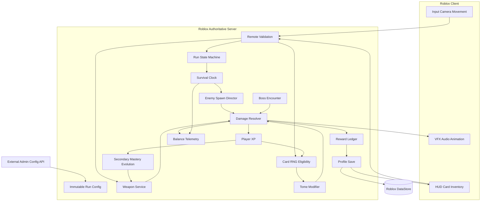
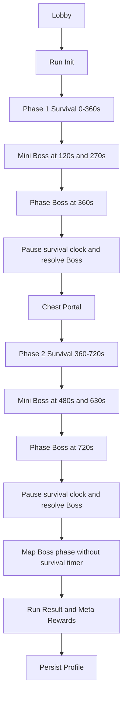

# DOC-02 — GAME SYSTEM DESIGN (GSD)

**Dự án:** Roblox Survivor Roguelite  
**Phiên bản:** 0.1 — Draft  
**Tài liệu nguồn:** DOC-01 — Core Gameplay Design & Rules (67 mục)  
**Phạm vi:** Gameplay Systems, Rules, Dependencies & Interactions  
**Trạng thái:** Draft — Chưa phê duyệt

# 1\. MỤC ĐÍCH TÀI LIỆU

Tài liệu Game System Design mô tả cấu trúc và hoạt động của các hệ thống gameplay dựa trên GDD gốc.

Tài liệu phải trả lời được:

1. Game có những hệ thống nào?  
2. Mỗi hệ thống chịu trách nhiệm gì?  
3. Hệ thống nhận dữ liệu đầu vào nào?  
4. Hệ thống xử lý theo những quy tắc nào?  
5. Hệ thống tạo ra kết quả gì?  
6. Các hệ thống phụ thuộc và tương tác với nhau như thế nào?  
7. Những quy tắc nào chưa được xác định?

Tài liệu này không quy định cấu trúc code Luau, RemoteEvent hoặc DataStore. Những nội dung đó thuộc Technical Design Document.

## 1.1. Quy ước trạng thái

* **\[Đã định nghĩa\]** — Quy tắc có trong GDD gốc.  
* **\[Chưa xác định\]** — GDD chưa cung cấp đủ thông tin.  
* **\[Mâu thuẫn\]** — Hai quy tắc có khả năng xung đột.  
* **\[Cần kiểm chứng\]** — Quy tắc đã có nhưng cần đánh giá khi balance hoặc playtest.  
* **\[Phân tích\]** — Cách tổ ch0ức hệ thống được suy ra từ GDD, không phải cơ chế gameplay mới.

---

# 2\. GAMEPLAY SYSTEM OVERVIEW

## 2.1. Tổng quan game

**\[Đã định nghĩa\]**

Game thuộc thể loại TPS Survivor Roguelite trên Roblox.

Người chơi lựa chọn trang bị tại Lobby, tham gia Run, chiến đấu với quái vật, thu thập XP, nhận nâng cấp và sinh tồn qua các Phase.

Khi bộ đếm Phase về 00:00, Final Boss xuất hiện. Sau khi tiêu diệt Boss và nhận rương thưởng, người chơi có thể chọn cổng sang Phase tiếp theo hoặc trở về Lobby.

Game hỗ trợ Singleplayer, Co-op 2–4 người và Endless Survival.

## 2.2. Core Gameplay Loop

Lobby → Start Run → Combat → Kill Enemies → Collect XP/Gold → Level Up/Upgrade → Combat → Final Boss → Boss Chest → Next Phase hoặc Return Lobby.

## 2.3. Meta Progression Loop

Complete Run → Receive Rewards → Return Lobby → Upgrade Equipment/Unlock Content → Start New Run.

## 2.4. System Inventory

| System ID | System Name | GDD Reference |
| ----- | ----- | ----- |
| SYS-01 | Player Movement & Control | 1–10 |
| SYS-02 | Primary Weapon | 11, 13, 17–20 |
| SYS-03 | Secondary Auto-Weapon | 12–16, 21–22 |
| SYS-04 | Combat & Damage | 17–20, 38–44 |
| SYS-05 | Enemy AI & Behaviors | 26–29 |
| SYS-06 | Enemy Spawn Director | 23–26, 28–29 |
| SYS-07 | Boss Encounter | 26–30 |
| SYS-08 | XP & Level Progression | 31–36 |
| SYS-09 | Upgrade Card Selection | 13, 36 |
| SYS-10 | Tome System | 47–51 |
| SYS-11 | Player Survival & Revive | 38–46 |
| SYS-12 | Chest & Banish | 37, 63 |
| SYS-13 | Shrine System | 52–54 |
| SYS-14 | Merchant System | 55–57 |
| SYS-15 | Map & Environment | 9–10, 58–62 |
| SYS-16 | Run & Phase Management | 30, 45–46, 61, 67 |
| SYS-17 | Lobby Equipment & Upgrades | 11–12, 49, 64 |
| SYS-18 | Economy & Rewards | 37, 55–57, 63–65 |
| SYS-19 | Multiplayer & Co-op | 50, 67 |
| SYS-20 | Daily Systems & Leaderboards | 65–66 |

---

# 3\. CHI TIẾT CÁC GAMEPLAY SYSTEM

## SYS-01 — PLAYER MOVEMENT & CONTROL

### GDD ĐÃ DUYỆT — BỔ SUNG ĐẶC TẢ TRIỂN KHAI (25/10/2026)

Nguồn đối chiếu: GDD 6.1–6.16. GDD được người thiết kế duyệt làm baseline, nhưng những điểm \[TBD\]/\[Conflict\] bên trong vẫn là câu hỏi chưa được giải quyết.

System Purpose / Rules: Input WASD/thumbstick, Space jump, E Dash, F interact và camera TPS. Kiểm tra ControlEnabled và trạng thái Alive trước khi xử lý hành động; va chạm map chặn vượt tường. Dash có cooldown gốc 0,5s; tại GDD 6.7 có ghi '(Bỏ)' đối với iFrames 0,2s nên phải giữ cờ cấu hình chưa chốt, không tự bảo đảm bất tử. Camera có thể xoay 360° và tùy chọn khóa tùy người chơi. Đụng quái khi Dash vẫn có thể chịu sát thương theo ghi chú 6.9.

Trigger, Data Flow & Exceptions: MoveInput→ValidateState→Collision/Action→ReplicatePosition. Không đủ cooldown thì reject Dash; F chỉ tương tác đối tượng hợp lệ trong range; tương tác khi chết bị hủy. Range F, distance Dash, acceleration và friction TBD.

Acceptance & Verification: MOV-01: Dash trước cooldown bị từ chối; MOV-02: không thể vượt Map Boundary; MOV-03: khi khóa camera bật/tắt hướng quan sát theo tùy chọn; MOV-04: Dash-collision không tự biến thành invulnerability.

Dependencies: Run State, Game Config, dữ liệu Player và các SYS liên quan như đã liệt kê trong mục Dependencies gốc. Không tự suy diễn tham số nếu nguồn chưa chốt.

## 

### Purpose

Quản lý di chuyển, nhảy, Dash, Camera và tương tác môi trường của nhân vật.

### Inputs

* WASD hoặc Mobile Thumbstick.  
* Jump Input.  
* Dash Input.  
* Camera Input.  
* Interaction Input.  
* Vị trí và trạng thái nhân vật.  
* Va chạm với môi trường.

### Processing Rules

**\[Đã định nghĩa\]**

1. Người chơi di chuyển bằng WASD hoặc Thumbstick.  
2. Người chơi có thể Jump bằng Spacebar.  
3. Dash sử dụng phím E.  
4. Dash Cooldown là 0.5 giây.  
5. Dash cung cấp 0.2 giây iFrames.  
6. Camera hoạt động ở góc nhìn TPS.  
7. Người chơi tương tác với Chest, Merchant và Shop bằng phím F.  
8. Người chơi bị giới hạn bởi Map Boundary.  
9. Nhân vật có va chạm với môi trường.

### Outputs

* Thay đổi vị trí nhân vật.  
* Thực hiện Dash.  
* Thực hiện Jump.  
* Cập nhật Camera.  
* Phát sinh yêu cầu tương tác với đối tượng.

### Dependencies

* SYS-04 — Combat & Damage.  
*   
* SYS-11 — Player Survival.  
*   
* SYS-15 — Map & Environment.  
*   
* SYS-12/14 — Chest & Merchant.

### Open Questions

* **\[Đã xác nhận\] E dùng để Dash; F dùng để tương tác. Không còn xung đột phím điều khiển.**  
* **\[Chưa xác định\]** Base Movement Speed.  
* Trả lời — \[APPROVED: PHƯƠNG ÁN SOLO; THÔNG SỐ TBD VẪN CHỜ BALANCE\] Đề xuất WalkSpeed 16 studs/s làm baseline playtest; được duyệt làm baseline playtest.  
*   
* **\[Chưa xác định\]** Acceleration và Friction.  
* Trả lời — \[APPROVED: PHƯƠNG ÁN SOLO; THÔNG SỐ TBD VẪN CHỜ BALANCE\] Đề xuất gia tốc/ma sát có config riêng và test khả năng khởi động/dừng, chưa đặt số.  
*   
* **\[Chưa xác định\]** Jump Power.  
* Trả lời — \[APPROVED: PHƯƠNG ÁN SOLO; THÔNG SỐ TBD VẪN CHỜ BALANCE\] Đề xuất JumpPower 50 làm baseline Roblox, được duyệt làm baseline playtest; tinh chỉnh qua playtest.  
*   
* **\[Chưa xác định\]** Camera khóa theo nhân vật hay tự do 360°.  
* Trả lời — \[THEO GDD\] Theo GDD: camera TPS xoay 360° và tùy chọn khóa theo người chơi.  
*   
* **\[Chưa xác định\]** Dash Distance, Dash Direction và điều kiện không thể Dash.  
* Trả lời — \[THEO GDD\] Theo GDD: E Dash cooldown 0,5s, không xuyên tường, chạm quái vẫn có thể chịu damage; đề xuất Dash theo input, không input dùng hướng mặt. Distance TBD; iFrames có ghi '(Bỏ)' nên chưa kích hoạt mặc định.  
* 

---

## SYS-02 — PRIMARY WEAPON SYSTEM

### GDD ĐÃ DUYỆT — BỔ SUNG ĐẶC TẢ TRIỂN KHAI (25/10/2026)

Nguồn đối chiếu: GDD 7.1–7.12; Balance V3.1. GDD được người thiết kế duyệt làm baseline, nhưng những điểm \[TBD\]/\[Conflict\] bên trong vẫn là câu hỏi chưa được giải quyết.

System Purpose / Rules: Chọn Primary tại Lobby trước Run, chỉ tấn công theo input chủ động và không tự đổi Primary giữa Run. Bảng gốc: Kiếm 20 damage/0,8s/5% crit; Cung 14/0,5s/10%; Trượng 26/1,3s/3%. Danh mục đầu phát triển dự kiến 5 Primary, cần xác nhận stats của Súng và Liềm. Chỉ số nền nâng cấp vĩnh viễn tại Lobby, buff toàn cục trong Run có thể tác động.

Trigger, Data Flow & Exceptions: AttackRequest(weaponId,aim)→ValidateEquipped/Alive/Cooldown→Hit Detection→SYS-04 Damage→Feedback. Primary Level chỉ tăng vĩnh viễn tại Lobby; Level-Up không có thẻ tăng cấp Primary. Tome, Buff và Global Stat Augment có thể tăng chỉ số Primary tạm thời trong Run \[Đã xác định\].

Acceptance & Verification: PRI-01: input tấn công hợp lệ trừ cooldown; PRI-02: không trigger automatic attack; PRI-03: upgrade Lobby tồn tại qua Run, augment Run bị xóa khi Run kết thúc.

Dependencies: Run State, Game Config, dữ liệu Player và các SYS liên quan như đã liệt kê trong mục Dependencies gốc. Không tự suy diễn tham số nếu nguồn chưa chốt.

## 

### Purpose

Quản lý Vũ khí Chính được trang bị trước Run và sử dụng để tấn công thủ công.

### Inputs

* Primary Weapon đã chọn trong Lobby.  
* Manual Attack Input.  
* Chỉ số vũ khí.  
* Các nâng cấp chỉ số toàn cục.  
* Thông tin mục tiêu.

### Processing Rules

**\[Đã định nghĩa\]**

1. Primary Weapon được chọn và trang bị tại Lobby.  
2. Các nhóm vũ khí được nêu gồm Kiếm, Cung, Súng, Trượng phép và Liềm.  
3. Primary Weapon chỉ tấn công khi người chơi chủ động kích hoạt.  
4. Cấp độ Primary Weapon được nâng cấp vĩnh viễn tại Lobby.  
5. Primary Weapon không xuất hiện dưới dạng thẻ nâng cấp cấp độ vũ khí trong Run.  
6. Các nâng cấp chỉ số trong Run có thể gia tăng sức mạnh của cả Primary và Secondary.

### Outputs

* Đòn tấn công được kích hoạt.  
* Sự kiện gây sát thương.  
* Hiệu ứng tấn công tương ứng.

### Dependencies

* SYS-01 — Player Controls.  
*   
* SYS-04 — Combat & Damage.  
*   
* SYS-09 — Upgrade Cards.  
*   
* SYS-17 — Lobby Equipment.  
* 

### Open Questions

* **\[Đã xác định\] Primary Weapon chỉ tăng cấp độ vĩnh viễn tại Lobby bằng Permanent Weapon Upgrade. Trong Run, thẻ Level-Up không trực tiếp tăng Level Primary; Primary vẫn hưởng hiệu ứng chỉ số từ Tome, Buff và Global Stat Augment phù hợp. Các hiệu ứng trong Run là tạm thời, không thay đổi cấp độ vĩnh viễn của vũ khí.**  
* **\[Chưa xác định\]** Hành vi tấn công chi tiết của từng loại Primary.  
* Trả lời — \[APPROVED: PHƯƠNG ÁN SOLO; THÔNG SỐ TBD VẪN CHỜ BALANCE\] Đề xuất 5 archetype: kiếm quét melee, cung projectile, súng bắn thẳng, trượng AoE, liềm quét rộng; pattern Súng/Liềm cần duyệt.  
*   
* **\[Chưa xác định\]** Attack Rate, Range, Damage và Hit Detection.  
* Trả lời — \[APPROVED: PHƯƠNG ÁN SOLO; THÔNG SỐ TBD VẪN CHỜ BALANCE\] Đã có số nền: Kiếm 20 damage/0,8s/5% crit; Cung 14/0,5s/10%; Trượng 26/1,3s/3%. Range/hitbox các vũ khí và Súng/Liềm TBD; đề xuất hitbox server cho melee, projectile/raycast cho ranged.  
*   
* **\[Chưa xác định\]** Quy tắc chuyển đổi Primary trong Lobby.  
* Trả lời — \[APPROVED: PHƯƠNG ÁN SOLO; THÔNG SỐ TBD VẪN CHỜ BALANCE\] Đề xuất Primary chỉ đổi tại Lobby khi đã unlock, một vũ khí active; khóa đổi sau Start Run.  
* 

---

## SYS-03 — SECONDARY AUTO-WEAPON SYSTEM

### GDD ĐÃ DUYỆT — BỔ SUNG ĐẶC TẢ TRIỂN KHAI (25/10/2026)

Nguồn đối chiếu: GDD 8.1–8.19. GDD được người thiết kế duyệt làm baseline, nhưng những điểm \[TBD\]/\[Conflict\] bên trong vẫn là câu hỏi chưa được giải quyết.

System Purpose / Rules: Chỉ 1 Secondary Auto-Weapon/Run; nhận trong Run, tự đánh theo targeting priority cấu hình ở Lobby: nearest/highest HP/lowest HP/random. Orbs 8 damage mỗi 0,2s tick; Daggers 12 damage mỗi 0,6s, crit 8%; Drone, Flame Spray, Lightning Totem theo hành vi archetype ghi trong GDD. Evolution khi Secondary đạt max, không đòi Primary max theo Core Rules; GDD bổ sung khả năng cộng hưởng Primary mở passive.

Trigger, Data Flow & Exceptions: CardGrant→SlotEligibility→Equip→AcquireTarget→AttackTick→Damage. Khi target chết/ra khỏi vùng cho phép, reevaluate eligible targets; chính sách hủy đòn/retarget giữa cast TBD. Max Level 99 \[APPROVED\]; bản Core Rules cũ ghi 30 và nay đã được thay thế; không tự triển khai một mức khi chưa được chốt.

Acceptance & Verification: SEC-01: không thể sở hữu Secondary thứ hai; SEC-02: mục tiêu không hợp lệ không bị gây sát thương; SEC-03: tiến hóa không xảy ra khi chưa đáp ứng max level và điều kiện synergy đã duyệt.

Dependencies: Run State, Game Config, dữ liệu Player và các SYS liên quan như đã liệt kê trong mục Dependencies gốc. Không tự suy diễn tham số nếu nguồn chưa chốt.

## 

### Purpose

Quản lý vũ khí phụ tự động, chọn mục tiêu, tấn công, nâng cấp và Evolution.

### Inputs

* Secondary Weapon nhận trong Run.  
* Targeting Preference thiết lập tại Lobby.  
* Vị trí quái vật.  
* Chỉ số Secondary.  
* Level và các nâng cấp hiện tại.

### Processing Rules

**\[Đã định nghĩa\]**

1. Secondary được lựa chọn hoặc thu thập trong Run.  
2. Mỗi người chơi có tối đa 1 Secondary trong một Run.  
3. Secondary tự động tấn công mà không cần Manual Attack Input.  
4. Secondary có thể được nâng cấp chỉ số nền tảng vĩnh viễn tại Lobby.  
5. Targeting Preference có các lựa chọn Nearest Enemy, Highest HP, Lowest HP hoặc Random.  
6. Targeting Preference có thể điều chỉnh tại Lobby.  
7. Secondary có Level Cap 99 trong Run \[APPROVED 25/10/2026\].  
8. Khi Secondary đạt Max Level, có thể tiến hóa thành dạng mạnh hơn.  
9. Evolution không yêu cầu Primary đạt Max Level.

### Secondary Concepts

* Orbiting Energy Orbs.  
* Floating Melee Daggers.  
* Automatic Drone.  
* Flame Spray.  
* Lightning Totem.

### Outputs

* Tự động lựa chọn mục tiêu.  
* Kích hoạt đòn tấn công.  
* Gây Damage hoặc Status Effect.  
* Cập nhật Level.  
* Kích hoạt Evolution khi đủ điều kiện.

### Dependencies

* SYS-04 — Combat & Damage.  
*   
* SYS-05 — Enemy AI.  
*   
* SYS-08 — XP & Level.  
*   
* SYS-09 — Upgrade Cards.  
*   
* SYS-17 — Lobby Equipment.  
* 

### Open Questions

* **\[Chưa xác định\]** Secondary được nhận qua thẻ, loot hay cả hai theo những điều kiện cụ thể nào.  
* Trả lời — \[APPROVED: PHƯƠNG ÁN SOLO; THÔNG SỐ TBD VẪN CHỜ BALANCE\] Đề xuất Secondary nhận qua Level-Up Card nếu slot trống, lựa chọn từ pool đã unlock; không tự có Secondary thứ hai từ chest.  
*   
* **\[APPROVED\] Secondary Evolution tự kích hoạt duy nhất một lần khi Mastery Level 99; không yêu cầu Primary max.**  
* Trả lời — \[THEO GDD\] Theo GDD: Evolution tự kích hoạt một lần tại Secondary Mastery Level 99; Tome cap 30 giữ nguyên.  
*   
* **\[Chưa xác định\]** Evolution có thay thế hoàn toàn Secondary cũ không.  
* Trả lời — \[APPROVED: PHƯƠNG ÁN SOLO; THÔNG SỐ TBD VẪN CHỜ BALANCE\] Đề xuất Evolution thay thế phiên bản active của Secondary nhưng vẫn dùng 1 slot.  
*   
* **\[Chưa xác định\]** Xử lý khi mục tiêu biến mất.  
* Trả lời — \[APPROVED: PHƯƠNG ÁN SOLO; THÔNG SỐ TBD VẪN CHỜ BALANCE\] Đề xuất mất mục tiêu trước cast thì retarget; projectile đã bắn xử lý hit bình thường, không tự chuyển mục tiêu.  
*   
* **\[Chưa xác định\]** Cơ chế chọn mục tiêu có áp dụng giống nhau cho mọi Secondary hay không.  
* Trả lời — \[THEO GDD\] Theo GDD: ưu tiên target tại Lobby gồm nearest/highest HP/lowest HP/random; áp dụng trong tập mục tiêu hợp lệ riêng từng vũ khí.  
* 

---

## SYS-04 — COMBAT & DAMAGE SYSTEM

### GDD ĐÃ DUYỆT — BỔ SUNG ĐẶC TẢ TRIỂN KHAI (25/10/2026)

Nguồn đối chiếu: GDD 9.1–9.15; Math & Balance V3.1. GDD được người thiết kế duyệt làm baseline, nhưng những điểm \[TBD\]/\[Conflict\] bên trong vẫn là câu hỏi chưa được giải quyết.

System Purpose / Rules: Công thức sát thương lên quái: (BaseDamage+FlatBonus)×(1+SumDamageBuffPercent)×CritMultiplier×100/(100+ArmorMonster). Cùng bộ quy tắc stat áp dụng với Primary, Secondary và các buff/Tome tương thích. Damage Buff \+50% trong 15s, Tome Damage và các Item có thể gia tăng tổng hệ số theo trường tương ứng.

Trigger, Data Flow & Exceptions: HitConfirmed→CheckInvulnerability/Evasion nếu mục tiêu Player→ResolveBase/Flat→ApplyDamageBuff→Crit→Armor→Shield/HP→Death Event. Crit multiplier, rounding, DoT ticking, knockback, pierce/bounce, armor Player, thứ tự shield vẫn cần chốt. Không suy từ armor monster sang player.

Acceptance & Verification: DMG-01: cùng một hit không trừ HP hai lần; DMG-02: enemy armor 0 không giảm sát thương; DMG-03: damage không được thực hiện ở State không hợp lệ.

Dependencies: Run State, Game Config, dữ liệu Player và các SYS liên quan như đã liệt kê trong mục Dependencies gốc. Không tự suy diễn tham số nếu nguồn chưa chốt.

## 

### Purpose

Quản lý tính toán và áp dụng sát thương, Crit, Knockback, Pierce, Bounce và các chỉ số phòng thủ liên quan.

### Inputs

* Attack Event.  
* Base Damage.  
* Crit Rate và Crit Damage Factor.  
* Armor.  
* Knockback Force.  
* Pierce Count.  
* Bounce Count.  
* Các Tome, Buff và Augment.

### Processing Rules

**\[Đã định nghĩa\]**

1. Primary và Secondary đều sử dụng hệ thống sát thương.  
2. Crit có thể áp dụng cho cả hai loại vũ khí.  
3. Một số đòn đánh có thể gây Knockback.  
4. Projectile hoặc kỹ năng có thể có Pierce và Bounce.  
5. Armor làm giảm sát thương nhận vào.  
6. Lifesteal hồi HP dựa trên sát thương gây ra.  
7. Thorns phản lại sát thương khi nhân vật chịu đòn.  
8. Evasion cho phép né hoàn toàn một số đòn tấn công.

### Outputs

* Damage Result.  
* HP Change.  
* Critical Hit Result.  
* Knockback.  
* Lifesteal Recovery.  
* Thorns Damage.  
* Evasion Result.

### Dependencies

* SYS-02 — Primary Weapon.  
*   
* SYS-03 — Secondary Weapon.  
*   
* SYS-05 — Enemy AI.  
*   
* SYS-10 — Tome.  
*   
* SYS-11 — Survival.  
* 

### Open Questions

* **\[Chưa xác định\]** Công thức Damage chính thức.  
* Trả lời — \[THEO GDD\] Theo Balance V3.1: Damage=(Base+Flat)×(1+Buff%)×CritMultiplier×100/(100+EnemyArmor). Player Armor và Crit multiplier vẫn TBD.  
*   
* **\[Chưa xác định\]** Thứ tự áp dụng Crit, Armor, Buff và Evasion.  
* Trả lời — \[APPROVED: PHƯƠNG ÁN SOLO; THÔNG SỐ TBD VẪN CHỜ BALANCE\] Đề xuất thứ tự: xác nhận hit→iFrames/Evasion→Base+Flat→Buff→Crit→Armor→Shield→HP→Death/Lifesteal/Thorns; GDD xác nhận thứ tự phần công thức lên quái.  
*   
* **\[Chưa xác định\]** Damage tối thiểu.  
* Trả lời — \[APPROVED: PHƯƠNG ÁN SOLO; THÔNG SỐ TBD VẪN CHỜ BALANCE\] Đề xuất hit hợp lệ tối thiểu 1 damage, trừ immunity; chưa có nguồn chốt.  
*   
* **\[Chưa xác định\]** Quy tắc cộng dồn Status Effect.  
* Trả lời — \[APPROVED: PHƯƠNG ÁN SOLO; THÔNG SỐ TBD VẪN CHỜ BALANCE\] Đề xuất cùng loại DoT refresh duration và có cap stack, khác loại cùng hoạt động; số cap TBD.  
*   
* **\[Chưa xác định\]** Lifesteal và Thorns có giới hạn hay không.  
* Trả lời — \[APPROVED: PHƯƠNG ÁN SOLO; THÔNG SỐ TBD VẪN CHỜ BALANCE\] Đề xuất Lifesteal theo damage thực lên HP, Thorns không kích hoạt lại Thorns/Lifesteal để tránh recursion; giới hạn % cần cân bằng.  
* 

**Lưu ý:** Công thức toán học và thông số sẽ được quản lý trong DOC-04 và DOC-05.

---

## SYS-05 — ENEMY AI & BEHAVIORS

### GDD ĐÃ DUYỆT — BỔ SUNG ĐẶC TẢ TRIỂN KHAI (25/10/2026)

Nguồn đối chiếu: GDD 10.1–10.14. GDD được người thiết kế duyệt làm baseline, nhưng những điểm \[TBD\]/\[Conflict\] bên trong vẫn là câu hỏi chưa được giải quyết.

System Purpose / Rules: Normal Melee tập trung cận chiến, Suicide/Explosive gây nổ, Elite bắt đầu từ giây 40, Mini-Boss có cả melee và AoE ranged, Phase/Map Boss có encounter riêng, Dơi hoạt động khi Boss xuất hiện. Quái đã sinh ra không despawn chỉ vì người chơi rời xa.

Trigger, Data Flow & Exceptions: Spawn→AcquirePlayerTarget→Chase/Navigate→AttackWhenInRange→ReceiveDamage→Death/Drop. Khi Boss spawn vẫn giữ quái cũ; khi Phase Boss chết, chỉ dơi của encounter đó bị dọn. Co-op target selection và navigation fallback TBD.

Acceptance & Verification: AI-01: enemy còn sống tiếp tục đuổi khi player thay đổi vị trí; AI-02: không xóa quái cũ lúc Phase Boss xuất hiện; AI-03: death callback chỉ chạy một lần.

Dependencies: Run State, Game Config, dữ liệu Player và các SYS liên quan như đã liệt kê trong mục Dependencies gốc. Không tự suy diễn tham số nếu nguồn chưa chốt.

## 

### Purpose

Quản lý hành vi di chuyển, truy đuổi và tấn công của quái vật.

### Inputs

* Player Position.  
* Enemy Type.  
* Enemy Stats.  
* Trạng thái chiến đấu.  
* Map Geometry.

### Processing Rules

**\[Đã định nghĩa\]**

1. Quái vật truy đuổi người chơi.  
2. Quái đã Spawn không tự Despawn khi người chơi di chuyển xa.  
3. Quái đã Spawn không tự Despawn khi Final Boss xuất hiện.  
4. Normal Enemies bao gồm Melee và Explosive/Suicide.  
5. Elite có kích thước lớn hơn và khả năng chịu sát thương cao hơn quái thường.  
6. Mini-Boss có đòn đánh cận chiến và tầm xa AoE.  
7. Bat là quái bay, xuất hiện trong giai đoạn Boss.

### Outputs

* Enemy Movement.  
* Enemy Attack Event.  
* Enemy Death Event.

### Dependencies

* SYS-04 — Combat & Damage.  
*   
* SYS-06 — Enemy Spawn.  
*   
* SYS-07 — Boss Encounter.  
*   
* SYS-15 — Map.  
* 

### Open Questions

* **\[Chưa xác định\]** Quy tắc chọn mục tiêu trong Co-op.  
* Trả lời — \[DEFERRED: CO-OP / ENDLESS — KHÔNG THUỘC SOLO V1\] Đề xuất Co-op aggro chọn player còn sống gần nhất/đang gây threat; không nhắm player đã chết.  
*   
* **\[Chưa xác định\]** Enemy Attack Cooldown và Range.  
* Trả lời — \[APPROVED: PHƯƠNG ÁN SOLO; THÔNG SỐ TBD VẪN CHỜ BALANCE\] Cooldown và Range lưu riêng từng EnemyTypeConfig; số cụ thể cần playtest.  
*   
* **\[Chưa xác định\]** Hành vi khi bị kẹt địa hình.  
* Trả lời — \[APPROVED: PHƯƠNG ÁN SOLO; THÔNG SỐ TBD VẪN CHỜ BALANCE\] Đề xuất pathfinding retry rồi unstuck tại vị trí hợp lệ nếu kẹt; không teleport gây hit bất ngờ.  
*   
* **\[Chưa xác định\]** Chi tiết hành vi của từng loại quái.  
* Trả lời — \[THEO GDD\] Theo GDD: Melee đánh gần, Suicide tự nổ, Elite khỏe hơn, Mini-Boss melee \+ AoE, Bat bay khi boss; pattern chi tiết còn TBD.  
* 

---

## SYS-06 — ENEMY SPAWN DIRECTOR

### GDD ĐÃ DUYỆT — BỔ SUNG ĐẶC TẢ TRIỂN KHAI (25/10/2026)

Nguồn đối chiếu: GDD 11.1–11.13; Balance V3.1. GDD được người thiết kế duyệt làm baseline, nhưng những điểm \[TBD\]/\[Conflict\] bên trong vẫn là câu hỏi chưa được giải quyết.

System Purpose / Rules: Spawn xung quanh người chơi ở khoảng 6 lần chiều cao avatar, chỉ vị trí hợp lệ trong map. Mật độ tăng theo thời gian phase; map 1 ghi 20 quái, mỗi map \+5, nhưng chưa rõ active cap hay batch cap. Elite từ giây 40\. HP(t)=HP\_base×(1+0,15t)^1,3; Damage(t)=Damage\_base×(1+0,08t), t theo phút.

Trigger, Data Flow & Exceptions: PhaseCombatTick→CheckCap/SpawnSchedule→SelectEnemyType→SampleValidLocation→Spawn. Khi timer 00:00 ngừng tạo Normal; tạo Dơi trong Boss Encounter. Nếu vị trí không hợp lệ phải retry/fail-safe theo cấu hình TBD, không tạo quái bên ngoài tường.

Acceptance & Verification: SPN-01: spawn position hợp lệ; SPN-02: sau Boss summon không xuất hiện Normal mới; SPN-03: Elite không spawn trước 40 giây.

Dependencies: Run State, Game Config, dữ liệu Player và các SYS liên quan như đã liệt kê trong mục Dependencies gốc. Không tự suy diễn tham số nếu nguồn chưa chốt.

## 

### Purpose

Quản lý vị trí, số lượng, thời điểm và loại quái xuất hiện trong Phase.

### Inputs

* Current Phase.  
* Remaining Phase Time.  
* Player Position.  
* Enemy Count.  
* Enemy Type Pool.  
* Boss State.

### Processing Rules

**\[Đã định nghĩa\]**

1. Quái Spawn ngẫu nhiên xung quanh người chơi.  
2. Khoảng cách Spawn xấp xỉ 6 lần chiều cao nhân vật Roblox.  
3. Thời gian Phase càng ít, mật độ và tần suất Spawn càng tăng.  
4. Map/Phase đầu có giới hạn được nêu là 20 quái.  
5. Giới hạn tăng thêm 5 ở mỗi Map/Phase tiếp theo.  
6. Elite bắt đầu xuất hiện sau 40 giây thi đấu.  
7. Khi Final Boss xuất hiện, quái thường ngừng Spawn.  
8. Trong Boss Encounter, Bat Spawn liên tục.  
9. Quái đã xuất hiện trước Boss vẫn tồn tại.

### Outputs

* Enemy Spawn Event.  
* Enemy Type.  
* Enemy Spawn Position.  
* Enemy Count Update.

### Dependencies

* SYS-01 — Player Position.  
*   
* SYS-05 — Enemy AI.  
*   
* SYS-07 — Boss Encounter.  
*   
* SYS-16 — Phase Management.  
* 

### Open Questions

* **\[Chưa xác định\]** 20 quái là giới hạn Spawn mỗi đợt hay giới hạn quái đang sống.  
* Trả lời — \[APPROVED: PHƯƠNG ÁN SOLO; THÔNG SỐ TBD VẪN CHỜ BALANCE\] Core Rules ghi 'giới hạn mỗi đợt' nên đề xuất 20 \+ 5/map là batch cap; active cap thiết lập riêng theo performance, chưa được chốt.  
*   
* **\[Chưa xác định\]** Công thức Spawn Rate theo thời gian.  
* Trả lời — \[APPROVED: PHƯƠNG ÁN SOLO; THÔNG SỐ TBD VẪN CHỜ BALANCE\] Đề xuất SpawnRate tăng qua curve theo phút Phase còn lại, interval/batch size lấy từ config cân bằng.  
*   
* **\[Chưa xác định\]** Spawn trong Co-op dựa vào vị trí người chơi nào.  
* Trả lời — \[DEFERRED: CO-OP / ENDLESS — KHÔNG THUỘC SOLO V1\] Đề xuất spawn quanh các player còn sống với vị trí hợp lệ, không spawn đè người trong Co-op.  
*   
* **\[Chưa xác định\]** Bat có tính vào giới hạn quái hay không.  
* Trả lời — \[APPROVED: PHƯƠNG ÁN SOLO; THÔNG SỐ TBD VẪN CHỜ BALANCE\] Đề xuất Bat có cap riêng trong Boss Encounter, không trừ quota Normal.  
*   
* **\[Chưa xác định\]** Quy tắc Spawn khi vị trí dự kiến nằm ngoài Map.  
* Trả lời — \[APPROVED: PHƯƠNG ÁN SOLO; THÔNG SỐ TBD VẪN CHỜ BALANCE\] Đề xuất reject vị trí ngoài Map/obstacle, retry N lần có cấu hình rồi bỏ tick và log.  
* 

---

## SYS-07 — BOSS ENCOUNTER SYSTEM

### GDD ĐÃ DUYỆT — BỔ SUNG ĐẶC TẢ TRIỂN KHAI (25/10/2026)

Nguồn đối chiếu: GDD 12.1–12.12; A 3.3/4. GDD được người thiết kế duyệt làm baseline, nhưng những điểm \[TBD\]/\[Conflict\] bên trong vẫn là câu hỏi chưa được giải quyết.

System Purpose / Rules: Trong mỗi phase sinh tồn 6 phút: Mini-Boss 1 tại 02:00, Mini-Boss 2 tại 04:30, Phase Boss khi countdown đạt 00:00. Phase 3 là Map Boss, không áp dụng countdown 6 phút. Boss và Mini-Boss hiển thị thanh HP; death chest bảo đảm theo Core Rules. Dơi xuất hiện khi đấu Boss; Dơi biến mất sau khi Phase Boss chết.

Trigger, Data Flow & Exceptions: TimeMarker/BossState→SpawnBossOnce→HUD→Combat→OnBossDeathOnce→GuaranteedChest→ClearDơi→CheckRequiredEnemies→UnlockPortal. Boss HP/pattern cần bảng riêng; Map Boss không tăng HP/Damage theo thời gian trong encounter (dơi có thể scale).

Acceptance & Verification: BOS-01: mỗi mốc Boss chỉ trigger một lần; BOS-02: chest không nhân đôi khi hit đồng thời; BOS-03: portal không mở nếu quái bắt buộc còn sống.

Dependencies: Run State, Game Config, dữ liệu Player và các SYS liên quan như đã liệt kê trong mục Dependencies gốc. Không tự suy diễn tham số nếu nguồn chưa chốt.

## 

### Purpose

Điều khiển sự kiện Mini-Boss, Final Boss và chuyển đổi từ Combat Phase sang Boss Encounter.

### Inputs

* Phase Timer.  
* Enemy State.  
* Boss HP.  
* Boss Defeated Event.  
* Boss Chest Claimed Event.

### Processing Rules

**\[Đã định nghĩa\]**

1. Final Boss xuất hiện khi Timer về 00:00.  
2. Khi Final Boss xuất hiện, Spawn quái thường dừng.  
3. Bat tiếp tục Spawn trong thời gian chiến đấu với Boss.  
4. Quái cũ vẫn tồn tại.  
5. Mini-Boss và Final Boss đều có Boss HP Bar.  
6. Mini-Boss và Final Boss chắc chắn rơi Chest.  
7. Sau khi hạ Final Boss và nhặt Chest, hai Portal xuất hiện.  
8. Portal thứ nhất đưa người chơi về Lobby.  
9. Portal thứ hai đưa người chơi sang Phase tiếp theo.

### Outputs

* Boss Spawn.  
* Boss HUD.  
* Boss Chest.  
* Portal Availability.

### Dependencies

* SYS-05 — Enemy AI.  
*   
* SYS-06 — Spawn Director.  
*   
* SYS-12 — Chest.  
*   
* SYS-16 — Phase Management.  
* 

### Open Questions

* **\[Chưa xác định\]** Điều kiện và thời điểm Mini-Boss Spawn.  
* Trả lời — \[THEO GDD\] Theo phần A: Mini-Boss mốc 02:00 và 04:30 mỗi phase sinh tồn, Phase Boss mốc 06:00.  
*   
* **\[Chưa xác định\]** Boss Stats và Attack Patterns.  
* Trả lời — \[THEO GDD\] Theo GDD: Mini-Boss melee+AoE ranged; Boss có thanh HP. Số liệu HP, cooldown, pattern riêng cần Boss Sheet và duyệt.  
*   
* **\[Chưa xác định\]** Thời gian Boss Fight có giới hạn hay không.  
* Trả lời — \[APPROVED: PHƯƠNG ÁN SOLO; THÔNG SỐ TBD VẪN CHỜ BALANCE\] GDD không đặt giới hạn Boss Fight; đề xuất không giới hạn giờ đấu Boss, Phase 3 không có countdown 6 phút.  
*   
* **\[Chưa xác định\]** Hành vi Portal trong Co-op.  
* Trả lời — \[DEFERRED: CO-OP / ENDLESS — KHÔNG THUỘC SOLO V1\] Đề xuất Co-op vote portal theo đa số sau clear, tie-break bằng host hoặc chính sách riêng; chưa duyệt.  
* 

---

## SYS-08 — XP & LEVEL PROGRESSION

### GDD ĐÃ DUYỆT — BỔ SUNG ĐẶC TẢ TRIỂN KHAI (25/10/2026)

Nguồn đối chiếu: GDD 13.1–13.13; Balance V3.1. GDD được người thiết kế duyệt làm baseline, nhưng những điểm \[TBD\]/\[Conflict\] bên trong vẫn là câu hỏi chưa được giải quyết.

System Purpose / Rules: 100% quái bị tiêu diệt tạo XP; phần A mô tả 3 orb mỗi quái. Orb xanh 5 XP, tím 20 XP, đỏ 100 XP. Normal: 80% xanh/18% tím/2% đỏ. Elite 60% xanh/30% tím/10% đỏ và Boss 60% tím/40% đỏ \[APPROVED\]; các bảng Balance V3.1 khác biệt là lịch sử. Pickup radius gốc 1,5 lần chiều cao avatar.

Trigger, Data Flow & Exceptions: OnEnemyKilled→RollXPUsingApprovedTable→SpawnOrbs→Pickup→AddXP→WhileThresholdReached LevelUpPending. XP(L): L\<=10 là 60L; 11–25 là 600+150(L−10); \>=26 là 3200×1,12^(L−25). Player level không giới hạn theo phần A, nhưng cách xử lý nhiều Level-Up cùng một lúc TBD.

Acceptance & Verification: XP-01: enemy death chỉ drop một lần; XP-02: áp dụng threshold theo đúng dải; XP-03: chưa hardcode Elite/Boss odds trước khi chọn bảng mâu thuẫn.

Dependencies: Run State, Game Config, dữ liệu Player và các SYS liên quan như đã liệt kê trong mục Dependencies gốc. Không tự suy diễn tham số nếu nguồn chưa chốt.

## 

### Purpose

Quản lý XP Drop, XP Pickup, tổng XP và Player Level.

### Inputs

* Enemy Death Event.  
* Enemy Type.  
* XP Orb Type.  
* Player Position.  
* Current XP.  
* Current Level.

### Processing Rules

**\[Đã định nghĩa\]**

1. 100% quái bị tiêu diệt rơi XP Orb.  
2. Normal Enemy: Green 80%, Purple 18%, Red 2%.  
3. Elite Enemy: Purple 30%, Red 10%.  
4. Mini-Boss và Final Boss: Purple 60%, Red 40%.  
5. Base Magnet Radius bằng 1.5 lần chiều cao nhân vật.  
6. XP cần để lên cấp tăng dần theo Level.  
7. Khi lên cấp, hệ thống kích hoạt lựa chọn nâng cấp.

### Outputs

* XP Orb Spawn.  
* XP Collected.  
* Player XP Update.  
* Level-Up Event.

### Dependencies

* SYS-05 — Enemy.  
*   
* SYS-09 — Upgrade Cards.  
*   
* SYS-10 — Tome.  
*   
* SYS-19 — Multiplayer.  
* 

### Open Questions

* **\[Đã xác định\] Elite XP: 60% Green / 30% Purple / 10% Red.**  
* Trả lời — \[APPROVED: PHƯƠNG ÁN SOLO; THÔNG SỐ TBD VẪN CHỜ BALANCE\] \[APPROVED\] Elite 60% xanh/30% tím/10% đỏ. Tỷ lệ cũ trong Balance V3.1 đã bị thay thế.  
*   
* **\[Chưa xác định\]** Giá trị XP của từng loại Orb.  
* Trả lời — \[THEO GDD\] Theo Balance V3.1: xanh 5 XP, tím 20 XP, đỏ 100 XP.  
*   
* **\[Chưa xác định\]** XP Curve cụ thể.  
* Trả lời — \[THEO GDD\] Theo Balance V3.1: XP(L)=60L (1–10); 600+150(L−10) (11–25); 3200×1,12^(L−25) (26+).  
*   
* **\[Chưa xác định\]** XP trong Co-op chia sẻ hay cá nhân.  
* Trả lời — \[DEFERRED: CO-OP / ENDLESS — KHÔNG THUỘC SOLO V1\] Đề xuất Co-op cấp XP cá nhân từ kill/shared pickup, không tranh orb; tỷ lệ chia và range TBD.  
*   
* **\[Chưa xác định\]** XP Orb tồn tại trên bản đồ trong bao lâu.  
* Trả lời — \[APPROVED: PHƯƠNG ÁN SOLO; THÔNG SỐ TBD VẪN CHỜ BALANCE\] Đề xuất orb giữ đến khi nhặt hoặc kết thúc Run, nếu nhiều thì gom orb bằng đại diện giá trị tương đương thay vì mất XP.  
* 

---

## SYS-09 — UPGRADE CARD SELECTION

### GDD ĐÃ DUYỆT — BỔ SUNG ĐẶC TẢ TRIỂN KHAI (25/10/2026)

Nguồn đối chiếu: GDD 14.1–14.15; Balance V3.1. GDD được người thiết kế duyệt làm baseline, nhưng những điểm \[TBD\]/\[Conflict\] bên trong vẫn là câu hỏi chưa được giải quyết.

System Purpose / Rules: Solo khi đủ XP sẽ Pause rồi hiển thị ba thẻ, chọn một. Pool cho Secondary, Tome mới, Tome Upgrade, augment chỉ số toàn cục; hiệu quả rarity chịu Luck. Odds Luck 0: 60/25/11/3,5/0,5; Luck \+20:45/30/16/7,5/1,5; \+50:30/32/22/12/4; \+100:15/30/30/18/7. Thẻ được chọn chỉ tồn tại trong Run.

Trigger, Data Flow & Exceptions: OnLevelUp→PauseSolo→BuildEligiblePool→RarityRoll→Show3Cards→PlayerSelectOne→ValidateAgain→ApplyBuildUpdate→Resume. Khi đạt cấp max/slot đầy phải loại card bất hợp lệ hoặc áp dụng chính sách đã duyệt. Các trường hợp pool thiếu, duplicate card và Co-op Pause TBD.

Acceptance & Verification: CRD-01: một lần level-up chỉ áp dụng 1 card; CRD-02: pause trong Solo cũng diễn ra lúc Boss; CRD-03: thẻ không hợp lệ không được trao.

Dependencies: Run State, Game Config, dữ liệu Player và các SYS liên quan như đã liệt kê trong mục Dependencies gốc. Không tự suy diễn tham số nếu nguồn chưa chốt.

## 

### Purpose

Quản lý việc hiển thị và áp dụng lựa chọn nâng cấp khi Player Level Up.

### Inputs

* Level-Up Event.  
* Current Build.  
* Available Card Pool.  
* Current Tome Levels.  
* Current Secondary Level.

### Processing Rules

**\[Đã định nghĩa\]**

1. Khi Level Up, game hiển thị 3 thẻ nâng cấp ngẫu nhiên.  
2. Người chơi chọn một thẻ.  
3. Thẻ có thể liên quan tới Secondary, Tome, chỉ số hoặc vật phẩm bổ trợ.  
4. Các nâng cấp chỉ số trong Run có thể ảnh hưởng cả Primary và Secondary.  
5. GDD mô tả game Pause khi mở giao diện Level-Up.

### Outputs

* Card Options.  
* Selected Card.  
* Applied Upgrade.  
* Updated Player Build.

### Dependencies

* SYS-02 — Primary.  
*   
* SYS-03 — Secondary.  
*   
* SYS-08 — XP.  
*   
* SYS-10 — Tome.  
*   
* SYS-19 — Multiplayer.  
* 

### Open Questions

* **\[Đã xác định\] Level-Up Cards không trực tiếp nâng Level Primary. Thẻ Tome và Global Stat Augment hợp lệ có thể tăng các chỉ số như Damage, Attack Speed hoặc Crit cho Primary và Secondary trong Run, nhưng không thay đổi cấp độ vĩnh viễn của Primary.**  
* **\[Chưa xác định\]** Card Pool và trọng số xuất hiện.  
* Trả lời — \[THEO GDD\] Theo GDD pool: Secondary, Tome mới, Tome Upgrade và Global Augment; odds rarity theo bảng Luck. Đề xuất ưu tiên thẻ lấy Secondary khi chưa có, nhưng trọng số loại thẻ TBD.  
*   
* **\[Chưa xác định\]** Quy tắc khi Tome Slots đã đầy.  
* Trả lời — \[APPROVED: PHƯƠNG ÁN SOLO; THÔNG SỐ TBD VẪN CHỜ BALANCE\] Đề xuất khi Tome slots đầy bỏ thẻ Acquire Tome mới khỏi pool, vẫn có thể Upgrade Tome hiện có.  
*   
* **\[Chưa xác định\]** Quy tắc khi Secondary/Tome đã Max Level.  
* Trả lời — \[APPROVED: PHƯƠNG ÁN SOLO; THÔNG SỐ TBD VẪN CHỜ BALANCE\] Đề xuất bỏ thẻ đã max khỏi pool; Secondary max hiện Evolution hợp lệ. Tome cap 30, Secondary cap 99 đã được duyệt.  
*   
* **\[Chưa xác định\]** Pause khi Co-op.  
* Trả lời — \[DEFERRED: CO-OP / ENDLESS — KHÔNG THUỘC SOLO V1\] Solo theo GDD Pause kể cả Boss. Đề xuất Co-op chỉ người chọn bị khóa điều khiển, các người khác vẫn chơi; cần duyệt cách bảo vệ player.  
* 

---

## SYS-10 — TOME SYSTEM

### GDD ĐÃ DUYỆT — BỔ SUNG ĐẶC TẢ TRIỂN KHAI (25/10/2026)

Nguồn đối chiếu: GDD 15.1–15.23. GDD được người thiết kế duyệt làm baseline, nhưng những điểm \[TBD\]/\[Conflict\] bên trong vẫn là câu hỏi chưa được giải quyết.

System Purpose / Rules: Có 2 slot Tome mặc định, slot 3 và 4 mở premium bằng Robux theo nguồn. Các Tome cơ bản: Damage, AoE, Movement, Vitality, Quantity, Crit, Magnet, Armor, Thorns. Tome cần unlock đặc biệt: Cursed, Luck, XP Boost, Cooldown. Tome tạo chỉ số thụ động cho build; Co-op có lợi ích chia sẻ Tome đặc biệt theo Core Rules.

Trigger, Data Flow & Exceptions: CardEligible→CheckUnlocked/Slot/Cap→GrantOrLevelUpTome→RecalculatePassiveStats. Cấp trần 30 \[APPROVED\]; ghi chú 99 trước đây đã được thay thế của phần A; Tome swap, stat scaling chính xác và stacking từng Tome cần bảng duyệt trước khi hardcode.

Acceptance & Verification: TOM-01: không vượt số slot đang mở; TOM-02: Tome đã khóa không tự xuất hiện Solo; TOM-03: không cho nâng cấp vượt cap đã duyệt.

Dependencies: Run State, Game Config, dữ liệu Player và các SYS liên quan như đã liệt kê trong mục Dependencies gốc. Không tự suy diễn tham số nếu nguồn chưa chốt.

## 

### Purpose

Quản lý Tome Slots, Tome Unlock, Tome Level và các hiệu ứng bị động.

### Inputs

* Tome Unlock Status.  
* Current Tome Slots.  
* Tome Card Selection.  
* Tome Level.  
* Co-op Party Information.

### Processing Rules

**\[Đã định nghĩa\]**

1. Mặc định có 2 Tome Slots.  
2. Slot 3 và Slot 4 được mở khóa/mua bằng Robux.  
3. Tome có Level Cap 30 trong Run \[APPROVED 25/10/2026\].  
4. Một số Tome đặc biệt cần mở khóa vĩnh viễn tại Lobby.  
5. Tome có thể tăng Damage, AoE, Movement, Vitality, Quantity, Crit, Magnet, Armor hoặc Thorns.  
6. Các Tome đặc biệt được nêu gồm Cursed, Luck, XP Boost và Cooldown.  
7. Trong Co-op có cơ chế Shared Tome Synergy.

### Outputs

* Tome Equipped.  
* Tome Level Updated.  
* Passive Stats Updated.  
* Tome Unlock Status Updated.

### Dependencies

* SYS-04 — Damage.  
*   
* SYS-08 — XP.  
*   
* SYS-09 — Cards.  
*   
* SYS-17 — Lobby.  
*   
* SYS-18 — Economy.  
*   
* SYS-19 — Multiplayer.  
* 

### Open Questions

* **\[Chưa xác định\]** Hiệu ứng chính xác theo từng Level.  
* Trả lời — \[APPROVED: PHƯƠNG ÁN SOLO; THÔNG SỐ TBD VẪN CHỜ BALANCE\] GDD chưa cho per-level Tome effect; cần bảng effectValue(level,rarity) riêng, không tự đặt trị số.  
*   
* **\[Chưa xác định\]** Shared Tome là chia sẻ quyền sử dụng hay chia sẻ chỉ số.  
* Trả lời — \[THEO GDD\] Theo Core Rules: đồng đội chưa unlock vẫn tiếp cận/hưởng lợi từ Tome đặc biệt đã có người unlock. Đề xuất share quyền xuất hiện trong pool, không copy toàn bộ stat.  
*   
* **\[Chưa xác định\]** Quy tắc cộng dồn hiệu ứng Tome.  
* Trả lời — \[APPROVED: PHƯƠNG ÁN SOLO; THÔNG SỐ TBD VẪN CHỜ BALANCE\] Đề xuất cộng buff cùng nhóm theo tổng % và dùng cap riêng, Tome khác nhóm cộng đồng thời; cap TBD.  
*   
* **\[Chưa xác định\]** Tome Slot có thể thay thế trong Run hay không.  
* Trả lời — \[APPROVED: PHƯƠNG ÁN SOLO; THÔNG SỐ TBD VẪN CHỜ BALANCE\] Đề xuất không cho thay Tome khi đầy slot ở bản đầu; tính năng swap cần luật riêng và duyệt.  
* 

---

## SYS-11 — PLAYER SURVIVAL & REVIVE

### GDD ĐÃ DUYỆT — BỔ SUNG ĐẶC TẢ TRIỂN KHAI (25/10/2026)

Nguồn đối chiếu: GDD 16.1–16.14. GDD được người thiết kế duyệt làm baseline, nhưng những điểm \[TBD\]/\[Conflict\] bên trong vẫn là câu hỏi chưa được giải quyết.

System Purpose / Rules: Player HP gồm MaxHP/CurrentHP; Armor, Regen, Lifesteal, Thorns, Evasion tác động đến sống sót. Khi HP=0, vào luồng Revive hoặc Game Over; vé hồi sinh và Robux được Core Rules nhắc tới. Nếu Run thất bại, xóa in-run build nhưng giữ vũ khí, giáp, Pet và nâng cấp vĩnh viễn.

Trigger, Data Flow & Exceptions: OnDamage→CheckDodge/DamageMitigation→ApplyShield/HP→OnZeroHP→ReviveAvailability→ReviveOrRunFail. Revive limit, HP khi revive, grace time và co-op Team Wipe chưa xác định, giữ trạng thái TBD.

Acceptance & Verification: SUR-01: không âm HP; SUR-02: không xóa meta equipment khi Game Over; SUR-03: revival không nhân đôi khoản trả phí.

Dependencies: Run State, Game Config, dữ liệu Player và các SYS liên quan như đã liệt kê trong mục Dependencies gốc. Không tự suy diễn tham số nếu nguồn chưa chốt.

## 

### Purpose

Quản lý HP, phòng thủ, hồi máu, trạng thái sống/chết và hồi sinh.

### Inputs

* Incoming Damage.  
* Max HP và Current HP.  
* Armor.  
* HP Regeneration.  
* Lifesteal.  
* Evasion.  
* Thorns.  
* Revive Resources.

### Processing Rules

**\[Đã định nghĩa\]**

1. Người chơi có Max HP và Current HP.  
2. Armor giảm sát thương nhận vào.  
3. HP có thể hồi theo thời gian.  
4. Lifesteal hồi máu khi gây sát thương.  
5. Thorns phản sát thương.  
6. Evasion có thể tránh hoàn toàn một đòn.  
7. Người chơi có thể hồi sinh bằng Revive Ticket hoặc Robux.  
8. Run thất bại khi HP về 0 và không còn khả năng hồi sinh.

### Outputs

* HP Updated.  
* Death/Revive Event.  
* Run Failure Event.

### Dependencies

* SYS-04 — Damage.  
*   
* SYS-16 — Run.  
*   
* SYS-18 — Economy.  
*   
* SYS-19 — Multiplayer.  
* 

### Open Questions

* **\[Chưa xác định\]** Revive Count tối đa.  
* Trả lời — \[APPROVED: PHƯƠNG ÁN SOLO; THÔNG SỐ TBD VẪN CHỜ BALANCE\] GDD không chốt Revive Count. Đề xuất tối đa 1 lần hồi sinh/Run Solo để thử cân bằng.  
*   
* **\[Chưa xác định\]** Thời gian hoặc điều kiện Revive.  
* Trả lời — \[APPROVED: PHƯƠNG ÁN SOLO; THÔNG SỐ TBD VẪN CHỜ BALANCE\] Đề xuất HP=0 mở Revive Prompt và Pause Solo, xác minh ticket/Robux trước hồi, giới hạn thời gian/HP hồi theo config TBD.  
*   
* **\[Chưa xác định\]** Co-op có cứu đồng đội được không.  
* Trả lời — \[DEFERRED: CO-OP / ENDLESS — KHÔNG THUỘC SOLO V1\] Co-op ngoài scope đầu. Đề xuất có Downed State và người khác giữ F cứu đồng đội, chưa duyệt.  
*   
* **\[Chưa xác định\]** Cách xử lý khi một người chết nhưng những người khác còn sống.  
* Trả lời — \[DEFERRED: CO-OP / ENDLESS — KHÔNG THUỘC SOLO V1\] Đề xuất player chết chuyển Spectator/Downed; Run Co-op chỉ fail khi cả đội không hồi sinh được, chưa duyệt.  
* 

---

## SYS-12 — CHEST & BANISH SYSTEM

### GDD ĐÃ DUYỆT — BỔ SUNG ĐẶC TẢ TRIỂN KHAI (25/10/2026)

Nguồn đối chiếu: GDD 18.1–18.11; Balance V3.1. GDD được người thiết kế duyệt làm baseline, nhưng những điểm \[TBD\]/\[Conflict\] bên trong vẫn là câu hỏi chưa được giải quyết.

System Purpose / Rules: Chest spawn ngẫu nhiên; Mini-Boss/Phase Boss/Map Boss drop 100%. Gold mở chest map. Danh mục Common→Legendary hiện có bảng item; duplicate áp dụng diminishing returns, cap Common 5, Uncommon 4, Rare 3, Epic 3, Legendary 2\. Chest hiển thị 3 vật phẩm, người chơi chọn 1 \[APPROVED\]; cách Banish/Skip vẫn TBD.

Trigger, Data Flow & Exceptions: ChestSpawn→InteractF→CheckCost/Ownership→GenerateRewards→ClaimOrBanish→ApplyItem→CloseChest. Chest 3 lựa chọn, chọn 1 \[APPROVED\]; Banish allowance và chest ownership Co-op còn TBD.

Acceptance & Verification: CHE-01: boss chest xuất hiện đúng một lần; CHE-02: không trừ Gold hai lần; CHE-03: stack item không vượt cap.

Dependencies: Run State, Game Config, dữ liệu Player và các SYS liên quan như đã liệt kê trong mục Dependencies gốc. Không tự suy diễn tham số nếu nguồn chưa chốt.

## 

### Purpose

Quản lý Chest Spawn, Chest Reward, Claim và Banish.

### Inputs

* Chest Spawn Event.  
* Enemy Death Event.  
* Loot Pool.  
* Player Interaction.  
* Banish Resource.  
* Gold.

### Processing Rules

**\[Đã định nghĩa\]**

1. Chest có thể xuất hiện ngẫu nhiên trên bản đồ.  
2. Mini-Boss và Final Boss chắc chắn rơi Chest.  
3. Mỗi Chest chứa một phần thưởng/vật phẩm ngẫu nhiên.  
4. Người chơi có thể Claim hoặc Banish.  
5. Gold có thể được sử dụng để mở Chest trên bản đồ.

### Outputs

* Chest Created.  
* Reward Generated.  
* Reward Claimed hoặc Banished.  
* Currency Updated nếu áp dụng.

### Dependencies

* SYS-07 — Boss.  
*   
* SYS-15 — Map.  
*   
* SYS-18 — Economy.  
* 

### Open Questions

* **\[Chưa xác định\]** Chest nào cần Gold và Chest nào được mở miễn phí.  
* Trả lời — \[APPROVED: PHƯƠNG ÁN SOLO; THÔNG SỐ TBD VẪN CHỜ BALANCE\] Đề xuất Chest random trên Map dùng Gold; Chest bảo đảm từ Boss mở miễn phí, cần duyệt.  
*   
* **\[Chưa xác định\]** Banish loại bỏ phần thưởng hiện tại hay khỏi Loot Pool.  
* Trả lời — \[APPROVED: PHƯƠNG ÁN SOLO; THÔNG SỐ TBD VẪN CHỜ BALANCE\] Đề xuất Banish loại reward hiện tại khỏi lựa chọn/loot pool của Run, không xóa unlock meta; phạm vi banish cần chốt.  
*   
* **\[Chưa xác định\]** Banish Point được nhận từ đâu.  
* Trả lời — \[APPROVED: PHƯƠNG ÁN SOLO; THÔNG SỐ TBD VẪN CHỜ BALANCE\] Chưa có nguồn Banish Point; đề xuất tài nguyên giới hạn theo Run, số lượt lấy từ config/upgrade.  
*   
* **\[Chưa xác định\]** Chest Ownership trong Co-op.  
* Trả lời — \[DEFERRED: CO-OP / ENDLESS — KHÔNG THUỘC SOLO V1\] Đề xuất Co-op Boss Chest có phần thưởng cá nhân; Chest Map do người mở nhận, cần duyệt.  
* 

---

## SYS-13 — SHRINE SYSTEM

### GDD ĐÃ DUYỆT — BỔ SUNG ĐẶC TẢ TRIỂN KHAI (25/10/2026)

Nguồn đối chiếu: GDD 19.1–19.10. GDD được người thiết kế duyệt làm baseline, nhưng những điểm \[TBD\]/\[Conflict\] bên trong vẫn là câu hỏi chưa được giải quyết.

System Purpose / Rules: Shrine là vòng sáng, xuất hiện ngẫu nhiên tại vị trí hợp lệ; đứng liên tục 5 giây kích hoạt. Item/buff có thể rút ngắn thời gian. Blessing có Common, Uncommon, Rare, Legendary.

Trigger, Data Flow & Exceptions: PlayerEnterZone→CaptureProgress→ValidateContinuousPresence→ClaimBlessing→MarkUsed. Khi rời zone, mất HP, nhiều người cùng đứng hoặc Blessing RNG chưa có luật đầy đủ; ghi TBD, không suy đoán.

Acceptance & Verification: SHR-01: không claim khi thời gian chiếm chưa đủ; SHR-02: Shrine không cấp hai lần nếu không có luật reuse.

Dependencies: Run State, Game Config, dữ liệu Player và các SYS liên quan như đã liệt kê trong mục Dependencies gốc. Không tự suy diễn tham số nếu nguồn chưa chốt.

## 

### Purpose

Quản lý các vùng chiếm giữ và phần thưởng Blessing.

### Inputs

* Shrine Position.  
* Player Position.  
* Capture Duration.  
* Capture Speed Modifier.

### Processing Rules

**\[Đã định nghĩa\]**

1. Shrine xuất hiện ngẫu nhiên trên Map.  
2. Shrine là vùng tròn phát sáng.  
3. Người chơi phải đứng trong vùng liên tục 5 giây.  
4. Buff hoặc vật phẩm có thể giảm thời gian chiếm giữ.  
5. Phần thưởng có các độ hiếm Common, Uncommon, Rare và Legendary.

### Outputs

* Capture Progress.  
* Shrine Activated.  
* Blessing Reward.

### Dependencies

* SYS-01 — Player Position.  
*   
* SYS-15 — Map.  
*   
* SYS-19 — Multiplayer.  
* 

### Open Questions

* **\[Chưa xác định\]** Rời vùng thì tiến độ có reset không.  
* Trả lời — \[THEO GDD\] Theo GDD phải đứng liên tục 5 giây; đề xuất rời zone reset tiến độ 0\.  
*   
* **\[Chưa xác định\]** Co-op cần một người hay cả đội chiếm giữ.  
* Trả lời — \[DEFERRED: CO-OP / ENDLESS — KHÔNG THUỘC SOLO V1\] Đề xuất một người đủ thời gian có thể chiếm cho bản thân, không bắt cả đội đứng; cách chia thưởng Co-op chưa duyệt.  
*   
* **\[Chưa xác định\]** Shrine có thể kích hoạt nhiều lần không.  
* Trả lời — \[APPROVED: PHƯƠNG ÁN SOLO; THÔNG SỐ TBD VẪN CHỜ BALANCE\] Đề xuất Shrine dùng một lần mỗi instance/Run tránh farm vô hạn.  
*   
* **\[Chưa xác định\]** Danh sách Blessing và tỷ lệ.  
* Trả lời — \[APPROVED: PHƯƠNG ÁN SOLO; THÔNG SỐ TBD VẪN CHỜ BALANCE\] GDD chỉ chốt độ hiếm Common/Uncommon/Rare/Legendary; blessing pool và odds cần thiết kế riêng, không mượn card odds.  
* 

---

## SYS-14 — MERCHANT SYSTEM

### GDD ĐÃ DUYỆT — BỔ SUNG ĐẶC TẢ TRIỂN KHAI (25/10/2026)

Nguồn đối chiếu: GDD 20.1–20.13. GDD được người thiết kế duyệt làm baseline, nhưng những điểm \[TBD\]/\[Conflict\] bên trong vẫn là câu hỏi chưa được giải quyết.

System Purpose / Rules: Tổng cộng 5 Merchant trong một Run, phân bổ qua Phase (ví dụ 2 ở Phase 1 và 3 ở Phase 2). White 75% bán Common/Uncommon; Purple 20% Rare/Epic; Gold 5% Legendary. Merchant bán vật phẩm xuất hiện từ Chest bằng Gold kiếm được trong Run.

Trigger, Data Flow & Exceptions: SpawnMerchantWithinTotalBudget→AssignTier→PopulateInventoryFromEligibleChestPool→InteractF→CheckGold→Deduct→GrantItem. Giá, refresh stock, Merchant Phase 3 và Co-op stock ownership chưa chốt.

Acceptance & Verification: MER-01: không spawn merchant thứ sáu; MER-02: thiếu Gold không cấp item; MER-03: server xử lý mua chỉ một lần.

Dependencies: Run State, Game Config, dữ liệu Player và các SYS liên quan như đã liệt kê trong mục Dependencies gốc. Không tự suy diễn tham số nếu nguồn chưa chốt.

## 

### Purpose

Quản lý Merchant Spawn, Merchant Rarity, Stock và Purchase.

### Inputs

* Current Run.  
* Merchant Spawn Count.  
* Merchant Rarity.  
* Loot Pool.  
* Player Gold.  
* Interaction Input.

### Processing Rules

**\[Đã định nghĩa\]**

1. Merchant xuất hiện tại vị trí ngẫu nhiên.  
2. Tổng cộng tối đa 5 Merchant trong một Run.  
3. Số Merchant đã xuất hiện được tính xuyên suốt các Phase.  
4. White Merchant có tỷ lệ 75%.  
5. Purple Merchant có tỷ lệ 20%.  
6. Gold Merchant có tỷ lệ 5%.  
7. Merchant bán vật phẩm thuộc nhóm phần thưởng Chest.  
8. Người chơi sử dụng Gold trong Run để mua.

### Outputs

* Merchant Spawn.  
* Merchant Stock.  
* Purchase Result.  
* Gold Updated.  
* Item Granted.

### Dependencies

* SYS-12 — Loot Pool.  
*   
* SYS-15 — Map.  
*   
* SYS-16 — Run.  
*   
* SYS-18 — Economy.  
* 

### Open Questions

* **\[Chưa xác định\]** Cách phân bổ Merchant giữa các Phase.  
* Trả lời — \[THEO GDD\] Theo GDD tổng 5/run; đề xuất phân bổ Phase1=2, Phase2=3, Phase3=0.  
*   
* **\[Chưa xác định\]** Số lượng hàng bán.  
* Trả lời — \[APPROVED: PHƯƠNG ÁN SOLO; THÔNG SỐ TBD VẪN CHỜ BALANCE\] Đề xuất mỗi Merchant có 3 offer và sold-out sau mua; số lượng TBD.  
*   
* **\[Chưa xác định\]** Giá hàng.  
* Trả lời — \[APPROVED: PHƯƠNG ÁN SOLO; THÔNG SỐ TBD VẪN CHỜ BALANCE\] Đề xuất giá trong MerchantCatalog theo item/rarity/phase, chỉ thu Gold, chưa gán số.  
*   
* **\[Chưa xác định\]** Co-op sử dụng Stock chung hay riêng.  
* Trả lời — \[DEFERRED: CO-OP / ENDLESS — KHÔNG THUỘC SOLO V1\] Đề xuất Co-op stock cá nhân, Merchant location/tier chung.  
*   
* **\[Chưa xác định\]** Quy tắc Merchant trong Endless Run.  
* Trả lời — \[APPROVED: PHƯƠNG ÁN ENDLESS; THÔNG SỐ TBD\] Đề xuất Endless có merchant budget theo chu kỳ riêng và giới hạn kinh tế, chưa duyệt.  
* 

---

## SYS-15 — MAP & ENVIRONMENT SYSTEM

### GDD ĐÃ DUYỆT — BỔ SUNG ĐẶC TẢ TRIỂN KHAI (25/10/2026)

Nguồn đối chiếu: GDD 21.1–21.12; 22.1–22.8. GDD được người thiết kế duyệt làm baseline, nhưng những điểm \[TBD\]/\[Conflict\] bên trong vẫn là câu hỏi chưa được giải quyết.

System Purpose / Rules: Map cố định có tường bao; hazard gồm đầm lầy làm chậm, núi lửa gây damage, bão cát làm giảm tầm nhìn; vật có thể phá gồm thùng, cây, hòm đá, rơi máu/Gold/Nuke. Event ngẫu nhiên có Swarm, Meteor Rain, Lightning Storm.

Trigger, Data Flow & Exceptions: ValidateMapRegion→EnableHazardZones/Destructibles→ReceiveHit/ZoneEnter→ApplyConfiguredEffect→LootOrEvent. Damage/tick hazard, Nuke interaction với Boss, event frequency/duration và loot odds chưa xác định; để TBD.

Acceptance & Verification: MAP-01: player/enemy không vượt boundary không hợp lệ; MAP-02: destructible nhận hit và drop một lần; MAP-03: event không kích hoạt khi state cấm.

Dependencies: Run State, Game Config, dữ liệu Player và các SYS liên quan như đã liệt kê trong mục Dependencies gốc. Không tự suy diễn tham số nếu nguồn chưa chốt.

## 

### Purpose

Quản lý Map Boundary, Environmental Hazards, Destructibles và Random Events.

### Inputs

* Current Map.  
* Player Position.  
* Enemy Position.  
* Object Damage Event.  
* Random Event Trigger.

### Processing Rules

**\[Đã định nghĩa\]**

1. Map có ranh giới cố định.  
2. Môi trường có thể chứa đầm lầy làm chậm.  
3. Vùng núi lửa có thể gây sát thương.  
4. Bão cát có thể giảm tầm nhìn.  
5. Các vật thể có thể phá hủy gồm thùng gỗ, cây cỏ, hòm đá.  
6. Vật thể có thể rơi HP, Gold hoặc Nuke.  
7. Random Events gồm Swarm, Meteor Rain và Lightning Storm.

### Outputs

* Environmental Effect.  
* Object Destroyed.  
* Loot Drop.  
* Random Event Started/Ended.

### Dependencies

* SYS-01 — Movement.  
*   
* SYS-04 — Damage.  
*   
* SYS-06 — Spawn.  
*   
* SYS-16 — Stage.  
*   
* SYS-18 — Economy.  
* 

### Open Questions

* **\[Chưa xác định\]** Danh sách Map và thứ tự Phase.  
* Trả lời — \[THEO GDD\] Theo phần A: release đầu một Map hoàn chỉnh, Phase1/2 sinh tồn, Phase3 Map Boss; các Map khác chưa đặt danh sách.  
*   
* **\[Chưa xác định\]** Điều kiện kích hoạt Random Event.  
* Trả lời — \[APPROVED: PHƯƠNG ÁN SOLO; THÔNG SỐ TBD VẪN CHỜ BALANCE\] Đề xuất event ngẫu nhiên chỉ bật trong Combat Phase, không chạy khi Pause/Portal, có cooldown sự kiện.  
*   
* **\[Chưa xác định\]** Hazard Damage/Duration.  
* Trả lời — \[APPROVED: PHƯƠNG ÁN SOLO; THÔNG SỐ TBD VẪN CHỜ BALANCE\] Đề xuất Swamp slow %, Volcano damage/tick, Sandstorm visibility qua config; trị số TBD.  
*   
* **\[Chưa xác định\]** Nuke có ảnh hưởng Boss không.  
* Trả lời — \[APPROVED: PHƯƠNG ÁN SOLO; THÔNG SỐ TBD VẪN CHỜ BALANCE\] Đề xuất Nuke dọn quái thường và Elite, không one-shot Boss; Boss interaction cần duyệt.  
*   
* **\[Chưa xác định\]** Loot Table của vật thể phá hủy.  
* Trả lời — \[THEO GDD\] Theo nguồn destructible có thể rơi máu, Gold hoặc Nuke; dùng LootTable riêng từng vật thể, odds TBD.  
* 

---

## SYS-16 — RUN & PHASE MANAGEMENT

### GDD ĐÃ DUYỆT — BỔ SUNG ĐẶC TẢ TRIỂN KHAI (25/10/2026)

Nguồn đối chiếu: GDD 4.1–4.10, 23.1–23.8, 30,33. GDD được người thiết kế duyệt làm baseline, nhưng những điểm \[TBD\]/\[Conflict\] bên trong vẫn là câu hỏi chưa được giải quyết.

System Purpose / Rules: Một Run diễn ra trên một Map có Phase 1 (6 phút), Phase 2 (6 phút), Phase 3 Map Boss; Phase 1 và 2 mỗi phase có hai Mini-Boss và một Phase Boss. Phase chuyển khi Boss và quái bắt buộc chết, dơi của Boss được loại bỏ; chest/portal theo luật được duyệt. Giữ 100% in-run build từ Phase 1→2→3.

Trigger, Data Flow & Exceptions: Lobby→RunInit→Combat1→Boss1→ClearEnemies→Portal→Combat2→Boss2→ClearEnemies→Portal→MapBoss→Victory. Portal trở Lobby cho phép Exit sớm. Phải quyết định liệu chest claim bắt buộc và reward Exit sớm thế nào. Khi fail hoặc exit, tạm build không mang sang Run khác.

Acceptance & Verification: RUN-01: 2 bộ timer 6 phút, không dùng cho Phase 3; RUN-02: không mở portal trước khi clear; RUN-03: phase transition không reset build.

Dependencies: Run State, Game Config, dữ liệu Player và các SYS liên quan như đã liệt kê trong mục Dependencies gốc. Không tự suy diễn tham số nếu nguồn chưa chốt.

## 

### Purpose

Quản lý vòng đời Run, Phase Timer, Boss Transition, Portal và kết quả Run.

### Inputs

* Start Run Request.  
* Current Phase.  
* Phase Timer.  
* Boss Defeated Event.  
* Boss Chest Claimed Event.  
* Portal Interaction.  
* Player Survival State.

### Processing Rules

**\[Đã định nghĩa\]**

1. Run bắt đầu sau khi người chơi chuẩn bị tại Lobby.  
2. Một Run có thể gồm nhiều Phase.  
3. Final Boss xuất hiện khi Phase Timer về 00:00.  
4. Sau khi Boss bị tiêu diệt và Chest được nhận, hai Portal xuất hiện.  
5. Người chơi có thể sang Phase tiếp theo hoặc về Lobby.  
6. Khi HP về 0 và hết Revive, Run thất bại.  
7. Màn hình kết quả hiển thị thời gian sống sót, số quái tiêu diệt, XP và Gold thu thập.  
8. Game có Endless Survival Mode.

### Outputs

* Run Started.  
* Phase Started/Ended.  
* Boss Phase Triggered.  
* Portal Spawned.  
* Run Completed/Failed.  
* Results Screen.

### Dependencies

* SYS-06 — Spawn.  
*   
* SYS-07 — Boss.  
*   
* SYS-11 — Survival.  
*   
* SYS-12 — Chest.  
*   
* SYS-18 — Rewards.  
*   
* SYS-19 — Multiplayer.  
* 

### Open Questions

* **\[Chưa xác định\]** Thời lượng Phase.  
* Trả lời — \[THEO GDD\] Theo GDD: Phase1 và Phase2 mỗi phase 6 phút, Phase3 Map Boss không có timer sinh tồn.  
*   
* **\[Chưa xác định\]** Có giới hạn số Phase ở chế độ thường hay không.  
* Trả lời — \[THEO GDD\] Theo GDD: chế độ thường gồm 3 Phase trên một Map; Endless là chế độ riêng.  
*   
* **\[Chưa xác định\]** Quy tắc giữ hoặc reset Build giữa các Phase.  
* Trả lời — \[THEO GDD\] Theo GDD: giữ 100% Build/stats giữa Phase1→2→3, ngoại trừ buff hết hạn tự nhiên.  
*   
* **\[Chưa xác định\]** Quyết định Portal trong Co-op.  
* Trả lời — \[DEFERRED: CO-OP / ENDLESS — KHÔNG THUỘC SOLO V1\] Đề xuất Co-op quyết định portal theo majority vote; tie-break cần duyệt.  
*   
* **\[Chưa xác định\]** Điều kiện kết thúc Endless Mode.  
* Trả lời — \[APPROVED: PHƯƠNG ÁN ENDLESS; THÔNG SỐ TBD\] Đề xuất Endless chỉ kết thúc khi chọn Exit hoặc team wipe; không cố định số Phase.  
* 

---

## SYS-17 — LOBBY EQUIPMENT & PERMANENT UPGRADES

### GDD ĐÃ DUYỆT — BỔ SUNG ĐẶC TẢ TRIỂN KHAI (25/10/2026)

Nguồn đối chiếu: GDD 24.1–25.8; phần A 1.7. GDD được người thiết kế duyệt làm baseline, nhưng những điểm \[TBD\]/\[Conflict\] bên trong vẫn là câu hỏi chưa được giải quyết.

System Purpose / Rules: Phạm vi release đầu ưu tiên Solo cốt truyện, một Map hoàn chỉnh, năm Primary và năm Secondary, Tome/Pet/Armor. Lobby gồm Sảnh Danh Vọng, Dungeon, Cây Nâng Cấp, Shop Mua Bán, Gacha, Xưởng Rèn. Primary, Armor, Pet và các mở khóa được chuẩn bị tại Lobby; nâng cấp vĩnh viễn tồn tại qua Run.

Trigger, Data Flow & Exceptions: LoadPlayerProfile→OpenEquipment/UpgradeUI→ValidateUnlocks/Cost→EquipOrPurchase→SaveProfile→InitializeRunStats. Shop nguyên liệu nâng cấp, vũ khí Common và tỷ lệ đổi nguyên liệu 2:1 theo phần A. Giá nâng cấp và các bảng stat chưa được xác nhận.

Acceptance & Verification: LOB-01: đổi Primary ở Lobby ảnh hưởng Run kế tiếp; LOB-02: upgrade thành công lưu vĩnh viễn; LOB-03: không dùng tài nguyên Run khi mua nâng cấp Lobby.

Dependencies: Run State, Game Config, dữ liệu Player và các SYS liên quan như đã liệt kê trong mục Dependencies gốc. Không tự suy diễn tham số nếu nguồn chưa chốt.

## 

### Purpose

Quản lý trang bị và tiến trình nâng cấp vĩnh viễn trước Run.

### Inputs

* Player Equipment Inventory.  
* Primary/Secondary Selection.  
* Armor.  
* Pet.  
* Coin.  
* Unlock Status.

### Processing Rules

**\[Đã định nghĩa\]**

1. Primary được lựa chọn và trang bị tại Lobby.  
2. Primary và Secondary có thể được nâng cấp chỉ số nền tảng vĩnh viễn.  
3. Armor và Pet có thể được thu thập và nâng cấp.  
4. Một số Tome phải được mở khóa tại Lobby trước khi có thể xuất hiện trong Run.  
5. Coin được sử dụng để nâng cấp vĩnh viễn.

### Outputs

* Updated Loadout.  
* Permanent Upgrade Applied.  
* Updated Unlock Status.  
* Starting Stats for Run.

### Dependencies

* SYS-02 — Primary.  
*   
* SYS-03 — Secondary.  
*   
* SYS-10 — Tome.  
*   
* SYS-18 — Economy.  
* 

### Open Questions

* **\[Chưa xác định\]** Upgrade Level Cap và Cost.  
* Trả lời — \[APPROVED: PHƯƠNG ÁN SOLO; THÔNG SỐ TBD VẪN CHỜ BALANCE\] Chưa có bảng cap/cost; đề xuất UpgradeConfig theo từng vũ khí, Armor, Pet với cost(level), maxLevel và statPerLevel riêng.  
*   
* **\[Chưa xác định\]** Danh sách Armor và Pet.  
* Trả lời — \[THEO GDD\] Theo Scope có Armor/Pet nhưng danh sách cụ thể chưa chốt; đề xuất vài archetype để playtest trước.  
*   
* **\[Chưa xác định\]** Các chỉ số Pet ảnh hưởng.  
* Trả lời — \[APPROVED: PHƯƠNG ÁN SOLO; THÔNG SỐ TBD VẪN CHỜ BALANCE\] Pet stat chưa chốt; đề xuất hỗ trợ pickup radius, regen hoặc Gold bonus nhẹ; không tự tăng sát thương lớn.  
*   
* **\[Chưa xác định\]** Cách lựa chọn Secondary tại Lobby liên quan đến việc thu thập Secondary trong Run.  
* Trả lời — \[THEO GDD\] Theo GDD Secondary nâng nền tại Lobby nhưng nhận trong Run; đề xuất Lobby chỉ quản lý pool unlock và target preference.  
* 

---

## SYS-18 — ECONOMY & REWARDS

### GDD ĐÃ DUYỆT — BỔ SUNG ĐẶC TẢ TRIỂN KHAI (25/10/2026)

Nguồn đối chiếu: GDD 26.1–27.8, 33.7–33.8; phần A 2.3. GDD được người thiết kế duyệt làm baseline, nhưng những điểm \[TBD\]/\[Conflict\] bên trong vẫn là câu hỏi chưa được giải quyết.

System Purpose / Rules: Gold là tiền trong Run dùng mua Merchant/mở Chest; Coin nhận sau Run và dùng nâng cấp meta; Diamond premium quy đổi từ Robux, dùng Gacha/Crates/vật phẩm độc quyền. Phần A mô tả boss Map drop Coin, vật liệu nâng cấp, mảnh vũ khí; độ khó 2 reward \+20% và có vật liệu cao cấp hơn. Từ 'Vàng tích lũy sau Run' ở một đoạn phần A mâu thuẫn phân loại tiền tệ, cần giữ Gold/ Coin tách biệt.

Trigger, Data Flow & Exceptions: EarnRunGold→SpendInRun; OnRunEnd→CalculateApprovedCoin/Materials→CommitMetaLedger; ShopPurchase→ValidatePrice/Balance→GrantOnce. Chưa có công thức Coin, odds Gacha, pity, bảng giá hay định nghĩa \+20% áp cho từng loại reward.

Acceptance & Verification: ECO-01: Gold không tự trở thành Coin; ECO-02: không có giao dịch trùng; ECO-03: không trao reward khi điều kiện chưa đạt.

Dependencies: Run State, Game Config, dữ liệu Player và các SYS liên quan như đã liệt kê trong mục Dependencies gốc. Không tự suy diễn tham số nếu nguồn chưa chốt.

## 

### Purpose

Quản lý Gold, Coin, Diamond, các khoản chi tiêu và phần thưởng.

### Inputs

* Gold Drop.  
* Run Completion.  
* Purchase Request.  
* Coin Balance.  
* Diamond Balance.  
* Robux Purchase Result.  
* Quest Reward.

### Processing Rules

**\[Đã định nghĩa\]**

1. Gold là tiền tệ trong Run.  
2. Gold dùng để mua hàng Merchant và mở Chest trên Map.  
3. Coin được nhận sau Run.  
4. Coin dùng để nâng cấp vĩnh viễn tại Lobby và có thể mở một số Chest.  
5. Diamond là tiền tệ cao cấp có thể quy đổi từ Robux.  
6. Diamond dùng cho Gacha/Crates hoặc mua vật phẩm độc quyền.  
7. Hoàn thành cả 4 Daily Quests nhận 20 Diamond.

### Outputs

* Currency Balance Updated.  
* Purchase Completed/Rejected.  
* Reward Granted.  
* Upgrade Purchased.

### Dependencies

* SYS-12 — Chest.  
*   
* SYS-14 — Merchant.  
*   
* SYS-16 — Run.  
*   
* SYS-17 — Lobby.  
*   
* SYS-20 — Daily Rewards.  
* 

### Open Questions

* **\[Chưa xác định\]** Công thức thưởng Coin sau Run.  
* Trả lời — \[APPROVED: PHƯƠNG ÁN SOLO; THÔNG SỐ TBD VẪN CHỜ BALANCE\] Coin reward chưa có công thức; đề xuất BaseCompletion \+ KillBonus \+ BossBonus có modifier độ khó, cấp một lần sau Result.  
*   
* **\[Chưa xác định\]** Gold Drop Rate và giá vật phẩm.  
* Trả lời — \[APPROVED: PHƯƠNG ÁN SOLO; THÔNG SỐ TBD VẪN CHỜ BALANCE\] Gold drop rate và merchant price chưa có số; đề xuất EnemyLootConfig và MerchantCatalog riêng, balance theo Run 12 phút.  
*   
* **\[Chưa xác định\]** Diamond Conversion Rate.  
* Trả lời — \[APPROVED: PHƯƠNG ÁN SOLO; THÔNG SỐ TBD VẪN CHỜ BALANCE\] Diamond đổi Robux nhưng chưa có tỷ giá; lập bảng package có receipt xác thực, không tự gán số.  
*   
* **\[Chưa xác định\]** Các quy tắc Gacha/Crates.  
* Trả lời — \[APPROVED: PHƯƠNG ÁN SOLO; THÔNG SỐ TBD VẪN CHỜ BALANCE\] Đề xuất Gacha công bố odds, có duplicate compensation/material và pity nếu duyệt; mọi odds vẫn TBD.  
*   
* **\[Chưa xác định\]** Quy tắc hoàn trả khi giao dịch thất bại.  
* Trả lời — \[APPROVED: PHƯƠNG ÁN SOLO; THÔNG SỐ TBD VẪN CHỜ BALANCE\] Đề xuất giao dịch idempotent: thất bại không mất tiền, duplicate receipt không cấp thưởng hai lần, refund theo trạng thái.  
* 

---

## SYS-19 — MULTIPLAYER & CO-OP

### GDD ĐÃ DUYỆT — BỔ SUNG ĐẶC TẢ TRIỂN KHAI (25/10/2026)

Nguồn đối chiếu: GDD 32.1–32.13; phần A 1.7. GDD được người thiết kế duyệt làm baseline, nhưng những điểm \[TBD\]/\[Conflict\] bên trong vẫn là câu hỏi chưa được giải quyết.

System Purpose / Rules: Co-op 2–4 người là mục tiêu mở rộng, nằm ngoài scope release đầu; GDD chỉ xác nhận chia sẻ quyền tiếp cận/lợi ích Tome đặc biệt nếu một người đã unlock. Cần giữ riêng trạng thái Run chung và trạng thái Player riêng như phương án thiết kế, nhưng chưa Approved.

Trigger, Data Flow & Exceptions: SharedPhase/Timer/Boss và PlayerHP/Level/Build/Gold theo kiến trúc đề xuất. XP sharing, co-op level-up pause, ownership chest/merchant, portal vote, team wipe, revive đồng đội, disconnect/rejoin và enemy scaling đều TBD; không hardcode quy tắc default.

Acceptance & Verification: MP-01: Solo hoạt động độc lập Co-op; MP-02: các tính năng chưa duyệt không chặn luồng Solo; MP-03: unlock Tome chia sẻ đúng phạm vi khi có quy tắc co-op chính thức.

Dependencies: Run State, Game Config, dữ liệu Player và các SYS liên quan như đã liệt kê trong mục Dependencies gốc. Không tự suy diễn tham số nếu nguồn chưa chốt.

## 

### Purpose

Quản lý Run nhiều người chơi và các cơ chế gameplay dùng chung.

### Inputs

* Player Count.  
* Party Members.  
* Player State.  
* Shared Tome Status.  
* Run State.  
* Portal Interaction.

### Processing Rules

**\[Đã định nghĩa\]**

1. Game hỗ trợ Singleplayer và Co-op 2–4 người.  
2. Co-op có Shared Tome Synergy.  
3. Các thành viên tham gia chiến đấu trong cùng Run.

### Outputs

* Shared Run State.  
* Player Participation State.  
* Shared Gameplay Events theo những luật được chốt.

### Dependencies

* SYS-05 — Enemy AI.  
*   
* SYS-06 — Spawn.  
*   
* SYS-08 — XP.  
*   
* SYS-09 — Cards.  
*   
* SYS-10 — Tome.  
*   
* SYS-11 — Survival.  
*   
* SYS-16 — Run.  
* 

### Open Questions

* **\[Chưa xác định\]** Pause khi Level-Up.  
* Trả lời — \[DEFERRED: CO-OP / ENDLESS — KHÔNG THUỘC SOLO V1\] Co-op chưa chốt: đề xuất không Pause cả server khi một người chọn thẻ; người đó vào SelectState và được bảo vệ giới hạn.  
*   
* **\[Chưa xác định\]** XP Sharing.  
* Trả lời — \[DEFERRED: CO-OP / ENDLESS — KHÔNG THUỘC SOLO V1\] Đề xuất XP theo người nhưng chia nguồn khi đánh quái chung, chống tranh orb; tỷ lệ và phạm vi cần duyệt.  
*   
* **\[Chưa xác định\]** Enemy Scaling theo số người.  
* Trả lời — \[DEFERRED: CO-OP / ENDLESS — KHÔNG THUỘC SOLO V1\] Đề xuất số quái và HP boss scale theo player count với cap hiệu năng, hệ số TBD.  
*   
* **\[Chưa xác định\]** Shared Tome Effect.  
* Trả lời — \[THEO GDD\] Theo Core Rules chia sẻ quyền lợi Tome đặc biệt; đề xuất share eligibility, không tự cộng bonus của người khác.  
*   
* **\[Chưa xác định\]** Chest, Merchant và Shrine Ownership.  
* Trả lời — \[DEFERRED: CO-OP / ENDLESS — KHÔNG THUỘC SOLO V1\] Đề xuất chest/merchant stock cá nhân; shrine reward thuộc player chiếm; cần duyệt.  
*   
* **\[Chưa xác định\]** Portal Voting.  
* Trả lời — \[DEFERRED: CO-OP / ENDLESS — KHÔNG THUỘC SOLO V1\] Đề xuất vote đa số sau boss, không cho chia đội sang Phase khác; tie-break TBD.  
*   
* **\[Chưa xác định\]** Xử lý người chơi ngắt kết nối.  
* Trả lời — \[DEFERRED: CO-OP / ENDLESS — KHÔNG THUỘC SOLO V1\] Đề xuất reconnect dùng Run snapshot trong grace period, hết hạn player rời party; thời hạn TBD.  
* 

---

## SYS-20 — DAILY SYSTEMS & LEADERBOARDS

### GDD ĐÃ DUYỆT — BỔ SUNG ĐẶC TẢ TRIỂN KHAI (25/10/2026)

Nguồn đối chiếu: GDD 28.1–29.5; Core Rules. GDD được người thiết kế duyệt làm baseline, nhưng những điểm \[TBD\]/\[Conflict\] bên trong vẫn là câu hỏi chưa được giải quyết.

System Purpose / Rules: Daily Check-in và bốn nhiệm vụ mỗi ngày; hoàn tất cả bốn nhận 20 Diamond. Leaderboard bao gồm longest survival time và most enemies defeated; đây là mục tiêu quản lý thành tích dài hạn.

Trigger, Data Flow & Exceptions: DailyReset→AssignQuestSet→TrackVerifiedProgress→Claim4of4Once→Credit20Diamonds. OnRunResult→UpdateBestSurvival/BestKill. Giờ reset/múi giờ, nhiệm vụ cụ thể, leaderboard scope, tie-break và thời hạn mùa chưa được chốt.

Acceptance & Verification: DAY-01: không claim 20 Diamond nhiều hơn một lần mỗi kỳ; DAY-02: leaderboard lấy từ kết quả Run xác thực; DAY-03: reset không xóa tài sản meta.

Dependencies: Run State, Game Config, dữ liệu Player và các SYS liên quan như đã liệt kê trong mục Dependencies gốc. Không tự suy diễn tham số nếu nguồn chưa chốt.

## 

### Purpose

Quản lý Daily Check-in, Daily Quests và Leaderboard.

### Inputs

* Player Login.  
* Daily Quest Progress.  
* Run Statistics.  
* Player Records.

### Processing Rules

**\[Đã định nghĩa\]**

1. Game có Daily Check-in.  
2. Game có 4 Daily Quests.  
3. Hoàn thành cả 4 Quest nhận 20 Diamond.  
4. Leaderboard có thể xếp hạng theo thời gian sống sót lâu nhất hoặc số quái tiêu diệt nhiều nhất.

### Outputs

* Daily Reward.  
* Quest Progress.  
* Diamond Reward.  
* Leaderboard Record.

### Dependencies

* SYS-16 — Run.  
*   
* SYS-18 — Economy.  
* 

### Open Questions

* **\[Chưa xác định\]** Nội dung của 4 Daily Quests.  
* Trả lời — \[APPROVED: PHƯƠNG ÁN SOLO; THÔNG SỐ TBD VẪN CHỜ BALANCE\] Đề xuất bốn quest: diệt quái, hoàn thành Phase, nhặt XP, đánh Mini-Boss; số lượng mục tiêu TBD.  
*   
* **\[Chưa xác định\]** Thời điểm Reset.  
* Trả lời — \[APPROVED: PHƯƠNG ÁN SOLO; THÔNG SỐ TBD VẪN CHỜ BALANCE\] Đề xuất reset 00:00 UTC để đồng nhất, hiển thị local countdown.  
*   
* **\[Chưa xác định\]** Check-in Reward.  
* Trả lời — \[APPROVED: PHƯƠNG ÁN SOLO; THÔNG SỐ TBD VẪN CHỜ BALANCE\] Đề xuất check-in thưởng Coin/material theo chuỗi ngày; không thay reward 20 Diamonds/4 quest.  
*   
* **\[Chưa xác định\]** Leaderboard theo cá nhân hay đội.  
* Trả lời — \[APPROVED: PHƯƠNG ÁN SOLO; THÔNG SỐ TBD VẪN CHỜ BALANCE\] Đề xuất leaderboard cá nhân theo longest survival và kills; thêm co-op board khi mode mở.  
*   
* **\[Chưa xác định\]** Cách xử lý kết quả hòa.  
* Trả lời — \[APPROVED: PHƯƠNG ÁN SOLO; THÔNG SỐ TBD VẪN CHỜ BALANCE\] Đề xuất tie-break bằng thời điểm đạt điểm sớm hơn, rồi player ID ổn định.  
* 

---

# 4\. SYSTEM DEPENDENCY MODEL

## 4.1. Gameplay Runtime

Player Controls → Primary/Secondary Weapons → Combat & Damage → Enemy Death → XP/Gold/Loot.

XP → Level Progression → Upgrade Cards → Tome/Secondary/Global Stats → Combat.

Run & Phase Manager → Spawn Director → Enemy AI → Combat.

Phase Timer → Boss Encounter → Boss Defeated → Boss Chest → Portal → Next Phase hoặc Lobby.

## 4.2. Meta Progression

Run Results → Economy → Lobby Upgrades → Starting Equipment/Stats → Next Run.

Daily Quests → Diamond Rewards → Lobby Shop.

## 4.3. Multiplayer

Multiplayer & Co-op ảnh hưởng đến các hệ thống dùng chung trong Run, bao gồm Enemy Targeting, Spawn, XP, Level-Up, Tome, Revive, Chest và Portal.

Các quy tắc chia sẻ cụ thể vẫn chưa được chốt.

---

# 5\. OPEN DECISION REGISTER

| ID | Vấn đề | Hệ thống ảnh hưởng | Trạng thái |
| ----- | ----- | ----- | ----- |
| DEC-001 | Điều khiển: E \= Dash; F \= Interaction | SYS-01 | Open |
| DEC-002 | Primary Level tại Lobby / Global Stat Augment trong Run | SYS-02, 09 | Open |
| DEC-003 | Secondary Evolution Trigger | SYS-03 | Open |
| DEC-004 | Damage Formula | SYS-04 | Open |
| DEC-005 | Enemy Spawn Cap | SYS-06 | Open |
| DEC-006 | Elite XP 60% Green / 30% Purple / 10% Red \[APPROVED\] | SYS-08 | Open |
| DEC-007 | Co-op Level-Up Pause | SYS-09, 19 | Open |
| DEC-008 | Shared Tome Synergy | SYS-10, 19 | Open |
| DEC-009 | Revive Rules | SYS-11 | Open |
| DEC-010 | Banish Behavior | SYS-12 | Open |
| DEC-011 | Shrine Capture in Co-op | SYS-13, 19 | Open |
| DEC-012 | Merchant Distribution | SYS-14, 16 | Open |
| DEC-013 | Phase Duration | SYS-16 | Open |
| DEC-014 | Portal Selection in Co-op | SYS-16, 19 | Open |
| DEC-015 | XP Sharing in Co-op | SYS-08, 19 | Open |
| DEC-016 | Endless Scaling | SYS-06, 16 | Open |
| DEC-017 | Tome Slot Monetization Balance | SYS-10, 18 | Review |
| DEC-018 | Economy Rates & Costs | SYS-18 | Open |

---

# 6\. NHỮNG GÌ GSD V0.1 ĐÃ ĐẠT

* Đã xác định 20 nhóm hệ thống từ 67 mục GDD.  
* Đã mô tả Purpose, Inputs, Processing Rules, Outputs và Dependencies.  
* Đã giữ nguyên các thông số và quy tắc có trong GDD.  
* Đã chỉ ra các vấn đề chưa xác định và mâu thuẫn.  
* Đã mô tả các quan hệ phụ thuộc chính giữa các hệ thống.  
* Đã tạo danh sách Decision để tiếp tục làm rõ.

# 7\. NHỮNG GÌ GSD V0.1 CHƯA ĐẠT

* Chưa có State Machine chi tiết cho từng hệ thống.  
* Chưa có đầy đủ Trigger, Preconditions và Exceptions.  
* Chưa xác định mọi trường hợp đặc biệt.  
* Chưa có Data Contract giữa các hệ thống.  
* Chưa chốt các Decision đang Open.  
* Chưa có System Interaction Sequence cho các luồng phức tạp.  
* Chưa có ma trận truy vết đầy đủ từ từng quy tắc GDD sang System ID.

# 8\. TIÊU CHÍ ĐỂ NÂNG LÊN GSD V1.0

Một hệ thống được xem là đủ điều kiện hoàn thiện khi:

1. Mọi luật trong GDD liên quan đã được ghi nhận.  
2. Purpose và System Boundary rõ ràng.  
3. Inputs và Outputs được định nghĩa.  
4. Processing Rules không mâu thuẫn.  
5. Trigger và điều kiện hoạt động được xác định.  
6. Dependencies được liệt kê.  
7. Edge Cases quan trọng được xử lý hoặc ghi rõ là chưa chốt.  
8. Các Decision bắt buộc cho việc triển khai đã được giải quyết.  
9. Có thể chuyển nội dung thành Functional Requirements mà không phải tự sáng tạo luật gameplay.

**Trạng thái hiện tại:** GSD V0.1 — Draft. Chưa đủ điều kiện Approved hoặc Implementation Ready.

---

**END OF DOCUMENT — DOC-02 GAME SYSTEM DESIGN V0**

**DESIGN DECISIONS — APPROVED 25/10/2026 (OVERRIDES EARLIER CONFLICT NOTES)**

**APP-01 Elite XP: 60% Green / 30% Purple / 10% Red. Balance V3.1 70% Purple / 30% Red is superseded.**

**APP-02 Boss XP: 60% Purple / 40% Red. Balance V3.1 100% Red is superseded. Mini-Boss-specific drop quantity, if not otherwise specified, remains TBD.**

**APP-03 Secondary Level Cap: Level 99 in Run. Old cap 30 is superseded. Evolution automatically triggers once at Level 99 (Solo v1.1); the impact of Stainless Steel Pot on the level cap and any additional synergy remain TBD.**

**APP-04 Tome Level Cap: Level 30 in Run. Old mention of level 99 is superseded.**

**APP-05 Chest: shows 3 eligible reward items/cards; player selects exactly 1\. Old 1 item Claim/Banish format is superseded. Banish/Skip detailed rules, ownership and costs remain TBD.**

**Implementation: GDD/GSD, UI, card eligibility and balance computations must use these APPROVED values. Historical comparisons may remain as history only, not active gameplay rules.**

**DESIGN SCOPE APPROVAL — 25/10/2026**

**APPROVED — Các phương án thiết kế dành cho Solo trong mục Open Questions của GSD được chủ dự án phê duyệt làm baseline triển khai, gồm cách tổ chức hệ thống, xử lý ngoại lệ, Chest/Revive/Shrine/Merchant, combat/spawn và vận hành cấp độ. Các phương án Endless được duyệt về nguyên tắc nhưng thông số cần tinh chỉnh riêng.**

**DEFERRED — Co-op 2–4 người chưa thuộc phạm vi bản triển khai hiện tại. Tất cả quyết định đặc thù Co-op như XP sharing, pause, revive đồng đội, ownership, portal voting, enemy scaling và reconnect chuyển sang giai đoạn sau; không cần triển khai/test ở Solo V1.**

**TBD — Mọi giá trị số liệu chưa có trong GDD/GSD (giá, drop odds, stacking cap, HP/Range/Cooldown, XP quantity, level scaling cụ thể, monetization) tiếp tục ở trạng thái TBD và sẽ được cấu hình/kiểm chứng bằng Balance Design và playtest. Duyệt phương án không đồng nghĩa tự duy**

**APPROVED SOLO V1.1 — SECONDARY MASTERY & EVOLUTION (25/10/2026)**

**1\. Secondary Level 1–99 là tiến trình Mastery riêng trong một Run, KHÔNG bằng Player Level và không đòi 98 Level-Up Cards. Player XP vẫn dùng để tăng Player Level và mở bảng ba thẻ; cùng lượng XP người chơi thực nhặt được sau khi trang bị Secondary đồng thời được ghi nhận vào Secondary Mastery XP (không tiêu/trừ XP người chơi). XP trước khi lấy Secondary không được cộng hồi tố. Chỉ một Secondary active.**

**2\. Secondary bắt đầu Level 1, MasteryXP=0; mỗi 100 Mastery XP tăng 1 Secondary Level, carry phần dư; SecondaryLevel=min(99,1+floor(MasteryXP/100)). Tổng 9.800 Mastery XP sau khi trang bị đạt Level 99\. XP khi Secondary ở Level 99 không tăng level thêm. Đây là baseline số được chốt để chạy playtest, có thể cân chỉnh qua balance revision.**

**3\. Card Secondary Upgrade hợp lệ trong các lựa chọn Level-Up cấp ngay \+500 Mastery XP (tương đương tối đa 5 Level, subject to cap), không tăng Player Level. Card này chỉ có trong pool khi đã sở hữu Secondary và chưa đạt Level 99\. Lựa chọn Secondary Acquisition ở slot rỗng trang bị Secondary Level 1\. Card vẫn chỉ chọn 1 trong 3; Tome và Primary giữ luật riêng. Không bắt buộc phải chọn Secondary Upgrade để đủ điều kiện Evolution.**

**4\. Mastery scaling trong Solo v1.1: Secondary damage multiplier \= 1 \+ 0,005×(SecondaryLevel−1), tăng tối đa \+49% ở Level 99 trước Evolution; các chỉ số khác không tăng tự động nếu chưa có bảng từng weapon. Không nhân lại modifier này mỗi tick; luôn tính từ base attack và level hiện tại.**

**5\. Khi lần đầu đạt Level 99, Secondary tự Evolution đúng một lần (không cần card phụ, Primary max hay đổi slot); thay thế dạng/ability đang active, vẫn chiếm 1 Secondary slot. Baseline tiến hóa gây \+25% damage lên phần damage Secondary sau Mastery, không áp dụng lên Primary. VFX/pattern riêng từng loại Secondary vẫn TBD; không tự cộng hưởng thêm Primary khi chưa có bảng.**

**6\. Cơ chế không bảo đảm người chơi sẽ Evolution trong mọi Run: phụ thuộc thời điểm nhận Secondary, lượng XP thực nhặt và lựa chọn thẻ. Target để playtest: người chơi nhặt được Secondary đủ sớm và hoàn tất gần trọn 2 Phase thì Evolution thường có cơ hội xảy ra; đo time-to-evolution thực tế. Với XP thu được sau trang bị 9.800, tiến hóa xảy ra; mỗi card \+500 làm giảm yêu cầu XP nhặt còn lại 500\.**

**7\. Xử lý edge cases: nhiều orb cùng lúc phải xử lý nhiều cấp trong một lần mà không mất XP dư; việc nhặt XP khi đã cap không nâng quá 99; Level/XP Mastery và Evolution flag giữ qua Phase 1→2→3, reset khi kết thúc Run; event Evolution chỉ phát một lần; Co-op chưa nằm trong Solo V1.**

**8\. Stainless Steel Pot vượt Level 99, item synergy, thời điểm spawn card và tỉ lệ từng pool là TBD riêng; chưa làm thay đổi cap 99 hoặc cơ chế Evolution mặc định vừa duyệt.**

**ệt mọi thông số.**

**.1**

APPENDIX BL-V2 — RUNTIME SYSTEM ARCHITECTURE / PROPOSED — 27/10/2026  
STATUS: Design proposal only; accepted parameters remain unchanged.  
RUNTIME STATE MACHINE: Lobby \-\> RunInit \-\> Phase1Survival(0..360s) \-\> Phase1Boss (clock paused) \-\> Chest/Portal \-\> Phase2Survival(360..720s) \-\> Phase2Boss (clock paused) \-\> Chest/Portal \-\> MapBoss(no survival clock) \-\> Result/Save. Exit/Fail branch to Result; boss clearance includes required enemy policy TBD.  
SERVER AUTHORITY: Client sends Move/Attack/Interaction/CardChoice intent; server validates state/cooldown/ownership/range, performs hit, XP grant, mastery, enemy spawn, rewards and DataStore writes. Client renders HUD/VFX/animations. No client authority for damage/currencies.  
CLOCK SERVICE: SurvivalElapsedTime accumulates only in active survival state; EncounterElapsedTime per boss; buff expiration/cooldowns use independent time; do not increment survival clock in boss/portal. At enemy spawn take a snapshot of stats based on survival minutes, never rescale living enemies.  
EVENT FLOW: EnemyKilled \-\> LootDrop \-\> OrbPickupValidated \-\> PlayerXPGranted \-\> SecondaryEquipped? MasteryXPGranted \-\> ResolvePlayerLevelUpQueue \-\> EligibilityFilter \-\> rarity weighted 3-card draw \-\> ValidateChoice \-\> Apply Tome/Secondary/GlobalModifier \-\> recompute affected stats; SecondaryEvolution fires once at Mastery \>=9800.  
COMBAT SERVICE: input \-\> authoritative cooldown/state/target \-\> hit \-\> Base/Flat \-\> applicable buffs/tomes \-\> critical roll \-\> armor \-\> shield/HP \-\> secondary effects/heal/death; avoid recursive OnHit double counting. Log hit, miss, damage, uptime and DPS.  
ENCOUNTER SERVICE: MiniBoss at survival 120s/270s of each phase (global 120,270,480,630); PhaseBoss at 360/720; Phase3 Map Boss after required progression. Snapshot boss stats; monitor active enemies; apply portal eligibility and single-grant rewards.  
SPAWN DIRECTOR: tick interval configurable (initial 1s proposal), active cap and spawn batch separately configurable; server validates map bounds/performance; previous enemies persist as specified.  
ECONOMY LEDGER: event-sourced Gold earnings/spend during Run; Coin/material meta grant once at end; Diamond/Robux fulfillment validated server-side; Coin-or-Robux Tome slots, pricing TBD.  
E2E TEST CONTRACT: use seeded random runs, record pickup timestamps, card offered/chosen, Secondary equip timestamp, boss hit-rate, effective DPS, incoming damage, death, 2/4 Tome slots. Compare runs for Evolution rate, boss TTK and win rate; existing 12-minute expected-value model remains baseline, not proof of victory.  
OWNERSHIP: GDD \= approved/proposed gameplay policies; GSD \= services/dataflow/state/acceptance; DOC-03 \= formulas/scenarios/verification; DOC-04 TDD shortcut requires locating target before updating implementation details.  

---

## Sơ đồ kiến trúc Balance V2 — Mermaid (bản bổ sung chỉnh sửa được)

## Sơ đồ trạng thái thời gian Run — Mermaid

> Các sơ đồ Mermaid là biểu diễn kỹ thuật bổ sung theo BL-V2. Hình PNG ở các phần trước là hình gốc trích từ Google Docs.
