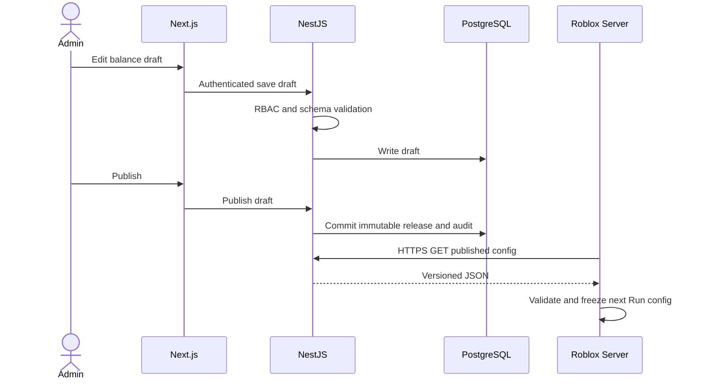

# Admin Architecture — Next.js + NestJS

**Selected stack:** Next.js TypeScript frontend; NestJS TypeScript modular monolith API; Prisma/PostgreSQL.

**Proposed endpoints** are specified in `../contracts/openapi.yaml` (not verified deployed). Public read routes must not expose admin writes.
