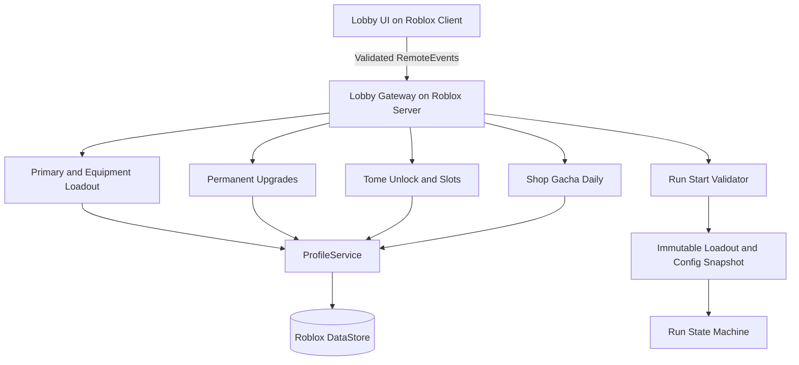

# Lobby Architecture

The Lobby is an authoritative server domain, not an Admin web service.

**Approved rules:** 2 Tome Slots default; slots 3/4 unlock using Coin or early Robux; Primary selected in Lobby; Secondary baseline upgraded in Lobby but Secondary must still be obtained during each Run via in-Run card. Temporary Gold/XP/Mastery reset when Run ends. Exact pricing and several shops/portal rules remain TBD. See DOC-01 and DOC-04 Lobby appendix.
