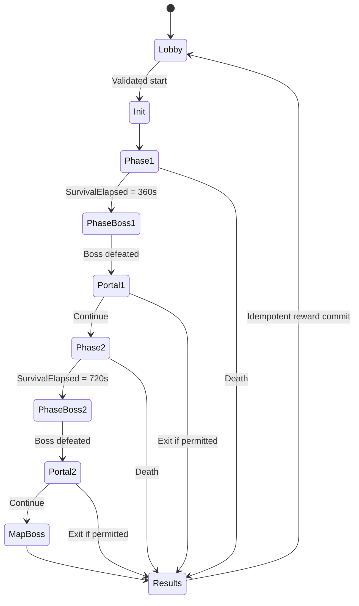

# Run State and Clock

Mini-boss triggers at 120, 270, 480 and 630 survival seconds. Survival clock pauses for boss and portal encounters. Remaining-enemy portal gate is TBD; exit rewards follow approved tables, not assumptions.
