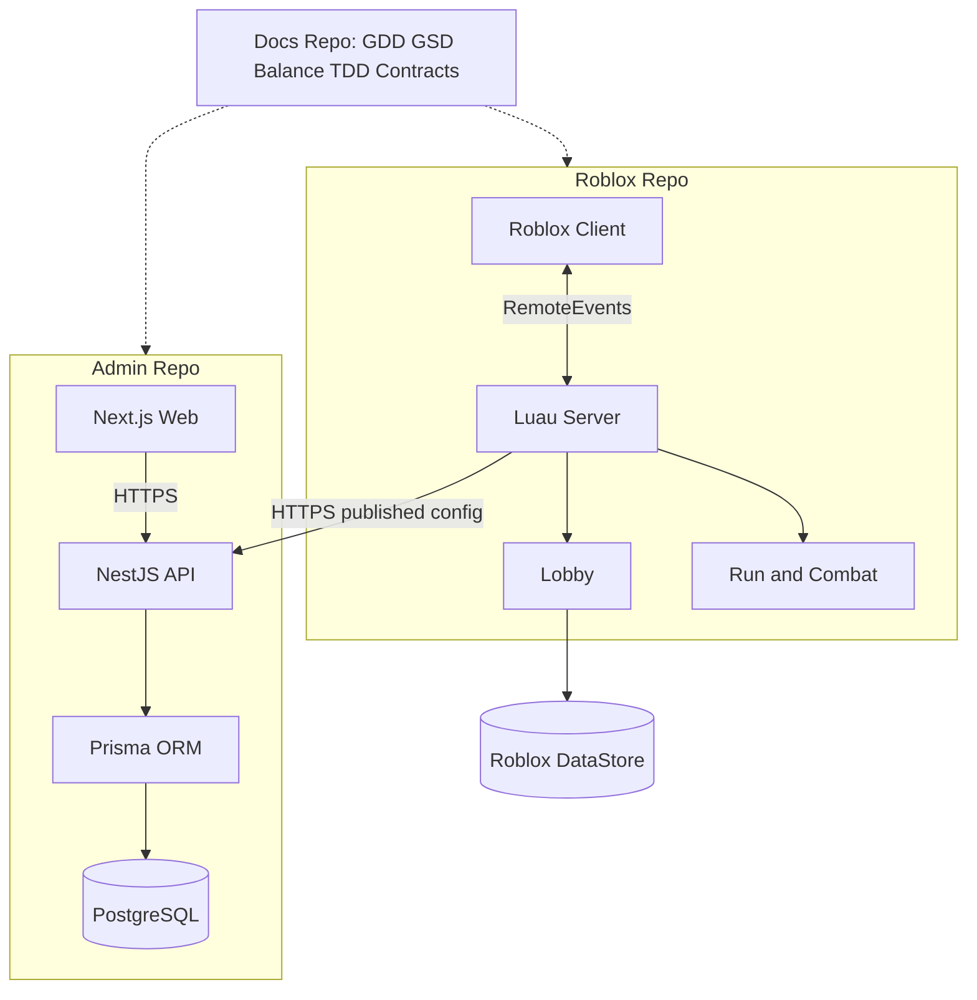

# Beat the Horde — System Architecture

**Approved repository layout:** 3 independent Git repositories. **Runtime deployment:** Roblox experience plus Next.js Web and NestJS API. **Backend style:** modular monolith, microservices-ready.

Admin config in PostgreSQL; persistent player profile in Roblox DataStore; temporary run state in server memory. Roblox clients never connect to PostgreSQL.
