## DOC-04

# TECHNICAL DESIGN DOCUMENT

# BEAT THE HORDE

## Roblox Solo — Technical Architecture

Rojo • VS Code • Roblox Studio Team Create • External Admin

## DOCUMENT INFORMATION

Document ID: DOC-04

Version: v0.1 — Technical Design Draft

Status: Proposed for Implementation Review

Scope: Solo MVP (Co-op deferred)

Platform: Roblox Studio / Luau

Development: VS Code \+ Rojo \+ Git

Collaboration: Roblox Studio Team Create

Configuration: External Admin Website & Config API

Source: Approved GDD, GSD and Game Balance Design

Original issue date: 25 October 2026

Technical choices in this document remain proposals unless explicitly approved.

# 1\. Scope and source of truth

Goal: translate game design into implementable Roblox Luau modules, data contracts, server-state transitions, operations and test cases. Solo first release. Roblox Studio multiplayer/team collaboration (Team Create) is part of the production workflow; playable Co-op is deferred and explicitly not required in first release.

Priority sources: DOC-01 Core Gameplay GDD (https\://docs.google.com/document/d/1Hn6hznuTHmY0q2g77ptnrUcs-F0YEHUAWHyY\_0cxUpo/edit); DOC-02 GSD (https\://docs.google.com/document/d/12af5fwqADAKJSWCU4m1x1Ss7FTILt9nXxxmwXn8lR8k/edit); original live balance calculator (https\://docs.google.com/spreadsheets/d/1CCMXj8wjzi-CpdwuVxLmBVGDGvjfuXU-v3mY1Inw46w/edit). When a balance proposal disagrees with APPROVED gameplay rules, approved rules win. Numeric values remain editable via managed config and versioned release, not hardcoded.

# 2\. Architecture and trust boundaries

*Figure 1 — End-to-end system architectur*e

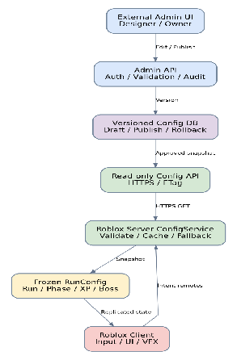

# 

Recommended flow: External Admin Web UI → authenticated Admin API → validation/approval/audit → PostgreSQL config versions → public read-only Game Config API/CDN → Roblox server ConfigService via HttpService → validated immutable RunConfig snapshot → server gameplay systems → replicated minimal state → Roblox client UI.

Roblox SERVER owns authoritative combat, enemy spawn/death, XP award, mastery, level-up card roll/selection validation, item grants, purchases, boss/phase progress, coin rewards, and persistence. Roblox CLIENT owns input, camera, local prediction, HUD, animation, particles and sound. All client intents are untrusted.

Strict boundary: the external browser-admin does NOT call Roblox client RemoteEvents and does NOT require Roblox client to hold a privileged API token. HTTP request to external config endpoint originates only from Roblox server. Browsers cannot directly mutate a live RunConfig.

# 3\. Stack and local development workflow

3.1 DEVELOPMENT ENVIRONMENTS — Developer works locally with a separately saved .rbxl copy; the Designer continues editing the shared Team Create place. A local copy is not automatically synced to the shared place. Developers may publish a separate Dev experience under an account/group with appropriate permission. Do not publish over the Designer's shared place. Code belongs in Git and Rojo-managed folders; map, terrain, lighting and visual UI remain Studio-owned.

# 

*Figure 3 — Rojo, Git, VS Code and Team Create workflo*w

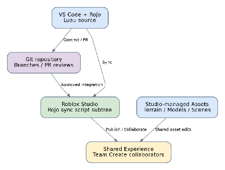

# 

Roblox Studio: experience/place authoring, terrain, models, UI inspection, collaboration through a shared published experience with Team Create. Rojo: synchronize Luau source from a local project folder into Studio. VS Code: editing, Luau language tooling, lint/format, Git source control. Git branches and pull requests are canonical for code review. Rojo synchronization is NOT a replacement for Team Create or Git.

Recommended tools (verify versions before installation): Rojo CLI and Studio plugin, VS Code Luau Language Server, StyLua, Selene, Wally (dependencies only if needed), TestEZ for automated Luau tests. Use a pinned Rojo version and a tested project mapping; avoid simultaneous Rojo sync sessions overwriting one another in the same shared Studio tree.

Team Create working convention: (1) one shared Roblox experience, each developer granted the right Studio permissions; (2) Git manages scripts/config/schema; (3) Rojo syncs one controlled script subtree per active integration session into Studio; (4) Studio/Team Create is the ownership surface for terrain, scenes, models, assets and visual editing; (5) do not edit the same Script concurrently in Studio and VS Code; (6) test collaboration with at least two separate Studio users and two-server/playtest scenarios only when applicable. Multiplayer-capable shared editing does NOT imply Co-op mode is complete.

# 4\. Proposed Rojo project structure

4.1 LOCAL STUDIO FILE — add studio/BeatTheHorde\_Dev.rbxl to the local working directory, preferably treated as a local snapshot rather than the canonical script repository. Proposed Rojo mapping includes ONLY src/shared → ReplicatedStorage/Shared, src/server → ServerScriptService/GameServer and src/client → StarterPlayer/StarterPlayerScripts/GameClient. Exclude Workspace, Terrain, Lighting, StarterGui and designer-owned asset folders from that mapping. Confirm the actual hierarchy in Studio before activating a Rojo sync; the screenshot suggests ArcaneGardens nested under a Terrain-named folder, but that visual alone does not establish object classes.

# 

# Figure — Rojo Project Mapping

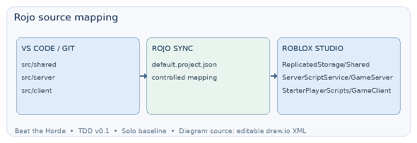

# 

## PROJECT TREE — ROJO \+ VS CODE (LOCAL SOURCE \+ STUDIO SNAPSHOT)   

beat-the-horde/  
├── studio/  
│   └── BeatTheHorde\_Dev.rbxl       \# local snapshot; do not Rojo-sync  
├── default.project.json             \# Rojo mapping  
├── aftman.toml                     \# Tool version pins (optional)  
├── src/  
│   ├── shared/                     \# ReplicatedStorage/Shared  
│   │   ├── ConfigSchema.luau  
│   │   ├── GameTypes.luau  
│   │   ├── DamageMath.luau  
│   │   ├── XPFormula.luau  
│   │   └── RemoteContracts.luau  
│   ├── server/                     \# ServerScriptService/GameServer  
│   │   ├── Bootstrap.server.luau  
│   │   ├── services/               \# Run, Combat, XP, Boss, etc.  
│   │   └── repositories/           \# PlayerProfile, RunState  
│   └── client/                     \# StarterPlayerScripts/GameClient  
│       ├── Bootstrap.client.luau  
│       └── controllers/            \# Input, HUD, Upgrade, VFX  
├── tests/  
│   ├── unit/  
│   └── integration/  
├── docs/                            \# Schemas & runbook  
├── scripts/                         \# Local build and checks  
└── admin/                           \# Separate deploy/repo permitted  
    ├── web/                         \# External dashboard  
    ├── api/                         \# Admin/config endpoints  
    └── migrations/                  \# Database changes

## SERVICE IMPLEMENTATION LIST

Server services: Config, Run, Phase, Spawn, Combat, XP, Card, SecondaryMastery, Evolution, Boss, Chest, Shrine, Merchant, Reward, Profile, Analytics.

Client controllers: Input, HUD, Weapon, Upgrade, Chest, BossHUD, Feedback.

Proposed Rojo mapping: src/shared → ReplicatedStorage/Shared; src/server → ServerScriptService/GameServer; src/client → StarterPlayer/StarterPlayerScripts/GameClient. ReplicatedStorage contains no server secrets. Server-only modules and API credentials must remain inaccessible to clients.

# 5\. External Admin control plane (mandatory requirement)

# Figure — Admin Control Plane

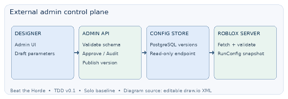

# 

Admin objective: designer can change balance parameters from an external website without opening Studio, recompiling Luau or republishing a place for ordinary tuning. Editable examples: weapon damage/cooldown/crit/range; enemy base HP/damage/spawn intervals/caps; Elite and Boss XP probabilities and orb quantities; Tome effects; Secondary Mastery 100 XP/level, \+500 XP/card, \+0.5% damage/level, \+25% Evolution; boss HP/attacks; chest/merchant cost; Gold/Coin rates. Approved design rules are protected by restricted approval policy and should not be casually edited as ordinary tuning.

Proposed Admin UI pages: Login & Access; Overview/active version; Weapons; Enemies & Spawn; XP/Level Curve; Secondary & Evolution; Tome; Boss; Chest/Merchant; Economy; Change Diff; Publish/Rollback; Audit Log; Test Environment Preview. Support draft, diff, validation, approve, publish, rollback. Show field help, unit, min/max, source and last change. Make separate dev/staging/prod environments.

Roles: Owner/Admin can publish production version; Designer can edit draft and request review; QA can test/compare without production publish; Viewer read-only. Use individual accounts, MFA, server-side RBAC, audit actor/time/IP/version/change reason; avoid shared password and long-lived frontend API keys.

Approved stack (FS-01): Next.js + TypeScript Admin frontend; NestJS + TypeScript Admin API, Prisma ORM, PostgreSQL for versioned config, Redis or CDN cache for approved snapshots. This is a proposed implementation stack, not pre-existing infrastructure. A simpler managed backend is acceptable if it meets authentication, auditing, validation, public read-only game delivery and rollback.

## CONFIG SCHEMA — example JSON (illustrative; omitted branches require full schema definitions)

{  
  "schemaVersion": 1,

  "configVersion": "solo-1.1.0",

  "environment": "production",

  "payload": {

    "secondary": {

    "maxLevel": 99,

    "masteryXpPerLevel": 100,

    "upgradeCardXp": 500,

    "damagePerLevel": 0.005,

    "evolutionDamageBonus": 0.25

  },

    "tomes": { "maxLevel": 30 },

    "xp": {

      "eliteWeights": { "green": 0.6, "purple": 0.3, "red": 0.1 },

      "bossWeights": { "purple": 0.6, "red": 0.4 }

    }

  }

}  
Additional required groups: weapons, enemies, spawn, xp, boss, economy, effectiveAt and integrity metadata. Never use arbitrary magic constants in gameplay modules.

Hard validation: no negative HP/cost/cooldown, finite numbers only, supported enum IDs, probability tables sum 1 within tolerance, required keys present, min\<=max, spawn active cap within operations limit, evolutionLevel\<=secondary.maxLevel, review any change to APPROVED-level rules. Version schema migrations and validate in Admin API AND Roblox server at load.

# 6\. Config publishing, live update, fallback

6.1 CONFIG ENVIRONMENT ISOLATION — Admin config must have distinct development, staging and production channels. Local .rbxl and separate Dev experience use development/staging config endpoints and test data, never production secrets or balances by accident. Each channel has independently versioned snapshots, publication permission, fallback defaults and rollback history. Validate configVersion/environment at server startup and record channel and version in telemetry. Publishing new config affects new Runs only.

# 

*Figure 2 — Admin configuration publishing and rollbac*k

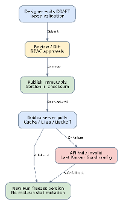

# 

## API CONTRACT — Game Config & Admin

Game servers read only a published, validated configuration. Browser administrators must authenticate for every write. ETag may reduce repeat fetch traffic.

ENDPOINTS (HTTP — technical reference)

GET    /api/v1/game-config/solo?channel=production  
POST   /admin/config/drafts  
PATCH  /admin/config/drafts/{id}  
POST   /admin/config/drafts/{id}/validate  
POST   /admin/config/drafts/{id}/publish  
POST   /admin/config/versions/{id}/rollback  
RESPONSE FIELDS (read endpoint)

schemaVersion \| configVersion \| publishedAt \| checksum \| payload

SECURITY RULE — Never expose database credentials or admin tokens in the public game response.

## SERVER BOOTSTRAP — safe initialization

1\. Load the bundled LastKnownGoodConfig before network access.

# 2\. FETCH CONFIG — trusted HTTPS via HttpService

Purpose: fetch a published config for the current environment (development/staging/production) from a server-controlled, allowlisted endpoint. The Roblox server, not the client, performs the request.

Prerequisites: enable Allow HTTP Requests in Experience Settings; provision HTTPS API and a published version; keep the endpoint and channel server-owned; never accept a URL, admin token or environment override from a RemoteEvent.

Expected response (HTTP 200, application/json): {schemaVersion, configVersion, environment, publishedAt, checksum, payload}. A 304 response is only useful when a previously validated cached config already exists. Cache raw ETag and approved config; HTTP failure must not replace last known good values.

## IMPLEMENTATION EXAMPLE — ConfigFetcher.luau (server-only)

local HttpService \= game:GetService("HttpService")

local ConfigFetcher \= {}  
local BASE\_URL \= "https\://config.example.com" \-- REPLACE with the real trusted API  
local ALLOWED\_CHANNELS \= {development \= true, staging \= true, production \= true}

function ConfigFetcher.Fetch(channel, etag)  
    assert(ALLOWED\_CHANNELS\[channel\], "Invalid config channel")  
    local url \= BASE\_URL .. "/api/v1/game-config/solo?channel=" .. channel  
    local headers \= {Accept \= "application/json"}  
    if etag then headers\["If-None-Match"\] \= etag end

    local ok, response \= pcall(function()  
        return HttpService:RequestAsync({  
            Url \= url,  
            Method \= "GET",  
            Headers \= headers  
        })  
    end)  
    if not ok then return nil, "NETWORK\_ERROR", nil end  
    if response.StatusCode \== 304 then return nil, "NOT\_MODIFIED", etag end  
    if not response.Success or response.StatusCode \~= 200 then  
        return nil, "HTTP\_" .. tostring(response.StatusCode), nil  
    end

    local decodedOk, candidate \= pcall(function()  
        return HttpService:JSONDecode(response.Body)  
    end)  
    if not decodedOk or type(candidate) \~= "table" then  
        return nil, "INVALID\_JSON", nil  
    end  
    return candidate, nil, response.Headers\["ETag"\] or response.Headers\["etag"\]  
end

return ConfigFetcher

IMPLEMENTATION NOTES — Run this only in ServerScriptService. The example intentionally omits a hard-coded secret. If the config API requires authentication, use server-managed Roblox secrets and a supported secret-bearing request flow; never put bearer tokens in client code. Add request budgets, retries with backoff/jitter and telemetry in the calling ConfigService. BASE\_URL is a placeholder, not a deployed endpoint.

# 3\. VALIDATE CONFIG — reject incompatible or unsafe releases

Validation gate runs BEFORE replacing LastKnownGoodConfig. All checks must pass: (a) JSON document is a table and required keys exist; (b) schemaVersion equals a supported schema version; (c) environment matches the server channel; (d) configVersion is a nonempty string; (e) payload contains the expected groups; (f) all numeric fields are finite and within defined limits; (g) probability tables total 1 within epsilon and contain no negative values; (h) game rule invariants remain valid (Secondary cap 99, Tome cap 30, nonnegative XP and spawn caps); (i) integrity/authenticity is assessed using a real implemented policy.

INTEGRITY POLICY — HTTPS provides transport protection to the configured host but does not by itself prove that a release was approved. The Admin backend must validate, authorize, audit and publish only approved immutable config versions. A checksum field alone is NOT proof of authenticity, and Roblox should not merely compare it to an untrusted checksum in the same JSON. For end-to-end cryptographic verification, define a canonical serialization and signature scheme with an independently trusted public key and a Roblox-compatible verification implementation; until those exist, mark cryptographic signature verification NOT IMPLEMENTED and trust only the authenticated publication pipeline. Do not claim verification exists when it does not.

## IMPLEMENTATION EXAMPLE — ConfigValidator.luau (server-only)

local ConfigValidator \= {}  
local SUPPORTED\_SCHEMA\_VERSION \= 1  
local EPSILON \= 0.0001

local function finiteNumber(x, minimum, maximum)  
    return type(x) \== "number"  
        and x \== x  
        and x \~= math.huge and x \~= \-math.huge  
        and x \>= minimum and x \<= maximum  
end

local function validDistribution(weights)  
    if type(weights) \~= "table" then return false end  
    local sum, count \= 0, 0  
    for \_, value in pairs(weights) do  
        if not finiteNumber(value, 0, 1\) then return false end  
        sum \+= value  
        count \+= 1  
    end  
    return count \> 0 and math.abs(sum \- 1\) \<= EPSILON  
end

function ConfigValidator.Validate(data, expectedChannel)  
    if type(data) \~= "table" then return false, "ROOT\_TYPE" end  
    if data.schemaVersion \~= SUPPORTED\_SCHEMA\_VERSION then  
        return false, "SCHEMA\_VERSION"  
    end  
    if data.environment \~= expectedChannel then return false, "ENVIRONMENT" end  
    if type(data.configVersion) \~= "string" or \#data.configVersion \== 0 then  
        return false, "CONFIG\_VERSION"  
    end  
    local p \= data.payload  
    if type(p) \~= "table" or type(p.secondary) \~= "table"  
        or type(p.tomes) \~= "table" or type(p.xp) \~= "table" then  
        return false, "REQUIRED\_GROUPS"  
    end  
    local s \= p.secondary  
    if s.maxLevel \~= 99 or p.tomes.maxLevel \~= 30 then  
        return false, "APPROVED\_CAP\_VIOLATION"  
    end  
    if not finiteNumber(s.masteryXpPerLevel, 1, 1000000\)  
        or not finiteNumber(s.upgradeCardXp, 0, 1000000\)  
        or not finiteNumber(s.damagePerLevel, 0, 1\)  
        or not finiteNumber(s.evolutionDamageBonus, 0, 10\) then  
        return false, "MASTERY\_BOUNDS"  
    end  
    if not validDistribution(p.xp.eliteWeights)  
        or not validDistribution(p.xp.bossWeights) then  
        return false, "DROP\_WEIGHTS"  
    end  
    return true, nil  
end

return ConfigValidator

SCHEMA REQUIREMENT — This validator is a focused example, not a complete production schema. The final validator must also check weapon IDs and stats, all enemy/spawn and Boss bounds, normal orb weights, economy values, item prices, cardinalities, fields used by the runtime, and exact approved probability vectors when those values are locked. Reject unsupported fields or perform explicit migrations as defined by schemaVersion.

ACCEPTANCE PATH — Fetch candidate → Validate → Compare approved version/channel → keep as validated LatestConfig → freeze a deep-copied RunConfig for each new Run. Failed validation: log reason and version, keep LastKnownGoodConfig, do not partially apply any candidate fields. Unit-test malformed JSON, wrong schema/channel, NaN/Infinity, negatives, probability sums, missing keys, bad caps, HTTP 304/429/500 and stale versions.

4\. Select the approved config for new Runs; log configVersion.

FAILURE & FALLBACK — On timeout, malformed JSON, invalid version, HTTP 5xx or rate limit, continue using LastKnownGoodConfig. Record metrics and retry with exponential backoff plus jitter. Do not block player join indefinitely or accept URLs supplied by clients.

LIVE TUNING — versioned and Run-safe

Refresh policy: start with a 60–120 second polling interval per server (operational proposal; tune to API limits).

Run snapshot: freeze RunConfig when the Run begins. Existing Runs continue with the same version, including across all three phases.

Publish effect: compatible new configuration is used only by newly created Runs. Record configVersion in gameplay events and analytics.

Exception: emergency feature-disabling flags require separate, explicitly approved handling. Different servers may observe a release at slightly different times.

## SECURITY CHECKLIST — External Config

• Enable Allow HTTP Requests in Roblox Experience Settings.

• Use HTTPS and an allowlisted trusted endpoint; set request timeouts, rate budgets and retry backoff.

• Keep credentials in server-side secret storage (Roblox secrets/GetSecret when applicable), never in ReplicatedStorage, LocalScripts, Rojo source or Git.

• Protect publishing with authentication, role authorization, validation and audit logs.

• Cache public read endpoints and apply API rate limiting/DoS mitigation.

# 7\. Roblox remotes and contracts

# Figure — Remote Security

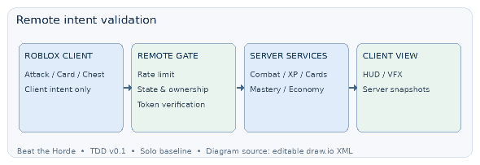

# 

## REMOTE CONTRACTS — Client → Server (untrusted intents)

RequestAttack(weaponId, aim)  
RequestDash(direction)  
SelectUpgrade(choiceIndex, selectionToken)  
RequestChestOpen(chestId)  
ChooseChestReward(chestId, choiceIndex, selectionToken)  
RequestMerchantBuy(merchantId, offerId)  
RequestShrineInteract(shrineId)  
RequestPortal(portalId)  
SERVER VALIDATION — Check Run state, ownership, proximity, rate limits, cooldown, eligible options and one-time tokens before any mutation.

## REMOTE CONTRACTS — Server → Client (display/state replication)

RunStateChanged(phase, elapsed, configVersion)  
StatSnapshot(stats)  
XPUpdated(playerXP, playerLevel, secondaryMastery, secondaryLevel)  
ShowUpgradeChoices(token, choices)  
SecondaryEvolved(weaponId, formId)  
BossStateChanged(id, hp, state)  
ChestChoices(token, items)  
CurrencyChanged(gold, coin)  
ErrorFeedback(code)  
Only replicate the data required by client UI/VFX. Never replicate server secrets.

Never trust client-reported damage, XP, kill counts, currency amounts, rarity roll, item IDs not in issued choices or mastery level. All authoritative mutations are server-owned. Do not use RemoteFunction for long-running network calls; avoid blocking callbacks on HTTP/DB operations.

# 8\. Core gameplay state machines (Solo)

# Figure — Run State Machine

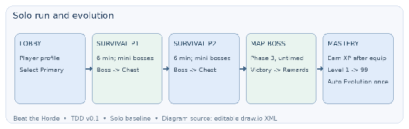

# 

Run: Lobby → Initializing → Phase1Survival(360s) → Phase1Boss → Reward/Portal → Phase2Survival(360s) → Phase2Boss → Reward/Portal → Phase3MapBoss(untimed) → Victory → Results → Lobby. Failure path: Alive→Dead→RevivePrompt→Alive OR RunFailed. Early Exit portal can return to Results/Lobby as approved by design; reward details in balance config/TBD.

Phase boss markers: Mini-Boss at 02:00 and 04:30 during each 6-minute survival phase; Phase Boss on 06:00 expiry. One-shot marker flags avoid duplicate spawns. Regular enemy spawn stops at Phase Boss; bats spawn during Boss encounter according to Boss-specific policy. Phase 3 Map Boss has no 6-minute timer.

Card state: XPThresholdReached → PendingChoice(token) → ClientDisplays3 → Selected(token,index) → ServerValidatesEligibleChoice → ApplyOnce → Resume Solo. At max Tome/Secondary cap, remove invalid upgrade options; if pool has fewer than 3 valid cards, explicit fallback is required (technical TODO until odds/duplicates rule validated). Primary permanent level never increases via in-run Level Up.

Mastery state: SecondaryNotOwned → SecondaryEquipped(Level1, Mastery0) → CollectXPGrantsMastery → LevelThresholdLoop (100 XP per level) → At99 → AutoEvolutionOnce → Evolved. XP from before equip is NOT credited. Secondary upgrade card grants 500 Mastery XP. DamageMultiplier=1+0.005×(level−1), then evolved secondary only ×1.25. Max Level99. Stage transitions preserve state; new Run resets. Evolution is idempotent and does not replace the single active slot.

# 9\. Detailed data objects and persistence

# Figure — Data Persistence

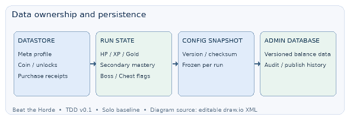

# 

PlayerProfile (persistent): profileSchemaVersion, playerUserId, coin, diamond, permanent primary/secondary/armor/pet upgrades, unlocks, selected primary, equipped items, purchase receipts and quest history. Store using DataStore/ProfileStore-like safe patterns with session ownership or equivalent, retry, idempotent receipts, version migration and explicit save failure handling.

RunState (ephemeral): runId, userId, startedAt, currentPhase, phaseElapsed, phaseStatus, configVersion, frozenConfigRef, playerHP, runGold, playerXP, playerLevel, currentBuild, secondaryId, masteryXP, secondaryLevel, evolutionTriggered, usedChestIds, bossMarkerFlags, claimedRewardTokens. Not permanently saved to meta profile except rewards at committed Result.

EnemyState: enemyId, spawnTimestamp, type, baseStats, derivedStats, currentHP, target, combatState and dropGrantedFlag. ChestState: chestId, isOpened, owner/run, issuedChoices, selectionToken, claimed. MerchantState: merchantId, offers, soldOut, goldTransactionId. All idempotency checks run server-side.

Persistence boundary: use DataStore for player meta/owned items, not for per-hit or per-orb events. If game servers crash, live Run may be lost under initial Solo rules; crash recovery/snapshot frequency needs separate acceptance decision and should not be assumed. External admin PostgreSQL does NOT store PlayerProfile unless deliberately extended with privacy/security review.

# 10\. System service responsibilities and dependencies

# Figure — Service Dependencies

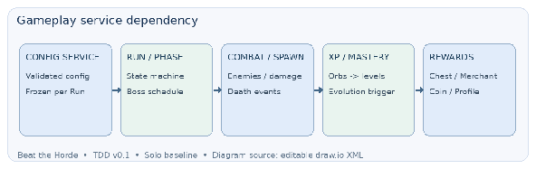

# 

ConfigService: remote config fetch, schema validation, ETag/cache/fallback, freeze per-run config version. ProfileService: persistent player meta, lock, receipts. RunService/PhaseService: lifecycle/timer/portal. SpawnService: valid position, batch quota vs active cap. EnemyService/CombatService: server hit, damage and death. XPService: orb roll and pickup attribution; CardService: weighted choices, eligibility and one-time apply. SecondaryMasteryService/EvolutionService: independent Mastery path and evolution. ChestService/MerchantService/ShrineService: interaction/rewards. AnalyticsService: reporting, sampling, no secrets.

Implementation order: (1) Repo/Rojo integration and Team Create boundaries; (2) Config schema/Admin API bootstrap and fallback; (3) run/phase finite-state machine; (4) combat/enemy/spawn; (5) XP/cards/mastery/evolution; (6) boss/chest/merchant/shrine; (7) persistence/economy; (8) UI/VFX, performance and analytics; (9) playtest, staging release and rollback drill.

# 11\. QA acceptance plan

11.1 ENVIRONMENT & INTEGRATION CHECKS — TEST-DEV-01: local .rbxl opens and runs with Rojo scripts without changing the shared Team Create place. TEST-DEV-02: Rojo mapping does not delete/overwrite ArcaneGardens, Terrain, Lighting or StarterGui designer assets. TEST-DEV-03: separate Development experience can test HTTP Config, DataStore and gameplay with isolated keys/settings. TEST-DEV-04: refreshing the map snapshot preserves code under Git and reveals intentional asset/path changes. TEST-DEV-05: controlled integration into shared experience passes path-contract, spawn/boss-marker, UI-binding and config-version checks, with rollback plan. TEST-DEV-06: no live Production publication occurs during local Dev testing.

# 

# Figure — QA RELEASE

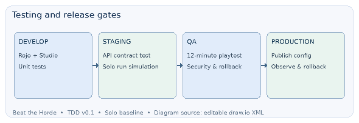

# 

TECH-01: Two developers can edit shared Studio map while one developer syncs Rojo scripts; no asset/scripts overwritten by ambiguous ownership.   
TECH-02: Git PR merges reproduce Studio script hierarchy via pinned Rojo mapping. TECH-03: unauthorized admin cannot edit/publish; every config release has version, diff, actor, reason and rollback.   
TECH-04: server starts with LastKnownGoodConfig when Admin API is down.   
TECH-05: existing Run retains frozen config after new admin publish; new Run sees compatible newer version.   
TECH-06: invalid values/probability sums rejected before publish and again by server. TECH-07: no client can forge XP, damage, evolution, chest claim or purchases.   
TECH-08: Secondary Level 99 auto-evolves exactly once; \+500/card and per-level XP carry are consistent.   
TECH-09: Phase boss times and run snapshot correct across phase transitions.   
TECH-10: full 12-minute EV balance simulator agrees on key formulas with Lua unit tests within rounding tolerance.

Performance targets (initial hypotheses): stable frame pacing on target Roblox devices, bounded active enemies and projectiles, no unbounded Heartbeat listeners or XP orb instances. Pool repeatable VFX/projectiles and coalesce XP drops visually while preserving full numeric XP. Determine exact device/fps/memory budgets through profiling, not arbitrary production claims.

# 12\. Open technical decisions / handoff

Open for technical approval: exact Admin hosting/vendor, auth system, custom domain, data protection/compliance, whether game read endpoint should be signed or server-authenticated, Dev/Staging/Prod environment setup, team Git permissions, Rojo mapping against existing Studio structure, test-place vs production-place workflow, release automation, maximum API request frequency, last-known-good persistence, rollback SLA, and operational on-call.

Gameplay TBD preserved: Stainless Steel Pot beyond level 99, per-weapon evolution patterns, precise drop quantities, card rarity type weight, spawn active cap, Boss attack details, advanced Co-op rules. User approved Solo design proposals but unspecified numeric values remain configurable TBD; do not silently fill them in a production config.

External references (current docs): Roblox HttpService https\://create.roblox.com/docs/cloud-services/http-service ; Roblox Secret Store https\://create.roblox.com/docs/cloud-services/secrets ; Rojo documentation https\://rojo.space/docs/ 

# 13\. TEAM FOLDER OWNERSHIP & HANDOFF GUIDE (DESIGNER \+ DEVELOPER)

**13.0 OWNERSHIP CLARIFICATION** — Designer's shared Team Create experience is the current source of truth for world/map and designer-owned UI. Developer's Git repository is the source of truth for Luau scripts; the local .rbxl is a working/test snapshot, NOT a second independently authoritative map. Asset changes from Team Create require an explicit snapshot refresh or integration handoff. Developer should not silently sync local map changes back into shared Studio. Track map version/date, owner, object paths and dependency changes at each handoff.

# 

## 13.1. Golden rule — one owner for each asset type

Team Create is for shared Studio experience/world editing; VS Code \+ Git \+ Rojo are the source of truth for Luau source. External Admin Website is the source of truth for published balance values. Never independently edit the same scripts from Roblox Studio and VS Code. Co-op gameplay remains out of scope.

## 13.2. Designer — what to edit and where

WORLD DESIGNER (Roblox Studio / Team Create): Workspace/Maps, Workspace/Environment, Workspace/Interactables (visual placements only), Terrain, Lighting, non-scripted models, animations and VFX assets. Coordinate prefab IDs, spawn markers, NPC placements and collision requirements with dev. Do not edit ServerScriptService/GameServer or ReplicatedStorage/Shared code generated by Rojo.

UI/UX DESIGNER (Roblox Studio / Team Create): StarterGui/GameUI for ScreenGui layouts, visual components, icons and transitions. Implemented UI controllers remain in src/client/controllers and are owned by developers. Any scripts embedded directly inside visual UI objects need explicit ownership agreement, otherwise do not create them.

GAME/BALANCE DESIGNER (External Admin Website): use development/staging config drafts to adjust weapon damage, cooldown, enemy HP, spawn, XP, Tome, Economy and boss values; validate, preview diff, request publish. Do not edit production JSON by hand or change approved game rules silently. Every published change must be versioned and auditable.

**DESIGNER HANDOFF:** asset name \+ path \+ screenshot, purpose, desired interaction, collision/anchor requirements, spawn marker name and event/animation references. Mark READY FOR DEV only after Studio object names and locations are finalized; notify developer before changing assets that scripts reference.

## 13.3. Developer — what to edit and where

GAMEPLAY DEV (VS Code/Git/Rojo): src/server/services for Run/Phase/Combat/Spawn/XP/Mastery/Evolution/Boss/Chest/Merchant/Shrine; src/server/repositories for persistence; src/shared for config schema, types, formulas, remote contracts. Never put server secrets in src/shared or the client tree.

CLIENT DEV (VS Code/Git/Rojo): src/client/controllers for UI controllers, Input, HUD state, camera, UI integration, VFX drivers. Designer owns the visual StarterGui hierarchy; client dev binds by stable object names and interfaces rather than rebuilding layouts by script without agreement.

**BACKEND/ADMIN DEV:** admin/web for external dashboard; admin/api for authentication, roles, config validation/publishing; admin/migrations for database schema. Admin API changes must preserve versioning, rollback, audit and public read-only game config boundary.

**QA/AUTOMATION DEV:** tests/unit and tests/integration for pure Luau module tests, server-authoritative tests, config migration, Remote abuse tests and Run simulation. scripts contains build/lint/release utilities; docs contains contracts and operational instructions.

## 13.4. Studio and repository ownership map

Studio Workspace/Maps, Workspace/Environment, Workspace/Interactables, Terrain, Lighting: DESIGNER-owned; source of truth Studio Team Create. Avoid Rojo mapping over these folders.

Studio StarterGui/GameUI: UI DESIGNER-owned visual hierarchy; coordinate object names with client dev. Keep it outside Rojo-managed mapping unless the team explicitly changes ownership.

ReplicatedStorage/Shared: DEVELOPER-owned generated from src/shared; do not edit directly in Studio.

ServerScriptService/GameServer: DEVELOPER-owned generated from src/server; do not edit directly in Studio.

StarterPlayer/StarterPlayerScripts/GameClient: DEVELOPER-owned generated from src/client; do not edit directly in Studio.

External Admin site/API and PostgreSQL: BACKEND/ADMIN DEV-owned; designers change values through the authenticated UI, not database queries.

## 13.5. Daily workflow — Designer

1\) Open the shared Team Create experience. Confirm the assigned map/UI area; do not touch Rojo-owned folders.

2\) Edit visuals; use stable naming such as Map01/SpawnMarkers/EnemySpawn\_01, BossArena/PortalAnchor, StarterGui/GameUI/BossHUD.

3\) Test asset placement, collisions, mobile readability and alignment.

4\) Record names/paths and screenshots in handoff notes.

5\) Notify developer and wait for integration test before renaming or deleting referenced objects.

## 13.6. Daily workflow — Developer

1\) Pull latest Git branch; ensure Rojo project mapping is pinned.

2\) Edit Luau in VS Code under src/server, src/client or src/shared; edit admin source in admin.

3\) Run formatting/lint/unit tests and local Studio sync only to owned script subtrees.

4\) Open shared Studio in Team Create, verify Rojo does not overwrite designer-managed assets.

5\) Test on a dedicated test place/environment, review PR, merge and integrate through controlled sync/publish. 6\) If designer changes an object path, update contracts/references and tests before releasing.

## 13.7. Change control — conflict prevention

Never use simultaneous unattended Rojo sessions targeting the same Studio subtree. Treat Studio-published place as the source of truth for scenes/visual assets and Git as the source of truth for scripts; document export/import for assets if needed. Before renaming any object accessed by scripts, notify both roles and run integration tests. Maintain a simple ownership register: asset path, owner, expected schema/name, dependent service and status. No production balance change without a draft, validation and publish flow.

## 13.8. Definition of done for cross-role handoff

**Designer READY:** object path and naming stable, no script in Rojo-controlled area, collision/anchor settings validated, screenshot/acceptance note supplied.

**Developer READY:** server-owned logic, remote validation, config reading, UI binding, unit/integration checks, Rojo sync and no hardcoded balance assumptions.

**Combined READY:** a Solo test Run demonstrates objects, UI and gameplay functioning together and can load published test config.

# **14\. DEVELOPMENT ENVIRONMENT & INTEGRATION WORKFLO**W

## **14.1 Purpose and environment matri**x

SHARED DESIGN PLACE (Team Create): Designer-owned canonical Map/Workspace/Terrain/Lighting/UI visuals; integration target after review, not a place for unreviewed Rojo sync.

LOCAL DEV (BeatTheHorde\_Dev.rbxl): Developer’s offline/isolated Studio copy with Map snapshot for quick gameplay debugging; combined with VS Code \+ Rojo, but does not automatically receive Designer updates.

DEVELOPMENT EXPERIENCE (separate Roblox experience/place): Publish test copy with permission to verify HTTP requests, DataStore, game configuration, multiple real clients and integration; use isolated data and Admin development config.

**STAGING/PRODUCTION:** Controlled release destinations. Restrict publishing and use explicitly approved config channels.

## **14.2 One-time setup — from shared Team Create to local De**v

1\. Ask the shared experience owner for permission to save/use a copy. Open the correct place and use File → Save to File / Download a Copy, according to Studio UI and account permissions. Name studio/BeatTheHorde\_Dev.rbxl. This captures the place snapshot but does not transfer ownership of external assets or grant missing audio/animation permissions.

2\. Open the .rbxl locally with File → Open from File; confirm ArcaneGardens, Workspace, Terrain, Lighting, StarterGui, Spawn locations and assets render. Do not rename ArcaneGardens based on the Explorer screenshot alone; inspect the actual Instance class/path first.

3\. Open the Git repo in VS Code; install matching Rojo CLI and Studio plugin. Run local Rojo server and connect the plugin to the local .rbxl only. Verify changes appear solely in ReplicatedStorage/Shared, ServerScriptService/GameServer and StarterPlayerScripts/GameClient.

4\. Keep the map's original object hierarchy in the local snapshot. Make a separate Development experience by Publish to Roblox As if online API/DataStore or multi-client testing is needed; avoid overwriting the shared place.

## **14.3 Repository layout (ownership contract**)

BeatTheHorde/

├── studio/

│   └── BeatTheHorde\_Dev.rbxl        \# Local map snapshot; Studio-owned

├── src/

│   ├── shared/                    \# Rojo → ReplicatedStorage/Shared

│   ├── server/                    \# Rojo → ServerScriptService/GameServer

│   └── client/                    \# Rojo → StarterPlayerScripts/GameClient

├── tests/                        \# Developer \+ QA

├── docs/                         \# Shared conventions and contracts

├── admin/                        \# Admin frontend/backend, separate deployment

└── default.project.json          \# Explicit script-only mapping

Do not Rojo-map Workspace/ArcaneGardens, Terrain, Lighting or StarterGui unless a documented migration deliberately changes asset ownership.

## **14.4 Working routine — Designer / Develope**r

**DESIGNER:** Edit the shared Team Create map or visual UI in assigned areas; stabilize object names; provide exact Instance paths, prefab identifiers, marker names, screenshots and changed assets. Communicate breaking changes before removing/restructuring referenced Instances. Do not edit Rojo-managed Scripts.

**DEVELOPER:** Work in Git branches on src/shared, src/server and src/client; test in local .rbxl; commit code and contracts. Use the separately published Dev experience for HTTP/Datastore integration and online playtests. Do not treat code copied into Studio as authoritative when Git/Rojo owns it.

## **14.5 Map updates and integration — explicit handof**f

A. Designer labels a Map revision, lists changed objects and shares an approved updated place snapshot or access to the updated shared place.

B. Developer keeps a backup of existing local .rbxl and notes Git commit/RunConfig version, then opens a fresh designer snapshot as the new local map baseline. Reconnect Rojo to the script-only subtrees; do NOT manually transplant old Studio scripts or overwrite source-of-truth Git code.

C. Compare tracked marker paths, collision, animations, UI element names, boss arena, enemy spawn points, portal anchors and server logic dependencies; update path contracts and integration tests if required.

D. Test Solo Run locally and then in the separate Dev experience with development config. Document defects and request Designer fixes for map-only issues.

E. To integrate to shared Team Create, coordinate one integration owner/time window. Merge reviewed Git code and sync ONLY approved Rojo folders to shared place; import/select approved map assets through Designer's Studio workflow. Verify place version and Rollback plan. Never blanket-replace the entire shared place with a developer local .rbxl without approval.

## **14.6 Conflict resolution and safety checklis**t

**Before each integration:** confirm target place ID, user publish permissions, fresh map revision, Git SHA, Rojo version, config channel/version and whether anyone is editing the target folders. Preserve backups and use test place first. After integration: verify ArcaneGardens, UI and code tree, Solo Phase/XP/Mastery/Evolution, API fetching and persisted currency. Roll back code/place/config through their own version mechanisms; don't assume a single undo restores all three.

## **14.7 Acceptance criteri**a

**DONE when:** a Developer can reproduce local .rbxl \+ Rojo environment from documented steps; Designer can continue map edits unaffected; changes are integrated via reviewed source and named map revisions; isolated Dev config/data never touches Production; project and separate environments pass a Solo regression Run. Co-op gameplay remains deferred.

.

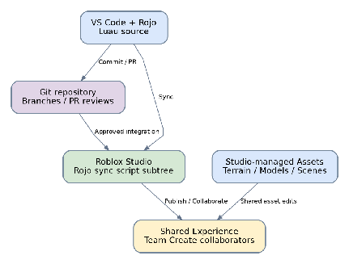

APPENDIX BL-V2 — IMPLEMENTATION HANDOFF / 27 OCT 2026  
STATUS: PROPOSED for implementation review; preserves existing DOC-04 Admin Web \-\> Admin API \-\> PostgreSQL/versioned Config \-\> read-only Config API \-\> Roblox Server architecture, Rojo/VS Code/Git and Studio Team Create. This appendix does not supersede APPROVED GDD values.  
A. Architecture delta: Server ConfigService acquires and schema-validates published configuration, snapshots immutable RunConfig at RunInit, logs configVersion and randomSeed. Do not change mid-run balance on admin publish. Client input through authenticated RemoteEvents (server check ownership, state, cooldown/range, rate limits). Server owns HP, XP, Mastery, coins, card RNG, boss and persistence; client owns HUD/VFX/camera. Co-op deferred.  
B. Services and suggested Luau modules (adapt to existing project structure; avoid duplicate services): core/RunStateMachine, core/SurvivalClock, core/EventDispatcher, core/ConfigService; combat/WeaponService, combat/DamageResolver, combat/EnemySpawnDirector, combat/BossEncounter, combat/SurvivalService; progression/XPService, progression/SecondaryMasteryService, progression/CardDirector, progression/TomeModifierService; economy/RewardLedger, economy/ProfilePersistence; telemetry/BalanceTelemetry. Server-only modules stay ServerScriptService; shared types/config schemas may be replicated, never secrets or authoritative ledgers.  
C. Clock contract: runSurvivalSeconds increments ONLY in Phase1Survival/Phase2Survival. Phase1 0-360, Phase2 360-720; pause during boss, chest and portal. EncounterElapsed separately tracks boss fight. For spawned enemy at survival minute t: hp=baseHP\*(1+0.15\*t)^1.3; damage=baseDamage\*(1+0.08\*t). Snapshot enemy stats at spawn; no retroactive inflation. Mini bosses at 120,270,480,630; phase bosses 360,720; MapBoss uses separate stats, no survival timer.  
D. XP/Mastery contract: Validate OrbPickup exactly once with orbId/playerId, credit PlayerXP, and if Secondary equipped at the actual pickup timestamp, credit same amount to SecondaryMastery (not consumed, no retroactive credit). On card selected, \+500 Mastery separately if valid. Secondary starts level 1; level=min(99,1+floor(masteryXP/100)); Evolution when masteryXP\>=9800 and evolutionFlag false, execute once, \+25% secondary damage after existing mastery scaling. Upgrade card eligibility honors slot caps and level caps; CardDirector rolls 3 valid choices with versioned rarity weights/seed and server validates selected card.  
E. Combat contract: AttackIntent \-\> Validate \-\> HitDetect \-\> base+flat \-\> applicable buffs/tomes \-\> crit \-\> target armor \-\> shield/HP \-\> status/regen/lifesteal/death. For balance, record per-hit damage, miss, combat uptime and invulnerability. Boss EffectiveDPS must be measured/derived from actual build/uptime/hit rate; 75/120/200 DPS and boss HP 3000/7000/18000 in old DOC-03 are assumptions only, not approved constants. Combat logic must avoid chained OnHit duplicate grants.  
F. Run state and reward safety: Lobby \-\> RunInit \-\> Phase1Survival \-\> Phase1Boss \-\> Chest/Portal \-\> Phase2Survival \-\> Phase2Boss \-\> Chest/Portal \-\> MapBoss \-\> Result \-\> Save. Fail/Exit transitions supported with explicit reward rules TBD. Gold ledger is Run-scoped, Coin/materials are meta rewards, Diamond/Robux transactions validated server-side. Grant boss rewards and save through idempotent unique event IDs; never imply Gold converts to Coin. Tome slots 1/2 default; 3/4 unlock via Coin OR Robux (user-confirmed); pricing/caps TBD.  
G. Event contracts: EnemyKilled(enemyId,runId,spawnTimestamp); XPPickup(orbId,playerId,runId,serverTimestamp,value); SecondaryEquipped(playerId,weaponId,serverTimestamp); CardChoice(playerId,offerId,cardId); SecondaryEvolved(playerId,weaponId,runId); BossDefeated(bossId,runId); RewardGranted(eventId,playerId,currency,amount); RunEnded(runId,reason,configVersion,seed). Use schema/version validation, deduplicate grants, and retain trace IDs for telemetry.  
H. Timer and performance: spawn director initial proposed scheduler at 1s tick, separately configure spawn-batch and active-enemy caps; server checks map boundaries and performance. XP, mastery, damage and economy are event-driven. DoT/regeneration use configurable tick with time-integrated effect so changing tick does not change total damage/heal. Use client VFX replication of minimal result data, not raw state authority.  
I. E2E acceptance matrix: CLOCK-01 no survival progression during Boss/Portal; ENEMY-01 spawned stats remain stable; XP-01 no Mastery for pre-equip orbs; MAST-01 exactly one Evolution at 9800 XP; CARD-01 three eligible deterministic-seed offers; COMBAT-01 DPS derived from actual build; SURV-01 HP trace determines death; ECON-01 rewards granted once including MapBoss/Exit/Fail; TOME-01 2-slot and 4-slot scenarios have defined benchmarks. Run randomized simulations with multiple seeds; existing DOC-03 12-minute expected-value run remains reference, not gameplay PASS. Record failures as NOT TESTED until simulator exists.  
J. Alignment references: DOC-01 BL-V2 appendix; DOC-02 BL-V2 runtime appendix; DOC-03 tabs 19\_BLV2\_ChangeRegister, 20\_BLV2\_RuntimeTimeline, 21\_BLV2\_E2E\_Acceptance. Previous DOC-04 links may reference historical source versions; use verified current DOC-01, DOC-02 and DOC-03 source links when implementing this appendix. Do not implement story or Primary+Secondary combo damage in balance baseline before separate design approval.

APPENDIX BL-V2 TEST EXECUTION SCENARIOS — 27 OCT 2026  
Status: SPECIFIED ONLY / NOT EXECUTED. Source-of-truth for detailed test input/steps/expected outcome: DOC-03 tab 22\_BLV2\_E2E\_Scenarios (E2E-01 through E2E-20).  
Test harness requirements: deterministic RNG seeds, immutable RunConfig version, event timestamps, event-id deduplication, event trace, per-run outputs (player level, secondary level, evolution time, cards offered/chosen, player HP, effective DPS, Boss TTK, Gold/Coin ledger, completion reason). Never mark a scenario PASS without generated evidence.  
Execution groups:  
T1 Progression (E2E-01..06): baseline, late equip, pickup 60%/100%, level99 threshold, duplicate orb.  
T2 Card & Tome (E2E-07..10): eligible card pool, reproducible draw, two/four Tome slots matched-seed comparisons.  
T3 Combat & clock (E2E-11..15): build-derived Boss DPS, actual player survival, boss/portal clock pause, enemy snapshot, spawn active cap.  
T4 Economy and operations (E2E-16..20): Gold/Coin reconciliation, exit/death rewards, required-enemy portal rule TBD, config publish immutability, parity between Coin vs Robux Tome slot unlock.  
Baseline computation reference: 904 Gold earned \- 300 spent \= 604 Gold before Phase3; \+100 MapBoss Gold if optional assumption is approved \= 704; 150 Coin completion assumption only. Mastery threshold 9800 XP, \+500/card, level cap99, Evolution once. Scenario E2E-18 BLOCKED DESIGN pending portal rules; other scenarios NOT RUN.  
Execution guideline: start deterministic single-seed for correctness; then 1000 seeded runs for stochastic metrics across 2 vs 4 Tome and early/late Secondary. Compare distribution (P10, median, P90), not one average; gameplay benchmark thresholds should be approved before PASS/FAIL.  

---

## Sơ đồ kiến trúc Balance V2 — Mermaid (bản bổ sung chỉnh sửa được)

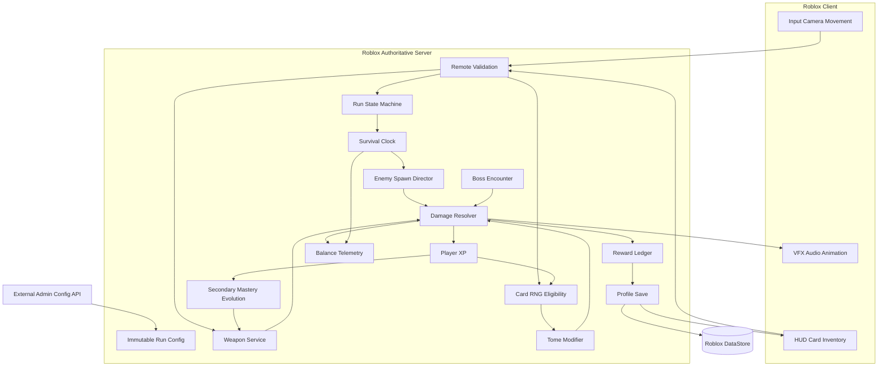

## Sơ đồ trạng thái thời gian Run — Mermaid

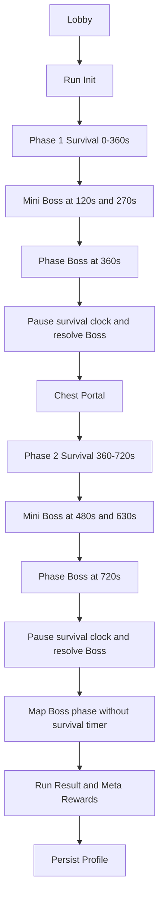

> Các sơ đồ Mermaid là biểu diễn kỹ thuật bổ sung theo BL-V2. Hình PNG ở các phần trước là hình gốc trích từ Google Docs.

## APPENDIX BL-V2 — LOBBY SYSTEM ARCHITECTURE (CORRECTION)

> **Status:** Proposed architecture mapping grounded in DOC-01 GDD / DOC-02 SYS-17 and SYS-18. Prices, caps, persistence mechanisms and purchase details still marked TBD in source design must not be treated as finalized.

### Lobby system scope

The Lobby is a first-class gameplay domain, not just a transition state. It owns player preparation, persistent progression, content unlock, service access and Run initialization. Visual Lobby environments are Studio/Designer-owned, while authoritative game rules and profile mutations are server-owned.

- **Lobby Loadout:** Select an unlocked Primary for the next Run. Configure the targeting preference for Secondary (Nearest, Highest HP, Lowest HP, Random). Secondary acquisition remains an **in-Run** action, not an automatic second equipped weapon at Run initialization.
- **Permanent Upgrades:** Primary, Secondary, Armor and Pet upgrades use the persistent economy and require server validation of cost, cap and ownership.
- **Tome Unlocks and Slots:** Unlock eligible Tomes and prepare availability for the in-Run card pool. Two slots default; slots three/four can unlock by Coin **or** Robux (user-confirmed rule; prices TBD). Slot unlocking is a persistent entitlement, not an instant free Tome grant during the Run.
- **Shops and Forge:** Material/Coin item exchange and crafting/upgrades, depending on approved content and prices. Gacha/Crates use the premium economy and require approved rarity odds.
- **Daily Systems:** Daily check-in and daily quest progress/reward claim with server-side idempotency. The four-daily-quest / 20-Diamond proposal from GDD remains subject to implementation and economy validation.
- **Leaderboard / Hall of Fame:** Read player records/results from dedicated leaderboard projections where applicable; do not trust client-supplied kill counts or survival times.
- **Dungeon / Run Entry:** Validate player readiness and selected loadout, freeze an immutable `RunConfig` and `RunLoadoutSnapshot`, then transition to RunInit. Only approved and unlocked items are copied to the snapshot.

### Lobby System Architecture — complete flow

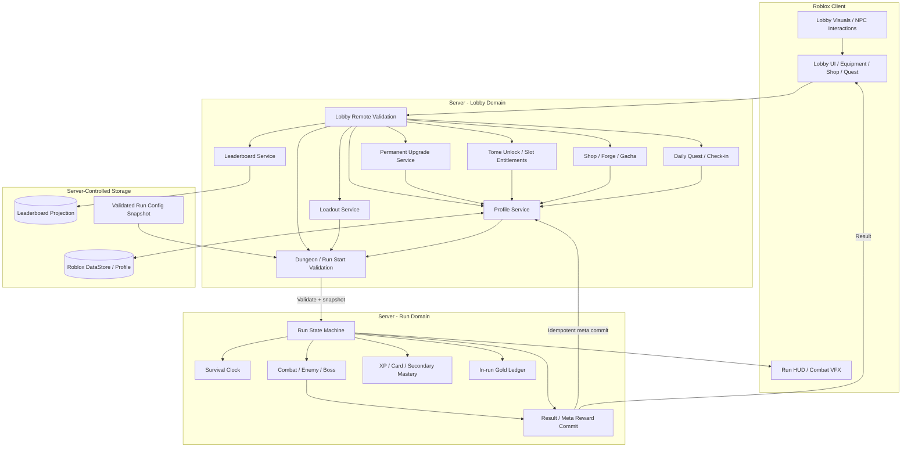

### Lobby to Run to Lobby — lifecycle and authority

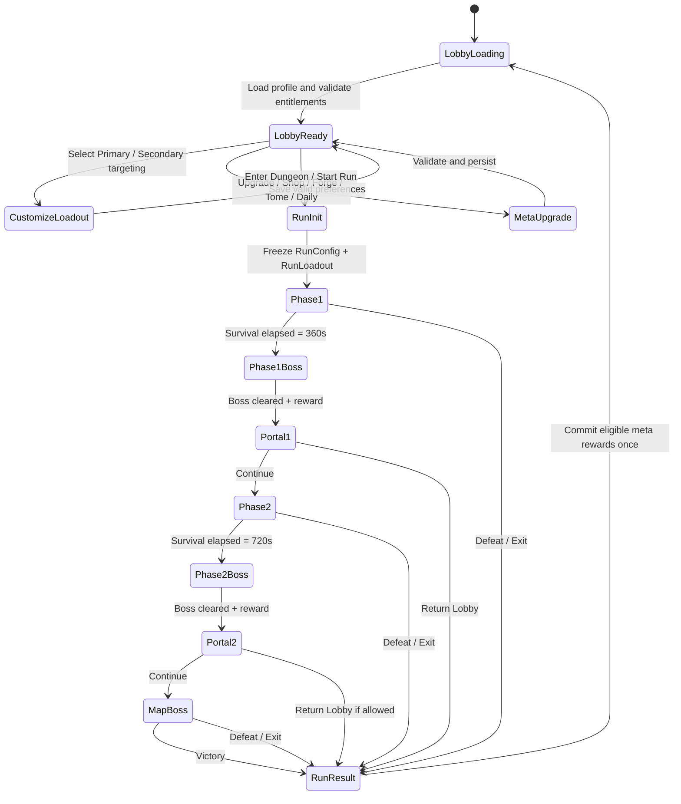

### Data boundary: permanent versus per-Run

| Domain | Persistent / Lobby | Temporary / Run |
| --- | --- | --- |
| Weapons | Ownership, Primary selection, permanent levels; Secondary baseline upgrades and targeting preference | One Secondary acquired through eligible in-Run card, Mastery 1–99, Evolution |
| Tomes | Unlocked Tome pool and slot entitlement (2 / 3 / 4) | Tome acquisition, Tome level up to 30, temporary modifiers |
| Currencies | Coin, Diamond, permanent unlocks and receipt status | Gold used in the current Run only |
| Armor / Pets | Owned/equipped and permanent progression | Derived run-effective stats and temporary buffs |
| Run status | Last completed results / eligible committed rewards | Phase state, temporary XP and build, boss progress |

### Proposed Lobby integration acceptance tests

| ID | Test | Expected outcome |
| --- | --- | --- |
| LOB-01 | Change Primary at Lobby then start Run | Next Run uses selected owned Primary; no mid-Run Primary swap |
| LOB-02 | Upgrade Primary / Secondary / Armor / Pet | Currency charged once; upgrade persists after rejoin |
| LOB-03 | Configure Secondary targeting at Lobby | Run uses valid targeting preference; Secondary is still acquired in-Run |
| LOB-04 | Unlock slot 3/4 using Coin versus Robux | Same functional entitlement; no double purchase or advantage from payment channel |
| LOB-05 | Unlock Tome while not in Run | Eligible Tome added to future card pool; no free in-Run grant |
| LOB-06 | Attempt unauthorized shop/upgrade purchase | Server rejects forged price, ownership, insufficient currency or replayed receipt |
| LOB-07 | Claim daily rewards twice | Only one grant per eligible claim; state saved |
| LOB-08 | Start Run while config updates | Run retains frozen config and validated loadout to Result |
| LOB-09 | Return to Lobby on victory/defeat/exit | Only eligible rewards committed once; temporary Gold/XP and in-Run Tome build reset |

**Source/approval note:** GDD/GSD already define the Lobby and major functions; module decomposition and state/data contracts here are proposed implementation details. Specific shop prices, Forge recipes, Gacha odds, quest reset, leaderboard scoring and some exit reward conditions remain TBD.

## APPENDIX FS-01 — MULTI-REPOSITORY & FULLSTACK IMPLEMENTATION (27 OCT 2026)

**Decision: APPROVED architecture; runtime implementation: STARTER / NOT VERIFIED.** This appendix supersedes previous all-in-one-monorepo paths and optional frontend/backend technology choices. Preserve approved gameplay rules; detailed costs, values and unexecuted tests retain TBD / NOT TESTED.

### Repository ownership

| Repo | Ownership | Deployment |
|---|---|---|
| `hungnq18/document-roblox` | DOC-01 GDD, DOC-02 GSD, DOC-03 Balance, DOC-04 TDD, diagrams, API specs | None |
| `beat-the-horde-roblox` | Luau + Rojo, gameplay/Lobby/Run, ProfileService and DataStore | Roblox Studio / experience publishing |
| `beat-the-horde-admin` | Next.js Web, NestJS API, Prisma migrations, PostgreSQL, admin auth/config/publishing | Web and API independently deployable |

### Stack and ownership

- **Roblox Server authoritative:** combat, XP, Secondary Mastery, lobby purchase validation, Run rewards and owned progression. Player Profile resides in Roblox DataStore. Temporary Gold, HP, XP, Mastery and buffs are in Run memory.
- **Next.js:** admin UI only; no direct privileged DB access from browser. **NestJS:** Auth/RBAC, config drafts and validation, publish, audit, read-only published config endpoint. **Prisma + PostgreSQL:** admin users/roles, draft versions, immutable releases and audit records.
- Roblox ConfigService calls NestJS published-config endpoint via **server-side HTTPS HttpService**, validates payload against a Luau-compatible versioned contract, caches known-good config and freezes configuration at Run start. Admin draft changes never affect active Runs. Never call backend per combat hit.
- Three Git repos do **not** imply microservices. Admin API starts as **NestJS modular monolith**; later extract analytics and other services only if deployment/scaling requirements justify it. Do not call the current architecture full microservices.

### Cross-repository architecture

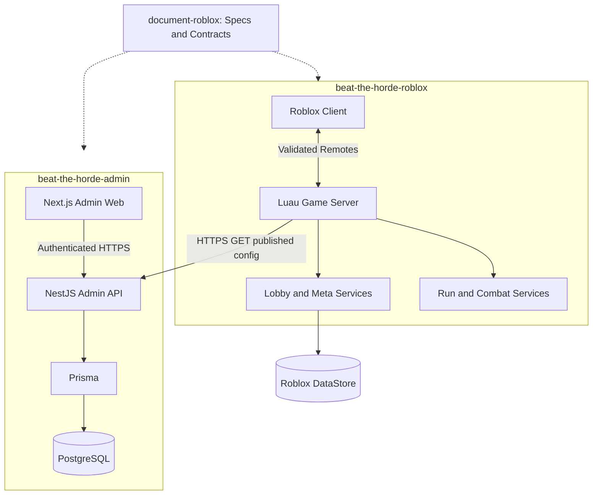

### Publishing lifecycle

1. Next.js Admin UI sends authenticated draft update to NestJS.
2. NestJS validates schema, constraints and roles; persists draft to PostgreSQL using Prisma.
3. Authorized publish creates immutable release/version and audit record; unpublished draft is not returned by public config API.
4. Roblox server fetches published config, validates schema/version and caches safe fallback.
5. **New Run** takes immutable config snapshot. **Current Run** retains its prior snapshot.

### Contract governance

`contracts/openapi.yaml` and `contracts/config.schema.json` in this repo specify expected wire format. The implementation contract within the Admin repo must be validated against these documents in CI; Roblox consumer must reject unsupported schema versions. These files are **design contracts**, not proof of deployed API behavior. Update DOC-04/contract version with changes to API before releasing an incompatible implementation.

### Security and failure behavior

Admin write routes require identity, RBAC, validation, audit and rate limits. Do not ship shared API keys to Roblox client or Next.js browser code. Roblox cannot access a developer's localhost from published cloud servers; use externally reachable HTTPS staging API. In-game progress and rewards must be idempotent and must not fail because analytics is unavailable. Profile persistence remains server-side Roblox DataStore.

### Verification (currently NOT TESTED)

- FS-01 auth/RBAC, FS-02 schema validation and gameplay invariants, FS-03 unpublished draft isolation, FS-04 versioned release/audit, FS-05 active-run snapshot stability, FS-06 known-good offline fallback, FS-07 client security, FS-08 DataStore single source of truth, FS-09 PostgreSQL migration, FS-10 staging HTTPS config fetch.

For editable system, Lobby and Admin diagrams, see `../architecture/`.
